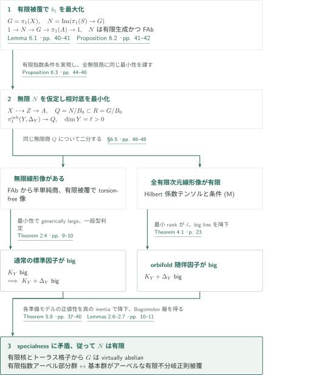
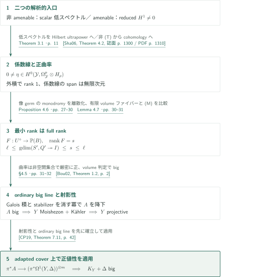
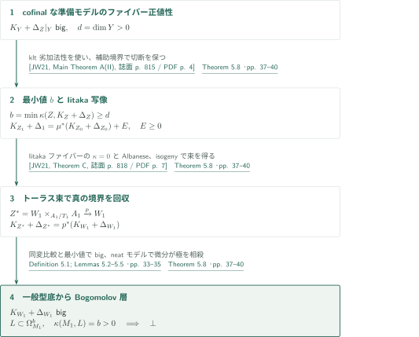
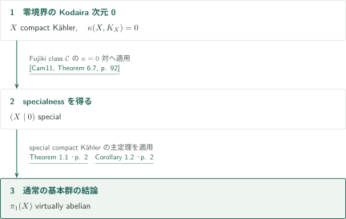
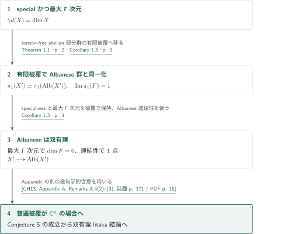
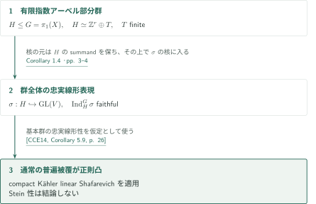
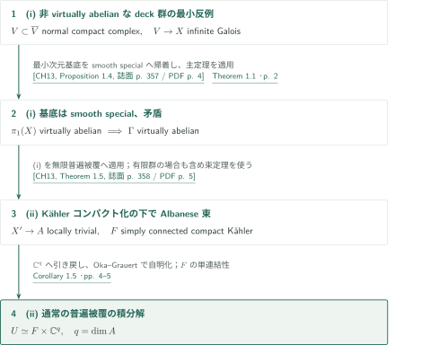

# The abelianity conjecture for special compact Kähler manifolds

**Albaneseファイバー群の最小商、Hilbert係数テンソル、真のinertiaを保つ降下**

原稿は、specialなコンパクトKähler多様体の通常の基本群全体がvirtually abelianであると主張する。有限被覆上でAlbaneseファイバー群の像を取り、その無限商から正値性を作り、specialnessが禁じるBogomolov層へ降下させる。有限次元線形像が無限の場合と、すべて有限の場合を別に処理する点が中心となる。

## 1. 主要結果

### Theorem 1.1 — 通常の基本群のvirtual abelianity

$X$を任意次元の連結滑らかなコンパクトKähler多様体とする。$X$がspecialなら、$\pi_1(X)$は有限指数のアーベル部分群を持つ。等価に、アーベル基本群を持つ連結有限不分岐正則被覆$X'\to X$が存在する。ここでspecialは、$1\le p\le\dim X$と非零射$L\to\Omega_X^p$で$\kappa(X,L)=p$となるものが存在しない、という原典の規約による。線形性・residual finiteness・射影性は仮定しない。

<!-- cite:main -->[Theorem 1.1 · p. 2](https://github.com/openai/math/blob/fd4aeeb2ee4fc729c18d98444fed42fd0529eeeb/preprints/The-abelianity-conjecture-for-special-compact-Kahler-manifolds-September-23-2026/paper.pdf)<!-- /cite -->

### Corollary 1.2 — Kodaira次元0

$X$を滑らかなコンパクト連結Kähler多様体とし、$\kappa(X,K_X)=0$とする。このとき通常の基本群$\pi_1(X)$はvirtually abelianである。

<!-- cite:cor12 -->[Corollary 1.2 · p. 2](https://github.com/openai/math/blob/fd4aeeb2ee4fc729c18d98444fed42fd0529eeeb/preprints/The-abelianity-conjecture-for-special-compact-Kahler-manifolds-September-23-2026/paper.pdf)<!-- /cite -->

### Corollary 1.3 — Conjecture Sと双有理一意化

$X$を複素次元$n$の連結コンパクトKähler多様体とする。(i) $X$がspecialで通常の$\Gamma$次元が$\gamma d(X)=n$、または(ii)通常の普遍被覆が$\mathbb C^n$と双正則であると仮定する。いずれの場合も、複素トーラスと双有理な連結有限étale被覆$X'\to X$が存在する。$\gamma d$は$\pi_1(X)$の恒等商に対する$\Gamma$-reductionの次元である。

<!-- cite:cor13 -->[Corollary 1.3 · p. 3](https://github.com/openai/math/blob/fd4aeeb2ee4fc729c18d98444fed42fd0529eeeb/preprints/The-abelianity-conjecture-for-special-compact-Kahler-manifolds-September-23-2026/paper.pdf)<!-- /cite -->

### Corollary 1.4 — 普遍被覆の正則凸性

$X$を連結滑らかなspecial compact Kähler多様体とすると、通常の普遍被覆はholomorphically convexである。結論はStein性ではない。

<!-- cite:cor14 -->[Corollary 1.4 · pp. 3–4](https://github.com/openai/math/blob/fd4aeeb2ee4fc729c18d98444fed42fd0529eeeb/preprints/The-abelianity-conjecture-for-special-compact-Kahler-manifolds-September-23-2026/paper.pdf)<!-- /cite -->

### Corollary 1.5 — コンパクト化可能な被覆

(i) $X$を連結正規コンパクトKähler空間、$V\to X$を連結無限étale Galois被覆、$\Gamma$をdeck群とする。$V$が正規コンパクト**複素空間**のZariski開集合として埋め込まれるなら、$\Gamma$はvirtually abelianである。

(ii) $X$を連結コンパクトKähler多様体、$U$を通常の普遍被覆とする。$U$が正規コンパクト**Kähler空間**のZariski開集合として埋め込まれるなら、連結有限étale被覆$X'\to X$が存在し、Albanese写像$X'\to A$は単連結コンパクトKählerファイバー$F$を持つ局所自明な正則束である。$q=\dim A$とすると

$$U\simeq F\times\mathbb C^q.$$

$A$または$F$は点でもよい。(i)は非普遍被覆の場合に$\pi_1(X)$全体の結論を与えず、(ii)も$X'$自体を積とは主張しない。

<!-- cite:cor15 -->[Corollary 1.5 · pp. 4–5](https://github.com/openai/math/blob/fd4aeeb2ee4fc729c18d98444fed42fd0529eeeb/preprints/The-abelianity-conjecture-for-special-compact-Kahler-manifolds-September-23-2026/paper.pdf)<!-- /cite -->

## 図の矢印に付した引用

<!-- reference-guide -->
略号のない定理・補題・節・式番号は本原稿 [The abelianity conjecture for special compact Kähler manifolds](https://github.com/openai/math/blob/fd4aeeb2ee4fc729c18d98444fed42fd0529eeeb/preprints/The-abelianity-conjecture-for-special-compact-Kahler-manifolds-September-23-2026/paper.pdf) を指します。外部入力には次の略号を使います。

- [Cam04](https://arxiv.org/pdf/math/0110051v9) Frédéric Campana — *Orbifolds, special varieties and classification theory*：Bogomolov層による特徴付けと有限étale被覆でのspecialness保持。arXiv:math/0110051v9。
- [Cam23](https://aif.centre-mersenne.org/item/10.5802/aif.3563.pdf) Frédéric Campana — *Albanese map of special manifolds: a correction*：Albaneseの全射性・連結性。多重ファイバー排除の射影ターゲット条件とは区別。Ann. Inst. Fourier 73 (2023), 1903–1908; published version。
- [BW16](https://arxiv.org/pdf/1312.6619v2) Botong Wang — *Torsion points on the cohomology jump loci of compact Kähler manifolds*：孤立したrank-one jump locusの指標がtorsionとなり、FAbの証明でisogenyを選ぶ。arXiv:1312.6619v2, 2015-11-30。
- [CCE14](https://arxiv.org/pdf/1302.5016v3) Frédéric Campana; Benoît Claudon; Philippe Eyssidieux — *Représentations linéaires des groupes kählériens: factorisations et conjecture de Shafarevich linéaire*：半単純表現のShafarevich底の一般型性、および忠実線形基本群の普遍被覆の正則凸性。arXiv:1302.5016v3, 2014-02-17; manuscript dated 2014-01-24。
- [Sha06](https://www.mathunion.org/fileadmin/ICM/Proceedings/ICM2006.2/ICM2006.2.ocr.pdf) Yehuda Shalom — *The algebraization of Kazhdan’s property (T)*：有限生成かつ非(T)から非零reduced H¹を持つunitary表現を得る。ICM 2006, Vol. II, pp. 1283–1310; full proceedings PDF。
- [Bou02](https://arxiv.org/pdf/math/0201031v1) Sébastien Boucksom — *On the volume of a line bundle*：正曲率currentの開集合上の厳密正値性からordinary lineのbignessを得る。arXiv:math/0201031v1。
- [CP19](https://www.numdam.org/item/10.1007/s10240-019-00105-w.pdf) Frédéric Campana; Mihai Păun — *Foliations with positive slopes and birational stability of orbifold cotangent bundles*：射影性を確立した後、big lineのorbifold cotangent tensorへの射から随伴因子のbignessを得る。Publ. Math. IHÉS 129 (2019), 1–49; published version。
- [JW21](https://afst.centre-mersenne.org/item/10.5802/afst.1690.pdf) Juanyong Wang — *On the Iitaka Conjecture Cn,m for Kähler Fibre Spaces*：非射影トーラスも含むklt劣加法性とκ=0対のAlbaneseファイブレーション。Ann. Fac. Sci. Toulouse 30 (2021), 813–897; published version。
- [Cam11](https://arxiv.org/pdf/0705.0737v8) Frédéric Campana — *Orbifoldes géométriques spéciales et classification biméromorphe des variétés kählériennes compactes*：零境界でκ=0からspecialnessを得る。arXiv:0705.0737v8; stamp 2009-07-15; title page 2018-10-25。
- [CH13](https://www.numdam.org/item/10.24033/bsmf.2651.pdf) Benoît Claudon; Andreas Höring; Appendix A by Frédéric Campana — *Compact Kähler manifolds with compactifiable universal cover*：最小反例のspecialness、Albanese束、およびAppendixのConjecture Sへの含意。Bull. Soc. Math. France 141 (2013), 355–375; published version with Appendix A。

各引用に結果番号とページを付します。誌面番号とPDF内の位置が異なる場合は両方を示します。GitHubの閲覧リンクではページ位置への自動移動を前提としません。
<!-- /reference-guide -->

## 2. Theorem 1.1 — 主定理の証明概略

<!-- proof-target:1 -->証明対象：[Theorem 1.1 · p. 2](https://github.com/openai/math/blob/fd4aeeb2ee4fc729c18d98444fed42fd0529eeeb/preprints/The-abelianity-conjecture-for-special-compact-Kahler-manifolds-September-23-2026/paper.pdf)<!-- /proof-target --> [仮定・結論](#theorem-1-1)を参照する。

**証明の道筋。** $b_1$を最大化する有限被覆で$\alpha:X\to A$を取り、$G=\pi_1(X)$、$N=\operatorname{Im}(\pi_1(S)\to G)$と置く。$S$は滑らかな一般Albaneseファイバーである。$N$の有限性が目標であり、一般ファイバー自身のspecialnessは仮定しない。無限と仮定して最小の相対底を作り、二分岐で得た正値性を[Theorem 5.8](#theorem-5-8)へ渡す。

### 1. 有限被覆上のexactnessとFAb

有限étale被覆はspecialnessを保ち、そのAlbaneseは全射かつ連結ファイバーを持つので、$b_1\le2\dim X$である。最大値を達成する被覆へ移り、以後の有限被覆でも$b_1$は変わらない。Lemma 6.1は

$$1\longrightarrow N\longrightarrow G\longrightarrow\pi_1(A)\longrightarrow1$$

を示す。ここで多重ファイバーがないことを非射影トーラスへ無条件に拡張しない。商$G/N$における実際のmeridian orderが非自明なら、対応する有効境界がトーラスの射影商上のample因子から引き戻される。その小さい有理倍を微分に引き戻すと極を相殺でき、Bogomolov層ができて矛盾する。このためmeridianが消え、上のexactnessが得られる。

Proposition 6.2では有限被覆に対応する$N'=N\cap G'$について$V=\operatorname{Hom}(N',\mathbb C)$を考える。$\pi_1(A')$の作用の固有指標は、非自明ならrank-one jump locusの孤立点であり、[BW16]によりtorsionである。適切なisogenyで不変ベクトルにすると、inflation–restrictionと$H^2(A',\mathbb C)\hookrightarrow H^2(X',\mathbb C)$から余分な$H^1$が生じ、Albaneseの次元に矛盾する。Lemma 2.7で任意の有限指数条件を全空間の有限被覆に実現し、$N$がFAbであることを得る。

<!-- cite:cam-stability -->[&#91;Cam04, Theorems 2.26; 5.12, pp. 27, 56&#93;](https://arxiv.org/pdf/math/0110051v9#page=27)<!-- /cite --> · <!-- cite:cam-albanese -->[&#91;Cam23, Theorem 1.2(1)–(2), 誌面 p. 1904 / PDF p. 3&#93;](https://aif.centre-mersenne.org/item/10.5802/aif.3563.pdf#page=3)<!-- /cite --> · <!-- cite:exact -->[Lemma 6.1 · pp. 40–41](https://github.com/openai/math/blob/fd4aeeb2ee4fc729c18d98444fed42fd0529eeeb/preprints/The-abelianity-conjecture-for-special-compact-Kahler-manifolds-September-23-2026/paper.pdf)<!-- /cite --> · <!-- cite:fab -->[Proposition 6.2 · pp. 41–42](https://github.com/openai/math/blob/fd4aeeb2ee4fc729c18d98444fed42fd0529eeeb/preprints/The-abelianity-conjecture-for-special-compact-Kahler-manifolds-September-23-2026/paper.pdf)<!-- /cite --> · <!-- cite:bw-torsion -->[&#91;BW16, Theorem 1.3, p. 2&#93;](https://arxiv.org/pdf/1312.6619v2#page=2)<!-- /cite -->

### 2. 無限商を担う最小の相対底

$N$が無限と仮定する。すべての適合する有限被覆と一般Albaneseファイバー$S$上で、ファイバー群の像$C$に対する$N/C$が無限となるファイブレーション$S\dashrightarrow T$の$\dim T$を最小化し、$\ell>0$とする。Proposition 6.3はcycle族と$\Gamma$-reductionでこれを$X\dashrightarrow Z\to A$へ大域化する。実際の$X\dashrightarrow Z$のファイバー群像を$B_0$とすると

$$Q=N/B_0\subset R=G/B_0,\qquad \dim Y=\ell,$$

かつ一般トーラスファイバー$Y$上に$\pi_1^{\mathrm{orb}}(Y,\Delta_Y)\twoheadrightarrow Q$を得る。$\Delta_Y$の係数は$R$内の実際のmeridian orderで定まり、$Q\hookrightarrow R$により制限後も同じ次数を保つ。有限指数部分群$Q_0$ごとに**先に一つの**$S'\to S$を選び、その像$Q'\subset Q_0$の**すべての無限商**について$\operatorname{gdim}(S',\psi\nu')\ge\ell$を確保する。これがTheorem 4.1の(M)であり、無限商ごとに別の被覆を選ぶ弱い条件ではない。

<!-- cite:minimum -->[Proposition 6.3 · pp. 44–46](https://github.com/openai/math/blob/fd4aeeb2ee4fc729c18d98444fed42fd0529eeeb/preprints/The-abelianity-conjecture-for-special-compact-Kahler-manifolds-September-23-2026/paper.pdf)<!-- /cite --> · <!-- cite:kernel -->[Lemmas 2.6–2.7 · pp. 10–11](https://github.com/openai/math/blob/fd4aeeb2ee4fc729c18d98444fed42fd0529eeeb/preprints/The-abelianity-conjecture-for-special-compact-Kahler-manifolds-September-23-2026/paper.pdf)<!-- /cite -->

### 3. 無限線形像がある場合

FAbである$Q$の無限線形像はvirtually solvableではない。有限指数へ移り、Zariski閉包の半単純商のsimple adjoint factorを取り、Selbergの補題とLemma 2.7でtorsion-free像の表現を全空間の有限被覆上に実現する。有限次数のmeridianはtorsion-free像で消えるので、表現は通常の$\pi_1(Y)$へ延びる。もしgenerically largeでなければ、その$\Gamma$-reductionを$S'\dashrightarrow Y$と合成して$\ell$より小さい admissibleな底を得る。[CCE14]の半単純一般型判定により$K_Y$、したがって$K_Y+\Delta_Y$がbigとなる。

<!-- cite:cases -->[§6.5 · pp. 46–48](https://github.com/openai/math/blob/fd4aeeb2ee4fc729c18d98444fed42fd0529eeeb/preprints/The-abelianity-conjecture-for-special-compact-Kahler-manifolds-September-23-2026/paper.pdf)<!-- /cite --> · <!-- cite:cce-general -->[&#91;CCE14, Theorems 1; 6.3, pp. 2, 29&#93;](https://arxiv.org/pdf/1302.5016v3#page=2)<!-- /cite -->

### 4. すべての有限次元線形像が有限の場合

通常の有限次元表現ではこの場合を除外できない。[Theorem 4.1の説明](#proof-1)ではunitary Hilbert係数の正則テンソルを作り、係数線写像の最小rankと(M)からfull rankを得る。これにより$K_Y+\Delta_Y$がbigになる。両分岐とも、固定した群商のinertiaを使い、**各準備モデルで新たに非常に一般のファイバーを選び直して**同じ最小性を適用する。単一モデル上のbignessでは降下の仮定を満たさない。

<!-- cite:hilbert -->[Theorem 4.1 · p. 23](https://github.com/openai/math/blob/fd4aeeb2ee4fc729c18d98444fed42fd0529eeeb/preprints/The-abelianity-conjecture-for-special-compact-Kahler-manifolds-September-23-2026/paper.pdf)<!-- /cite --> · <!-- cite:cases -->[§6.5 · pp. 46–48](https://github.com/openai/math/blob/fd4aeeb2ee4fc729c18d98444fed42fd0529eeeb/preprints/The-abelianity-conjecture-for-special-compact-Kahler-manifolds-September-23-2026/paper.pdf)<!-- /cite -->

### 5. 降下による矛盾、有限核、被覆への翻訳

[Theorem 5.8の説明](#proof-2)で、正次元一般型orbifold底のpluriformを有限被覆上のBogomolov層へ引き戻し、specialnessに矛盾する。従って$N$は有限である。Lemma 2.6では有限核をcentralizeする有限指数部分群を取り、その有限中心的commutatorを生成元の十分な冪で消す。得られるアーベル部分群は有限指数であり、最初の有限被覆から元の$G$にも結論が戻る。この部分群に対応する連結有限位相被覆に複素構造を持ち上げると、定理の同値な不分岐正則被覆の結論になる。

<!-- cite:descent -->[Theorem 5.8 · pp. 37–40](https://github.com/openai/math/blob/fd4aeeb2ee4fc729c18d98444fed42fd0529eeeb/preprints/The-abelianity-conjecture-for-special-compact-Kahler-manifolds-September-23-2026/paper.pdf)<!-- /cite --> · <!-- cite:kernel -->[Lemmas 2.6–2.7 · pp. 10–11](https://github.com/openai/math/blob/fd4aeeb2ee4fc729c18d98444fed42fd0529eeeb/preprints/The-abelianity-conjecture-for-special-compact-Kahler-manifolds-September-23-2026/paper.pdf)<!-- /cite --> · <!-- cite:cases -->[§6.5 · pp. 46–48](https://github.com/openai/math/blob/fd4aeeb2ee4fc729c18d98444fed42fd0529eeeb/preprints/The-abelianity-conjecture-for-special-compact-Kahler-manifolds-September-23-2026/paper.pdf)<!-- /cite -->

## 3. Theorem 4.1の証明 — Hilbert係数からbigな随伴因子へ

<!-- proof-target:2 -->証明対象：[Theorem 4.1 · p. 23](https://github.com/openai/math/blob/fd4aeeb2ee4fc729c18d98444fed42fd0529eeeb/preprints/The-abelianity-conjecture-for-special-compact-Kahler-manifolds-September-23-2026/paper.pdf)<!-- /proof-target -->

<!-- statement:theorem-4-1 -->
### Theorem 4.1 — 最小性条件(M)の下の正値性

$Y$を複素次元$\ell>0$の連結滑らかなコンパクトKähler多様体、$\Delta=\sum_i(1-m_i^{-1})D_i$をSNC支持の境界（整数$m_i\ge2$）、$\mathcal Y$を対応するroot orbifoldとする。$q:\pi_1^{\mathrm{orb}}(\mathcal Y)\twoheadrightarrow Q$は無限群への全射で、$Q$の全有限次元複素線形表現の像は有限とする。

連結滑らかなコンパクトKähler多様体$S$、支配的有理型写像$a:S\dashrightarrow Y$、有限指数像を持つ$\nu:\pi_1(S)\to Q$があり、$a$が正則で境界補集合へ写る稠密解析的Zariski開集合上で$a,\nu,q$が適合するとする。さらに各有限指数$Q_0\le Q$に対し連結有限étale被覆$S'\to S$が存在し、誘導写像$\nu'$の像$Q'\subset Q_0$が

条件(M)：

$$\begin{gathered}\operatorname{gdim}(S',\psi\circ\nu')\ge\ell,\\\text{for every }\psi:Q'\twoheadrightarrow H\text{ with }H\text{ infinite}.\end{gathered}$$

を満たすとする。このとき$K_Y+\Delta$はbigである。被覆は$Q_0$に依存してよいが、その後のすべての無限商に一つの被覆で対応する。

<!-- cite:hilbert -->[Theorem 4.1 · p. 23](https://github.com/openai/math/blob/fd4aeeb2ee4fc729c18d98444fed42fd0529eeeb/preprints/The-abelianity-conjecture-for-special-compact-Kahler-manifolds-September-23-2026/paper.pdf)<!-- /cite -->
<!-- /statement -->

### 1. 非零テンソルと無限次元係数線

非amenableの場合はTheorem 3.1を使う。この入力は、無限deck群を持つcompact Kähler orbifoldの正規被覆について、ある$p\in\{0,\ldots,n\}$でscalar $(p,0)$-Dolbeault Laplacianのスペクトルに0が入るというもの。原稿§3では、反対のspectral gapから重み付き逆作用素と有限伝播smoothingを構成し、コンパクト対角類の非零pairingを保ったままノルムと支持体積の評価でpairingを0へ送る。Proposition 4.3は低スペクトルの形式をregular係数として基底へ折り畳み、Hilbert ultrapowerで非零正則形式を得る。

amenableの場合、無限有限生成群は(T)を持たず、[Sha06]の非零reduced $H^1$を使う。有限次元部分表現からのcohomologyを除き、Kähler型分解で正則1形式を得る。いずれも有限次元不変部分空間を持たない係数表現を選べる。次数0の正則切断はparallelで不変直線を与えるため排除され、$p>0$となる。外積で係数rankを1にし、無限次元spanを持つ係数線写像と正曲率orbifold lineを得る。単なるテンソルの非消滅だけではspecialnessと矛盾しない。

<!-- cite:spectrum -->[Theorem 3.1 · p. 11](https://github.com/openai/math/blob/fd4aeeb2ee4fc729c18d98444fed42fd0529eeeb/preprints/The-abelianity-conjecture-for-special-compact-Kahler-manifolds-September-23-2026/paper.pdf)<!-- /cite --> · <!-- cite:diagonal -->[Lemma 3.6; §3.6; (35) · pp. 21–23](https://github.com/openai/math/blob/fd4aeeb2ee4fc729c18d98444fed42fd0529eeeb/preprints/The-abelianity-conjecture-for-special-compact-Kahler-manifolds-September-23-2026/paper.pdf)<!-- /cite --> · <!-- cite:shalom -->[&#91;Sha06, Theorem 4.2, 誌面 p. 1300 / PDF p. 1310&#93;](https://www.mathunion.org/fileadmin/ICM/Proceedings/ICM2006.2/ICM2006.2.ocr.pdf#page=1310)<!-- /cite --> · <!-- cite:tensor -->[Proposition 4.3; Lemmas 4.4–4.5 · pp. 24–27](https://github.com/openai/math/blob/fd4aeeb2ee4fc729c18d98444fed42fd0529eeeb/preprints/The-abelianity-conjecture-for-special-compact-Kahler-manifolds-September-23-2026/paper.pdf)<!-- /cite -->

### 2. 最小rankと離散monodromy

有限orbifold被覆上の係数線写像のrankを最小化し、$s\in\{1,\ldots,\ell\}$を取る。Proposition 4.6は正則像のgerm空間を使ってmonodromyの閉包をLie群として扱う。閉包の連結成分が動くなら、unitary係数のspectral decompositionからrankがさらに小さい線テンソルを得る。最小性と有限線形像の仮定がその成分を自明にし、無限離散像が残る。

Lemma 4.7は正曲率currentの有限massとcoareaからほとんどすべてのファイバーの有限volumeを得て、閉包をコンパクト解析的集合にする。その群像は離散作用の有限stabilizerに入るので$\Gamma$-reductionに縮約され、$\operatorname{gdim}\le s$となる。先に(M)が選んだ$S'$へ引き戻すと、同じ無限monodromy商に$\operatorname{gdim}\ge\ell$が課される。従って$s=\ell$である。

<!-- cite:rank -->[Proposition 4.6 · pp. 27–30](https://github.com/openai/math/blob/fd4aeeb2ee4fc729c18d98444fed42fd0529eeeb/preprints/The-abelianity-conjecture-for-special-compact-Kahler-manifolds-September-23-2026/paper.pdf)<!-- /cite --> · <!-- cite:compact-fibres -->[Lemma 4.7 · pp. 30–31](https://github.com/openai/math/blob/fd4aeeb2ee4fc729c18d98444fed42fd0529eeeb/preprints/The-abelianity-conjecture-for-special-compact-Kahler-manifolds-September-23-2026/paper.pdf)<!-- /cite --> · <!-- cite:big-line -->[§4.5 · pp. 31–32](https://github.com/openai/math/blob/fd4aeeb2ee4fc729c18d98444fed42fd0529eeeb/preprints/The-abelianity-conjecture-for-special-compact-Kahler-manifolds-September-23-2026/paper.pdf)<!-- /cite -->

### 3. ordinary lineへの降下と射影性の順序

Galois orbifold被覆上で線のdeck変換による積を取り、chart stabilizerを殺す冪でordinary line bundleへ降下する。full rankの曲率は非空開集合上で厳密に正であり、[Bou02]のvolume判定でこの線はbigとなる。従って$Y$はMoishezonで、Kähler性から射影的になる。ここまでを済ませてからadapted projective cover上のcotangent tensorへの射を解釈し、[CP19]のTheorem 7.11で$K_Y+\Delta$をbigとする。最初から射影性や$K_Y+\Delta$のpseudo-effectivityを仮定する議論ではない。

<!-- cite:big-line -->[§4.5 · pp. 31–32](https://github.com/openai/math/blob/fd4aeeb2ee4fc729c18d98444fed42fd0529eeeb/preprints/The-abelianity-conjecture-for-special-compact-Kahler-manifolds-September-23-2026/paper.pdf)<!-- /cite --> · <!-- cite:bou-volume -->[&#91;Bou02, Theorem 1.2, p. 2&#93;](https://arxiv.org/pdf/math/0201031v1#page=2)<!-- /cite --> · <!-- cite:cp-big -->[&#91;CP19, Theorem 7.11, p. 42&#93;](https://www.numdam.org/item/10.1007/s10240-019-00105-w.pdf#page=42)<!-- /cite -->

## 4. Theorem 5.8の証明 — 真のinertiaを保つトーラス降下

<!-- proof-target:3 -->証明対象：[Theorem 5.8 · pp. 37–40](https://github.com/openai/math/blob/fd4aeeb2ee4fc729c18d98444fed42fd0529eeeb/preprints/The-abelianity-conjecture-for-special-compact-Kahler-manifolds-September-23-2026/paper.pdf)<!-- /proof-target -->

<!-- statement:theorem-5-8 -->
### Theorem 5.8 — トーラス上の降下による不可能性

$M$をspecialな滑らかなコンパクトKähler多様体、$\alpha:M\to A$を複素トーラスへの連結ファイバーを持つ全射とし、ファイブレーションによる分解$M\dashrightarrow Z\xrightarrow{g}A$で$d=\dim Z-\dim A>0$とする。$F_c$を最初の写像の滑らかな一般ファイバーとし、固定商

$$R=\pi_1(M)/\operatorname{Im}\bigl(\pi_1(F_c)\to\pi_1(M)\bigr)$$

の実際のmeridian orderから、各準備済み滑らかなモデル上の境界$\Delta_Z$を定める。このとき、準備モデルのcofinalな集まりで、非常に一般の$g$-ファイバー$Y$について$K_Y+\Delta_Z|_Y$がbigとなることは不可能である。$A$は点でもよい。準備では写像の解消、境界のSNC化、smooth locusの選択を行い、新しい例外因子でも実際のorderを読み直す。cofinalとは、任意の準備モデルがその集まりのあるモデルから正則なmodificationで支配されることをいう。

<!-- cite:descent -->[Theorem 5.8 · pp. 37–40](https://github.com/openai/math/blob/fd4aeeb2ee4fc729c18d98444fed42fd0529eeeb/preprints/The-abelianity-conjecture-for-special-compact-Kahler-manifolds-September-23-2026/paper.pdf)<!-- /cite -->
<!-- /statement -->

### 1. 最小log Kodaira次元と補助境界

[JW21]のトーラス上のklt劣加法性で$\kappa(Z,K_Z+\Delta_Z)\ge d>0$を得る。そのcofinalな集まりで最小値$b$を選び、Iitaka写像を解消して$h:Z_1\to W$を取る。ここでは真のinertiaとは別に、例外係数を1未満で十分大きくした補助klt境界$\Delta_1$を用い、

$$K_{Z_1}+\Delta_1=\mu^*(K_{Z_0}+\Delta_{Z_0})+E,\qquad E\ge0\text{ exceptional}$$

として切断とIitaka写像を保つ。一般$Iitaka$ファイバー$H$のlog Kodaira次元は0となる。真のinertial adjointのKodaira次元が任意の双有理モデルで不変だとは置かない。

<!-- cite:descent -->[Theorem 5.8 · pp. 37–40](https://github.com/openai/math/blob/fd4aeeb2ee4fc729c18d98444fed42fd0529eeeb/preprints/The-abelianity-conjecture-for-special-compact-Kahler-manifolds-September-23-2026/paper.pdf)<!-- /cite --> · <!-- cite:jw-subadd -->[&#91;JW21, Main Theorem A(II), 誌面 p. 815 / PDF p. 4&#93;](https://afst.centre-mersenne.org/item/10.5802/afst.1690.pdf#page=4)<!-- /cite -->

### 2. トーラス束モデルと真の境界の回収

[JW21]のTheorem Cと劣加法性を$H$へ適用する。$h,g$の共通一般ファイバーへのbignessの制限により、$H$はトーラスのtranslateへ双有理isogenyで写る。有限isogeny後には、$Z$の双有理モデルが

$$Z^*=W_1\times_{A_1/T_1}A_1,\qquad p:Z^*\to W_1$$

というprincipal torus bundleになる。真のinertiaには水平成分がなく、$\Delta_{Z^*}=p^*\Delta_{W_1}$、$K_{Z^*}=p^*K_{W_1}$となる。有限deck群に関する同変比較で元のトーラス上のcofinal準備モデルへ戻し、最小値$b$を使って$K_{W_1}+\Delta_{W_1}$をbigにする。補助境界の係数をそのまま真の境界と取り違えないことが接続の要点である。

<!-- cite:descent -->[Theorem 5.8 · pp. 37–40](https://github.com/openai/math/blob/fd4aeeb2ee4fc729c18d98444fed42fd0529eeeb/preprints/The-abelianity-conjecture-for-special-compact-Kahler-manifolds-September-23-2026/paper.pdf)<!-- /cite --> · <!-- cite:jw-albanese -->[&#91;JW21, Theorem C, 誌面 p. 818 / PDF p. 7&#93;](https://afst.centre-mersenne.org/item/10.5802/afst.1690.pdf#page=7)<!-- /cite -->

### 3. neatモデルで極を相殺する

必要な追加変更後にも上のbignessを得られるため、$M_1\dashrightarrow W_1$をneatにできる。Lemma 5.2は、境界次数が各source因子の引戻し重複度を割ることを保証する。Lemma 5.5でorbifold pluriformの極が微分の零と相殺され、$\Omega^{\dim W_1}$内にIitaka次元$\dim W_1>0$の線を得る。これは有限étale被覆$M_1$のspecialnessに反する。

<!-- cite:inertia -->[Definition 5.1; Lemmas 5.2–5.5 · pp. 33–35](https://github.com/openai/math/blob/fd4aeeb2ee4fc729c18d98444fed42fd0529eeeb/preprints/The-abelianity-conjecture-for-special-compact-Kahler-manifolds-September-23-2026/paper.pdf)<!-- /cite --> · <!-- cite:descent -->[Theorem 5.8 · pp. 37–40](https://github.com/openai/math/blob/fd4aeeb2ee4fc729c18d98444fed42fd0529eeeb/preprints/The-abelianity-conjecture-for-special-compact-Kahler-manifolds-September-23-2026/paper.pdf)<!-- /cite -->

## 5. Corollary 1.2の証明 — κ=0からの適用

<!-- proof-target:4 -->証明対象：[Corollary 1.2 · p. 2](https://github.com/openai/math/blob/fd4aeeb2ee4fc729c18d98444fed42fd0529eeeb/preprints/The-abelianity-conjecture-for-special-compact-Kahler-manifolds-September-23-2026/paper.pdf)<!-- /proof-target --> [仮定・結論](#corollary-1-2)を参照する。

### 1. 零境界のspecialnessを入力する

[Cam11]のTheorem 6.7を$(X\mid0)$へ適用してspecialnessを得て、Theorem 1.1を用いる。これは$\kappa=0$という仮定からの帰結であり、$c_1(X)=0$への置換は行わない。原稿が併記するカタログ033のOrbifold Iitakaはこの既知の含意の別記録であり、本証明の追加の直接入力にはしていない。

<!-- cite:cam-kappa -->[&#91;Cam11, Theorem 6.7, p. 92&#93;](https://arxiv.org/pdf/0705.0737v8#page=92)<!-- /cite --> · <!-- cite:main -->[Theorem 1.1 · p. 2](https://github.com/openai/math/blob/fd4aeeb2ee4fc729c18d98444fed42fd0529eeeb/preprints/The-abelianity-conjecture-for-special-compact-Kahler-manifolds-September-23-2026/paper.pdf)<!-- /cite --> · <!-- cite:cor12 -->[Corollary 1.2 · p. 2](https://github.com/openai/math/blob/fd4aeeb2ee4fc729c18d98444fed42fd0529eeeb/preprints/The-abelianity-conjecture-for-special-compact-Kahler-manifolds-September-23-2026/paper.pdf)<!-- /cite -->

## 6. Corollary 1.3の証明 — 最大Γ次元とAlbanese

<!-- proof-target:5 -->証明対象：[Corollary 1.3 · p. 3](https://github.com/openai/math/blob/fd4aeeb2ee4fc729c18d98444fed42fd0529eeeb/preprints/The-abelianity-conjecture-for-special-compact-Kahler-manifolds-September-23-2026/paper.pdf)<!-- /proof-target --> [仮定・結論](#corollary-1-3)を参照する。

### 1. specialかつ最大の通常Γ次元の場合

Theorem 1.1から、基本群がtorsion-free abelianとなる有限étale被覆$X'$を選ぶ。specialnessと通常$\Gamma$次元の最大性は保持される。後者は、上の正次元部分多様体の有限群像が有限写像を介して下にも有限群像を与えることによる。Albanese latticeへの写像はこの基本群と同型なので、滑らかな一般Albaneseファイバーの群像は自明である。最大$\Gamma$次元からそのファイバーは0次元、連結性から1点となり、$X'\to\operatorname{Alb}(X')$は双有理である。

<!-- cite:cor13 -->[Corollary 1.3 · p. 3](https://github.com/openai/math/blob/fd4aeeb2ee4fc729c18d98444fed42fd0529eeeb/preprints/The-abelianity-conjecture-for-special-compact-Kahler-manifolds-September-23-2026/paper.pdf)<!-- /cite --> · <!-- cite:cam-albanese -->[&#91;Cam23, Theorem 1.2(1)–(2), 誌面 p. 1904 / PDF p. 3&#93;](https://aif.centre-mersenne.org/item/10.5802/aif.3563.pdf#page=3)<!-- /cite -->

### 2. 普遍被覆がアフィン空間の場合

原稿は[CH13] Appendix AのRemarks A.4(2)–(3)を使う。アーベル性予想から上のConjecture Sを得て、Conjecture Sから$U\simeq\mathbb C^n$の場合の双有理Iitaka結論へ進む。後半は独立の幾何学的含意を入力する段階であり、普遍被覆の形だけからAlbaneseの同型性を直接断定してはいない。

<!-- cite:ch-s -->[&#91;CH13, Appendix A, Remarks A.4(2)–(3), 誌面 p. 371 / PDF p. 18&#93;](https://www.numdam.org/item/10.24033/bsmf.2651.pdf#page=18)<!-- /cite --> · <!-- cite:cor13 -->[Corollary 1.3 · p. 3](https://github.com/openai/math/blob/fd4aeeb2ee4fc729c18d98444fed42fd0529eeeb/preprints/The-abelianity-conjecture-for-special-compact-Kahler-manifolds-September-23-2026/paper.pdf)<!-- /cite -->

## 7. Corollary 1.4の証明 — 忠実線形化と正則凸性

<!-- proof-target:6 -->証明対象：[Corollary 1.4 · pp. 3–4](https://github.com/openai/math/blob/fd4aeeb2ee4fc729c18d98444fed42fd0529eeeb/preprints/The-abelianity-conjecture-for-special-compact-Kahler-manifolds-September-23-2026/paper.pdf)<!-- /proof-target --> [仮定・結論](#corollary-1-4)を参照する。

### 1. 群全体の忠実表現を作る

有限生成$G$の有限指数アーベル部分群$H\simeq\mathbb Z^r\oplus T$は有限次元忠実複素表現$\sigma$を持つ。$\operatorname{Ind}_H^G\sigma$も忠実である。実際、その核はcoset $H$のsummandを固定するので$H$に属し、そのsummand上で$\sigma$の核に入る。[CCE14] Corollary 5.9を$G$のこの忠実線形性へ適用し、通常の普遍被覆の正則凸性を得る。射影性や最大$\Gamma$次元を追加する必要はない。

<!-- cite:cor14 -->[Corollary 1.4 · pp. 3–4](https://github.com/openai/math/blob/fd4aeeb2ee4fc729c18d98444fed42fd0529eeeb/preprints/The-abelianity-conjecture-for-special-compact-Kahler-manifolds-September-23-2026/paper.pdf)<!-- /cite --> · <!-- cite:cce-convex -->[&#91;CCE14, Corollary 5.9, p. 26&#93;](https://arxiv.org/pdf/1302.5016v3#page=26)<!-- /cite -->

## 8. Corollary 1.5の証明 — 最小反例と束の自明化

<!-- proof-target:7 -->証明対象：[Corollary 1.5 · pp. 4–5](https://github.com/openai/math/blob/fd4aeeb2ee4fc729c18d98444fed42fd0529eeeb/preprints/The-abelianity-conjecture-for-special-compact-Kahler-manifolds-September-23-2026/paper.pdf)<!-- /proof-target --> [二つのcompactification仮定](#corollary-1-5)を参照する。

### 1. (i) 最小次元の反例を除く

deck群がvirtually abelianでない反例の基底次元を最小にする。[CH13] Proposition 1.4により基底は滑らかかつspecialとなる。Theorem 1.1でその基本群はvirtually abelianであり、商であるdeck群も同じ性質を持つため矛盾する。コンパクト化のKähler性やdeck作用の延長はこの段階で要求しない。

<!-- cite:ch-minimal -->[&#91;CH13, Proposition 1.4, 誌面 p. 357 / PDF p. 4&#93;](https://www.numdam.org/item/10.24033/bsmf.2651.pdf#page=4)<!-- /cite --> · <!-- cite:cor15 -->[Corollary 1.5 · pp. 4–5](https://github.com/openai/math/blob/fd4aeeb2ee4fc729c18d98444fed42fd0529eeeb/preprints/The-abelianity-conjecture-for-special-compact-Kahler-manifolds-September-23-2026/paper.pdf)<!-- /cite -->

### 2. (ii) Albanese束と単連結ファイバー

$\pi_1(X)$が無限なら(i)を普遍被覆へ適用し、有限なら既にvirtually abelianである。ここで**Kählerコンパクト化**の仮定と[CH13] Theorem 1.5を合わせ、有限étale被覆上でAlbaneseが単連結ファイバーを持つ局所自明な正則束になる。ファイバーはコンパクトKählerであるが、射影性は主張しない。

<!-- cite:ch-bundle -->[&#91;CH13, Theorem 1.5, 誌面 p. 358 / PDF p. 5&#93;](https://www.numdam.org/item/10.24033/bsmf.2651.pdf#page=5)<!-- /cite --> · <!-- cite:cor15 -->[Corollary 1.5 · pp. 4–5](https://github.com/openai/math/blob/fd4aeeb2ee4fc729c18d98444fed42fd0529eeeb/preprints/The-abelianity-conjecture-for-special-compact-Kahler-manifolds-September-23-2026/paper.pdf)<!-- /cite -->

### 3. 普遍被覆の積分解

束を$\mathbb C^q\to A$へ引き戻す。コンパクト複素多様体$F$の自己同型群を構造群とする束は、可縮な底上で位相的に自明であり、Stein底上のOka–Grauert原理により正則に自明になる。$F$の単連結性からこの$F\times\mathbb C^q$が$X'$、従って$X$の通常の普遍被覆である。原稿pp.4–5のこの接続を追い、[CH13]の束の結論と区別した。

<!-- cite:cor15 -->[Corollary 1.5 · pp. 4–5](https://github.com/openai/math/blob/fd4aeeb2ee4fc729c18d98444fed42fd0529eeeb/preprints/The-abelianity-conjecture-for-special-compact-Kahler-manifolds-September-23-2026/paper.pdf)<!-- /cite -->

## 9. どの論文が、どの段階を担うか

| 入力 | 本稿での使用箇所 | 使用内容と照合範囲 |
|---|---|---|
| Cam04・Cam23 | Theorem 2.1、§6.1 | 有限被覆でのspecialness、Albaneseの全射・連結性を原典記述と照合。非射影底で多重ファイバーなしとは使わない。 |
| BW16 | Proposition 6.2 | 孤立指標のtorsion性とisogeny後の不変ベクトルを照合。 |
| CCE14 | Theorem 2.4、§6.5、Corollary 1.4 | torsion-free半単純像の一般型底と、忠実線形群の正則凸性は別の入力。 |
| Sha06・Bou02・CP19 | Proposition 4.3、§4.5 | Hilbert係数の存在、ordinary big line、射影的orbifold随伴のbignessを原典記述と照合。 |
| JW21 | Theorem 5.8 | smooth klt対と任意の複素トーラスという適用範囲を照合。 |
| Cam11・CH13 | Corollaries 1.2、1.3、1.5 | 帰結への入力。κ=0、最大Γ次元、二種類のcompactification仮定を区別。 |

図前の一覧と各証明段階の引用が、上のキー・結果・原典ページを対応させる。外部結果そのものの証明全体の再検証とは区別する。

## 10. 原典を読む入口と確認範囲

<!-- reading-list -->
- [Theorem 1.1 · p. 2](https://github.com/openai/math/blob/fd4aeeb2ee4fc729c18d98444fed42fd0529eeeb/preprints/The-abelianity-conjecture-for-special-compact-Kahler-manifolds-September-23-2026/paper.pdf) — 主定理の対象は線形像でなく通常の基本群全体。
- [Lemma 6.1 · pp. 40–41](https://github.com/openai/math/blob/fd4aeeb2ee4fc729c18d98444fed42fd0529eeeb/preprints/The-abelianity-conjecture-for-special-compact-Kahler-manifolds-September-23-2026/paper.pdf) — 非射影Albaneseでもmeridianが消える理由。
- [Proposition 6.2 · pp. 41–42](https://github.com/openai/math/blob/fd4aeeb2ee4fc729c18d98444fed42fd0529eeeb/preprints/The-abelianity-conjecture-for-special-compact-Kahler-manifolds-September-23-2026/paper.pdf) — jump locusのtorsionから有限被覆上のアーベル化有限性へ。
- [Proposition 6.3 · pp. 44–46](https://github.com/openai/math/blob/fd4aeeb2ee4fc729c18d98444fed42fd0529eeeb/preprints/The-abelianity-conjecture-for-special-compact-Kahler-manifolds-September-23-2026/paper.pdf) — 有限被覆を無限商より先に選ぶ量化。
- [Theorem 4.1 · p. 23](https://github.com/openai/math/blob/fd4aeeb2ee4fc729c18d98444fed42fd0529eeeb/preprints/The-abelianity-conjecture-for-special-compact-Kahler-manifolds-September-23-2026/paper.pdf) — 最小rank、離散monodromy、big lineへの接続。
- [Theorem 5.8 · pp. 37–40](https://github.com/openai/math/blob/fd4aeeb2ee4fc729c18d98444fed42fd0529eeeb/preprints/The-abelianity-conjecture-for-special-compact-Kahler-manifolds-September-23-2026/paper.pdf) — 真のinertiaと補助境界を区別する降下。
- [Corollary 1.5 · pp. 4–5](https://github.com/openai/math/blob/fd4aeeb2ee4fc729c18d98444fed42fd0529eeeb/preprints/The-abelianity-conjecture-for-special-compact-Kahler-manifolds-September-23-2026/paper.pdf) — 二種類のcompactification仮定と束・積の結論。
<!-- /reading-list -->

主要結果、§§4–6の核心の接続、§3後半のdiagonal pairingへの帰着を固定原稿で読み、上記外部入力の指定結果の記述と使用箇所を照合した。本記事は原稿が提示する証明戦略の解説であり、主定理の独立検証完了や専門家査読を意味しない。

Theorem 3.1のpotential構成・楕円評価を含む全定数と極限操作、Proposition 4.6のimage-germ空間とdirect integralの全解析的細部、Theorem 5.8の全モデル比較は独立に再証明していない。外部入力の証明とその先の依存文献、Oka–Grauert原理の別原典は本記事の照合範囲外である。これらの範囲を「証明全体を確認済み」と解釈しない。
