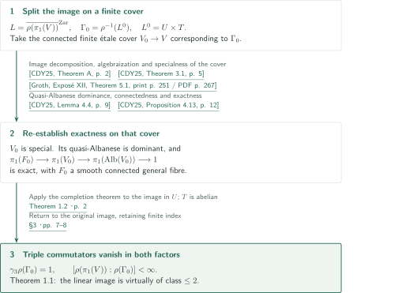
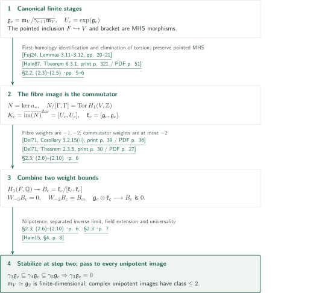
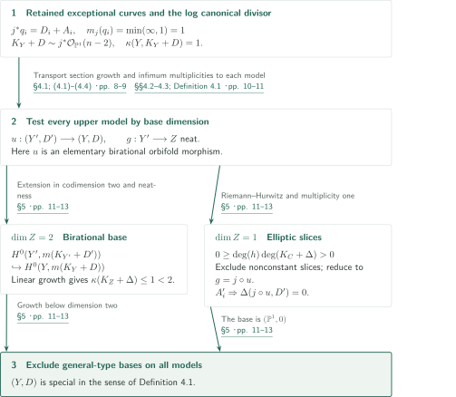
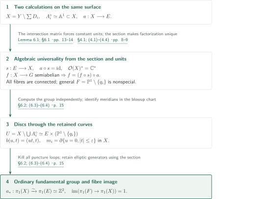
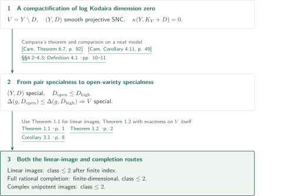

# Two-step monodromy of special quasi-projective varieties

**Identify the fibre image with the commutator, then use mixed Hodge weights to stop at step two**

The manuscript proves virtual nilpotence of class at most two for every complex linear representation image of a smooth special complex quasi-projective variety, using ordinary quasi-Albanese exactness and unipotent completion. It also constructs special surfaces with nonspecial general quasi-Albanese fibres. The object controlled by the argument is the image of the fibre group, rather than the fibre group itself.

## 1. Main results

### Theorem 1.1 — Two-step linear monodromy

Let $V$ be a connected smooth special complex quasi-projective variety. For every positive integer $d$ and every representation $\rho:\pi_1(V)\to\mathrm{GL}_d(\mathbb C)$, the image has a finite-index subgroup of nilpotency class at most two. Here $\pi_1$ is the ordinary topological fundamental group, with no additional orbifold relations imposed on boundary meridians.

Specialness uses the open-variety convention of §1: on allowed proper birational modifications, every dominant algebraic fibration with connected general fibre onto a positive-dimensional normal quasi-projective base has orbifold-base Kodaira dimension strictly below the base dimension, computed birationally with infimum multiplicities.

<!-- cite:linear -->[Theorem 1.1 · p. 1](https://github.com/openai/math/blob/fd4aeeb2ee4fc729c18d98444fed42fd0529eeeb/preprints/Two-step-monodromy-of-special-quasi-projective-varieties-September-24-2026/paper.pdf)<!-- /cite -->

### Theorem 1.2 — Completion under quasi-Albanese exactness

Let $V$ be a connected smooth complex quasi-projective variety and $a:V\to A=\operatorname{Alb}(V)$ its **algebraic** quasi-Albanese map. Assume $a$ is dominant, choose a smooth connected general fibre $F$ and $v\in F$, and suppose

$$
\pi_1(F,v)\longrightarrow\Gamma:=\pi_1(V,v)\xrightarrow{a_*}\pi_1(A,a(v))\longrightarrow1
$$

is exact. Every canonical rational unipotent quotient then has class at most two. The full rational unipotent completion is a **finite-dimensional** unipotent algebraic group of class at most two; every finite-dimensional complex unipotent representation also has image of class at most two. Injectivity of the first arrow, properness of $a$, and specialness of $V$ or $F$ are not assumed.

<!-- cite:completion -->[Theorem 1.2 · p. 2](https://github.com/openai/math/blob/fd4aeeb2ee4fc729c18d98444fed42fd0529eeeb/preprints/Two-step-monodromy-of-special-quasi-projective-varieties-September-24-2026/paper.pdf)<!-- /cite -->

### Theorem 1.3 — A special surface with nonspecial general fibre

Let $E$ be a complex elliptic curve, let $q_1,\ldots,q_n\in\mathbb P^1$ be distinct with $n\ge3$, and choose arbitrary points $e_1,\ldots,e_n\in E$. Set

$$
b:Y=\operatorname{Bl}_{\{(e_i,q_i)\}_{i=1}^n}(E\times\mathbb P^1)\longrightarrow E\times\mathbb P^1.
$$

Let $D_i$ be the strict transform of $E\times\{q_i\}$, $D=\sum_iD_i$, and $X=Y\setminus D$. **The exceptional curves are not added to the boundary.** The manuscript proves:

1. $(Y,D)$ is a smooth projective special pair, including every upper model in Definition 4.1: every elementary birational orbifold morphism $u:(Y',D')\to(Y,D)$ and every positive-dimensional neat fibration on it are tested.
2. After choosing origins, $a=(\operatorname{pr}_E\circ b)|_X$ is the algebraic quasi-Albanese map. All its fibres are connected, and its general fibre is $F\simeq\mathbb P^1\setminus\{q_1,\ldots,q_n\}$. Its log canonical degree is $n-2>0$, so $F$ is not special.
3. $a_*:\pi_1(X)\xrightarrow{\sim}\pi_1(E)\simeq\mathbb Z^2$, and $\pi_1(F)\to\pi_1(X)$ is trivial.

<!-- cite:surface -->[Theorem 1.3 · p. 3](https://github.com/openai/math/blob/fd4aeeb2ee4fc729c18d98444fed42fd0529eeeb/preprints/Two-step-monodromy-of-special-quasi-projective-varieties-September-24-2026/paper.pdf)<!-- /cite -->

### Corollary 3.1 — Log Kodaira dimension zero

Let $V$ be a connected smooth complex quasi-projective variety with $\bar\kappa(V)=0$. Every finite-dimensional complex linear representation image is virtually nilpotent of class at most two. Its full rational unipotent completion is finite-dimensional of class at most two, and every finite-dimensional complex unipotent representation image has class at most two. The finite-index subgroup in the first assertion may depend on the representation. Virtual class-two nilpotence of the entire ordinary discrete group is not asserted.

<!-- cite:logzero -->[Corollary 3.1 · p. 8](https://github.com/openai/math/blob/fd4aeeb2ee4fc729c18d98444fed42fd0529eeeb/preprints/Two-step-monodromy-of-special-quasi-projective-varieties-September-24-2026/paper.pdf)<!-- /cite -->

## References on the arrows

<!-- reference-guide -->
Unprefixed theorem, lemma, section and equation numbers refer to [Two-step monodromy of special quasi-projective varieties](https://github.com/openai/math/blob/fd4aeeb2ee4fc729c18d98444fed42fd0529eeeb/preprints/Two-step-monodromy-of-special-quasi-projective-varieties-September-24-2026/paper.pdf). External inputs use the following keys.

- [CDY25](https://arxiv.org/pdf/2512.20360v1) Benoît Cadorel; Ya Deng; Katsutoshi Yamanoi — *Hyperbolicity and fundamental groups of complex quasi-projective varieties (III): applications*: Linear-image decomposition, specialness under finite étale covers, and quasi-Albanese dominance and exactness. arXiv:2512.20360v1, 2025-12-23.
- [Fuj24](https://arxiv.org/pdf/2402.04595v2) Osamu Fujino — *On quasi-Albanese maps*: First-homology identification induced by the quasi-Albanese map. arXiv:2402.04595v2, 2024-03-21.
- [Hain87](https://sites.math.duke.edu/~hain/papers/dht1.pdf) Richard M. Hain — *The de Rham homotopy theory of complex algebraic varieties I*: Pointed functorial mixed Hodge structures and the bracket. K-Theory 1 (1987), 271–324; author-hosted scan.
- [Hain15](https://arxiv.org/pdf/1305.2052v2) Richard Hain — *Genus 3 mapping class groups are not Kähler*: Extension of the ground field for unipotent completion. arXiv:1305.2052v2.
- [Del71](https://www.numdam.org/item/PMIHES_1971__40__5_0.pdf) Pierre Deligne — *Théorie de Hodge. II*: Strictness and weights on first homology of smooth open varieties. Publications Mathématiques de l’IHÉS 40 (1971), 5–57; Numdam scan.
- [Cam](https://arxiv.org/pdf/0705.0737v8) Frédéric Campana — *Orbifoldes géométriques spéciales et classification biméromorphe des variétés kählériennes compactes*: Specialness at log Kodaira dimension zero, neat models and composed base divisors. arXiv:0705.0737v8; arXiv stamp 2009-07-15, title date 2018-10-25.
- [CDHP26](https://arxiv.org/pdf/2603.14539v2) Junyan Cao; Ya Deng; Christopher D. Hacon; Mihai Păun — *Two-step nilpotent monodromy of local systems on special varieties*: Conventions for special pairs and neat models; prior linear-image result and comparison with fibre specialness. arXiv:2603.14539v2, 2026-04-07; comparison restricted to this version.
- [Groth](https://arxiv.org/pdf/math/0206203v2) Alexander Grothendieck et al. — *Revêtements étales et groupe fondamental (SGA 1)*: Algebraization of the finite cover corresponding to a finite-index subgroup. arXiv:math/0206203v2, 2004-01-04; updated edition.

Each citation gives the result and pages. When printed pagination differs from the PDF position, both are shown. GitHub previews do not automatically jump to the cited page.
<!-- /reference-guide -->

## 2. Theorem 1.1 — Proof overview of the main theorem

<!-- proof-target:1 -->Proof target：[Theorem 1.1 · p. 1](https://github.com/openai/math/blob/fd4aeeb2ee4fc729c18d98444fed42fd0529eeeb/preprints/Two-step-monodromy-of-special-quasi-projective-varieties-September-24-2026/paper.pdf)<!-- /proof-target --> See the [statement](#theorem-1-1).

**Proof route.** On a finite étale cover, split the identity component of the linear image closure as $U\times T$. Apply ordinary quasi-Albanese exactness on that same cover and the [weight argument in Theorem 1.2](#proof-1) to bound the image in $U$. Combine it with the torus factor. No specialness of the general fibre enters this route; the surface example explains why this distinction matters.

### 1. Choose the cover and obtain exactness there

Put $L=\overline{\rho(\pi_1(V))}^{\mathrm{Zar}}$ and take the connected finite étale cover $V_0\to V$ corresponding to $\Gamma_0=\rho^{-1}(L^0)$. CDY gives $L^0=U\times T$. The cover remains special; its quasi-Albanese map is dominant, has connected general fibre, and satisfies the ordinary exact sequence. The weakly special hypothesis in Lemma 4.4 follows from Theorem 3.1. Generic smoothness supplies a smooth general fibre.

<!-- cite:cdy-linear -->[&#91;CDY25, Theorem A, p. 2&#93;](https://arxiv.org/pdf/2512.20360v1#page=2)<!-- /cite --> <!-- cite:cdy-cover -->[&#91;CDY25, Theorem 3.1, p. 5&#93;](https://arxiv.org/pdf/2512.20360v1#page=5)<!-- /cite --> <!-- cite:cdy-albanese -->[&#91;CDY25, Lemma 4.4, p. 9&#93;](https://arxiv.org/pdf/2512.20360v1#page=9)<!-- /cite --> <!-- cite:cdy-exact -->[&#91;CDY25, Proposition 4.13, p. 12&#93;](https://arxiv.org/pdf/2512.20360v1#page=12)<!-- /cite --> <!-- cite:cover-algebraic -->[&#91;Groth, Exposé XII, Theorem 5.1, print p. 251 / PDF p. 267&#93;](https://arxiv.org/pdf/math/0206203v2#page=267)<!-- /cite -->

### 2. Kill triple commutators in both factors

Theorem 1.2 applied to $\pi_1(V_0)\to U$ kills triple commutators. Their projection to the abelian group $T$ also vanishes, hence they vanish in the image in $U\times T$. This image has finite index in the original image. Exactness must be re-established on $V_0$: completion need not be invariant under passage to finite index. The manuscript credits Cao–Deng–Hacon–Păun with the prior class-two linear-image conclusion and presents an independent proof.

<!-- cite:cdhp-linear -->[&#91;CDHP26, Theorem A, p. 1&#93;](https://arxiv.org/pdf/2603.14539v2#page=1)<!-- /cite -->

<!-- cite:linear-proof -->[§3 · pp. 7–8](https://github.com/openai/math/blob/fd4aeeb2ee4fc729c18d98444fed42fd0529eeeb/preprints/Two-step-monodromy-of-special-quasi-projective-varieties-September-24-2026/paper.pdf)<!-- /cite -->

## 3. Proof of Theorem 1.2 — Weights, centrality and stabilization

<!-- proof-target:2 -->Proof target：[Theorem 1.2 · p. 2](https://github.com/openai/math/blob/fd4aeeb2ee4fc729c18d98444fed42fd0529eeeb/preprints/Two-step-monodromy-of-special-quasi-projective-varieties-September-24-2026/paper.pdf)<!-- /proof-target --> See the [hypotheses and three conclusions](#theorem-1-2).

Write $\mathfrak m_V$ for the complete Lie algebra of rational unipotent completion, $\mathfrak g_c=\mathfrak m_V/\gamma_{c+1}\mathfrak m_V$, and $U_c=\exp(\mathfrak g_c)$. The lower-central terms are closed in the inverse-limit topology. The argument takes place on canonical finite stages carrying mixed Hodge structures.

### 1. Identify the fibre image with the commutator

Exactness gives $N=\operatorname{im}(\pi_1(F)\to\Gamma)=\ker a_*$. The first-homology property of quasi-Albanese yields

$$
[\Gamma,\Gamma]\subseteq N,\qquad N/[\Gamma,\Gamma]\simeq\operatorname{Tor}H_1(V,\mathbb Z).
$$

Do not identify the two discrete subgroups. Instead take the Zariski closure $K_c$ of $N$ in $U_c$. Since $U_c^{\mathrm{ab}}$ is a torsion-free additive group, $K_c\subseteq[U_c,U_c]$. Conversely the dense image of $\Gamma$ in $U_c/K_c$ is abelian, so the commutator morphism vanishes and the reverse inclusion follows. Thus $\mathfrak k_c:=\operatorname{Lie}K_c=[\mathfrak g_c,\mathfrak g_c]$. No left-exactness of completion is invoked.

Hain's construction applied to the pointed algebraic inclusion $F\hookrightarrow V$ makes $\mathfrak g_c(F)\to\mathfrak g_c(V)$ a mixed-Hodge morphism, and gives its image $\mathfrak k_c$ the induced structure. An arbitrary representation quotient is not assumed to carry such a structure.

<!-- cite:kernel -->[§2.2; (2.3)–(2.5) · pp. 5–6](https://github.com/openai/math/blob/fd4aeeb2ee4fc729c18d98444fed42fd0529eeeb/preprints/Two-step-monodromy-of-special-quasi-projective-varieties-September-24-2026/paper.pdf)<!-- /cite --> <!-- cite:fuj-homology -->[&#91;Fuj24, Lemmas 3.11–3.12, pp. 20–21&#93;](https://arxiv.org/pdf/2402.04595v2#page=20)<!-- /cite --> <!-- cite:hain-mhs -->[&#91;Hain87, Theorem 6.3.1, print p. 321 / PDF p. 51&#93;](https://sites.math.duke.edu/~hain/papers/dht1.pdf#page=51)<!-- /cite -->

### 2. Combine the fibre's lower weight bound with the commutator's upper bound

Iterated brackets give weights at most $-r$ on $\gamma_r\mathfrak g_c$. Meanwhile

$$
H_1(F,\mathbb Q)\twoheadrightarrow B_c:=\mathfrak k_c/[\mathfrak k_c,\mathfrak k_c]
$$

and strictness restrict the weights of $B_c$ to $-1,-2$. Its position in $\mathfrak k_c=\gamma_2\mathfrak g_c$ therefore makes it pure of weight $-2$. The bracket

$$
\mathfrak g_c\otimes\mathfrak k_c\longrightarrow B_c
$$

has source of weights at most $-3$ and consequently vanishes. Hence

$$
\gamma_3\mathfrak g_c\subseteq[\gamma_2\mathfrak g_c,\gamma_2\mathfrak g_c]
\subseteq\gamma_4\mathfrak g_c\subseteq\gamma_3\mathfrak g_c.
$$

All subsequent lower-central terms coincide, and nilpotence forces $\gamma_3\mathfrak g_c=0$. This proves the assertion for each canonical quotient.

<!-- cite:weights -->[§2.3; (2.6)–(2.10) · p. 6](https://github.com/openai/math/blob/fd4aeeb2ee4fc729c18d98444fed42fd0529eeeb/preprints/Two-step-monodromy-of-special-quasi-projective-varieties-September-24-2026/paper.pdf)<!-- /cite --> <!-- cite:del-strict -->[&#91;Del71, Theorem 2.3.5, print p. 30 / PDF p. 27&#93;](https://www.numdam.org/item/PMIHES_1971__40__5_0.pdf#page=27)<!-- /cite --> <!-- cite:del-weights -->[&#91;Del71, Corollary 3.2.15(ii), print p. 39 / PDF p. 36&#93;](https://www.numdam.org/item/PMIHES_1971__40__5_0.pdf#page=36)<!-- /cite -->

### 3. Pass to full completion and complex unipotent representations

The Lie algebra $\mathfrak m_V$ is the separated inverse limit of its canonical quotients. Vanishing of $\gamma_3$ in every quotient gives $\gamma_3\mathfrak m_V=0$. Thus $\mathfrak m_V\simeq\mathfrak g_2$: the tower stabilizes and full completion inherits finite-dimensionality of $\mathfrak g_2$, which follows from finite generation of $\Gamma$. A uniform class bound on the finite stages alone would not explain this conclusion.

Completion commutes with characteristic-zero field extension. Extend from $\mathbb Q$ to $\mathbb C$ and use universality to factor each complex unipotent representation. This proves the third conclusion. Injectivity of $\Gamma\to\Gamma^{\mathrm{un}}(\mathbb Q)$ is not supplied; killing $\gamma_3\Gamma$ in completion does not identify its elements inside the discrete group.

<!-- cite:limit -->[§2.3 · p. 7](https://github.com/openai/math/blob/fd4aeeb2ee4fc729c18d98444fed42fd0529eeeb/preprints/Two-step-monodromy-of-special-quasi-projective-varieties-September-24-2026/paper.pdf)<!-- /cite --> <!-- cite:hain-field -->[&#91;Hain15, §4, p. 8&#93;](https://arxiv.org/pdf/1305.2052v2#page=8)<!-- /cite --> <!-- cite:ordinary -->[Question 8.1; §8 · p. 18](https://github.com/openai/math/blob/fd4aeeb2ee4fc729c18d98444fed42fd0529eeeb/preprints/Two-step-monodromy-of-special-quasi-projective-varieties-September-24-2026/paper.pdf)<!-- /cite -->

## 4. Proof of Theorem 1.3(i) — Exclude general-type bases on every upper model

<!-- proof-target:3 -->Proof target：[Theorem 1.3 · p. 3](https://github.com/openai/math/blob/fd4aeeb2ee4fc729c18d98444fed42fd0529eeeb/preprints/Two-step-monodromy-of-special-quasi-projective-varieties-September-24-2026/paper.pdf)<!-- /proof-target --> See the [construction and assertion (i)](#theorem-1-3).

Set $j=\operatorname{pr}_{\mathbb P^1}\circ b$ and $A_i=b^{-1}(e_i,q_i)$. The affine line $A_i^\circ=A_i\cap X\simeq\mathbb A^1$ is retained, while $j^*q_i=D_i+A_i$ has both coefficients one. Thus $m_j(q_i)=\min(\infty,1)=1$ and $\Delta(j,D)=0$. At the same time $K_Y+D\sim j^*\mathcal O_{\mathbb P^1}(n-2)$, so $\kappa(Y,K_Y+D)=1$. These are distinct computations.

### 1. Exclude a surface base by the growth of sections

Fix any allowed $u:(Y',D')\to(Y,D)$ and neat fibration $g:Y'\to Z$. If $\dim Z=2$, then $g$ is birational. Neatness and canonical dimension bound the base Kodaira dimension by $\kappa(Y',K_{Y'}+D')$. For sufficiently divisible $m$, restrict sections away from the finite exceptional image of $u$ and extend by normality to obtain

$$
H^0(Y',m(K_{Y'}+D'))\hookrightarrow H^0(Y,m(K_Y+D)).
$$

The target grows linearly, so the base has Kodaira dimension at most one. Birational invariance under arbitrary boundary changes is not assumed.

<!-- cite:surface-geometry -->[§4.1; (4.1)–(4.4) · pp. 8–9](https://github.com/openai/math/blob/fd4aeeb2ee4fc729c18d98444fed42fd0529eeeb/preprints/Two-step-monodromy-of-special-quasi-projective-varieties-September-24-2026/paper.pdf)<!-- /cite --> <!-- cite:special-proof -->[§5 · pp. 11–13](https://github.com/openai/math/blob/fd4aeeb2ee4fc729c18d98444fed42fd0529eeeb/preprints/Two-step-monodromy-of-special-quasi-projective-varieties-September-24-2026/paper.pdf)<!-- /cite --> <!-- cite:cdhp-models -->[&#91;CDHP26, Definitions 2.1–2.9; Lemma 2.7; Proposition 2.8, pp. 7–9&#93;](https://arxiv.org/pdf/2603.14539v2#page=7)<!-- /cite -->

### 2. Exclude a curve base using elliptic slices and retained components

Suppose $Z=C$ with $\deg(K_C+\Delta(g,D'))>0$. A sufficiently general fibre $C_t$ of $j\circ u$ is an unchanged complete elliptic curve avoiding the boundary and exceptional locus. If $h=g|_{C_t}$ is nonconstant, its ramification index satisfies $e_x\ge m_c$ for the infimum multiplicity $m_c$. Infinite $m_c$ is impossible, and Riemann–Hurwitz gives

$$
0=\deg K_{C_t}\ge\deg(h)\deg(K_C+\Delta)>0.
$$

Thus $g$ factors through $j\circ u$. Connected general fibres force the intervening map of curves to have degree one, hence $C\simeq\mathbb P^1$. The strict transform of each $A_i$ still has coefficient zero in $D'$ and ordinary multiplicity one above $q_i$. Strict transforms of the other elliptic fibres do likewise. Therefore $\Delta(j\circ u,D')=0$: additional exceptional components cannot increase an infimum already equal to one. This proves specialness on every upper model.

<!-- cite:special-proof -->[§5 · pp. 11–13](https://github.com/openai/math/blob/fd4aeeb2ee4fc729c18d98444fed42fd0529eeeb/preprints/Two-step-monodromy-of-special-quasi-projective-varieties-September-24-2026/paper.pdf)<!-- /cite -->

## 5. Proof of Theorem 1.3(ii)–(iii) — Universality and the ordinary group

<!-- proof-target:4 -->Proof target：[Theorem 1.3 · p. 3](https://github.com/openai/math/blob/fd4aeeb2ee4fc729c18d98444fed42fd0529eeeb/preprints/Two-step-monodromy-of-special-quasi-projective-varieties-September-24-2026/paper.pdf)<!-- /proof-target --> See [assertions (ii)–(iii)](#theorem-1-3).

### 1. The section and units determine quasi-Albanese universality

Choose a complete section $s:E\to X$ using $q_*\notin\{q_i\}$. The divisor of a unit $v\in\mathcal O(X)^*$ is $\sum b_iD_i$. Intersecting with $A_j$, using $D_i\cdot A_j=\delta_{ij}$ and zero intersection for a principal divisor, gives $b_j=0$. Consequently every unit is constant.

For an algebraic morphism $f:X\to G$ into a semiabelian extension $1\to T\to G\to B\to1$, its projection to $B$ is constant on the general punctured rational fibre. The difference $f-(f\circ s)\circ a$ therefore takes values in $T$. It is constant by the units calculation and zero on the section, hence zero everywhere. After fixing origins, $f\circ s:E\to G$ is a homomorphism: its projection to $B$ is a homomorphism, and its group-law defect is a map from the projective variety $E\times E$ to an affine torus, hence constant and zero. The section proves uniqueness. This establishes the algebraic universal property, beyond a dimension count of logarithmic one-forms.

Every special fibre consists of the strict transform of a vertical curve with retained affine exceptional lines attached at individual points, and is connected. The general fibre is the $n$-punctured projective line; its log canonical degree $n-2>0$ proves it is nonspecial.

<!-- cite:units -->[Lemma 6.1; §6.1 · pp. 13–14](https://github.com/openai/math/blob/fd4aeeb2ee4fc729c18d98444fed42fd0529eeeb/preprints/Two-step-monodromy-of-special-quasi-projective-varieties-September-24-2026/paper.pdf)<!-- /cite --> <!-- cite:surface-geometry -->[§4.1; (4.1)–(4.4) · pp. 8–9](https://github.com/openai/math/blob/fd4aeeb2ee4fc729c18d98444fed42fd0529eeeb/preprints/Two-step-monodromy-of-special-quasi-projective-varieties-September-24-2026/paper.pdf)<!-- /cite -->

### 2. Discs inside X kill every puncture meridian

We have $U=X\setminus\bigcup A_i^\circ\simeq E\times(\mathbb P^1\setminus\{q_i\})$. The inclusion induces a surjection on fundamental groups whose kernel is normally generated by meridians of the $A_i^\circ$. In the local blowup chart $b(u,t)=(ut,t)$, a meridian of $A_i^\circ=\{t=0\}$ corresponds to the puncture loop $m_i$ about $q_i$ and bounds the actual disc $\{u=0,|t|\le\varepsilon\}\subset X$. Hence

$$
\pi_1(X)\simeq\frac{\pi_1(E)\times\pi_1(\mathbb P^1\setminus\{q_i\})}{\langle\!\langle m_1,\ldots,m_n\rangle\!\rangle}\simeq\mathbb Z^2.
$$

The map $a_*$ is this isomorphism; the section also shows that the elliptic generators survive. Since puncture loops generate the free fibre group, its image in the total group is zero. No additional orbifold relations have been imposed.

<!-- cite:meridians -->[§6.2; (6.3)–(6.4) · p. 15](https://github.com/openai/math/blob/fd4aeeb2ee4fc729c18d98444fed42fd0529eeeb/preprints/Two-step-monodromy-of-special-quasi-projective-varieties-September-24-2026/paper.pdf)<!-- /cite -->

## 6. Proof of Corollary 3.1 — Three conclusions from log Kodaira dimension zero

<!-- proof-target:5 -->Proof target：[Corollary 3.1 · p. 8](https://github.com/openai/math/blob/fd4aeeb2ee4fc729c18d98444fed42fd0529eeeb/preprints/Two-step-monodromy-of-special-quasi-projective-varieties-September-24-2026/paper.pdf)<!-- /proof-target --> See the [statement](#corollary-3-1).

### 1. Compare specialness conventions and apply both theorems

Choose a smooth projective SNC compactification $(Y,D)$ with $\kappa(Y,K_Y+D)=0$. Apply Campana's specialness theorem and the calculation on neat models. The comparison after Definition 4.1 resolves an open fibration so that $D_{\mathrm{open}}\le D_{\mathrm{high}}$. Infimum multiplicities then give $\Delta(g,D_{\mathrm{open}})\le\Delta(g,D_{\mathrm{high}})$. This supplies the required implication to open-variety specialness.

Theorem 1.1 yields the finite-index linear-image assertion. For completion, apply ordinary quasi-Albanese exactness to $V$ itself and then Theorem 1.2. This gives finite-dimensionality and class two for full rational completion, together with class two for complex unipotent images. The last two conclusions do not follow merely from the finite-index assertion for linear images.

<!-- cite:cam-zero -->[&#91;Cam, Theorem 6.7, p. 92&#93;](https://arxiv.org/pdf/0705.0737v8#page=92)<!-- /cite --> <!-- cite:cam-neat -->[&#91;Cam, Corollary 4.11, p. 49&#93;](https://arxiv.org/pdf/0705.0737v8#page=49)<!-- /cite --> <!-- cite:convention -->[§§4.2–4.3; Definition 4.1 · pp. 10–11](https://github.com/openai/math/blob/fd4aeeb2ee4fc729c18d98444fed42fd0529eeeb/preprints/Two-step-monodromy-of-special-quasi-projective-varieties-September-24-2026/paper.pdf)<!-- /cite --> <!-- cite:logzero -->[Corollary 3.1 · p. 8](https://github.com/openai/math/blob/fd4aeeb2ee4fc729c18d98444fed42fd0529eeeb/preprints/Two-step-monodromy-of-special-quasi-projective-varieties-September-24-2026/paper.pdf)<!-- /cite -->

## 7. Which papers supply which steps

| Source | Used at | Role and hypotheses | Checking scope |
|---|---|---|---|
| CDY25 | Theorem 1.1; Corollary 3.1 | The smooth special total-space hypothesis persists on the cover; use image decomposition and ordinary exactness | Statements in the specified v1 and their use in §3 checked |
| Fuj24, Hain87, Del71 | Theorem 1.2 | First homology, pointed algebraic functoriality, weights and strictness | Statements and use checked; the full completed-group-algebra construction was not independently verified |
| Hain15, Groth | Theorems 1.2, 1.1 | Field extension for completion and algebraization of finite covers | Relevant statements and use checked |
| Cam, CDHP26 | Corollary 3.1; surface example | Pair specialness, neat upper models and infimum multiplicities | Conventions and statements checked; the CDHP comparison is restricted to v2 |

In §7 the manuscript compares the direct calculation $\Delta(j,D)=0$ with $\Delta(\operatorname{pr}_{\mathbb P^1},\sum H_i)=\sum q_i$ after blowdown. This illustrates why equality in Campana's composition rule is conditional. The authors present it as a counterexample to CDHP26 Theorem 7.15 and Claim 7.17. Editorial checking covered the statements in the specified v2, the point where Claim 7.17 changes flatness over $J'$ to flatness over a different intermediate space, and the displayed multiplicity calculation. This comparison is not extended to other versions or to that paper's separate linear-image theorem.

<!-- cite:comparison -->[§7; (7.1)–(7.3) · pp. 15–18](https://github.com/openai/math/blob/fd4aeeb2ee4fc729c18d98444fed42fd0529eeeb/preprints/Two-step-monodromy-of-special-quasi-projective-varieties-September-24-2026/paper.pdf)<!-- /cite --> <!-- cite:cam-compose -->[&#91;Cam, Proposition 3.13, p. 44&#93;](https://arxiv.org/pdf/0705.0737v8#page=44)<!-- /cite --> <!-- cite:cdhp-fibre -->[&#91;CDHP26, Theorem 7.15, p. 70&#93;](https://arxiv.org/pdf/2603.14539v2#page=70)<!-- /cite --> <!-- cite:cdhp-claim -->[&#91;CDHP26, Claim 7.17, pp. 73–74&#93;](https://arxiv.org/pdf/2603.14539v2#page=73)<!-- /cite -->

The first paper in catalogue 057 is cited as compact Kähler background. It is not a direct input to the proof routes for Theorems 1.1–1.3 described here.

## 8. Return to the sources

<!-- reading-list -->
- [§3 · pp. 7–8](https://github.com/openai/math/blob/fd4aeeb2ee4fc729c18d98444fed42fd0529eeeb/preprints/Two-step-monodromy-of-special-quasi-projective-varieties-September-24-2026/paper.pdf) — Reapply the inputs on the finite cover
- [§2.2; (2.3)–(2.5) · pp. 5–6](https://github.com/openai/math/blob/fd4aeeb2ee4fc729c18d98444fed42fd0529eeeb/preprints/Two-step-monodromy-of-special-quasi-projective-varieties-September-24-2026/paper.pdf) — Handle discrete torsion and identify the commutator
- [§2.3; (2.6)–(2.10) · p. 6](https://github.com/openai/math/blob/fd4aeeb2ee4fc729c18d98444fed42fd0529eeeb/preprints/Two-step-monodromy-of-special-quasi-projective-varieties-September-24-2026/paper.pdf) — Use two weight bounds to force centrality
- [§2.3 · p. 7](https://github.com/openai/math/blob/fd4aeeb2ee4fc729c18d98444fed42fd0529eeeb/preprints/Two-step-monodromy-of-special-quasi-projective-varieties-September-24-2026/paper.pdf) — Stabilization and passage to complex representations
- [§5 · pp. 11–13](https://github.com/openai/math/blob/fd4aeeb2ee4fc729c18d98444fed42fd0529eeeb/preprints/Two-step-monodromy-of-special-quasi-projective-varieties-September-24-2026/paper.pdf) — Exclude curve and surface bases on every upper model
- [Lemma 6.1; §6.1 · pp. 13–14](https://github.com/openai/math/blob/fd4aeeb2ee4fc729c18d98444fed42fd0529eeeb/preprints/Two-step-monodromy-of-special-quasi-projective-varieties-September-24-2026/paper.pdf) — The algebraic quasi-Albanese universal property
- [§6.2; (6.3)–(6.4) · p. 15](https://github.com/openai/math/blob/fd4aeeb2ee4fc729c18d98444fed42fd0529eeeb/preprints/Two-step-monodromy-of-special-quasi-projective-varieties-September-24-2026/paper.pdf) — Kill meridians using discs inside X
- [§7; (7.1)–(7.3) · pp. 15–18](https://github.com/openai/math/blob/fd4aeeb2ee4fc729c18d98444fed42fd0529eeeb/preprints/Two-step-monodromy-of-special-quasi-projective-varieties-September-24-2026/paper.pdf) — Compare base divisors with the specified v2
- [Question 8.1; §8 · p. 18](https://github.com/openai/math/blob/fd4aeeb2ee4fc729c18d98444fed42fd0529eeeb/preprints/Two-step-monodromy-of-special-quasi-projective-varieties-September-24-2026/paper.pdf) — Separate the kernel invisible to completion
<!-- /reading-list -->

The principal statements and relevant arguments in §§2–8 were read, and the reductions in the diagrams, coverage of each conclusion, and statements and use of the direct external inputs were checked in the specified versions. Hain's pointed functoriality was also inspected on the image of printed page 321; Morgan's older functoriality assertion is not substituted for it. Complete proofs of the external results, the entire completed-group-algebra construction, recursive dependencies, expert refereeing and formal verification are outside this checking scope. The ordinary-group conclusion remains Question 8.1 in the manuscript and is kept distinct from the linear-image and completion assertions.
