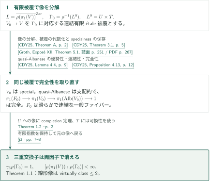
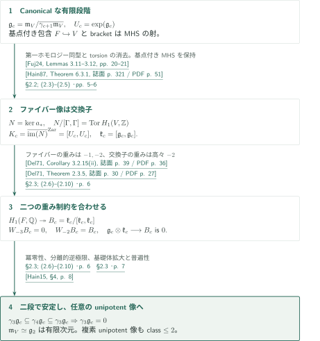
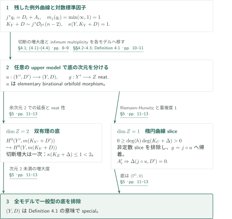
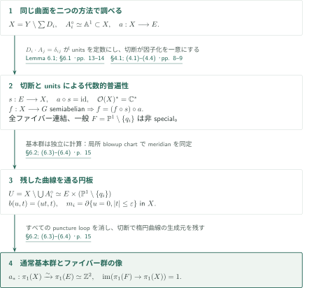
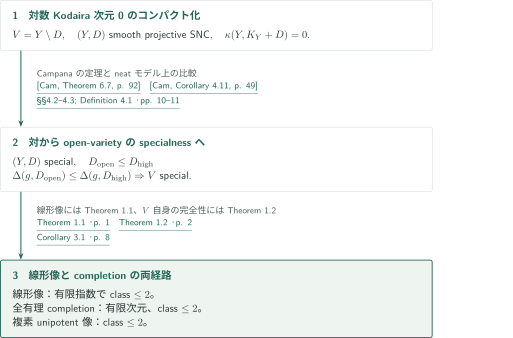

# Two-step monodromy of special quasi-projective varieties

**ファイバー像を交換子に同定し、混合Hodge構造の重みで二段に止める**

原稿は、specialな滑らかな複素準射影多様体の任意の複素線形表現像がvirtually nilpotent of class at most twoとなることを、quasi-Albaneseの通常基本群の完全列とunipotent completionから示す。同時に、全空間がspecialでも一般quasi-Albaneseファイバーはspecialでない曲面を構成する。制御されるのはファイバー群そのものではなく、その像である。

## 1. 主要結果

### Theorem 1.1 — 二段の線形モノドロミー

$V$を連結・滑らかなspecial複素準射影多様体とする。任意の正整数$d$と表現$\rho:\pi_1(V)\to\mathrm{GL}_d(\mathbb C)$について、$\rho(\pi_1(V))$は冪零度が高々2の有限指数部分群を持つ。ここで$\pi_1$は通常の位相的基本群であり、境界meridianに追加のorbifold関係を課していない。

specialは原典§1のopen-varietyの規約である。許されたproper birational modification上の、正次元の正規準射影底への支配的代数的ファイブレーション（一般ファイバー連結）について、infimum multiplicityで計算するorbifold底のKodaira次元が底の次元未満であることを要求する。

<!-- cite:linear -->[Theorem 1.1 · p. 1](https://github.com/openai/math/blob/fd4aeeb2ee4fc729c18d98444fed42fd0529eeeb/preprints/Two-step-monodromy-of-special-quasi-projective-varieties-September-24-2026/paper.pdf)<!-- /cite -->

### Theorem 1.2 — Quasi-Albanese完全性の下でのcompletion

$V$を連結・滑らかな複素準射影多様体、$a:V\to A=\operatorname{Alb}(V)$を**代数的**quasi-Albanese写像とする。$a$が支配的で、滑らかな連結一般ファイバー$F$と$v\in F$について

$$
\pi_1(F,v)\longrightarrow\Gamma:=\pi_1(V,v)\xrightarrow{a_*}\pi_1(A,a(v))\longrightarrow1
$$

が完全であると仮定する。このとき、各canonical rational unipotent quotientの冪零度は高々2である。さらにfull rational unipotent completionは**有限次元**のunipotent代数群で冪零度高々2となり、任意の有限次元複素unipotent表現の像も冪零度高々2となる。最初の矢印の単射性、$a$のproperness、$V$または$F$のspecialnessは仮定しない。

<!-- cite:completion -->[Theorem 1.2 · p. 2](https://github.com/openai/math/blob/fd4aeeb2ee4fc729c18d98444fed42fd0529eeeb/preprints/Two-step-monodromy-of-special-quasi-projective-varieties-September-24-2026/paper.pdf)<!-- /cite -->

### Theorem 1.3 — 非specialな一般ファイバーを持つspecial曲面

$E$を複素楕円曲線、$q_1,\ldots,q_n\in\mathbb P^1$を相異なる点（$n\ge3$）、$e_1,\ldots,e_n\in E$を任意の点とする。

$$
b:Y=\operatorname{Bl}_{\{(e_i,q_i)\}_{i=1}^n}(E\times\mathbb P^1)\longrightarrow E\times\mathbb P^1
$$

とし、$D_i$を$E\times\{q_i\}$の狭義変換、$D=\sum_iD_i$、$X=Y\setminus D$と置く。**例外曲線は境界に加えない。** 原稿は次を示す。

1. $(Y,D)$は滑らかな射影special対である。原典Definition 4.1の全upper model、すなわち任意のelementary birational orbifold morphism $u:(Y',D')\to(Y,D)$上の任意の正次元neat fibrationについてspecialnessを要求する規約を含む。
2. $a=(\operatorname{pr}_E\circ b)|_X$は原点を選ぶと代数的quasi-Albanese写像であり、全ファイバーが連結、一般ファイバーは$F\simeq\mathbb P^1\setminus\{q_1,\ldots,q_n\}$である。したがって$\deg K_{\mathbb P^1}(\sum q_i)=n-2>0$で、$F$はspecialでない。
3. $a_*:\pi_1(X)\xrightarrow{\sim}\pi_1(E)\simeq\mathbb Z^2$であり、$\pi_1(F)\to\pi_1(X)$は自明である。

<!-- cite:surface -->[Theorem 1.3 · p. 3](https://github.com/openai/math/blob/fd4aeeb2ee4fc729c18d98444fed42fd0529eeeb/preprints/Two-step-monodromy-of-special-quasi-projective-varieties-September-24-2026/paper.pdf)<!-- /cite -->

### Corollary 3.1 — 対数Kodaira次元0

$V$を連結・滑らかな複素準射影多様体で$\bar\kappa(V)=0$とする。任意の複素有限次元線形表現像はvirtually nilpotent of class at most twoである。full rational unipotent completionは有限次元かつ冪零度高々2、任意の複素有限次元unipotent表現像も冪零度高々2となる。最初の有限指数部分群は表現に依存してよく、通常の離散群$\pi_1(V)$全体がvirtually class twoであるとは主張していない。

<!-- cite:logzero -->[Corollary 3.1 · p. 8](https://github.com/openai/math/blob/fd4aeeb2ee4fc729c18d98444fed42fd0529eeeb/preprints/Two-step-monodromy-of-special-quasi-projective-varieties-September-24-2026/paper.pdf)<!-- /cite -->

## 図の矢印に付した引用

<!-- reference-guide -->
略号のない定理・補題・節・式番号は本原稿 [Two-step monodromy of special quasi-projective varieties](https://github.com/openai/math/blob/fd4aeeb2ee4fc729c18d98444fed42fd0529eeeb/preprints/Two-step-monodromy-of-special-quasi-projective-varieties-September-24-2026/paper.pdf) を指します。外部入力には次の略号を使います。

- [CDY25](https://arxiv.org/pdf/2512.20360v1) Benoît Cadorel; Ya Deng; Katsutoshi Yamanoi — *Hyperbolicity and fundamental groups of complex quasi-projective varieties (III): applications*：線形像の分解、有限étale被覆でのspecialness、quasi-Albaneseの優勢性・完全性。arXiv:2512.20360v1, 2025-12-23。
- [Fuj24](https://arxiv.org/pdf/2402.04595v2) Osamu Fujino — *On quasi-Albanese maps*：quasi-Albaneseが誘導する第一ホモロジー同型。arXiv:2402.04595v2, 2024-03-21。
- [Hain87](https://sites.math.duke.edu/~hain/papers/dht1.pdf) Richard M. Hain — *The de Rham homotopy theory of complex algebraic varieties I*：基点付き代数写像に自然な混合Hodge構造とbracket。K-Theory 1 (1987), 271–324; author-hosted scan。
- [Hain15](https://arxiv.org/pdf/1305.2052v2) Richard Hain — *Genus 3 mapping class groups are not Kähler*：unipotent completionの基礎体拡大。arXiv:1305.2052v2。
- [Del71](https://www.numdam.org/item/PMIHES_1971__40__5_0.pdf) Pierre Deligne — *Théorie de Hodge. II*：混合Hodge構造のstrictnessと開多様体の第一ホモロジーの重み。Publications Mathématiques de l’IHÉS 40 (1971), 5–57; Numdam scan。
- [Cam](https://arxiv.org/pdf/0705.0737v8) Frédéric Campana — *Orbifoldes géométriques spéciales et classification biméromorphe des variétés kählériennes compactes*：対数Kodaira次元0のspecialness、neatモデル・合成の底因子。arXiv:0705.0737v8; arXiv stamp 2009-07-15, title date 2018-10-25。
- [CDHP26](https://arxiv.org/pdf/2603.14539v2) Junyan Cao; Ya Deng; Christopher D. Hacon; Mihai Păun — *Two-step nilpotent monodromy of local systems on special varieties*：special対の規約とneatモデル。先行する線形像の結論およびファイバーspecialnessとの比較。arXiv:2603.14539v2, 2026-04-07; comparison restricted to this version。
- [Groth](https://arxiv.org/pdf/math/0206203v2) Alexander Grothendieck et al. — *Revêtements étales et groupe fondamental (SGA 1)*：有限指数部分群に対応する被覆の代数化。arXiv:math/0206203v2, 2004-01-04; updated edition。

各引用に結果番号とページを付します。誌面番号とPDF内の位置が異なる場合は両方を示します。GitHubの閲覧リンクではページ位置への自動移動を前提としません。
<!-- /reference-guide -->

## 2. Theorem 1.1 — 主定理の証明概略

<!-- proof-target:1 -->証明対象：[Theorem 1.1 · p. 1](https://github.com/openai/math/blob/fd4aeeb2ee4fc729c18d98444fed42fd0529eeeb/preprints/Two-step-monodromy-of-special-quasi-projective-varieties-September-24-2026/paper.pdf)<!-- /proof-target --> [主張](#theorem-1-1)を参照する。

**証明の道筋。** 線形像のZariski閉包を有限étale被覆上で$U\times T$に分ける。同じ被覆のquasi-Albaneseに完全性を適用し、[Theorem 1.2の重みの議論](#proof-1)で$U$への像を二段に制限する。トーラス因子と合わせて結論を得る。一般ファイバーのspecialnessを介さないことが、後の曲面例との接続である。

### 1. 被覆を選び、その被覆で完全性を得る

$L=\overline{\rho(\pi_1(V))}^{\mathrm{Zar}}$とし、$\Gamma_0=\rho^{-1}(L^0)$に対応する連結有限étale被覆$V_0\to V$を取る。CDYの分解定理は$L^0=U\times T$を与える。被覆$V_0$は再びspecialであり、そのquasi-Albaneseが支配的で連結一般ファイバーを持ち、通常基本群の完全列を満たす。ここでLemma 4.4のweakly specialという条件はTheorem 3.1から満たされる。滑らかな一般ファイバーはgeneric smoothnessで選べる。

<!-- cite:cdy-linear -->[&#91;CDY25, Theorem A, p. 2&#93;](https://arxiv.org/pdf/2512.20360v1#page=2)<!-- /cite --> <!-- cite:cdy-cover -->[&#91;CDY25, Theorem 3.1, p. 5&#93;](https://arxiv.org/pdf/2512.20360v1#page=5)<!-- /cite --> <!-- cite:cdy-albanese -->[&#91;CDY25, Lemma 4.4, p. 9&#93;](https://arxiv.org/pdf/2512.20360v1#page=9)<!-- /cite --> <!-- cite:cdy-exact -->[&#91;CDY25, Proposition 4.13, p. 12&#93;](https://arxiv.org/pdf/2512.20360v1#page=12)<!-- /cite --> <!-- cite:cover-algebraic -->[&#91;Groth, Exposé XII, Theorem 5.1, 誌面 p. 251 / PDF p. 267&#93;](https://arxiv.org/pdf/math/0206203v2#page=267)<!-- /cite -->

### 2. 二つの因子で三重交換子を消す

$\pi_1(V_0)\to U$にTheorem 1.2を適用すると三重交換子は自明となる。$T$は可換なので$T$への射影でも消え、$U\times T$内の像全体で消える。$\rho(\Gamma_0)$は元の像の有限指数部分群である。有限指数部分群へ移るとcompletionが不変とは限らないため、完全性を$V_0$で取り直すことが必要である。この線形像の結論はCao–Deng–Hacon–Păunが先行して発表したもので、本稿は独立の証明を与えると位置付けている。

<!-- cite:cdhp-linear -->[&#91;CDHP26, Theorem A, p. 1&#93;](https://arxiv.org/pdf/2603.14539v2#page=1)<!-- /cite -->

<!-- cite:linear-proof -->[§3 · pp. 7–8](https://github.com/openai/math/blob/fd4aeeb2ee4fc729c18d98444fed42fd0529eeeb/preprints/Two-step-monodromy-of-special-quasi-projective-varieties-September-24-2026/paper.pdf)<!-- /cite -->

## 3. Theorem 1.2 の証明 — 重みから中心性と極限の安定化へ

<!-- proof-target:2 -->証明対象：[Theorem 1.2 · p. 2](https://github.com/openai/math/blob/fd4aeeb2ee4fc729c18d98444fed42fd0529eeeb/preprints/Two-step-monodromy-of-special-quasi-projective-varieties-September-24-2026/paper.pdf)<!-- /proof-target --> [仮定と3つの結論](#theorem-1-2)を参照する。

$\mathfrak m_V$をrational unipotent completionの完備Lie代数、$\mathfrak g_c=\mathfrak m_V/\gamma_{c+1}\mathfrak m_V$、$U_c=\exp(\mathfrak g_c)$と置く。降中心項は逆極限位相で閉包を取る。議論は混合Hodge構造を持つcanonical有限段階で行う。

### 1. ファイバー像を交換子に同定する

$N=\operatorname{im}(\pi_1(F)\to\Gamma)=\ker a_*$である。quasi-Albaneseの第一ホモロジー同型から

$$
[\Gamma,\Gamma]\subseteq N,\qquad N/[\Gamma,\Gamma]\simeq\operatorname{Tor}H_1(V,\mathbb Z)
$$

となる。離散群で両者を等置せず、$U_c$内のZariski閉包$K_c$へ移る。$U_c^{\mathrm{ab}}$はtorsionを持たない加法群なので$K_c\subseteq[U_c,U_c]$。逆に$U_c/K_c$の稠密な$\Gamma$像は可換であり、交換子写像の消滅から逆包含を得る。したがって$\mathfrak k_c:=\operatorname{Lie}K_c=[\mathfrak g_c,\mathfrak g_c]$である。completionの左完全性は使わない。

基点付き代数的包含$F\hookrightarrow V$にHainの構成を適用すると$\mathfrak g_c(F)\to\mathfrak g_c(V)$は混合Hodge構造の射となり、像$\mathfrak k_c$にもその構造が入る。任意の表現商へ直接Hodge構造を仮定するわけではない。

<!-- cite:kernel -->[§2.2; (2.3)–(2.5) · pp. 5–6](https://github.com/openai/math/blob/fd4aeeb2ee4fc729c18d98444fed42fd0529eeeb/preprints/Two-step-monodromy-of-special-quasi-projective-varieties-September-24-2026/paper.pdf)<!-- /cite --> <!-- cite:fuj-homology -->[&#91;Fuj24, Lemmas 3.11–3.12, pp. 20–21&#93;](https://arxiv.org/pdf/2402.04595v2#page=20)<!-- /cite --> <!-- cite:hain-mhs -->[&#91;Hain87, Theorem 6.3.1, 誌面 p. 321 / PDF p. 51&#93;](https://sites.math.duke.edu/~hain/papers/dht1.pdf#page=51)<!-- /cite -->

### 2. ファイバーの重み下界と交換子の重み上界を合わせる

反復bracketから$\gamma_r\mathfrak g_c$の重みは高々$-r$である。一方

$$
H_1(F,\mathbb Q)\twoheadrightarrow B_c:=\mathfrak k_c/[\mathfrak k_c,\mathfrak k_c]
$$

とstrictnessを使うと、$B_c$の重みは$-1,-2$に限られる。$\mathfrak k_c=\gamma_2\mathfrak g_c$内にあるので、結局$B_c$は純粋な重み$-2$となる。bracket

$$
\mathfrak g_c\otimes\mathfrak k_c\longrightarrow B_c
$$

の源の重みは高々$-3$なのでこの射は零である。ゆえに

$$
\gamma_3\mathfrak g_c\subseteq[\gamma_2\mathfrak g_c,\gamma_2\mathfrak g_c]
\subseteq\gamma_4\mathfrak g_c\subseteq\gamma_3\mathfrak g_c.
$$

以後の降中心列も一致し、$\mathfrak g_c$の冪零性から$\gamma_3\mathfrak g_c=0$を得る。これは各canonical quotientへの結論である。

<!-- cite:weights -->[§2.3; (2.6)–(2.10) · p. 6](https://github.com/openai/math/blob/fd4aeeb2ee4fc729c18d98444fed42fd0529eeeb/preprints/Two-step-monodromy-of-special-quasi-projective-varieties-September-24-2026/paper.pdf)<!-- /cite --> <!-- cite:del-strict -->[&#91;Del71, Theorem 2.3.5, 誌面 p. 30 / PDF p. 27&#93;](https://www.numdam.org/item/PMIHES_1971__40__5_0.pdf#page=27)<!-- /cite --> <!-- cite:del-weights -->[&#91;Del71, Corollary 3.2.15(ii), 誌面 p. 39 / PDF p. 36&#93;](https://www.numdam.org/item/PMIHES_1971__40__5_0.pdf#page=36)<!-- /cite -->

### 3. 全completionと複素unipotent表現へ移る

$\mathfrak m_V$はcanonical商の分離的逆極限なので、全商での$\gamma_3=0$から$\gamma_3\mathfrak m_V=0$となる。したがって$\mathfrak m_V\simeq\mathfrak g_2$で塔は安定し、有限生成な$\Gamma$に由来する$\mathfrak g_2$の有限次元性がfull completionにも及ぶ。単に「各段階の冪零度が有界」と述べるだけでは、この有限次元性の説明にならない。

unipotent completionの標数0での基礎体拡大を用いて$\mathbb Q$から$\mathbb C$へ移り、その普遍性で任意の複素unipotent表現を因子化する。これが3番目の結論である。$\Gamma\to\Gamma^{\mathrm{un}}(\mathbb Q)$の単射性は証明されておらず、$\gamma_3\Gamma$がcompletionで消えることから離散群内での消滅は導けない。

<!-- cite:limit -->[§2.3 · p. 7](https://github.com/openai/math/blob/fd4aeeb2ee4fc729c18d98444fed42fd0529eeeb/preprints/Two-step-monodromy-of-special-quasi-projective-varieties-September-24-2026/paper.pdf)<!-- /cite --> <!-- cite:hain-field -->[&#91;Hain15, §4, p. 8&#93;](https://arxiv.org/pdf/1305.2052v2#page=8)<!-- /cite --> <!-- cite:ordinary -->[Question 8.1; §8 · p. 18](https://github.com/openai/math/blob/fd4aeeb2ee4fc729c18d98444fed42fd0529eeeb/preprints/Two-step-monodromy-of-special-quasi-projective-varieties-September-24-2026/paper.pdf)<!-- /cite -->

## 4. Theorem 1.3(i) の証明 — 全upper modelで一般型の底を排除する

<!-- proof-target:3 -->証明対象：[Theorem 1.3 · p. 3](https://github.com/openai/math/blob/fd4aeeb2ee4fc729c18d98444fed42fd0529eeeb/preprints/Two-step-monodromy-of-special-quasi-projective-varieties-September-24-2026/paper.pdf)<!-- /proof-target --> [曲面の構成と主張(i)](#theorem-1-3)を参照する。

$j=\operatorname{pr}_{\mathbb P^1}\circ b$、$A_i=b^{-1}(e_i,q_i)$と置く。$A_i^\circ=A_i\cap X\simeq\mathbb A^1$が残り、$j^*q_i=D_i+A_i$で両係数は1である。したがって$m_j(q_i)=\min(\infty,1)=1$、$\Delta(j,D)=0$となる。一方$K_Y+D\sim j^*\mathcal O_{\mathbb P^1}(n-2)$なので$\kappa(Y,K_Y+D)=1$である。この二つを混同しない。

### 1. 二次元の底は切断の増大度で除く

任意の許された$u:(Y',D')\to(Y,D)$とneat fibration $g:Y'\to Z$を固定する。$\dim Z=2$なら$g$は双有理であり、neat性とcanonical dimensionの定義により底のKodaira次元は$\kappa(Y',K_{Y'}+D')$以下である。十分可除な$m$について、$u$の例外像である有限集合を除いた切断を正規性で延長すると

$$
H^0(Y',m(K_{Y'}+D'))\hookrightarrow H^0(Y,m(K_Y+D))
$$

を得る。右辺の増大は一次であるから、底のKodaira次元は高々1である。任意の境界変更に対する双有理不変性を仮定していない。

<!-- cite:surface-geometry -->[§4.1; (4.1)–(4.4) · pp. 8–9](https://github.com/openai/math/blob/fd4aeeb2ee4fc729c18d98444fed42fd0529eeeb/preprints/Two-step-monodromy-of-special-quasi-projective-varieties-September-24-2026/paper.pdf)<!-- /cite --> <!-- cite:special-proof -->[§5 · pp. 11–13](https://github.com/openai/math/blob/fd4aeeb2ee4fc729c18d98444fed42fd0529eeeb/preprints/Two-step-monodromy-of-special-quasi-projective-varieties-September-24-2026/paper.pdf)<!-- /cite --> <!-- cite:cdhp-models -->[&#91;CDHP26, Definitions 2.1–2.9; Lemma 2.7; Proposition 2.8, pp. 7–9&#93;](https://arxiv.org/pdf/2603.14539v2#page=7)<!-- /cite -->

### 2. 曲線底は楕円曲線sliceと残した成分で除く

$Z=C$かつ$\deg(K_C+\Delta(g,D'))>0$を仮定する。$j\circ u$の十分一般のファイバー$C_t$は境界・例外集合を避けた完備楕円曲線である。$g|_{C_t}=h$が非定数なら、infimum multiplicity $m_c$とramification index $e_x$について$e_x\ge m_c$となる。$m_c=\infty$は直ちに排除され、Riemann–Hurwitzは

$$
0=\deg K_{C_t}\ge\deg(h)\deg(K_C+\Delta)>0
$$

という矛盾を与える。よって$g$は$j\circ u$を経由する。連結一般ファイバーから底間写像の次数は1で、$C\simeq\mathbb P^1$となる。$A_i$の狭義変換は$D'$で係数0のまま、$q_i$上の重複度1の成分である。その他の一般楕円ファイバーの狭義変換も同様なので$\Delta(j\circ u,D')=0$。追加の例外成分は既に1のinfimumを増加させない。これで全upper modelを含むspecialnessが得られる。

<!-- cite:special-proof -->[§5 · pp. 11–13](https://github.com/openai/math/blob/fd4aeeb2ee4fc729c18d98444fed42fd0529eeeb/preprints/Two-step-monodromy-of-special-quasi-projective-varieties-September-24-2026/paper.pdf)<!-- /cite -->

## 5. Theorem 1.3(ii)–(iii) の証明 — 普遍性と通常基本群を直接計算する

<!-- proof-target:4 -->証明対象：[Theorem 1.3 · p. 3](https://github.com/openai/math/blob/fd4aeeb2ee4fc729c18d98444fed42fd0529eeeb/preprints/Two-step-monodromy-of-special-quasi-projective-varieties-September-24-2026/paper.pdf)<!-- /proof-target --> [主張(ii)–(iii)](#theorem-1-3)を参照する。

### 1. 切断とunitsがquasi-Albaneseの普遍性を決める

$q_*\notin\{q_i\}$から完備切断$s:E\to X$を取る。unit $v\in\mathcal O(X)^*$の因子は$\sum b_iD_i$であり、$D_i\cdot A_j=\delta_{ij}$と主因子の交点数0から全$b_i=0$。したがって$v$は定数である。

任意の代数射$f:X\to G$（$1\to T\to G\to B\to1$がsemiabelian）について、$B$への射影は一般のpunctured rational fibre上で定数となる。よって$f-(f\circ s)\circ a$は$T$に値を取り、unitsが定数で切断上で零なので全体で零である。原点を合わせた$f\circ s:E\to G$は、$B$への射影が群準同型で、そのgroup-law defectが射影多様体$E\times E$からaffine torusへの写像となることから群準同型である。因子化の一意性は$s$で確かめられる。この議論は単なる対数1形式の次元計算ではなく、代数的普遍性を与える。

特殊ファイバーは垂直曲線の狭義変換と、その曲線に一点で付く各$A_i^\circ$からなるので連結である。一般ファイバーは$n$点を除いた$\mathbb P^1$で、対数標準次数$n-2>0$により非specialとなる。

<!-- cite:units -->[Lemma 6.1; §6.1 · pp. 13–14](https://github.com/openai/math/blob/fd4aeeb2ee4fc729c18d98444fed42fd0529eeeb/preprints/Two-step-monodromy-of-special-quasi-projective-varieties-September-24-2026/paper.pdf)<!-- /cite --> <!-- cite:surface-geometry -->[§4.1; (4.1)–(4.4) · pp. 8–9](https://github.com/openai/math/blob/fd4aeeb2ee4fc729c18d98444fed42fd0529eeeb/preprints/Two-step-monodromy-of-special-quasi-projective-varieties-September-24-2026/paper.pdf)<!-- /cite -->

### 2. X内の円板が全puncture meridianを消す

$U=X\setminus\bigcup A_i^\circ\simeq E\times(\mathbb P^1\setminus\{q_i\})$である。$U\hookrightarrow X$は基本群上全射で、その核は$A_i^\circ$のmeridianで正規生成される。局所blowup chart $b(u,t)=(ut,t)$において、$A_i^\circ=\{t=0\}$のmeridianはpuncture $q_i$のloop $m_i$に対応し、$\{u=0,|t|\le\varepsilon\}\subset X$という実際の円板を境界とする。したがって

$$
\pi_1(X)\simeq\frac{\pi_1(E)\times\pi_1(\mathbb P^1\setminus\{q_i\})}{\langle\!\langle m_1,\ldots,m_n\rangle\!\rangle}\simeq\mathbb Z^2.
$$

写像$a_*$はこの同型であり、切断によって楕円曲線の生成元が残る。ファイバーの自由群はpuncture loopで生成されるので全空間への像は零である。orbifold関係を後付けした計算ではない。

<!-- cite:meridians -->[§6.2; (6.3)–(6.4) · p. 15](https://github.com/openai/math/blob/fd4aeeb2ee4fc729c18d98444fed42fd0529eeeb/preprints/Two-step-monodromy-of-special-quasi-projective-varieties-September-24-2026/paper.pdf)<!-- /cite -->

## 6. Corollary 3.1 の証明 — 対数Kodaira次元0から三つの結論へ

<!-- proof-target:5 -->証明対象：[Corollary 3.1 · p. 8](https://github.com/openai/math/blob/fd4aeeb2ee4fc729c18d98444fed42fd0529eeeb/preprints/Two-step-monodromy-of-special-quasi-projective-varieties-September-24-2026/paper.pdf)<!-- /proof-target --> [主張](#corollary-3-1)を参照する。

### 1. Specialnessの規約を比較して二つの定理を適用する

滑らかな射影SNCコンパクト化$(Y,D)$で$\kappa(Y,K_Y+D)=0$とする。Campanaのspecialness定理とneatモデルでの計算を用いる。原典Definition 4.1直後の比較では、open fibrationを解消したモデルで$D_{\mathrm{open}}\le D_{\mathrm{high}}$となり、infimum multiplicityも$\Delta(g,D_{\mathrm{open}})\le\Delta(g,D_{\mathrm{high}})$を満たす。これが本稿で必要なopen-varietyのspecialnessへの含意である。

Theorem 1.1を適用して線形像の有限指数結論を得る。completionについては$V$自身のquasi-Albaneseに完全性を適用してTheorem 1.2を使い、full rational completionの有限次元性・二段性と複素unipotent像の二段性を得る。線形像の有限指数結論だけから残る二つを推論しない。

<!-- cite:cam-zero -->[&#91;Cam, Theorem 6.7, p. 92&#93;](https://arxiv.org/pdf/0705.0737v8#page=92)<!-- /cite --> <!-- cite:cam-neat -->[&#91;Cam, Corollary 4.11, p. 49&#93;](https://arxiv.org/pdf/0705.0737v8#page=49)<!-- /cite --> <!-- cite:convention -->[§§4.2–4.3; Definition 4.1 · pp. 10–11](https://github.com/openai/math/blob/fd4aeeb2ee4fc729c18d98444fed42fd0529eeeb/preprints/Two-step-monodromy-of-special-quasi-projective-varieties-September-24-2026/paper.pdf)<!-- /cite --> <!-- cite:logzero -->[Corollary 3.1 · p. 8](https://github.com/openai/math/blob/fd4aeeb2ee4fc729c18d98444fed42fd0529eeeb/preprints/Two-step-monodromy-of-special-quasi-projective-varieties-September-24-2026/paper.pdf)<!-- /cite -->

## 7. どの論文が、どの段階を担うか

| 供給元 | 利用箇所 | 使用内容・適用条件 | 確認範囲 |
|---|---|---|---|
| CDY25 | Theorem 1.1、Corollary 3.1 | smooth specialという全空間の条件を被覆上でも満たし、像の分解と通常完全性を使う | 指定v1の記述と本稿§3を照合 |
| Fuj24・Hain87・Del71 | Theorem 1.2 | 第一ホモロジー同型、基点付き代数写像のMHS、重み・strictness | 記述・適用を照合。完成群環構成の全証明は未検証 |
| Hain15・Groth | Theorems 1.2・1.1 | completionの基礎体拡大、有限被覆の代数化 | 該当記述と使用箇所を照合 |
| Cam・CDHP26 | Corollary 3.1、曲面例 | 対のspecialness、neat upper modelとinfimum multiplicity | 規約・結果の記述を照合。CDHPの比較はv2に限定 |

本稿§7は、曲面例について直接計算した$\Delta(j,D)=0$と、blowdown後に計算した$\Delta(\operatorname{pr}_{\mathbb P^1},\sum H_i)=\sum q_i$の差を示す。Campanaの合成則で等号が無条件でないことに対応する。著者はこれをCDHP26のTheorem 7.15およびClaim 7.17への反例と位置付ける。編集側は指定v2の主張と、Claimの証明が$J'$へのflatnessから別の中間空間へのflatnessへ移る箇所、上のmultiplicity計算を照合した。この比較を他版や同論文の線形像定理への否定へ広げない。

<!-- cite:comparison -->[§7; (7.1)–(7.3) · pp. 15–18](https://github.com/openai/math/blob/fd4aeeb2ee4fc729c18d98444fed42fd0529eeeb/preprints/Two-step-monodromy-of-special-quasi-projective-varieties-September-24-2026/paper.pdf)<!-- /cite --> <!-- cite:cam-compose -->[&#91;Cam, Proposition 3.13, p. 44&#93;](https://arxiv.org/pdf/0705.0737v8#page=44)<!-- /cite --> <!-- cite:cdhp-fibre -->[&#91;CDHP26, Theorem 7.15, p. 70&#93;](https://arxiv.org/pdf/2603.14539v2#page=70)<!-- /cite --> <!-- cite:cdhp-claim -->[&#91;CDHP26, Claim 7.17, pp. 73–74&#93;](https://arxiv.org/pdf/2603.14539v2#page=73)<!-- /cite -->

カタログ057の第1論文はcompact Kählerの場合の背景として挙げられるが、本稿Theorems 1.1–1.3の上記証明経路への直接入力ではない。

## 8. 原典を読む入口と確認範囲

<!-- reading-list -->
- [§3 · pp. 7–8](https://github.com/openai/math/blob/fd4aeeb2ee4fc729c18d98444fed42fd0529eeeb/preprints/Two-step-monodromy-of-special-quasi-projective-varieties-September-24-2026/paper.pdf) — 有限被覆上での入力の再適用
- [§2.2; (2.3)–(2.5) · pp. 5–6](https://github.com/openai/math/blob/fd4aeeb2ee4fc729c18d98444fed42fd0529eeeb/preprints/Two-step-monodromy-of-special-quasi-projective-varieties-September-24-2026/paper.pdf) — 離散群のtorsionを処理して交換子に同定
- [§2.3; (2.6)–(2.10) · p. 6](https://github.com/openai/math/blob/fd4aeeb2ee4fc729c18d98444fed42fd0529eeeb/preprints/Two-step-monodromy-of-special-quasi-projective-varieties-September-24-2026/paper.pdf) — 二つの重み制約から中心性へ
- [§2.3 · p. 7](https://github.com/openai/math/blob/fd4aeeb2ee4fc729c18d98444fed42fd0529eeeb/preprints/Two-step-monodromy-of-special-quasi-projective-varieties-September-24-2026/paper.pdf) — 極限の安定化と複素表現への移行
- [§5 · pp. 11–13](https://github.com/openai/math/blob/fd4aeeb2ee4fc729c18d98444fed42fd0529eeeb/preprints/Two-step-monodromy-of-special-quasi-projective-varieties-September-24-2026/paper.pdf) — 全upper modelの両次元の底を排除
- [Lemma 6.1; §6.1 · pp. 13–14](https://github.com/openai/math/blob/fd4aeeb2ee4fc729c18d98444fed42fd0529eeeb/preprints/Two-step-monodromy-of-special-quasi-projective-varieties-September-24-2026/paper.pdf) — 代数的quasi-Albaneseの普遍性
- [§6.2; (6.3)–(6.4) · p. 15](https://github.com/openai/math/blob/fd4aeeb2ee4fc729c18d98444fed42fd0529eeeb/preprints/Two-step-monodromy-of-special-quasi-projective-varieties-September-24-2026/paper.pdf) — X内の円板でmeridianを消す
- [§7; (7.1)–(7.3) · pp. 15–18](https://github.com/openai/math/blob/fd4aeeb2ee4fc729c18d98444fed42fd0529eeeb/preprints/Two-step-monodromy-of-special-quasi-projective-varieties-September-24-2026/paper.pdf) — 指定v2との底因子の比較
- [Question 8.1; §8 · p. 18](https://github.com/openai/math/blob/fd4aeeb2ee4fc729c18d98444fed42fd0529eeeb/preprints/Two-step-monodromy-of-special-quasi-projective-varieties-September-24-2026/paper.pdf) — completionでは見えない核を区別
<!-- /reading-list -->

主要結果と§§2–8の該当論証を読み、図で示した帰着、各結論の説明先、直接入力の指定版の記述と使用箇所を照合した。Hainのpointed functorialityは誌面321頁を画像でも確認し、Morganの旧functorialityを代用しない。外部定理の全証明、Hainの完成群環構成全体、依存文献の再帰的検証、専門家査読・形式検証は行っていない。通常基本群全体への結論は原稿自身がQuestion 8.1として残しており、線形像・completionに対する結論との区別を維持する。
