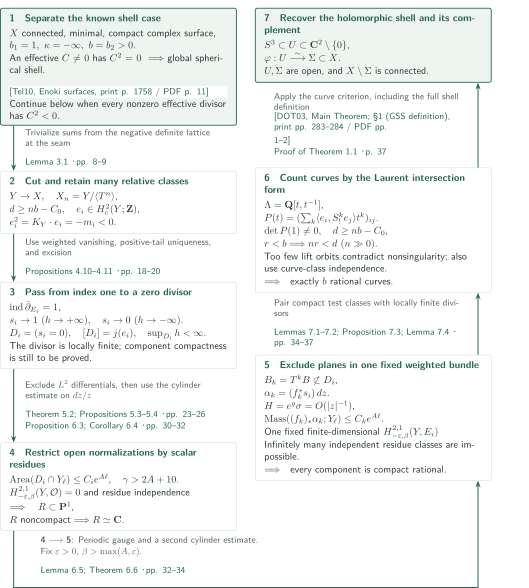

# Global Spherical Shells on Minimal Surfaces of Class VII

**Proving compactness of divisor components on a cyclic cover, then recovering a shell from the number of rational curves.**

The manuscript claims a proof of the Global Spherical Shell conjecture for minimal class VII surfaces with positive second Betti number. Its central step excludes noncompact components of effective divisors constructed from compactly supported Chern classes, using weighted Dolbeault cohomology and a cylinder estimate. This article follows that argument; it does not certify the correctness of the complete proof.

## 1. Main results

### Theorem 1.1 — A global spherical shell

Let $X$ be a connected compact complex surface with

$$b_1(X)=1,\qquad b_2(X)>0,\qquad \kappa(X)=-\infty.$$

Assume also that $X$ is minimal: it contains no smooth rational curve of self-intersection $-1$. Then there are an open neighborhood $U$ of

$$S^3=\{z\in\mathbf C^2:|z|=1\}$$

in $\mathbf C^2\setminus\{0\}$, an open set $\Sigma\subset X$, and a biholomorphism $\varphi:U\longrightarrow\Sigma$ such that $X\setminus\Sigma$ is connected.

<!-- cite:main-result -->[Theorem 1.1 · p. 1](https://github.com/openai/math/blob/1581d4cbdd69a0faf34b2089614fe2a814316a6a/preprints/Global-Spherical-Shells-on-Minimal-Surfaces-of-Class-VII-September-24-2026/paper.pdf)<!-- /cite -->

## References on the arrows

<!-- reference-guide -->
Unprefixed theorem, lemma, section and equation numbers refer to [Global Spherical Shells](https://github.com/openai/math/blob/1581d4cbdd69a0faf34b2089614fe2a814316a6a/preprints/Global-Spherical-Shells-on-Minimal-Surfaces-of-Class-VII-September-24-2026/paper.pdf). External inputs use the following keys.

- [Eno81](https://www.jstage.jst.go.jp/article/tmj1949/33/4/33_4_453/_pdf/-char/en) Ichiro Enoki — *Surfaces of class VII₀ with curves*: Classify the square-zero-divisor case and link the family to shells in note (3); statement compared. Tohoku Math. J. (2) 33 (1981), 453–492; publisher PDF.
- [DOT03](https://www.jstage.jst.go.jp/article/tmj/55/2/55_2_283/_pdf/-char/en) Georges Dloussky, Karl Oeljeklaus and Matei Toma — *Class VII₀ surfaces with b₂ curves*: Final input from $b_2$ rational curves to a shell; main theorem and shell definition compared. Tohoku Math. J. (2) 55 (2003), 283–309; publisher PDF.
- [Tel10](https://annals.math.princeton.edu/wp-content/uploads/annals-v172-n3-p07-p.pdf) Andrei Teleman — *Instantons and curves on class VII surfaces*: Cross-check the shell formulation of Enoki’s result and the canonical basis. Annals of Mathematics 172 (2010), 1749–1804; publisher PDF with front matter.
- [Hem11](https://www.impan.pl/shop/en/publication/transaction/download/product/84985) Gollakota V. V. Hemasundar — *Koebe’s general uniformisation theorem for planar Riemann surfaces*: Theorem 1.1 embeds a planar open normalization into the sphere; statement compared. Annales Polonici Mathematici 100.1 (2011), 77–85; publisher PDF.
- [Don87](https://doi.org/10.4310/jdg/1214441485) Simon K. Donaldson — *The orientation of Yang–Mills moduli spaces and 4-manifold topology*: Negative definite intersection input in Lemma 2.2; original theorem unchecked, application formulation checked in Teleman. Journal of Differential Geometry 26 (1987), 397–428; bibliographic record from manuscript.
- [HS74](https://doi.org/10.2307/1971062) Reese Harvey and Bernard Shiffman — *A characterization of holomorphic chains*: Analytic-cycle graph limit in Lemma 6.1; complete external statement comparison remains open. Annals of Mathematics 99 (1974), 553–587; bibliographic record from manuscript.
- [Tru67](https://doi.org/10.1512/iumj.1968.17.17028) Neil S. Trudinger — *On imbeddings into Orlicz spaces and some applications*: Exponential integrability in Lemma 6.5; original-source comparison of the strip formulation remains open. Journal of Mathematics and Mechanics 17 (1967), 473–483; bibliographic record from manuscript.
- [OpenAI26k3](https://github.com/openai/math/blob/1581d4cbdd69a0faf34b2089614fe2a814316a6a/preprints/Every-complex-K3-surface-is-Oka-September-23-2026/paper.pdf) OpenAI — *Every complex K3 surface is Oka*: Downstream use: the shell theorem enters only the class VII part of Corollary 10.2. September 23, 2026; fixed commit 1581d4cbdd69a0faf34b2089614fe2a814316a6a.

Each citation gives the result and pages. When printed pagination differs from the PDF position, both are shown. GitHub previews do not automatically jump to the cited page.
<!-- /reference-guide -->

## 2. Proof of Theorem 1.1 — Divisors, compact components, and curve counting

<!-- proof-target:1 -->Proof target：[Theorem 1.1 · p. 1](https://github.com/openai/math/blob/1581d4cbdd69a0faf34b2089614fe2a814316a6a/preprints/Global-Spherical-Shells-on-Minimal-Surfaces-of-Class-VII-September-24-2026/paper.pdf)<!-- /proof-target -->

**Proof route.** A nonzero effective divisor of square zero is handled by an established shell criterion. In the remaining case, the negative definite intersection forms of finite cyclic quotients supply many compactly supported Chern classes, which are realized by zero divisors of holomorphic sections on the infinite cyclic cover. Residue independence and a cylinder estimate force every component to be compact rational. An intersection argument over a Laurent polynomial ring then yields $b_2(X)$ rational curves downstairs. The final curve criterion supplies both the holomorphic shell and its connected-complement condition.

Write $b=b_2(X)$, let $\pi:Y\to X$ be the infinite cyclic cover associated with a primitive generator of $H^1(X;\mathbf Z)$, and let $T$ generate the deck group. The manuscript also uses $b$ for the second weight parameter; we denote that parameter alone by $\beta$ below.

In the diagram, $h$ is a proper height with $h\circ T=h+1$ and $Lh>0$, and $Y_\ell=h^{-1}([-\ell-1,-\ell])$. The map $j:H_c^2(Y;\mathbf Z)\to H^2(Y;\mathbf Z)$ forgets the support condition, $R$ denotes a component normalization, and $S=T^n$.

### 1. Remove the square-zero case and construct many classes

Under negative definiteness, a nonzero effective divisor $C$ with $C^2=0$ gives a shell by the Enoki criterion in Proposition 2.1(i). The remaining branch assumes $C^2<0$ for every nonzero effective divisor. Together with minimality, this gives $K_X\cdot B\geq0$ for every curve $B$ by Lemma 2.2. In particular, effective divisors cannot have negative canonical degree.

The height is chosen with $h\circ T=h+1$ and $Lh=c>0$. Each finite cyclic quotient $X_n=Y/\langle T^n\rangle$ is again minimal class VII, with $b_2(X_n)=nb$. Donaldson diagonalization supplies a canonical basis of $H^2(X_n;\mathbf Z)/\mathrm{Tors}$ with $u_i\cdot u_j=-\delta_{ij}$ and $K_{X_n}=\sum u_j\pmod{\mathrm{Tors}}$. Choose integral cohomology lifts of the $u_j$. Restrictions to a fixed cutting hypersurface $Z$ lie in a finite torsion group. Sums of distinct basis elements having the same restriction therefore supply sufficiently many classes trivial on $Z$. Cutting and extending with the prescribed end frames gives

$$d\geq nb-C_0,\qquad e_i\in H_c^2(Y;\mathbf Z),\qquad e_i^2=K_Y\cdot e_i=-m_i<0,$$

where $C_0$ is independent of $n$. Using sums of distinct basis elements preserves precisely this intersection identity.

<!-- cite:enoki -->[&#91;Eno81, Main Theorem; note (3), print p. 454 / PDF p. 2&#93;](https://www.jstage.jst.go.jp/article/tmj1949/33/4/33_4_453/_pdf/-char/en)<!-- /cite -->

<!-- cite:teleman -->[&#91;Tel10, Enoki surfaces, print p. 1758 / PDF p. 11&#93;](https://annals.math.princeton.edu/wp-content/uploads/annals-v172-n3-p07-p.pdf#page=11)<!-- /cite -->

<!-- cite:reductions -->[Proposition 2.1; Lemmas 2.2–2.5 · pp. 5–8](https://github.com/openai/math/blob/1581d4cbdd69a0faf34b2089614fe2a814316a6a/preprints/Global-Spherical-Shells-on-Minimal-Surfaces-of-Class-VII-September-24-2026/paper.pdf)<!-- /cite -->

<!-- cite:basis -->[&#91;Tel10, §1.1 (canonical basis), print p. 1756 / PDF p. 9&#93;](https://annals.math.princeton.edu/wp-content/uploads/annals-v172-n3-p07-p.pdf#page=9)<!-- /cite -->

<!-- cite:classes -->[Lemma 3.1 · pp. 8–9](https://github.com/openai/math/blob/1581d4cbdd69a0faf34b2089614fe2a814316a6a/preprints/Global-Spherical-Shells-on-Minimal-Surfaces-of-Class-VII-September-24-2026/paper.pdf)<!-- /cite -->

### 2. Use index one to obtain sections with different end limits

The absence of square-zero effective divisors makes the nontrivial character bundles $P_\lambda$ and $K_X\otimes P_\lambda$ acyclic. Fourier–Laplace transformation in the deck variable transfers this input to Dolbeault complexes with exponential conditions at both ends. Continuing across the trivial character leaves only a scalar constant term. Positive-tail uniqueness, using $Lh>0$, determines a holomorphic section from its positive constant $c_+$ and makes canonical-valued holomorphic sections vanish on a positive tail.

Each $E_i$ admits a holomorphic structure with any prescribed finite decay rate $\gamma$, and its weighted $H^{0,2}$ vanishes. In weighted spaces allowing positive growth rates at both ends, compact excision and Riemann–Roch give

$$\operatorname{ind}\bar\partial_{E_i}=1+\frac12(e_i^2-K_Y\cdot e_i)=1.$$

Thus $\dim H^{0,0}=1$, and a section $s_i$ can be normalized by $c_+=1$. A nonzero negative constant would make its zero divisor $D_i$ compact. Homotopies comparing the section with the prescribed end frames identify its **relative class itself** with $e_i$. Its effective pushforward would then satisfy $K_X\cdot\pi_*D_i=-m_i<0$, a contradiction. Consequently $s_i\to0$ at the negative end.

What has been obtained at this point is a locally finite divisor $D_i=(s_i=0)$ bounded above in height, with $[D_i]=j(e_i)$ in ordinary cohomology. Neither compactness of its components nor compactness of the whole divisor follows yet.

<!-- cite:sections -->[Propositions 4.8, 4.10–4.11 · pp. 17–20](https://github.com/openai/math/blob/1581d4cbdd69a0faf34b2089614fe2a814316a6a/preprints/Global-Spherical-Shells-on-Minimal-Surfaces-of-Class-VII-September-24-2026/paper.pdf)<!-- /cite -->

### 3. Use the scalar residue obstruction to restrict open normalizations

Lemma 5.1 bounds the area on negative unit height slabs $Y_\ell=h^{-1}([-\ell-1,-\ell])$ by $\operatorname{Area}(D_i\cap Y_\ell)\leq C_i e^{A\ell}$. The exponent $A$ depends only on fixed geometry; the holomorphic correction rate is then chosen with $\gamma>2A+10$. The constants $C_i$ may vary, while the exponent is common.

A holomorphic differential $\eta$ on the normalization $f:R\to B$ of a component defines a $(2,1)$-current $f_*\eta$. For $\varepsilon>0$ and $\beta>\varepsilon$, a mass exponent smaller than $\beta$ places it in the space with fixed weights $(-\varepsilon,\beta)$. Scalar $H^{2,1}$ vanishes, whereas Proposition 5.3 makes nonzero residue classes on distinct curves linearly independent. A primitive of an exact current first vanishes on the positive tail; analytic continuation then confines its support to the curves. A normal derivative of a distribution supported on a curve cannot produce the required order-zero delta term. This local contradiction is the residue obstruction.

An $L^2$ holomorphic differential has admissible mass growth by the area estimate and therefore cannot exist. The manuscript constructs such a differential from a handle to prove genus zero, and applies planar uniformization to place an open $R$ inside $\mathbf P^1$. If $R$ omits two points, it lies in $\mathbf C^*$ and carries $dz/z$. The cylinder estimate of Proposition 6.3 bounds the corresponding residue mass with the same exponent $A$, contradicting the scalar obstruction. Any remaining noncompact normalization must therefore be $\mathbf C$.

<!-- cite:residues -->[Theorem 5.2; Propositions 5.3–5.4 · pp. 23–26](https://github.com/openai/math/blob/1581d4cbdd69a0faf34b2089614fe2a814316a6a/preprints/Global-Spherical-Shells-on-Minimal-Surfaces-of-Class-VII-September-24-2026/paper.pdf)<!-- /cite -->

<!-- cite:planar -->[&#91;Hem11, Theorem 1.1, print p. 77 / PDF p. 1&#93;](https://www.impan.pl/shop/en/publication/transaction/download/product/84985)<!-- /cite -->

<!-- cite:cylinder -->[Proposition 6.3; Corollary 6.4 · pp. 30–32](https://github.com/openai/math/blob/1581d4cbdd69a0faf34b2089614fe2a814316a6a/preprints/Global-Spherical-Shells-on-Minimal-Surfaces-of-Class-VII-September-24-2026/paper.pdf)<!-- /cite -->

### 4. Apply the cylinder estimate again to exclude plane components

The cylinder estimate separates nonflat strips with a fixed energy cost from arbitrarily long chains of flat strips whose images lie in small coordinate charts. On the latter, the derivative of a periodic holomorphic map has zero constant angular Fourier mode. The sum of derivative bounds, and hence target-height variation, is controlled independently of chain length. For a multiplier $w$ with uniformly bounded $L^2$ norms on unit strips, this bounds $\int |df|w$ over a target height slab by area over a fixed enlargement of that slab.

If a plane component $B$ existed, then for all sufficiently large $k$ the curves $B_k=T^kB$ would be distinct and not contained in $D_i$. On their normalizations $f_k:\mathbf C\to B_k$,

$$\alpha_k=(f_k^*s_i)\,dz$$

is a nonzero holomorphic differential valued in $f_k^*E_i$. Properness and the upper height bound send $|z|\to\infty$ to the negative end. A periodic gauge $g$ makes the section coefficient $\sigma$ into an ordinary holomorphic function $H=e^g\sigma$. The stripwise $L^2$ bound for $e^{\operatorname{Re}g}$ and $\sigma\to0$ imply $\int_{S_j}|H|^2\to0$ on unit strips $S_j$ of the logarithmic cylinder; the mean-value estimate then gives uniform convergence $H\to0$. It therefore extends with value zero at infinity, so $H(z)=O(|z|^{-1})$, canceling the growth in $dz=z\,d(\log z)$. Exponential integrability in Lemma 6.5 bounds $e^{-\operatorname{Re}g}$ in $L^2$ on unit strips. A second application of the cylinder estimate gives all currents $(f_k)_*\alpha_k$ the common mass exponent $A$.

Fixing $\beta>\max(A,\varepsilon)$ puts their classes in **the same finite-dimensional space with the same coefficient bundle**, $H^{2,1}_{-\varepsilon,\beta}(Y,E_i)$. Residue independence applies to every finite subfamily, contradicting the infinitely many $B_k$. Their individual constants need not be uniformly bounded in $k$. Every component of every $D_i$ is therefore compact with rational normalization.

<!-- cite:compactness -->[Lemma 6.5; Theorem 6.6 · pp. 32–34](https://github.com/openai/math/blob/1581d4cbdd69a0faf34b2089614fe2a814316a6a/preprints/Global-Spherical-Shells-on-Minimal-Surfaces-of-Class-VII-September-24-2026/paper.pdf)<!-- /cite -->

### 5. Recover the curve count from the Laurent intersection form

Put $S=T^n$, $\Lambda=\mathbf Q[t,t^{-1}]$, and $F=\mathbf Q(t)$, with $t$ translating supports in the $S$ direction. Organize compact-support intersections as

$$P(a,c)=\sum_{k\in\mathbf Z}\langle a,S_!^kc\rangle t^k.$$

The sum is finite. Evaluating at $t=1$ recovers the negative definite Gram matrix on the finite cyclic quotient, so $P(e_i,e_j)$ is nonsingular over $F$.

If there were only $r<b$ rational curves downstairs, their compact lifts would give at most $nr$ orbits under $S$. For large $n$, one has $d\geq nb-C_0>nr$, leaving a nonzero $\Lambda$-linear combination $x$ orthogonal to every orbit. All components of each $D_j$ lie in those orbits, so $x$ is also orthogonal to every $S_!^ke_j$. This pairs a **compactly supported test class with a locally finite divisor**; only finitely many components contribute. Nonsingularity gives a contradiction, hence $r\geq b$.

Conversely, Lemma 7.4 shows that distinct curve classes are independent when there is no square-zero effective divisor. There are at most $b$ curves in total. Thus there are exactly $b$ rational curves.

<!-- cite:count -->[Lemmas 7.1–7.2; Proposition 7.3; Lemma 7.4 · pp. 34–37](https://github.com/openai/math/blob/1581d4cbdd69a0faf34b2089614fe2a814316a6a/preprints/Global-Spherical-Shells-on-Minimal-Surfaces-of-Class-VII-September-24-2026/paper.pdf)<!-- /cite -->

### 6. Obtain the holomorphic shell and connected complement

Connectedness, compactness, minimality, $b_1=1$, $\kappa=-\infty$, and $b_2>0$ are the original hypotheses on $X$. With the curve count, every hypothesis of the Dloussky–Oeljeklaus–Toma Main Theorem is satisfied, giving a global spherical shell. The cited definition includes a holomorphic embedding and a nonseparating condition. The manuscript explains that, if necessary, one shrinks to a small annular neighborhood and pushes the complement of the core sphere onto the complement of that open collar, preserving connectedness. The output is therefore the stated $U,\Sigma,\varphi$ with connected $X\setminus\Sigma$, rather than merely a topological sphere.

<!-- cite:dot -->[&#91;DOT03, Main Theorem; §1 (GSS definition), print pp. 283–284 / PDF pp. 1–2&#93;](https://www.jstage.jst.go.jp/article/tmj/55/2/55_2_283/_pdf/-char/en)<!-- /cite -->

<!-- cite:finish -->[Proof of Theorem 1.1 · p. 37](https://github.com/openai/math/blob/1581d4cbdd69a0faf34b2089614fe2a814316a6a/preprints/Global-Spherical-Shells-on-Minimal-Surfaces-of-Class-VII-September-24-2026/paper.pdf)<!-- /cite -->

## 3. Which papers supply which steps

| Source and result | Used at | Role and required hypotheses | Checking scope |
|---|---|---|---|
| Enoki's square-zero-divisor criterion, also stated by Teleman | Proposition 2.1(i), step 1 | Minimal class VII, $b_2>0$, and a nonzero effective divisor of square zero give a shell | Enoki’s Main Theorem and note (3), and Teleman’s formulation, compared; full proofs outside scope |
| Dloussky–Oeljeklaus–Toma, Main Theorem | Proposition 2.1(ii), step 6 | Exactly $b_2$ rational curves give a holomorphic global spherical shell | Conclusion, definition, and application hypotheses compared; the full input proof is outside scope |
| Donaldson diagonalization | Lemma 2.2 and Lemma 2.5 on finite cyclic quotients | Diagonalize the integral intersection lattice of a negative definite closed four-manifold | Application formulation compared in Teleman §1.1; original Donaldson theorem unchecked |
| Planar uniformization, analytic-cycle compactness, and Trudinger exponential integrability | Proposition 5.4, Lemma 6.1, Lemma 6.5 | Planarity of open normalizations, graph limits, and the periodic-gauge multiplier estimate | Uniformization Theorem 1.1 source-compared; complete statements of the other two inputs remain unchecked |

Taubes and Mrowka–Ruberman–Saveliev provide background for periodic-end methods. The Dolbeault Fredholm, continuation, and excision arguments required here are presented in §4; a background citation alone is not represented as direct application of a theorem from those papers.

**Input to a consequence in catalogue 042.** The [relevant section of Every complex K3 surface is Oka](../every-complex-k3-oka/#proof-4-step-4) explicitly uses the present Theorem 1.1 in the class VII part of Corollary 10.2. It brings minimal class VII surfaces with $b_2>0$ into the Kato classification and combines this with established Oka criteria. This is not an input to the K3 theorem, nor to the Enriques or Kodaira-dimension-zero parts of the corollary.

<!-- cite:oka-use -->[&#91;OpenAI26k3, Corollary 10.2, p. 54&#93;](https://github.com/openai/math/blob/1581d4cbdd69a0faf34b2089614fe2a814316a6a/preprints/Every-complex-K3-surface-is-Oka-September-23-2026/paper.pdf)<!-- /cite -->

## 4. Return to the sources

<!-- reading-list -->
- [Theorem 1.1 · p. 1](https://github.com/openai/math/blob/1581d4cbdd69a0faf34b2089614fe2a814316a6a/preprints/Global-Spherical-Shells-on-Minimal-Surfaces-of-Class-VII-September-24-2026/paper.pdf) — Hypotheses and every shell conclusion
- [Lemma 3.1 · pp. 8–9](https://github.com/openai/math/blob/1581d4cbdd69a0faf34b2089614fe2a814316a6a/preprints/Global-Spherical-Shells-on-Minimal-Surfaces-of-Class-VII-September-24-2026/paper.pdf) — Torsion at the seam and many relative classes
- [Propositions 4.8, 4.10–4.11 · pp. 17–20](https://github.com/openai/math/blob/1581d4cbdd69a0faf34b2089614fe2a814316a6a/preprints/Global-Spherical-Shells-on-Minimal-Surfaces-of-Class-VII-September-24-2026/paper.pdf) — Index one, end frames, and the zero negative coefficient
- [Theorem 5.2; Propositions 5.3–5.4 · pp. 23–26](https://github.com/openai/math/blob/1581d4cbdd69a0faf34b2089614fe2a814316a6a/preprints/Global-Spherical-Shells-on-Minimal-Surfaces-of-Class-VII-September-24-2026/paper.pdf) — Fixed weighted spaces and residue obstruction
- [Proposition 6.3; Corollary 6.4 · pp. 30–32](https://github.com/openai/math/blob/1581d4cbdd69a0faf34b2089614fe2a814316a6a/preprints/Global-Spherical-Shells-on-Minimal-Surfaces-of-Class-VII-September-24-2026/paper.pdf) — The target-height-slab estimate
- [Lemma 6.5; Theorem 6.6 · pp. 32–34](https://github.com/openai/math/blob/1581d4cbdd69a0faf34b2089614fe2a814316a6a/preprints/Global-Spherical-Shells-on-Minimal-Surfaces-of-Class-VII-September-24-2026/paper.pdf) — Excluding planes with one fixed coefficient bundle
- [Lemmas 7.1–7.2; Proposition 7.3; Lemma 7.4 · pp. 34–37](https://github.com/openai/math/blob/1581d4cbdd69a0faf34b2089614fe2a814316a6a/preprints/Global-Spherical-Shells-on-Minimal-Surfaces-of-Class-VII-September-24-2026/paper.pdf) — Locally finite divisors and compact test classes
- [Proof of Theorem 1.1 · p. 37](https://github.com/openai/math/blob/1581d4cbdd69a0faf34b2089614fe2a814316a6a/preprints/Global-Spherical-Shells-on-Minimal-Surfaces-of-Class-VII-September-24-2026/paper.pdf) — Final passage to a holomorphic shell and connected complement
<!-- /reading-list -->

External comparisons cover Enoki’s Main Theorem and note (3) (print p.454 / PDF p.2), the DOT Main Theorem and shell definition (print pp.283–284 / PDF pp.1–2), Teleman’s formulations (print pp.1756, 1758 / PDF pp.9, 11), and Hemasundar Theorem 1.1 (print p.77 / PDF p.1). Complete original-source comparison remains open for Donaldson’s theorem, Harvey–Shiffman cycle convergence, and the bounded-strip Trudinger formulation.

The hypotheses and every conclusion of the main theorem, the route above through §§2–7, and the use in Corollary 10.2 of catalogue 042 were read and compared in the manuscript bodies. The account distinguishes the relative class $e_i$ from its ordinary image $j(e_i)$, compactness of components from compactness of a whole divisor, and fixed weights and coefficient bundles from individual mass constants. The complete analytic estimates and proofs of external inputs have not been independently verified; no expert peer review or formal verification is claimed. Corollaries 1.2–1.3 are not included among this article's main results, and an overview of all their conclusions is outside its scope.
