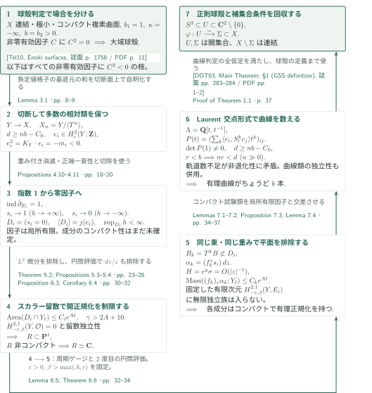

# Global Spherical Shells on Minimal Surfaces of Class VII

**巡回被覆上の因子の成分のコンパクト性を示し、有理曲線の本数から大域球殻へ帰着する。**

この原稿は、正の第2 Betti数をもつ極小class VII曲面について大域球殻予想を証明すると主張する。核心は、位相的なコンパクト台Chern類から作った有効因子について、非コンパクト成分を重み付きDolbeaultコホモロジーと円筒評価で排除することにある。以下は原稿の論証を追う概説であり、全証明の正しさの認定ではない。

## 1. 主要結果

### Theorem 1.1 — 大域球殻

$X$を連結コンパクト複素曲面とし、

$$b_1(X)=1,\qquad b_2(X)>0,\qquad \kappa(X)=-\infty$$

を仮定する。さらに$X$は極小、すなわち自己交点数$-1$の滑らかな有理曲線を含まないとする。このとき

$$S^3=\{z\in\mathbf C^2:|z|=1\}$$

の$\mathbf C^2\setminus\{0\}$内の開近傍$U$、開集合$\Sigma\subset X$、双正則写像$\varphi:U\longrightarrow\Sigma$が存在し、$X\setminus\Sigma$は連結である。

<!-- cite:main-result -->[Theorem 1.1 · p. 1](https://github.com/openai/math/blob/1581d4cbdd69a0faf34b2089614fe2a814316a6a/preprints/Global-Spherical-Shells-on-Minimal-Surfaces-of-Class-VII-September-24-2026/paper.pdf)<!-- /cite -->

## 図の矢印に付した引用

<!-- reference-guide -->
略号のない定理・補題・節・式番号は本原稿 [Global Spherical Shells](https://github.com/openai/math/blob/1581d4cbdd69a0faf34b2089614fe2a814316a6a/preprints/Global-Spherical-Shells-on-Minimal-Surfaces-of-Class-VII-September-24-2026/paper.pdf) を指します。外部入力には次の略号を使います。

- [Eno81](https://www.jstage.jst.go.jp/article/tmj1949/33/4/33_4_453/_pdf/-char/en) Ichiro Enoki — *Surfaces of class VII₀ with curves*：平方零因子の場合を分類し、note (3)で球殻を持つ系列と結び付ける。主張を照合。Tohoku Math. J. (2) 33 (1981), 453–492; publisher PDF。
- [DOT03](https://www.jstage.jst.go.jp/article/tmj/55/2/55_2_283/_pdf/-char/en) Georges Dloussky, Karl Oeljeklaus and Matei Toma — *Class VII₀ surfaces with b₂ curves*：$b_2$本の有理曲線から球殻を得る最終入力。主定理と球殻の定義を照合。Tohoku Math. J. (2) 55 (2003), 283–309; publisher PDF。
- [Tel10](https://annals.math.princeton.edu/wp-content/uploads/annals-v172-n3-p07-p.pdf) Andrei Teleman — *Instantons and curves on class VII surfaces*：Enoki判定の球殻による定式化、および標準基底の記述を併照。Annals of Mathematics 172 (2010), 1749–1804; publisher PDF with front matter。
- [Hem11](https://www.impan.pl/shop/en/publication/transaction/download/product/84985) Gollakota V. V. Hemasundar — *Koebe’s general uniformisation theorem for planar Riemann surfaces*：種数零の開正規化を球面内の領域へ移すTheorem 1.1。記述を照合。Annales Polonici Mathematici 100.1 (2011), 77–85; publisher PDF。
- [Don87](https://doi.org/10.4310/jdg/1214441485) Simon K. Donaldson — *The orientation of Yang–Mills moduli spaces and 4-manifold topology*：Lemma 2.2の負定値交点形式の入力。原典定理は未照合、Telemanの適用記述を確認。Journal of Differential Geometry 26 (1987), 397–428; bibliographic record from manuscript。
- [HS74](https://doi.org/10.2307/1971062) Reese Harvey and Bernard Shiffman — *A characterization of holomorphic chains*：Lemma 6.1のグラフの解析サイクル極限。外部定理の完全な記述照合は未了。Annals of Mathematics 99 (1974), 553–587; bibliographic record from manuscript。
- [Tru67](https://doi.org/10.1512/iumj.1968.17.17028) Neil S. Trudinger — *On imbeddings into Orlicz spaces and some applications*：Lemma 6.5の指数可積分性。帯上の定式化の原典照合は未了。Journal of Mathematics and Mechanics 17 (1967), 473–483; bibliographic record from manuscript。
- [OpenAI26k3](https://github.com/openai/math/blob/1581d4cbdd69a0faf34b2089614fe2a814316a6a/preprints/Every-complex-K3-surface-is-Oka-September-23-2026/paper.pdf) OpenAI — *Every complex K3 surface is Oka*：本稿の利用先。Corollary 10.2のclass VII部分のみで球殻定理を使う。September 23, 2026; fixed commit 1581d4cbdd69a0faf34b2089614fe2a814316a6a。

各引用に結果番号とページを付します。誌面番号とPDF内の位置が異なる場合は両方を示します。GitHubの閲覧リンクではページ位置への自動移動を前提としません。
<!-- /reference-guide -->

## 2. Theorem 1.1 の証明 — 因子の構成・成分のコンパクト性・曲線計数

<!-- proof-target:1 -->証明対象：[Theorem 1.1 · p. 1](https://github.com/openai/math/blob/1581d4cbdd69a0faf34b2089614fe2a814316a6a/preprints/Global-Spherical-Shells-on-Minimal-Surfaces-of-Class-VII-September-24-2026/paper.pdf)<!-- /proof-target -->

**証明の道筋。** 平方零の非零有効因子があれば既知の球殻判定を使う。残る場合には、有限巡回商の負定値交点形式から多数のコンパクト台Chern類を作り、無限巡回被覆上の正則切断の零因子へ移す。留数カレントの独立性と円筒評価により各成分をコンパクトな有理曲線に限り、Laurent多項式環上の交点計算から下の曲面に$b_2(X)$本の有理曲線を得る。最後の球殻の正則構造と補集合の連結性は、曲線判定の結論として取り出す。

以下では$b=b_2(X)$、$\pi:Y\to X$を$H^1(X;\mathbf Z)$の原始生成元に対応する無限巡回被覆、$T$をデッキ変換の生成元とする。原稿の重みの第2成分も$b$と書かれているため、以下ではその重みだけ$\beta$と書いて区別する。

図では$h$は$h\circ T=h+1$、$Lh>0$を満たすproperな高さ、$Y_\ell=h^{-1}([-\ell-1,-\ell])$である。$j:H_c^2(Y;\mathbf Z)\to H^2(Y;\mathbf Z)$は台の条件を忘れる写像、$R$は因子成分の正規化、$S=T^n$を表す。

### 1. 平方零因子を除き、巡回商から多数の類を作る

負定値性の下では、非零有効因子$C$に$C^2=0$があればProposition 2.1(i)のEnoki型判定が球殻を与える。以下はすべての非零有効因子に$C^2<0$を仮定する枝である。この仮定と極小性から、Lemma 2.2は各曲線$B$に$K_X\cdot B\geq0$を与える。特に有効因子が負の標準次数を持つことはない。

高さ関数は$h\circ T=h+1$、$Lh=c>0$となるよう選ばれる。有限巡回商$X_n=Y/\langle T^n\rangle$も極小class VIIで、$b_2(X_n)=nb$である。Donaldsonの対角化を使った$H^2(X_n;\mathbf Z)/\mathrm{Tors}$の標準基底$u_j$は$u_i\cdot u_j=-\delta_{ij}$、$K_{X_n}=\sum u_j\pmod{\mathrm{Tors}}$を満たす。各$u_j$の整数コホモロジーへの持ち上げを選ぶ。固定した切断超曲面$Z$への制限は有限torsion群に入るため、同じ制限を持つ相異なる基底元の和で$Z$上自明な類を十分多く作れる。切断して両端の自明化を保ったまま延長すると、$n$に依存しない$C_0$について

$$d\geq nb-C_0,\qquad e_i\in H_c^2(Y;\mathbf Z),\qquad e_i^2=K_Y\cdot e_i=-m_i<0$$

を得る。ここで相異なる基底元の和を使うのは、この交点等式を保つためである。

<!-- cite:enoki -->[&#91;Eno81, Main Theorem; note (3), 誌面 p. 454 / PDF p. 2&#93;](https://www.jstage.jst.go.jp/article/tmj1949/33/4/33_4_453/_pdf/-char/en)<!-- /cite -->

<!-- cite:teleman -->[&#91;Tel10, Enoki surfaces, 誌面 p. 1758 / PDF p. 11&#93;](https://annals.math.princeton.edu/wp-content/uploads/annals-v172-n3-p07-p.pdf#page=11)<!-- /cite -->

<!-- cite:reductions -->[Proposition 2.1; Lemmas 2.2–2.5 · pp. 5–8](https://github.com/openai/math/blob/1581d4cbdd69a0faf34b2089614fe2a814316a6a/preprints/Global-Spherical-Shells-on-Minimal-Surfaces-of-Class-VII-September-24-2026/paper.pdf)<!-- /cite -->

<!-- cite:basis -->[&#91;Tel10, §1.1 (canonical basis), 誌面 p. 1756 / PDF p. 9&#93;](https://annals.math.princeton.edu/wp-content/uploads/annals-v172-n3-p07-p.pdf#page=9)<!-- /cite -->

<!-- cite:classes -->[Lemma 3.1 · pp. 8–9](https://github.com/openai/math/blob/1581d4cbdd69a0faf34b2089614fe2a814316a6a/preprints/Global-Spherical-Shells-on-Minimal-Surfaces-of-Class-VII-September-24-2026/paper.pdf)<!-- /cite -->

### 2. 指数1から両端極限の異なる正則切断へ

平方零因子がないことから、非自明な指標束$P_\lambda$と$K_X\otimes P_\lambda$は非輪状になる。これをデッキ変数のFourier–Laplace変換で使い、原稿は両端に指数重みを課したDolbeault複体を構成する。自明指標を越える継続では、スカラーの場合の定数項だけが残る。$Lh>0$を用いる正端の一意性により、正則切断は正端定数$c_+$で決まり、標準束係数の正則切断は正端で消える。

任意に指定した有限の減衰率$\gamma$で各$E_i$を正則化でき、重み付き$H^{0,2}$は消える。両端に正の増大率を許す重み付き空間では、コンパクト部分の切り貼りとRiemann–Rochにより

$$\operatorname{ind}\bar\partial_{E_i}=1+\frac12(e_i^2-K_Y\cdot e_i)=1.$$

したがって$\dim H^{0,0}=1$であり、$c_+=1$に規格化した$s_i$が存在する。負端定数が非零なら、零因子$D_i$はコンパクトになり、両端の自明化とのホモトピーからその**相対類そのもの**が$e_i$になる。すると$\pi_*D_i$は有効であるのに$K_X\cdot\pi_*D_i=-m_i<0$となる。ゆえに$s_i\to0$が負端で成立する。

この段階で得るのは、上方に高さが有界な局所有限因子$D_i=(s_i=0)$と、通常のコホモロジーでの等式$[D_i]=j(e_i)$である。各成分のコンパクト性も、因子全体のコンパクト性も、ここからはまだ従わない。

<!-- cite:sections -->[Propositions 4.8, 4.10–4.11 · pp. 17–20](https://github.com/openai/math/blob/1581d4cbdd69a0faf34b2089614fe2a814316a6a/preprints/Global-Spherical-Shells-on-Minimal-Surfaces-of-Class-VII-September-24-2026/paper.pdf)<!-- /cite -->

### 3. スカラー留数障害で種数と開正規化を制限する

Lemma 5.1は負端の単位高さ帯$Y_\ell=h^{-1}([-\ell-1,-\ell])$で$\operatorname{Area}(D_i\cap Y_\ell)\leq C_i e^{A\ell}$を与える。指数$A$は固定した幾何だけで決まり、その後で$\gamma>2A+10$を選ぶ。定数$C_i$が各因子に依存してよい点と、指数が共通である点を分ける。

成分の正規化$f:R\to B$上の正則1形式$\eta$は$(2,1)$カレント$f_*\eta$を定める。ここで$\varepsilon>0$、$\beta>\varepsilon$を取り、質量指数が$\beta$未満なら、これは固定した重み$(-\varepsilon,\beta)$の空間に入る。スカラー係数の$H^{2,1}$は零である一方、Proposition 5.3は異なる曲線に支えを持つ非零留数カレントの類が独立であることを示す。完全なカレントの原始は正端で消え、解析接続により支えが曲線上に限られる。しかし曲線上に支えを持つ分布の法線微分から、必要な次数零のdelta項は生じない。この局所的な矛盾が留数障害である。

$L^2$正則1形式は面積評価から許容される質量増大を持つので存在できない。原稿はハンドルから$L^2$正則1形式を作る議論により種数零を示し、平面型一意化を適用して、開いた$R$を$\mathbf P^1$内の領域とする。さらに$R$が2点を欠けば$R\subset\mathbf C^*$として$dz/z$を用いる。Proposition 6.3の円筒評価がその留数質量を同じ指数$A$で抑え、スカラー障害に矛盾する。したがって非コンパクトな正規化があるなら$R\simeq\mathbf C$に限られる。

<!-- cite:residues -->[Theorem 5.2; Propositions 5.3–5.4 · pp. 23–26](https://github.com/openai/math/blob/1581d4cbdd69a0faf34b2089614fe2a814316a6a/preprints/Global-Spherical-Shells-on-Minimal-Surfaces-of-Class-VII-September-24-2026/paper.pdf)<!-- /cite -->

<!-- cite:planar -->[&#91;Hem11, Theorem 1.1, 誌面 p. 77 / PDF p. 1&#93;](https://www.impan.pl/shop/en/publication/transaction/download/product/84985)<!-- /cite -->

<!-- cite:cylinder -->[Proposition 6.3; Corollary 6.4 · pp. 30–32](https://github.com/openai/math/blob/1581d4cbdd69a0faf34b2089614fe2a814316a6a/preprints/Global-Spherical-Shells-on-Minimal-Surfaces-of-Class-VII-September-24-2026/paper.pdf)<!-- /cite -->

### 4. 円筒評価をもう一度使い、平面成分を排除する

円筒評価の要点は、固定量のエネルギーを消費する非平坦帯と、像が小さな座標近傍に収まる平坦帯の長い鎖を分けることにある。後者では周期的正則写像の微分の角方向定数モードが零となり、微分の上界の和と像の高さ変化が鎖の長さによらず抑えられる。これにより、単位帯ごとの$L^2$ノルムが有界な乗数$w$に対して、目標側の高さ帯上の$\int |df|w$を固定幅で拡大した高さ帯の面積から評価できる。

平面成分$B$があれば、十分大きな$k$に対して$B_k=T^kB$は互いに異なり$D_i$に含まれない。正規化$f_k:\mathbf C\to B_k$上で

$$\alpha_k=(f_k^*s_i)\,dz$$

は非零の$f_k^*E_i$値正則1形式となる。proper性と高さの上界から$|z|\to\infty$は負端へ送られる。周期ゲージ$g$を取ると、切断の係数$\sigma$に対し$H=e^g\sigma$が通常の正則関数となる。$e^{\operatorname{Re}g}$の帯ごとの$L^2$上界と$\sigma\to0$から対数円筒の単位帯$S_j$上で$\int_{S_j}|H|^2\to0$を得て、平均値評価により$H\to0$が一様に成立する。したがって無限遠で零に延長するので$H(z)=O(|z|^{-1})$である。$dz=z\,d(\log z)$の増大はこれで相殺される。Lemma 6.5の指数可積分性が$e^{-\operatorname{Re}g}$の帯ごとの$L^2$上界を与え、2度目の円筒評価により全カレント$(f_k)_*\alpha_k$の質量指数が共通の$A$となる。

$\beta>\max(A,\varepsilon)$を一度固定すると、これらの類は**同じ束$E_i$を係数とする同じ有限次元空間**$H^{2,1}_{-\varepsilon,\beta}(Y,E_i)$に属する。留数障害は任意の有限部分族を独立にするため、無限個の$B_k$は矛盾を生む。定数が$k$によらず有界である必要はない。これで各$D_i$の全成分はコンパクトで、有理正規化を持つ。

<!-- cite:compactness -->[Lemma 6.5; Theorem 6.6 · pp. 32–34](https://github.com/openai/math/blob/1581d4cbdd69a0faf34b2089614fe2a814316a6a/preprints/Global-Spherical-Shells-on-Minimal-Surfaces-of-Class-VII-September-24-2026/paper.pdf)<!-- /cite -->

### 5. Laurent交点形式で曲線数を回収する

$S=T^n$、$\Lambda=\mathbf Q[t,t^{-1}]$、$F=\mathbf Q(t)$とし、$t$は支えを$S$方向へ移す作用を表す。コンパクト台類の交点を

$$P(a,c)=\sum_{k\in\mathbf Z}\langle a,S_!^kc\rangle t^k$$

にまとめる。和は有限であり、$t=1$で有限巡回商上の負定値Gram行列を回収するので、$P(e_i,e_j)$は$F$上非退化となる。

下の有理曲線が$r<b$本しかなければ、それらのコンパクトな持ち上げは$S$作用で高々$nr$軌道である。$n$を大きくして$d\geq nb-C_0>nr$とすると、全軌道に直交する非零の$\Lambda$線形結合$x$が存在する。各$D_j$の成分はその軌道群に含まれるため、$x$は全$S_!^ke_j$にも直交する。ここでは**コンパクト台の試験類と局所有限因子**を交差させるので、実際に寄与する成分は有限個である。非退化性との矛盾から$r\geq b$を得る。

一方、平方零有効因子がない場合のLemma 7.4は相異なる曲線の類の独立性を与え、曲線総数は高々$b$となる。したがって有理曲線がちょうど$b$本存在する。

<!-- cite:count -->[Lemmas 7.1–7.2; Proposition 7.3; Lemma 7.4 · pp. 34–37](https://github.com/openai/math/blob/1581d4cbdd69a0faf34b2089614fe2a814316a6a/preprints/Global-Spherical-Shells-on-Minimal-Surfaces-of-Class-VII-September-24-2026/paper.pdf)<!-- /cite -->

### 6. 正則球殻と連結な補集合を得る

$X$の連結性・コンパクト性・極小性と$b_1=1$、$\kappa=-\infty$、$b_2>0$は最初の仮定である。前段の曲線数を加えるとDloussky–Oeljeklaus–TomaのMain Theoremの仮定が満たされ、大域球殻が得られる。引用先の球殻の定義は正則埋込みと非分離条件を含む。原稿は必要なら球面の十分小さな環状近傍へ縮小し、球面の補集合からその開近傍の補集合へ押し出すことで$X\setminus\Sigma$の連結性を得る、と明記している。したがって最後の結論は位相的な球面の存在だけではなく、主張にある$U,\Sigma,\varphi$と連結な補集合である。

<!-- cite:dot -->[&#91;DOT03, Main Theorem; §1 (GSS definition), 誌面 pp. 283–284 / PDF pp. 1–2&#93;](https://www.jstage.jst.go.jp/article/tmj/55/2/55_2_283/_pdf/-char/en)<!-- /cite -->

<!-- cite:finish -->[Proof of Theorem 1.1 · p. 37](https://github.com/openai/math/blob/1581d4cbdd69a0faf34b2089614fe2a814316a6a/preprints/Global-Spherical-Shells-on-Minimal-Surfaces-of-Class-VII-September-24-2026/paper.pdf)<!-- /cite -->

## 3. どの論文が、どの段階を担うか

| 供給元と結果 | 利用箇所 | 使用内容・必要な仮定 | 確認範囲 |
|---|---|---|---|
| Enokiの平方零因子判定（Telemanの記述を併照） | Proposition 2.1(i)、証明の第1段階 | 極小class VII、$b_2>0$と非零有効因子$C^2=0$から球殻へ | EnokiのMain Theorem・note (3)とTelemanの定式化を照合。証明全体は対象外 |
| Dloussky–Oeljeklaus–Toma, Main Theorem | Proposition 2.1(ii)、証明の第6段階 | $b_2$本の有理曲線から正則大域球殻へ | 結論の定義と適用条件を照合、入力の全証明は対象外 |
| Donaldsonの対角化 | Lemma 2.2、有限巡回商に関するLemma 2.5 | 負定値閉4次元多様体の整数交点格子を対角化 | Teleman §1.1の適用記述を照合。Donaldson原典定理は未照合 |
| 平面型一意化、解析サイクルのコンパクト性、Trudinger型指数可積分性 | Proposition 5.4、Lemma 6.1、Lemma 6.5 | 開正規化の平面性、グラフ極限、周期ゲージの乗数評価 | 一意化のTheorem 1.1は原典照合済み。他の2入力の完全な記述照合は未了 |

TaubesおよびMrowka–Ruberman–Savelievの周期端理論は方法の背景として挙げられるが、本稿が必要とするDolbeault複体のFredholm性・継続・切除の議論は§4に記載されている。この背景引用から別論文の定理をそのまま適用した矢印は作らない。

**カタログ042への帰結入力。** [Every complex K3 surface is Okaの該当節](../every-complex-k3-oka/#proof-4-step-4)は、Corollary 10.2のclass VII部分で本稿Theorem 1.1を明示的に使う。$b_2>0$の極小class VII曲面をKato曲面の分類へ移し、既知のOka判定と合わせる接続である。K3主定理の証明への入力ではなく、Enriques／Kodaira次元零の部分にもこの球殻結果は使われない。

<!-- cite:oka-use -->[&#91;OpenAI26k3, Corollary 10.2, p. 54&#93;](https://github.com/openai/math/blob/1581d4cbdd69a0faf34b2089614fe2a814316a6a/preprints/Every-complex-K3-surface-is-Oka-September-23-2026/paper.pdf)<!-- /cite -->

## 4. 原典を読む入口と確認範囲

<!-- reading-list -->
- [Theorem 1.1 · p. 1](https://github.com/openai/math/blob/1581d4cbdd69a0faf34b2089614fe2a814316a6a/preprints/Global-Spherical-Shells-on-Minimal-Surfaces-of-Class-VII-September-24-2026/paper.pdf) — 仮定と球殻の全結論
- [Lemma 3.1 · pp. 8–9](https://github.com/openai/math/blob/1581d4cbdd69a0faf34b2089614fe2a814316a6a/preprints/Global-Spherical-Shells-on-Minimal-Surfaces-of-Class-VII-September-24-2026/paper.pdf) — 切断のtorsion障害と多数の相対類
- [Propositions 4.8, 4.10–4.11 · pp. 17–20](https://github.com/openai/math/blob/1581d4cbdd69a0faf34b2089614fe2a814316a6a/preprints/Global-Spherical-Shells-on-Minimal-Surfaces-of-Class-VII-September-24-2026/paper.pdf) — 指数1・両端の自明化・負端定数零
- [Theorem 5.2; Propositions 5.3–5.4 · pp. 23–26](https://github.com/openai/math/blob/1581d4cbdd69a0faf34b2089614fe2a814316a6a/preprints/Global-Spherical-Shells-on-Minimal-Surfaces-of-Class-VII-September-24-2026/paper.pdf) — 固定した重み付き空間と留数障害
- [Proposition 6.3; Corollary 6.4 · pp. 30–32](https://github.com/openai/math/blob/1581d4cbdd69a0faf34b2089614fe2a814316a6a/preprints/Global-Spherical-Shells-on-Minimal-Surfaces-of-Class-VII-September-24-2026/paper.pdf) — 目標側の高さ帯を評価する仕組み
- [Lemma 6.5; Theorem 6.6 · pp. 32–34](https://github.com/openai/math/blob/1581d4cbdd69a0faf34b2089614fe2a814316a6a/preprints/Global-Spherical-Shells-on-Minimal-Surfaces-of-Class-VII-September-24-2026/paper.pdf) — 平面成分を同一係数束で排除する議論
- [Lemmas 7.1–7.2; Proposition 7.3; Lemma 7.4 · pp. 34–37](https://github.com/openai/math/blob/1581d4cbdd69a0faf34b2089614fe2a814316a6a/preprints/Global-Spherical-Shells-on-Minimal-Surfaces-of-Class-VII-September-24-2026/paper.pdf) — 局所有限因子とコンパクト試験類の交点
- [Proof of Theorem 1.1 · p. 37](https://github.com/openai/math/blob/1581d4cbdd69a0faf34b2089614fe2a814316a6a/preprints/Global-Spherical-Shells-on-Minimal-Surfaces-of-Class-VII-September-24-2026/paper.pdf) — 正則球殻と補集合条件の最終接続
<!-- /reading-list -->

外部ではEnokiのMain Theorem・note (3)（誌面p.454 / PDF p.2）、DOTのMain Theoremと球殻の定義（誌面pp.283–284 / PDF pp.1–2）、Telemanの定式化（誌面pp.1756, 1758 / PDF pp.9, 11）、Hemasundar Theorem 1.1（誌面p.77 / PDF p.1）を照合した。Donaldson原典の定理、Harvey–Shiffmanのサイクル収束定理、Trudingerの帯上の定式化は原典での完全な記述照合が残る。

主定理の仮定と全結論、§§2–7の上記経路、042 Corollary 10.2の使用箇所を原稿本文で読解・照合した。特に相対類$e_i$と通常の類$j(e_i)$、各成分と因子全体のコンパクト性、固定した重み・係数束と個々の質量定数を区別した。原稿の全解析的評価、外部入力の全証明、専門家査読・形式検証は行っていない。Corollaries 1.2–1.3は本記事の主要結果に含めず、その全結論の証明概説も対象外とする。
