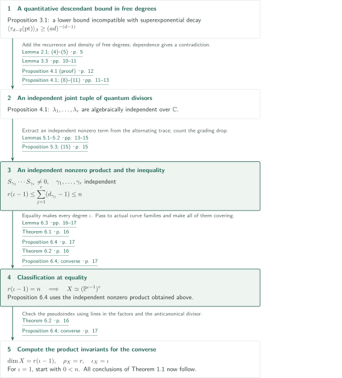
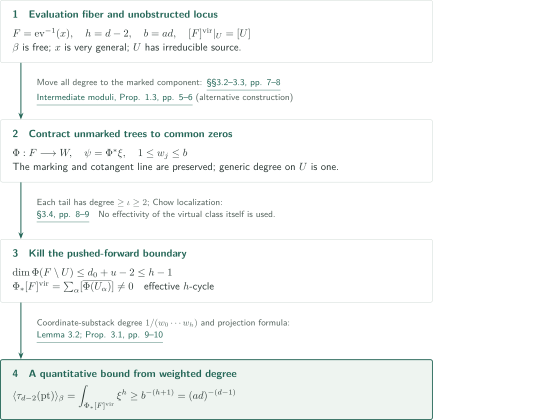
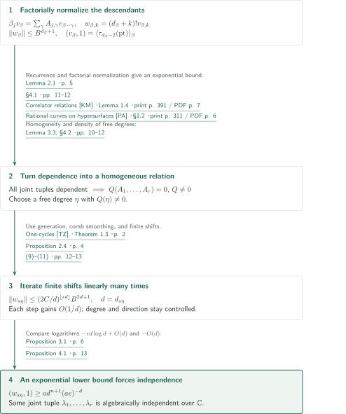
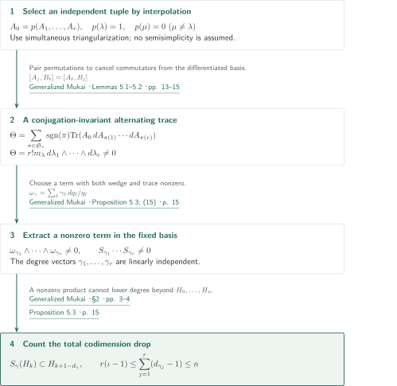
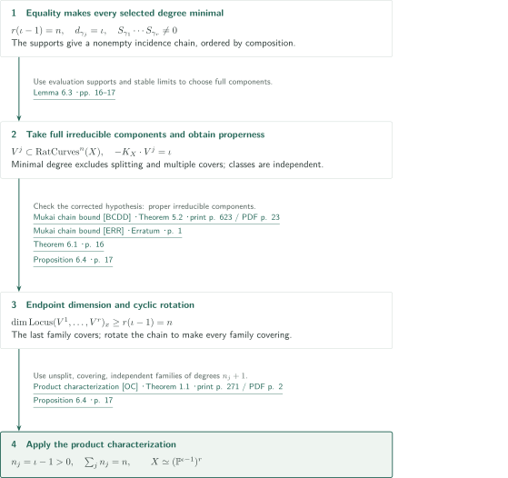

# The generalized Mukai conjecture

**Point-descendant lower bounds, independent quantum divisors, and rigidity through minimal rational curves**

The manuscript claims the Picard-number–pseudoindex inequality for smooth complex Fano manifolds by exploiting the grading of quantum multiplication. Its central task is to construct a nonzero product of correspondences in independent curve degrees. Only at equality does it pass to actual families of minimal rational curves and invoke an existing characterization of products.

## 1. Main results

### Theorem 1.1 — The generalized Mukai inequality and equality

Let $X$ be a smooth connected complex projective Fano manifold of positive dimension $n$, Picard number $\rho_X$, and pseudoindex $\iota_X$. The manuscript asserts

$$
\rho_X(\iota_X-1)\le n
$$

with equality if and only if

$$
X\simeq (\mathbb P^{\iota_X-1})^{\rho_X}.
$$

Write $r=\rho_X$ and $\iota=\iota_X$. If $\iota=1$, the left side is $0<n$, so the argument concerns $\iota\ge2$.

<!-- cite:main-result -->[Theorem 1.1 · p. 2; §1 · pp. 2–3](https://github.com/openai/math/blob/fd4aeeb2ee4fc729c18d98444fed42fd0529eeeb/preprints/The-Generalized-Mukai-Conjecture-September-24-2026/article.pdf)<!-- /cite -->

## References on the arrows

<!-- reference-guide -->
Unprefixed theorem, lemma, section and equation numbers refer to [Generalized Mukai](https://github.com/openai/math/blob/fd4aeeb2ee4fc729c18d98444fed42fd0529eeeb/preprints/The-Generalized-Mukai-Conjecture-September-24-2026/article.pdf). External inputs use the following keys.

- [KM](https://www.ihes.fr/~maxim/TEXTS/relation_between_23.pdf) Kontsevich–Manin — *Correlator relations*: Correlator relations and recursion. 1998 published version.
- [PA](https://www.numdam.org/item/SB_1997-1998__40__307_0.pdf) Rahul Pandharipande — *Rational curves on hypersurfaces*: Divisor, string and topological recursion relations. 1998 published version (Astérisque 252).
- [MM](https://arxiv.org/pdf/math/0409569v4) Andrei Mustaţă and Magdalena Anca Mustaţă — *Intermediate moduli*: An alternative contraction via intermediate moduli of stable maps. arXiv v4 (July 17, 2006).
- [MMC](https://arxiv.org/pdf/math/0507464v5) Anca M. Mustaţă and Andrei Mustaţă — *Chow ring*: Intermediate stacks and the cotangent class. arXiv v5 (November 30, 2006).
- [TZ](https://arxiv.org/pdf/1209.4342v5) Zhiyu Tian and Hong R. Zong — *One-cycles*: Generation of one-cycles by rational curves and comb smoothing. arXiv v5 (July 22, 2013).
- [CA](https://www.numdam.org/item/10.24033/asens.1658.pdf) Frédéric Campana — *Fano rational connectedness*: Rational connectedness of Fano varieties. 1992 published version.
- [DE](https://www.math.ens.psl.eu/~debarre/NotesGAEL.pdf) Olivier Debarre — *Rational curves*: Passage to separable rational connectedness. Lecture notes dated August 29, 2011.
- [BCDD](https://druel.perso.math.cnrs.fr/textes/mukai.pdf) Laurent Bonavero, Cinzia Casagrande, Olivier Debarre and Stéphane Druel — *Mukai chain bound*: Dimension bound for an ordered chain locus. 2003 published version.
- [ERR](https://druel.perso.math.cnrs.fr/textes/mukai_erratum.pdf) Bonavero–Casagrande–Debarre–Druel — *Mukai chain bound*: Correction to the hypotheses of the chain bound. Undated one-page author correction (retrieved October 9, 2026).
- [OC](https://doi.org/10.4153/CMB-2006-028-3) Gianluca Occhetta — *Product characterization*: Characterization of products of projective spaces. 2006 published version.

Each citation gives the result and pages. When printed pagination differs from the PDF position, both are shown. GitHub previews do not automatically jump to the cited page.
<!-- /reference-guide -->

## 2. Theorem 1.1 — Proof overview of the main theorem

<!-- proof-target:1 -->Proof target：[Theorem 1.1 · p. 2; §1 · pp. 2–3](https://github.com/openai/math/blob/fd4aeeb2ee4fc729c18d98444fed42fd0529eeeb/preprints/The-Generalized-Mukai-Conjecture-September-24-2026/article.pdf)<!-- /proof-target -->

**Proof route.** Use $X,n,r,\iota$ from Theorem 1.1. If $\iota=1$, then $r(\iota-1)=0<n$, so the inequality is immediate and equality is impossible. Assume $\iota\ge2$ below. The lower bound in [Proposition 3.1](#proposition-3-1) leads to independence in [Proposition 4.1](#proposition-4-1). [Proposition 5.3](#proposition-5-3) supplies both the inequality and the input for the equality case; [Proposition 6.4](#proposition-6-4) then gives the product structure.

### 1. From a lower bound and independence to the inequality

Proposition 3.1 alone does not give independence. Combine it with the recurrence in Lemma 2.1 and the density of free degrees in Lemma 3.3. If every joint eigenvalue tuple were algebraically dependent, the resulting superexponential upper bound would contradict the descendant lower bound. This proves Proposition 4.1. The details are separated into the sections on the [lower bound](#proof-1) and [independence](#proof-2).

<!-- cite:descendant-target -->[Proposition 3.1 · p. 6](https://github.com/openai/math/blob/fd4aeeb2ee4fc729c18d98444fed42fd0529eeeb/preprints/The-Generalized-Mukai-Conjecture-September-24-2026/article.pdf)<!-- /cite --> · <!-- cite:recurrence -->[Lemma 2.1; (4)–(5) · p. 5](https://github.com/openai/math/blob/fd4aeeb2ee4fc729c18d98444fed42fd0529eeeb/preprints/The-Generalized-Mukai-Conjecture-September-24-2026/article.pdf)<!-- /cite --> · <!-- cite:free-direction -->[Lemma 3.3 · pp. 10–11; Proposition 4.1 (proof) · p. 12](https://github.com/openai/math/blob/fd4aeeb2ee4fc729c18d98444fed42fd0529eeeb/preprints/The-Generalized-Mukai-Conjecture-September-24-2026/article.pdf)<!-- /cite --> · <!-- cite:independence -->[Proposition 4.1; (8)–(11) · pp. 11–13](https://github.com/openai/math/blob/fd4aeeb2ee4fc729c18d98444fed42fd0529eeeb/preprints/The-Generalized-Mukai-Conjecture-September-24-2026/article.pdf)<!-- /cite -->

Apply Proposition 5.3 to the independent tuple. It yields linearly independent curve degrees $\gamma_1,\ldots,\gamma_r$ with $S_{\gamma_1}\cdots S_{\gamma_r}\ne0$. Writing $d_\gamma=-K_X\cdot\gamma$, one obtains

$$
r(\iota-1)\le\sum_{j=1}^r(d_{\gamma_j}-1)\le n.
$$

The first inequality uses $d_{\gamma_j}\ge\iota$ for positive stable-map degrees; the second counts the grading drop of the nonzero product. This proves the inequality in the main theorem. The [alternating-trace section](#proof-3) explains how to extract this product.

<!-- cite:inequality -->[Proposition 5.3; (15) · p. 15](https://github.com/openai/math/blob/fd4aeeb2ee4fc729c18d98444fed42fd0529eeeb/preprints/The-Generalized-Mukai-Conjecture-September-24-2026/article.pdf)<!-- /cite -->

### 2. Equality forces the product of projective spaces

If $r(\iota-1)=n$, all the preceding bounds are equalities and each $d_{\gamma_j}=\iota$. The independent nonzero product from Proposition 5.3 is exactly the additional input required by Proposition 6.4. Lemma 6.3 passes to actual proper rational-curve families. The corrected chain-locus dimension bound and cyclic rotation make every family covering. The product characterization gives

$$
X\simeq(\mathbb P^{\iota-1})^r.
$$

The [equality section](#proof-4) explains the hypotheses and applications of these external results.

<!-- cite:proper-family -->[Lemma 6.3 · pp. 16–17](https://github.com/openai/math/blob/fd4aeeb2ee4fc729c18d98444fed42fd0529eeeb/preprints/The-Generalized-Mukai-Conjecture-September-24-2026/article.pdf)<!-- /cite --> · <!-- cite:classified -->[Proposition 6.4 · p. 17](https://github.com/openai/math/blob/fd4aeeb2ee4fc729c18d98444fed42fd0529eeeb/preprints/The-Generalized-Mukai-Conjecture-September-24-2026/article.pdf)<!-- /cite --> · <!-- cite:chain-bound -->[Mukai chain bound &#91;BCDD&#93; · Theorem 5.2 · print p. 623 / PDF p. 23](https://druel.perso.math.cnrs.fr/textes/mukai.pdf#page=23)<!-- /cite --> · <!-- cite:erratum -->[Mukai chain bound &#91;ERR&#93; · Erratum · p. 1](https://druel.perso.math.cnrs.fr/textes/mukai_erratum.pdf#page=1)<!-- /cite --> · <!-- cite:product -->[Product characterization &#91;OC&#93; · Theorem 1.1 · print p. 271 / PDF p. 2](https://doi.org/10.4153/CMB-2006-028-3)<!-- /cite -->

### 3. The product attains equality

Conversely, let $X=(\mathbb P^{\iota-1})^r$ with $\iota\ge2$. Its dimension is $r(\iota-1)$ and its Picard number is $r$. If $H_j$ is the pullback of the hyperplane class from the $j$th factor, then $-K_X=\iota\sum_jH_j$. A line in one factor has anticanonical degree $\iota$. Every irreducible rational curve has nonnegative integral intersections with the $H_j$, at least one of which is positive. Thus the pseudoindex is $\iota$, and equality holds. This completes both directions of Theorem 1.1.

<!-- cite:classification -->[Theorem 6.2 · p. 16; Proposition 6.4; converse · p. 17](https://github.com/openai/math/blob/fd4aeeb2ee4fc729c18d98444fed42fd0529eeeb/preprints/The-Generalized-Mukai-Conjecture-September-24-2026/article.pdf)<!-- /cite -->

## 3. Proof of Proposition 3.1 — the point-descendant lower bound

<!-- proof-target:2 -->Proof target：[Proposition 3.1 · p. 6](https://github.com/openai/math/blob/fd4aeeb2ee4fc729c18d98444fed42fd0529eeeb/preprints/The-Generalized-Mukai-Conjecture-September-24-2026/article.pdf)<!-- /proof-target -->

<!-- statement:proposition-3-1 -->
### Proposition 3.1 — Point-descendant lower bound

Let $X$ be the smooth complex projective Fano manifold above, with $\iota\ge2$. Fix a positive integer $a$ and an embedding $X\hookrightarrow\mathbb P^N$ such that $\mathcal O_{\mathbb P^N}(1)|_X\simeq\mathcal O_X(-aK_X)$. Suppose that the numerical curve degree $\beta$ is represented by a nonconstant free map $\mathbb P^1\to X$. Put $d=-K_X\cdot\beta$ and $b=ad$. The manuscript asserts

$$
\langle\tau_{d-2}(\mathrm{pt})\rangle_\beta\ge b^{-(d-1)}.
$$

<!-- cite:descendant-target -->[Proposition 3.1 · p. 6](https://github.com/openai/math/blob/fd4aeeb2ee4fc729c18d98444fed42fd0529eeeb/preprints/The-Generalized-Mukai-Conjecture-September-24-2026/article.pdf)<!-- /cite -->
<!-- /statement -->

Write $d_\beta=-K_X\cdot\beta$. The next section compares this quantitative bound with an upper bound from the recurrence.

### 1. A contraction preserving the unobstructed open part

Let $\beta$ be free, and set $d=d_\beta$, $b=ad$, and $h=d-2$. For a very general point $x$, put $F=\mathrm{ev}^{-1}(x)\subset\overline M_{0,1}(X,\beta)$. The open substack $U$ with irreducible source is nonempty and smooth, with $[F]^{\mathrm{vir}}|_U=[U]$. The manuscript retains the marked component and replaces the other trees by common zeros at their attachment points. In §3.2, $L^+=L(\sum_e e\Delta_e)$ transfers all degree to the marked component without changing a neighborhood of the marking. Normalized coefficients define $\Phi:F\to W$ into a weighted projective stack $W$, with $\psi=\Phi^*\xi$, $\xi=c_1(\mathcal O_W(1))$, and generic stack degree one on $U$.

<!-- cite:evaluation-fiber -->[§§3.1–3.3 · pp. 6–8](https://github.com/openai/math/blob/fd4aeeb2ee4fc729c18d98444fed42fd0529eeeb/preprints/The-Generalized-Mukai-Conjecture-September-24-2026/article.pdf)<!-- /cite --> · <!-- cite:intermediate-moduli -->[Intermediate moduli &#91;MM&#93; · Definition 1.2; Proposition 1.3 · pp. 5–6; Lemma 3.3 (proof) · pp. 17–18](https://arxiv.org/pdf/math/0409569v4#page=5)<!-- /cite --> · <!-- cite:chow-ring -->[Chow ring &#91;MMC&#93; · Proposition 1.7 · p. 5](https://arxiv.org/pdf/math/0507464v5#page=5)<!-- /cite -->

### 2. It is the boundary pushforward that vanishes

Let $d_0$ be the anticanonical degree of the marked component and $u$ the number of attached trees. The retained data have dimension at most $d_0+u-2$. Each tree has degree at least $\iota\ge2$, so $d-d_0\ge2u$ yields

$$
\dim\Phi(F\setminus U)\le d_0+u-2\le h-1.
$$

The boundary term in Chow localization therefore vanishes after pushforward. Thus $\Phi_*[F]^{\mathrm{vir}}$ is a nonempty effective $h$-cycle consisting of closures of components of $\Phi(U)$. The argument does not assume that $[F]^{\mathrm{vir}}$ itself is effective or that all tail maps are unobstructed.

<!-- cite:boundary -->[§3.4 · pp. 8–9](https://github.com/openai/math/blob/fd4aeeb2ee4fc729c18d98444fed42fd0529eeeb/preprints/The-Generalized-Mukai-Conjecture-September-24-2026/article.pdf)<!-- /cite -->

### 3. Turning stack degrees into a numerical bound

All weights of $W$ are at most $b$. Lemma 3.2 gives $\int_Z\xi^h\ge b^{-(h+1)}$ for every integral $h$-dimensional closed substack $Z\subset W$. A monomial degeneration of the weighted homogeneous ideal reduces the estimate to coordinate substacks, of degree $1/(w_0\cdots w_h)$. The projection formula gives $\int_{[F]^{\mathrm{vir}}}\psi^h=\int_{\Phi_*[F]^{\mathrm{vir}}}\xi^h$, hence the desired lower bound. Stabilizer denominators are essential to this numerical estimate.

<!-- cite:degree-bound -->[Lemma 3.2; Proposition 3.1 (proof) · pp. 9–10](https://github.com/openai/math/blob/fd4aeeb2ee4fc729c18d98444fed42fd0529eeeb/preprints/The-Generalized-Mukai-Conjecture-September-24-2026/article.pdf)<!-- /cite -->

## 4. Proof of Proposition 4.1 — independent eigenvalues

<!-- proof-target:3 -->Proof target：[Proposition 4.1; (8)–(11) · pp. 11–13](https://github.com/openai/math/blob/fd4aeeb2ee4fc729c18d98444fed42fd0529eeeb/preprints/The-Generalized-Mukai-Conjecture-September-24-2026/article.pdf)<!-- /proof-target -->

Put $H_k=H^{2k}(X,\mathbb C)$ and $H=\bigoplus_{k=0}^n H_k$. For a numerical divisor basis $D_1,\ldots,D_r$, set $\beta_j=D_j\cdot\beta$. Define the two-point correspondence by $(S_\beta a,b)=\langle a,b\rangle_\beta$. The commuting quantum multiplication matrices are

$$
A_j(q)=D_j\cup(-)+\sum_{\beta>0}q^\beta\beta_jS_\beta,
\qquad S_\beta(H_k)\subset H_{k+1-d_\beta}.
$$

The grading kills terms with $d_\beta>n+1$, so these are finite Laurent polynomial matrices. No semisimplicity of quantum cohomology is assumed.

<!-- statement:proposition-4-1 -->
### Proposition 4.1 — An algebraically independent joint tuple

For $X$ and the quantum divisor operators $A_1(q),\ldots,A_r(q)$ above, take a simultaneous upper triangular form over $L=\overline{\mathbb C(q_1,\ldots,q_r)}$. A joint diagonal tuple consists of the entries at one common diagonal position. The manuscript asserts that at least one such tuple $(\lambda_1,\ldots,\lambda_r)$ has coordinates algebraically independent over $\mathbb C$. Semisimplicity of quantum cohomology is not assumed.

<!-- cite:independence-statement -->[Proposition 4.1 · p. 11](https://github.com/openai/math/blob/fd4aeeb2ee4fc729c18d98444fed42fd0529eeeb/preprints/The-Generalized-Mukai-Conjecture-September-24-2026/article.pdf)<!-- /cite -->
<!-- /statement -->

### 1. A recurrence with a separate degree-zero initial value

Set $v_0=\mathrm{pt}$ and, in positive degree, $(v_\beta,b)=\sum_{\ell\ge0}\langle\tau_\ell(\mathrm{pt}),b\rangle_\beta$. Lemma 2.1 gives

$$
\beta_jv_\beta=\sum_\gamma A_{j,\gamma}v_{\beta-\gamma},
\qquad (v_\beta,1)=\langle\tau_{d_\beta-2}(\mathrm{pt})\rangle_\beta.
$$

The divisor correction vanishes because $D_j\cup\mathrm{pt}=0$. In topological recursion, the degree-zero three-point side contributes classical cup product, while the primary term contributes $A_{j,\beta}v_0$. The initial value $v_0$ must not be identified with an unstable degree-zero two-point invariant. The second identity uses the string equation. The cited source explicitly states that this equation remains valid for nonconvex smooth projective targets using virtual classes.

<!-- cite:recurrence -->[Lemma 2.1; (4)–(5) · p. 5](https://github.com/openai/math/blob/fd4aeeb2ee4fc729c18d98444fed42fd0529eeeb/preprints/The-Generalized-Mukai-Conjecture-September-24-2026/article.pdf)<!-- /cite --> · <!-- cite:correlators -->[Correlator relations &#91;KM&#93; · (4a) · print p. 388 / PDF p. 4; Lemma 1.4, (12) · print p. 391 / PDF p. 7](https://www.ihes.fr/~maxim/TEXTS/relation_between_23.pdf#page=4)<!-- /cite --> · <!-- cite:rational-hypersurfaces -->[Rational curves on hypersurfaces &#91;PA&#93; · §1.2 · print p. 311 / PDF p. 6](https://www.numdam.org/item/SB_1997-1998__40__307_0.pdf#page=6)<!-- /cite -->

### 2. Finite shifts and factorial normalization

Set $w_{\beta,k}=(d_\beta+k)!v_{\beta,k}$. Then $(A_j(E)w)_{\beta,k}=\beta_jw_{\beta,k}/(d_\beta+k)$. Combining these identities with the coefficients of $-K_X$ and inverting the grading-raising classical term by a finite nilpotent series gives $\|w_\beta\|\le B^{d_\beta+1}$. The positive shifts here form a finite set and decrease anticanonical degree. The shifts arising from the polynomial relation below need not have this monotonicity.

<!-- cite:factorial -->[§4.1; (6)–(7) · pp. 11–12](https://github.com/openai/math/blob/fd4aeeb2ee4fc729c18d98444fed42fd0529eeeb/preprints/The-Generalized-Mukai-Conjecture-September-24-2026/article.pdf)<!-- /cite -->

### 3. A free direction avoiding a relation

Suppose every joint diagonal tuple over $L=\overline{\mathbb C(q_1,\ldots,q_r)}$ is algebraically dependent. Multiplying finitely many relations, then using simultaneous triangularization and homogeneity (3), gives a nonzero homogeneous polynomial $Q$ with $Q(A_1,\ldots,A_r)=0$. Lemma 3.3 supplies a free degree $\eta$ with $Q(\eta)\ne0$. That lemma uses rational connectedness of Fano manifolds, Tian–Zong's generation of $\mathrm{CH}_1$ by rational curves, and comb smoothing. Taking handle $\mathbb P^1$ and a twist of degree $-1$ gives $H^1(f^*T_X(-1))=0$ after smoothing, hence freeness. Every rational curve degree is a difference of free degrees; closure under addition then gives Zariski density.

<!-- cite:free-direction -->[Lemma 3.3 · pp. 10–11; Proposition 4.1 (proof) · p. 12](https://github.com/openai/math/blob/fd4aeeb2ee4fc729c18d98444fed42fd0529eeeb/preprints/The-Generalized-Mukai-Conjecture-September-24-2026/article.pdf)<!-- /cite --> · <!-- cite:one-cycles -->[One-cycles &#91;TZ&#93; · Theorem 1.3 · p. 2; Proposition 2.4 · p. 4](https://arxiv.org/pdf/1209.4342v5#page=2)<!-- /cite --> · <!-- cite:campana -->[Fano rational connectedness &#91;CA&#93; · Corollary 3.2 · print p. 543 / PDF p. 6](https://www.numdam.org/item/10.24033/asens.1658.pdf#page=6)<!-- /cite --> · <!-- cite:debarre -->[Rational curves &#91;DE&#93; · Definition 2.20 · print p. 29 / PDF p. 30; Theorem 2.49 · print p. 43 / PDF p. 44](https://www.math.ens.psl.eu/~debarre/NotesGAEL.pdf#page=30)<!-- /cite -->

### 4. Linearly many iterations force incompatible decay

Polynomial differencing with $p=\beta/d_\beta$ held fixed gives $\|w_\beta\|\le(C/d_\beta)\max_{\delta\in U}\|w_{\beta-\delta}\|$ near $\eta/d_\eta$. For $\beta=s\eta$, choose $\epsilon>0$ so that the degree and direction remain controlled through $\lfloor\epsilon d_\beta\rfloor$ finite shifts. Using (7) after these iterations yields

$$
\|w_\beta\|\le(2C/d_\beta)^{\lfloor\epsilon d_\beta\rfloor}B^{2d_\beta+1}.
$$

On the other hand, $s\eta$ remains free, and Proposition 3.1 gives

$$
(w_\beta,1)\ge\frac{(d_\beta+n)!}{(ad_\beta)^{d_\beta-1}}
\ge a d_\beta^{n+1}(ae)^{-d_\beta}.
$$

The logarithm of the upper bound is $-\epsilon d_\beta\log d_\beta+O(d_\beta)$, whereas the lower bound is $-O(d_\beta)$. Their incompatibility proves the algebraic independence asserted in Proposition 4.1.

<!-- cite:independence -->[Proposition 4.1; (8)–(11) · pp. 11–13](https://github.com/openai/math/blob/fd4aeeb2ee4fc729c18d98444fed42fd0529eeeb/preprints/The-Generalized-Mukai-Conjecture-September-24-2026/article.pdf)<!-- /cite -->

## 5. Proof of Proposition 5.3 — trace and inequality

<!-- proof-target:4 -->Proof target：[Proposition 5.3; (15) · p. 15](https://github.com/openai/math/blob/fd4aeeb2ee4fc729c18d98444fed42fd0529eeeb/preprints/The-Generalized-Mukai-Conjecture-September-24-2026/article.pdf)<!-- /proof-target -->

<!-- statement:proposition-5-3 -->
### Proposition 5.3 — Independent curve correspondences

Suppose the quantum divisor operators $A_1(q),\ldots,A_r(q)$ have a joint eigenvalue tuple algebraically independent over $\mathbb C$. Let $S_\gamma$ be the two-point correspondence from the preceding section and put $d_\gamma=-K_X\cdot\gamma$. The manuscript asserts that there exist linearly independent numerical degrees $\gamma_1,\ldots,\gamma_r$ of positive genus-zero stable maps such that

$$
S_{\gamma_1}\cdots S_{\gamma_r}\ne0,
\qquad \sum_{j=1}^r(d_{\gamma_j}-1)\le n.
$$

Consequently $r(\iota-1)\le n$. Proposition 4.1 supplies the independent tuple required here.

<!-- cite:inequality -->[Proposition 5.3; (15) · p. 15](https://github.com/openai/math/blob/fd4aeeb2ee4fc729c18d98444fed42fd0529eeeb/preprints/The-Generalized-Mukai-Conjecture-September-24-2026/article.pdf)<!-- /cite -->
<!-- /statement -->

Independence of eigenvalues alone does not yet exhibit a nonzero product of correspondences in the fixed cohomology basis. Lemma 5.1 handles the derivatives of a basis depending on the variables.

### 1. Alternation removes derivatives of the basis

When $A_0$ commutes with every $A_j$, the manuscript proves simultaneous conjugation invariance of

$$
\Theta(A_0;A_1,\ldots,A_r)
=\sum_{\pi\in\mathfrak S_r}\operatorname{sgn}(\pi)
\operatorname{Tr}(A_0\,dA_{\pi(1)}\cdots dA_{\pi(r)}).
$$

A change of basis $G(q)$ introduces $K=G^{-1}dG$. Setting $B_j(t)=dA_j+t[K,A_j]$ gives $[A_j,B_\ell(t)]=[A_\ell,B_j(t)]$. Pairing permutations with exchanged labels cancels the commutator terms in the differentiated trace. The proof does not differentiate $A_0$ or require $A_0$ to commute with $dA_j$.

<!-- cite:trace -->[Lemma 5.1; (12)–(14) · pp. 13–14](https://github.com/openai/math/blob/fd4aeeb2ee4fc729c18d98444fed42fd0529eeeb/preprints/The-Generalized-Mukai-Conjecture-September-24-2026/article.pdf)<!-- /cite -->

### 2. Selecting one joint tuple

Choose an interpolation polynomial $p$ taking value one at the independent tuple $\lambda$ and zero at the other distinct joint tuples, and set $A_0=p(A_1,\ldots,A_r)$. In a common upper triangular basis,

$$
\Theta=r!m_\lambda\,d\lambda_1\wedge\cdots\wedge d\lambda_r\ne0.
$$

The matrix $A_0$ need not be an idempotent projector on a generalized eigenspace: selecting the diagonal entries suffices. This is another point at which the argument avoids semisimplicity.

<!-- cite:interpolation -->[Lemma 5.2 · pp. 14–15](https://github.com/openai/math/blob/fd4aeeb2ee4fc729c18d98444fed42fd0529eeeb/preprints/The-Generalized-Mukai-Conjecture-September-24-2026/article.pdf)<!-- /cite -->

### 3. Returning to the fixed basis and counting degrees

In the fixed basis, $dA_j=\sum_{\gamma>0}q^\gamma\gamma_jS_\gamma\omega_\gamma$, where $\omega_\gamma=\sum_\ell\gamma_\ell\,dq_\ell/q_\ell$. A nonzero summand in the expansion of $\Theta$ has both $\omega_{\gamma_1}\wedge\cdots\wedge\omega_{\gamma_r}\ne0$ and $\operatorname{Tr}(A_0S_{\gamma_1}\cdots S_{\gamma_r})\ne0$. The first gives linear independence of degree vectors; the second gives a nonzero ordered operator product. Each correspondence lowers codimension by $d_{\gamma_j}-1$. Since the available degrees are $H_0,\ldots,H_n$,

$$
r(\iota-1)\le\sum_{j=1}^r(d_{\gamma_j}-1)\le n.
$$

This is Proposition 5.3 and proves the inequality in Theorem 1.1.

<!-- cite:inequality -->[Proposition 5.3; (15) · p. 15](https://github.com/openai/math/blob/fd4aeeb2ee4fc729c18d98444fed42fd0529eeeb/preprints/The-Generalized-Mukai-Conjecture-September-24-2026/article.pdf)<!-- /cite -->

## 6. Proof of Proposition 6.4 — classification at equality

<!-- proof-target:5 -->Proof target：[Proposition 6.4 · p. 17](https://github.com/openai/math/blob/fd4aeeb2ee4fc729c18d98444fed42fd0529eeeb/preprints/The-Generalized-Mukai-Conjecture-September-24-2026/article.pdf)<!-- /proof-target -->

<!-- statement:proposition-6-4 -->
### Proposition 6.4 — Rigidity at equality

Suppose $\iota\ge2$, $r(\iota-1)=n$, and the independent nonzero product in (15) of Proposition 5.3 exists: there are linearly independent positive stable-map degrees $\gamma_1,\ldots,\gamma_r$ with

$$
S_{\gamma_1}\cdots S_{\gamma_r}\ne0,
\qquad \sum_{j=1}^r(d_{\gamma_j}-1)\le n.
$$

Then the manuscript asserts

$$
X\simeq(\mathbb P^{\iota-1})^r.
$$

For the main theorem, Proposition 5.3 provides the existence of this nonzero product.

<!-- cite:classified -->[Proposition 6.4 · p. 17](https://github.com/openai/math/blob/fd4aeeb2ee4fc729c18d98444fed42fd0529eeeb/preprints/The-Generalized-Mukai-Conjecture-September-24-2026/article.pdf)<!-- /cite -->
<!-- /statement -->

Assume $r(\iota-1)=n$. Both inequalities above must be equalities, forcing every selected degree to satisfy $d_{\gamma_j}=\iota$. Only now does the argument pass from a nonzero correspondence product to actual families of minimal rational curves.

### 1. From supports of correspondences to a nonempty chain

The two-evaluation image $Z_\gamma\subset X\times X$ contains the support of the correspondence inducing $S_\gamma$. If the incidence fiber product matching consecutive evaluations were empty, the composition would vanish. A nonzero product therefore supplies a chain. Order the curves according to composition, reversing and relabelling the degree list if necessary. Total degree $\iota$ forces each stable map to have exactly one nonconstant component, birational onto its image. Take the **full irreducible components** of $\mathrm{RatCurves}^n(X)$ containing these curves. After forgetting the markings, a stable limit has neither splitting, multiple covers, nor contracted trees. These components are consequently proper.

<!-- cite:proper-family -->[Lemma 6.3 · pp. 16–17](https://github.com/openai/math/blob/fd4aeeb2ee4fc729c18d98444fed42fd0529eeeb/preprints/The-Generalized-Mukai-Conjecture-September-24-2026/article.pdf)<!-- /cite -->

### 2. The ordered-locus bound makes every family covering

Theorem 5.2 of the Mukai chain bound gives dimension at least $\sum_j(-K_X\cdot V^j-1)$ for a nonempty ordered endpoint locus of numerically independent proper irreducible components. The erratum requires irreducible components of $\mathrm{RatCurves}^n(X)$; arbitrary proper subfamilies do not suffice. Lemma 6.3 provides precisely this condition.

At equality the lower bound is $n$, so the last family $V^r$ is covering. Properness makes its evaluation image closed, hence all of $X$. Prepending a member of $V^r$ to the original chain and dropping the last member rotates the order. Repeating this operation puts each $V^j$ last in a nonempty chain. The same dimension bound makes every family covering.

<!-- cite:covering -->[Theorem 6.1 · p. 16; Proposition 6.4 · p. 17](https://github.com/openai/math/blob/fd4aeeb2ee4fc729c18d98444fed42fd0529eeeb/preprints/The-Generalized-Mukai-Conjecture-September-24-2026/article.pdf)<!-- /cite --> · <!-- cite:chain-bound -->[Mukai chain bound &#91;BCDD&#93; · Theorem 5.2 · print p. 623 / PDF p. 23](https://druel.perso.math.cnrs.fr/textes/mukai.pdf#page=23)<!-- /cite --> · <!-- cite:erratum -->[Mukai chain bound &#91;ERR&#93; · Erratum · p. 1](https://druel.perso.math.cnrs.fr/textes/mukai_erratum.pdf#page=1)<!-- /cite -->

### 3. Checking Occhetta's hypotheses

The families are unsplit, covering, numerically independent, and all have anticanonical degree $\iota$. With $n_j=\iota-1>0$, one has $\sum_j n_j=n$, so Occhetta's Theorem 1.1 gives $X\simeq(\mathbb P^{\iota-1})^r$. Conversely, computing the dimension, Picard number, and pseudoindex of this product proves equality.

<!-- cite:classification -->[Theorem 6.2 · p. 16; Proposition 6.4; converse · p. 17](https://github.com/openai/math/blob/fd4aeeb2ee4fc729c18d98444fed42fd0529eeeb/preprints/The-Generalized-Mukai-Conjecture-September-24-2026/article.pdf)<!-- /cite --> · <!-- cite:product -->[Product characterization &#91;OC&#93; · Theorem 1.1 · print p. 271 / PDF p. 2](https://doi.org/10.4153/CMB-2006-028-3)<!-- /cite -->

## 7. Which papers supply which steps

These inputs and alternative constructions are external to catalogue 063. The Mustaţă–Mustaţă construction is an alternative to the contraction explicitly constructed in the manuscript. Their statements have been compared with the manuscript's applications; complete proofs of the external results have not been independently verified.

| Source and result | Used at | Role and required hypotheses | Checking scope |
|---|---|---|---|
| <!-- cite:correlators -->[Correlator relations &#91;KM&#93; · (4a) · print p. 388 / PDF p. 4; Lemma 1.4, (12) · print p. 391 / PDF p. 7](https://www.ihes.fr/~maxim/TEXTS/relation_between_23.pdf#page=4)<!-- /cite -->; <!-- cite:rational-hypersurfaces -->[Rational curves on hypersurfaces &#91;PA&#93; · §1.2 · print p. 311 / PDF p. 6](https://www.numdam.org/item/SB_1997-1998__40__307_0.pdf#page=6)<!-- /cite --> | [Lemma 2.1, p. 5](#proof-2-step-1) | Genus-zero recursion, divisor and string identities; smooth projective target, positive-degree forgetful morphism, $D_j\cup\mathrm{pt}=0$ | Input formulas, the nonconvex qualification, and application checked. |
| <!-- cite:intermediate-moduli -->[Intermediate moduli &#91;MM&#93; · Definition 1.2; Proposition 1.3 · pp. 5–6; Lemma 3.3 (proof) · pp. 17–18](https://arxiv.org/pdf/math/0409569v4#page=5)<!-- /cite -->; <!-- cite:chow-ring -->[Chow ring &#91;MMC&#93; · Proposition 1.7 · p. 5](https://arxiv.org/pdf/math/0507464v5#page=5)<!-- /cite --> | [§§3.2–3.3, pp. 7–8](#proof-1-step-1) | Alternative contraction away from the marking, weighted coefficients, cotangent class; projective-space target in characteristic zero | Alternative contraction and cotangent class checked; virtual positivity is argued in §3.4. |
| <!-- cite:campana -->[Fano rational connectedness &#91;CA&#93; · Corollary 3.2 · print p. 543 / PDF p. 6](https://www.numdam.org/item/10.24033/asens.1658.pdf#page=6)<!-- /cite -->; <!-- cite:debarre -->[Rational curves &#91;DE&#93; · Definition 2.20 · print p. 29 / PDF p. 30; Theorem 2.49 · print p. 43 / PDF p. 44](https://www.math.ens.psl.eu/~debarre/NotesGAEL.pdf#page=30)<!-- /cite --> | [Lemma 3.3, p. 10](#proof-2-step-3) | Smooth complex projective Fano implies rational chain connectedness, then separable rational connectedness | Checked while retaining the distinction from Campana’s older terminology. |
| <!-- cite:one-cycles -->[One-cycles &#91;TZ&#93; · Theorem 1.3 · p. 2; Proposition 2.4 · p. 4](https://arxiv.org/pdf/1209.4342v5#page=2)<!-- /cite --> | [Lemma 3.3, pp. 10–11](#proof-2-step-3) | Rational-curve generation and comb smoothing; smooth proper SRC target, handle $\mathbb P^1$, twist $-1$ | Generation by rational curves and passage to numerical degrees checked. |
| <!-- cite:chain-bound -->[Mukai chain bound &#91;BCDD&#93; · Theorem 5.2 · print p. 623 / PDF p. 23](https://druel.perso.math.cnrs.fr/textes/mukai.pdf#page=23)<!-- /cite --> and <!-- cite:erratum -->[Mukai chain bound &#91;ERR&#93; · Erratum · p. 1](https://druel.perso.math.cnrs.fr/textes/mukai_erratum.pdf#page=1)<!-- /cite --> | [Theorem 6.1 and Proposition 6.4, pp. 16–17](#proof-4-step-2) | Proper **irreducible components**, independent numerical classes, nonempty ordered chain | Original statement, erratum, and connection from Lemma 6.3 checked. |
| <!-- cite:product -->[Product characterization &#91;OC&#93; · Theorem 1.1 · print p. 271 / PDF p. 2](https://doi.org/10.4153/CMB-2006-028-3)<!-- /cite --> | [Theorem 6.2 and Proposition 6.4, pp. 16–17](#proof-4-step-3) | Independent unsplit covering families, degrees $n_j+1$, $\sum n_j=n$ | Statement and application after cyclic rotation checked. |

Givental's quantum differential equations and Khalkhali's generalized trace are background references cited by the manuscript. Lemmas 2.1 and 5.1 derive the particular identities needed here; the background references have not been turned into additional direct dependency edges. Relations with the existing catalogues 033 and 034 have not been exhaustively investigated.

## 8. Return to the sources

<!-- reading-list -->
- [Proposition 3.1 · p. 6; Proposition 4.1 · p. 11](https://github.com/openai/math/blob/fd4aeeb2ee4fc729c18d98444fed42fd0529eeeb/preprints/The-Generalized-Mukai-Conjecture-September-24-2026/article.pdf) — The descendant lower bound and the independence conclusion.
- [§4 · pp. 11–13](https://github.com/openai/math/blob/fd4aeeb2ee4fc729c18d98444fed42fd0529eeeb/preprints/The-Generalized-Mukai-Conjecture-September-24-2026/article.pdf) — Iteration of the recurrence and comparison with the lower bound.
- [Lemmas 5.1–5.2 · pp. 13–15](https://github.com/openai/math/blob/fd4aeeb2ee4fc729c18d98444fed42fd0529eeeb/preprints/The-Generalized-Mukai-Conjecture-September-24-2026/article.pdf) — Cancellation of basis derivatives and selection of a joint eigenvalue tuple.
- [Proposition 5.3; (15) · p. 15](https://github.com/openai/math/blob/fd4aeeb2ee4fc729c18d98444fed42fd0529eeeb/preprints/The-Generalized-Mukai-Conjecture-September-24-2026/article.pdf) — The nonzero trace term yields the inequality.
- [Theorem 6.2 · p. 16; Proposition 6.4; converse · p. 17](https://github.com/openai/math/blob/fd4aeeb2ee4fc729c18d98444fed42fd0529eeeb/preprints/The-Generalized-Mukai-Conjecture-September-24-2026/article.pdf) — Minimal rational-curve families classify the equality case.
<!-- /reading-list -->

The proof passages in §§2–6 were read, and the external statements listed above were compared with their uses. Particular attention was paid to the unstable degree-zero term, virtual pushforward, factorial normalization, derivatives of the basis, and the corrected family hypotheses. This is an overview of the manuscript's argument, not an independent certification of its correctness.

Outstanding verification includes the foundations of virtual classes and associativity, all technical compatibility of the family contraction and stack descent in §3.2, a complete independent check of the commutator calculation in Lemma 5.1, and the full proofs of external inputs. Complete dependencies with existing articles remain uninvestigated. These limits are distinct from the statement-and-application checks recorded above.

<!-- cite:reading-scope -->[§§2–6 · pp. 3–17](https://github.com/openai/math/blob/fd4aeeb2ee4fc729c18d98444fed42fd0529eeeb/preprints/The-Generalized-Mukai-Conjecture-September-24-2026/article.pdf)<!-- /cite --> · [Detailed source and checking record](sources.json)
