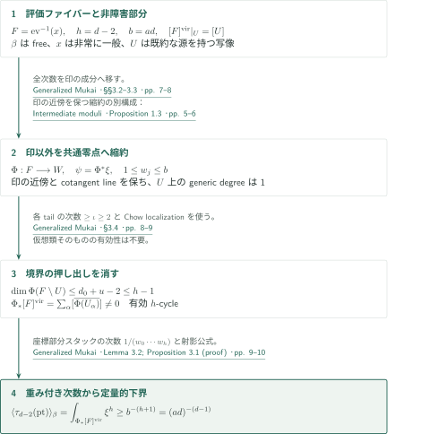
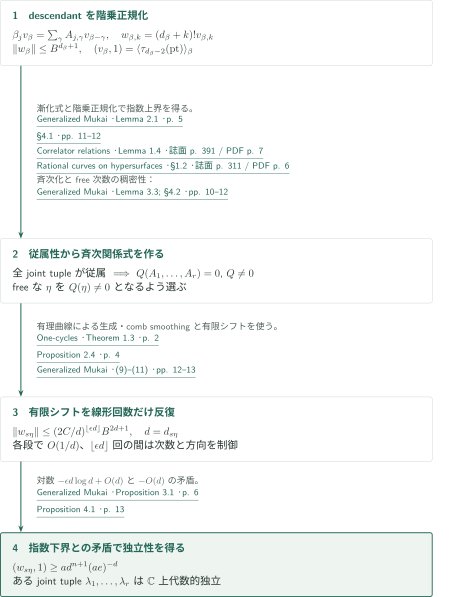
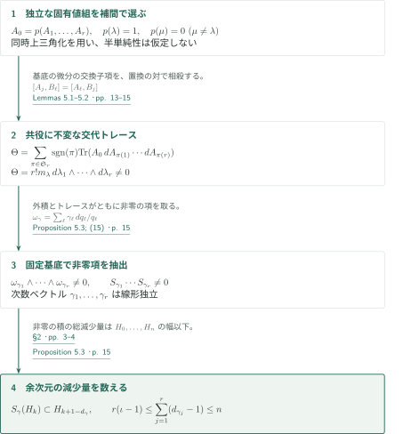
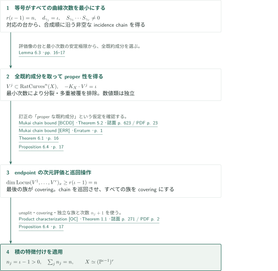

# The generalized Mukai conjecture

**Point descendant の下界、量子因子の独立性、最小有理曲線族による等号分類**

この原稿は、滑らかな複素 Fano 多様体の Picard 数と pseudoindex の不等式を、量子乗法の次数構造から導くと主張する。証明の核心は、独立な曲線次数に属する対応の非零積を作ることである。等号の場合に限って、その対応を最小次数の実際の有理曲線族へ移し、既存の積の特徴付けを適用する。

## 1. 主要結果

### Theorem 1.1 — 一般化向井不等式と等号の場合

$X$ を正次元 $n$ の滑らかな連結な複素射影 Fano 多様体とし、$\rho_X$ を Picard 数、$\iota_X$ を pseudoindex とする。原稿の主張は

$$
\rho_X(\iota_X-1)\le n
$$

であり、等号は

$$
X\simeq (\mathbb P^{\iota_X-1})^{\rho_X}
$$

のとき、かつそのときに限り成立する。以下では $r=\rho_X$、$\iota=\iota_X$ と置く。$\iota=1$ なら左辺は $0<n$ なので、証明の対象は $\iota\ge2$ である。

<!-- cite:main-result -->[Theorem 1.1 · p. 2; §1 · pp. 2–3](https://github.com/openai/math/blob/fd4aeeb2ee4fc729c18d98444fed42fd0529eeeb/preprints/The-Generalized-Mukai-Conjecture-September-24-2026/article.pdf)<!-- /cite -->

## 図の矢印に付した引用

<!-- reference-guide -->
略号のない定理・補題・節・式番号は本原稿 [Generalized Mukai](https://github.com/openai/math/blob/fd4aeeb2ee4fc729c18d98444fed42fd0529eeeb/preprints/The-Generalized-Mukai-Conjecture-September-24-2026/article.pdf) を指します。外部入力には次の略号を使います。

- [KM](https://www.ihes.fr/~maxim/TEXTS/relation_between_23.pdf) Kontsevich–Manin — *Correlator relations*：correlatorの関係式と漸化式。1998年公刊版。
- [PA](https://www.numdam.org/item/SB_1997-1998__40__307_0.pdf) Rahul Pandharipande — *Rational curves on hypersurfaces*：divisor・string・topological recursionの関係式。1998年公刊版（Astérisque 252）。
- [MM](https://arxiv.org/pdf/math/0409569v4) Andrei Mustaţă and Magdalena Anca Mustaţă — *Intermediate moduli*：安定写像の中間モジュライによる縮約の別構成。arXiv v4（2006年7月17日）。
- [MMC](https://arxiv.org/pdf/math/0507464v5) Anca M. Mustaţă and Andrei Mustaţă — *Chow ring*：中間モジュライのスタックとcotangent class。arXiv v5（2006年11月30日）。
- [TZ](https://arxiv.org/pdf/1209.4342v5) Zhiyu Tian and Hong R. Zong — *One-cycles*：有理曲線による1-cycleの生成とcomb smoothing。arXiv v5（2013年7月22日）。
- [CA](https://www.numdam.org/item/10.24033/asens.1658.pdf) Frédéric Campana — *Fano rational connectedness*：Fano多様体の有理連結性。1992年公刊版。
- [DE](https://www.math.ens.psl.eu/~debarre/NotesGAEL.pdf) Olivier Debarre — *Rational curves*：separably rationally connectedへの移行。2011年8月29日版の講義ノート。
- [BCDD](https://druel.perso.math.cnrs.fr/textes/mukai.pdf) Laurent Bonavero, Cinzia Casagrande, Olivier Debarre and Stéphane Druel — *Mukai chain bound*：順序付きchain locusの次元下界。2003年公刊版。
- [ERR](https://druel.perso.math.cnrs.fr/textes/mukai_erratum.pdf) Bonavero–Casagrande–Debarre–Druel — *Mukai chain bound*：chain boundの適用条件の訂正。日付記載なしの著者公開訂正1ページ（2026年10月9日取得）。
- [OC](https://doi.org/10.4153/CMB-2006-028-3) Gianluca Occhetta — *Product characterization*：射影空間の積の特徴付け。2006年公刊版。

各引用に結果番号とページを付します。誌面番号とPDF内の位置が異なる場合は両方を示します。GitHubの閲覧リンクではページ位置への自動移動を前提としません。
<!-- /reference-guide -->

## 2. Proposition 3.1 の証明 — point descendant の下界

<!-- proof-target:1 -->証明対象：[Proposition 3.1 · p. 6](https://github.com/openai/math/blob/fd4aeeb2ee4fc729c18d98444fed42fd0529eeeb/preprints/The-Generalized-Mukai-Conjecture-September-24-2026/article.pdf)<!-- /proof-target -->

**証明の道筋。** [この節](#proof-1)で free な次数の point descendant に正の下界を与え、[次節](#proof-2)で漸化式と比較して量子因子の固有値の独立性を得る。[交代トレース](#proof-3)がそれを曲線対応の非零積へ変換し、次数の減少量から不等式を導く。[等号の場合](#proof-4)は最小次数の曲線族を取り出して分類する。

数値的曲線次数 $\beta$ に対し $d_\beta=-K_X\cdot\beta$ と書く。$-aK_X$ による埋込み $X\hookrightarrow\mathbb P^N$ を固定する。Proposition 3.1 が供給する入力は、$\beta$ が非定数 free map で表されるときの

$$
\big\langle\tau_{d_\beta-2}(\mathrm{pt})\big\rangle_\beta
\ge (a d_\beta)^{-(d_\beta-1)}
$$

である。これは非零性だけでなく、後の減衰率の比較に必要な定量的下界である。

### 1. 非障害部分を保つ縮約

$\beta$ を free な次数、$d=d_\beta$、$b=ad$、$h=d-2$ とする。非常に一般の点 $x$ を選び、$F=\mathrm{ev}^{-1}(x)\subset\overline M_{0,1}(X,\beta)$ と置く。既約な源を持つ開部分 $U$ は空でなく滑らかで、$[F]^{\mathrm{vir}}|_U=[U]$ となる。原稿は印を持つ成分を残し、他の木を付着点の共通零点に置き換える。§3.2の $L^+=L(\sum_e e\Delta_e)$ は印の成分へ全次数を移し、印の近傍を変えない。正規化した係数を重み付き射影スタック $W$ に送る射 $\Phi:F\to W$ が得られ、$\psi=\Phi^*\xi$、$\xi=c_1(\mathcal O_W(1))$、$U$ 上の generic stack degree は1となる。

<!-- cite:evaluation-fiber -->[§§3.1–3.3 · pp. 6–8](https://github.com/openai/math/blob/fd4aeeb2ee4fc729c18d98444fed42fd0529eeeb/preprints/The-Generalized-Mukai-Conjecture-September-24-2026/article.pdf)<!-- /cite --> · <!-- cite:intermediate-moduli -->[Intermediate moduli &#91;MM&#93; · Definition 1.2; Proposition 1.3 · pp. 5–6; Lemma 3.3 (proof) · pp. 17–18](https://arxiv.org/pdf/math/0409569v4#page=5)<!-- /cite --> · <!-- cite:chow-ring -->[Chow ring &#91;MMC&#93; · Proposition 1.7 · p. 5](https://arxiv.org/pdf/math/0507464v5#page=5)<!-- /cite -->

### 2. 消えるのは境界の押し出し

印の成分の反標準次数を $d_0$、そこに付く木の数を $u$ とする。縮約後に残るデータの次元は高々 $d_0+u-2$。各木の次数は少なくとも $\iota\ge2$ なので、$d-d_0\ge2u$ から

$$
\dim\Phi(F\setminus U)\le d_0+u-2\le h-1
$$

を得る。したがって Chow localization の境界項は押し出しで消え、$\Phi_*[F]^{\mathrm{vir}}$ は $\Phi(U)$ の成分の閉包からなる空でない有効 $h$-cycle になる。$[F]^{\mathrm{vir}}$ 自体の有効性や、すべての tail の非障害性を仮定する議論ではない。

<!-- cite:boundary -->[§3.4 · pp. 8–9](https://github.com/openai/math/blob/fd4aeeb2ee4fc729c18d98444fed42fd0529eeeb/preprints/The-Generalized-Mukai-Conjecture-September-24-2026/article.pdf)<!-- /cite -->

### 3. スタックの次数を数値的下界にする

$W$ の重みはすべて $b$ 以下である。Lemma 3.2 は、$h$ 次元の整部分スタック $Z\subset W$ に対して $\int_Z\xi^h\ge b^{-(h+1)}$ を与える。重み付き斉次イデアルの単項式退化を使い、座標部分スタックの次数 $1/(w_0\cdots w_h)$ を比較する。射影公式と合わせると、$\int_{[F]^{\mathrm{vir}}}\psi^h=\int_{\Phi_*[F]^{\mathrm{vir}}}\xi^h$ が所要の下界になる。スタックの安定化群に由来する分母を落とさないことが、この定量化に必要である。

<!-- cite:degree-bound -->[Lemma 3.2; Proposition 3.1 (proof) · pp. 9–10](https://github.com/openai/math/blob/fd4aeeb2ee4fc729c18d98444fed42fd0529eeeb/preprints/The-Generalized-Mukai-Conjecture-September-24-2026/article.pdf)<!-- /cite -->

## 3. Proposition 4.1 の証明 — 固有値の独立性

<!-- proof-target:2 -->証明対象：[Proposition 4.1; (8)–(11) · pp. 12–13](https://github.com/openai/math/blob/fd4aeeb2ee4fc729c18d98444fed42fd0529eeeb/preprints/The-Generalized-Mukai-Conjecture-September-24-2026/article.pdf)<!-- /proof-target -->

$H_k=H^{2k}(X,\mathbb C)$、$H=\bigoplus_{k=0}^n H_k$ と置く。数値的因子基底 $D_1,\ldots,D_r$ に対して $\beta_j=D_j\cdot\beta$ とし、二点不変量が定める対応を $(S_\beta a,b)=\langle a,b\rangle_\beta$ と書く。可換な量子乗法行列は

$$
A_j(q)=D_j\cup(-)+\sum_{\beta>0}q^\beta\beta_jS_\beta,
\qquad S_\beta(H_k)\subset H_{k+1-d_\beta}.
$$

次数制約により $d_\beta>n+1$ の項は消え、これは有限 Laurent 多項式行列になる。以下の議論は量子コホモロジーの半単純性を仮定しない。

### 1. 不安定な次数零項を分けた漸化式

$v_0=\mathrm{pt}$ とし、正次数では $(v_\beta,b)=\sum_{\ell\ge0}\langle\tau_\ell(\mathrm{pt}),b\rangle_\beta$ と定める。Lemma 2.1 は

$$
\beta_jv_\beta=\sum_\gamma A_{j,\gamma}v_{\beta-\gamma},
\qquad (v_\beta,1)=\langle\tau_{d_\beta-2}(\mathrm{pt})\rangle_\beta
$$

を与える。divisor equation の補正は $D_j\cup\mathrm{pt}=0$ で消える。topological recursion の次数零の三点側は古典的 cup 積、primary 項は $A_{j,\beta}v_0$ を与える。$v_0$ を不安定な二点次数零不変量と同一視してはいけない。第二式には string equation を使う。引用先は非凸な滑らかな射影多様体にも、この式が仮想類を用いて成立すると明記している。

<!-- cite:recurrence -->[Lemma 2.1; (4)–(5) · p. 5](https://github.com/openai/math/blob/fd4aeeb2ee4fc729c18d98444fed42fd0529eeeb/preprints/The-Generalized-Mukai-Conjecture-September-24-2026/article.pdf)<!-- /cite --> · <!-- cite:correlators -->[Correlator relations &#91;KM&#93; · (4a) · 誌面 p. 388 / PDF p. 4; Lemma 1.4, (12) · 誌面 p. 391 / PDF p. 7](https://www.ihes.fr/~maxim/TEXTS/relation_between_23.pdf#page=4)<!-- /cite --> · <!-- cite:rational-hypersurfaces -->[Rational curves on hypersurfaces &#91;PA&#93; · §1.2 · 誌面 p. 311 / PDF p. 6](https://www.numdam.org/item/SB_1997-1998__40__307_0.pdf#page=6)<!-- /cite -->

### 2. 有限個のシフトと階乗正規化

$w_{\beta,k}=(d_\beta+k)!v_{\beta,k}$ と置くと、$(A_j(E)w)_{\beta,k}=\beta_jw_{\beta,k}/(d_\beta+k)$ となる。$-K_X$ の係数で線形結合し、次数を上げる古典的項を有限の冪零級数で反転することで、$\|w_\beta\|\le B^{d_\beta+1}$ を得る。ここで正のシフトは有限個で、反標準次数を下げる。次の多項式関係から生じるシフトには、この単調性を要求しない。

<!-- cite:factorial -->[§4.1; (6)–(7) · pp. 11–12](https://github.com/openai/math/blob/fd4aeeb2ee4fc729c18d98444fed42fd0529eeeb/preprints/The-Generalized-Mukai-Conjecture-September-24-2026/article.pdf)<!-- /cite -->

### 3. 関係式を避ける free な方向

$L=\overline{\mathbb C(q_1,\ldots,q_r)}$ 上ですべての joint diagonal tuple が代数的従属だと仮定する。有限個の関係式を掛け、同時三角化と斉次性 (3) を使うと、非零斉次多項式 $Q$ で $Q(A_1,\ldots,A_r)=0$ を得る。Lemma 3.3 により $Q(\eta)\ne0$ となる free な次数 $\eta$ を選べる。この補題は、Fano の有理連結性、Tian–Zong による有理曲線の $\mathrm{CH}_1$ の生成、comb smoothing を用いる。handle を $\mathbb P^1$、twist の次数を $-1$ とすると、平滑化後の $H^1(f^*T_X(-1))=0$ から free 性を得る。有理曲線次数を free 次数の差で表し、加法閉性によって Zariski 稠密性へ進む。

<!-- cite:free-direction -->[Lemma 3.3 · pp. 10–11; Proposition 4.1 (proof) · p. 12](https://github.com/openai/math/blob/fd4aeeb2ee4fc729c18d98444fed42fd0529eeeb/preprints/The-Generalized-Mukai-Conjecture-September-24-2026/article.pdf)<!-- /cite --> · <!-- cite:one-cycles -->[One-cycles &#91;TZ&#93; · Theorem 1.3 · p. 2; Proposition 2.4 · p. 4](https://arxiv.org/pdf/1209.4342v5#page=2)<!-- /cite --> · <!-- cite:campana -->[Fano rational connectedness &#91;CA&#93; · Corollary 3.2 · 誌面 p. 543 / PDF p. 6](https://www.numdam.org/item/10.24033/asens.1658.pdf#page=6)<!-- /cite --> · <!-- cite:debarre -->[Rational curves &#91;DE&#93; · Definition 2.20 · 誌面 p. 29 / PDF p. 30; Theorem 2.49 · 誌面 p. 43 / PDF p. 44](https://www.math.ens.psl.eu/~debarre/NotesGAEL.pdf#page=30)<!-- /cite -->

### 4. 線形回数の反復で矛盾する減衰率

$p=\beta/d_\beta$ を固定した多項式差分から、$\eta/d_\eta$ の近傍で $\|w_\beta\|\le(C/d_\beta)\max_{\delta\in U}\|w_{\beta-\delta}\|$ を得る。$\beta=s\eta$ とし、有限シフトを $\lfloor\epsilon d_\beta\rfloor$ 回反復しても次数と方向を制御できるよう $\epsilon>0$ を選ぶと、(7)から

$$
\|w_\beta\|\le(2C/d_\beta)^{\lfloor\epsilon d_\beta\rfloor}B^{2d_\beta+1}.
$$

一方、$s\eta$ も free なので Proposition 3.1 は

$$
(w_\beta,1)\ge\frac{(d_\beta+n)!}{(ad_\beta)^{d_\beta-1}}
\ge a d_\beta^{n+1}(ae)^{-d_\beta}
$$

を与える。上界の対数は $-\epsilon d_\beta\log d_\beta+O(d_\beta)$、下界は $-O(d_\beta)$ で矛盾する。これが Proposition 4.1 の代数的独立性である。

<!-- cite:independence -->[Proposition 4.1; (8)–(11) · pp. 12–13](https://github.com/openai/math/blob/fd4aeeb2ee4fc729c18d98444fed42fd0529eeeb/preprints/The-Generalized-Mukai-Conjecture-September-24-2026/article.pdf)<!-- /cite -->

## 4. Proposition 5.3 の証明 — 交代トレースと不等式

<!-- proof-target:3 -->証明対象：[Proposition 5.3; (15) · p. 15](https://github.com/openai/math/blob/fd4aeeb2ee4fc729c18d98444fed42fd0529eeeb/preprints/The-Generalized-Mukai-Conjecture-September-24-2026/article.pdf)<!-- /proof-target -->

固有値の独立性だけでは、固定したコホモロジー基底で非零の対応の積を取り出せない。原稿の Lemma 5.1 は、変数に依存する基底変換の微分項を処理する。

### 1. 基底の微分を消す交代化

$A_0$ がすべての $A_j$ と可換なとき、原稿は

$$
\Theta(A_0;A_1,\ldots,A_r)
=\sum_{\pi\in\mathfrak S_r}\operatorname{sgn}(\pi)
\operatorname{Tr}(A_0\,dA_{\pi(1)}\cdots dA_{\pi(r)})
$$

が同時共役に不変であることを示す。$G(q)$ による変換では $K=G^{-1}dG$ が現れるが、$B_j(t)=dA_j+t[K,A_j]$ と置くと $[A_j,B_\ell(t)]=[A_\ell,B_j(t)]$ である。微分したトレースの交換子項を、添字を交換した置換どうしで相殺する。$A_0$ の微分は取らず、$A_0$ と $dA_j$ の可換性も要求しない。

<!-- cite:trace -->[Lemma 5.1; (12)–(14) · pp. 13–14](https://github.com/openai/math/blob/fd4aeeb2ee4fc729c18d98444fed42fd0529eeeb/preprints/The-Generalized-Mukai-Conjecture-September-24-2026/article.pdf)<!-- /cite -->

### 2. 一つの固有値組を選ぶ

有限個の異なる joint tuple のうち、代数的独立な $\lambda$ で1、他で0になる補間多項式 $p$ を選び、$A_0=p(A_1,\ldots,A_r)$ とする。同時上三角基底で計算すると

$$
\Theta=r!m_\lambda\,d\lambda_1\wedge\cdots\wedge d\lambda_r\ne0.
$$

$A_0$ が一般化固有空間上の冪等射影である必要はない。対角成分を選別できればよく、この点でも半単純性を避けている。

<!-- cite:interpolation -->[Lemma 5.2 · pp. 14–15](https://github.com/openai/math/blob/fd4aeeb2ee4fc729c18d98444fed42fd0529eeeb/preprints/The-Generalized-Mukai-Conjecture-September-24-2026/article.pdf)<!-- /cite -->

### 3. 固定基底へ戻して次数を数える

固定基底では $dA_j=\sum_{\gamma>0}q^\gamma\gamma_jS_\gamma\omega_\gamma$、$\omega_\gamma=\sum_\ell\gamma_\ell\,dq_\ell/q_\ell$ である。非零の $\Theta$ の展開に現れるある項では、$\omega_{\gamma_1}\wedge\cdots\wedge\omega_{\gamma_r}\ne0$ と $\operatorname{Tr}(A_0S_{\gamma_1}\cdots S_{\gamma_r})\ne0$ が同時に成立する。前者は次数ベクトルの線形独立性、後者は順序付き作用素積の非零性を与える。各対応は余次元を $d_{\gamma_j}-1$ 下げるため、$H_0,\ldots,H_n$ の範囲から

$$
r(\iota-1)\le\sum_{j=1}^r(d_{\gamma_j}-1)\le n
$$

を得る。これは Proposition 5.3、したがって Theorem 1.1 の不等式部分である。

<!-- cite:inequality -->[Proposition 5.3; (15) · p. 15](https://github.com/openai/math/blob/fd4aeeb2ee4fc729c18d98444fed42fd0529eeeb/preprints/The-Generalized-Mukai-Conjecture-September-24-2026/article.pdf)<!-- /cite -->

## 5. Proposition 6.4 の証明 — 等号の場合の分類

<!-- proof-target:4 -->証明対象：[Proposition 6.4 · p. 17](https://github.com/openai/math/blob/fd4aeeb2ee4fc729c18d98444fed42fd0529eeeb/preprints/The-Generalized-Mukai-Conjecture-September-24-2026/article.pdf)<!-- /proof-target -->

$r(\iota-1)=n$ とする。上の二つの不等式が等号になるため、選ばれたすべての次数が $d_{\gamma_j}=\iota$ になる。ここで初めて、対応の非零性から実際の最小有理曲線の族へ移る。

### 1. 対応の台から非空の chain へ

二点安定写像の評価像 $Z_\gamma\subset X\times X$ は対応 $S_\gamma$ の台を含む。連続する評価を一致させる incidence fiber product が空なら、対応の合成も零である。したがって非零積は chain の存在を意味する。曲線の順序は作用素の合成順に合わせ、必要なら次数の列を逆順にして番号を付け直す。総次数が $\iota$ なので、各安定写像の非定数成分は一つで、その像への写像は双有理である。これらの曲線を含む $\mathrm{RatCurves}^n(X)$ の**全既約成分**を取る。印を忘れた安定極限にも分裂・多重被覆・縮約された木が現れないため、成分は proper となる。

<!-- cite:proper-family -->[Lemma 6.3 · pp. 16–17](https://github.com/openai/math/blob/fd4aeeb2ee4fc729c18d98444fed42fd0529eeeb/preprints/The-Generalized-Mukai-Conjecture-September-24-2026/article.pdf)<!-- /cite -->

### 2. 順序付き locus の次元評価で全族を covering にする

Mukai chain bound の Theorem 5.2 は、数値的に独立な proper 既約成分の非空の endpoint locus に $\sum_j(-K_X\cdot V^j-1)$ という次元下界を与える。訂正は、任意の proper 部分族では足りず、$\mathrm{RatCurves}^n(X)$ の既約成分であることを要求する。Lemma 6.3 はこの条件を用意している。

等号の場合、下界が $n$ なので最後の族 $V^r$ は covering になる。proper 性によりその評価像は閉じており、全点を覆う。$V^r$ の曲線を元の chain の先頭へ付けて最後を除く巡回操作を繰り返すと、各 $V^j$ を非空 chain の最後に置ける。同じ次元評価からすべての族が covering となる。

<!-- cite:covering -->[Theorem 6.1 · p. 16; Proposition 6.4 · p. 17](https://github.com/openai/math/blob/fd4aeeb2ee4fc729c18d98444fed42fd0529eeeb/preprints/The-Generalized-Mukai-Conjecture-September-24-2026/article.pdf)<!-- /cite --> · <!-- cite:chain-bound -->[Mukai chain bound &#91;BCDD&#93; · Theorem 5.2 · 誌面 p. 623 / PDF p. 23](https://druel.perso.math.cnrs.fr/textes/mukai.pdf#page=23)<!-- /cite --> · <!-- cite:erratum -->[Mukai chain bound &#91;ERR&#93; · Erratum · p. 1](https://druel.perso.math.cnrs.fr/textes/mukai_erratum.pdf#page=1)<!-- /cite -->

### 3. Occhetta の仮定を満たして分類する

得られた族は unsplit・covering・数値的独立で、反標準次数はすべて $\iota$。$n_j=\iota-1>0$ と置けば $\sum_j n_j=n$ となり、Occhetta の Theorem 1.1 を適用できる。よって $X\simeq(\mathbb P^{\iota-1})^r$。逆にこの積の次元・Picard数・pseudoindexを計算すれば等号が成立する。

<!-- cite:classification -->[Theorem 6.2 · p. 16; Proposition 6.4; converse · p. 17](https://github.com/openai/math/blob/fd4aeeb2ee4fc729c18d98444fed42fd0529eeeb/preprints/The-Generalized-Mukai-Conjecture-September-24-2026/article.pdf)<!-- /cite --> · <!-- cite:product -->[Product characterization &#91;OC&#93; · Theorem 1.1 · 誌面 p. 271 / PDF p. 2](https://doi.org/10.4153/CMB-2006-028-3)<!-- /cite -->

## 6. どの論文が、どの段階を担うか

以下はカタログ063外からの入力と別構成である。Mustaţă–Mustaţă の構成は、本稿で明示する縮約の別経路として区別する。供給結果の記述と本稿の適用箇所を照合した。外部結果の証明全体は検証対象としていない。

| 供給元と結果 | 利用箇所 | 使用内容・必要な仮定 | 確認範囲 |
|---|---|---|---|
| <!-- cite:correlators -->[Correlator relations &#91;KM&#93; · (4a) · 誌面 p. 388 / PDF p. 4; Lemma 1.4, (12) · 誌面 p. 391 / PDF p. 7](https://www.ihes.fr/~maxim/TEXTS/relation_between_23.pdf#page=4)<!-- /cite -->；<!-- cite:rational-hypersurfaces -->[Rational curves on hypersurfaces &#91;PA&#93; · §1.2 · 誌面 p. 311 / PDF p. 6](https://www.numdam.org/item/SB_1997-1998__40__307_0.pdf#page=6)<!-- /cite --> | [Lemma 2.1、p. 5](#proof-2-step-1) | genus-zero recursion・divisor・string。$X$ は滑らかで射影的、正次数の忘却写像が存在。$D_j\cup\mathrm{pt}=0$ | 入力の式・非凸の場合の記述と適用を照合。 |
| <!-- cite:intermediate-moduli -->[Intermediate moduli &#91;MM&#93; · Definition 1.2; Proposition 1.3 · pp. 5–6; Lemma 3.3 (proof) · pp. 17–18](https://arxiv.org/pdf/math/0409569v4#page=5)<!-- /cite -->；<!-- cite:chow-ring -->[Chow ring &#91;MMC&#93; · Proposition 1.7 · p. 5](https://arxiv.org/pdf/math/0507464v5#page=5)<!-- /cite --> | [§§3.2–3.3、pp. 7–8](#proof-1-step-1) | 印以外の成分の縮約の別構成、重み付き係数、cotangent class。射影空間への写像と標数零を使用 | 縮約の別構成とcotangent classを照合。仮想類の正値性は本稿§3.4。 |
| <!-- cite:campana -->[Fano rational connectedness &#91;CA&#93; · Corollary 3.2 · 誌面 p. 543 / PDF p. 6](https://www.numdam.org/item/10.24033/asens.1658.pdf#page=6)<!-- /cite -->；<!-- cite:debarre -->[Rational curves &#91;DE&#93; · Definition 2.20 · 誌面 p. 29 / PDF p. 30; Theorem 2.49 · 誌面 p. 43 / PDF p. 44](https://www.math.ens.psl.eu/~debarre/NotesGAEL.pdf#page=30)<!-- /cite --> | [Lemma 3.3、p. 10](#proof-2-step-3) | 滑らかな複素射影 Fano から rational chain connected、さらに separably rationally connected へ | Campanaの旧用語とseparable rational connectednessの区別を保持して照合。 |
| <!-- cite:one-cycles -->[One-cycles &#91;TZ&#93; · Theorem 1.3 · p. 2; Proposition 2.4 · p. 4](https://arxiv.org/pdf/1209.4342v5#page=2)<!-- /cite --> | [Lemma 3.3、pp. 10–11](#proof-2-step-3) | 有理曲線による生成と comb smoothing。smooth proper SRC、handle $\mathbb P^1$、twist $-1$ | 有理曲線の生成と数値的次数への移行を照合。 |
| <!-- cite:chain-bound -->[Mukai chain bound &#91;BCDD&#93; · Theorem 5.2 · 誌面 p. 623 / PDF p. 23](https://druel.perso.math.cnrs.fr/textes/mukai.pdf#page=23)<!-- /cite -->＋<!-- cite:erratum -->[Mukai chain bound &#91;ERR&#93; · Erratum · p. 1](https://druel.perso.math.cnrs.fr/textes/mukai_erratum.pdf#page=1)<!-- /cite --> | [Theorem 6.1・Proposition 6.4、pp. 16–17](#proof-4-step-2) | proper な**既約成分**、独立な数値類、非空の順序付き chain | 原定理・訂正・Lemma 6.3からの接続を照合。 |
| <!-- cite:product -->[Product characterization &#91;OC&#93; · Theorem 1.1 · 誌面 p. 271 / PDF p. 2](https://doi.org/10.4153/CMB-2006-028-3)<!-- /cite --> | [Theorem 6.2・Proposition 6.4、pp. 16–17](#proof-4-step-3) | 独立な unsplit covering 族、次数 $n_j+1$、$\sum n_j=n$ | 原定理と巡回操作後の適用を照合。 |

Givental の量子微分方程式と Khalkhali の generalized trace は原稿が挙げる背景である。本稿の Lemma 2.1 と Lemma 5.1 はそれぞれ必要な式を本文で導いており、背景文献をそのまま追加の直接依存辺にはしていない。既存カタログ033・034との関係の網羅調査は行っていない。

## 7. 原典を読む入口と確認範囲

<!-- reading-list -->
- [Proposition 3.1 · p. 6; Proposition 4.1 · p. 13](https://github.com/openai/math/blob/fd4aeeb2ee4fc729c18d98444fed42fd0529eeeb/preprints/The-Generalized-Mukai-Conjecture-September-24-2026/article.pdf) — descendantの下界と、固有値の独立性の結論。
- [§4 · pp. 11–13](https://github.com/openai/math/blob/fd4aeeb2ee4fc729c18d98444fed42fd0529eeeb/preprints/The-Generalized-Mukai-Conjecture-September-24-2026/article.pdf) — 漸化式を反復し、下界と比較する核心。
- [Lemmas 5.1–5.2 · pp. 13–15](https://github.com/openai/math/blob/fd4aeeb2ee4fc729c18d98444fed42fd0529eeeb/preprints/The-Generalized-Mukai-Conjecture-September-24-2026/article.pdf) — 基底変換の微分を相殺し、一つの固有値組を選ぶ。
- [Proposition 5.3; (15) · p. 15](https://github.com/openai/math/blob/fd4aeeb2ee4fc729c18d98444fed42fd0529eeeb/preprints/The-Generalized-Mukai-Conjecture-September-24-2026/article.pdf) — 交代トレースの非零項から不等式を得る。
- [Theorem 6.2 · p. 16; Proposition 6.4; converse · p. 17](https://github.com/openai/math/blob/fd4aeeb2ee4fc729c18d98444fed42fd0529eeeb/preprints/The-Generalized-Mukai-Conjecture-September-24-2026/article.pdf) — 最小有理曲線族から等号の場合を分類する。
<!-- /reading-list -->

今回、§§2–6の証明本文を読み、上表の外部結果の記述・適用箇所を照合した。とくに不安定な次数零項、仮想類の押し出し、階乗正規化、基底の微分、訂正後の曲線族の仮定を区別した。これは原稿の論証の接続を案内する概説であり、主張の正しさを独立に認定したものではない。

未完了の範囲は、仮想基本類の基礎構成・結合律を含む一般論の独立検証、§3.2の族の縮約とスタック上の降下の全技術的整合性、Lemma 5.1の交換子計算の独立した完全検算、外部結果の全証明である。既存記事との全依存関係も未調査。入力の記述・使用の照合と、これらの残る検証範囲を混同しない。

<!-- cite:reading-scope -->[§§2–6 · pp. 3–17](https://github.com/openai/math/blob/fd4aeeb2ee4fc729c18d98444fed42fd0529eeeb/preprints/The-Generalized-Mukai-Conjecture-September-24-2026/article.pdf)<!-- /cite --> · [詳細な出典・照合記録](sources.json)
