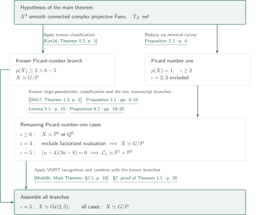
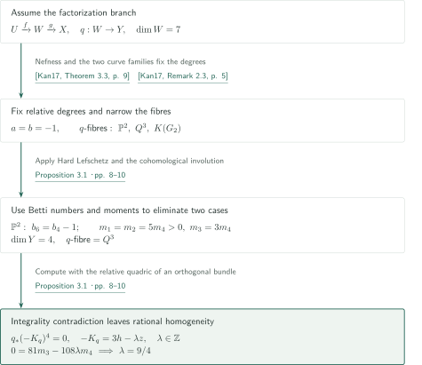
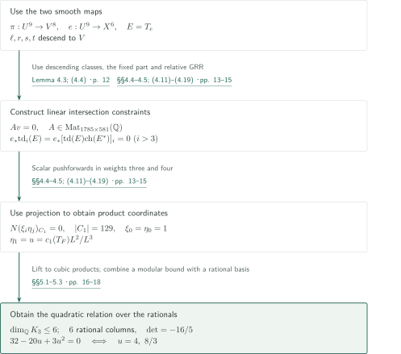
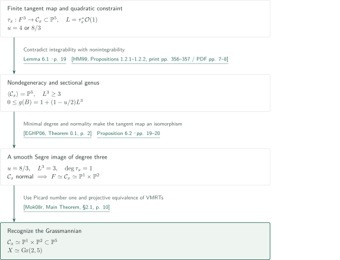
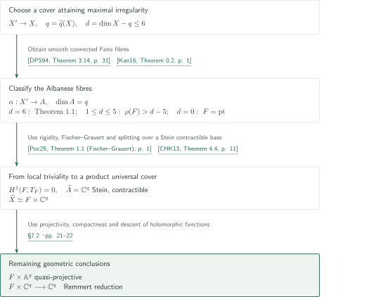
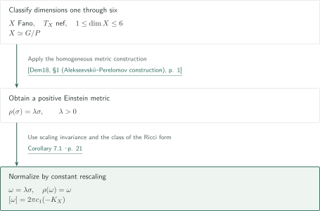

# The Campana–Peternell conjecture in dimension six

**Characteristic numbers from two fibrations and recognition of the VMRT**

The general Campana–Peternell conjecture asserts that a smooth complex projective Fano manifold with nef tangent bundle is rational homogeneous in every dimension. The new range treated in this manuscript is complex dimension six. After separating the known cases of larger Picard number, the argument studies minimal rational curves on a Picard-number-one manifold. Its central pseudoindex-five calculation compares intersection numbers using the three-dimensional evaluation fibres and the parameter space of curves.

## 1. Main results

### Theorem 1.1 — Rational homogeneity of Fano sixfolds

Let $X$ be a smooth connected complex projective Fano variety. If $\dim_{\mathbb C}X=6$ and $T_X$ is nef, then $X$ is rational homogeneous: it is isomorphic to $G/P$ for a connected semisimple complex algebraic group $G$ and a parabolic subgroup $P$. No additional restriction on the Picard number is imposed. The Fano hypothesis is essential to the scope of this statement; the theorem does not classify all projective sixfolds with nef tangent bundle without that hypothesis.

<!-- cite:main -->[Theorem 1.1 · p. 2](https://github.com/openai/math/blob/1581d4cbdd69a0faf34b2089614fe2a814316a6a/preprints/The-Campana-Peternell-conjecture-in-dimension-six-September-25-2026/main.pdf)<!-- /cite -->

### Corollary 1.2 — Albanese fibres and the ordinary universal cover

Let $X$ be a connected compact Kähler manifold with analytically nef holomorphic tangent bundle, and set

$$
\widetilde q(X)=\max\{h^1(X',\mathcal O_{X'}):X'\to X\text{ is a connected finite étale cover}\},\qquad d=\dim_{\mathbb C}X-\widetilde q(X).
$$

If $0\le d\le6$, there is a connected finite étale cover $X'\to X$ with the following properties.

1. The Albanese map $\alpha:X'\to A=\operatorname{Alb}(X')$ is a smooth proper surjection with connected fibres, and $A$ is a complex torus of dimension $\widetilde q(X)$. Every fibre is rational homogeneous of dimension $d$, allowing a point when $d=0$.
2. For one fixed fibre $F$, the map $\alpha$ is a holomorphically locally trivial $F$-bundle, and the ordinary universal cover of $X$ is

$$
\widetilde X\simeq F\times\mathbb C^{\widetilde q(X)}.
$$

This product is biholomorphic to a quasi-projective variety and is holomorphically convex. Its Remmert reduction is the projection $F\times\mathbb C^{\widetilde q(X)}\to\mathbb C^{\widetilde q(X)}$. In particular, all conclusions hold when $\dim_{\mathbb C}X\le6$. Neither projectivity of $A$ nor a product decomposition of $X'$ itself is asserted.

<!-- cite:albanese -->[Corollary 1.2 · p. 4](https://github.com/openai/math/blob/1581d4cbdd69a0faf34b2089614fe2a814316a6a/preprints/The-Campana-Peternell-conjecture-in-dimension-six-September-25-2026/main.pdf)<!-- /cite -->

### Corollary 7.1 — A positive Kähler–Einstein metric

Let $X$ be a smooth connected complex projective Fano variety with nef tangent bundle and $1\le\dim_{\mathbb C}X\le6$. With the convention $\rho(\omega)=-i\partial\bar\partial\log\det(g_{a\bar b})$ for the Ricci form, there is a Kähler form $\omega$ satisfying

$$
\rho(\omega)=\omega,\qquad [\omega]=2\pi c_1(-K_X).
$$

<!-- cite:ke -->[Corollary 7.1 · p. 21](https://github.com/openai/math/blob/1581d4cbdd69a0faf34b2089614fe2a814316a6a/preprints/The-Campana-Peternell-conjecture-in-dimension-six-September-25-2026/main.pdf)<!-- /cite -->

## References on the arrows

<!-- reference-guide -->
Unprefixed theorem, lemma, section and equation numbers refer to [The Campana–Peternell conjecture in dimension six](https://github.com/openai/math/blob/1581d4cbdd69a0faf34b2089614fe2a814316a6a/preprints/The-Campana-Peternell-conjecture-in-dimension-six-September-25-2026/main.pdf). External inputs use the following keys.

- [Kan16](https://arxiv.org/pdf/1505.02952v1) Akihiro Kanemitsu — *Fano n-folds with nef tangent bundle and Picard number greater than n − 5*: Classification for large Picard number and dimensions at most five. arXiv:1505.02952v1, 12 May 2015; published 2016.
- [Kan17](https://arxiv.org/pdf/1503.04579v1) Akihiro Kanemitsu — *Fano 5-folds with nef tangent bundles*: Minimal families and the pseudoindex-four factorization. arXiv:1503.04579v1, 16 March 2015; published 2017.
- [DH17](https://www.math.univ-toulouse.fr/~tdedieu/hyperquadrics.pdf) Thomas Dedieu and Andreas Höring — *Numerical characterisation of quadrics*: Recognition of projective space and quadrics when pseudoindex is at least the dimension. Author manuscript dated 9 December 2016; published 2017.
- [Mok08s](https://www.numdam.org/article/AST_2008__322__151_0.pdf) Ngaiming Mok — *Geometric structures on uniruled projective manifolds defined by their varieties of minimal rational tangents*: One-dimensional VMRT classification excludes pseudoindex three. Astérisque 322 (2008), 151–205; published scan.
- [Keb02](https://arxiv.org/pdf/math/0004023v2) Stefan Kebekus — *Families of singular rational curves*: Finiteness of the tangent map at a general point. arXiv:math/0004023v2, 6 June 2000; published 2002.
- [HM99](https://library.slmath.org/books/Book37/files/hwang.pdf) Jun-Muk Hwang and Ngaiming Mok — *Varieties of minimal rational tangents on uniruled projective manifolds*: Integrability and nonintegrability of the distribution spanned by tangent directions. Several Complex Variables, MSRI Publications 37 (1999), 351–389; published PDF with cover.
- [Mok08r](https://hkumath.hku.hk/~nmok/IMR2005-09.pdf) Ngaiming Mok — *Recognizing certain rational homogeneous manifolds of Picard number 1 from their varieties of minimal rational tangents*: Recognition of Gr(2,5) from its Segre VMRT. Author PDF IMR2005-09, 22 pages; published in AMS/IP 42 (2008), 41–61.
- [EGHP06](https://eisenbud.github.io/papers/pdfs/2006-002.pdf) David Eisenbud, Mark Green, Klaus Hulek, and Sorin Popescu — *Small schemes and varieties of minimal degree*: Minimal-degree classification reduces the degree-three image to a scroll. arXiv:math/0404517v5, 15 November 2004; published 2006.
- [Del71](https://www.numdam.org/item/PMIHES_1971__40__5_0.pdf) Pierre Deligne — *Théorie de Hodge: II*: Invariant cycles and the fixed part give trivial Hodge direct images. Publications Mathématiques de l’IHÉS 40 (1971), 5–57; published scan.
- [BS58](https://www.numdam.org/item/BSMF_1958__86__97_0.pdf) Armand Borel and Jean-Pierre Serre — *Le théorème de Riemann–Roch*: Relative Riemann–Roch gives characteristic-number vanishings. Bulletin de la Société Mathématique de France 86 (1958), 97–136; published scan.
- [DPS94](https://www-fourier.univ-grenoble-alpes.fr/~demailly/manuscripts/dps1.pdf) Jean-Pierre Demailly, Thomas Peternell, and Michael Schneider — *Compact complex manifolds with numerically effective tangent bundles*: Maximal-irregularity cover and Albanese fibration with Fano fibres. Author manuscript dps1.pdf, 47 pages; published J. Algebraic Geometry 3 (1994), 295–345.
- [BB96](https://www.numdam.org/item/CM_1996__104_1_1_0.pdf) Frédéric Bien and Michel Brion — *Automorphisms and local rigidity of regular varieties*: Local rigidity of rational homogeneous manifolds. Compositio Mathematica 104 (1996), 1–26; published scan.
- [Poc25](https://d-nb.info/1371867054/34) Paweł Poczobut — *An algebraic variant of the Fischer–Grauert Theorem*: Analytic Fischer–Grauert theorem recalled as Theorem 1.1. Mathematische Zeitschrift 310, Article 33 (2025), published 25 April 2025.
- [CHK13](https://claudon.pages.math.cnrs.fr/pdf/universal-final.pdf) Benoît Claudon, Andreas Höring, and János Kollár — *Algebraic varieties with quasi-projective universal cover*: Splitting over a Stein contractible universal cover of the base. Author manuscript universal-final.pdf, 14 pages; published J. reine angew. Math. 679 (2013), 207–221.
- [Dem18](https://www-fourier.univ-grenoble-alpes.fr/~demailly/manuscripts/special_issue_mok.pdf) Jean-Pierre Demailly — *Fano manifolds with nef tangent bundles are weakly almost Kähler–Einstein*: Positive Kähler–Einstein metrics on homogeneous manifolds recalled in §1. Author manuscript special_issue_mok.pdf, 6 pages; published Asian J. Math. 22 (2018), 285–290.

Each citation gives the result and pages. When printed pagination differs from the PDF position, both are shown. GitHub previews do not automatically jump to the cited page.
<!-- /reference-guide -->

The following account describes the manuscript's argument. Checking external statements and applications, reading the manuscript's proofs, and independently verifying complete proofs are different tasks. The Fischer–Grauert and homogeneous-metric inputs were checked in their restatements by Poczobut and Demailly, respectively.

## 2. Proof of Theorem 1.1 — All Picard-number and pseudoindex branches

<!-- proof-target:1 -->Proof target：[Theorem 1.1 · p. 2](https://github.com/openai/math/blob/1581d4cbdd69a0faf34b2089614fe2a814316a6a/preprints/The-Campana-Peternell-conjecture-in-dimension-six-September-25-2026/main.pdf)<!-- /proof-target -->

**Proof route.** For the [main theorem](#theorem-1-1), known classification handles $\rho(X)\ge2$. For $\rho(X)=1$, split according to the pseudoindex $\iota$. We write $\iota$ for the manuscript's pseudoindex $d$, reserving $d$ for the fibre dimension in the corollary. The [pseudoindex-four argument](#proof-2) excludes a factorized evaluation map; the [pseudoindex-five numerical constraint](#proof-3) feeds into [VMRT recognition](#proof-4).

### 1. Separate the known Picard-number range

Projectivity gives $\rho(X)\ge1$. If $\rho(X)\ge2$, then $\rho(X)>6-5$, so Kanemitsu's classification applies. The manuscript uses this result directly without reclassifying contractions and fibres on this branch. It remains to consider $\rho(X)=1$.

<!-- cite:kan-large -->[&#91;Kan16, Theorem 0.2, p. 1&#93;](https://arxiv.org/pdf/1505.02952v1#page=1)<!-- /cite -->

### 2. Reduce the pseudoindex using the minimal family

Choose a family $V$ of curves of least anticanonical degree $\iota$, with universal family $\pi:U\to V$ and evaluation $e:U\to X$. Nefness makes every curve free, and minimality of the degree prevents splitting. The known minimal-family theorem gives smooth projective $U,V$, a smooth $\mathbb P^1$-fibration $\pi$, and a smooth surjective evaluation of relative dimension $\iota-2$ with connected fibres. Proposition 2.1 in the manuscript further proves, for every $\pi$-fibre $C$,

$$
T_e|_C\simeq\mathcal O_{\mathbb P^1}(-1)^{\oplus(\iota-2)}.
$$

Differentiating the map-space construction makes $H^0(T_U|_C)\to H^0(e^*T_X|_C)$ surjective. The two spaces have the same dimension, so the kernel bundle has vanishing $H^0$ and $H^1$. The splitting holds along every fibre, a fact needed later for descent of a bundle.

<!-- cite:minimal -->[Proposition 2.1 · pp. 5–6](https://github.com/openai/math/blob/1581d4cbdd69a0faf34b2089614fe2a814316a6a/preprints/The-Campana-Peternell-conjecture-in-dimension-six-September-25-2026/main.pdf)<!-- /cite --> <!-- cite:kan-family -->[&#91;Kan17, Proposition 1.6, p. 4&#93;](https://arxiv.org/pdf/1503.04579v1#page=4)<!-- /cite -->

The differential $\mathcal O(2)\to\varphi^*T_X$ gives $\iota\ge2$. If $\iota=2$, evaluation is an isomorphism and the resulting fibration $X\to V$ produces a nonzero nef divisor of degree zero on its curve fibres, contradicting $\rho(X)=1$. If $\iota=3$, the finite tangent map gives a one-dimensional VMRT; the Mok–Hwang classification only allows dimensions two, three and five, excluding six. If $\iota\ge6$, every rational curve $B$ satisfies $-K_X\cdot B\ge6$, and Dedieu–Höring gives $X\simeq\mathbb P^6$ or $Q^6$.

<!-- cite:reduction -->[Proposition 2.2 · p. 6](https://github.com/openai/math/blob/1581d4cbdd69a0faf34b2089614fe2a814316a6a/preprints/The-Campana-Peternell-conjecture-in-dimension-six-September-25-2026/main.pdf)<!-- /cite --> <!-- cite:mok-small -->[&#91;Mok08s, Theorem 15, print p. 199 / PDF p. 50&#93;](https://www.numdam.org/article/AST_2008__322__151_0.pdf#page=50)<!-- /cite --> <!-- cite:dh -->[&#91;DH17, Theorem 1.3, p. 1&#93;](https://www.math.univ-toulouse.fr/~tdedieu/hyperquadrics.pdf#page=1)<!-- /cite -->

### 3. Join the two remaining branches

Proposition 3.1 handles $\iota=4$, and Proposition 6.2 handles $\iota=5$. They give rational homogeneity and $X\simeq\operatorname{Gr}(2,5)$, respectively. Once the pseudoindex-four argument leaves a $\mathbb P^2$-fibration as evaluation, the external Proposition 4.1 identifies $X$ as $\mathbb P^3$ or $\operatorname{LG}(3,6)$; dimension six selects the latter. This refinement adds no hypothesis to the main theorem. Every Picard-number and pseudoindex branch is now connected to the conclusion.

<!-- cite:four -->[Proposition 3.1 · pp. 8–10](https://github.com/openai/math/blob/1581d4cbdd69a0faf34b2089614fe2a814316a6a/preprints/The-Campana-Peternell-conjecture-in-dimension-six-September-25-2026/main.pdf)<!-- /cite --> <!-- cite:recognition -->[Proposition 6.2 · pp. 19–20](https://github.com/openai/math/blob/1581d4cbdd69a0faf34b2089614fe2a814316a6a/preprints/The-Campana-Peternell-conjecture-in-dimension-six-September-25-2026/main.pdf)<!-- /cite --> <!-- cite:kan-hom -->[&#91;Kan17, Proposition 4.1; Remark 4.2, p. 12&#93;](https://arxiv.org/pdf/1503.04579v1#page=12)<!-- /cite --> <!-- cite:assembly -->[§7, proof of Theorem 1.1 · p. 20](https://github.com/openai/math/blob/1581d4cbdd69a0faf34b2089614fe2a814316a6a/preprints/The-Campana-Peternell-conjecture-in-dimension-six-September-25-2026/main.pdf)<!-- /cite -->

## 3. Proof of Proposition 3.1 — Pseudoindex four and two contractions

<!-- proof-target:2 -->Proof target：[Proposition 3.1 · pp. 8–10](https://github.com/openai/math/blob/1581d4cbdd69a0faf34b2089614fe2a814316a6a/preprints/The-Campana-Peternell-conjecture-in-dimension-six-September-25-2026/main.pdf)<!-- /proof-target -->

<!-- statement:proposition-3-1 -->
### Proposition 3.1 — Sixfolds of pseudoindex four

Let $X$ be a smooth complex Fano sixfold. If $T_X$ is nef, $\rho(X)=1$, and the pseudoindex is four, then $X$ is rational homogeneous.

<!-- cite:four -->[Proposition 3.1 · pp. 8–10](https://github.com/openai/math/blob/1581d4cbdd69a0faf34b2089614fe2a814316a6a/preprints/The-Campana-Peternell-conjecture-in-dimension-six-September-25-2026/main.pdf)<!-- /cite -->
<!-- /statement -->

### 1. Fix the factorization and relative degrees

Kanemitsu's results give either rational homogeneity or a factorization $e=g\circ f:U\to W\to X$, where $f,g,\pi$ are smooth $\mathbb P^1$-fibrations. The latter case comes with a smooth elementary Mori contraction $q:W\to Y$, with $\dim W=7$. Put $H=c_1(T_X)/4$, $h=g^*H$, $c=c_1(T_g)$, and for a $\pi$-fibre $C$ set $a=c_1(T_f)\cdot C$, $b=c\cdot f(C)$. The splitting $T_e|_C=\mathcal O(-1)^{\oplus2}$ gives $a+b=-2$ and $a\le-1$. A positive multiple of $c-bh$ is the pullback of an ample class from $Y$, while $g_*c=2$, $g_*c^2=0$ give $b\le0$. To exclude $b=0$, choose a curve $D\subset X$ for which the surface $g^{-1}(D)$ has two-dimensional image under $q$, contradicting its zero intersection number. Thus $a=b=-1$.

<!-- cite:kan-factor -->[&#91;Kan17, Theorem 3.3, p. 9&#93;](https://arxiv.org/pdf/1503.04579v1#page=9)<!-- /cite --> <!-- cite:kan-hom -->[&#91;Kan17, Proposition 4.1; Remark 4.2, p. 12&#93;](https://arxiv.org/pdf/1503.04579v1#page=12)<!-- /cite --> <!-- cite:involution -->[Lemma 2.3 · p. 7](https://github.com/openai/math/blob/1581d4cbdd69a0faf34b2089614fe2a814316a6a/preprints/The-Campana-Peternell-conjecture-in-dimension-six-September-25-2026/main.pdf)<!-- /cite --> <!-- cite:four -->[Proposition 3.1 · pp. 8–10](https://github.com/openai/math/blob/1581d4cbdd69a0faf34b2089614fe2a814316a6a/preprints/The-Campana-Peternell-conjecture-in-dimension-six-September-25-2026/main.pdf)<!-- /cite -->

### 2. Narrow the possible fibres

Relative degree $-1$ reduces the fibre candidates of $q$ to $\mathbb P^2,Q^3,K(G_2)$. In the $\mathbb P^2$ case, the two Leray–Hirsch decompositions and Poincaré duality on $Y$ give $b_6(X)=b_4(X)-1$, contradicting Hard Lefschetz. In the remaining cases, $z=(h+c)/2$ descends from $Y$; since $\dim Y\le4$, we have $z^5=0$.

$$
m_i=\int_W h^{7-i}z^i,\qquad m_0=m_5=m_6=m_7=0,\qquad m_1=\int_X H^6>0.
$$

The cohomological involution for $g$ sends $z$ to $h-z$ and negates top-degree integrals. The even-index relations give $m_1=m_2=5m_4$ and $m_3=3m_4$. Thus $m_4>0$ and $\dim Y=4$: the $K(G_2)$ branch disappears and $q$ is a $Q^3$-fibration.

<!-- cite:kan-fibres -->[&#91;Kan17, Remark 2.3, p. 5&#93;](https://arxiv.org/pdf/1503.04579v1#page=5)<!-- /cite --> <!-- cite:four -->[Proposition 3.1 · pp. 8–10](https://github.com/openai/math/blob/1581d4cbdd69a0faf34b2089614fe2a814316a6a/preprints/The-Campana-Peternell-conjecture-in-dimension-six-September-25-2026/main.pdf)<!-- /cite -->

### 3. Contradict integrality using the orthogonal bundle

Fischer–Grauert gives local triviality. Using $\operatorname{Aut}(Q^3)=\operatorname{PGO}_5\simeq\operatorname{SO}_5$, the manuscript realizes $W$ as a relative quadric for an orthogonal rank-five bundle with trivial determinant, algebraizes it by GAGA, and obtains $q_*(-K_q)^4=0$ by adjunction. On the other hand, write $-K_q=3h-\lambda z$. Degrees on a $g$-fibre imply $\lambda\in\mathbb Z$. The projection formula gives

$$
0=\int_W(-K_q)^4z^3=81m_3-108\lambda m_4.
$$

Since $m_3=3m_4$, this forces $\lambda=9/4$, a contradiction. The factorization is excluded, leaving the known homogeneous case. The manuscript also cites Watanabe's treatment of pseudoindex four; the argument described here is the manuscript's own intersection-theoretic alternative.

<!-- cite:fg -->[&#91;Poc25, Theorem 1.1 (Fischer–Grauert), p. 1&#93;](https://d-nb.info/1371867054/34)<!-- /cite --> <!-- cite:four -->[Proposition 3.1 · pp. 8–10](https://github.com/openai/math/blob/1581d4cbdd69a0faf34b2089614fe2a814316a6a/preprints/The-Campana-Peternell-conjecture-in-dimension-six-September-25-2026/main.pdf)<!-- /cite -->

## 4. Proof of Lemma 5.1 — From geometric constraints to a quadratic equation

<!-- proof-target:3 -->Proof target：[Lemma 5.1 · p. 15](https://github.com/openai/math/blob/1581d4cbdd69a0faf34b2089614fe2a814316a6a/preprints/The-Campana-Peternell-conjecture-in-dimension-six-September-25-2026/main.pdf)<!-- /proof-target -->

Assume $\rho(X)=1,\iota=5$, so $\dim U=9,\dim V=8$. Set $h=e^*c_1(T_X)/5$, $c=c_1(T_\pi)$, $\ell=2h-c$, and $E=T_e$. Let $r,s,t$ be the elementary symmetric functions in the three formal Chern roots of $E$ shifted by $h$. We do not assume that $h$ is the first Chern class of an actual line bundle. For a general evaluation fibre $F=e^{-1}(x)$, the tangent map $\tau_x:F\to\mathbb P(T_x^*X)\simeq\mathbb P^5$ is finite, and $L=\tau_x^*\mathcal O(1)$ is ample and globally generated, with $c_1(L)=\ell|_F$ and $r|_F=c_1(T_F)$.

<!-- cite:polarized -->[Lemmas 4.1–4.2 · pp. 10–11](https://github.com/openai/math/blob/1581d4cbdd69a0faf34b2089614fe2a814316a6a/preprints/The-Campana-Peternell-conjecture-in-dimension-six-September-25-2026/main.pdf)<!-- /cite --> <!-- cite:keb -->[&#91;Keb02, Theorems 3.3–3.4, pp. 7–8&#93;](https://arxiv.org/pdf/math/0004023v2#page=7)<!-- /cite -->

<!-- statement:lemma-5-1 -->
### Lemma 5.1 — The numerical constraint

Let $A,C_1,N$ be the rational matrices and index set defined in §4 of the manuscript. Specifically, $A$ is the matrix of relations (4.11)–(4.16) on weight-nine intersection monomials, and $C_1$ selects the 129 coordinates in (4.18). Select these coordinates from a basis matrix of $\ker A$ to obtain $P$; the nonzero rows of the reduced row echelon form of a basis of $\ker(P^T)$ form $N$. If $\xi\in\mathbb Q^{11}$ and $\eta\in\mathbb Q^{18}$ satisfy

$$
\xi_0=\eta_0=1,\qquad N(\xi_i\eta_j)_{(i,(j))\in C_1}=0,
$$

then $32-20\eta_1+3\eta_1^2=0$. For the geometric coordinates, $\eta_1=u=c_1(T_F)L^2/L^3$.

<!-- cite:numerical -->[Lemma 5.1 · p. 15](https://github.com/openai/math/blob/1581d4cbdd69a0faf34b2089614fe2a814316a6a/preprints/The-Campana-Peternell-conjecture-in-dimension-six-September-25-2026/main.pdf)<!-- /cite --> <!-- cite:constraints -->[§§4.4–4.5; (4.11)–(4.19) · pp. 13–15](https://github.com/openai/math/blob/1581d4cbdd69a0faf34b2089614fe2a814316a6a/preprints/The-Campana-Peternell-conjecture-in-dimension-six-September-25-2026/main.pdf)<!-- /cite -->
<!-- /statement -->

### 1. Extract linear relations from the two maps

For $\delta=\pi^*\pi_*$, the involution for $\pi$ satisfies $\bar\alpha=\alpha-c\delta\alpha$ and $\delta(\alpha\gamma)=(\delta\alpha)\gamma+\bar\alpha\delta\gamma$. The actual line bundle $e^*(-K_X)\otimes(T_\pi^*)^{\otimes2}$ has degree one along the fibres, so its tensor product with $E$ is trivial on every $\pi$-fibre. Descending that bundle shows that $r,s,t$ also come from $V$. Weight-nine products descending to $V$ therefore vanish, as do base classes of weight at least seven pulled back from $X$.

Using simple connectedness of $X$ and Deligne's fixed-part results, Lemma 4.3 establishes triviality of $R^je_*\Omega^p_{U/X}$. Relative GRR applied to $\mathcal O_U$ and $E^*$ then gives

$$
e_*\operatorname{td}_i(E)=0,\qquad e_*[\operatorname{td}(E)\operatorname{ch}(E^*)]_i=0\quad(i>3).
$$

Expanding these relations in a common weight yields $Av=0$. The final family consists of vanishing integrals; it need not consist of zero cohomology classes.

<!-- cite:involution -->[Lemma 2.3 · p. 7](https://github.com/openai/math/blob/1581d4cbdd69a0faf34b2089614fe2a814316a6a/preprints/The-Campana-Peternell-conjecture-in-dimension-six-September-25-2026/main.pdf)<!-- /cite --> <!-- cite:polarized -->[Lemmas 4.1–4.2 · pp. 10–11](https://github.com/openai/math/blob/1581d4cbdd69a0faf34b2089614fe2a814316a6a/preprints/The-Campana-Peternell-conjecture-in-dimension-six-September-25-2026/main.pdf)<!-- /cite --> <!-- cite:hodge -->[Lemma 4.3; (4.4) · p. 12](https://github.com/openai/math/blob/1581d4cbdd69a0faf34b2089614fe2a814316a6a/preprints/The-Campana-Peternell-conjecture-in-dimension-six-September-25-2026/main.pdf)<!-- /cite --> <!-- cite:del-inv -->[&#91;Del71, Theorem 4.1.1(ii), print p. 40 / PDF p. 37&#93;](https://www.numdam.org/item/PMIHES_1971__40__5_0.pdf#page=37)<!-- /cite --> <!-- cite:del-fixed -->[&#91;Del71, Corollary 4.1.2, print p. 42 / PDF p. 39&#93;](https://www.numdam.org/item/PMIHES_1971__40__5_0.pdf#page=39)<!-- /cite --> <!-- cite:grr -->[&#91;BS58, §7, Riemann–Roch theorem, print p. 113 / PDF p. 18&#93;](https://www.numdam.org/item/BSMF_1958__86__97_0.pdf#page=18)<!-- /cite -->

### 2. The projection formula supplies the product structure

For invariant monomials $G_j$ of weights three and four, integration along $e$ lands in $H^0(X,\mathbb Q)$ and $H^2(X,\mathbb Q)=\mathbb Qh_X$. Each image is therefore determined by a scalar: $e_*G_j=D\eta_jh_X^{w_j-3}$, where $D=L^3>0$. Normalize the intersection numbers of the weight-six base monomials $M_i$ as $\xi_i$. The projection formula identifies the selected coordinates, divided by the single positive number $D\int_Xh_X^6$, with $\xi_i\eta_j$. This product structure, in addition to the linear equations, is what supplies a nonlinear constraint.

<!-- cite:constraints -->[§§4.4–4.5; (4.11)–(4.19) · pp. 13–15](https://github.com/openai/math/blob/1581d4cbdd69a0faf34b2089614fe2a814316a6a/preprints/The-Campana-Peternell-conjecture-in-dimension-six-September-25-2026/main.pdf)<!-- /cite -->

### 3. Combine modular ranks with a rational certificate

Multiply $N(\xi_i\eta_j)=0$ by $\eta_a\eta_b$, identifying repeated triples to form a linear solution space $K_3$. The calculation over $\mathbb F_{10007}$ gives kernel dimension six in 6820 coordinates, implying the rational upper bound $\dim K_3\le6$. Six rational columns satisfying every double-slice equation are then exhibited; a minor equal to $-16/5\ne0$ proves that they form a basis. The functional

$$
32v_{0,(0,0,0)}-20v_{0,(0,0,1)}+3v_{0,(0,1,1)}
$$

vanishes on that basis. Returning to product coordinates and using $\xi_0=\eta_0=1$ gives $(u-4)(3u-8)=0$. The argument does not infer a rational identity merely from a finite-field computation. Appendix A supplies an executable certificate for the finite calculation.

<!-- cite:certificate -->[§§5.1–5.3 · pp. 16–18](https://github.com/openai/math/blob/1581d4cbdd69a0faf34b2089614fe2a814316a6a/preprints/The-Campana-Peternell-conjecture-in-dimension-six-September-25-2026/main.pdf)<!-- /cite --> <!-- cite:appendix -->[Appendix A · pp. 22–25](https://github.com/openai/math/blob/1581d4cbdd69a0faf34b2089614fe2a814316a6a/preprints/The-Campana-Peternell-conjecture-in-dimension-six-September-25-2026/main.pdf)<!-- /cite -->

## 5. Proof of Proposition 6.2 — From the constraint to the Grassmannian

<!-- proof-target:4 -->Proof target：[Proposition 6.2 · pp. 19–20](https://github.com/openai/math/blob/1581d4cbdd69a0faf34b2089614fe2a814316a6a/preprints/The-Campana-Peternell-conjecture-in-dimension-six-September-25-2026/main.pdf)<!-- /proof-target -->

<!-- statement:proposition-6-2 -->
### Proposition 6.2 — Recognition in pseudoindex five

Let $X$ be a smooth complex Fano sixfold. If $T_X$ is nef, $\rho(X)=1$, and the pseudoindex is five, then $X\simeq\operatorname{Gr}(2,5)$.

<!-- cite:recognition -->[Proposition 6.2 · pp. 19–20](https://github.com/openai/math/blob/1581d4cbdd69a0faf34b2089614fe2a814316a6a/preprints/The-Campana-Peternell-conjecture-in-dimension-six-September-25-2026/main.pdf)<!-- /cite -->
<!-- /statement -->

### 1. The tangent image spans the whole space

Suppose the affine cone over $\mathcal C_x=\tau_x(F)$ spans a proper subspace $W_x\subset T_xX$. Then $4\le\dim W_x\le5$. If the tangent bivectors $\alpha\wedge v$ do not span $\bigwedge^2W_x$, a nonzero alternating form annihilates them, and the four-dimensional tangent spaces to the cone are isotropic. The rank bound leaves only $\dim W_x=5$ and a form of rank two. But projection of the cone to the two-dimensional symplectic quotient has an irreducible conical image of dimension at most one, hence a line, contradicting the spanning property. Thus the bivectors span the whole exterior square.

One Hwang–Mok proposition now gives integrability of the spanned distribution; the other gives nonintegrability under $b_2(X)=1$ and linear degeneracy of the VMRT. This contradiction proves nondegeneracy of $\mathcal C_x\subset\mathbb P^5$. Smoothness of the VMRT has not yet been used.

<!-- cite:nondegenerate -->[Lemma 6.1 · p. 19](https://github.com/openai/math/blob/1581d4cbdd69a0faf34b2089614fe2a814316a6a/preprints/The-Campana-Peternell-conjecture-in-dimension-six-September-25-2026/main.pdf)<!-- /cite --> <!-- cite:hm -->[&#91;HM99, Propositions 1.2.1–1.2.2, print pp. 356–357 / PDF pp. 7–8&#93;](https://library.slmath.org/books/Book37/files/hwang.pdf#page=7)<!-- /cite -->

### 2. Sectional genus determines both degrees

The intersection $B$ of two general members of the ample globally generated system $|L|$ is a smooth connected curve: use Bertini and connectedness from Kodaira vanishing. Adjunction and the degree formula for a finite morphism give

$$
g(B)=1+(1-u/2)L^3\ge0,\qquad L^3=\deg(\tau_x)\deg(\mathcal C_x)\ge3.
$$

The value $u=4$ would give negative genus. For $u=8/3$, the equation becomes $g(B)=1-L^3/3$, forcing $L^3=3$, $\deg(\tau_x)=1$, and $\deg(\mathcal C_x)=3$.

<!-- cite:recognition -->[Proposition 6.2 · pp. 19–20](https://github.com/openai/math/blob/1581d4cbdd69a0faf34b2089614fe2a814316a6a/preprints/The-Campana-Peternell-conjecture-in-dimension-six-September-25-2026/main.pdf)<!-- /cite --> <!-- cite:eghp -->[&#91;EGHP06, Theorem 0.1, p. 2&#93;](https://eisenbud.github.io/papers/pdfs/2006-002.pdf#page=2)<!-- /cite -->

### 3. Use normality before recognizing the Segre image

The minimal-degree classification makes $\mathcal C_x$ a three-dimensional rational normal scroll of degree three, still possibly a cone. The manuscript realizes its coordinate ring as the invariant ring for a $\mathbb G_m$-action with weights $(-a_1,-a_2,-a_3,1,1)$ and proves normality. Only then does the finite birational map $\tau_x$ become an isomorphism, transferring smoothness of $F$ to the image. Excluding cones gives $a_i>0$, and $\sum a_i=3$ implies $(a_1,a_2,a_3)=(1,1,1)$. Thus $\mathcal C_x=\mathbb P^1\times\mathbb P^2\hookrightarrow\mathbb P^5$.

This is the projectivization of rank-one maps in $T_A\operatorname{Gr}(2,5)=\operatorname{Hom}(A,\mathbb C^5/A)$. The model $\operatorname{Gr}(2,5)$ is an irreducible compact Hermitian symmetric space of rank two. Picard number one and projective equivalence of the VMRT at a general point verify the hypotheses of Mok's Main Theorem, giving $X\simeq\operatorname{Gr}(2,5)$.

<!-- cite:eghp -->[&#91;EGHP06, Theorem 0.1, p. 2&#93;](https://eisenbud.github.io/papers/pdfs/2006-002.pdf#page=2)<!-- /cite --> <!-- cite:recognition -->[Proposition 6.2 · pp. 19–20](https://github.com/openai/math/blob/1581d4cbdd69a0faf34b2089614fe2a814316a6a/preprints/The-Campana-Peternell-conjecture-in-dimension-six-September-25-2026/main.pdf)<!-- /cite --> <!-- cite:mok-rec -->[&#91;Mok08r, Main Theorem, §2.1, p. 10&#93;](https://hkumath.hku.hk/~nmok/IMR2005-09.pdf#page=10)<!-- /cite -->

## 6. Proof of Corollary 1.2 — From the Albanese bundle to the universal cover

<!-- proof-target:5 -->Proof target：[Corollary 1.2 · p. 4](https://github.com/openai/math/blob/1581d4cbdd69a0faf34b2089614fe2a814316a6a/preprints/The-Campana-Peternell-conjecture-in-dimension-six-September-25-2026/main.pdf)<!-- /proof-target -->

Return to the [corollary](#corollary-1-2), now using $d$ for the fibre dimension and $q=\widetilde q(X)$.

### 1. Classify fibres on a maximal-irregularity cover

Finite étale covers preserve the Kähler condition and analytic nefness. Surjectivity of their Albanese maps bounds irregularity by $\dim X$, so the integer maximum $q$ is attained. Demailly–Peternell–Schneider gives a smooth Albanese surjection on that cover with connected Fano fibres. Their tangent bundles are nef and their dimension is $d$. Use Theorem 1.1 for $d=6$, the known classification with $\rho(F)\ge1>d-5$ for $1\le d\le5$, and a point for $d=0$. If $X$ itself has dimension zero, connectedness makes it a point from the outset.

<!-- cite:dps-alb -->[&#91;DPS94, Proposition 3.9, p. 25&#93;](https://www-fourier.univ-grenoble-alpes.fr/~demailly/manuscripts/dps1.pdf#page=25)<!-- /cite --> <!-- cite:dps -->[&#91;DPS94, Theorem 3.14, p. 31&#93;](https://www-fourier.univ-grenoble-alpes.fr/~demailly/manuscripts/dps1.pdf#page=31)<!-- /cite --> <!-- cite:kan-large -->[&#91;Kan16, Theorem 0.2, p. 1&#93;](https://arxiv.org/pdf/1505.02952v1#page=1)<!-- /cite --> <!-- cite:albanese-proof -->[§7.2 · pp. 21–22](https://github.com/openai/math/blob/1581d4cbdd69a0faf34b2089614fe2a814316a6a/preprints/The-Campana-Peternell-conjecture-in-dimension-six-September-25-2026/main.pdf)<!-- /cite -->

### 2. Pass through local rigidity to split the cover

The vanishing $H^1(F,T_F)=0$ gives local deformation rigidity, making the fibre type locally constant and therefore constant on connected $A$. Fischer–Grauert makes $\alpha$ holomorphically locally trivial. For $d=0$, $\alpha$ is itself an isomorphism. Since $\widetilde A=\mathbb C^q$ is Stein and contractible, Claudon–Höring–Kollár gives $\widetilde{X'}\simeq\widetilde F\times\mathbb C^q$. Rational homogeneous $F$ is simply connected, and a connected finite étale cover has the same ordinary universal cover, yielding the asserted product for $\widetilde X$.

<!-- cite:bb -->[&#91;BB96, §3.7, print pp. 17–18 / PDF pp. 18–19&#93;](https://www.numdam.org/item/CM_1996__104_1_1_0.pdf#page=18)<!-- /cite --> <!-- cite:fg -->[&#91;Poc25, Theorem 1.1 (Fischer–Grauert), p. 1&#93;](https://d-nb.info/1371867054/34)<!-- /cite --> <!-- cite:chk -->[&#91;CHK13, Theorem 4.4, p. 11&#93;](https://claudon.pages.math.cnrs.fr/pdf/universal-final.pdf#page=11)<!-- /cite --> <!-- cite:albanese-proof -->[§7.2 · pp. 21–22](https://github.com/openai/math/blob/1581d4cbdd69a0faf34b2089614fe2a814316a6a/preprints/The-Campana-Peternell-conjecture-in-dimension-six-September-25-2026/main.pdf)<!-- /cite -->

### 3. Quasi-projectivity, holomorphic convexity and Remmert reduction

Projectivity of $F$ makes $F\times\mathbb A^q$ quasi-projective. Projection to $\mathbb C^q$ is proper with connected compact fibres, and every holomorphic function is constant on each fibre. Its direct image of the structure sheaf is consequently $\mathcal O_{\mathbb C^q}$, so this map to a Stein base is the Remmert reduction. The argument includes $q=0$, with a point as base. Finally, $0\le q\le\dim X$ makes $d\le6$ automatic when $\dim X\le6$.

<!-- cite:albanese-proof -->[§7.2 · pp. 21–22](https://github.com/openai/math/blob/1581d4cbdd69a0faf34b2089614fe2a814316a6a/preprints/The-Campana-Peternell-conjecture-in-dimension-six-September-25-2026/main.pdf)<!-- /cite -->

## 7. Proof of Corollary 7.1 — Normalize the homogeneous metric

<!-- proof-target:6 -->Proof target：[Corollary 7.1 · p. 21](https://github.com/openai/math/blob/1581d4cbdd69a0faf34b2089614fe2a814316a6a/preprints/The-Campana-Peternell-conjecture-in-dimension-six-September-25-2026/main.pdf)<!-- /proof-target -->

The [metric statement](#corollary-7-1) uses the known existence of a homogeneous metric after classification.

### 1. Make the positive Einstein constant equal to one

The main theorem in dimension six and Kanemitsu's result in dimensions one through five make $X$ rational homogeneous. Apply the Alekseevskii–Perelomov construction as recalled in Demailly §1 to obtain a Kähler form with $\rho(\sigma)=\lambda\sigma$, $\lambda>0$. Constant rescaling leaves the Ricci form unchanged, so $\omega=\lambda\sigma$ satisfies $\rho(\omega)=\omega$. In the stated convention the Ricci form represents $2\pi c_1(-K_X)$, which also proves the cohomological conclusion.

<!-- cite:kan-large -->[&#91;Kan16, Theorem 0.2, p. 1&#93;](https://arxiv.org/pdf/1505.02952v1#page=1)<!-- /cite --> <!-- cite:metric -->[&#91;Dem18, §1 (Alekseevskii–Perelomov construction), p. 1&#93;](https://www-fourier.univ-grenoble-alpes.fr/~demailly/manuscripts/special_issue_mok.pdf#page=1)<!-- /cite --> <!-- cite:ke -->[Corollary 7.1 · p. 21](https://github.com/openai/math/blob/1581d4cbdd69a0faf34b2089614fe2a814316a6a/preprints/The-Campana-Peternell-conjecture-in-dimension-six-September-25-2026/main.pdf)<!-- /cite -->

## 8. Which papers supply which steps

| Input | Used at | Content and required hypotheses | Checking scope |
|---|---|---|---|
| The two Kanemitsu papers, Dedieu–Höring, Mok's one-dimensional VMRT classification | §§2, 3, 7 | Picard-number threshold, pseudoindex, smooth evaluation and contractions | Statements and their use in the manuscript checked |
| Deligne, Borel–Serre | §4 | Simply connected base, smooth projective morphism, fixed part and GRR | Statements and connection to (4.4) checked; Griffiths' original relative Hodge–de Rham identification not separately checked |
| Kebekus, Hwang–Mok, Eisenbud–Green–Hulek–Popescu, Mok's recognition theorem | §§4, 6 | Finite tangent map, nondegeneracy, minimal degree and Picard-number-one recognition | Input statements and applications checked, without reverifying external proofs |
| Demailly–Peternell–Schneider, Bien–Brion, Fischer–Grauert, Claudon–Höring–Kollár | Corollary 1.2 | Classification of Albanese fibres, rigidity, local triviality and a Stein contractible base | Statements and applications checked; Fischer–Grauert checked in Poczobut's restatement |
| Alekseevskii–Perelomov | Corollary 7.1 | Positive Einstein metric on a rational homogeneous manifold | Restatement in Demailly §1 checked; the 1986 original not checked |

These are inputs from established literature outside the catalogue; the last two rows feed the consequences. No direct citation to another OpenAI manuscript was found in this manuscript's text and bibliography. Further inclusion, generalization or alternative-proof relations with catalogues such as 036 and 052 remain uninvestigated, rather than being recorded as absent. The Campana–Peternell inequality in the Schnell article of catalogue 034 is a different statement.

## 9. Return to the sources

<!-- reading-list -->
- [Proposition 2.2 · p. 6](https://github.com/openai/math/blob/1581d4cbdd69a0faf34b2089614fe2a814316a6a/preprints/The-Campana-Peternell-conjecture-in-dimension-six-September-25-2026/main.pdf) — Separate known branches from pseudoindices four and five
- [Proposition 3.1 · pp. 8–10](https://github.com/openai/math/blob/1581d4cbdd69a0faf34b2089614fe2a814316a6a/preprints/The-Campana-Peternell-conjecture-in-dimension-six-September-25-2026/main.pdf) — Eliminate fibre candidates in the factorized evaluation
- [§§4.4–4.5; (4.11)–(4.19) · pp. 13–15](https://github.com/openai/math/blob/1581d4cbdd69a0faf34b2089614fe2a814316a6a/preprints/The-Campana-Peternell-conjecture-in-dimension-six-September-25-2026/main.pdf) — Pass from geometry to linear and product constraints
- [§§5.1–5.3 · pp. 16–18](https://github.com/openai/math/blob/1581d4cbdd69a0faf34b2089614fe2a814316a6a/preprints/The-Campana-Peternell-conjecture-in-dimension-six-September-25-2026/main.pdf) — Distinguish the modular bound from the rational basis
- [Proposition 6.2 · pp. 19–20](https://github.com/openai/math/blob/1581d4cbdd69a0faf34b2089614fe2a814316a6a/preprints/The-Campana-Peternell-conjecture-in-dimension-six-September-25-2026/main.pdf) — Connect degree, normality and VMRT recognition
- [§7.2 · pp. 21–22](https://github.com/openai/math/blob/1581d4cbdd69a0faf34b2089614fe2a814316a6a/preprints/The-Campana-Peternell-conjecture-in-dimension-six-September-25-2026/main.pdf) — Distinguish the finite-cover bundle from the universal-cover product
- [Corollary 7.1 · p. 21](https://github.com/openai/math/blob/1581d4cbdd69a0faf34b2089614fe2a814316a6a/preprints/The-Campana-Peternell-conjecture-in-dimension-six-September-25-2026/main.pdf) — Check the Ricci-form normalization
<!-- /reading-list -->

We read the principal and intermediate statements, the proof passages described above in §§2–7, and the structure of the finite calculation in the appendix. The connections to the main theorem, including the known branches, and all conclusions of Corollary 1.2 and the normalization in Corollary 7.1 were checked against the manuscript. This is an editorial self-check, not independent peer review or formal verification of the entire proof.

The manuscript’s certificate was executed with assertions enabled and completed with `N done` and `pass`. The environment and log are preserved in the accompanying checking record. Griffiths' relative Hodge–de Rham identification, the original GAGA reference, the original proofs of standard inputs such as rational connectedness of Fano manifolds, and Alekseevskii–Perelomov's 1986 paper are outside the additional source checks performed here. Successful finite computation alone would not certify the geometric inputs.
