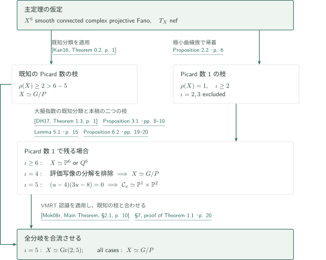
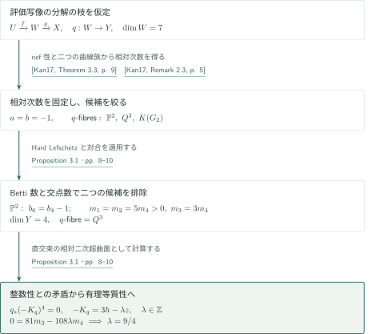
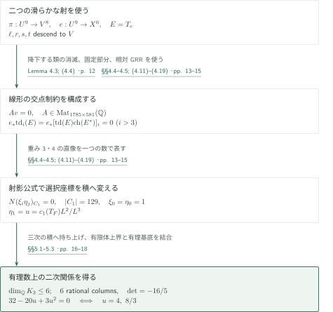
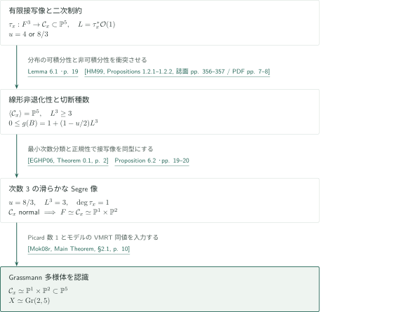
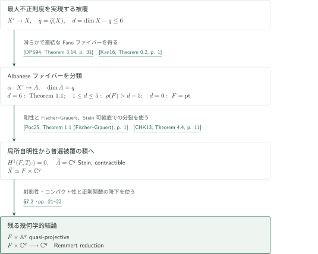
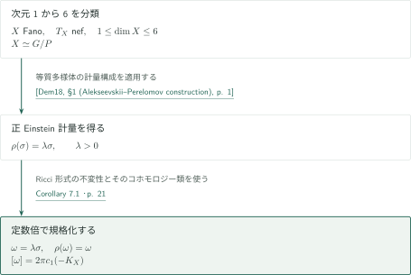

# The Campana–Peternell conjecture in dimension six

**二つのファイバー構造から特性数を制約し、VMRTを認識する**

Campana–Peternell予想の一般形は、nef接束を持つ滑らかな複素射影Fano多様体が任意次元で有理等質多様体になるという主張である。本原稿が新たに扱うのは複素次元6である。Picard数が大きい既知の場合を切り離し、Picard数1の極小有理曲線族を調べる。中心となる擬指数5の計算は、評価写像の3次元ファイバーと曲線パラメータ空間の間で交点数を比較する。

## 1. 主要結果

### Theorem 1.1 — Fano六次元多様体の有理等質性

$X$を滑らかな連結複素射影Fano多様体とする。$\dim_{\mathbb C}X=6$かつ$T_X$がnefなら、$X$は有理等質多様体、すなわち連結半単純複素代数群$G$と放物型部分群$P$に対する$G/P$に同型である。Picard数に追加条件は課さない。これは任意のnef接束を持つ六次元射影多様体をFanoと仮定せず分類する主張ではない。

<!-- cite:main -->[Theorem 1.1 · p. 2](https://github.com/openai/math/blob/1581d4cbdd69a0faf34b2089614fe2a814316a6a/preprints/The-Campana-Peternell-conjecture-in-dimension-six-September-25-2026/main.pdf)<!-- /cite -->

### Corollary 1.2 — Albaneseファイバーと通常の普遍被覆

$X$を解析的な意味でnefな正則接束を持つ連結コンパクトKähler多様体とし、

$$
\widetilde q(X)=\max\{h^1(X',\mathcal O_{X'}):X'\to X\text{ は連結有限étale被覆}\},\qquad d=\dim_{\mathbb C}X-\widetilde q(X)
$$

と置く。$0\le d\le6$なら、連結有限étale被覆$X'\to X$で次を満たすものがある。

1. $\alpha:X'\to A=\operatorname{Alb}(X')$は連結ファイバーを持つ滑らかな固有全射で、$A$は次元$\widetilde q(X)$の複素トーラスである。全ファイバーは次元$d$の有理等質多様体であり、$d=0$では点を許す。
2. 一つのファイバー$F$を固定すると、$\alpha$は正則局所自明な$F$束であり、$X$の通常の普遍被覆は

$$
\widetilde X\simeq F\times\mathbb C^{\widetilde q(X)}
$$

となる。この積は準射影多様体に双正則で、正則凸である。Remmert還元は$F\times\mathbb C^{\widetilde q(X)}\to\mathbb C^{\widetilde q(X)}$という射影である。特に$\dim_{\mathbb C}X\le6$なら全結論が成立する。$A$の射影性や$X'$自体の直積性は結論に含まれない。

<!-- cite:albanese -->[Corollary 1.2 · p. 4](https://github.com/openai/math/blob/1581d4cbdd69a0faf34b2089614fe2a814316a6a/preprints/The-Campana-Peternell-conjecture-in-dimension-six-September-25-2026/main.pdf)<!-- /cite -->

### Corollary 7.1 — 正Kähler–Einstein計量

$X$をnef接束を持つ滑らかな連結複素射影Fano多様体とし、$1\le\dim_{\mathbb C}X\le6$とする。Ricci形式を$\rho(\omega)=-i\partial\bar\partial\log\det(g_{a\bar b})$とする規約の下で、

$$
\rho(\omega)=\omega,\qquad [\omega]=2\pi c_1(-K_X)
$$

を満たすKähler形式$\omega$が存在する。

<!-- cite:ke -->[Corollary 7.1 · p. 21](https://github.com/openai/math/blob/1581d4cbdd69a0faf34b2089614fe2a814316a6a/preprints/The-Campana-Peternell-conjecture-in-dimension-six-September-25-2026/main.pdf)<!-- /cite -->

## 図の矢印に付した引用

<!-- reference-guide -->
略号のない定理・補題・節・式番号は本原稿 [The Campana–Peternell conjecture in dimension six](https://github.com/openai/math/blob/1581d4cbdd69a0faf34b2089614fe2a814316a6a/preprints/The-Campana-Peternell-conjecture-in-dimension-six-September-25-2026/main.pdf) を指します。外部入力には次の略号を使います。

- [Kan16](https://arxiv.org/pdf/1505.02952v1) Akihiro Kanemitsu — *Fano n-folds with nef tangent bundle and Picard number greater than n − 5*：Picard数の大きい場合と次元5以下の分類。arXiv:1505.02952v1, 12 May 2015; published 2016。
- [Kan17](https://arxiv.org/pdf/1503.04579v1) Akihiro Kanemitsu — *Fano 5-folds with nef tangent bundles*：極小有理曲線族と擬指数4の評価写像の分解。arXiv:1503.04579v1, 16 March 2015; published 2017。
- [DH17](https://www.math.univ-toulouse.fr/~tdedieu/hyperquadrics.pdf) Thomas Dedieu and Andreas Höring — *Numerical characterisation of quadrics*：擬指数が次元以上の場合の射影空間・二次超曲面の認識。Author manuscript dated 9 December 2016; published 2017。
- [Mok08s](https://www.numdam.org/article/AST_2008__322__151_0.pdf) Ngaiming Mok — *Geometric structures on uniruled projective manifolds defined by their varieties of minimal rational tangents*：1次元VMRTの分類による擬指数3の除外。Astérisque 322 (2008), 151–205; published scan。
- [Keb02](https://arxiv.org/pdf/math/0004023v2) Stefan Kebekus — *Families of singular rational curves*：一般点での接写像の有限性。arXiv:math/0004023v2, 6 June 2000; published 2002。
- [HM99](https://library.slmath.org/books/Book37/files/hwang.pdf) Jun-Muk Hwang and Ngaiming Mok — *Varieties of minimal rational tangents on uniruled projective manifolds*：接方向の張る分布の可積分性と非可積分性。Several Complex Variables, MSRI Publications 37 (1999), 351–389; published PDF with cover。
- [Mok08r](https://hkumath.hku.hk/~nmok/IMR2005-09.pdf) Ngaiming Mok — *Recognizing certain rational homogeneous manifolds of Picard number 1 from their varieties of minimal rational tangents*：Segre VMRTからGr(2,5)を認識。Author PDF IMR2005-09, 22 pages; published in AMS/IP 42 (2008), 41–61。
- [EGHP06](https://eisenbud.github.io/papers/pdfs/2006-002.pdf) David Eisenbud, Mark Green, Klaus Hulek, and Sorin Popescu — *Small schemes and varieties of minimal degree*：次数3の非退化3次元像をscrollに絞る。arXiv:math/0404517v5, 15 November 2004; published 2006。
- [Del71](https://www.numdam.org/item/PMIHES_1971__40__5_0.pdf) Pierre Deligne — *Théorie de Hodge: II*：不変サイクル・固定部分からHodge直像の自明性を得る。Publications Mathématiques de l’IHÉS 40 (1971), 5–57; published scan。
- [BS58](https://www.numdam.org/item/BSMF_1958__86__97_0.pdf) Armand Borel and Jean-Pierre Serre — *Le théorème de Riemann–Roch*：相対Riemann–Rochによる特性数の消滅。Bulletin de la Société Mathématique de France 86 (1958), 97–136; published scan。
- [DPS94](https://www-fourier.univ-grenoble-alpes.fr/~demailly/manuscripts/dps1.pdf) Jean-Pierre Demailly, Thomas Peternell, and Michael Schneider — *Compact complex manifolds with numerically effective tangent bundles*：最大不正則度の被覆とFanoファイバーを持つAlbanese写像。Author manuscript dps1.pdf, 47 pages; published J. Algebraic Geometry 3 (1994), 295–345。
- [BB96](https://www.numdam.org/item/CM_1996__104_1_1_0.pdf) Frédéric Bien and Michel Brion — *Automorphisms and local rigidity of regular varieties*：有理等質多様体の局所剛性。Compositio Mathematica 104 (1996), 1–26; published scan。
- [Poc25](https://d-nb.info/1371867054/34) Paweł Poczobut — *An algebraic variant of the Fischer–Grauert Theorem*：Theorem 1.1に再掲された解析的Fischer–Grauert定理。Mathematische Zeitschrift 310, Article 33 (2025), published 25 April 2025。
- [CHK13](https://claudon.pages.math.cnrs.fr/pdf/universal-final.pdf) Benoît Claudon, Andreas Höring, and János Kollár — *Algebraic varieties with quasi-projective universal cover*：Steinかつ可縮な底の普遍被覆上での分裂。Author manuscript universal-final.pdf, 14 pages; published J. reine angew. Math. 679 (2013), 207–221。
- [Dem18](https://www-fourier.univ-grenoble-alpes.fr/~demailly/manuscripts/special_issue_mok.pdf) Jean-Pierre Demailly — *Fano manifolds with nef tangent bundles are weakly almost Kähler–Einstein*：§1で再掲する等質多様体の正Kähler–Einstein計量。Author manuscript special_issue_mok.pdf, 6 pages; published Asian J. Math. 22 (2018), 285–290。

各引用に結果番号とページを付します。誌面番号とPDF内の位置が異なる場合は両方を示します。GitHubの閲覧リンクではページ位置への自動移動を前提としません。
<!-- /reference-guide -->

以下は原稿の論証の解説である。外部入力の記述と適用箇所の照合、原稿本文の読解、全証明の独立検証を区別する。Fischer–Grauertと等質計量の入力は、それぞれPoczobutとDemaillyによる再掲を照合している。

## 2. Theorem 1.1 の証明 — Picard数と擬指数の全分岐

<!-- proof-target:1 -->証明対象：[Theorem 1.1 · p. 2](https://github.com/openai/math/blob/1581d4cbdd69a0faf34b2089614fe2a814316a6a/preprints/The-Campana-Peternell-conjecture-in-dimension-six-September-25-2026/main.pdf)<!-- /proof-target -->

**証明の道筋。** [主定理](#theorem-1-1)に対し、$\rho(X)\ge2$を既知の分類で処理し、$\rho(X)=1$で擬指数$\iota$を分ける。原典の擬指数の記号$d$は、系のファイバー次元と区別するためこの記事では$\iota$と書く。[擬指数4](#proof-2)では評価写像の分解を排除し、[擬指数5の数値制約](#proof-3)を[VMRTの認識](#proof-4)へ渡す。

### 1. 既知のPicard数の範囲を切り離す

射影性より$\rho(X)\ge1$。$\rho(X)\ge2$なら$\rho(X)>6-5$なのでKanemitsuの分類が適用できる。原稿はこの枝の収縮やファイバーを改めて分類せず、既知結果を直接入力する。残りは$\rho(X)=1$である。

<!-- cite:kan-large -->[&#91;Kan16, Theorem 0.2, p. 1&#93;](https://arxiv.org/pdf/1505.02952v1#page=1)<!-- /cite -->

### 2. 極小曲線族による擬指数の帰着

最小反標準次数$\iota$の曲線族$V$と普遍族$\pi:U\to V$、評価写像$e:U\to X$を取る。nef性はすべての曲線をfreeにし、次数の最小性は分裂を禁じる。既知の極小族の定理から$U,V$は滑らかで射影的、$\pi$は滑らかな$\mathbb P^1$-fibration、$e$は相対次元$\iota-2$の滑らかな全射で連結ファイバーを持つ。原稿のProposition 2.1は、各$\pi$-ファイバー$C$上で

$$
T_e|_C\simeq\mathcal O_{\mathbb P^1}(-1)^{\oplus(\iota-2)}
$$

を示す。写像空間を微分して$H^0(T_U|_C)\to H^0(e^*T_X|_C)$が全射となり、両辺の次元が等しいことから核の$H^0,H^1$が消える。一般の曲線だけでなく全ファイバー上の分裂であることが、後の束の降下に必要になる。

<!-- cite:minimal -->[Proposition 2.1 · pp. 5–6](https://github.com/openai/math/blob/1581d4cbdd69a0faf34b2089614fe2a814316a6a/preprints/The-Campana-Peternell-conjecture-in-dimension-six-September-25-2026/main.pdf)<!-- /cite --> <!-- cite:kan-family -->[&#91;Kan17, Proposition 1.6, p. 4&#93;](https://arxiv.org/pdf/1503.04579v1#page=4)<!-- /cite -->

微分$\mathcal O(2)\to\varphi^*T_X$から$\iota\ge2$。$\iota=2$なら$e$が同型になり、$X\to V$の曲線ファイバー上で次数0の非零nef因子が得られ、$\rho(X)=1$に反する。$\iota=3$では有限接写像によりVMRTが1次元となり、Mok–Hwangの分類に現れる次元は2、3、5であって6ではない。$\iota\ge6$なら全有理曲線$B$に$-K_X\cdot B\ge6$が成立し、Dedieu–Höringにより$X\simeq\mathbb P^6$または$Q^6$となる。

<!-- cite:reduction -->[Proposition 2.2 · p. 6](https://github.com/openai/math/blob/1581d4cbdd69a0faf34b2089614fe2a814316a6a/preprints/The-Campana-Peternell-conjecture-in-dimension-six-September-25-2026/main.pdf)<!-- /cite --> <!-- cite:mok-small -->[&#91;Mok08s, Theorem 15, 誌面 p. 199 / PDF p. 50&#93;](https://www.numdam.org/article/AST_2008__322__151_0.pdf#page=50)<!-- /cite --> <!-- cite:dh -->[&#91;DH17, Theorem 1.3, p. 1&#93;](https://www.math.univ-toulouse.fr/~tdedieu/hyperquadrics.pdf#page=1)<!-- /cite -->

### 3. 残る二枝を合流させる

$\iota=4$はProposition 3.1、$\iota=5$はProposition 6.2へ進む。前者は有理等質性、後者は$X\simeq\operatorname{Gr}(2,5)$を与える。擬指数4の議論で最後に残る評価写像が$\mathbb P^2$-fibrationなら、外部のProposition 4.1は$\mathbb P^3$または$\operatorname{LG}(3,6)$まで同定し、六次元では後者となる。この細分は主定理に余分な仮定を加えない。以上で全Picard数・全擬指数の枝が主定理へ接続する。

<!-- cite:four -->[Proposition 3.1 · pp. 8–10](https://github.com/openai/math/blob/1581d4cbdd69a0faf34b2089614fe2a814316a6a/preprints/The-Campana-Peternell-conjecture-in-dimension-six-September-25-2026/main.pdf)<!-- /cite --> <!-- cite:recognition -->[Proposition 6.2 · pp. 19–20](https://github.com/openai/math/blob/1581d4cbdd69a0faf34b2089614fe2a814316a6a/preprints/The-Campana-Peternell-conjecture-in-dimension-six-September-25-2026/main.pdf)<!-- /cite --> <!-- cite:kan-hom -->[&#91;Kan17, Proposition 4.1; Remark 4.2, p. 12&#93;](https://arxiv.org/pdf/1503.04579v1#page=12)<!-- /cite --> <!-- cite:assembly -->[§7, proof of Theorem 1.1 · p. 20](https://github.com/openai/math/blob/1581d4cbdd69a0faf34b2089614fe2a814316a6a/preprints/The-Campana-Peternell-conjecture-in-dimension-six-September-25-2026/main.pdf)<!-- /cite -->

## 3. Proposition 3.1 の証明 — 擬指数4と二つの収縮

<!-- proof-target:2 -->証明対象：[Proposition 3.1 · pp. 8–10](https://github.com/openai/math/blob/1581d4cbdd69a0faf34b2089614fe2a814316a6a/preprints/The-Campana-Peternell-conjecture-in-dimension-six-September-25-2026/main.pdf)<!-- /proof-target -->

<!-- statement:proposition-3-1 -->
### Proposition 3.1 — 擬指数4の六次元多様体

$X$を滑らかな複素Fano六次元多様体とする。$T_X$がnef、$\rho(X)=1$、擬指数が4なら、$X$は有理等質多様体である。

<!-- cite:four -->[Proposition 3.1 · pp. 8–10](https://github.com/openai/math/blob/1581d4cbdd69a0faf34b2089614fe2a814316a6a/preprints/The-Campana-Peternell-conjecture-in-dimension-six-September-25-2026/main.pdf)<!-- /cite -->
<!-- /statement -->

### 1. 分解と相対次数を固定する

Kanemitsuの結果は、有理等質性を与える場合か、$e=g\circ f:U\to W\to X$で$f,g,\pi$が滑らかな$\mathbb P^1$-fibrationとなる場合へ分ける。後者には滑らかな初等Mori収縮$q:W\to Y$があり、$\dim W=7$。$H=c_1(T_X)/4$、$h=g^*H$、$c=c_1(T_g)$、$C$を$\pi$-ファイバーとして$a=c_1(T_f)\cdot C$、$b=c\cdot f(C)$と置く。$T_e|_C=\mathcal O(-1)^{\oplus2}$より$a+b=-2$、$a\le-1$。$c-bh$は$Y$の豊富類の正の倍の引き戻しであり、$g_*c=2$、$g_*c^2=0$から$b\le0$を得る。$b=0$は適切な曲線$D\subset X$上の曲面$g^{-1}(D)$が$q$で2次元像を持つことと交点数0を衝突させて除外し、$a=b=-1$となる。

<!-- cite:kan-factor -->[&#91;Kan17, Theorem 3.3, p. 9&#93;](https://arxiv.org/pdf/1503.04579v1#page=9)<!-- /cite --> <!-- cite:kan-hom -->[&#91;Kan17, Proposition 4.1; Remark 4.2, p. 12&#93;](https://arxiv.org/pdf/1503.04579v1#page=12)<!-- /cite --> <!-- cite:involution -->[Lemma 2.3 · p. 7](https://github.com/openai/math/blob/1581d4cbdd69a0faf34b2089614fe2a814316a6a/preprints/The-Campana-Peternell-conjecture-in-dimension-six-September-25-2026/main.pdf)<!-- /cite --> <!-- cite:four -->[Proposition 3.1 · pp. 8–10](https://github.com/openai/math/blob/1581d4cbdd69a0faf34b2089614fe2a814316a6a/preprints/The-Campana-Peternell-conjecture-in-dimension-six-September-25-2026/main.pdf)<!-- /cite -->

### 2. ファイバー候補を二次三次元まで絞る

相対次数$-1$を入力すると$q$のファイバー候補は$\mathbb P^2,Q^3,K(G_2)$となる。$\mathbb P^2$の場合、二つのLeray–Hirsch分解と$Y$のPoincaré双対性が$b_6(X)=b_4(X)-1$を与え、Hard Lefschetzに反する。残る場合には$z=(h+c)/2$が$Y$から降下し、$\dim Y\le4$より$z^5=0$である。

$$
m_i=\int_W h^{7-i}z^i,\qquad m_0=m_5=m_6=m_7=0,\qquad m_1=\int_X H^6>0.
$$

$g$のコホモロジー対合は$z\mapsto h-z$となり、最高次で符号を反転する。偶数指数の関係から$m_1=m_2=5m_4$、$m_3=3m_4$を得る。従って$m_4>0$、$\dim Y=4$となり、$K(G_2)$の枝も消えて$q$は$Q^3$-fibrationとなる。

<!-- cite:kan-fibres -->[&#91;Kan17, Remark 2.3, p. 5&#93;](https://arxiv.org/pdf/1503.04579v1#page=5)<!-- /cite --> <!-- cite:four -->[Proposition 3.1 · pp. 8–10](https://github.com/openai/math/blob/1581d4cbdd69a0faf34b2089614fe2a814316a6a/preprints/The-Campana-Peternell-conjecture-in-dimension-six-September-25-2026/main.pdf)<!-- /cite -->

### 3. 直交束の消滅と整数性を衝突させる

Fischer–Grauertで局所自明化し、$\operatorname{Aut}(Q^3)=\operatorname{PGO}_5\simeq\operatorname{SO}_5$を使うと、$W$は行列式自明な階数5の直交束の相対二次超曲面となる。原稿はGAGAで代数化し、随伴公式から$q_*(-K_q)^4=0$を得る。他方$-K_q=3h-\lambda z$で、$g$のファイバーとの次数から$\lambda\in\mathbb Z$。射影公式は

$$
0=\int_W(-K_q)^4z^3=81m_3-108\lambda m_4
$$

を与え、$m_3=3m_4$から$\lambda=9/4$となって矛盾する。分解の枝が消え、既知の有理等質な場合だけが残る。原稿はWatanabeの同じ擬指数4の結果も挙げるが、ここで説明したのは原稿自身の交点論的な別証明である。

<!-- cite:fg -->[&#91;Poc25, Theorem 1.1 (Fischer–Grauert), p. 1&#93;](https://d-nb.info/1371867054/34)<!-- /cite --> <!-- cite:four -->[Proposition 3.1 · pp. 8–10](https://github.com/openai/math/blob/1581d4cbdd69a0faf34b2089614fe2a814316a6a/preprints/The-Campana-Peternell-conjecture-in-dimension-six-September-25-2026/main.pdf)<!-- /cite -->

## 4. Lemma 5.1 の証明 — 幾何学的制約から二次方程式へ

<!-- proof-target:3 -->証明対象：[Lemma 5.1 · p. 15](https://github.com/openai/math/blob/1581d4cbdd69a0faf34b2089614fe2a814316a6a/preprints/The-Campana-Peternell-conjecture-in-dimension-six-September-25-2026/main.pdf)<!-- /proof-target -->

$\rho(X)=1,\iota=5$とし、$\dim U=9,\dim V=8$。$h=e^*c_1(T_X)/5$、$c=c_1(T_\pi)$、$\ell=2h-c$、$E=T_e$と置く。$r,s,t$は$E$の形式的Chern根に$h$を足した三つの根の基本対称式とする。$h$を整数係数のline bundleの第一Chern類と仮定しない。一般の評価ファイバー$F=e^{-1}(x)$には有限接写像$\tau_x:F\to\mathbb P(T_x^*X)\simeq\mathbb P^5$があり、$L=\tau_x^*\mathcal O(1)$は豊富かつ大域生成、$c_1(L)=\ell|_F$、$r|_F=c_1(T_F)$である。

<!-- cite:polarized -->[Lemmas 4.1–4.2 · pp. 10–11](https://github.com/openai/math/blob/1581d4cbdd69a0faf34b2089614fe2a814316a6a/preprints/The-Campana-Peternell-conjecture-in-dimension-six-September-25-2026/main.pdf)<!-- /cite --> <!-- cite:keb -->[&#91;Keb02, Theorems 3.3–3.4, pp. 7–8&#93;](https://arxiv.org/pdf/math/0004023v2#page=7)<!-- /cite -->

<!-- statement:lemma-5-1 -->
### Lemma 5.1 — 数値制約

$A,C_1,N$を原典§4の有理係数行列・添字集合とする。具体的に、$A$は重み9の交点単項式に対する(4.11)–(4.16)の関係行列、$C_1$は(4.18)の129個の選択座標である。$\ker A$の基底からその座標を選んだ行列を$P$とし、$N$は$\ker(P^T)$の基底の行簡約形の非零行から作る。$\xi\in\mathbb Q^{11}$、$\eta\in\mathbb Q^{18}$が

$$
\xi_0=\eta_0=1,\qquad N(\xi_i\eta_j)_{(i,(j))\in C_1}=0
$$

を満たすなら、$32-20\eta_1+3\eta_1^2=0$。幾何学から構成する座標では$\eta_1=u=c_1(T_F)L^2/L^3$である。

<!-- cite:numerical -->[Lemma 5.1 · p. 15](https://github.com/openai/math/blob/1581d4cbdd69a0faf34b2089614fe2a814316a6a/preprints/The-Campana-Peternell-conjecture-in-dimension-six-September-25-2026/main.pdf)<!-- /cite --> <!-- cite:constraints -->[§§4.4–4.5; (4.11)–(4.19) · pp. 13–15](https://github.com/openai/math/blob/1581d4cbdd69a0faf34b2089614fe2a814316a6a/preprints/The-Campana-Peternell-conjecture-in-dimension-six-September-25-2026/main.pdf)<!-- /cite -->
<!-- /statement -->

### 1. 二つの射から線形関係を取り出す

$\delta=\pi^*\pi_*$とすると、$\pi$の対合は$\bar\alpha=\alpha-c\delta\alpha$、$\delta(\alpha\gamma)=(\delta\alpha)\gamma+\bar\alpha\delta\gamma$を満たす。実際のline bundle $e^*(-K_X)\otimes(T_\pi^*)^{\otimes2}$のファイバー次数は1で、$E$とのテンソル積は全$\pi$-ファイバー上で自明になる。これを降下させると$r,s,t$も$V$から来る。従って$V$から来る重み9の積は消え、$X$から来る重み7以上の類も消える。

さらに$X$の単連結性とDeligneの固定部分の結果を使い、原稿のLemma 4.3は$R^je_*\Omega^p_{U/X}$の自明性を導く。相対GRRを$\mathcal O_U$と$E^*$へ適用すると

$$
e_*\operatorname{td}_i(E)=0,\qquad e_*[\operatorname{td}(E)\operatorname{ch}(E^*)]_i=0\quad(i>3).
$$

これらを同じ重みの多項式に展開したものが$Av=0$である。最後の関係は積分の消滅であり、すべての多項式がコホモロジー類として0だと読み替えない。

<!-- cite:involution -->[Lemma 2.3 · p. 7](https://github.com/openai/math/blob/1581d4cbdd69a0faf34b2089614fe2a814316a6a/preprints/The-Campana-Peternell-conjecture-in-dimension-six-September-25-2026/main.pdf)<!-- /cite --> <!-- cite:polarized -->[Lemmas 4.1–4.2 · pp. 10–11](https://github.com/openai/math/blob/1581d4cbdd69a0faf34b2089614fe2a814316a6a/preprints/The-Campana-Peternell-conjecture-in-dimension-six-September-25-2026/main.pdf)<!-- /cite --> <!-- cite:hodge -->[Lemma 4.3; (4.4) · p. 12](https://github.com/openai/math/blob/1581d4cbdd69a0faf34b2089614fe2a814316a6a/preprints/The-Campana-Peternell-conjecture-in-dimension-six-September-25-2026/main.pdf)<!-- /cite --> <!-- cite:del-inv -->[&#91;Del71, Theorem 4.1.1(ii), 誌面 p. 40 / PDF p. 37&#93;](https://www.numdam.org/item/PMIHES_1971__40__5_0.pdf#page=37)<!-- /cite --> <!-- cite:del-fixed -->[&#91;Del71, Corollary 4.1.2, 誌面 p. 42 / PDF p. 39&#93;](https://www.numdam.org/item/PMIHES_1971__40__5_0.pdf#page=39)<!-- /cite --> <!-- cite:grr -->[&#91;BS58, §7, Riemann–Roch theorem, 誌面 p. 113 / PDF p. 18&#93;](https://www.numdam.org/item/BSMF_1958__86__97_0.pdf#page=18)<!-- /cite -->

### 2. 射影公式が積の構造を供給する

重み3・4の不変単項式$G_j$の$e_*$は、それぞれ$H^0(X,\mathbb Q)$、$H^2(X,\mathbb Q)=\mathbb Qh_X$に入る。そのため$D=L^3>0$を使い$e_*G_j=D\eta_jh_X^{w_j-3}$と一つの数で記述できる。重み6の底の単項式$M_i$の正規化交点数を$\xi_i$とすると、射影公式は選択座標を共通の正数$D\int_Xh_X^6$で割ったものが$\xi_i\eta_j$に等しいことを示す。線形関係だけでなく、この積の構造が非線形制約の入力となる。

<!-- cite:constraints -->[§§4.4–4.5; (4.11)–(4.19) · pp. 13–15](https://github.com/openai/math/blob/1581d4cbdd69a0faf34b2089614fe2a814316a6a/preprints/The-Campana-Peternell-conjecture-in-dimension-six-September-25-2026/main.pdf)<!-- /cite -->

### 3. 有限体の階数と有理数上の証明を結合する

$N(\xi_i\eta_j)=0$を$\eta_a\eta_b$倍し、同じ三つ組を同一視した座標上の線形空間$K_3$を作る。原稿の有限体$\mathbb F_{10007}$上の計算は6820座標における核次元6を与え、有理数上では$\dim K_3\le6$という上界になる。さらに有理数上で二重スライスの全関係を満たす6本の列を与え、ある小行列式$-16/5\ne0$を確認して基底とする。線形汎関数

$$
32v_{0,(0,0,0)}-20v_{0,(0,0,1)}+3v_{0,(0,1,1)}
$$

はこの基底上で0となる。積座標へ戻して$\xi_0=\eta_0=1$を使えば、$(u-4)(3u-8)=0$が従う。有限体だけで有理恒等式を断定する議論ではない。付録はこの有限計算の実行可能な証明書を与える。

<!-- cite:certificate -->[§§5.1–5.3 · pp. 16–18](https://github.com/openai/math/blob/1581d4cbdd69a0faf34b2089614fe2a814316a6a/preprints/The-Campana-Peternell-conjecture-in-dimension-six-September-25-2026/main.pdf)<!-- /cite --> <!-- cite:appendix -->[Appendix A · pp. 22–25](https://github.com/openai/math/blob/1581d4cbdd69a0faf34b2089614fe2a814316a6a/preprints/The-Campana-Peternell-conjecture-in-dimension-six-September-25-2026/main.pdf)<!-- /cite -->

## 5. Proposition 6.2 の証明 — 数値制約からGrassmann多様体へ

<!-- proof-target:4 -->証明対象：[Proposition 6.2 · pp. 19–20](https://github.com/openai/math/blob/1581d4cbdd69a0faf34b2089614fe2a814316a6a/preprints/The-Campana-Peternell-conjecture-in-dimension-six-September-25-2026/main.pdf)<!-- /proof-target -->

<!-- statement:proposition-6-2 -->
### Proposition 6.2 — 擬指数5の認識

$X$を滑らかな複素Fano六次元多様体とする。$T_X$がnef、$\rho(X)=1$、擬指数が5なら、$X\simeq\operatorname{Gr}(2,5)$である。

<!-- cite:recognition -->[Proposition 6.2 · pp. 19–20](https://github.com/openai/math/blob/1581d4cbdd69a0faf34b2089614fe2a814316a6a/preprints/The-Campana-Peternell-conjecture-in-dimension-six-September-25-2026/main.pdf)<!-- /cite -->
<!-- /statement -->

### 1. 接方向像は全空間を張る

$\mathcal C_x=\tau_x(F)$のアフィン錐が真部分空間$W_x\subset T_xX$を張ると仮定すると、$4\le\dim W_x\le5$。接二重ベクトル$\alpha\wedge v$が$\bigwedge^2W_x$を張らなければ、これらを消す非零交代形式が存在し、錐の4次元接空間は等方的となる。階数の評価から残るのは$\dim W_x=5$、交代形式の階数2だけである。しかし2次元のsymplectic商への錐の像は高々1次元の既約錐、従って直線となり、$W_x$を張ることに反する。よって二重ベクトルは全空間を張る。

Hwang–Mokの一方の命題はこの条件から分布の可積分性を与え、他方は$b_2(X)=1$かつVMRTが線形退化という仮定から非可積分性を与える。この矛盾で$\mathcal C_x\subset\mathbb P^5$の非退化性が従う。VMRTの滑らかさはまだ使わない。

<!-- cite:nondegenerate -->[Lemma 6.1 · p. 19](https://github.com/openai/math/blob/1581d4cbdd69a0faf34b2089614fe2a814316a6a/preprints/The-Campana-Peternell-conjecture-in-dimension-six-September-25-2026/main.pdf)<!-- /cite --> <!-- cite:hm -->[&#91;HM99, Propositions 1.2.1–1.2.2, 誌面 pp. 356–357 / PDF pp. 7–8&#93;](https://library.slmath.org/books/Book37/files/hwang.pdf#page=7)<!-- /cite -->

### 2. 切断種数で次数と接写像の次数を決める

大域生成かつ豊富な$L$の一般の2切断の交わり$B$は、BertiniとKodaira消滅による連結性から滑らかな連結曲線となる。随伴公式と有限射の次数公式は

$$
g(B)=1+(1-u/2)L^3\ge0,\qquad L^3=\deg(\tau_x)\deg(\mathcal C_x)\ge3
$$

を与える。$u=4$は負の種数を与えて不可能。$u=8/3$なら$g(B)=1-L^3/3$であり、$L^3=3$、$\deg(\tau_x)=1$、$\deg(\mathcal C_x)=3$となる。

<!-- cite:recognition -->[Proposition 6.2 · pp. 19–20](https://github.com/openai/math/blob/1581d4cbdd69a0faf34b2089614fe2a814316a6a/preprints/The-Campana-Peternell-conjecture-in-dimension-six-September-25-2026/main.pdf)<!-- /cite --> <!-- cite:eghp -->[&#91;EGHP06, Theorem 0.1, p. 2&#93;](https://eisenbud.github.io/papers/pdfs/2006-002.pdf#page=2)<!-- /cite -->

### 3. 正規性を通じてSegre像を認識する

最小次数の分類により$\mathcal C_x$は次数3の3次元有理正規scrollで、錐の可能性も残る。原稿はその座標環を重み$(-a_1,-a_2,-a_3,1,1)$の$\mathbb G_m$作用の不変環として表し、正規性を示す。有限双有理な$\tau_x$はそこで初めて同型になり、$F$の滑らかさが像へ移る。錐を排除すると$a_i>0$、$\sum a_i=3$より$(a_1,a_2,a_3)=(1,1,1)$、すなわち$\mathcal C_x=\mathbb P^1\times\mathbb P^2\hookrightarrow\mathbb P^5$である。

これは$T_A\operatorname{Gr}(2,5)=\operatorname{Hom}(A,\mathbb C^5/A)$内の階数1写像の射影化に一致する。$\operatorname{Gr}(2,5)$は階数2の既約コンパクトHermitian対称空間であり、$X$のPicard数1と一般点での射影的VMRT同値が揃ったので、MokのMain Theoremが$X\simeq\operatorname{Gr}(2,5)$を与える。

<!-- cite:eghp -->[&#91;EGHP06, Theorem 0.1, p. 2&#93;](https://eisenbud.github.io/papers/pdfs/2006-002.pdf#page=2)<!-- /cite --> <!-- cite:recognition -->[Proposition 6.2 · pp. 19–20](https://github.com/openai/math/blob/1581d4cbdd69a0faf34b2089614fe2a814316a6a/preprints/The-Campana-Peternell-conjecture-in-dimension-six-September-25-2026/main.pdf)<!-- /cite --> <!-- cite:mok-rec -->[&#91;Mok08r, Main Theorem, §2.1, p. 10&#93;](https://hkumath.hku.hk/~nmok/IMR2005-09.pdf#page=10)<!-- /cite -->

## 6. Corollary 1.2 の証明 — Albanese束から普遍被覆へ

<!-- proof-target:5 -->証明対象：[Corollary 1.2 · p. 4](https://github.com/openai/math/blob/1581d4cbdd69a0faf34b2089614fe2a814316a6a/preprints/The-Campana-Peternell-conjecture-in-dimension-six-September-25-2026/main.pdf)<!-- /proof-target -->

[系の主張](#corollary-1-2)に戻り、ここでは$d$をファイバー次元、$q=\widetilde q(X)$とする。

### 1. 最大不正則度の被覆でファイバーを分類する

有限étale被覆でもKähler性と解析的nef性は保たれる。各被覆のAlbanese写像は全射なので不正則度は$\dim X$以下の整数となり、最大値$q$が実現する。Demailly–Peternell–Schneiderはその被覆の滑らかなAlbanese全射と連結Fanoファイバーを与える。ファイバーの接束はnefで、次元は$d$。$d=6$にはTheorem 1.1、$1\le d\le5$には$\rho(F)\ge1>d-5$を使う既知の分類、$d=0$には点を対応させる。$X$が0次元の場合も点として最初に処理する。

<!-- cite:dps-alb -->[&#91;DPS94, Proposition 3.9, p. 25&#93;](https://www-fourier.univ-grenoble-alpes.fr/~demailly/manuscripts/dps1.pdf#page=25)<!-- /cite --> <!-- cite:dps -->[&#91;DPS94, Theorem 3.14, p. 31&#93;](https://www-fourier.univ-grenoble-alpes.fr/~demailly/manuscripts/dps1.pdf#page=31)<!-- /cite --> <!-- cite:kan-large -->[&#91;Kan16, Theorem 0.2, p. 1&#93;](https://arxiv.org/pdf/1505.02952v1#page=1)<!-- /cite --> <!-- cite:albanese-proof -->[§7.2 · pp. 21–22](https://github.com/openai/math/blob/1581d4cbdd69a0faf34b2089614fe2a814316a6a/preprints/The-Campana-Peternell-conjecture-in-dimension-six-September-25-2026/main.pdf)<!-- /cite -->

### 2. 局所剛性を経て普遍被覆を分裂させる

$H^1(F,T_F)=0$による局所変形剛性からファイバーの同型型は局所定数となり、連結な$A$上で一つの$F$に固定される。Fischer–Grauertにより$\alpha$は正則局所自明となる。$d=0$では$\alpha$自体が同型である。$\widetilde A=\mathbb C^q$はSteinかつ可縮なので、Claudon–Höring–Kollárの定理は$\widetilde{X'}\simeq\widetilde F\times\mathbb C^q$を与える。有理等質$F$は単連結であり、連結有限étale被覆は通常の普遍被覆を変えないので、主張する$\widetilde X$の積が得られる。

<!-- cite:bb -->[&#91;BB96, §3.7, 誌面 pp. 17–18 / PDF pp. 18–19&#93;](https://www.numdam.org/item/CM_1996__104_1_1_0.pdf#page=18)<!-- /cite --> <!-- cite:fg -->[&#91;Poc25, Theorem 1.1 (Fischer–Grauert), p. 1&#93;](https://d-nb.info/1371867054/34)<!-- /cite --> <!-- cite:chk -->[&#91;CHK13, Theorem 4.4, p. 11&#93;](https://claudon.pages.math.cnrs.fr/pdf/universal-final.pdf#page=11)<!-- /cite --> <!-- cite:albanese-proof -->[§7.2 · pp. 21–22](https://github.com/openai/math/blob/1581d4cbdd69a0faf34b2089614fe2a814316a6a/preprints/The-Campana-Peternell-conjecture-in-dimension-six-September-25-2026/main.pdf)<!-- /cite -->

### 3. 準射影性・正則凸性・Remmert還元

$F$は射影的なので$F\times\mathbb A^q$は準射影的である。積から$\mathbb C^q$への射影は固有で連結コンパクトファイバーを持ち、正則関数は各ファイバー上で定数となる。従って射影の構造層の直像は$\mathcal O_{\mathbb C^q}$であり、Stein底へのこの射がRemmert還元を与える。$q=0$でも底を点として成立する。また$0\le q\le\dim X$なので、$\dim X\le6$なら$d\le6$が自動的に満たされる。

<!-- cite:albanese-proof -->[§7.2 · pp. 21–22](https://github.com/openai/math/blob/1581d4cbdd69a0faf34b2089614fe2a814316a6a/preprints/The-Campana-Peternell-conjecture-in-dimension-six-September-25-2026/main.pdf)<!-- /cite -->

## 7. Corollary 7.1 の証明 — 等質計量の正規化

<!-- proof-target:6 -->証明対象：[Corollary 7.1 · p. 21](https://github.com/openai/math/blob/1581d4cbdd69a0faf34b2089614fe2a814316a6a/preprints/The-Campana-Peternell-conjecture-in-dimension-six-September-25-2026/main.pdf)<!-- /proof-target -->

[正Kähler–Einstein計量の主張](#corollary-7-1)では、分類後の標準的な等質計量の存在を入力する。

### 1. 正のEinstein定数を1にする

次元6では主定理、次元1から5ではKanemitsuの既知結果で$X$を有理等質とする。Alekseevskii–Perelomovの構成をDemailly §1の記述を通じて入力し、$\rho(\sigma)=\lambda\sigma$、$\lambda>0$を満たすKähler形式を得る。定数倍でRicci形式は変わらないので$\omega=\lambda\sigma$とすれば$\rho(\omega)=\omega$となる。採用した規約でRicci形式は$2\pi c_1(-K_X)$を表すため、コホモロジー類の結論も同時に得られる。

<!-- cite:kan-large -->[&#91;Kan16, Theorem 0.2, p. 1&#93;](https://arxiv.org/pdf/1505.02952v1#page=1)<!-- /cite --> <!-- cite:metric -->[&#91;Dem18, §1 (Alekseevskii–Perelomov construction), p. 1&#93;](https://www-fourier.univ-grenoble-alpes.fr/~demailly/manuscripts/special_issue_mok.pdf#page=1)<!-- /cite --> <!-- cite:ke -->[Corollary 7.1 · p. 21](https://github.com/openai/math/blob/1581d4cbdd69a0faf34b2089614fe2a814316a6a/preprints/The-Campana-Peternell-conjecture-in-dimension-six-September-25-2026/main.pdf)<!-- /cite -->

## 8. どの論文が、どの段階を担うか

| 入力 | 利用箇所 | 内容・必要条件 | 確認範囲 |
|---|---|---|---|
| Kanemitsuの二論文、Dedieu–Höring、Mokの1次元VMRT分類 | §2、§3、§7 | Picard数の閾値、擬指数、滑らかな評価写像と収縮 | 定理記述と本稿での使用を照合 |
| Deligne、Borel–Serre | §4 | 単連結な底、滑らかな射影射、固定部分とGRR | 記述と式(4.4)への接続を照合。相対Hodge–de Rham同定のGriffiths原典は未照合 |
| Kebekus、Hwang–Mok、Eisenbud–Green–Hulek–Popescu、Mokの認識定理 | §§4, 6 | 有限接写像、非退化性、最小次数、Picard数1のVMRT認識 | 入力記述と適用を照合。外部証明の再検証はしない |
| Demailly–Peternell–Schneider、Bien–Brion、Fischer–Grauert、Claudon–Höring–Kollár | Corollary 1.2 | Albaneseファイバーの分類、剛性、局所自明性、Stein可縮底 | 記述と適用を照合。Fischer–GrauertはPoczobutでの再掲を使用 |
| Alekseevskii–Perelomov | Corollary 7.1 | 有理等質多様体上の正Einstein計量 | Demailly §1での再掲を照合。1986年原典は未照合 |

これらはカタログ外の既知文献からの直接入力（最後の二行は帰結への入力）である。本稿の本文・参考文献で他のOpenAI原稿への直接引用は確認されなかった。036・052等との追加の包含・一般化・別証明関係は未調査であり、「依存なし」とは扱わない。034 SchnellのCampana–Peternell不等式とも区別する。

## 9. 原典を読む入口と確認範囲

<!-- reading-list -->
- [Proposition 2.2 · p. 6](https://github.com/openai/math/blob/1581d4cbdd69a0faf34b2089614fe2a814316a6a/preprints/The-Campana-Peternell-conjecture-in-dimension-six-September-25-2026/main.pdf) — 既知の枝と擬指数4・5への帰着
- [Proposition 3.1 · pp. 8–10](https://github.com/openai/math/blob/1581d4cbdd69a0faf34b2089614fe2a814316a6a/preprints/The-Campana-Peternell-conjecture-in-dimension-six-September-25-2026/main.pdf) — 分解された評価写像のファイバー候補の排除
- [§§4.4–4.5; (4.11)–(4.19) · pp. 13–15](https://github.com/openai/math/blob/1581d4cbdd69a0faf34b2089614fe2a814316a6a/preprints/The-Campana-Peternell-conjecture-in-dimension-six-September-25-2026/main.pdf) — 幾何学から線形・積関係への移行
- [§§5.1–5.3 · pp. 16–18](https://github.com/openai/math/blob/1581d4cbdd69a0faf34b2089614fe2a814316a6a/preprints/The-Campana-Peternell-conjecture-in-dimension-six-September-25-2026/main.pdf) — 有限体の上界と有理数上の基底を区別して読む
- [Proposition 6.2 · pp. 19–20](https://github.com/openai/math/blob/1581d4cbdd69a0faf34b2089614fe2a814316a6a/preprints/The-Campana-Peternell-conjecture-in-dimension-six-September-25-2026/main.pdf) — 次数・正規性・VMRT認識をつなぐ
- [§7.2 · pp. 21–22](https://github.com/openai/math/blob/1581d4cbdd69a0faf34b2089614fe2a814316a6a/preprints/The-Campana-Peternell-conjecture-in-dimension-six-September-25-2026/main.pdf) — 有限被覆の束と普遍被覆の積を区別する
- [Corollary 7.1 · p. 21](https://github.com/openai/math/blob/1581d4cbdd69a0faf34b2089614fe2a814316a6a/preprints/The-Campana-Peternell-conjecture-in-dimension-six-September-25-2026/main.pdf) — Ricci形式の正規化を確認する
<!-- /reading-list -->

主要結果と中間命題の記述、§§2–7の上記証明箇所、付録の有限計算の構成を読んだ。既知の枝を含む主定理への接続と、Corollary 1.2の全結論・Corollary 7.1の正規化を原典と照合した。これは本部による自己点検であり、独立査読や全証明の形式検証ではない。

原典付属の計算証明書をassertion有効で実行し、`N done`・`pass`を確認した。使用環境とログは付属点検記録に保存した。Griffithsの相対Hodge–de Rham同定、GAGAの原典、Fano多様体の有理連結性等の標準入力の原証明、Alekseevskii–Perelomovの1986年原典は今回の追加照合範囲外である。有限計算の成功だけで幾何学的入力の妥当性まで認定しない。
