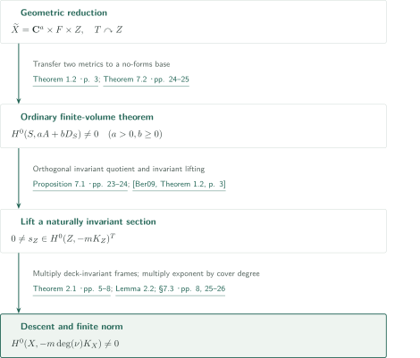
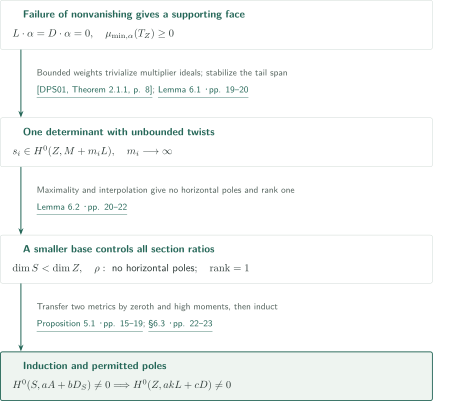
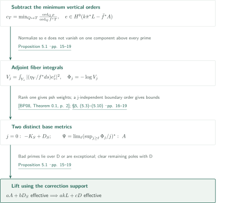
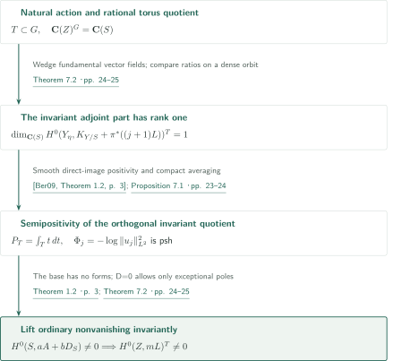

# Anticanonical nonvanishing from smooth semipositivity

**Finite-adjoint-volume induction and naturally invariant sections**

This article follows OpenAI, *Anticanonical nonvanishing from smooth semipositivity* (September 26, 2026). It separates ordinary section production from the invariance needed for descent. Smooth semipositivity is stronger than nefness; smoothness is also used in the invariant direct-image argument.

## Main results

### Theorem 1.1 — Anticanonical nonvanishing

Let $X$ be a smooth connected projective complex variety. If $-K_X$ admits a smooth Hermitian metric of semipositive curvature, then for some integer $m>0$,
$$H^0(X,-mK_X)\ne0.$$
The assertion neither gives a first-power section nor a dimension-dependent uniform exponent.

<!-- cite:main -->[Theorem 1.1 · p. 2](https://github.com/openai/math/blob/fd4aeeb2ee4fc729c18d98444fed42fd0529eeeb/preprints/Anticanonical-nonvanishing-from-smooth-semipositivity-September-26-2026/main.pdf)<!-- /cite -->

### Theorem 1.2 — Finite volume and permitted poles

Let $Z$ be a smooth connected projective complex variety of dimension $d$, with $H^0(Z,\Omega_Z^q)=0$ for every $1\le q\le d$. Let $D\ge0$ be an integral divisor. Suppose $J=-K_Z+D$ has a semipositive singular Hermitian metric $h_J$ such that, for the canonical section $s_D\in H^0(Z,K_Z+J)$,
$$\int_Z|s_D|^2_{h_J}<\infty.$$
If a line bundle $L$ has a semipositive singular Hermitian metric with locally bounded weights, there are integers $a>0,b\ge0$ with
$$H^0(Z,aL+bD)\ne0.$$
The weights of $h_J$ need not be bounded; those of $h_L$ must be locally bounded on both sides. The conclusion gives a rational section of a positive power of $L$ with poles only on $D$, without a uniform bound on $b$.

<!-- cite:volume -->[Theorem 1.2 · p. 3](https://github.com/openai/math/blob/fd4aeeb2ee4fc729c18d98444fed42fd0529eeeb/preprints/Anticanonical-nonvanishing-from-smooth-semipositivity-September-26-2026/main.pdf)<!-- /cite -->

## References on the arrows

<!-- reference-guide -->
Unprefixed theorem, lemma, section and equation numbers refer to [Anticanonical nonvanishing from smooth semipositivity](https://github.com/openai/math/blob/fd4aeeb2ee4fc729c18d98444fed42fd0529eeeb/preprints/Anticanonical-nonvanishing-from-smooth-semipositivity-September-26-2026/main.pdf). External inputs use the following keys.

- [BP08](https://arxiv.org/pdf/math/0703344v4) Bo Berndtsson; Mihai Păun — *Bergman kernels and the pseudoeffectivity of relative canonical bundles*: Relative Bergman metric with singular coefficients, in Lemma 4.1 and Proposition 5.1. arXiv:math/0703344v4, 2008-01-21.
- [Ber09](https://arxiv.org/pdf/math/0511225v2) Bo Berndtsson — *Curvature of vector bundles associated to holomorphic fibrations*: Smooth direct-image L² metric; used on the invariant orthogonal summand. arXiv:math/0511225v2, 2007-08-20; published 2009.
- [DPS01](https://arxiv.org/pdf/math/0006205v2) Jean-Pierre Demailly; Thomas Peternell; Michael Schneider — *Pseudo-effective line bundles on compact Kähler manifolds*: Hard Lefschetz with multiplier ideals produces twisted forms. arXiv:math/0006205v2, 2000-10-10; published 2001.
- [CP19](https://www.numdam.org/item/10.1007/s10240-019-00105-w.pdf) Frédéric Campana; Mihai Păun — *Foliations with positive slopes and birational stability of orbifold cotangent bundles*: Algebraic integrability of foliations of positive minimum movable slope. Published version, 2019, 49 pages.
- [DPS96](https://www-fourier.univ-grenoble-alpes.fr/~demailly/manuscripts/dps4.pdf) Jean-Pierre Demailly; Thomas Peternell; Michael Schneider — *Compact Kähler manifolds with hermitian semipositive anticanonical bundle*: Isometric universal-cover splitting and finite-cover structure; author-manuscript pagination differs from published p.218. Undated author manuscript, 8 pages; published 1996.
- [CDP](https://arxiv.org/pdf/1210.2092v3) Frédéric Campana; Jean-Pierre Demailly; Thomas Peternell — *Rationally connected manifolds and semipositivity of the Ricci curvature*: Structure theorem including rational connectedness of residual factors. arXiv:1210.2092v3, 2018-02-05.
- [GKP](https://arxiv.org/pdf/1408.4308v2) Daniel Greb; Stefan Kebekus; Thomas Peternell — *Movable curves and semistable sheaves*: HN filtrations and tensor slopes for real boundary movable classes. arXiv:1408.4308v2, 2015-04-15.
- [BDPP](https://arxiv.org/pdf/math/0405285v1) Sébastien Boucksom; Jean-Pierre Demailly; Mihai Păun; Thomas Peternell — *The pseudo-effective cone of a compact Kähler manifold and varieties of negative Kodaira dimension*: Duality of pseudoeffective divisors and movable curves. arXiv:math/0405285v1, 2004.

Each citation gives the result and pages. When printed pagination differs from the PDF position, both are shown. GitHub previews do not automatically jump to the cited page.
<!-- /reference-guide -->

## Theorem 1.1 — Proof overview of the main theorem

<!-- proof-target:1 -->Proof target：[Theorem 1.1 · p. 2](https://github.com/openai/math/blob/fd4aeeb2ee4fc729c18d98444fed42fd0529eeeb/preprints/Anticanonical-nonvanishing-from-smooth-semipositivity-September-26-2026/main.pdf)<!-- /proof-target -->

**Proof route.** Split the universal cover after a finite cover while retaining the torus monodromy on the residual factor. Theorem 1.2 supplies ordinary nonvanishing; Theorem 7.2 supplies a naturally invariant section. A finite étale norm finishes the descent.

### 1. The cover retains monodromy

The structure theorem gives a finite étale cover $S\to X$ with universal cover $\mathbf C^a\times F\times Z$. The Ricci-flat factor $F$ has a parallel nowhere-zero canonical frame; $Z$ has no positive-degree holomorphic forms and smoothly semipositive $-K_Z$. The manuscript passes to a finite-index deck subgroup, kills its action on $F$, and makes the closure of its action on $Z$ a connected compact torus $T$. It does not assert that $S$ itself is a product.

<!-- cite:structure -->[Theorem 2.1 · pp. 5–8](https://github.com/openai/math/blob/fd4aeeb2ee4fc729c18d98444fed42fd0529eeeb/preprints/Anticanonical-nonvanishing-from-smooth-semipositivity-September-26-2026/main.pdf)<!-- /cite --> <!-- cite:dps96 -->[&#91;DPS96, Structure Theorem, p. 1&#93;](https://www-fourier.univ-grenoble-alpes.fr/~demailly/manuscripts/dps4.pdf#page=1)<!-- /cite --> <!-- cite:cdp -->[&#91;CDP, Theorem 1.4, p. 3&#93;](https://arxiv.org/pdf/1210.2092v3#page=3)<!-- /cite -->

### 2. From finite volume to a naturally invariant section

On the no-forms factor, $D=0,J=L=-K_Z$ satisfies the finite-volume and bounded-metric assumptions. An ordinary section, however, need not descend under the deck action. Theorem 7.2 takes a rational torus quotient and uses rank one of the invariant adjoint direct image to transfer two metrics to the base. Theorem 1.2 applies on that base, and its section lifts invariantly.

<!-- cite:volume -->[Theorem 1.2 · p. 3](https://github.com/openai/math/blob/fd4aeeb2ee4fc729c18d98444fed42fd0529eeeb/preprints/Anticanonical-nonvanishing-from-smooth-semipositivity-September-26-2026/main.pdf)<!-- /cite --> <!-- cite:invariant -->[Theorem 7.2 · pp. 24–25](https://github.com/openai/math/blob/fd4aeeb2ee4fc729c18d98444fed42fd0529eeeb/preprints/Anticanonical-nonvanishing-from-smooth-semipositivity-September-26-2026/main.pdf)<!-- /cite -->

### 3. Descend using invariance of the natural action

Multiply $s_Z\in H^0(Z,-mK_Z)^T\setminus\{0\}$ by the inverse $m$th powers of the invariant canonical frames on $\mathbf C^a$ and $F$. The product is deck-invariant, hence descends to a section of $-mK_S$. Its norm, for $e=\deg(S/X)$, gives $H^0(X,-meK_X)\ne0$. If $Z$ is a point, take $m=1,s_Z=1$. The argument requires some positive exponent, without uniform estimates for the cover degree or exponent.

<!-- cite:norm -->[Lemma 2.2; §7.3 · pp. 8, 25–26](https://github.com/openai/math/blob/fd4aeeb2ee4fc729c18d98444fed42fd0529eeeb/preprints/Anticanonical-nonvanishing-from-smooth-semipositivity-September-26-2026/main.pdf)<!-- /cite -->

## Theorem 1.2 — Induction through a smaller base

<!-- proof-target:2 -->Proof target：[Theorem 1.2 · p. 3](https://github.com/openai/math/blob/fd4aeeb2ee4fc729c18d98444fed42fd0529eeeb/preprints/Anticanonical-nonvanishing-from-smooth-semipositivity-September-26-2026/main.pdf)<!-- /proof-target -->

The statement is given in the [main results](#theorem-1-2). Assume that every $aL+bD$, with $a>0,b\ge0$, has no section.

### 1. Finite volume controls the tangent slope on a supporting face

Since $L+D$ is pseudoeffective but not big, cone duality supplies a nonzero movable class $\alpha$ with $L\cdot\alpha=D\cdot\alpha=0$. Finite volume enters the relative Bergman metric in Lemma 4.1. Near a multiple fiber $s_1=z_1^e$, the relative-form coefficient contains $z_1^{-(e-1)}$. A local upper bound after subtracting $(e-1)\log|z_1|^2$ from the Bergman weight extends the metric to the determinant of the saturated conormal sheaf. The positive HN part is a foliation, and positive-slope algebraicity then yields $\mu_{\min,\alpha}(T_Z)\ge-D\cdot\alpha=0$.

<!-- cite:slope -->[Lemma 4.1; Theorem 4.2; Corollary 4.3 · pp. 11–15](https://github.com/openai/math/blob/fd4aeeb2ee4fc729c18d98444fed42fd0529eeeb/preprints/Anticanonical-nonvanishing-from-smooth-semipositivity-September-26-2026/main.pdf)<!-- /cite --> <!-- cite:bp08 -->[&#91;BP08, Theorem 0.1, p. 2&#93;](https://arxiv.org/pdf/math/0703344v4#page=2)<!-- /cite --> <!-- cite:cp19 -->[&#91;CP19, Theorem 1.1, p. 2&#93;](https://www.numdam.org/item/10.1007/s10240-019-00105-w.pdf#page=2)<!-- /cite --> <!-- cite:gkp -->[&#91;GKP, Corollary 2.27; Theorem 4.2, pp. 8, 12&#93;](https://arxiv.org/pdf/1408.4308v2#page=8)<!-- /cite --> <!-- cite:bdpp -->[&#91;BDPP, Theorems 2.2, 2.4, p. 6&#93;](https://arxiv.org/pdf/math/0405285v1#page=6)<!-- /cite -->

### 2. One determinant and a base controlling every section ratio

The no-forms assumption gives $\chi(\mathcal O_Z)=1$. The Riemann–Roch polynomial $\chi(K_Z+mL)$ has constant term $(-1)^d$, hence is nonzero for large $m$. Bounded weights imply $\mathcal I(h_L^m)=\mathcal O_Z$, so Hard Lefschetz produces infinitely many maps $-mL\to\Omega_Z^p$ for one fixed $p$. Stabilize their generic tail span and take its determinant $M$. Then $M\cdot\alpha\le0$ and there are $s_i\in H^0(Z,M+m_iL)$ with $m_i\to\infty$.

Every complete system $|uL+vM+wD|$, for $u,v,w\ge0$, has nonpositive degree against $\alpha$ and cannot be generically finite. Choose one with maximal image dimension, and take the relative algebraic closure of its image field in $\mathbf C(Z)$ to obtain $\dim S<\dim Z$. Products of sections and maximality put every ratio from these systems in $\mathbf C(S)$. The interpolation identity (6.5), together with $m_i\to\infty$, shows that $\rho=s_2/s_1$ has nonnegative order at horizontal divisors. The same ratio property, after clearing common vertical denominators, gives adjoint rank one for every $j\ge0$, including $j=0$.

<!-- cite:determinant -->[Lemma 6.1 · pp. 19–20](https://github.com/openai/math/blob/fd4aeeb2ee4fc729c18d98444fed42fd0529eeeb/preprints/Anticanonical-nonvanishing-from-smooth-semipositivity-September-26-2026/main.pdf)<!-- /cite --> <!-- cite:dps01 -->[&#91;DPS01, Theorem 2.1.1, p. 8&#93;](https://arxiv.org/pdf/math/0006205v2#page=8)<!-- /cite --> <!-- cite:maximal -->[Lemma 6.2 · pp. 20–22](https://github.com/openai/math/blob/fd4aeeb2ee4fc729c18d98444fed42fd0529eeeb/preprints/Anticanonical-nonvanishing-from-smooth-semipositivity-September-26-2026/main.pdf)<!-- /cite -->

### 3. Transfer two metrics and lift only permitted poles

Proposition 5.1 supplies a bounded semipositive line $A$ and a finite-volume metric on $-K_S+D_S$. Pullback of holomorphic forms is injective, so $S$ also has no positive-degree forms. Induction gives a section of $aA+bD_S$, which lifts to a nonzero section of $akL+cD$, contradicting the assumption. If the base is a point, the absence of horizontal poles already makes $\rho$ a section. The dimension-zero starting case is $a=1,b=0$.

<!-- cite:transfer -->[Proposition 5.1 · pp. 15–19](https://github.com/openai/math/blob/fd4aeeb2ee4fc729c18d98444fed42fd0529eeeb/preprints/Anticanonical-nonvanishing-from-smooth-semipositivity-September-26-2026/main.pdf)<!-- /cite --> <!-- cite:induction -->[§6.3 · pp. 22–23](https://github.com/openai/math/blob/fd4aeeb2ee4fc729c18d98444fed42fd0529eeeb/preprints/Anticanonical-nonvanishing-from-smooth-semipositivity-September-26-2026/main.pdf)<!-- /cite -->

## Proposition 5.1 — Separate the zeroth and high moments

<!-- proof-target:3 -->Proof target：[Proposition 5.1 · pp. 15–19](https://github.com/openai/math/blob/fd4aeeb2ee4fc729c18d98444fed42fd0529eeeb/preprints/Anticanonical-nonvanishing-from-smooth-semipositivity-September-26-2026/main.pdf)<!-- /proof-target -->

<!-- statement:proposition-5-1 -->
### Proposition 5.1 — Two-metric transfer

Let $X,S,Y$ be smooth connected projective complex varieties and $\bar Y$ normal projective. Let $r:Y\to\bar Y$ and $\bar\pi:\bar Y\to X$ be projective birational morphisms, and $\bar f:\bar Y\to S$ surjective equidimensional with connected general fiber. Put $\pi=\bar\pi r,f=\bar f r$. Assume the metric conditions on $D,J,h_J,L,h_L$ from Theorem 1.2; the no-forms hypothesis is not required here. Suppose $k>0$ and a nonzero rational section $\rho$ of $k\bar\pi^*L$ have no horizontal poles and, over $\eta=\operatorname{Spec}\mathbf C(S)$, for every integer $j\ge0$,
$$\dim_{\mathbf C(S)}H^0(Y_\eta,(K_{Y/S}+\pi^*(J+jkL))|_{Y_\eta})=1.$$
After replacing $k,\rho$ by a common positive power, there are a line bundle $A$, an effective integral divisor $D_S$ on $S$, and a nonzero regular section $e\in H^0(\bar Y,k\bar\pi^*L-\bar f^*A)$. The line $A$ has a bounded semipositive metric, and $-K_S+D_S$ a semipositive metric of finite adjoint volume. The support of $D_S$ consists only of primes $T$ for which every component of $\bar f^*T$ is $\bar\pi$-exceptional or contained in $\operatorname{Supp}\bar\pi^*D$. If $a>0,b\ge0$ and $H^0(S,aA+bD_S)\ne0$, then $H^0(X,akL+cD)\ne0$ for some $c\ge0$.

<!-- cite:transfer -->[Proposition 5.1 · pp. 15–19](https://github.com/openai/math/blob/fd4aeeb2ee4fc729c18d98444fed42fd0529eeeb/preprints/Anticanonical-nonvanishing-from-smooth-semipositivity-September-26-2026/main.pdf)<!-- /cite -->
<!-- /statement -->

### 1. Normalize vertical orders on the equidimensional normal model

Clear denominators in $c_T=\min_{\bar f(Q)=T}\operatorname{ord}_Q(\rho)/\operatorname{ord}_Q(\bar f^*T)$ and put $A=\mathcal O_S(\sum c_TT)$. Dividing $\rho$ by the pullback of its tautological rational section gives $e$ with nonnegative order at every prime divisor. Normality makes it regular. Above each $T$, at least one component has zero order in $e$. Equidimensionality is required of the normal model, not of the smooth resolution used for integration.

<!-- cite:transfer -->[Proposition 5.1 · pp. 15–19](https://github.com/openai/math/blob/fd4aeeb2ee4fc729c18d98444fed42fd0529eeeb/preprints/Anticanonical-nonvanishing-from-smooth-semipositivity-September-26-2026/main.pdf)<!-- /cite -->

### 2. Zeroth moments carry volume; high moments carry boundedness

Using $\eta_Y=\pi^*s_D$, including its Jacobian, and local frames $ds,v$, set
$$V_j(s)=\int_{Y_s}|(\eta_Y/f^*ds)e_v^j|^2_{\pi^*(h_Jh_L^{jk})},\qquad\Phi_j=-\log V_j.$$
Rank one identifies a Bergman weight and gives psh representatives of $\Phi_j$. For $j=0$, a boundary correction $D_S$ yields an adjoint measure equal to $f_*|\eta_Y|^2$, preserving finite volume. In contrast,
$$\Psi=\lim_{\ell\to\infty}\left(\sup_{j\ge\ell}\frac{\Phi_j}{j}\right)^*$$
is a weight on $A$. Boundedness of $h_L$ gives $V_j\le C^jV_0$ and hence a lower bound for $\Psi$. On a component where $e$ does not vanish, $V_j\ge C_1C_2^j|s_1|^{2b_T}$ has $b_T$ independent of $j$. Division by $j$ and passage to the limit remove the boundary term. These two estimates produce bounds on both sides.

<!-- cite:moments -->[§5, (5.3)–(5.10) · pp. 16–19](https://github.com/openai/math/blob/fd4aeeb2ee4fc729c18d98444fed42fd0529eeeb/preprints/Anticanonical-nonvanishing-from-smooth-semipositivity-September-26-2026/main.pdf)<!-- /cite --> <!-- cite:bp08 -->[&#91;BP08, Theorem 0.1, p. 2&#93;](https://arxiv.org/pdf/math/0703344v4#page=2)<!-- /cite -->

### 3. The support condition permits lifting

Pull back a base section and multiply by $e^a$. Poles occur only over bad primes, hence are exceptional over $X$ or supported above $D$. Exceptional poles disappear under normal pushdown, and multiplication by $s_D^c$ clears the remaining ones. No new forbidden polar divisor survives on $X$.

<!-- cite:transfer -->[Proposition 5.1 · pp. 15–19](https://github.com/openai/math/blob/fd4aeeb2ee4fc729c18d98444fed42fd0529eeeb/preprints/Anticanonical-nonvanishing-from-smooth-semipositivity-September-26-2026/main.pdf)<!-- /cite -->

## Theorem 7.2 — Nonvanishing for the natural linearization

<!-- proof-target:4 -->Proof target：[Theorem 7.2 · pp. 24–25](https://github.com/openai/math/blob/fd4aeeb2ee4fc729c18d98444fed42fd0529eeeb/preprints/Anticanonical-nonvanishing-from-smooth-semipositivity-September-26-2026/main.pdf)<!-- /proof-target -->

<!-- statement:theorem-7-2 -->
### Theorem 7.2 — Anticanonical sections fixed by a compact torus

Let $Z$ be smooth connected projective over $\mathbf C$, with $H^0(Z,\Omega_Z^q)=0$ for every $q>0$. Suppose $L=-K_Z$ has a smooth semipositive Hermitian metric. Let a compact connected real torus $T$ act continuously by holomorphic automorphisms, and equip $L$ with the natural linearization induced by the differential. Then $H^0(Z,mL)^T\ne0$ for some integer $m>0$.

<!-- cite:invariant -->[Theorem 7.2 · pp. 24–25](https://github.com/openai/math/blob/fd4aeeb2ee4fc729c18d98444fed42fd0529eeeb/preprints/Anticanonical-nonvanishing-from-smooth-semipositivity-September-26-2026/main.pdf)<!-- /cite -->
<!-- /statement -->

### 1. A rational quotient gives rank one only in the invariant part

The vanishing $H^1(\mathcal O_Z)=0$ extends $T$ to an algebraic torus $G$ and identifies $T$-fixed and $G$-fixed sections for the natural action. A general fiber of the Rosenlicht quotient has a dense orbit. Commutativity makes the fundamental vector fields invariant; their wedge, combined with a base anticanonical frame, gives an invariant $\rho$ without horizontal poles. Ratios of invariant adjoint sections belong to $\mathbf C(Z)^G=\mathbf C(S)$, so the invariant subspace has dimension one for every $j\ge0$. The full adjoint space need not have rank one.

<!-- cite:invariant -->[Theorem 7.2 · pp. 24–25](https://github.com/openai/math/blob/fd4aeeb2ee4fc729c18d98444fed42fd0529eeeb/preprints/Anticanonical-nonvanishing-from-smooth-semipositivity-September-26-2026/main.pdf)<!-- /cite -->

### 2. Positivity comes from an orthogonal quotient of the smooth direct image

Average the smooth semipositive metrics to make them $T$-invariant. Berndtsson's theorem gives the adjoint direct image its semipositive $L^2$ metric on the smooth locus. Compact averaging is a holomorphic orthogonal projection onto the invariant line, whose metric is therefore a semipositive quotient metric. The argument does not assume positivity of an arbitrary subbundle. This use of smooth coefficients distinguishes Proposition 7.1 from ordinary Proposition 5.1, which allows singular coefficients.

<!-- cite:smooth -->[Proposition 7.1 · pp. 23–24](https://github.com/openai/math/blob/fd4aeeb2ee4fc729c18d98444fed42fd0529eeeb/preprints/Anticanonical-nonvanishing-from-smooth-semipositivity-September-26-2026/main.pdf)<!-- /cite --> <!-- cite:ber09 -->[&#91;Ber09, Theorem 1.2, p. 3&#93;](https://arxiv.org/pdf/math/0511225v2#page=3)<!-- /cite -->

### 3. Apply the ordinary theorem downstairs and lift invariantly

Proposition 7.1 uses the boundary estimates of Proposition 5.1 to construct both base metrics. The no-forms condition descends, and Theorem 1.2 gives a section of $aA+bD_S$. The base action is trivial and $e$ is invariant, so the lift remains invariant. Since $D=0$, every permitted pole is exceptional and disappears on pushdown. If the general orbit has dimension zero, the action is trivial and Theorem 1.2 applies directly; the point case is immediate as well.

<!-- cite:smooth -->[Proposition 7.1 · pp. 23–24](https://github.com/openai/math/blob/fd4aeeb2ee4fc729c18d98444fed42fd0529eeeb/preprints/Anticanonical-nonvanishing-from-smooth-semipositivity-September-26-2026/main.pdf)<!-- /cite --> <!-- cite:invariant -->[Theorem 7.2 · pp. 24–25](https://github.com/openai/math/blob/fd4aeeb2ee4fc729c18d98444fed42fd0529eeeb/preprints/Anticanonical-nonvanishing-from-smooth-semipositivity-September-26-2026/main.pdf)<!-- /cite -->

## Dependencies and catalogue role

This manuscript proves both ordinary and naturally invariant nonvanishing internally, without using another manuscript from catalogue 068 as a direct input. Uses by later manuscripts are distinguished in the catalogue after checking the receiving hypotheses. DPS96/CDP supply structure, BDPP/GKP/CP19 slope theory, DPS01 twisted forms, and BP08 and Ber09 two different positivity mechanisms. Neither nefness alone nor an integrable singular metric alone is substituted for the assumptions of Theorem 7.2.

## Return to the sources

<!-- reading-list -->
- [Theorem 2.1 · pp. 5–8](https://github.com/openai/math/blob/fd4aeeb2ee4fc729c18d98444fed42fd0529eeeb/preprints/Anticanonical-nonvanishing-from-smooth-semipositivity-September-26-2026/main.pdf) — Finite cover retaining monodromy.
- [Lemma 4.1; Theorem 4.2; Corollary 4.3 · pp. 11–15](https://github.com/openai/math/blob/fd4aeeb2ee4fc729c18d98444fed42fd0529eeeb/preprints/Anticanonical-nonvanishing-from-smooth-semipositivity-September-26-2026/main.pdf) — Finite-volume cotangent slope bound.
- [Proposition 5.1 · pp. 15–19](https://github.com/openai/math/blob/fd4aeeb2ee4fc729c18d98444fed42fd0529eeeb/preprints/Anticanonical-nonvanishing-from-smooth-semipositivity-September-26-2026/main.pdf) — Separate uses of zeroth and high moments.
- [Lemma 6.2 · pp. 20–22](https://github.com/openai/math/blob/fd4aeeb2ee4fc729c18d98444fed42fd0529eeeb/preprints/Anticanonical-nonvanishing-from-smooth-semipositivity-September-26-2026/main.pdf) — Maximal systems give no horizontal poles and rank one in every degree.
- [Proposition 7.1 · pp. 23–24](https://github.com/openai/math/blob/fd4aeeb2ee4fc729c18d98444fed42fd0529eeeb/preprints/Anticanonical-nonvanishing-from-smooth-semipositivity-September-26-2026/main.pdf) — Invariant direct-image positivity requiring smooth coefficients.
- [Theorem 7.2 · pp. 24–25](https://github.com/openai/math/blob/fd4aeeb2ee4fc729c18d98444fed42fd0529eeeb/preprints/Anticanonical-nonvanishing-from-smooth-semipositivity-September-26-2026/main.pdf) — Construction of naturally invariant sections.
<!-- /reading-list -->

The editorial reading checked the principal statements, proof passages in §§2 and 4–7, and the indicated statements and uses of eight external sources. The model preparation in §3 was read, but the original sources for flattening, equivariant resolution, the Rosenlicht quotient and Yau's theorem were not separately checked in this draft. External proofs, every psh-envelope extension, and the common-denominator arguments were not independently reproved. This is neither expert peer review nor formal verification; the authors' assertions and this reading scope remain distinct.
