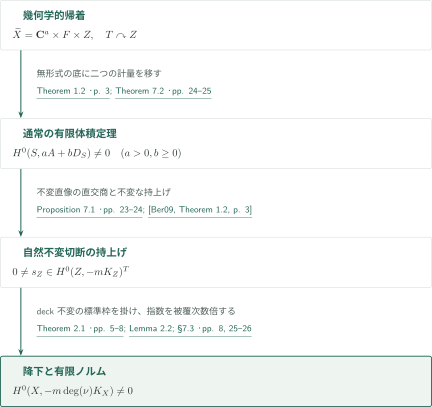
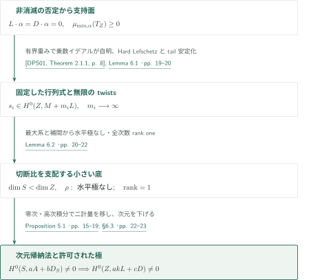
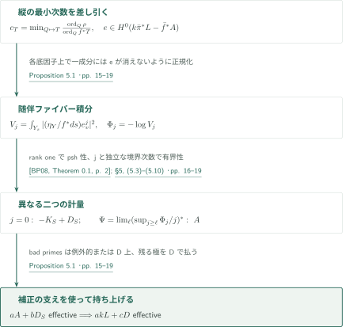
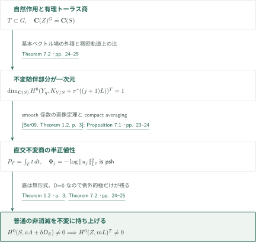

# 滑らかな半正値性からの反標準非消滅

**有限随伴体積による帰納法と、自然線形化の不変切断**

OpenAI, *Anticanonical nonvanishing from smooth semipositivity*（2026年9月26日版）の証明を案内する。普通の切断を作る有限体積定理と、被覆上の切断を降下させる不変化を分ける。smooth semipositivityはnef性より強い仮定であり、本文の不変直像の段階でも滑らかさを使う。

## 主要結果

### Theorem 1.1 — 反標準非消滅

$X$を滑らかな連結複素射影多様体とする。$-K_X$が曲率半正値の滑らかなHermitian計量を持つなら、ある整数$m>0$に対して
$$H^0(X,-mK_X)\ne0.$$
第一冪の切断や、次元だけによる一様な$m$は主張していない。

<!-- cite:main -->[Theorem 1.1 · p. 2](https://github.com/openai/math/blob/fd4aeeb2ee4fc729c18d98444fed42fd0529eeeb/preprints/Anticanonical-nonvanishing-from-smooth-semipositivity-September-26-2026/main.pdf)<!-- /cite -->

### Theorem 1.2 — 有限体積と許された極

$Z$を次元$d$の滑らかな連結複素射影多様体とし、$H^0(Z,\Omega_Z^q)=0$をすべての$1\le q\le d$に仮定する。$D\ge0$は整因子で、$J=-K_Z+D$は半正値特異Hermitian計量$h_J$を持ち、標準切断$s_D\in H^0(Z,K_Z+J)$について
$$\int_Z|s_D|^2_{h_J}<\infty$$
とする。線束$L$が局所有界な重みを持つ半正値特異Hermitian計量を持つなら、ある整数$a>0,b\ge0$に対して
$$H^0(Z,aL+bD)\ne0.$$
$h_J$の重みは有界でなくてよい。一方$h_L$は上下両側に局所有界である。結論は$L$の正の冪の有理切断で、極を$D$上に限るというものであり、$b$の一様性は含まない。

<!-- cite:volume -->[Theorem 1.2 · p. 3](https://github.com/openai/math/blob/fd4aeeb2ee4fc729c18d98444fed42fd0529eeeb/preprints/Anticanonical-nonvanishing-from-smooth-semipositivity-September-26-2026/main.pdf)<!-- /cite -->

## 図の矢印に付した引用

<!-- reference-guide -->
略号のない定理・補題・節・式番号は本原稿 [Anticanonical nonvanishing from smooth semipositivity](https://github.com/openai/math/blob/fd4aeeb2ee4fc729c18d98444fed42fd0529eeeb/preprints/Anticanonical-nonvanishing-from-smooth-semipositivity-September-26-2026/main.pdf) を指します。外部入力には次の略号を使います。

- [BP08](https://arxiv.org/pdf/math/0703344v4) Bo Berndtsson; Mihai Păun — *Bergman kernels and the pseudoeffectivity of relative canonical bundles*：特異係数を許す相対Bergman計量。Lemma 4.1とProposition 5.1。arXiv:math/0703344v4, 2008-01-21。
- [Ber09](https://arxiv.org/pdf/math/0511225v2) Bo Berndtsson — *Curvature of vector bundles associated to holomorphic fibrations*：滑らかな係数の直像L²計量。不変直和因子の商計量に使用。arXiv:math/0511225v2, 2007-08-20; published 2009。
- [DPS01](https://arxiv.org/pdf/math/0006205v2) Jean-Pierre Demailly; Thomas Peternell; Michael Schneider — *Pseudo-effective line bundles on compact Kähler manifolds*：乗数イデアル付きHard Lefschetzからtwisted formsを作る。arXiv:math/0006205v2, 2000-10-10; published 2001。
- [CP19](https://www.numdam.org/item/10.1007/s10240-019-00105-w.pdf) Frédéric Campana; Mihai Păun — *Foliations with positive slopes and birational stability of orbifold cotangent bundles*：正の最小movable slopeを持つ葉層の代数的可積分性。Published version, 2019, 49 pages。
- [DPS96](https://www-fourier.univ-grenoble-alpes.fr/~demailly/manuscripts/dps4.pdf) Jean-Pierre Demailly; Thomas Peternell; Michael Schneider — *Compact Kähler manifolds with hermitian semipositive anticanonical bundle*：普遍被覆の等長分解と有限被覆の構造。誌面版p.218とはページを区別。Undated author manuscript, 8 pages; published 1996。
- [CDP](https://arxiv.org/pdf/1210.2092v3) Frédéric Campana; Jean-Pierre Demailly; Thomas Peternell — *Rationally connected manifolds and semipositivity of the Ricci curvature*：残余因子の有理連結性を含む構造定理。arXiv:1210.2092v3, 2018-02-05。
- [GKP](https://arxiv.org/pdf/1408.4308v2) Daniel Greb; Stefan Kebekus; Thomas Peternell — *Movable curves and semistable sheaves*：実境界movable classでのHN filtrationとtensor slope。arXiv:1408.4308v2, 2015-04-15。
- [BDPP](https://arxiv.org/pdf/math/0405285v1) Sébastien Boucksom; Jean-Pierre Demailly; Mihai Păun; Thomas Peternell — *The pseudo-effective cone of a compact Kähler manifold and varieties of negative Kodaira dimension*：擬有効錐とmovable curve錐の双対性。arXiv:math/0405285v1, 2004。

各引用に結果番号とページを付します。誌面番号とPDF内の位置が異なる場合は両方を示します。GitHubの閲覧リンクではページ位置への自動移動を前提としません。
<!-- /reference-guide -->

## Theorem 1.1 — 主定理の証明概略

<!-- proof-target:1 -->証明対象：[Theorem 1.1 · p. 2](https://github.com/openai/math/blob/fd4aeeb2ee4fc729c18d98444fed42fd0529eeeb/preprints/Anticanonical-nonvanishing-from-smooth-semipositivity-September-26-2026/main.pdf)<!-- /proof-target -->

**証明の道筋。** 有限被覆の普遍被覆を分解し、残る因子のトーラス作用を保持する。Theorem 1.2は通常の非消滅を与え、Theorem 7.2が自然作用に不変な切断へ進める。最後に有限étale normを取る。

### 1. 被覆の分解はモノドロミーを消さない

構造定理により、適切な有限étale被覆$S\to X$の普遍被覆は$\mathbf C^a\times F\times Z$となる。$F$はRicci平坦で標準束に平行な非消滅枠があり、$Z$は正次数の正則形式を持たず$-K_Z$が滑らかに半正値である。原稿はdeck群を有限指数で取り直し、$F$への作用を消して$Z$への像の閉包を連結compact torus $T$にする。$S$自体が直積になるとは主張しない。

<!-- cite:structure -->[Theorem 2.1 · pp. 5–8](https://github.com/openai/math/blob/fd4aeeb2ee4fc729c18d98444fed42fd0529eeeb/preprints/Anticanonical-nonvanishing-from-smooth-semipositivity-September-26-2026/main.pdf)<!-- /cite --> <!-- cite:dps96 -->[&#91;DPS96, Structure Theorem, p. 1&#93;](https://www-fourier.univ-grenoble-alpes.fr/~demailly/manuscripts/dps4.pdf#page=1)<!-- /cite --> <!-- cite:cdp -->[&#91;CDP, Theorem 1.4, p. 3&#93;](https://arxiv.org/pdf/1210.2092v3#page=3)<!-- /cite -->

### 2. 有限体積定理から自然不変切断へ

無正次数形式の因子で$D=0,J=L=-K_Z$とすると有限体積と有界計量の条件は満たされる。しかし普通の切断ではdeck作用に対する降下が保証されない。Theorem 7.2ではトーラスの有理商を取り、不変随伴直像のrank oneを使って底へ二つの計量を移す。その底にTheorem 1.2を適用し、不変切断として持ち上げる。

<!-- cite:volume -->[Theorem 1.2 · p. 3](https://github.com/openai/math/blob/fd4aeeb2ee4fc729c18d98444fed42fd0529eeeb/preprints/Anticanonical-nonvanishing-from-smooth-semipositivity-September-26-2026/main.pdf)<!-- /cite --> <!-- cite:invariant -->[Theorem 7.2 · pp. 24–25](https://github.com/openai/math/blob/fd4aeeb2ee4fc729c18d98444fed42fd0529eeeb/preprints/Anticanonical-nonvanishing-from-smooth-semipositivity-September-26-2026/main.pdf)<!-- /cite -->

### 3. 自然作用に対する不変性を使って降下する

得られた$s_Z\in H^0(Z,-mK_Z)^T\setminus\{0\}$と、$\mathbf C^a,F$の不変標準枠の逆冪との積はdeck不変である。したがって$S$上の$-mK_S$の切断に降下し、次数$e=\deg(S/X)$のnormが$H^0(X,-meK_X)\ne0$を与える。$Z$が点なら$m=1,s_Z=1$とする。必要なのはある正の指数であり、被覆次数や指数の一様評価ではない。

<!-- cite:norm -->[Lemma 2.2; §7.3 · pp. 8, 25–26](https://github.com/openai/math/blob/fd4aeeb2ee4fc729c18d98444fed42fd0529eeeb/preprints/Anticanonical-nonvanishing-from-smooth-semipositivity-September-26-2026/main.pdf)<!-- /cite -->

## Theorem 1.2 — 有限体積から小さい底への帰納法

<!-- proof-target:2 -->証明対象：[Theorem 1.2 · p. 3](https://github.com/openai/math/blob/fd4aeeb2ee4fc729c18d98444fed42fd0529eeeb/preprints/Anticanonical-nonvanishing-from-smooth-semipositivity-September-26-2026/main.pdf)<!-- /proof-target -->

主張は[主要結果](#theorem-1-2)のとおり。$aL+bD$がすべて非消滅しないと仮定して矛盾を導く。

### 1. 有限体積からsupporting movable class上の非負接束へ

$L+D$は擬有効だがbigではないため、錐双対性から非零movable class $\alpha$で$L\cdot\alpha=D\cdot\alpha=0$となるものを選べる。有限体積はLemma 4.1の相対Bergman計量に使う。多重ファイバーの局所式$s_1=z_1^e$で、相対形式の係数は$z_1^{-(e-1)}$を含む。Bergman重みから$(e-1)\log|z_1|^2$を引いても上に局所有界となる評価により、飽和conormalの行列式に計量が延長する。正のHN部分を葉層とし、その代数的可積分性を用いると$\mu_{\min,\alpha}(T_Z)\ge-D\cdot\alpha=0$を得る。

<!-- cite:slope -->[Lemma 4.1; Theorem 4.2; Corollary 4.3 · pp. 11–15](https://github.com/openai/math/blob/fd4aeeb2ee4fc729c18d98444fed42fd0529eeeb/preprints/Anticanonical-nonvanishing-from-smooth-semipositivity-September-26-2026/main.pdf)<!-- /cite --> <!-- cite:bp08 -->[&#91;BP08, Theorem 0.1, p. 2&#93;](https://arxiv.org/pdf/math/0703344v4#page=2)<!-- /cite --> <!-- cite:cp19 -->[&#91;CP19, Theorem 1.1, p. 2&#93;](https://www.numdam.org/item/10.1007/s10240-019-00105-w.pdf#page=2)<!-- /cite --> <!-- cite:gkp -->[&#91;GKP, Corollary 2.27; Theorem 4.2, pp. 8, 12&#93;](https://arxiv.org/pdf/1408.4308v2#page=8)<!-- /cite --> <!-- cite:bdpp -->[&#91;BDPP, Theorems 2.2, 2.4, p. 6&#93;](https://arxiv.org/pdf/math/0405285v1#page=6)<!-- /cite -->

### 2. 一つの行列式と、全ての切断比を支配する底

無正次数形式より$\chi(\mathcal O_Z)=1$。Riemann–Rochの多項式$\chi(K_Z+mL)$は定数項が$(-1)^d$であり、大きな$m$で消えない。有界重みは$\mathcal I(h_L^m)=\mathcal O_Z$を保証し、Hard Lefschetzは固定した$\Omega_Z^p$への写像$-mL\to\Omega_Z^p$を無限個与える。generic spanのtailを安定化して行列式$M$を固定し、$M\cdot\alpha\le0$かつ$s_i\in H^0(Z,M+m_iL)$、$m_i\to\infty$を得る。

全系$|uL+vM+wD|$（$u,v,w\ge0$）は$\alpha$との交点が非正なのでgenerically finiteにはならない。像次元最大の系を選び、像の函数体の$\mathbf C(Z)$内の相対代数閉包から$\dim S<\dim Z$の底を作る。積の切断を使う最大性は、これら全系の切断比を$\mathbf C(S)$に入れる。$\rho=s_2/s_1$の水平因子の次数は、$s_i$を使った補間式(6.5)と$m_i\to\infty$から非負になる。同じ切断比の性質と共通分母の除去が、$j=0$を含む全$j\ge0$の随伴rank oneを与える。

<!-- cite:determinant -->[Lemma 6.1 · pp. 19–20](https://github.com/openai/math/blob/fd4aeeb2ee4fc729c18d98444fed42fd0529eeeb/preprints/Anticanonical-nonvanishing-from-smooth-semipositivity-September-26-2026/main.pdf)<!-- /cite --> <!-- cite:dps01 -->[&#91;DPS01, Theorem 2.1.1, p. 8&#93;](https://arxiv.org/pdf/math/0006205v2#page=8)<!-- /cite --> <!-- cite:maximal -->[Lemma 6.2 · pp. 20–22](https://github.com/openai/math/blob/fd4aeeb2ee4fc729c18d98444fed42fd0529eeeb/preprints/Anticanonical-nonvanishing-from-smooth-semipositivity-September-26-2026/main.pdf)<!-- /cite -->

### 3. 二つの計量を移し、許された極だけを戻す

Proposition 5.1は底に有界半正値線束$A$と、有限随伴体積を持つ$-K_S+D_S$を作る。正則形式の引戻しは単射なので$S$も無正次数形式である。次元帰納法から$aA+bD_S$の切断を得て持ち上げると、$akL+cD$の非零切断となり仮定に反する。底が点なら、水平極のない$\rho$だけで既に非消滅する。次元零の初期段階は$a=1,b=0$である。

<!-- cite:transfer -->[Proposition 5.1 · pp. 15–19](https://github.com/openai/math/blob/fd4aeeb2ee4fc729c18d98444fed42fd0529eeeb/preprints/Anticanonical-nonvanishing-from-smooth-semipositivity-September-26-2026/main.pdf)<!-- /cite --> <!-- cite:induction -->[§6.3 · pp. 22–23](https://github.com/openai/math/blob/fd4aeeb2ee4fc729c18d98444fed42fd0529eeeb/preprints/Anticanonical-nonvanishing-from-smooth-semipositivity-September-26-2026/main.pdf)<!-- /cite -->

## Proposition 5.1 — 零次積分と高次momentsの役割を分ける

<!-- proof-target:3 -->証明対象：[Proposition 5.1 · pp. 15–19](https://github.com/openai/math/blob/fd4aeeb2ee4fc729c18d98444fed42fd0529eeeb/preprints/Anticanonical-nonvanishing-from-smooth-semipositivity-September-26-2026/main.pdf)<!-- /proof-target -->

<!-- statement:proposition-5-1 -->
### Proposition 5.1 — 二計量の移送

$X,S,Y$は滑らかな連結複素射影多様体、$\bar Y$はnormal projectiveとし、$r:Y\to\bar Y$、$\bar\pi:\bar Y\to X$は射影双有理、$\bar f:\bar Y\to S$は全射等次元で一般ファイバーは連結とする。$\pi=\bar\pi r,f=\bar f r$と置く。$D,J,h_J,L,h_L$はTheorem 1.2の計量条件を満たす（無形式の仮定はここでは不要）。ある$k>0$と$k\bar\pi^*L$の非零有理切断$\rho$が水平極を持たず、$\eta=\operatorname{Spec}\mathbf C(S)$上で全整数$j\ge0$に対し
$$\dim_{\mathbf C(S)}H^0(Y_\eta,(K_{Y/S}+\pi^*(J+jkL))|_{Y_\eta})=1$$
と仮定する。$k,\rho$を共通の正冪で置き換えれば、$S$上の線束$A$、有効整因子$D_S$と非零正則切断$e\in H^0(\bar Y,k\bar\pi^*L-\bar f^*A)$を得る。$A$には局所有界な半正値計量、$-K_S+D_S$には有限随伴体積の半正値計量がある。$D_S$の支えは、$\bar f^*T$の全成分が$\bar\pi$-例外または$\operatorname{Supp}\bar\pi^*D$内となる素因子$T$に限られる。さらに$a>0,b\ge0$で$H^0(S,aA+bD_S)\ne0$なら、ある$c\ge0$で$H^0(X,akL+cD)\ne0$である。

<!-- cite:transfer -->[Proposition 5.1 · pp. 15–19](https://github.com/openai/math/blob/fd4aeeb2ee4fc729c18d98444fed42fd0529eeeb/preprints/Anticanonical-nonvanishing-from-smooth-semipositivity-September-26-2026/main.pdf)<!-- /cite -->
<!-- /statement -->

### 1. 等次元normal modelで縦の次数を正規化する

$c_T=\min_{\bar f(Q)=T}\operatorname{ord}_Q(\rho)/\operatorname{ord}_Q(\bar f^*T)$の分母を払って$A=\mathcal O_S(\sum c_TT)$と置く。底の標準有理切断で$\rho$を割った$e$は全素因子で非負の次数を持ち、normalityにより正則になる。各$T$の上で少なくとも一成分には$e$が消えない。等次元性はnormal modelにのみ課し、積分用のsmooth resolutionには課さない。

<!-- cite:transfer -->[Proposition 5.1 · pp. 15–19](https://github.com/openai/math/blob/fd4aeeb2ee4fc729c18d98444fed42fd0529eeeb/preprints/Anticanonical-nonvanishing-from-smooth-semipositivity-September-26-2026/main.pdf)<!-- /cite -->

### 2. 零次積分は体積を、高次積分は有界性を運ぶ

Jacobianを含む$\eta_Y=\pi^*s_D$を用い、局所枠$ds,v$について
$$V_j(s)=\int_{Y_s}|(\eta_Y/f^*ds)e_v^j|^2_{\pi^*(h_Jh_L^{jk})},\qquad\Phi_j=-\log V_j$$
とする。rank oneによりBergman計量から$\Phi_j$のpsh性が得られる。$j=0$では、境界補正$D_S$を加えた計量の随伴測度が$f_*|\eta_Y|^2$となり有限体積を保つ。一方
$$\Psi=\lim_{\ell\to\infty}\left(\sup_{j\ge\ell}\frac{\Phi_j}{j}\right)^*$$
は$A$の重みになる。$h_L$の有界性から$V_j\le C^jV_0$で下界を得る。$e$が消えない成分での評価$V_j\ge C_1C_2^j|s_1|^{2b_T}$は$b_T$を$j$と独立にし、$j$で割った極限で境界項を消す。これが上下両側の有界性を得る接続である。

<!-- cite:moments -->[§5, (5.3)–(5.10) · pp. 16–19](https://github.com/openai/math/blob/fd4aeeb2ee4fc729c18d98444fed42fd0529eeeb/preprints/Anticanonical-nonvanishing-from-smooth-semipositivity-September-26-2026/main.pdf)<!-- /cite --> <!-- cite:bp08 -->[&#91;BP08, Theorem 0.1, p. 2&#93;](https://arxiv.org/pdf/math/0703344v4#page=2)<!-- /cite -->

### 3. 補正因子の支えが持上げを可能にする

底の切断を引き戻して$e^a$を掛けた有理切断の極はbad primes上だけにある。それらは$X$上では例外的または$D$上である。例外的極はnormalityによる押下げで消え、残りを$s_D^c$で払う。従って許可した境界以外に新しい極を作らない。

<!-- cite:transfer -->[Proposition 5.1 · pp. 15–19](https://github.com/openai/math/blob/fd4aeeb2ee4fc729c18d98444fed42fd0529eeeb/preprints/Anticanonical-nonvanishing-from-smooth-semipositivity-September-26-2026/main.pdf)<!-- /cite -->

## Theorem 7.2 — 自然線形化の不変非消滅

<!-- proof-target:4 -->証明対象：[Theorem 7.2 · pp. 24–25](https://github.com/openai/math/blob/fd4aeeb2ee4fc729c18d98444fed42fd0529eeeb/preprints/Anticanonical-nonvanishing-from-smooth-semipositivity-September-26-2026/main.pdf)<!-- /proof-target -->

<!-- statement:theorem-7-2 -->
### Theorem 7.2 — compact torusに不変な反標準切断

$Z$は滑らかな連結複素射影多様体で$H^0(Z,\Omega_Z^q)=0$を全$q>0$に仮定する。$L=-K_Z$は滑らかな半正値Hermitian計量を持つ。compact connected real torus $T$が正則自己同型で連続的に作用し、$L$には微分から来る自然線形化を入れる。このときある整数$m>0$に対し$H^0(Z,mL)^T\ne0$である。

<!-- cite:invariant -->[Theorem 7.2 · pp. 24–25](https://github.com/openai/math/blob/fd4aeeb2ee4fc729c18d98444fed42fd0529eeeb/preprints/Anticanonical-nonvanishing-from-smooth-semipositivity-September-26-2026/main.pdf)<!-- /cite -->
<!-- /statement -->

### 1. 有理商で不変部分だけのrank oneを得る

$H^1(\mathcal O_Z)=0$を使って$T$の作用を代数トーラス$G$へ延長し、自然線形化で$T$-不変と$G$-不変を一致させる。Rosenlicht商の一般ファイバーには稠密な軌道がある。可換性により不変な基本ベクトル場の外積と底の反標準枠から、水平極のない不変な$\rho$を得る。不変随伴切断の比は$\mathbf C(Z)^G=\mathbf C(S)$に属すため、その不変部分は全$j\ge0$で一次元となる。全随伴空間が一次元である必要はない。

<!-- cite:invariant -->[Theorem 7.2 · pp. 24–25](https://github.com/openai/math/blob/fd4aeeb2ee4fc729c18d98444fed42fd0529eeeb/preprints/Anticanonical-nonvanishing-from-smooth-semipositivity-September-26-2026/main.pdf)<!-- /cite -->

### 2. smooth direct imageの直交商として正値性を得る

平均した$h_J,h_L$は滑らか・半正値・$T$不変である。smooth locus上の随伴直像はBerndtssonの定理により$L^2$半正値となる。compact averagingは不変部分への正則直交射影なので、その一次元部分の計量は商計量として半正値である。一般の部分束に正値性が移るとする議論ではない。ここでsmooth係数の定理を用いる点が、特異係数を許す普通のProposition 5.1との違いである。

<!-- cite:smooth -->[Proposition 7.1 · pp. 23–24](https://github.com/openai/math/blob/fd4aeeb2ee4fc729c18d98444fed42fd0529eeeb/preprints/Anticanonical-nonvanishing-from-smooth-semipositivity-September-26-2026/main.pdf)<!-- /cite --> <!-- cite:ber09 -->[&#91;Ber09, Theorem 1.2, p. 3&#93;](https://arxiv.org/pdf/math/0511225v2#page=3)<!-- /cite -->

### 3. 通常の定理を底に適用して不変に持ち上げる

Proposition 5.1と同じ境界評価を使うProposition 7.1により底の二計量を作る。無正次数形式は底へ移り、Theorem 1.2が$aA+bD_S$の切断を与える。底への作用は自明で$e$は不変だから持上げも不変である。$D=0$なので許可される極は例外因子上だけで、押下げ後には正則となる。一般軌道次元零なら作用が自明でTheorem 1.2を直接使い、$Z$が点の場合も含めて結論を得る。

<!-- cite:smooth -->[Proposition 7.1 · pp. 23–24](https://github.com/openai/math/blob/fd4aeeb2ee4fc729c18d98444fed42fd0529eeeb/preprints/Anticanonical-nonvanishing-from-smooth-semipositivity-September-26-2026/main.pdf)<!-- /cite --> <!-- cite:invariant -->[Theorem 7.2 · pp. 24–25](https://github.com/openai/math/blob/fd4aeeb2ee4fc729c18d98444fed42fd0529eeeb/preprints/Anticanonical-nonvanishing-from-smooth-semipositivity-September-26-2026/main.pdf)<!-- /cite -->

## 直接入力とカタログ内での役割

本稿はカタログ068の基礎となる非消滅と自然不変非消滅を同一原稿内で証明する。他の068原稿を直接入力として引用してはいない。後続論文への利用は、利用先の結果と適用条件を照合したカタログ案内で区別する。DPS96/CDPは構造、BDPP/GKP/CP19はslope、DPS01はtwisted forms、BP08とBer09は異なる計量移送を供給する。nef性のみ、あるいは可積分な特異計量のみからTheorem 7.2を結論する記事ではない。

## 原典を読む入口と確認範囲

<!-- reading-list -->
- [Theorem 2.1 · pp. 5–8](https://github.com/openai/math/blob/fd4aeeb2ee4fc729c18d98444fed42fd0529eeeb/preprints/Anticanonical-nonvanishing-from-smooth-semipositivity-September-26-2026/main.pdf) — モノドロミーを残す有限被覆。
- [Lemma 4.1; Theorem 4.2; Corollary 4.3 · pp. 11–15](https://github.com/openai/math/blob/fd4aeeb2ee4fc729c18d98444fed42fd0529eeeb/preprints/Anticanonical-nonvanishing-from-smooth-semipositivity-September-26-2026/main.pdf) — 有限体積からcotangent slopeを抑える。
- [Proposition 5.1 · pp. 15–19](https://github.com/openai/math/blob/fd4aeeb2ee4fc729c18d98444fed42fd0529eeeb/preprints/Anticanonical-nonvanishing-from-smooth-semipositivity-September-26-2026/main.pdf) — 零次と高次momentsを別々に使う。
- [Lemma 6.2 · pp. 20–22](https://github.com/openai/math/blob/fd4aeeb2ee4fc729c18d98444fed42fd0529eeeb/preprints/Anticanonical-nonvanishing-from-smooth-semipositivity-September-26-2026/main.pdf) — 最大系から水平極なし・全次数rank oneを得る。
- [Proposition 7.1 · pp. 23–24](https://github.com/openai/math/blob/fd4aeeb2ee4fc729c18d98444fed42fd0529eeeb/preprints/Anticanonical-nonvanishing-from-smooth-semipositivity-September-26-2026/main.pdf) — smooth係数が必要な不変直像の正値性。
- [Theorem 7.2 · pp. 24–25](https://github.com/openai/math/blob/fd4aeeb2ee4fc729c18d98444fed42fd0529eeeb/preprints/Anticanonical-nonvanishing-from-smooth-semipositivity-September-26-2026/main.pdf) — 自然線形化の不変切断を作る。
<!-- /reading-list -->

編集側は固定版の主要主張、§§2・4–7の証明本文、外部8原典の上記入力結果の記述と適用箇所を照合した。§3のモデル準備は原稿の記述を読んだが、flattening・等変解消・Rosenlicht商・Yau定理の元論文までは今回別途照合していない。外部定理の全証明、psh envelopeの全延長議論、共通分母操作を独立に再証明したものではなく、専門家査読・形式検証でもない。主張の紹介と、この読解範囲は区別する。
