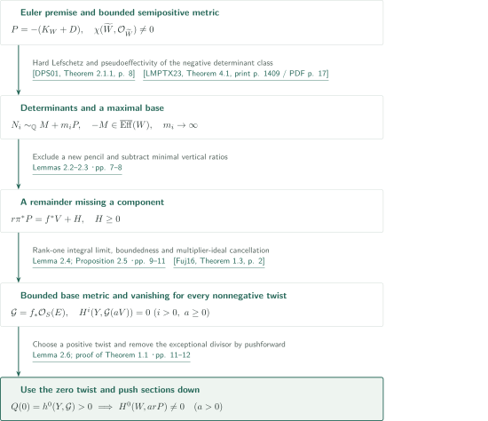
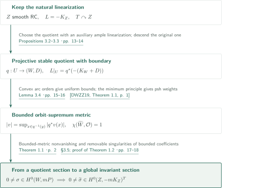
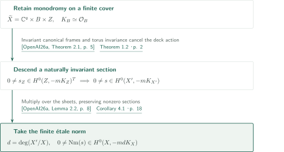

# Bounded anticanonical metrics on klt pairs and torus quotients

**Transfer a bounded metric to the base and produce sections from the zero twist**

The manuscript proves a bounded-metric nonvanishing criterion for klt pairs and obtains naturally invariant anticanonical sections through a torus quotient. Locally bounded psh weights need not be continuous. The variety upstairs in the quotient construction, however, is assumed to have a smooth semipositive metric. Neither premise is replaced by nefness alone.

## 1. Main results

### Theorem 1.1 — Bounded-metric nonvanishing

Let $(W,D)$ be a projective $\mathbb Q$-factorial klt pair with effective rational boundary, and put $P=-(K_W+D)$. Assume that $P$ is nef. On a smooth projective resolution $\rho:\widetilde W\to W$, suppose that $\rho^*P$ admits a semipositive metric with locally bounded weights and that $\chi(\widetilde W,\mathcal O_{\widetilde W})\ne0$. Then for some integer $m>0$ with $mP$ Cartier,
$$H^0(W,\mathcal O_W(mP))\ne0.$$

<!-- cite:main -->[Theorem 1.1 · p. 2](https://github.com/openai/math/blob/fd4aeeb2ee4fc729c18d98444fed42fd0529eeeb/preprints/Bounded-anticanonical-metrics-on-klt-pairs-and-torus-quotients-September-26-2026/main.pdf)<!-- /cite -->

### Theorem 1.2 — Invariant sections from a stable quotient

Let $Z$ be a smooth rationally connected projective variety whose $-K_Z$ admits a smooth semipositive Hermitian metric. For every algebraic torus $T$ acting on $Z$, there is an integer $m>0$ such that
$$H^0(Z,-mK_Z)^T\ne0.$$
Invariance refers to the natural linearization of $-K_Z=\det T_Z$ induced by the differential. The exponent may depend on the action; this is not a statement for every linearization or every positive exponent.

<!-- cite:invariant -->[Theorem 1.2 · p. 2](https://github.com/openai/math/blob/fd4aeeb2ee4fc729c18d98444fed42fd0529eeeb/preprints/Bounded-anticanonical-metrics-on-klt-pairs-and-torus-quotients-September-26-2026/main.pdf)<!-- /cite -->

### Corollary 4.1 — A smooth projective application

Let $X$ be a smooth connected complex projective variety. If $-K_X$ admits a smooth semipositive metric, then $H^0(X,-mK_X)\ne0$ for some integer $m>0$.

<!-- cite:smooth -->[Corollary 4.1 · p. 18](https://github.com/openai/math/blob/fd4aeeb2ee4fc729c18d98444fed42fd0529eeeb/preprints/Bounded-anticanonical-metrics-on-klt-pairs-and-torus-quotients-September-26-2026/main.pdf)<!-- /cite -->

## References on the arrows

<!-- reference-guide -->
Unprefixed theorem, lemma, section and equation numbers refer to [Bounded anticanonical metrics on klt pairs and torus quotients](https://github.com/openai/math/blob/fd4aeeb2ee4fc729c18d98444fed42fd0529eeeb/preprints/Bounded-anticanonical-metrics-on-klt-pairs-and-torus-quotients-September-26-2026/main.pdf). External inputs use the following keys.

- [DPS01](https://arxiv.org/pdf/math/0006205v2) Jean-Pierre Demailly; Thomas Peternell; Michael Schneider — *Pseudo-effective line bundles on compact Kähler manifolds*: Hard Lefschetz with multiplier ideals supplies twisted differentials. arXiv:math/0006205v2, 10 October 2000.
- [LMPTX23](https://ems.press/content/serial-article-files/31138) Vladimir Lazić; Shin-ichi Matsumura; Thomas Peternell; Nikolaos Tsakanikas; Zhixin Xie — *The Nonvanishing Problem for varieties with nef anticanonical bundle*: Pseudoeffectivity of the negative first Chern class of a saturated cotangent tensor subsheaf. Documenta Mathematica 28 (2023), 1393–1440.
- [PT14](https://arxiv.org/pdf/1409.5504v1) Mihai Păun; Shigeharu Takayama — *Positivity of twisted relative pluricanonical bundles and their direct images*: Positive curvature of the rank-one adjoint integral metric. arXiv:1409.5504v1.
- [Fuj16](https://arxiv.org/pdf/1607.04684v1) Osamu Fujino — *Kollár–Nadel type vanishing theorem*: Base-direction positivity gives vanishing, including the zero twist. arXiv:1607.04684v1, manuscript version 0.01 (10 July 2016).
- [DWZZ19](https://arxiv.org/pdf/1810.12733v1) Fusheng Deng; Zhiwei Wang; Liyou Zhang; Xiangyu Zhou — *A new proof of Kiselman’s minimum principle for plurisubharmonic functions*: Plurisubharmonicity of the infimum after a separate orbit bound. arXiv:1810.12733v1, 30 October 2018.
- [OpenAI26a](https://github.com/openai/math/blob/fd4aeeb2ee4fc729c18d98444fed42fd0529eeeb/preprints/Anticanonical-nonvanishing-from-smooth-semipositivity-September-26-2026/main.pdf) OpenAI — *Anticanonical nonvanishing from smooth semipositivity*: Finite-cover structure retaining torus monodromy and finite étale norm; its nonvanishing theorem is not an input. 2026-09-26; commit fd4aeeb2ee4fc729c18d98444fed42fd0529eeeb.

Each citation gives the result and pages. When printed pagination differs from the PDF position, both are shown. GitHub previews do not automatically jump to the cited page.
<!-- /reference-guide -->

## 2. Proof of Theorem 1.1 — A maximal base and the zero twist

<!-- proof-target:1 -->Proof target：[Theorem 1.1 · p. 2](https://github.com/openai/math/blob/fd4aeeb2ee4fc729c18d98444fed42fd0529eeeb/preprints/Bounded-anticanonical-metrics-on-klt-pairs-and-torus-quotients-September-26-2026/main.pdf)<!-- /proof-target -->

**Proof route.** The Euler premise supplies twisted differentials. Their determinants lead to a base of maximal dimension dominated by the anticanonical class. A divisor decomposition and rank-one direct images produce a bounded base metric. Vanishing including the zero twist then makes an Euler polynomial nonzero. The diagram gives the entire route; the intermediate results below are used as inputs to this theorem.

### 1. Produce unbounded twisted differentials

The polynomial $\chi(\widetilde W,K_{\widetilde W}+t\rho^*(r_0P))$ is nonzero at zero. Nonzero cohomology therefore occurs for infinitely many positive integers, and a subsequence fixes its degree. Positive powers of the bounded metric have trivial multiplier ideals, so hard Lefschetz produces nonzero sections of $\Omega^p_{\widetilde W}\otimes n_i\rho^*P$ for a fixed $p$. The case $p=0$ finishes immediately. Otherwise, saturating the determinant of their generic span gives effective divisors $N_i\sim_{\mathbb Q}M+m_iP$ with $m_i\to\infty$. The sums of positive twisting exponents are unbounded; numerical nontriviality of $P$ is not added as a premise. The cotangent tensor theorem applies using the klt pair, effective boundary and nef anticanonical class, giving pseudoeffectivity of $-M$.

<!-- cite:forms -->[Lemma 2.1 · pp. 5–6](https://github.com/openai/math/blob/fd4aeeb2ee4fc729c18d98444fed42fd0529eeeb/preprints/Bounded-anticanonical-metrics-on-klt-pairs-and-torus-quotients-September-26-2026/main.pdf)<!-- /cite --> <!-- cite:hard-lefschetz -->[&#91;DPS01, Theorem 2.1.1, p. 8&#93;](https://arxiv.org/pdf/math/0006205v2#page=8)<!-- /cite --> <!-- cite:cotangent -->[&#91;LMPTX23, Theorem 4.1, print p. 1409 / PDF p. 17&#93;](https://ems.press/content/serial-article-files/31138)<!-- /cite -->

### 2. Exclude new pencils and subtract minimal vertical ratios

Among diagrams $\pi:S\to W$ and $f:S\to Y$ with connected fibers and with $d\pi^*P-f^*A$ pseudoeffective for some $d>0$ and ample $A$, maximize $\dim Y$. A pencil dominated by $P$ and an exceptional divisor, nonconstant on the general fiber, would enlarge this base and is excluded. Applying this to ratios of the $N_i$ on a normal equidimensional model makes their horizontal parts affine in $m_i$. Taking a difference and subtracting, over each base prime, the minimum coefficient-to-multiplicity ratio yields
$$r\pi^*P=f^*V+H,\qquad H\ge0.$$
Above each prime divisor of the base, at least one component is absent from $H$. This is stronger than an effective decomposition and is what controls the later metric. A zero-dimensional base already gives a section.

<!-- cite:fibration -->[Lemmas 2.2–2.3 · pp. 7–8](https://github.com/openai/math/blob/fd4aeeb2ee4fc729c18d98444fed42fd0529eeeb/preprints/Bounded-anticanonical-metrics-on-klt-pairs-and-torus-quotients-September-26-2026/main.pdf)<!-- /cite -->

### 3. Turn rank-one integrals into a bounded essential-supremum metric

Set $R=K_S-\pi^*(K_W+D)$, $E=\lceil R\rceil$, and $\Xi=E-R$. Then $E$ is effective and exceptional, $\Xi$ has SNC support and coefficients in $[0,1)$, and $K_S+\pi^*P+\Xi=E$. Maximality forces $f_*\mathcal O_S(E+ar\pi^*P)$ to have rank one for every $a\ge0$. The bundle $B_a=(ar+1)\pi^*P+\Xi$ is integral and has trivial multiplier ideal.

Positive curvature of the adjoint direct image gives, for a local generating section $s=f^*v\,s_H$,
$$u_a(y)=-\frac1a\log\int_{S_y}|s|^{2a}_{h_P^r}\,d\mu_y\ \longrightarrow\ -\log\mathop{\rm ess\,sup}_{S_y}|s|^2_{h_P^r}.$$
The manuscript does not call the intersection of the exponent-dependent base-change opens Zariski open: it uses a common full-measure set and local $L^1$ compactness of psh functions. Near the component absent from $H$, the section $s$ is nonzero, bounding the essential supremum positively from below even toward a missing base divisor. The opposite estimate follows from properness. Psh extension gives a locally bounded semipositive metric on $V$, without a continuity assumption.

<!-- cite:metric -->[Lemma 2.4; Proposition 2.5 · pp. 9–11](https://github.com/openai/math/blob/fd4aeeb2ee4fc729c18d98444fed42fd0529eeeb/preprints/Bounded-anticanonical-metrics-on-klt-pairs-and-torus-quotients-September-26-2026/main.pdf)<!-- /cite --> <!-- cite:direct-image -->[&#91;PT14, Theorems 3.3.4–3.3.5, p. 24&#93;](https://arxiv.org/pdf/1409.5504v1#page=24)<!-- /cite -->

### 4. Start at the zero twist and push the section down

Mix a small amount of a positive-current metric associated with $d\pi^*P-f^*A$ into the bounded metric. The coefficient margin in the klt boundary, Skoda integrability at small exponents and Hölder give a metric on $\pi^*P+\Xi$ with strict positivity in base directions and trivial multiplier ideal. Adding the metrics of $a f^*V+aH$ gives exactly $\mathcal O_S(-aH)$ as multiplier ideal for every $a\ge0$. The adjoint bundle becomes $E+a f^*V$, and Kollár–Nadel vanishing gives
$$H^i(Y,\mathcal G\otimes\mathcal O_Y(aV))=0\quad(i>0,\ a\ge0),\qquad\mathcal G=f_*\mathcal O_S(E).$$
Since $E\ge0$, vanishing at $a=0$ yields $Q(0)=h^0(Y,\mathcal G)>0$. Thus $Q(a)=\chi(Y,\mathcal G(aV))$ is a nonzero polynomial and provides a section for some $a>0$. Multiply by $s_H^a$ and use $\pi_*\mathcal O_S(E)=\mathcal O_W$ to obtain $H^0(W,arP)\ne0$. The original Euler premise required nonzero value, not positive value.

<!-- cite:vanish -->[Lemma 2.6; proof of Theorem 1.1 · pp. 11–12](https://github.com/openai/math/blob/fd4aeeb2ee4fc729c18d98444fed42fd0529eeeb/preprints/Bounded-anticanonical-metrics-on-klt-pairs-and-torus-quotients-September-26-2026/main.pdf)<!-- /cite --> <!-- cite:kollar-nadel -->[&#91;Fuj16, Theorem 1.3, p. 2&#93;](https://arxiv.org/pdf/1607.04684v1#page=2)<!-- /cite -->

## 3. Proof of Theorem 1.2 — Preserve the natural linearization

<!-- proof-target:2 -->Proof target：[Theorem 1.2 · p. 2](https://github.com/openai/math/blob/fd4aeeb2ee4fc729c18d98444fed42fd0529eeeb/preprints/Bounded-anticanonical-metrics-on-klt-pairs-and-torus-quotients-September-26-2026/main.pdf)<!-- /proof-target -->

**Proof route.** An auxiliary ample linearization selects a complete stable quotient; the original natural anticanonical bundle is the bundle descended. A bounded orbit-supremum metric allows the section from Theorem 1.1 to extend across all omitted divisors.

### 1. Separate the auxiliary GIT linearization from the natural bundle

Pass to the effective image and average the smooth metric over the maximal compact subgroup. Positivity of the generic natural anticanonical weight pattern and finiteness of the patterns permit a small character perturbation of $L+\delta J$ with nonempty stable=semistable locus $U$. The quotient $W=U/T$ is projective. Finite stabilizer slices give a $\mathbb Q$-factorial klt pair and $D=\sum(1-1/e_B)B$. The torus adjoint representation is trivial, so the orbit-direction determinant introduces no character. Thus $L|_U=q^*P$ is an isomorphism of naturally equivariant $\mathbb Q$-line bundles. The auxiliary character must not be transferred to $L$.

<!-- cite:quotient -->[Propositions 3.2–3.3 · pp. 13–14](https://github.com/openai/math/blob/fd4aeeb2ee4fc729c18d98444fed42fd0529eeeb/preprints/Bounded-anticanonical-metrics-on-klt-pairs-and-torus-quotients-September-26-2026/main.pdf)<!-- /cite --> <!-- cite:natural -->[Remark 3.6 · p. 18](https://github.com/openai/math/blob/fd4aeeb2ee4fc729c18d98444fed42fd0529eeeb/preprints/Bounded-anticanonical-metrics-on-klt-pairs-and-torus-quotients-September-26-2026/main.pdf)<!-- /cite -->

### 2. Prove the orbit bound before applying the minimum principle

Translate the weak weight inequalities on $U$ into orders of moving lifts along algebraic arcs. Convexity of the orders and the initial weight calculation exclude poles. Compactifying the action graph and selecting a curve upgrades the arcwise conclusion to a locally uniform norm bound. The supremum along an orbit therefore defines a quotient norm. Its negative logarithm is the infimum of a psh function independent of imaginary exponential coordinates, hence is psh by Kiselman's principle. Slice bounds, the disc test for finite quotients and pullback to a resolution preserve local boundedness. Restriction to curves also establishes nefness of $P$.

<!-- cite:orbit -->[Lemma 3.4 · pp. 15–16](https://github.com/openai/math/blob/fd4aeeb2ee4fc729c18d98444fed42fd0529eeeb/preprints/Bounded-anticanonical-metrics-on-klt-pairs-and-torus-quotients-September-26-2026/main.pdf)<!-- /cite --> <!-- cite:descent -->[Proposition 3.5 · pp. 16–17](https://github.com/openai/math/blob/fd4aeeb2ee4fc729c18d98444fed42fd0529eeeb/preprints/Bounded-anticanonical-metrics-on-klt-pairs-and-torus-quotients-September-26-2026/main.pdf)<!-- /cite --> <!-- cite:minimum -->[&#91;DWZZ19, Theorem 1.1, p. 1&#93;](https://arxiv.org/pdf/1810.12733v1#page=1)<!-- /cite -->

### 3. Supply the Euler premise and extend the invariant section

Rational connectedness of $Z$ gives $\chi(\mathcal O)=1$ on a smooth resolution of the quotient. Theorem 1.1 supplies a section of $mP$; taking a power clears the denominators in the equivariant identification. On projective $W$ the section has bounded norm for the bounded quotient metric. The orbit-supremum definition bounds its pullback throughout $U$. Relative to the smooth upstairs metric, removable singularities extend the bounded coefficients across all of $Z\setminus U$, including its divisors. Invariance persists by equality on the dense open set. The manuscript treats trivial actions and a point quotient as well.

<!-- cite:extension -->[§3.5; proof of Theorem 1.2 · pp. 17–18](https://github.com/openai/math/blob/fd4aeeb2ee4fc729c18d98444fed42fd0529eeeb/preprints/Bounded-anticanonical-metrics-on-klt-pairs-and-torus-quotients-September-26-2026/main.pdf)<!-- /cite -->

## 4. Proof of Corollary 4.1 — Monodromy and norm

<!-- proof-target:3 -->Proof target：[Corollary 4.1 · p. 18](https://github.com/openai/math/blob/fd4aeeb2ee4fc729c18d98444fed42fd0529eeeb/preprints/Bounded-anticanonical-metrics-on-klt-pairs-and-torus-quotients-September-26-2026/main.pdf)<!-- /proof-target -->

**Proof route.** Decompose the universal cover of a finite étale cover, descend the naturally invariant section along the deck action, and take a finite norm.

### 1. Tensor invariant canonical frames with the section

The companion's structure theorem expresses the universal cover of a finite étale cover $X'\to X$ as $\mathbb C^q\times B\times Z$. It retains invariant canonical frames on the first two factors and residual monodromy on $Z$ inside an algebraic torus. Tensor the section from Theorem 1.2 with their anticanonical frames. The result is deck invariant and descends to $X'$. The finite cover itself need not be a product.

<!-- cite:structure -->[&#91;OpenAI26a, Theorem 2.1, p. 5&#93;](https://github.com/openai/math/blob/fd4aeeb2ee4fc729c18d98444fed42fd0529eeeb/preprints/Anticanonical-nonvanishing-from-smooth-semipositivity-September-26-2026/main.pdf)<!-- /cite --> <!-- cite:invariant -->[Theorem 1.2 · p. 2](https://github.com/openai/math/blob/fd4aeeb2ee4fc729c18d98444fed42fd0529eeeb/preprints/Bounded-anticanonical-metrics-on-klt-pairs-and-torus-quotients-September-26-2026/main.pdf)<!-- /cite -->

### 2. Multiply the exponent by the cover degree

For $d=\deg(X'/X)$, the finite étale norm sends the nonzero section to $H^0(X,-mdK_X)$. This proves nonvanishing at some positive exponent on the original $X$. The inputs from the companion are its independent structure theorem and norm lemma, not its nonvanishing theorem; the argument does not assume that conclusion circularly.

<!-- cite:norm -->[&#91;OpenAI26a, Lemma 2.2, p. 8&#93;](https://github.com/openai/math/blob/fd4aeeb2ee4fc729c18d98444fed42fd0529eeeb/preprints/Anticanonical-nonvanishing-from-smooth-semipositivity-September-26-2026/main.pdf)<!-- /cite --> <!-- cite:smooth -->[Corollary 4.1 · p. 18](https://github.com/openai/math/blob/fd4aeeb2ee4fc729c18d98444fed42fd0529eeeb/preprints/Bounded-anticanonical-metrics-on-klt-pairs-and-torus-quotients-September-26-2026/main.pdf)<!-- /cite -->

## 5. Which papers supply which steps

| Input | Used at | Role and checking scope |
|---|---|---|
| DPS01 and LMPTX23 | Lemma 2.1, pp. 5–6 | Hard Lefschetz and the negative Chern class of a saturated cotangent tensor subsheaf. Statements and applicable hypotheses directly compared. |
| PT14 | Proposition 2.5, pp. 9–11 | Positivity of the integral metric with trivial multiplier ideal and rank one. Statement checked; full external proof excluded. |
| Fuj16 | Proof of Theorem 1.1, pp. 11–12 | Adjoint direct-image vanishing also at $a=0$. Statement and the bundle after cancellation compared. |
| DWZZ19 | Proposition 3.5, pp. 16–17 | Psh infimum over tube fibers; boundedness comes separately from Lemma 3.4. |
| Anticanonical nonvanishing from smooth semipositivity | Corollary 4.1, p. 18 | Natural monodromy in Theorem 2.1 and norm in Lemma 2.2. An input to the corollary, not to the main theorem. |

## 6. Return to the sources

<!-- reading-list -->
- [Lemma 2.1 · pp. 5–6](https://github.com/openai/math/blob/fd4aeeb2ee4fc729c18d98444fed42fd0529eeeb/preprints/Bounded-anticanonical-metrics-on-klt-pairs-and-torus-quotients-September-26-2026/main.pdf) — From the Euler premise to unbounded twisted differentials.
- [Lemmas 2.2–2.3 · pp. 7–8](https://github.com/openai/math/blob/fd4aeeb2ee4fc729c18d98444fed42fd0529eeeb/preprints/Bounded-anticanonical-metrics-on-klt-pairs-and-torus-quotients-September-26-2026/main.pdf) — Maximal base and an effective remainder missing a component over each base divisor.
- [Lemma 2.4; Proposition 2.5 · pp. 9–11](https://github.com/openai/math/blob/fd4aeeb2ee4fc729c18d98444fed42fd0529eeeb/preprints/Bounded-anticanonical-metrics-on-klt-pairs-and-torus-quotients-September-26-2026/main.pdf) — Pass from integrals to essential suprema without continuity.
- [Lemma 2.6; proof of Theorem 1.1 · pp. 11–12](https://github.com/openai/math/blob/fd4aeeb2ee4fc729c18d98444fed42fd0529eeeb/preprints/Bounded-anticanonical-metrics-on-klt-pairs-and-torus-quotients-September-26-2026/main.pdf) — The zero twist makes the Euler polynomial nonzero.
- [Lemma 3.4 · pp. 15–16](https://github.com/openai/math/blob/fd4aeeb2ee4fc729c18d98444fed42fd0529eeeb/preprints/Bounded-anticanonical-metrics-on-klt-pairs-and-torus-quotients-September-26-2026/main.pdf) — Upgrade pole-free arcs to locally uniform bounds.
- [Corollary 4.1 · p. 18](https://github.com/openai/math/blob/fd4aeeb2ee4fc729c18d98444fed42fd0529eeeb/preprints/Bounded-anticanonical-metrics-on-klt-pairs-and-torus-quotients-September-26-2026/main.pdf) — Use invariance under residual monodromy.
<!-- /reading-list -->

The editorial reading covered the hypotheses and quantifiers of the principal results and the proof text of §§2–4, pp. 5–18. The five analytic/cotangent inputs above and the companion's structure and norm statements were compared with their uses. Local boundedness versus continuity, the zero twist, and natural versus auxiliary linearizations were kept distinct.

The full external proofs were not independently verified. GIT, Luna slices, the finite-morphism discrepancy formula, Skoda's foundational reference and the psh extension theorems were read as used in this manuscript; direct comparison with their original literature remains incomplete. This is an account of the authors' argument and its checked interfaces, not certification of the complete proof or expert peer review.
