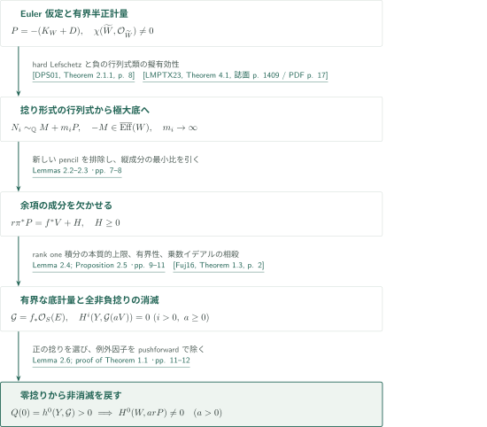
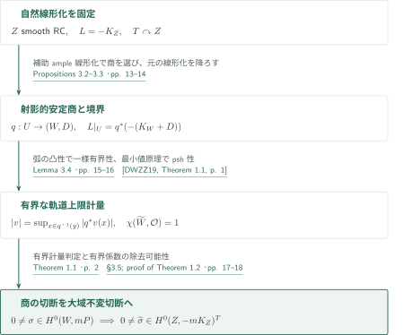
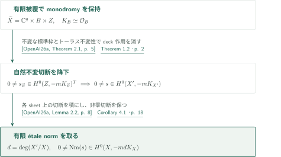

# Bounded anticanonical metrics on klt pairs and torus quotients

**有界計量を底へ移し、零捻りのEuler特性から切断を作る**

本稿は、klt対の反対数標準因子に対する有界計量の非消滅判定を証明し、トーラス商を介して自然不変な反標準切断を得る。局所有界なpsh重みは連続である必要がない。一方、商を作る上階では滑らかな半正計量を仮定する。この二つをnef性だけに置き換えてはいない。

## 1. 主要結果

### Theorem 1.1 — 有界計量による非消滅

$(W,D)$を有効な有理境界を持つ射影的$\mathbb Q$-factorial klt対とし、$P=-(K_W+D)$と置く。$P$はnefとする。滑らかな射影的解消$\rho:\widetilde W\to W$上で、$\rho^*P$が局所有界な重みを持つ半正計量を持ち、$\chi(\widetilde W,\mathcal O_{\widetilde W})\ne0$と仮定する。このとき、$mP$がCartierとなるある整数$m>0$について
$$H^0(W,\mathcal O_W(mP))\ne0.$$

<!-- cite:main -->[Theorem 1.1 · p. 2](https://github.com/openai/math/blob/fd4aeeb2ee4fc729c18d98444fed42fd0529eeeb/preprints/Bounded-anticanonical-metrics-on-klt-pairs-and-torus-quotients-September-26-2026/main.pdf)<!-- /cite -->

### Theorem 1.2 — 安定商からの自然不変切断

$Z$を滑らかな有理連結射影多様体とし、$-K_Z$が滑らかな半正Hermitian計量を持つとする。$Z$に作用する任意の代数的トーラス$T$に対し、ある整数$m>0$が存在して
$$H^0(Z,-mK_Z)^T\ne0.$$
不変性は微分から誘導される$-K_Z=\det T_Z$の自然線形化に関する。$m$は作用ごとに選び、任意の線形化・全ての正整数$m$についての主張ではない。

<!-- cite:invariant -->[Theorem 1.2 · p. 2](https://github.com/openai/math/blob/fd4aeeb2ee4fc729c18d98444fed42fd0529eeeb/preprints/Bounded-anticanonical-metrics-on-klt-pairs-and-torus-quotients-September-26-2026/main.pdf)<!-- /cite -->

### Corollary 4.1 — 滑らかな射影多様体への帰結

$X$を滑らかな連結複素射影多様体とする。$-K_X$が滑らかな半正計量を持つなら、ある整数$m>0$について$H^0(X,-mK_X)\ne0$である。

<!-- cite:smooth -->[Corollary 4.1 · p. 18](https://github.com/openai/math/blob/fd4aeeb2ee4fc729c18d98444fed42fd0529eeeb/preprints/Bounded-anticanonical-metrics-on-klt-pairs-and-torus-quotients-September-26-2026/main.pdf)<!-- /cite -->

## 図の矢印に付した引用

<!-- reference-guide -->
略号のない定理・補題・節・式番号は本原稿 [Bounded anticanonical metrics on klt pairs and torus quotients](https://github.com/openai/math/blob/fd4aeeb2ee4fc729c18d98444fed42fd0529eeeb/preprints/Bounded-anticanonical-metrics-on-klt-pairs-and-torus-quotients-September-26-2026/main.pdf) を指します。外部入力には次の略号を使います。

- [DPS01](https://arxiv.org/pdf/math/0006205v2) Jean-Pierre Demailly; Thomas Peternell; Michael Schneider — *Pseudo-effective line bundles on compact Kähler manifolds*：乗数イデアル付きhard Lefschetzにより非零コホモロジーを捻り微分形式へ移す。arXiv:math/0006205v2, 10 October 2000。
- [LMPTX23](https://ems.press/content/serial-article-files/31138) Vladimir Lazić; Shin-ichi Matsumura; Thomas Peternell; Nikolaos Tsakanikas; Zhixin Xie — *The Nonvanishing Problem for varieties with nef anticanonical bundle*：飽和cotangent tensor部分層の負の第一Chern類を擬有効にする。Documenta Mathematica 28 (2023), 1393–1440。
- [PT14](https://arxiv.org/pdf/1409.5504v1) Mihai Păun; Shigeharu Takayama — *Positivity of twisted relative pluricanonical bundles and their direct images*：rank one随伴直像の積分計量に半正曲率を与える。arXiv:1409.5504v1。
- [Fuj16](https://arxiv.org/pdf/1607.04684v1) Osamu Fujino — *Kollár–Nadel type vanishing theorem*：底方向の正曲率から零捻りを含む高次コホモロジー消滅を得る。arXiv:1607.04684v1, manuscript version 0.01 (10 July 2016)。
- [DWZZ19](https://arxiv.org/pdf/1810.12733v1) Fusheng Deng; Zhiwei Wang; Liyou Zhang; Xiangyu Zhou — *A new proof of Kiselman’s minimum principle for plurisubharmonic functions*：軌道上の有界性を別途得た後、下限のpsh性を与える。arXiv:1810.12733v1, 30 October 2018。
- [OpenAI26a](https://github.com/openai/math/blob/fd4aeeb2ee4fc729c18d98444fed42fd0529eeeb/preprints/Anticanonical-nonvanishing-from-smooth-semipositivity-September-26-2026/main.pdf) OpenAI — *Anticanonical nonvanishing from smooth semipositivity*：有限被覆上のトーラスmonodromyを保持した構造と有限étale norm。主定理の非消滅は入力にしない。2026-09-26; commit fd4aeeb2ee4fc729c18d98444fed42fd0529eeeb。

各引用に結果番号とページを付します。誌面番号とPDF内の位置が異なる場合は両方を示します。GitHubの閲覧リンクではページ位置への自動移動を前提としません。
<!-- /reference-guide -->

## 2. Theorem 1.1 の証明 — 極大底と零捻り

<!-- proof-target:1 -->証明対象：[Theorem 1.1 · p. 2](https://github.com/openai/math/blob/fd4aeeb2ee4fc729c18d98444fed42fd0529eeeb/preprints/Bounded-anticanonical-metrics-on-klt-pairs-and-torus-quotients-September-26-2026/main.pdf)<!-- /proof-target -->

**証明の道筋。** Euler仮定から捻り微分形式を作り、その行列式を支配する極大次元の底を選ぶ。因子の分解とrank one直像から底の有界計量を構成し、零捻りを含む消滅によってEuler多項式を非零にする。以下の図は全経路を示し、各中間結果はこの主定理の入力として説明する。

### 1. Euler仮定を無限個の捻り形式へ移す

$\chi(\widetilde W,K_{\widetilde W}+t\rho^*(r_0P))$は$t$の多項式で、$t=0$で非零である。したがって無限個の正整数で非零コホモロジーを持ち、部分列で次数を固定できる。有界計量の正の冪は乗数イデアルが自明なので、hard Lefschetzはある$p$について$\Omega^p_{\widetilde W}\otimes n_i\rho^*P$の非零切断を与える。$p=0$なら終了する。$p>0$ならこれらの一般点でのspanの行列式を飽和し、$N_i\sim_{\mathbb Q}M+m_iP$、$m_i\to\infty$、$N_i\ge0$を得る。正の捻り指数の和が非有界であることが重要で、$P$の数値的非自明性を追加しない。cotangent tensor部分層の定理にklt・有効境界・nef性を適用し、$-M$の擬有効性を得る。

<!-- cite:forms -->[Lemma 2.1 · pp. 5–6](https://github.com/openai/math/blob/fd4aeeb2ee4fc729c18d98444fed42fd0529eeeb/preprints/Bounded-anticanonical-metrics-on-klt-pairs-and-torus-quotients-September-26-2026/main.pdf)<!-- /cite --> <!-- cite:hard-lefschetz -->[&#91;DPS01, Theorem 2.1.1, p. 8&#93;](https://arxiv.org/pdf/math/0006205v2#page=8)<!-- /cite --> <!-- cite:cotangent -->[&#91;LMPTX23, Theorem 4.1, 誌面 p. 1409 / PDF p. 17&#93;](https://ems.press/content/serial-article-files/31138)<!-- /cite -->

### 2. 新しいpencilを排除し、縦成分の最小比を引く

$\pi:S\to W$と連結ファイバーを持つ$f:S\to Y$のうち、ある$d>0$とample $A$に対し$d\pi^*P-f^*A$が擬有効となるものから$\dim Y$最大を選ぶ。$P$と例外因子で支配され、一般ファイバー上で非定数となるpencilがあれば底を大きくできるため、そのようなpencilはない。正規等次元モデル上でこの性質を$N_i$の比に適用すると、水平部分は$m_i$のアフィン関数になる。差を取り、各底素因子上の係数／多重度の最小値を引いて
$$r\pi^*P=f^*V+H,\qquad H\ge0$$
を得る。各底素因子の上に$H$に含まれない成分が少なくとも一つある。この条件は後の有界性を支え、単なる有効分解より強い。$Y$が点なら既に切断が得られる。

<!-- cite:fibration -->[Lemmas 2.2–2.3 · pp. 7–8](https://github.com/openai/math/blob/fd4aeeb2ee4fc729c18d98444fed42fd0529eeeb/preprints/Bounded-anticanonical-metrics-on-klt-pairs-and-torus-quotients-September-26-2026/main.pdf)<!-- /cite -->

### 3. rank one積分を本質的上限にして有界計量を作る

$R=K_S-\pi^*(K_W+D)$、$E=\lceil R\rceil$、$\Xi=E-R$と置く。$E$は有効例外因子、$\Xi$は係数が$[0,1)$のSNC因子で、$K_S+\pi^*P+\Xi=E$である。極大性は全$a\ge0$について$f_*\mathcal O_S(E+ar\pi^*P)$のrankを1にする。$B_a=(ar+1)\pi^*P+\Xi$は整数線束で、自明な乗数イデアルを持つ。

随伴直像の半正性を適用し、局所生成切断$s=f^*v\,s_H$について
$$u_a(y)=-\frac1a\log\int_{S_y}|s|^{2a}_{h_P^r}\,d\mu_y\ \longrightarrow\ -\log\mathop{\rm ess\,sup}_{S_y}|s|^2_{h_P^r}$$
を得る。原稿は指数ごとのbase-change開集合の共通部分をZariski開とはせず、共通の全測度集合とpsh関数の局所$L^1$コンパクト性を使う。$H$を欠く成分の近傍で$s$が非零であるため、欠落した底因子に近づいても本質的上限が下から正に抑えられる。propernessによる逆側の評価とpsh延長により、$V$上の局所有界半正計量を得る。連続性への置換は行わない。

<!-- cite:metric -->[Lemma 2.4; Proposition 2.5 · pp. 9–11](https://github.com/openai/math/blob/fd4aeeb2ee4fc729c18d98444fed42fd0529eeeb/preprints/Bounded-anticanonical-metrics-on-klt-pairs-and-torus-quotients-September-26-2026/main.pdf)<!-- /cite --> <!-- cite:direct-image -->[&#91;PT14, Theorems 3.3.4–3.3.5, p. 24&#93;](https://arxiv.org/pdf/1409.5504v1#page=24)<!-- /cite -->

### 4. 零捻りで非零を確保し、切断を押し戻す

$d\pi^*P-f^*A$の正カレント計量を少量混ぜ、$\pi^*P+\Xi$に底方向の厳密な正曲率と自明な乗数イデアルを同時に与える。klt係数の余裕、Skodaの小指数可積分性、Hölderを使う。これに$a f^*V+aH$の計量を加えると、全$a\ge0$で乗数イデアルは正確に$\mathcal O_S(-aH)$となる。したがって随伴束は$E+a f^*V$に簡約され、Kollár–Nadel消滅により
$$H^i(Y,\mathcal G\otimes\mathcal O_Y(aV))=0\quad(i>0,\ a\ge0),\qquad\mathcal G=f_*\mathcal O_S(E).$$
$E\ge0$と$a=0$での消滅が$Q(0)=h^0(Y,\mathcal G)>0$を保証する。$Q(a)=\chi(Y,\mathcal G(aV))$は非零多項式なので、ある$a>0$で切断が存在する。$s_H^a$を掛け、$\pi_*\mathcal O_S(E)=\mathcal O_W$で押し戻すと$H^0(W,arP)\ne0$となる。最初のEuler仮定は非零で足り、正値を仮定していない。

<!-- cite:vanish -->[Lemma 2.6; proof of Theorem 1.1 · pp. 11–12](https://github.com/openai/math/blob/fd4aeeb2ee4fc729c18d98444fed42fd0529eeeb/preprints/Bounded-anticanonical-metrics-on-klt-pairs-and-torus-quotients-September-26-2026/main.pdf)<!-- /cite --> <!-- cite:kollar-nadel -->[&#91;Fuj16, Theorem 1.3, p. 2&#93;](https://arxiv.org/pdf/1607.04684v1#page=2)<!-- /cite -->

## 3. Theorem 1.2 の証明 — 自然線形化を保つ商

<!-- proof-target:2 -->証明対象：[Theorem 1.2 · p. 2](https://github.com/openai/math/blob/fd4aeeb2ee4fc729c18d98444fed42fd0529eeeb/preprints/Bounded-anticanonical-metrics-on-klt-pairs-and-torus-quotients-September-26-2026/main.pdf)<!-- /proof-target -->

**証明の道筋。** 補助ample線形化で完全な安定商を選ぶが、降下するのは元の自然反標準束である。軌道上限計量を有界にし、Theorem 1.1の切断を全ての欠落因子を越えて延長する。

### 1. 補助GIT線形化と自然反標準束を分ける

作用の有効像へ移り、滑らかな計量を極大コンパクト部分群で平均する。自然反標準重みの一般点での正値性と有限個の重みパターンを使い、$L+\delta J$の小さな指標移動に対する非空のstable=semistable locus $U$を選ぶ。$W=U/T$は射影的で、有限stabilizer sliceから$\mathbb Q$-factorial klt対と境界$D=\sum(1-1/e_B)B$を得る。トーラスの随伴表現が自明なので軌道接方向の行列式に指標は現れず、$L|_U=q^*P$は自然な同変$\mathbb Q$線束の同型となる。補助指標を$L$へ移してはいけない。

<!-- cite:quotient -->[Propositions 3.2–3.3 · pp. 13–14](https://github.com/openai/math/blob/fd4aeeb2ee4fc729c18d98444fed42fd0529eeeb/preprints/Bounded-anticanonical-metrics-on-klt-pairs-and-torus-quotients-September-26-2026/main.pdf)<!-- /cite --> <!-- cite:natural -->[Remark 3.6 · p. 18](https://github.com/openai/math/blob/fd4aeeb2ee4fc729c18d98444fed42fd0529eeeb/preprints/Bounded-anticanonical-metrics-on-klt-pairs-and-torus-quotients-September-26-2026/main.pdf)<!-- /cite -->

### 2. 軌道上限の有界性を先に証明する

$U$上の弱重み不等式を、代数弧に沿う移動持上げの位数へ変換する。位数の凸性と原点近傍の重み計算から極がないと分かる。作用グラフのコンパクト化と曲線選択により、この弧ごとの結論を局所一様ノルム上界へ強める。そこで初めて、軌道上のノルムの上限で商計量を定義できる。負の対数は指数写像上で虚方向に依らないpsh関数の下限であり、Kiselman原理でpshとなる。slice上の上下界、有限商での円板判定、解消への引戻しにより局所有界性を保つ。曲線への制限は$P$のnef性も与える。

<!-- cite:orbit -->[Lemma 3.4 · pp. 15–16](https://github.com/openai/math/blob/fd4aeeb2ee4fc729c18d98444fed42fd0529eeeb/preprints/Bounded-anticanonical-metrics-on-klt-pairs-and-torus-quotients-September-26-2026/main.pdf)<!-- /cite --> <!-- cite:descent -->[Proposition 3.5 · pp. 16–17](https://github.com/openai/math/blob/fd4aeeb2ee4fc729c18d98444fed42fd0529eeeb/preprints/Bounded-anticanonical-metrics-on-klt-pairs-and-torus-quotients-September-26-2026/main.pdf)<!-- /cite --> <!-- cite:minimum -->[&#91;DWZZ19, Theorem 1.1, p. 1&#93;](https://arxiv.org/pdf/1810.12733v1#page=1)<!-- /cite -->

### 3. Euler仮定と延長で不変非消滅を得る

$Z$の有理連結性から商の滑らかな解消にも$\chi(\mathcal O)=1$が従う。Theorem 1.1で$mP$の非零切断を得て、同変同型の分母を消す冪を取る。射影的な$W$上の切断は有界な商計量で大域有界だから、軌道上限の定義により引戻しも$U$全体で有界である。上階の滑らかな計量に対する係数の除去可能性で、$Z\setminus U$の因子を含む全域へ延長する。不変性は稠密開集合上の一致から保たれる。自明作用・点の商も原稿で別途処理される。

<!-- cite:extension -->[§3.5; proof of Theorem 1.2 · pp. 17–18](https://github.com/openai/math/blob/fd4aeeb2ee4fc729c18d98444fed42fd0529eeeb/preprints/Bounded-anticanonical-metrics-on-klt-pairs-and-torus-quotients-September-26-2026/main.pdf)<!-- /cite -->

## 4. Corollary 4.1 の証明 — monodromyとnorm

<!-- proof-target:3 -->証明対象：[Corollary 4.1 · p. 18](https://github.com/openai/math/blob/fd4aeeb2ee4fc729c18d98444fed42fd0529eeeb/preprints/Bounded-anticanonical-metrics-on-klt-pairs-and-torus-quotients-September-26-2026/main.pdf)<!-- /proof-target -->

**証明の道筋。** 有限étale被覆の普遍被覆を分解し、有理連結因子の自然不変切断をdeck作用に沿って降下させ、最後に有限被覆のnormを取る。

### 1. 不変な標準枠と切断をテンソルする

同伴原稿の構造定理は、有限étale被覆$X'\to X$の普遍被覆を$\mathbb C^q\times B\times Z$とし、前二因子の不変標準枠と、$Z$上の代数的トーラスに含まれる残留monodromyを保持する。Theorem 1.2の切断を前二因子の反標準枠とテンソルすればdeck不変となり、$X'$上へ降りる。有限被覆自体が直積とは主張しない。

<!-- cite:structure -->[&#91;OpenAI26a, Theorem 2.1, p. 5&#93;](https://github.com/openai/math/blob/fd4aeeb2ee4fc729c18d98444fed42fd0529eeeb/preprints/Anticanonical-nonvanishing-from-smooth-semipositivity-September-26-2026/main.pdf)<!-- /cite --> <!-- cite:invariant -->[Theorem 1.2 · p. 2](https://github.com/openai/math/blob/fd4aeeb2ee4fc729c18d98444fed42fd0529eeeb/preprints/Bounded-anticanonical-metrics-on-klt-pairs-and-torus-quotients-September-26-2026/main.pdf)<!-- /cite -->

### 2. 正の指数を被覆次数倍にして戻す

$d=\deg(X'/X)$とすると有限étale normは非零切断を$H^0(X,-mdK_X)$へ送る。したがって元の$X$である正の指数の非消滅が得られる。同伴原稿から入力するのは独立な構造定理とnorm補題であり、その非消滅主定理を再び仮定する循環ではない。

<!-- cite:norm -->[&#91;OpenAI26a, Lemma 2.2, p. 8&#93;](https://github.com/openai/math/blob/fd4aeeb2ee4fc729c18d98444fed42fd0529eeeb/preprints/Anticanonical-nonvanishing-from-smooth-semipositivity-September-26-2026/main.pdf)<!-- /cite --> <!-- cite:smooth -->[Corollary 4.1 · p. 18](https://github.com/openai/math/blob/fd4aeeb2ee4fc729c18d98444fed42fd0529eeeb/preprints/Bounded-anticanonical-metrics-on-klt-pairs-and-torus-quotients-September-26-2026/main.pdf)<!-- /cite -->

## 5. どの論文が、どの段階を担うか

| 入力 | 利用箇所 | 使用内容・確認範囲 |
|---|---|---|
| DPS01・LMPTX23 | Lemma 2.1、pp. 5–6 | hard Lefschetzと飽和cotangent tensor部分層の負のChern類。入力の記述と適用仮定を直接照合。 |
| PT14 | Proposition 2.5、pp. 9–11 | trivial multiplier idealとrank oneの下で積分計量を正にする。外部定理の記述を照合、証明全体は対象外。 |
| Fuj16 | Theorem 1.1の証明、pp. 11–12 | 正曲率下の随伴直像消滅を$a=0$にも適用。記述と相殺後の束を照合。 |
| DWZZ19 | Proposition 3.5、pp. 16–17 | tube fiber上の下限のpsh性。有界性は別のLemma 3.4から供給。 |
| Anticanonical nonvanishing from smooth semipositivity | Corollary 4.1、p. 18 | Theorem 2.1の自然monodromyとLemma 2.2のnorm。帰結への入力であり、主定理への依存ではない。 |

## 6. 原典を読む入口と確認範囲

<!-- reading-list -->
- [Lemma 2.1 · pp. 5–6](https://github.com/openai/math/blob/fd4aeeb2ee4fc729c18d98444fed42fd0529eeeb/preprints/Bounded-anticanonical-metrics-on-klt-pairs-and-torus-quotients-September-26-2026/main.pdf) — Euler仮定から無限個の捻り微分形式を得る。
- [Lemmas 2.2–2.3 · pp. 7–8](https://github.com/openai/math/blob/fd4aeeb2ee4fc729c18d98444fed42fd0529eeeb/preprints/Bounded-anticanonical-metrics-on-klt-pairs-and-torus-quotients-September-26-2026/main.pdf) — 底の極大性と成分を欠く有効余項。
- [Lemma 2.4; Proposition 2.5 · pp. 9–11](https://github.com/openai/math/blob/fd4aeeb2ee4fc729c18d98444fed42fd0529eeeb/preprints/Bounded-anticanonical-metrics-on-klt-pairs-and-torus-quotients-September-26-2026/main.pdf) — 連続性を仮定せず積分を本質的上限へ移す。
- [Lemma 2.6; proof of Theorem 1.1 · pp. 11–12](https://github.com/openai/math/blob/fd4aeeb2ee4fc729c18d98444fed42fd0529eeeb/preprints/Bounded-anticanonical-metrics-on-klt-pairs-and-torus-quotients-September-26-2026/main.pdf) — 零捻りでEuler多項式を非零にする。
- [Lemma 3.4 · pp. 15–16](https://github.com/openai/math/blob/fd4aeeb2ee4fc729c18d98444fed42fd0529eeeb/preprints/Bounded-anticanonical-metrics-on-klt-pairs-and-torus-quotients-September-26-2026/main.pdf) — 非有極性を局所一様有界性へ強める。
- [Corollary 4.1 · p. 18](https://github.com/openai/math/blob/fd4aeeb2ee4fc729c18d98444fed42fd0529eeeb/preprints/Bounded-anticanonical-metrics-on-klt-pairs-and-torus-quotients-September-26-2026/main.pdf) — 残留monodromyに対する不変性を用いる。
<!-- /reading-list -->

編集側では主要結果の仮定・量化と、§§2–4（pp. 5–18）の証明本文を読解した。上記5件の解析・cotangent入力および同伴原稿の構造・normの記述と使用箇所を照合した。局所有界性と連続性、零捻りの役割、自然線形化と補助指標を区別している。

外部結果の証明全体の独立検証は行っていない。GIT・Luna slice・有限写像のdiscrepancy公式、Skodaの基礎文献とpsh延長定理は、本稿内の使用内容を読んだ範囲に留まり原典文献での直接照合は未了である。これは著者の論証の概説と接続の照合であり、全証明の正しさの認定や専門家査読ではない。
