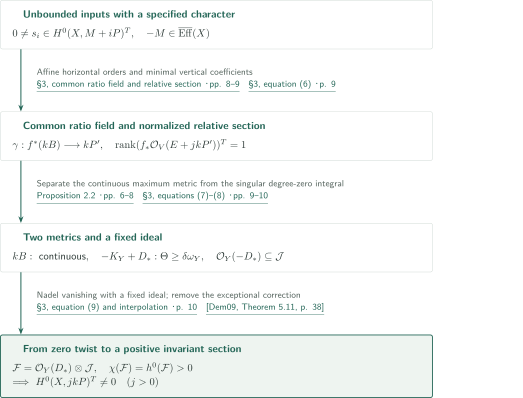
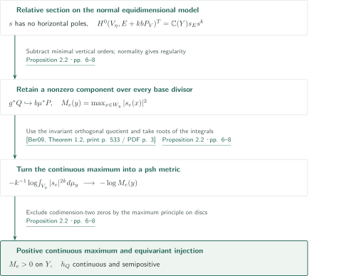
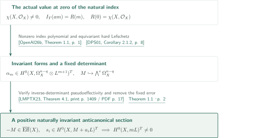
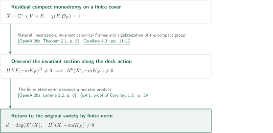
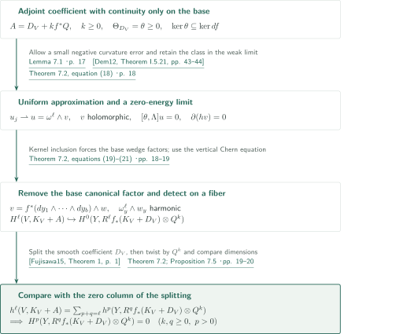

# Cohomological transfer and equivariant anticanonical sections

**Remove a fixed error while preserving its character, then descend invariant sections through monodromy**

For a smoothly semipositive anticanonical bundle, invariant sections with one fixed negative pseudoeffective error produce an invariant section in a positive untwisted degree. The main theorem allows any anticanonical linearization. The natural linearization is needed later, when the invariant index supplies the input. This account follows the authors' shortest route, §§2–4 and §14.1, to the main theorem and smooth nonvanishing corollary.

## 1. Main results

### Theorem 1.1 — Invariant transfer

Let $X$ be smooth connected complex projective, with a smooth semipositive metric on $L=-K_X$, and let an algebraic torus $T$ act on $X$. Let $P,M$ be linearized line bundles with $P=L$ as ordinary line bundles and with $-M$ pseudoeffective. The linearization of $P$ may differ from the natural one. Suppose that for an unbounded set $I\subset\mathbb Z_{>0}$ there are sections
$$0\ne s_i\in H^0(X,M+iP)^T\quad(i\in I).$$
Then $H^0(X,mP)^T\ne0$ for some integer $m>0$. No Euler-characteristic premise or vanishing of $H^1(X,\mathcal O_X)$ is assumed.

<!-- cite:main -->[Theorem 1.1 · p. 2](https://github.com/openai/math/blob/fd4aeeb2ee4fc729c18d98444fed42fd0529eeeb/preprints/Cohomological-transfer-and-equivariant-anticanonical-sections-September-26-2026/main.pdf)<!-- /cite -->

### Corollary 1.2 — Nonvanishing under smooth semipositivity

For every smooth connected complex projective variety $X$ with smoothly semipositive $-K_X$, there is an integer $m>0$ such that $H^0(X,-mK_X)\ne0$. The statement gives neither a uniform exponent nor nonvanishing in the first power.

<!-- cite:smooth -->[Corollary 1.2 · p. 2](https://github.com/openai/math/blob/fd4aeeb2ee4fc729c18d98444fed42fd0529eeeb/preprints/Cohomological-transfer-and-equivariant-anticanonical-sections-September-26-2026/main.pdf)<!-- /cite -->

### Theorem 7.2 — Higher-direct-image vanishing under a kernel condition

Let $f:V\to Y$ be a surjective morphism between smooth connected projective complex varieties. Let $D_V$ have a smooth semipositive Hermitian metric with curvature $\theta$, and let the line bundle $Q$ on $Y$ have a positive continuous Hermitian metric with psh local weights. Suppose that

$$\ker\theta\subseteq\ker df$$

on a nonempty ordinary open subset of the submersion locus. Then for **every** integer $k,q\geq0$ and $p>0$,

$$H^p\!\left(Y,R^qf_*(K_V+D_V)\otimes Q^k\right)=0.$$

This includes $k=0$. Continuity is allowed for the base weights of $Q$, whereas the coefficient metric on $D_V$ is smooth. Nefness alone does not imply the kernel condition.

<!-- cite:kernel -->[Theorem 7.2 · pp. 17–19](https://github.com/openai/math/blob/fd4aeeb2ee4fc729c18d98444fed42fd0529eeeb/preprints/Cohomological-transfer-and-equivariant-anticanonical-sections-September-26-2026/main.pdf)<!-- /cite -->

## References on the arrows

<!-- reference-guide -->
Unprefixed theorem, lemma, section and equation numbers refer to [Cohomological transfer and equivariant anticanonical sections](https://github.com/openai/math/blob/fd4aeeb2ee4fc729c18d98444fed42fd0529eeeb/preprints/Cohomological-transfer-and-equivariant-anticanonical-sections-September-26-2026/main.pdf). External inputs use the following keys.

- [DPS01](https://arxiv.org/pdf/math/0006205v2) Jean-Pierre Demailly; Thomas Peternell; Michael Schneider — *Pseudo-effective line bundles on compact Kähler manifolds*: Equivariant hard Lefschetz supplies unbounded twisted forms. arXiv:math/0006205v2, 10 October 2000.
- [LMPTX23](https://ems.press/content/serial-article-files/31138) Vladimir Lazić; Shin-ichi Matsumura; Thomas Peternell; Nikolaos Tsakanikas; Zhixin Xie — *The Nonvanishing Problem for varieties with nef anticanonical bundle*: Pseudoeffectivity of the inverse determinant. Documenta Mathematica 28 (2023), 1393–1440.
- [PT14](https://arxiv.org/pdf/1409.5504v1) Mihai Păun; Shigeharu Takayama — *Positivity of twisted relative pluricanonical bundles and their direct images*: Positivity of the singular adjoint direct-image metric and its invariant quotient. arXiv:1409.5504v1.
- [OpenAI26a](https://github.com/openai/math/blob/fd4aeeb2ee4fc729c18d98444fed42fd0529eeeb/preprints/Anticanonical-nonvanishing-from-smooth-semipositivity-September-26-2026/main.pdf) OpenAI — *Anticanonical nonvanishing from smooth semipositivity*: Finite-cover structure retaining residual monodromy and the finite étale norm. 2026-09-26; commit fd4aeeb2ee4fc729c18d98444fed42fd0529eeeb.
- [Ber09](https://annals.math.princeton.edu/wp-content/uploads/annals-v169-n2-p04.pdf) Bo Berndtsson — *Curvature of vector bundles associated to holomorphic fibrations*: Semipositivity for smooth adjoint integrals and the invariant orthogonal quotient. Annals of Mathematics 169 (2009), 531–560.
- [Dem09](https://www-fourier.univ-grenoble-alpes.fr/~demailly/manuscripts/analmeth.pdf) Jean-Pierre Demailly — *Analytic methods in algebraic geometry*: Auxiliary statement-level verification of Nadel vanishing used in §3. December 2009 lecture notes, 180-page version; distinct from the July 2011 book cited in the manuscript.
- [OpenAI26b](https://github.com/openai/math/blob/fd4aeeb2ee4fc729c18d98444fed42fd0529eeeb/preprints/Invariant-anticanonical-indices-and-conversion-of-twisted-differentials-September-26-2026/main.pdf) OpenAI — *Invariant anticanonical indices and conversion of twisted differentials*: Polynomial invariant anticanonical index retaining its actual value at zero. 2026-09-26; commit fd4aeeb2ee4fc729c18d98444fed42fd0529eeeb.
- [Fujisawa15](https://arxiv.org/pdf/1512.03887v1) Taro Fujisawa — *A remark on the decomposition theorem for direct images of canonical sheaves tensorized with semipositive vector bundles*: Derived decomposition for a smooth Nakano semipositive coefficient. arXiv:1512.03887v1; arXiv header 12 December 2015 (PDF internal date June 27, 2021).
- [Dem12](https://www-fourier.univ-grenoble-alpes.fr/~demailly/manuscripts/agbook.pdf) Jean-Pierre Demailly — *Complex Analytic and Differential Geometry*: Richberg smoothing with uniform control and a small curvature error. 21 June 2012; 455-page author PDF.

Each citation gives the result and pages. When printed pagination differs from the PDF position, both are shown. GitHub previews do not automatically jump to the cited page.
<!-- /reference-guide -->

## 2. Proof of Theorem 1.1 — Transfer with a fixed ideal

<!-- proof-target:1 -->Proof target：[Theorem 1.1 · p. 2](https://github.com/openai/math/blob/fd4aeeb2ee4fc729c18d98444fed42fd0529eeeb/preprints/Cohomological-transfer-and-equivariant-anticanonical-sections-September-26-2026/main.pdf)<!-- /proof-target -->

**Proof route.** A common field of ratios of sections of equal linearized degree defines the base. Affine horizontal orders and minimal vertical orders produce a regular relative section; every nonnegative invariant adjoint degree then has rank one. The [maximum metric](#proof-2) controls the varying twists. A separate singular metric supplies horizontal positivity and a nonzero Euler value at zero. The [natural index application](#proof-3) supplies inputs, and [Corollary 1.2](#proof-4) descends sections to general $X$.

### 1. Build a relative section from the common ratio field

Write $N_i=M+iP$. For $p<q<b$, the identity $(b-p)N_q=(b-q)N_p+(q-p)N_b$ preserves linearizations. Multiplication by the same fixed sections in numerator and denominator identifies the invariant ratio fields associated with interior indices. Independent ratios define a projective base; Stein factorization replaces its field by its relative algebraic closure in $\mathbb C(X)$. The torus acts trivially on this base.

Take a normal equidimensional model $\mu:W\to X$, $f_W:W\to Y$, and a smooth resolution $\pi:V\to X$, $f:V\to Y$. Since the ratios come from the base, horizontal section divisors are affine in the exponent; unboundedness makes their slope effective. Subtract the minimum order divided by pullback multiplicity over each base prime and clear denominators, obtaining
$$\gamma\in H^0(W,k\mu^*P-f_W^*(kB))^T,\qquad k>0.$$
At least one component over every base prime is absent from the zero divisor of $\gamma$. If the ratio field has transcendence degree zero, its effective slope already gives a regular invariant anticanonical section.

<!-- cite:ratio -->[§3, common ratio field and relative section · pp. 8–9](https://github.com/openai/math/blob/fd4aeeb2ee4fc729c18d98444fed42fd0529eeeb/preprints/Cohomological-transfer-and-equivariant-anticanonical-sections-September-26-2026/main.pdf)<!-- /cite -->

### 2. Obtain invariant rank one, including degree zero

The effective divisor $E=K_{V/X}$ has its natural invariant Jacobian section. A character shift in $P'=\pi^*P$ does not change this natural action on the Jacobian. For every $j\ge0$,
$$\operatorname{rank}\bigl(f_*\mathcal O_V(E+jkP')\bigr)^T=1.$$
The lower bound comes from $1_E\gamma^j$. Two independent invariant sections could be globalized after an ample base twist, then multiplied by input sections and powers of $\gamma$ to yield an invariant ratio of sections of an equal multiple of $N_b$. That ratio would belong to the common base field, contradicting independence on the generic fiber. Degree zero is included.

<!-- cite:rank -->[§3, equation (6) · p. 9](https://github.com/openai/math/blob/fd4aeeb2ee4fc729c18d98444fed42fd0529eeeb/preprints/Cohomological-transfer-and-equivariant-anticanonical-sections-September-26-2026/main.pdf)<!-- /cite -->

### 3. Separate the metric for varying twists from the degree-zero metric

Proposition 2.2 puts a continuous semipositive metric on $kB$. Separately, pseudoeffectivity of $-M$ and ample domination on the base give a singular metric on $L'=\pi^*L$ satisfying
$$i\Theta_h\ge\delta f^*\omega_Y,\qquad\mathcal I(h)=\mathcal O_V\qquad(\delta>0).$$
A small mixture with the smooth metric and Skoda integrability give the trivial ideal.

Project the degree-zero adjoint integral to the invariant holomorphic orthogonal quotient, giving a density $F_\xi$ on $-K_Y$ that is locally integrable throughout the base. At a boundary prime with pullback multiplicity $\ell$ and Jacobian order $a$, the local estimate is $F_\xi(y)\ge c|y_1|^{2((a+1)/\ell-1)}$. It determines an effective correction $D_*$ allowing extension of the metric on $-K_Y+D_*$. Its support is restricted to base primes whose dominating components are all exceptional. A dimension estimate on the equidimensional model also treats components mapping into codimension at least two. Consequently the entire $f^*D_*$ is exceptional over $X$.

<!-- cite:strict -->[§3, equations (7)–(8) · pp. 9–10](https://github.com/openai/math/blob/fd4aeeb2ee4fc729c18d98444fed42fd0529eeeb/preprints/Cohomological-transfer-and-equivariant-anticanonical-sections-September-26-2026/main.pdf)<!-- /cite --> <!-- cite:singular-image -->[&#91;PT14, Theorems 3.3.4–3.3.5, p. 24&#93;](https://arxiv.org/pdf/1409.5504v1#page=24)<!-- /cite -->

### 4. Keep one possibly nontrivial multiplier ideal

Let $\mathcal J$ be the extended metric's multiplier ideal. Local integrability of the density yields
$$\mathcal O_Y(-D_*)\subseteq\mathcal J,$$
without asserting $\mathcal J=\mathcal O_Y$. Tensoring with the bounded metric on $jkB$ leaves this ideal unchanged. For all $j\ge0$, Nadel vanishing gives
$$H^v(Y,\mathcal O_Y(D_*+jkB)\otimes\mathcal J)=0\quad(v>0).$$
The sheaf $\mathcal F=\mathcal O_Y(D_*)\otimes\mathcal J$ contains $\mathcal O_Y$, so $\chi(Y,\mathcal F)=h^0(Y,\mathcal F)>0$. Its Euler polynomial is not zero and gives a section for some $j>0$. Pull back, multiply by $\gamma^j$, remove the exceptional correction $f^*D_*$, and push to $X$. The resulting section of $jkP$ is invariant for the specified linearization.

<!-- cite:ideal -->[§3, equation (9) and interpolation · p. 10](https://github.com/openai/math/blob/fd4aeeb2ee4fc729c18d98444fed42fd0529eeeb/preprints/Cohomological-transfer-and-equivariant-anticanonical-sections-September-26-2026/main.pdf)<!-- /cite --> <!-- cite:nadel -->[&#91;Dem09, Theorem 5.11, p. 38&#93;](https://www-fourier.univ-grenoble-alpes.fr/~demailly/manuscripts/analmeth.pdf#page=38)<!-- /cite -->

## 3. Proof of Proposition 2.2 — A positive continuous maximum metric

<!-- proof-target:2 -->Proof target：[Proposition 2.2 · pp. 6–8](https://github.com/openai/math/blob/fd4aeeb2ee4fc729c18d98444fed42fd0529eeeb/preprints/Cohomological-transfer-and-equivariant-anticanonical-sections-September-26-2026/main.pdf)<!-- /proof-target -->

<!-- statement:proposition-2-2 -->
### Proposition 2.2 — Divisorial normalization and maximum metric

Let $X,Y$ be smooth connected projective and let $L=-K_X$ have a smooth semipositive metric. Suppose $V\xrightarrow{\nu}W\xrightarrow{\mu}X$, $g:W\to Y$, and $f=g\nu$, where $W$ is normal, $g$ is projective surjective equidimensional, $\mu$ is birational and $V$ is a smooth projective resolution. Set $D_V=(\mu\nu)^*L$ and $E=K_{V/X}$. A nonzero rational section $s$ of $b\mu^*L$, $b>0$, has no horizontal poles and satisfies, for every $k\ge0$,
$$H^0(V_\eta,E+kbD_V)=\mathbb C(Y)s_Es^k.$$
After replacing $b,s$ by a multiple and a power, there is a line bundle $Q$ on the base with a regular injection $g^*Q\to b\mu^*L$ whose fiber-maximum norms give a positive continuous semipositive metric on $Q$.

For the equivariant version, a torus acts compatibly on the diagram and trivially on the base, $P$ is any linearization of $L$, and $s$ is an invariant rational section of $b\mu^*P$. The rank condition may be replaced by $H^0(V_\eta,E+kbP_V)^T=\mathbb C(Y)s_Es^k$. Then $Q$ has trivial action and $g^*Q\to b\mu^*P$ is equivariant.

<!-- cite:metric -->[Proposition 2.2 · pp. 6–8](https://github.com/openai/math/blob/fd4aeeb2ee4fc729c18d98444fed42fd0529eeeb/preprints/Cohomological-transfer-and-equivariant-anticanonical-sections-September-26-2026/main.pdf)<!-- /cite -->
<!-- /statement -->

### 1. Normalize divisors and use equidimensionality for continuity

Subtract the minimal normalized order of $s$ over each base prime, then clear denominators to construct $Q$ and its injection. Its zero divisor misses at least one component over every base prime. For the image $s_e$ of a local frame, $M_e(y)=\max_{W_y}|s_e|^2$ is upper semicontinuous by properness and lower semicontinuous by openness of the normal equidimensional morphism. Its zero locus is algebraic closed and has codimension at least two by the omitted-component property. The rank condition at $k=0$ also supplies connected generic fibers.

<!-- cite:metric -->[Proposition 2.2 · pp. 6–8](https://github.com/openai/math/blob/fd4aeeb2ee4fc729c18d98444fed42fd0529eeeb/preprints/Cohomological-transfer-and-equivariant-anticanonical-sections-September-26-2026/main.pdf)<!-- /cite -->

### 2. Treat the invariant part as a holomorphic orthogonal quotient

Apply Berndtsson to the smooth adjoint coefficient $(kb+1)D_V$. Positivity of the invariant line does not follow merely from being a subline. Compact averaging makes the action unitary; the nonzero-weight spaces form the orthogonal complement and define a holomorphic quotient. Normalized rank-one integrals satisfy
$$-\frac1k\log\int_{V_y}|s_e|^{2k}d\mu_y\ \longrightarrow\ -\log M_e(y).$$
On smooth general fibers, the measure has full support and convergence is locally uniform. The negative logarithm of the maximum is therefore psh.

<!-- cite:berndtsson -->[&#91;Ber09, Theorem 1.2, print p. 533 / PDF p. 3&#93;](https://annals.math.princeton.edu/wp-content/uploads/annals-v169-n2-p04.pdf#page=3)<!-- /cite --> <!-- cite:metric -->[Proposition 2.2 · pp. 6–8](https://github.com/openai/math/blob/fd4aeeb2ee4fc729c18d98444fed42fd0529eeeb/preprints/Cohomological-transfer-and-equivariant-anticanonical-sections-September-26-2026/main.pdf)<!-- /cite -->

### 3. Exclude codimension-two zeros and retain equivariance

Continuity extends the psh weight wherever $M_e>0$. At the remaining codimension-two zero locus, use analytic discs and parallel translates whose boundaries stay off that locus. The maximum principle gives a uniform upper bound for $-\log M_e$, contradicting a zero of the continuous maximum. Hence $M_e$ is positive everywhere, and the frame transformation law defines the continuous semipositive metric on $Q$. Invariance of the normalized vertical divisors and relative section preserves the equivariant injection and the trivial base action.

<!-- cite:metric -->[Proposition 2.2 · pp. 6–8](https://github.com/openai/math/blob/fd4aeeb2ee4fc729c18d98444fed42fd0529eeeb/preprints/Cohomological-transfer-and-equivariant-anticanonical-sections-September-26-2026/main.pdf)<!-- /cite -->

## 4. Proof of Corollary 4.3 — Inputs from the natural index

<!-- proof-target:3 -->Proof target：[Corollary 4.3 · pp. 11–12](https://github.com/openai/math/blob/fd4aeeb2ee4fc729c18d98444fed42fd0529eeeb/preprints/Cohomological-transfer-and-equivariant-anticanonical-sections-September-26-2026/main.pdf)<!-- /proof-target -->

<!-- statement:corollary-4-3 -->
### Corollary 4.3 — Natural invariant nonvanishing

Let $X$ be smooth connected complex projective with smoothly semipositive $L=-K_X$. If an algebraic torus $T$ acts on $X$ and $\chi(X,\mathcal O_X)\ne0$, then $H^0(X,mL)^T\ne0$ for some integer $m>0$, using the natural linearization.

The trivial torus is allowed.

<!-- cite:natural -->[Corollary 4.3 · pp. 11–12](https://github.com/openai/math/blob/fd4aeeb2ee4fc729c18d98444fed42fd0529eeeb/preprints/Cohomological-transfer-and-equivariant-anticanonical-sections-September-26-2026/main.pdf)<!-- /cite -->
<!-- /statement -->

### 1. Use the index polynomial with its actual value at zero

A connected torus acts by maps homotopic to the identity, hence trivially on $H^q(X,\mathcal O_X)$ through Hodge decomposition. The natural invariant index at zero is therefore $\chi(X,\mathcal O_X)\ne0$. The companion's index theorem identifies this actual value with the constant term of a polynomial on a divisible progression. Eventual polynomiality alone would not exclude the zero polynomial. Fix a cohomological degree along a subsequence, and apply equivariant hard Lefschetz to $mL=K_X+(m+1)L$, obtaining invariant twisted forms.

<!-- cite:index -->[&#91;OpenAI26b, Theorem 1.1, p. 1&#93;](https://github.com/openai/math/blob/fd4aeeb2ee4fc729c18d98444fed42fd0529eeeb/preprints/Invariant-anticanonical-indices-and-conversion-of-twisted-differentials-September-26-2026/main.pdf)<!-- /cite --> <!-- cite:index-use -->[Proposition 4.1; Lemma 4.2 · pp. 10–11](https://github.com/openai/math/blob/fd4aeeb2ee4fc729c18d98444fed42fd0529eeeb/preprints/Cohomological-transfer-and-equivariant-anticanonical-sections-September-26-2026/main.pdf)<!-- /cite --> <!-- cite:hard-lefschetz -->[&#91;DPS01, Corollary 2.1.2, p. 8&#93;](https://arxiv.org/pdf/math/0006205v2#page=8)<!-- /cite -->

### 2. Remove the fixed determinant error by Theorem 1.1

If $q=0$ or $q=n$, a positive anticanonical section already exists. Otherwise take the generic span of the forms and its saturated determinant line $M$. Wedge a form of unbounded exponent with a fixed complementary basis to obtain nonzero invariant sections of $M+a_iL$ with $a_i\to\infty$. The cotangent tensor theorem applies to the smooth zero-boundary pair with nef $L$, making $-M$ pseudoeffective. Theorem 1.1 then applies with naturally linearized $P=L$.

<!-- cite:natural-proof -->[Corollary 4.3, proof · pp. 11–12](https://github.com/openai/math/blob/fd4aeeb2ee4fc729c18d98444fed42fd0529eeeb/preprints/Cohomological-transfer-and-equivariant-anticanonical-sections-September-26-2026/main.pdf)<!-- /cite --> <!-- cite:cotangent -->[&#91;LMPTX23, Theorem 4.1, print p. 1409 / PDF p. 17&#93;](https://ems.press/content/serial-article-files/31138)<!-- /cite -->

## 5. Proof of Corollary 1.2 — Descend invariant sections

<!-- proof-target:4 -->Proof target：[Corollary 1.2 · p. 2](https://github.com/openai/math/blob/fd4aeeb2ee4fc729c18d98444fed42fd0529eeeb/preprints/Cohomological-transfer-and-equivariant-anticanonical-sections-September-26-2026/main.pdf)<!-- /proof-target -->

**Proof route.** The finite-cover structure gives the universal cover $\mathbb C^c\times V\times F$ with residual compact-torus action. Apply Corollary 4.3 on $F$, attach the invariant canonical frames and descend.

### 1. Descend the compact-factor section to the finite cover

The companion's structure theorem gives a finite étale cover $X'\to X$ whose deck action is by translations on the Euclidean factor, trivial on $V$, and through a compact torus $H$ on $F$. Positive-degree holomorphic forms vanish on $F$, so Hodge symmetry gives $\chi(F,\mathcal O_F)=1$. Since $\operatorname{Pic}^0(F)=0$, the compact action can be algebraized through a very ample line. Corollary 4.3 supplies an invariant section for its algebraic-torus closure. Tensoring with invariant canonical frames makes it deck invariant and it descends to $X'$. For a point factor $F$, use the constant section.

<!-- cite:structure -->[&#91;OpenAI26a, Theorem 2.1, p. 5&#93;](https://github.com/openai/math/blob/fd4aeeb2ee4fc729c18d98444fed42fd0529eeeb/preprints/Anticanonical-nonvanishing-from-smooth-semipositivity-September-26-2026/main.pdf)<!-- /cite --> <!-- cite:natural -->[Corollary 4.3 · pp. 11–12](https://github.com/openai/math/blob/fd4aeeb2ee4fc729c18d98444fed42fd0529eeeb/preprints/Cohomological-transfer-and-equivariant-anticanonical-sections-September-26-2026/main.pdf)<!-- /cite --> <!-- cite:smooth-proof -->[§14.1, proof of Corollary 1.2 · p. 39](https://github.com/openai/math/blob/fd4aeeb2ee4fc729c18d98444fed42fd0529eeeb/preprints/Cohomological-transfer-and-equivariant-anticanonical-sections-September-26-2026/main.pdf)<!-- /cite -->

### 2. Take a norm to the original variety

For $d=\deg(X'/X)$, the finite étale norm sends the section to a nonzero section of $-mdK_X$. Common powers and the cover degree may increase the exponent; no uniform exponent is asserted. The structural input does not require the finite cover itself to be a product, and it does not use the companion's nonvanishing theorem.

<!-- cite:norm -->[&#91;OpenAI26a, Lemma 2.2, p. 8&#93;](https://github.com/openai/math/blob/fd4aeeb2ee4fc729c18d98444fed42fd0529eeeb/preprints/Anticanonical-nonvanishing-from-smooth-semipositivity-September-26-2026/main.pdf)<!-- /cite --> <!-- cite:smooth-proof -->[§14.1, proof of Corollary 1.2 · p. 39](https://github.com/openai/math/blob/fd4aeeb2ee4fc729c18d98444fed42fd0529eeeb/preprints/Cohomological-transfer-and-equivariant-anticanonical-sections-September-26-2026/main.pdf)<!-- /cite -->

## 6. Proof of Theorem 7.2 — Harmonic restriction through a continuous twist

<!-- proof-target:5 -->Proof target：[Theorem 7.2 · pp. 17–19](https://github.com/openai/math/blob/fd4aeeb2ee4fc729c18d98444fed42fd0529eeeb/preprints/Cohomological-transfer-and-equivariant-anticanonical-sections-September-26-2026/main.pdf)<!-- /proof-target -->

**Proof route.** Uniformly approximate the continuous base metric and take a limit with zero Bochner energy. The kernel condition forces the limiting form to contain the base canonical covectors, so a nonzero class is detected on a general fiber. Combine the resulting injective edge map with derived decomposition for a smooth coefficient. Decomposition alone does not assert vanishing.

### 1. Uniform approximation retains the curvature-null part

Fix $k\geq0$ and put $A=D_V+kf^*Q$. The Richberg-type approximation in Lemma 7.1 gives smooth metrics $h_j$ on $A$ with $h_j\to h$ uniformly and $\Theta_{h_j}\geq\theta-o(1)\omega$. A small negative curvature allowance is essential; the approximants are not asserted to be semipositive. The harmonic representatives $u_j$ of a fixed class in $H^\ell(V,K_V+A)$ have uniformly bounded $L^2$ norms. Bochner–Kodaira gives $\|(D'_j)^*u_j\|^2+\langle[\theta,\Lambda]u_j,u_j\rangle\to0$. A weak limit $v$ of $v_j=*u_j$ is holomorphic, and $u=\omega^\ell\wedge v$ represents the original class. The finite-rank harmonic projection for a fixed reference metric preserves that class through the weak limit.

<!-- cite:smoothing -->[Lemma 7.1 · p. 17](https://github.com/openai/math/blob/fd4aeeb2ee4fc729c18d98444fed42fd0529eeeb/preprints/Cohomological-transfer-and-equivariant-anticanonical-sections-September-26-2026/main.pdf)<!-- /cite -->
<!-- cite:richberg -->[&#91;Dem12, Theorem I.5.21, pp. 43–44&#93;](https://www-fourier.univ-grenoble-alpes.fr/~demailly/manuscripts/agbook.pdf#page=43)<!-- /cite -->
<!-- cite:harmonic-limit -->[Theorem 7.2, equation (18) · p. 18](https://github.com/openai/math/blob/fd4aeeb2ee4fc729c18d98444fed42fd0529eeeb/preprints/Cohomological-transfer-and-equivariant-anticanonical-sections-September-26-2026/main.pdf)<!-- /cite -->

### 2. Restrict the distributional Chern equation to a general fiber

Zero curvature energy makes every positive-curvature holomorphic covector a wedge factor of $v$. The kernel inclusion implies that the base covectors are factors on the specified open set; holomorphy extends this property over the smooth fibration locus. Thus $v=f^*(dy_1\wedge\cdots\wedge dy_b)\wedge w$. In a local frame, $D'_jv_j=0$ reads $\partial(h_jv_j)=0$. Uniform convergence of the metrics and weak $L^2$ convergence give $\partial(hv)=0$ in distributions, without convergence of derivatives of the weights.

The continuous base factor is constant under vertical differentiation. On each smooth fiber this yields $D'_{D_V|V_y}w_y=0$ for its smooth coefficient metric. Restriction here means restriction of a $(0,\ell)$-form valued in $K_V+A$. Removing the constant factor $K_Y|_y$ gives the fiber-harmonic representative $\omega_y^\ell\wedge w_y$. It is not ordinary pullback of an $(n,\ell)$-form to a smaller-dimensional fiber. A nonzero class is nonzero on some general fiber, making the Leray edge map injective.

<!-- cite:fiber-detection -->[Theorem 7.2, equations (19)–(21) · pp. 18–19](https://github.com/openai/math/blob/fd4aeeb2ee4fc729c18d98444fed42fd0529eeeb/preprints/Cohomological-transfer-and-equivariant-anticanonical-sections-September-26-2026/main.pdf)<!-- /cite -->

### 3. Smooth-coefficient splitting recovers every quantified case

Apply Fujisawa's theorem to the smooth semipositive line $D_V$: for a line its curvature condition is Nakano semipositivity, and the Kähler and proper-surjective hypotheses hold. The theorem is not applied directly to the continuous metric on $D_V+kf^*Q$. First obtain $Rf_*(K_V+D_V)\simeq\bigoplus_qR^qf_*(K_V+D_V)[-q]$, then tensor by $Q^k$ on the base. Projection formula gives

$$h^\ell(V,K_V+D_V+kf^*Q)=\sum_{p+q=\ell}h^p(Y,R^qf_*(K_V+D_V)\otimes Q^k).$$

The injective edge map bounds the left side by the $p=0$ summand, forcing all remaining summands to vanish. For $\ell>\dim V$, the left side itself is zero. Since $k$ was any nonnegative integer, this proves all $k,q\geq0$, $p>0$, including the zero twist. That zero-twist case supplies the later Euler interpolation in Proposition 7.5.

<!-- cite:fujisawa -->[&#91;Fujisawa15, Theorem 1, p. 1&#93;](https://arxiv.org/pdf/1512.03887v1#page=1)<!-- /cite -->
<!-- cite:kernel-end -->[Theorem 7.2; Proposition 7.5 · pp. 19–20](https://github.com/openai/math/blob/fd4aeeb2ee4fc729c18d98444fed42fd0529eeeb/preprints/Cohomological-transfer-and-equivariant-anticanonical-sections-September-26-2026/main.pdf)<!-- /cite -->

## 7. Which papers supply which steps

| Input | Used at | Role and checking scope |
|---|---|---|
| Ber09 | Proposition 2.2, p. 7 | Smooth adjoint integral positivity. The statement and use of the invariant orthogonal quotient were compared. |
| PT14 | §3, pp. 9–10 | Direct-image metric for the singular degree-zero coefficient. Generic multiplier-ideal isomorphism and the holomorphic quotient were checked. |
| Nadel vanishing, checked in Dem09 | §3, p. 10 | Strict positivity of $-K_Y+D_*+jkB$, fixed $\mathcal J$, and vanishing for every $j\ge0$. The original Nadel proof was not independently inspected. |
| Fujisawa15; Dem12 | Theorem 7.2, pp.17–19 | Uniform smoothing and derived decomposition for a smooth Nakano coefficient; tensor by the continuous base twist after splitting. |
| Invariant anticanonical indices and conversion of twisted differentials | Proposition 4.1 → Corollary 4.3, pp. 10–12 | Natural index and actual zero value in Theorem 1.1. This input is independent of the transfer theorem itself. |
| DPS01 and LMPTX23 | Lemma 4.2 → Corollary 4.3, pp. 11–12 | Forms with exponent $m+1$ and pseudoeffectivity of the inverse determinant; no numerical nontriviality premise is added. |
| Anticanonical nonvanishing from smooth semipositivity | §14.1, p. 39 | Finite-cover structure and norm used in the corollary, without reusing the nonvanishing theorem. |

## 8. Return to the sources

<!-- reading-list -->
- [§3, common ratio field and relative section · pp. 8–9](https://github.com/openai/math/blob/fd4aeeb2ee4fc729c18d98444fed42fd0529eeeb/preprints/Cohomological-transfer-and-equivariant-anticanonical-sections-September-26-2026/main.pdf) — Build a common ratio field while retaining the character.
- [Proposition 2.2 · pp. 6–8](https://github.com/openai/math/blob/fd4aeeb2ee4fc729c18d98444fed42fd0529eeeb/preprints/Cohomological-transfer-and-equivariant-anticanonical-sections-September-26-2026/main.pdf) — Maximum metric on a normal equidimensional model.
- [§3, equation (9) and interpolation · p. 10](https://github.com/openai/math/blob/fd4aeeb2ee4fc729c18d98444fed42fd0529eeeb/preprints/Cohomological-transfer-and-equivariant-anticanonical-sections-September-26-2026/main.pdf) — A fixed, possibly nontrivial ideal and the zero twist.
- [Corollary 4.3, proof · pp. 11–12](https://github.com/openai/math/blob/fd4aeeb2ee4fc729c18d98444fed42fd0529eeeb/preprints/Cohomological-transfer-and-equivariant-anticanonical-sections-September-26-2026/main.pdf) — Convert the natural index to transfer inputs.
- [§14.1, proof of Corollary 1.2 · p. 39](https://github.com/openai/math/blob/fd4aeeb2ee4fc729c18d98444fed42fd0529eeeb/preprints/Cohomological-transfer-and-equivariant-anticanonical-sections-September-26-2026/main.pdf) — Descend invariant sections and take a finite norm.
- [Theorem 7.2 · pp. 17–19](https://github.com/openai/math/blob/fd4aeeb2ee4fc729c18d98444fed42fd0529eeeb/preprints/Cohomological-transfer-and-equivariant-anticanonical-sections-September-26-2026/main.pdf) — Separate uniform approximation, fiber detection and smooth-coefficient splitting.
- [§1.4 · pp. 4–5](https://github.com/openai/math/blob/fd4aeeb2ee4fc729c18d98444fed42fd0529eeeb/preprints/Cohomological-transfer-and-equivariant-anticanonical-sections-September-26-2026/main.pdf) — Locate alternative routes not developed in this account.
<!-- /reading-list -->

The editorial reading covered the hypotheses and all conclusions of Theorem 1.1 and Corollary 1.2, Proposition 2.2, Corollary 4.3, and the proof text of §§2–4 and §14.1. The companion's index, structure and norm statements and the analytic inputs above were compared with their uses. Nadel's statement was checked in Demailly's December 2009 lecture notes, distinguished from the 2011 book cited elsewhere in the manuscript.

Within Sections 5–13, Lemma 7.1 and Theorem 7.2 are developed above. The remaining alternative mechanisms include exact source characters, singular injectivity, alteration through a curvature-null field, local strictness and stabilized direct-image orders. They are not treated as premises of the main theorem here, and their full proofs and interfaces are outside this account. The alternative cohomology, form and tensor-holonomy descents in §§14.2–14.4 are likewise not developed. Complete external proofs and the foundational sources for flattening, equivariant resolution, Skoda and psh extension were not independently checked. This is not expert peer review.

Among the additional outputs, Theorem 5.2 (p.13) attains the **full T-character** of the source of every generic cocharacter by an actual section, assuming no positive-degree holomorphic forms and a torus action with a linearized ample bundle. It retains more information than invariant nonvanishing alone. Theorem 11.1 (p.27) gives an alternative conversion of nonzero $H^q(X,mL)$ at one fixed $q$ and unbounded $m$ into ordinary nonvanishing. Proposition 14.1 (p.41) gives a further dichotomy for a compact simply connected nonflat de Rham irreducible Kähler factor of nonnegative Ricci curvature: a parallel holomorphic volume form or vanishing of all positive-degree covariant tensors. We locate and distinguish these outputs while prioritizing the shortest transfer–index–descent route; their proofs and direct inputs are outside this account's detailed checking scope.

<!-- cite:extra-source -->[Theorem 5.2 · p. 13](https://github.com/openai/math/blob/fd4aeeb2ee4fc729c18d98444fed42fd0529eeeb/preprints/Cohomological-transfer-and-equivariant-anticanonical-sections-September-26-2026/main.pdf)<!-- /cite -->
<!-- cite:extra-conversion -->[Theorem 11.1 · p. 27](https://github.com/openai/math/blob/fd4aeeb2ee4fc729c18d98444fed42fd0529eeeb/preprints/Cohomological-transfer-and-equivariant-anticanonical-sections-September-26-2026/main.pdf)<!-- /cite -->
<!-- cite:extra-tensor -->[Proposition 14.1 · p. 41](https://github.com/openai/math/blob/fd4aeeb2ee4fc729c18d98444fed42fd0529eeeb/preprints/Cohomological-transfer-and-equivariant-anticanonical-sections-September-26-2026/main.pdf)<!-- /cite -->
