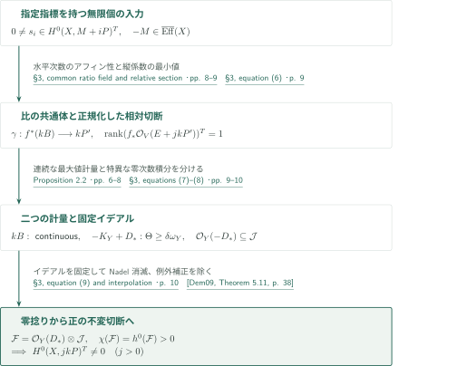
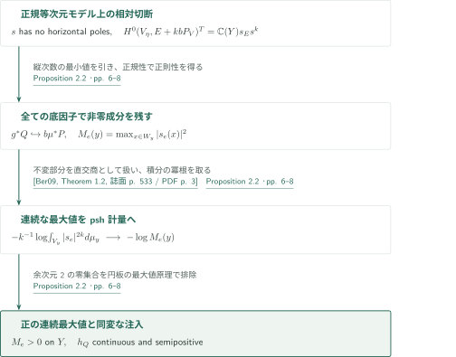
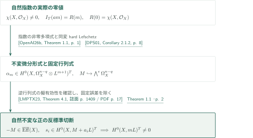
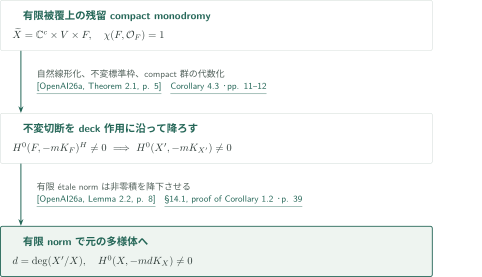
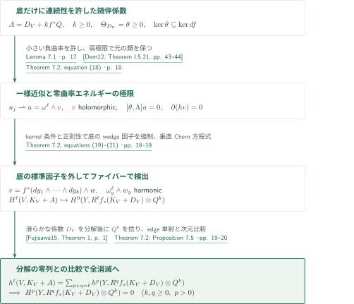

# Cohomological transfer and equivariant anticanonical sections

**指標を保って固定誤差を除き、不変切断をmonodromyに沿って降下させる**

滑らかな半正反標準束に対し、固定された負の擬有効誤差を持つ不変切断から、誤差のない正の次数の不変切断を作る。主定理では反標準束の任意の線形化を許す。自然線形化を必要とするのは、後に不変指数からこの入力を供給する段階である。本記事は著者が最短経路とする§§2–4と§14.1を中心に、主定理と滑らかな非消滅の帰結を説明する。

## 1. 主要結果

### Theorem 1.1 — 不変切断の移送

$X$を滑らかな連結複素射影多様体とし、$L=-K_X$が滑らかな半正計量を持つとする。代数的トーラス$T$が$X$に作用する。$P,M$を線形化された線束とし、通常の線束として$P=L$、$-M$は擬有効とする。$P$の線形化は自然線形化と異なってよい。非有界な集合$I\subset\mathbb Z_{>0}$について
$$0\ne s_i\in H^0(X,M+iP)^T\quad(i\in I)$$
が存在するとき、ある整数$m>0$について$H^0(X,mP)^T\ne0$である。Euler特性や$H^1(X,\mathcal O_X)$の消滅は仮定しない。

<!-- cite:main -->[Theorem 1.1 · p. 2](https://github.com/openai/math/blob/fd4aeeb2ee4fc729c18d98444fed42fd0529eeeb/preprints/Cohomological-transfer-and-equivariant-anticanonical-sections-September-26-2026/main.pdf)<!-- /cite -->

### Corollary 1.2 — 滑らかな半正反標準束の非消滅

滑らかな連結複素射影多様体$X$で$-K_X$が滑らかな半正計量を持つなら、ある整数$m>0$について$H^0(X,-mK_X)\ne0$である。指数の一様上界や第一冪の非消滅は主張していない。

<!-- cite:smooth -->[Corollary 1.2 · p. 2](https://github.com/openai/math/blob/fd4aeeb2ee4fc729c18d98444fed42fd0529eeeb/preprints/Cohomological-transfer-and-equivariant-anticanonical-sections-September-26-2026/main.pdf)<!-- /cite -->

### Theorem 7.2 — kernel条件による高次直像の消滅

$f:V\to Y$を滑らかな連結射影複素多様体の間の全射とする。$D_V$は滑らかな半正Hermitian計量を持つ線束、その曲率を$\theta$とする。$Y$上の線束$Q$には、局所重みがpshである正定値連続Hermitian計量があると仮定する。submersion locusの空でない通常開集合上で

$$\ker\theta\subseteq\ker df$$

ならば、**すべての**整数$k,q\geq0$と$p>0$について

$$H^p\!\left(Y,R^qf_*(K_V+D_V)\otimes Q^k\right)=0.$$

$k=0$も含む。$Q$の重みは連続でよく、$D_V$の係数計量には滑らかさを要求する。kernel条件はnef性のみから導かれるものではない。

<!-- cite:kernel -->[Theorem 7.2 · pp. 17–19](https://github.com/openai/math/blob/fd4aeeb2ee4fc729c18d98444fed42fd0529eeeb/preprints/Cohomological-transfer-and-equivariant-anticanonical-sections-September-26-2026/main.pdf)<!-- /cite -->

## 図の矢印に付した引用

<!-- reference-guide -->
略号のない定理・補題・節・式番号は本原稿 [Cohomological transfer and equivariant anticanonical sections](https://github.com/openai/math/blob/fd4aeeb2ee4fc729c18d98444fed42fd0529eeeb/preprints/Cohomological-transfer-and-equivariant-anticanonical-sections-September-26-2026/main.pdf) を指します。外部入力には次の略号を使います。

- [DPS01](https://arxiv.org/pdf/math/0006205v2) Jean-Pierre Demailly; Thomas Peternell; Michael Schneider — *Pseudo-effective line bundles on compact Kähler manifolds*：自然同変hard Lefschetzから無限個の捻り形式を得る。arXiv:math/0006205v2, 10 October 2000。
- [LMPTX23](https://ems.press/content/serial-article-files/31138) Vladimir Lazić; Shin-ichi Matsumura; Thomas Peternell; Nikolaos Tsakanikas; Zhixin Xie — *The Nonvanishing Problem for varieties with nef anticanonical bundle*：行列式の逆を擬有効とする。Documenta Mathematica 28 (2023), 1393–1440。
- [PT14](https://arxiv.org/pdf/1409.5504v1) Mihai Păun; Shigeharu Takayama — *Positivity of twisted relative pluricanonical bundles and their direct images*：特異係数の随伴直像計量と不変商の正値性。arXiv:1409.5504v1。
- [OpenAI26a](https://github.com/openai/math/blob/fd4aeeb2ee4fc729c18d98444fed42fd0529eeeb/preprints/Anticanonical-nonvanishing-from-smooth-semipositivity-September-26-2026/main.pdf) OpenAI — *Anticanonical nonvanishing from smooth semipositivity*：残留monodromyを保持した有限被覆構造と有限étale norm。2026-09-26; commit fd4aeeb2ee4fc729c18d98444fed42fd0529eeeb。
- [Ber09](https://annals.math.princeton.edu/wp-content/uploads/annals-v169-n2-p04.pdf) Bo Berndtsson — *Curvature of vector bundles associated to holomorphic fibrations*：滑らかな係数の随伴積分と不変直交商に半正性を与える。Annals of Mathematics 169 (2009), 531–560。
- [Dem09](https://www-fourier.univ-grenoble-alpes.fr/~demailly/manuscripts/analmeth.pdf) Jean-Pierre Demailly — *Analytic methods in algebraic geometry*：§3のNadel消滅入力を定理記述で照合する補助参照。December 2009 lecture notes, 180-page version; distinct from the July 2011 book cited in the manuscript。
- [OpenAI26b](https://github.com/openai/math/blob/fd4aeeb2ee4fc729c18d98444fed42fd0529eeeb/preprints/Invariant-anticanonical-indices-and-conversion-of-twisted-differentials-September-26-2026/main.pdf) OpenAI — *Invariant anticanonical indices and conversion of twisted differentials*：自然反標準指数の実際の零値を含む多項式性。2026-09-26; commit fd4aeeb2ee4fc729c18d98444fed42fd0529eeeb。
- [Fujisawa15](https://arxiv.org/pdf/1512.03887v1) Taro Fujisawa — *A remark on the decomposition theorem for direct images of canonical sheaves tensorized with semipositive vector bundles*：smooth Nakano半正係数の導来分解。arXiv:1512.03887v1; arXiv header 12 December 2015 (PDF internal date June 27, 2021)。
- [Dem12](https://www-fourier.univ-grenoble-alpes.fr/~demailly/manuscripts/agbook.pdf) Jean-Pierre Demailly — *Complex Analytic and Differential Geometry*：Richbergの一様平滑化と小さい曲率誤差。21 June 2012; 455-page author PDF。

各引用に結果番号とページを付します。誌面番号とPDF内の位置が異なる場合は両方を示します。GitHubの閲覧リンクではページ位置への自動移動を前提としません。
<!-- /reference-guide -->

## 2. Theorem 1.1 の証明 — 固定イデアルでの移送

<!-- proof-target:1 -->証明対象：[Theorem 1.1 · p. 2](https://github.com/openai/math/blob/fd4aeeb2ee4fc729c18d98444fed42fd0529eeeb/preprints/Cohomological-transfer-and-equivariant-anticanonical-sections-September-26-2026/main.pdf)<!-- /proof-target -->

**証明の道筋。** 指標込みで次数の等しい切断比が作る共通体から底を選ぶ。水平次数のアフィン性と縦成分の最小値で正則な相対切断を作り、全非負次数の不変随伴直像をrank oneにする。[最大値計量](#proof-2)は変化する捻りを担当し、別の特異計量は底方向の正値性と零次数の非零Euler値を担当する。自然指数からの入力は[Corollary 4.3](#proof-3)、一般の$X$への降下は[Corollary 1.2](#proof-4)で扱う。

### 1. 切断比の共通体から相対切断を作る

$N_i=M+iP$と置く。$p<q<b$に対する$(b-p)N_q=(b-q)N_p+(q-p)N_b$は線形化も保持する。同じ固定切断を分子・分母に掛けると、内側の指数に対応する不変切断比の体は共通になる。独立な比から射影的な底を作り、Stein分解でその関数体を$\mathbb C(X)$内の相対代数閉包にする。$T$はこの底に自明に作用する。

正規等次元モデル$\mu:W\to X$、$f_W:W\to Y$と滑らかな解消$\pi:V\to X$、$f:V\to Y$を取る。比が底関数であることから切断因子の水平部分は指数に関してアフィンとなり、非有界性はその傾きを有効にする。縦成分の係数／引戻し多重度の最小値を引き、分母を消すと
$$\gamma\in H^0(W,k\mu^*P-f_W^*(kB))^T,\qquad k>0$$
を得る。各底素因子の上で少なくとも一つの成分は$\gamma$の零因子に含まれない。比の体の超越次数が0なら、傾きが直接正則不変反標準切断を与えて終了する。

<!-- cite:ratio -->[§3, common ratio field and relative section · pp. 8–9](https://github.com/openai/math/blob/fd4aeeb2ee4fc729c18d98444fed42fd0529eeeb/preprints/Cohomological-transfer-and-equivariant-anticanonical-sections-September-26-2026/main.pdf)<!-- /cite -->

### 2. 零次数を含む不変rank oneを確保する

$E=K_{V/X}\ge0$には自然な不変Jacobian切断がある。$P'=\pi^*P$の指標がずれても、このJacobianの自然作用は変えない。全$j\ge0$で
$$\operatorname{rank}\bigl(f_*\mathcal O_V(E+jkP')\bigr)^T=1$$
となる。下界は$1_E\gamma^j$から来る。二つの独立な不変切断があれば底のample捻りで大域化し、入力$s_i$と$\gamma$の冪を掛けて同じ$N_b$の倍数の不変切断比を得る。共通体の構成からその比は底関数でなければならず、一般ファイバー上の独立性と矛盾する。ここで$j=0$を除かない。

<!-- cite:rank -->[§3, equation (6) · p. 9](https://github.com/openai/math/blob/fd4aeeb2ee4fc729c18d98444fed42fd0529eeeb/preprints/Cohomological-transfer-and-equivariant-anticanonical-sections-September-26-2026/main.pdf)<!-- /cite -->

### 3. 変化する捻りと零次数のために計量を分ける

Proposition 2.2から$kB$には連続半正計量がある。これとは別に、$-M$の擬有効性と底のample支配から$L'=\pi^*L$に
$$i\Theta_h\ge\delta f^*\omega_Y,\qquad\mathcal I(h)=\mathcal O_V\qquad(\delta>0)$$
を満たす特異計量を作る。滑らかな計量との小量混合にSkodaの可積分性を用いる。

零次数の随伴積分を不変な正則直交商へ移して、$-K_Y$上の密度$F_\xi$を得る。これは底全体で局所可積分である。境界素因子上で引戻し多重度を$\ell$、Jacobianの位数を$a$とすると、局所計算は$F_\xi(y)\ge c|y_1|^{2((a+1)/\ell-1)}$を与える。この評価に基づく補正$D_*\ge0$を加えて、$-K_Y+D_*$上の計量を延長する。補正の支持は全ての支配成分が例外的な底因子に限定される。さらに等次元モデルの次元評価で底の余次元2以上へ落ちる成分も例外的と確認し、$f^*D_*$全体が$X$上例外的となる。

<!-- cite:strict -->[§3, equations (7)–(8) · pp. 9–10](https://github.com/openai/math/blob/fd4aeeb2ee4fc729c18d98444fed42fd0529eeeb/preprints/Cohomological-transfer-and-equivariant-anticanonical-sections-September-26-2026/main.pdf)<!-- /cite --> <!-- cite:singular-image -->[&#91;PT14, Theorems 3.3.4–3.3.5, p. 24&#93;](https://arxiv.org/pdf/1409.5504v1#page=24)<!-- /cite -->

### 4. 自明とは限らない同じ乗数イデアルを保つ

延長計量の乗数イデアルを$\mathcal J$とする。密度$F_\xi$の局所可積分性から
$$\mathcal O_Y(-D_*)\subseteq\mathcal J$$
であり、$\mathcal J=\mathcal O_Y$とは仮定しない。$jkB$の有界計量をテンソルしてもイデアルは変わらず、全$j\ge0$でNadel消滅が
$$H^v(Y,\mathcal O_Y(D_*+jkB)\otimes\mathcal J)=0\quad(v>0)$$
を与える。$\mathcal F=\mathcal O_Y(D_*)\otimes\mathcal J$は$\mathcal O_Y$を含むので、$\chi(Y,\mathcal F)=h^0(Y,\mathcal F)>0$である。Euler多項式は零多項式でなく、ある$j>0$の切断を与える。引戻して$\gamma^j$を掛け、例外補正$f^*D_*$を除いて$X$へ押し戻すと、指定した線形化の$jkP$の不変切断が残る。

<!-- cite:ideal -->[§3, equation (9) and interpolation · p. 10](https://github.com/openai/math/blob/fd4aeeb2ee4fc729c18d98444fed42fd0529eeeb/preprints/Cohomological-transfer-and-equivariant-anticanonical-sections-September-26-2026/main.pdf)<!-- /cite --> <!-- cite:nadel -->[&#91;Dem09, Theorem 5.11, p. 38&#93;](https://www-fourier.univ-grenoble-alpes.fr/~demailly/manuscripts/analmeth.pdf#page=38)<!-- /cite -->

## 3. Proposition 2.2 の証明 — 正の連続最大値計量

<!-- proof-target:2 -->証明対象：[Proposition 2.2 · pp. 6–8](https://github.com/openai/math/blob/fd4aeeb2ee4fc729c18d98444fed42fd0529eeeb/preprints/Cohomological-transfer-and-equivariant-anticanonical-sections-September-26-2026/main.pdf)<!-- /proof-target -->

<!-- statement:proposition-2-2 -->
### Proposition 2.2 — 因子的正規化と最大値計量

$X,Y$を滑らかな連結射影多様体、$L=-K_X$を滑らかな半正計量を持つ線束とする。$V\xrightarrow{\nu}W\xrightarrow{\mu}X$、$g:W\to Y$、$f=g\nu$で、$W$は正規、$g$は射影的全射かつ等次元、$\mu$は双有理、$V$は滑らかな射影的解消とする。$D_V=(\mu\nu)^*L$、$E=K_{V/X}$とする。水平極を持たない$b\mu^*L$の非零有理切断$s$（$b>0$）が、全$k\ge0$で
$$H^0(V_\eta,E+kbD_V)=\mathbb C(Y)s_Es^k$$
を満たすとする。すると$b,s$を倍数・冪で置き換えた後、底の線束$Q$と正則な注入$g^*Q\to b\mu^*L$があり、ファイバー上のノルムの最大値は$Q$に正の連続半正計量を与える。

同変版では、$T$が図式に作用し底に自明に作用するものとし、$P$は任意に線形化した$L$、$s$は$b\mu^*P$の不変有理切断とする。rank条件を$H^0(V_\eta,E+kbP_V)^T=\mathbb C(Y)s_Es^k$へ替えてよい。このとき$Q$の作用は自明で、$g^*Q\to b\mu^*P$は同変である。

<!-- cite:metric -->[Proposition 2.2 · pp. 6–8](https://github.com/openai/math/blob/fd4aeeb2ee4fc729c18d98444fed42fd0529eeeb/preprints/Cohomological-transfer-and-equivariant-anticanonical-sections-September-26-2026/main.pdf)<!-- /cite -->
<!-- /statement -->

### 1. 正規化と等次元性で連続性を得る

各底素因子上で$s$の最小正規化位数を引き、分母を消して$Q$と注入を作る。零因子は各底素因子上の少なくとも一成分を欠く。局所枠$e$の像を$s_e$とすると、$M_e(y)=\max_{W_y}|s_e|^2$はpropernessから上半連続、正規等次元写像の開性から下半連続である。消える底点の集合は代数的閉で、成分を欠く性質により余次元2以上となる。$k=0$のrank条件は一般ファイバーの連結性にも使う。

<!-- cite:metric -->[Proposition 2.2 · pp. 6–8](https://github.com/openai/math/blob/fd4aeeb2ee4fc729c18d98444fed42fd0529eeeb/preprints/Cohomological-transfer-and-equivariant-anticanonical-sections-September-26-2026/main.pdf)<!-- /cite -->

### 2. 不変部分を正則直交商として扱う

滑らかな随伴係数$(kb+1)D_V$にBerndtssonの定理を適用する。不変直像は一般の部分線束として正にするのではなく、compact平均でunitaryな作用を得て、非零重み部分の直交補に対応する正則な商として扱う。そのrank one積分の正規化は
$$-\frac1k\log\int_{V_y}|s_e|^{2k}d\mu_y\ \longrightarrow\ -\log M_e(y).$$
滑らかな一般ファイバー上で$\mu_y$は全台を持ち、局所一様収束が成り立つ。したがって最大値の負対数はpshとなる。

<!-- cite:berndtsson -->[&#91;Ber09, Theorem 1.2, 誌面 p. 533 / PDF p. 3&#93;](https://annals.math.princeton.edu/wp-content/uploads/annals-v169-n2-p04.pdf#page=3)<!-- /cite --> <!-- cite:metric -->[Proposition 2.2 · pp. 6–8](https://github.com/openai/math/blob/fd4aeeb2ee4fc729c18d98444fed42fd0529eeeb/preprints/Cohomological-transfer-and-equivariant-anticanonical-sections-September-26-2026/main.pdf)<!-- /cite -->

### 3. 余次元2の零を排除し、全結論を得る

$M_e>0$の範囲へ連続性を用いてpsh延長する。残る余次元2以上の零集合に対して、境界が零集合を避ける円板とその平行移動に最大値原理を適用する。これが$-\log M_e$の一様上界を与え、連続な$M_e$が0へ近づく可能性を排除する。従って$M_e$は全ての点で正で、枠変換則は$Q$の連続半正計量を定める。縦因子と相対切断の不変性により、同変版の注入と底の自明作用も保持される。

<!-- cite:metric -->[Proposition 2.2 · pp. 6–8](https://github.com/openai/math/blob/fd4aeeb2ee4fc729c18d98444fed42fd0529eeeb/preprints/Cohomological-transfer-and-equivariant-anticanonical-sections-September-26-2026/main.pdf)<!-- /cite -->

## 4. Corollary 4.3 の証明 — 自然指数から入力を作る

<!-- proof-target:3 -->証明対象：[Corollary 4.3 · pp. 11–12](https://github.com/openai/math/blob/fd4aeeb2ee4fc729c18d98444fed42fd0529eeeb/preprints/Cohomological-transfer-and-equivariant-anticanonical-sections-September-26-2026/main.pdf)<!-- /proof-target -->

<!-- statement:corollary-4-3 -->
### Corollary 4.3 — 自然不変非消滅

$X$を滑らかな連結複素射影多様体、$L=-K_X$を滑らかな半正計量を持つ線束とする。代数的トーラス$T$が$X$に作用し、$\chi(X,\mathcal O_X)\ne0$なら、自然線形化について、ある整数$m>0$で$H^0(X,mL)^T\ne0$である。

自明なトーラスも含む。

<!-- cite:natural -->[Corollary 4.3 · pp. 11–12](https://github.com/openai/math/blob/fd4aeeb2ee4fc729c18d98444fed42fd0529eeeb/preprints/Cohomological-transfer-and-equivariant-anticanonical-sections-September-26-2026/main.pdf)<!-- /cite -->
<!-- /statement -->

### 1. 実際の零値を持つ指数多項式を使う

連結トーラスは恒等写像とホモトピックに作用するので、Hodge分解を通して$H^q(X,\mathcal O_X)$に自明に作用する。従って自然不変指数の零値は$\chi(X,\mathcal O_X)\ne0$である。同伴原稿の指数定理は、十分可除な進行上の多項式にこの実際の零値を対応させる。単に十分大きな指数で多項式というだけでは零多項式を排除できない。非零コホモロジーの次数を部分列で固定し、$mL=K_X+(m+1)L$に同変hard Lefschetzを適用して不変捻り微分形式を得る。

<!-- cite:index -->[&#91;OpenAI26b, Theorem 1.1, p. 1&#93;](https://github.com/openai/math/blob/fd4aeeb2ee4fc729c18d98444fed42fd0529eeeb/preprints/Invariant-anticanonical-indices-and-conversion-of-twisted-differentials-September-26-2026/main.pdf)<!-- /cite --> <!-- cite:index-use -->[Proposition 4.1; Lemma 4.2 · pp. 10–11](https://github.com/openai/math/blob/fd4aeeb2ee4fc729c18d98444fed42fd0529eeeb/preprints/Cohomological-transfer-and-equivariant-anticanonical-sections-September-26-2026/main.pdf)<!-- /cite --> <!-- cite:hard-lefschetz -->[&#91;DPS01, Corollary 2.1.2, p. 8&#93;](https://arxiv.org/pdf/math/0006205v2#page=8)<!-- /cite -->

### 2. 行列式の固定誤差をTheorem 1.1で除く

$q=0$または$q=n$なら既に正の反標準切断がある。それ以外は微分形式の一般点でのspanを取り、飽和した行列式線束$M$を作る。大きな指数の形式を固定した補基底とwedgeすることで、非零かつ不変な$M+a_iL$の切断を$a_i\to\infty$で得る。cotangent tensor部分層の定理を滑らかな零境界対とnefな$L$へ適用して$-M$を擬有効とし、自然線形化$P=L$でTheorem 1.1を適用する。

<!-- cite:natural-proof -->[Corollary 4.3, proof · pp. 11–12](https://github.com/openai/math/blob/fd4aeeb2ee4fc729c18d98444fed42fd0529eeeb/preprints/Cohomological-transfer-and-equivariant-anticanonical-sections-September-26-2026/main.pdf)<!-- /cite --> <!-- cite:cotangent -->[&#91;LMPTX23, Theorem 4.1, 誌面 p. 1409 / PDF p. 17&#93;](https://ems.press/content/serial-article-files/31138)<!-- /cite -->

## 5. Corollary 1.2 の証明 — 不変切断の降下

<!-- proof-target:4 -->証明対象：[Corollary 1.2 · p. 2](https://github.com/openai/math/blob/fd4aeeb2ee4fc729c18d98444fed42fd0529eeeb/preprints/Cohomological-transfer-and-equivariant-anticanonical-sections-September-26-2026/main.pdf)<!-- /proof-target -->

**証明の道筋。** 有限被覆構造は$\mathbb C^c\times V\times F$の普遍被覆と残留compact torus作用を与える。$F$にCorollary 4.3を適用し、不変標準枠を付けて降下させる。

### 1. compact因子の切断を有限被覆へ降ろす

同伴原稿の構造定理により、有限étale被覆$X'\to X$のdeck作用はEuclidean因子上で平行移動、$V$上で自明、$F$上でcompact torus $H$を通る。$F$では正次数の正則微分形式が消え、Hodge対称性から$\chi(F,\mathcal O_F)=1$である。$\operatorname{Pic}^0(F)=0$によりcompact作用をvery ample線束を通して代数化し、その代数的トーラス閉包の不変切断をCorollary 4.3で作る。不変標準枠とテンソルするとdeck不変になり$X'$へ降下する。$F$が点の場合は定数切断を使う。

<!-- cite:structure -->[&#91;OpenAI26a, Theorem 2.1, p. 5&#93;](https://github.com/openai/math/blob/fd4aeeb2ee4fc729c18d98444fed42fd0529eeeb/preprints/Anticanonical-nonvanishing-from-smooth-semipositivity-September-26-2026/main.pdf)<!-- /cite --> <!-- cite:natural -->[Corollary 4.3 · pp. 11–12](https://github.com/openai/math/blob/fd4aeeb2ee4fc729c18d98444fed42fd0529eeeb/preprints/Cohomological-transfer-and-equivariant-anticanonical-sections-September-26-2026/main.pdf)<!-- /cite --> <!-- cite:smooth-proof -->[§14.1, proof of Corollary 1.2 · p. 39](https://github.com/openai/math/blob/fd4aeeb2ee4fc729c18d98444fed42fd0529eeeb/preprints/Cohomological-transfer-and-equivariant-anticanonical-sections-September-26-2026/main.pdf)<!-- /cite -->

### 2. normにより元のXの切断を得る

$d=\deg(X'/X)$の有限étale normは、得た切断を非零な$-mdK_X$の切断へ送る。指数は共通冪や被覆次数で増加してよく、一様指数は結論に含まれない。構造定理の入力は有限被覆が直積であることを要求しない。また同伴原稿の非消滅主定理を入力としていない。

<!-- cite:norm -->[&#91;OpenAI26a, Lemma 2.2, p. 8&#93;](https://github.com/openai/math/blob/fd4aeeb2ee4fc729c18d98444fed42fd0529eeeb/preprints/Anticanonical-nonvanishing-from-smooth-semipositivity-September-26-2026/main.pdf)<!-- /cite --> <!-- cite:smooth-proof -->[§14.1, proof of Corollary 1.2 · p. 39](https://github.com/openai/math/blob/fd4aeeb2ee4fc729c18d98444fed42fd0529eeeb/preprints/Cohomological-transfer-and-equivariant-anticanonical-sections-September-26-2026/main.pdf)<!-- /cite -->

## 6. Theorem 7.2 の証明 — 連続捻りを通した調和的制限

<!-- proof-target:5 -->証明対象：[Theorem 7.2 · pp. 17–19](https://github.com/openai/math/blob/fd4aeeb2ee4fc729c18d98444fed42fd0529eeeb/preprints/Cohomological-transfer-and-equivariant-anticanonical-sections-September-26-2026/main.pdf)<!-- /proof-target -->

**証明の道筋。** 連続な底計量を一様近似し、Bochnerエネルギーが消える極限を取る。kernel条件が極限形式に底の標準余接因子を強制するため、非零の類を一般ファイバー上で検出できる。このedge mapの単射と、滑らかな係数に対する導来分解を最後に組み合わせる。分解定理だけから消滅を結論しない。

### 1. 一様近似から曲率零方向の形式を残す

$k\geq0$を固定し、$A=D_V+kf^*Q$とする。Lemma 7.1のRichberg型近似は$A$上の滑らかな計量$h_j$を与え、$h_j\to h$は一様、$\Theta_{h_j}\geq\theta-o(1)\omega$となる。連続重みに小さい負曲率を許すことが重要であり、各近似計量が半正であるとは主張しない。固定した$H^\ell(V,K_V+A)$の類の調和代表$u_j$は一様$L^2$有界で、Bochner–Kodaira恒等式から$\|(D'_j)^*u_j\|^2+\langle[\theta,\Lambda]u_j,u_j\rangle\to0$を得る。$v_j=*u_j$の弱極限$v$は正則で、$u=\omega^\ell\wedge v$が元の類を表す。固定参照計量の有限rank調和射影が、弱極限で同じ類を保持することを保証する。

<!-- cite:smoothing -->[Lemma 7.1 · p. 17](https://github.com/openai/math/blob/fd4aeeb2ee4fc729c18d98444fed42fd0529eeeb/preprints/Cohomological-transfer-and-equivariant-anticanonical-sections-September-26-2026/main.pdf)<!-- /cite -->
<!-- cite:richberg -->[&#91;Dem12, Theorem I.5.21, pp. 43–44&#93;](https://www-fourier.univ-grenoble-alpes.fr/~demailly/manuscripts/agbook.pdf#page=43)<!-- /cite -->
<!-- cite:harmonic-limit -->[Theorem 7.2, equation (18) · p. 18](https://github.com/openai/math/blob/fd4aeeb2ee4fc729c18d98444fed42fd0529eeeb/preprints/Cohomological-transfer-and-equivariant-anticanonical-sections-September-26-2026/main.pdf)<!-- /cite -->

### 2. 分布的Chern方程式を一般ファイバーへ制限する

曲率commutatorの零エネルギーから、正曲率方向の正則余接形式はすべて$v$のwedge因子になる。kernel包含がある開集合上で底の余接形式も因子となり、正則性によりsmooth fibration locus全体で$v=f^*(dy_1\wedge\cdots\wedge dy_b)\wedge w$となる。一方、$D'_jv_j=0$を局所frameで$\partial(h_jv_j)=0$と書き、一様計量収束と弱$L^2$収束だけで$\partial(hv)=0$へ移す。計量の微分収束は使わない。

底の連続因子は垂直微分で一定なので、各smooth fiber上では滑らかな$D_V$計量に対して$D'_{D_V|V_y}w_y=0$となる。ここで制限するのは$K_V+A$に値を取る$(0,\ell)$形式である。定数因子$K_Y|_y$を外せば代表は$\omega_y^\ell\wedge w_y$となり、これはファイバー上で調和的である。低次元ファイバーへの通常の$(n,\ell)$形式のpullbackと混同しない。非零類はある一般ファイバーで非零となり、Leray edge mapは単射となる。

<!-- cite:fiber-detection -->[Theorem 7.2, equations (19)–(21) · pp. 18–19](https://github.com/openai/math/blob/fd4aeeb2ee4fc729c18d98444fed42fd0529eeeb/preprints/Cohomological-transfer-and-equivariant-anticanonical-sections-September-26-2026/main.pdf)<!-- /cite -->

### 3. smooth係数の分解と次元比較で全量化を回収する

Fujisawaの定理はsmooth semipositive line $D_V$に適用する。lineの場合はNakano半正条件が曲率半正と一致し、$V$のKähler性と$f$のproper surjectivityも満たされる。$D_V+kf^*Q$の連続計量にこの定理を直接適用するのではない。まず$Rf_*(K_V+D_V)\simeq\bigoplus_qR^qf_*(K_V+D_V)[-q]$を得てから、底で$Q^k$をtensorする。projection formulaにより

$$h^\ell(V,K_V+D_V+kf^*Q)=\sum_{p+q=\ell}h^p(Y,R^qf_*(K_V+D_V)\otimes Q^k).$$

edge map単射は左辺を右辺の$p=0$項以下に抑えるので、残りの全項は零となる。$\ell>\dim V$では左辺自体が零である。$k$は任意の非負整数だったため、零捻りを含む全$k,q\geq0$、$p>0$を得る。この零捻りでの消滅が、後続Proposition 7.5のEuler補間に使われる。

<!-- cite:fujisawa -->[&#91;Fujisawa15, Theorem 1, p. 1&#93;](https://arxiv.org/pdf/1512.03887v1#page=1)<!-- /cite -->
<!-- cite:kernel-end -->[Theorem 7.2; Proposition 7.5 · pp. 19–20](https://github.com/openai/math/blob/fd4aeeb2ee4fc729c18d98444fed42fd0529eeeb/preprints/Cohomological-transfer-and-equivariant-anticanonical-sections-September-26-2026/main.pdf)<!-- /cite -->

## 7. どの論文が、どの段階を担うか

| 入力 | 利用箇所 | 役割・確認範囲 |
|---|---|---|
| Ber09 | Proposition 2.2、p. 7 | 滑らかな随伴積分の半正性。定理記述と不変直交商の使用を照合。 |
| PT14 | §3、pp. 9–10 | 特異な零次数係数の直像計量。generic multiplier-ideal同型と正則商を確認。 |
| Nadel消滅（Dem09の記述で照合） | §3、p. 10 | 正曲率を持つ$-K_Y+D_*+jkB$、固定$\mathcal J$、全$j\ge0$での消滅。元のNadel論文の全証明は未確認。 |
| Fujisawa15; Dem12 | Theorem 7.2、pp.17–19 | 一様平滑化とsmooth Nakano係数の導来分解。連続底捻りは分解後にtensorする。 |
| Invariant anticanonical indices and conversion of twisted differentials | Proposition 4.1 → Corollary 4.3、pp. 10–12 | Theorem 1.1の自然指数と実際の零値。Theorem 1.1の移送自体とは独立な入力。 |
| DPS01・LMPTX23 | Lemma 4.2 → Corollary 4.3、pp. 11–12 | $m+1$の微分形式と逆行列式の擬有効性。数値的非自明性は追加しない。 |
| Anticanonical nonvanishing from smooth semipositivity | §14.1、p. 39 | 有限被覆構造とnormを帰結で使用。主定理の非消滅を再引用しない。 |

## 8. 原典を読む入口と確認範囲

<!-- reading-list -->
- [§3, common ratio field and relative section · pp. 8–9](https://github.com/openai/math/blob/fd4aeeb2ee4fc729c18d98444fed42fd0529eeeb/preprints/Cohomological-transfer-and-equivariant-anticanonical-sections-September-26-2026/main.pdf) — 指標を保持して比の共通体を作る。
- [Proposition 2.2 · pp. 6–8](https://github.com/openai/math/blob/fd4aeeb2ee4fc729c18d98444fed42fd0529eeeb/preprints/Cohomological-transfer-and-equivariant-anticanonical-sections-September-26-2026/main.pdf) — 正規等次元モデル上の最大値計量。
- [§3, equation (9) and interpolation · p. 10](https://github.com/openai/math/blob/fd4aeeb2ee4fc729c18d98444fed42fd0529eeeb/preprints/Cohomological-transfer-and-equivariant-anticanonical-sections-September-26-2026/main.pdf) — 自明とは限らない固定イデアルと零捻り。
- [Corollary 4.3, proof · pp. 11–12](https://github.com/openai/math/blob/fd4aeeb2ee4fc729c18d98444fed42fd0529eeeb/preprints/Cohomological-transfer-and-equivariant-anticanonical-sections-September-26-2026/main.pdf) — 自然指数を移送定理の入力へ変える。
- [§14.1, proof of Corollary 1.2 · p. 39](https://github.com/openai/math/blob/fd4aeeb2ee4fc729c18d98444fed42fd0529eeeb/preprints/Cohomological-transfer-and-equivariant-anticanonical-sections-September-26-2026/main.pdf) — 不変切断を降下させ有限normを取る。
- [Theorem 7.2 · pp. 17–19](https://github.com/openai/math/blob/fd4aeeb2ee4fc729c18d98444fed42fd0529eeeb/preprints/Cohomological-transfer-and-equivariant-anticanonical-sections-September-26-2026/main.pdf) — 一様近似・fiber detection・smooth係数の分解を区別する。
- [§1.4 · pp. 4–5](https://github.com/openai/math/blob/fd4aeeb2ee4fc729c18d98444fed42fd0529eeeb/preprints/Cohomological-transfer-and-equivariant-anticanonical-sections-September-26-2026/main.pdf) — 本記事で詳説しない別経路の位置。
<!-- /reading-list -->

編集側ではTheorem 1.1・Corollary 1.2の仮定と全結論、Proposition 2.2・Corollary 4.3、§§2–4と§14.1の証明本文を読解した。入力原稿の自然指数・構造・norm、および上記解析定理の記述と適用を照合した。Nadelの記述確認には2009年12月のDemailly講義ノートを使い、原稿が別箇所で挙げる2011年書籍とは区別している。

§§5–13のうち§7のLemma 7.1とTheorem 7.2は今回詳説した。残る別経路には正確なsource character、singular injectivity、curvature-null fieldのalteration、局所strictness、直像次数の安定化という別経路がある。本記事ではこれらを主定理に必要な前提とせず、証明の詳説・全接続の確認を対象外とした。§14.2–14.4のcohomology・微分形式・tensor holonomyによる別降下も同様である。外部証明の独立再検証と、flattening・同変解消・Skoda・psh延長の基礎文献の直接照合は未実施であり、専門家査読済みとはしない。

追加出力のうち、Theorem 5.2（p.13）は正次数の正則形式がない場合、linearized ampleを持つtorus作用のgeneric cocharacterのsourceの**完全なT指標**を実際の切断で達成する。これは単なる不変非消滅より情報を残す。Theorem 11.1（p.27）は固定$q$でunbounded $m$の$H^q(X,mL)\ne0$を通常非消滅へ変換する別証明、Proposition 14.1（p.41）はcompact・単連結・非平坦・de Rham既約の非負Ricci Kähler因子について、平行な正則体積形式か全正次数の共変tensor消滅かを与える追加結果である。これらは最短の移送・指数・降下経路の解説を優先するため、主張の位置と役割のみ紹介し、証明の詳説・直接入力の照合は今回の範囲外とする。

<!-- cite:extra-source -->[Theorem 5.2 · p. 13](https://github.com/openai/math/blob/fd4aeeb2ee4fc729c18d98444fed42fd0529eeeb/preprints/Cohomological-transfer-and-equivariant-anticanonical-sections-September-26-2026/main.pdf)<!-- /cite -->
<!-- cite:extra-conversion -->[Theorem 11.1 · p. 27](https://github.com/openai/math/blob/fd4aeeb2ee4fc729c18d98444fed42fd0529eeeb/preprints/Cohomological-transfer-and-equivariant-anticanonical-sections-September-26-2026/main.pdf)<!-- /cite -->
<!-- cite:extra-tensor -->[Proposition 14.1 · p. 41](https://github.com/openai/math/blob/fd4aeeb2ee4fc729c18d98444fed42fd0529eeeb/preprints/Cohomological-transfer-and-equivariant-anticanonical-sections-September-26-2026/main.pdf)<!-- /cite -->
