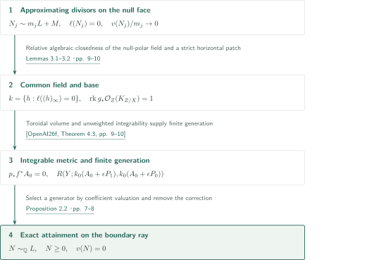
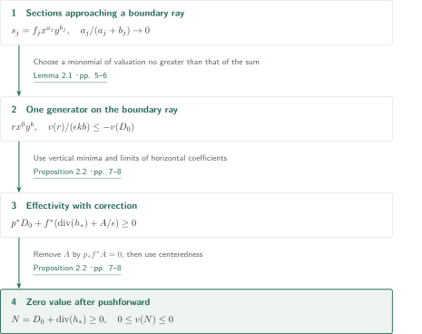
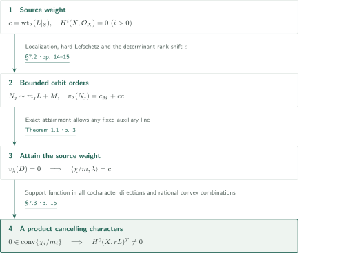
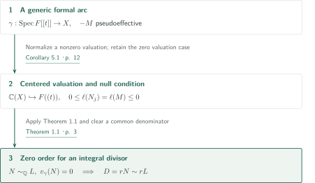
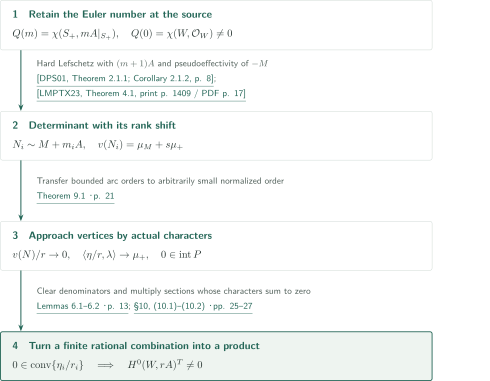
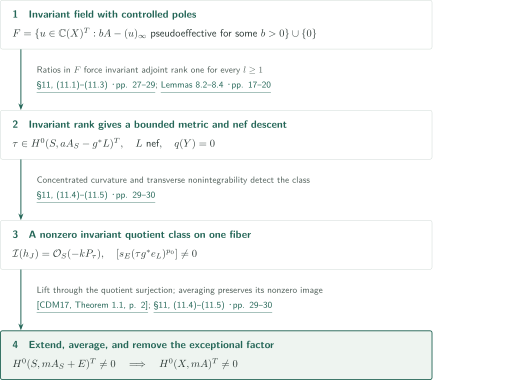
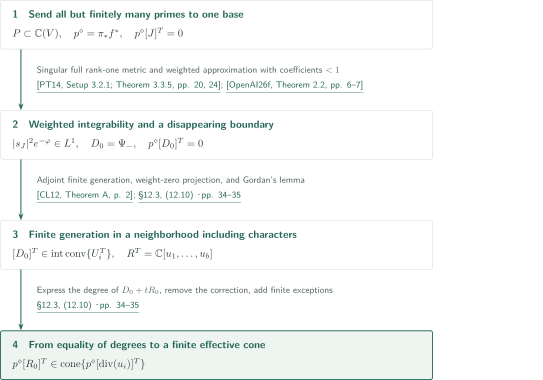

# Exact orders and invariant anticanonical linear systems

**Attain zero order on a boundary ray of a finitely generated ring, then pass from orbit orders to invariant characters**

The limit $\operatorname{ord}(N_j)/m_j\to0$ does not exclude vanishing at the center in every degree. This manuscript combines a curvature-null condition with finite generation to obtain an effective divisor in the actual anticanonical $\mathbb Q$-linear class with valuation exactly zero. It then translates generic orbit orders into characters. Smooth semipositivity is not replaced by nefness alone.

## 1. Main results

### Theorem 1.1 — Exact attainment of zero valuation

Let $X$ be a smooth connected projective complex variety of positive dimension $n$, and fix a smooth semipositive Hermitian metric on $L=-K_X$. Let its curvature form $\alpha$ represent $c_1(L)$ and have maximum complex rank $\nu$. For an ample line bundle $G_0$, set

$$\ell(D)=\begin{cases}D\cdot L^\nu\cdot G_0^{n-\nu-1}&\nu<n,\\0&\nu=n.\end{cases}$$

Let $v$ be a discrete valuation of $\mathbb C(X)$ centered on $X$, or the zero valuation, and let $M$ be **any fixed line bundle**. Suppose effective integral divisors $N_j$ and positive integers $m_j\to\infty$ satisfy

$$\begin{aligned}N_j&\sim m_jL+M,\\ \ell(N_j)&=0,\\ \frac{v(N_j)}{m_j}&\longrightarrow0.\end{aligned}$$

Then there is a rational divisor $N\geq0$ with $N\sim_{\mathbb Q}L$ and $v(N)=0$. Pseudoeffectivity of $-M$, vanishing irregularity, and an Euler-characteristic condition are not hypotheses of this theorem.

<!-- cite:exact -->[Theorem 1.1 · p. 3](https://github.com/openai/math/blob/fd4aeeb2ee4fc729c18d98444fed42fd0529eeeb/preprints/Exact-orders-and-invariant-anticanonical-linear-systems-September-26-2026/main.pdf)<!-- /cite -->

### Theorem 1.2 — Invariant sections for the natural anticanonical linearization

Let $X$ be smooth connected projective over $\mathbb C$, with $-K_X$ smoothly semipositive and $H^i(X,\mathcal O_X)=0$ for every $i>0$. For every algebraic torus $T$ acting on $X$, there is a positive integer $m$ with $H^0(X,-mK_X)^T\ne0$ for the natural anticanonical linearization.

<!-- cite:invariant -->[Theorem 1.2 · p. 4](https://github.com/openai/math/blob/fd4aeeb2ee4fc729c18d98444fed42fd0529eeeb/preprints/Exact-orders-and-invariant-anticanonical-linear-systems-September-26-2026/main.pdf)<!-- /cite -->

### Corollary 5.1 — Zero order along a generic formal arc

Let $X$ be smooth integral projective over $\mathbb C$, with $L=-K_X$ smoothly semipositive. Let $M$ be a line bundle with $-M$ pseudoeffective, and let $\gamma:\operatorname{Spec}F[[t]]\to X$ be a generic formal arc, meaning its fraction point maps to the generic point of $X$. If effective integral divisors $N_j\sim M+m_jL$, with positive $m_j\to\infty$, satisfy $v_\gamma(N_j)=o(m_j)$, there are an integer $r>0$ and an effective integral divisor $D\sim rL$ with $v_\gamma(D)=0$. A point variety is included.

<!-- cite:arc -->[Corollary 5.1 · p. 12](https://github.com/openai/math/blob/fd4aeeb2ee4fc729c18d98444fed42fd0529eeeb/preprints/Exact-orders-and-invariant-anticanonical-linear-systems-September-26-2026/main.pdf)<!-- /cite -->

### Proposition 10.1 — Invariant nonvanishing with nonzero Euler number

Let $W$ be smooth connected projective over $\mathbb C$, with $q(W)=0$ and $\chi(W,\mathcal O_W)\ne0$. Assume $A=-K_W$ has a smooth semipositive Hermitian metric, an algebraic torus $T$ acts faithfully on $W$, and an equivariantly linearized very ample line bundle is available. For the natural linearization, $H^0(W,rA)^T\ne0$ for some integer $r>0$.

<!-- cite:additional-chi -->[Proposition 10.1 · p. 25](https://github.com/openai/math/blob/fd4aeeb2ee4fc729c18d98444fed42fd0529eeeb/preprints/Exact-orders-and-invariant-anticanonical-linear-systems-September-26-2026/main.pdf)<!-- /cite -->

### Theorem 11.1 — Removing a fixed pseudoeffective equivariant error

Let $X$ be smooth connected projective over $\mathbb C$, with $q(X)=0$ and smoothly semipositive $A=-K_X$. Let an algebraic torus $T$ act on $X$ and use the natural linearization on $A$. Fix a pseudoeffective $T$-linearized line bundle $G$. If an unbounded set $I$ of positive integers has nonzero sections $\delta_j\in H^0(X,jA-G)^T$ for every $j\in I$, then $H^0(X,mA)^T\ne0$ for some integer $m>0$.

<!-- cite:additional-conversion -->[Theorem 11.1 · p. 27](https://github.com/openai/math/blob/fd4aeeb2ee4fc729c18d98444fed42fd0529eeeb/preprints/Exact-orders-and-invariant-anticanonical-linear-systems-September-26-2026/main.pdf)<!-- /cite -->

### Proposition 12.1 — A finite cone containing controlled invariant primes

Let $V$ be smooth connected rationally connected projective over $\mathbb C$, with smoothly semipositive $L=-K_V$. Let an algebraic torus $T$ act on $V$, and give $L$ its natural linearization. There is a rational polyhedral cone in $\operatorname{Pic}^T(V)_{\mathbb R}$, generated by invariant effective rational divisor classes, containing the divisor-linearized class $[D]^T$ of **every invariant prime** $D$ for which $aL-D$ is pseudoeffective for some integer $a>0$. The generators themselves need not satisfy this control condition.

<!-- cite:additional-cone -->[Proposition 12.1 · p. 31](https://github.com/openai/math/blob/fd4aeeb2ee4fc729c18d98444fed42fd0529eeeb/preprints/Exact-orders-and-invariant-anticanonical-linear-systems-September-26-2026/main.pdf)<!-- /cite -->

## References on the arrows

<!-- reference-guide -->
Unprefixed theorem, lemma, section and equation numbers refer to [Exact orders and invariant anticanonical linear systems](https://github.com/openai/math/blob/fd4aeeb2ee4fc729c18d98444fed42fd0529eeeb/preprints/Exact-orders-and-invariant-anticanonical-linear-systems-September-26-2026/main.pdf). External inputs use the following keys.

- [OpenAI26e](https://github.com/openai/math/blob/fd4aeeb2ee4fc729c18d98444fed42fd0529eeeb/preprints/Metric-descent-and-rank-preserving-contractions-September-26-2026/main.pdf) OpenAI — *Metric descent and rank-preserving contractions*: Toroidal volume metric and a disappearing rational correction. 2026-09-26.
- [OpenAI26f](https://github.com/openai/math/blob/fd4aeeb2ee4fc729c18d98444fed42fd0529eeeb/preprints/Integrable-metrics-and-effectivity-with-controlled-boundary-September-26-2026/main.pdf) OpenAI — *Integrable metrics and effectivity with controlled boundary*: Unweighted finite generation on the main route and weighted approximation on the cone route. 2026-09-26.
- [DPS01](https://arxiv.org/pdf/math/0006205v2) J.-P. Demailly, T. Peternell, M. Schneider — *Pseudo-effective line bundles on compact Kähler manifolds*: Hard Lefschetz surjectivity with smooth semipositive coefficients. arXiv:math/0006205v2.
- [CDM17](https://arxiv.org/pdf/1703.00292v2) Junyan Cao; Jean-Pierre Demailly; Shin-ichi Matsumura — *A general extension theorem for cohomology classes on non reduced analytic subspaces*: Extension of a multiplier-ideal quotient class. arXiv:1703.00292v2.
- [CL12](https://arxiv.org/pdf/1009.3188v2) Paolo Cascini; Vladimir Lazić — *New outlook on the Minimal Model Program, I*: Finite generation of a multigraded adjoint ring with a common ample part. arXiv:1009.3188v2.
- [Leh15](https://arxiv.org/pdf/1109.4382v3) Brian Lehmann — *Numerical triviality and pullbacks*: Numerical pullback from triviality on all contracted curves. arXiv:1109.4382v3.
- [EKL95](https://arxiv.org/pdf/alg-geom/9408003v1) Lawrence Ein; Oliver Küchle; Robert Lazarsfeld — *Local positivity of ample line bundles*: Seshadri lower bound at very general points. arXiv:alg-geom/9408003v1.
- [PT14](https://arxiv.org/pdf/1409.5504v1) M. Păun, S. Takayama — *Positivity of twisted relative pluricanonical bundles and their direct images*: Rank-one singular direct-image metric with its multiplier-ideal condition. arXiv:1409.5504v1 (2014); published in 2018.
- [LMPTX23](https://ems.press/content/serial-article-files/31138) V. Lazić, S. Matsumura, T. Peternell, N. Tsakanikas, Z. Xie — *The Nonvanishing Problem for varieties with nef anticanonical bundle*: Pseudoeffectivity of the negative determinant in a cotangent tensor. Documenta Mathematica 28 (2023), 1393–1440.

Each citation gives the result and pages. When printed pagination differs from the PDF position, both are shown. GitHub previews do not automatically jump to the cited page.
<!-- /reference-guide -->

## 2. Proof of Theorem 1.1 — From the null-polar field to exact attainment

<!-- proof-target:1 -->Proof target：[Theorem 1.1 · p. 3](https://github.com/openai/math/blob/fd4aeeb2ee4fc729c18d98444fed42fd0529eeeb/preprints/Exact-orders-and-invariant-anticanonical-linear-systems-September-26-2026/main.pdf)<!-- /proof-target -->

**Proof route.** Collect functions with null polar divisors in one relatively algebraically closed field. Its base supports a rank-one volume metric and a finitely generated ring. Two fixed input divisors express the sequence, and an actual generator on the boundary ray supplies the endpoint. The next section details the final removal of the correction by pushforward.

### 1. The curvature-null condition forces full rank one

The set $k=\{0\}\cup\{h\in\mathbb C(X)^\times:\ell((h)_\infty)=0\}$ is a field. The poles of coefficients in a monic equation bound the poles of an algebraic element, proving relative algebraic closedness and finite generation. Take $X\xleftarrow{\pi}Z\xrightarrow{g}Y$ with $\mathbb C(Y)=k$. Bounding the poles of ratios of a very ample base system by one null divisor gives $\ell(\pi_*g^*H)=0$. Dividing any generic-fiber section of $E=K_{Z/X}$ by its Jacobian section again gives a function with null poles, hence an element of $k$. Thus the **full adjoint direct image at exponent zero** has rank one.

<!-- cite:null-field -->[Lemmas 3.1–3.2 · pp. 9–10](https://github.com/openai/math/blob/fd4aeeb2ee4fc729c18d98444fed42fd0529eeeb/preprints/Exact-orders-and-invariant-anticanonical-linear-systems-September-26-2026/main.pdf)<!-- /cite -->

### 2. Turn a horizontal strictness patch into integrability and finite generation

For $\nu<n$, the intersection $\int_Z(\pi^*\alpha)^\nu\wedge g^*\omega_H\wedge\pi^*\omega_0^{n-\nu-1}$ vanishes. Semipositivity makes the top-degree form itself zero and gives $\ker\pi^*\alpha\subseteq\ker dg$ on the maximum-rank locus. For $\nu=n$, the inclusion is automatic. A smaller patch then satisfies $\pi^*\alpha\geq cg^*\omega_H$. If $\nu=0$, a positive-dimensional base cannot occur.

Prepare an equidimensional toroidal model $X\xleftarrow pW\xrightarrow fY$ by birational modifications without extending the field. Metric descent, Theorem 2.1, uses full rank one and this patch to give an effective rational correction $A_0$ with $p_*f^*A_0=0$ and an unweighted integrable metric on $-K_Y+A_0$. Its strictness on an ordinary open set allows Controlled boundary, Theorem 4.3, to supply common $\epsilon,k_0$ and a finitely generated ring in finitely many directions. Patch strictness is not itself described as a global lower bound.

<!-- cite:patch -->[§3.2, (3.4)–(3.6) · pp. 10–11](https://github.com/openai/math/blob/fd4aeeb2ee4fc729c18d98444fed42fd0529eeeb/preprints/Exact-orders-and-invariant-anticanonical-linear-systems-September-26-2026/main.pdf)<!-- /cite -->

<!-- cite:toroidal -->[&#91;OpenAI26e, Theorem 2.1, p. 7&#93;](https://github.com/openai/math/blob/fd4aeeb2ee4fc729c18d98444fed42fd0529eeeb/preprints/Metric-descent-and-rank-preserving-contractions-September-26-2026/main.pdf)<!-- /cite -->

<!-- cite:ring -->[&#91;OpenAI26f, Theorem 4.3, pp. 9–10&#93;](https://github.com/openai/math/blob/fd4aeeb2ee4fc729c18d98444fed42fd0529eeeb/preprints/Integrable-metrics-and-effectivity-with-controlled-boundary-September-26-2026/main.pdf)<!-- /cite -->

### 3. Reduce an arbitrary fixed auxiliary line to two directions

Choose input divisors $N_1,N_2$ with distinct exponents $u_1,u_2$. Solve $u_1t_j^1+u_2t_j^2=1$ and $t_j^1+t_j^2=1/m_j$. For $D(\mathbf t)=t^1N_1+t^2N_2$, this gives

$$N_j/m_j=D(\mathbf t_j)+\operatorname{div}_X(h_j),\qquad D(\mathbf t_*)\sim_{\mathbb Q}L.$$

Here $h_j\in k^\times\otimes_{\mathbb Z}\mathbb Q$ denotes formal rational powers of rational functions, not an extension obtained by adjoining roots. Bounding the principal corrections' poles by $N_1,N_2$ places them in this field. If $k=\mathbb C$, the fixed-support limit already gives the desired divisor. Otherwise, vertical minima are minima of finitely many rational affine functions, and become affine on a short rational segment at the endpoint. Apply finite generation in the two endpoint directions and Proposition 2.2 to obtain $N\sim_{\mathbb Q}L$ with $v(N)=0$.

<!-- cite:exact-proof -->[§4, (4.1) · pp. 11–12](https://github.com/openai/math/blob/fd4aeeb2ee4fc729c18d98444fed42fd0529eeeb/preprints/Exact-orders-and-invariant-anticanonical-linear-systems-September-26-2026/main.pdf)<!-- /cite -->

## 3. Proof of Proposition 2.2 — Remove the correction before comparing valuations

<!-- proof-target:2 -->Proof target：[Proposition 2.2 · pp. 7–8](https://github.com/openai/math/blob/fd4aeeb2ee4fc729c18d98444fed42fd0529eeeb/preprints/Exact-orders-and-invariant-anticanonical-linear-systems-September-26-2026/main.pdf)<!-- /proof-target -->

<!-- statement:proposition-2-2 -->
### Proposition 2.2 — Birational return of a boundary generator

Let $X,Y$ be smooth integral projective complex varieties, $W$ normal projective, $p:W\to X$ birational, and $f:W\to Y$ surjective and equidimensional. Let $v$ be a centered discrete valuation on $X$, or the zero valuation. Let $A\geq0$ be rational on $Y$ with $p_*f^*A=0$, and let $D_0,D_1$ be rational Cartier divisors on $X$. Put $D(t)=(1-t)D_0+tD_1$ and suppose

$$P(t)=\sum_Q\min_{E:f(E)=Q}\frac{\operatorname{coeff}_E p^*D(t)}{\operatorname{ord}_E(f^*Q)}Q=(1-t)P(0)+tP(1)$$

for $0\leq t\leq1$. Suppose rational $t_j\in[0,1]$ tend to zero and $h_j\in\mathbb C(Y)^\times\otimes\mathbb Q$ satisfy $N_j=D(t_j)+\operatorname{div}_X(h_j)\geq0$ and $v(N_j)\to0$. If some $\epsilon\in\mathbb Q_{>0}$ and integer $k>0$ make $B_i=k(A+\epsilon P(i))$, $i=0,1$, Cartier and $R(Y;B_1,B_0)$ finitely generated, then there is a rational divisor $N\geq0$ with $N\sim_{\mathbb Q}D_0$ and $v(N)=0$.

<!-- cite:endpoint -->[Proposition 2.2 · pp. 7–8](https://github.com/openai/math/blob/fd4aeeb2ee4fc729c18d98444fed42fd0529eeeb/preprints/Exact-orders-and-invariant-anticanonical-linear-systems-September-26-2026/main.pdf)<!-- /cite -->
<!-- /statement -->

### 1. Select among finitely many actual generators

Write $t_j=a_j/d_j$, $d_j=a_j+b_j$, and clear denominators so that $s_j=h_j^{\epsilon kd_j}$ is a section in bidegree $(a_j,b_j)$. Express each section as a sum of generator monomials. At least one monomial has valuation no greater than that of the sum. Every off-ray generator consumes at least one unit of first degree, so their total contribution is $O(a_j)$. Since $a_j/d_j\to0$, some degree-$(0,b)$ generator $r$ satisfies $v(r)/(\epsilon kb)\leq-v(D_0)$. A finitely generated numerical cone alone would not provide this rational function.

<!-- cite:generator -->[Lemma 2.1 · pp. 5–6](https://github.com/openai/math/blob/fd4aeeb2ee4fc729c18d98444fed42fd0529eeeb/preprints/Exact-orders-and-invariant-anticanonical-linear-systems-September-26-2026/main.pdf)<!-- /cite -->

### 2. Do not assume the correction has valuation zero

Set $h_*=r^{1/(\epsilon kb)}$. The generator's section inequality and the vertical minima give $p^*D_0+f^*(\operatorname{div}(h_*)+A/\epsilon)\geq0$; horizontal coefficients are nonnegative by passage to the limit. Push forward by $p$ to remove the correction, obtaining $N=D_0+\operatorname{div}_X(h_*)\geq0$. Only now use nonnegativity of a centered valuation to conclude $0\leq v(N)\leq0$. The exceptional correction may have positive valuation on a higher model.

<!-- cite:endpoint -->[Proposition 2.2 · pp. 7–8](https://github.com/openai/math/blob/fd4aeeb2ee4fc729c18d98444fed42fd0529eeeb/preprints/Exact-orders-and-invariant-anticanonical-linear-systems-September-26-2026/main.pdf)<!-- /cite -->

## 4. Proof of Theorem 1.2 — From source weights to an invariant product

<!-- proof-target:3 -->Proof target：[Theorem 1.2 · p. 4](https://github.com/openai/math/blob/fd4aeeb2ee4fc729c18d98444fed42fd0529eeeb/preprints/Exact-orders-and-invariant-anticanonical-linear-systems-September-26-2026/main.pdf)<!-- /proof-target -->

**Proof route.** Extract the source weight in each cocharacter direction from cohomology. Hard Lefschetz and determinants give divisors of bounded orbit order. Exact attainment realizes the source weight by an actual normalized section character, and a finite product cancels characters.

### 1. Lift an extremal source weight to forms

Use the left action $(g\cdot s)(x)=g(s(g^{-1}x))$. If $c$ is the natural weight of $L$ on the source $S$ of a cocharacter $\lambda$, then $c>0$ for a nonzero effective cocharacter. Concavity of the orbit logarithmic norm for the semipositive metric makes $c$ the largest fixed-component weight. The highest-weight coefficient in localization is $\chi(S,(l-1)L|_S)$, with value one at zero. For large $l$, cohomology of weight $(l-1)c$ is therefore nonzero. Hard Lefschetz with smooth coefficient $lL$ lifts it to eigensections of $\Omega_X^a\otimes lL$ with fixed $a$.

<!-- cite:source -->[§7.1 · p. 14](https://github.com/openai/math/blob/fd4aeeb2ee4fc729c18d98444fed42fd0529eeeb/preprints/Exact-orders-and-invariant-anticanonical-linear-systems-September-26-2026/main.pdf)<!-- /cite -->

<!-- cite:hard-lefschetz -->[&#91;DPS01, Theorem 2.1.1; Corollary 2.1.2, p. 8&#93;](https://arxiv.org/pdf/math/0006205v2#page=8)<!-- /cite -->

### 2. Retain the determinant-rank shift

Let the generic span of the images have rank $e$, and saturate its determinant in $\bigwedge^e\Omega_X^a$ to fix a line $M$. The manuscript uses Calabi–Yau metrics and the subbundle curvature inequality to obtain $\ell(M)\leq0$. Fixing $e-1$ basis vectors and varying the last produces eigensections of $M+m_jL$ of weight $(m_j-e)c$. If $c_M$ is the weight of $M$ on $S$, then

$$v_\lambda(N_j)=m_jc+c_M-(m_j-e)c=c_M+ec$$

is bounded. Effectivity and the intersection inequality give $\ell(N_j)=0$. This construction uses Theorem 1.1 for arbitrary fixed $M$, without requiring $-M$ pseudoeffective. Replacing the weight by $m_jc$ would lose the necessary rank shift.

<!-- cite:determinant -->[§7.2 · pp. 14–15](https://github.com/openai/math/blob/fd4aeeb2ee4fc729c18d98444fed42fd0529eeeb/preprints/Exact-orders-and-invariant-anticanonical-linear-systems-September-26-2026/main.pdf)<!-- /cite -->

### 3. Turn exact order into a finite product of characters

The generic orbit formula $v_\lambda(\operatorname{div}s)=\mu-w$ shows that a zero-order section has normalized character $\chi/m$ with $\langle\chi/m,\lambda\rangle=c$. Varying the cocharacter identifies the support function of the closed convex hull of normalized section weights with the source-weight function $c$. Positivity in every nonzero direction puts zero in the interior, hence in the convex hull of finitely many actual rational weights. Clear a rational convex combination's denominators and multiply the corresponding eigensections to obtain a nonzero invariant section in a positive anticanonical multiple. The trivial torus and point cases are immediate. For an ineffective action, pass to the effective quotient: its entire kernel, including its finite part, acts trivially on the natural anticanonical line, so invariance lifts to $T$.

<!-- cite:orders -->[Lemmas 6.1–6.2 · p. 13](https://github.com/openai/math/blob/fd4aeeb2ee4fc729c18d98444fed42fd0529eeeb/preprints/Exact-orders-and-invariant-anticanonical-linear-systems-September-26-2026/main.pdf)<!-- /cite -->

<!-- cite:weights -->[§7.3 · p. 15](https://github.com/openai/math/blob/fd4aeeb2ee4fc729c18d98444fed42fd0529eeeb/preprints/Exact-orders-and-invariant-anticanonical-linear-systems-September-26-2026/main.pdf)<!-- /cite -->

## 5. Proof of Corollary 5.1 — Turn a formal arc into a centered valuation

<!-- proof-target:4 -->Proof target：[Corollary 5.1 · p. 12](https://github.com/openai/math/blob/fd4aeeb2ee4fc729c18d98444fed42fd0529eeeb/preprints/Exact-orders-and-invariant-anticanonical-linear-systems-September-26-2026/main.pdf)<!-- /proof-target -->

**Proof route.** Pseudoeffectivity of $-M$ gives the null condition. Genericity embeds the function field in a Laurent-series field, producing a discrete valuation or the zero valuation.

### 1. Verify the null condition and the center

For $\nu<n$, $\ell$ is nonnegative on the pseudoeffective cone and $\ell(L)=0$, so $0\leq\ell(N_j)=\ell(M)\leq0$. For $\nu=n$, $\ell=0$ by definition. The generic arc gives $\mathbb C(X)\hookrightarrow F((t))$, and the image of $\operatorname{ord}_t$ is zero or $d\mathbb Z$. At the closed point's image $\xi$, the local ring maps into $F[[t]]$ and units have order zero, giving centeredness.

<!-- cite:arc -->[Corollary 5.1 · p. 12](https://github.com/openai/math/blob/fd4aeeb2ee4fc729c18d98444fed42fd0529eeeb/preprints/Exact-orders-and-invariant-anticanonical-linear-systems-September-26-2026/main.pdf)<!-- /cite -->

### 2. Clear denominators while preserving zero order

Divide a nonzero valuation by $d$, and retain the zero valuation as permitted in Theorem 1.1. This fixed normalization preserves the $o(m_j)$ condition. Clear the coefficients of the resulting $N\sim_{\mathbb Q}L$ and its rational linear equivalence by a common $r>0$. Then $D=rN\sim rL$ is integral and effective, and its arc order remains exactly zero. For a point, use the zero divisor.

<!-- cite:arc -->[Corollary 5.1 · p. 12](https://github.com/openai/math/blob/fd4aeeb2ee4fc729c18d98444fed42fd0529eeeb/preprints/Exact-orders-and-invariant-anticanonical-linear-systems-September-26-2026/main.pdf)<!-- /cite -->

## 6. Proof of Proposition 10.1 — Approximating vertices from the Euler number

<!-- proof-target:5 -->Proof target：[Proposition 10.1 · p. 25](https://github.com/openai/math/blob/fd4aeeb2ee4fc729c18d98444fed42fd0529eeeb/preprints/Exact-orders-and-invariant-anticanonical-linear-systems-September-26-2026/main.pdf)<!-- /proof-target -->

See Proposition 10.1 above. With weaker cohomological assumptions than Theorem 1.2, the original proof uses the approximate arc transfer of Theorem 9.1; exact attainment of order zero is unnecessary.

### 1. Retain the nonzero Euler number at the source

Let $P$ be the convex hull of fiber characters of $A=-K_W$ on the fixed components. For a nonzero cocharacter $\lambda$, nefness and the attracting decomposition identify the source weight $\mu_+$ with the support function of $P$. Faithfulness and the natural tangent-determinant character give $\mu_+>0$, so $0$ lies in the interior of $P$.

Expand the fixed-point formula at infinity. The coefficient of the maximal cohomological weight $m\mu_+$ is $Q(m)=\chi(S_+,mA|_{S_+})$; a negative normal weight at every other component removes its contribution to this coefficient. The connected torus acts trivially on $H^j(W,\mathcal O_W)$, giving $Q(0)=\chi(W,\mathcal O_W)\ne0$. Riemann–Roch and hard Lefschetz with coefficient $(m+1)A$ produce eigenforms of one degree at unbounded exponents.

<!-- cite:chi-proof -->[§10, (10.1)–(10.2) · pp. 25–27](https://github.com/openai/math/blob/fd4aeeb2ee4fc729c18d98444fed42fd0529eeeb/preprints/Exact-orders-and-invariant-anticanonical-linear-systems-September-26-2026/main.pdf)<!-- /cite --> <!-- cite:hard-lefschetz -->[&#91;DPS01, Theorem 2.1.1; Corollary 2.1.2, p. 8&#93;](https://arxiv.org/pdf/math/0006205v2#page=8)<!-- /cite -->

### 2. The determinant-rank shift becomes a fixed arc order

Let $s$ be the rank of the generic span of these forms and $M$ its saturated determinant. The cotangent-tensor inclusion and nef anticanonical bundle make $-M$ pseudoeffective; for $p=0$ the underlying line is trivial. Completing each varying form with a fixed finite choice of basis forms gives

$$N_i\sim M+m_iA,\qquad \text{section weight}=(m_i-s)\mu_+.$$

For the generic orbit arc, order is fiber weight minus section weight. Hence $v(N_i)=\mu_M+s\mu_+$ is constant. The rank shift $s$ is essential to this computation.

<!-- cite:chi-proof -->[§10, (10.1)–(10.2) · pp. 25–27](https://github.com/openai/math/blob/fd4aeeb2ee4fc729c18d98444fed42fd0529eeeb/preprints/Exact-orders-and-invariant-anticanonical-linear-systems-September-26-2026/main.pdf)<!-- /cite --> <!-- cite:negative-det -->[&#91;LMPTX23, Theorem 4.1, print p. 1409 / PDF p. 17&#93;](https://ems.press/content/serial-article-files/31138)<!-- /cite --> <!-- cite:orders -->[Lemmas 6.1–6.2 · p. 13](https://github.com/openai/math/blob/fd4aeeb2ee4fc729c18d98444fed42fd0529eeeb/preprints/Exact-orders-and-invariant-anticanonical-linear-systems-September-26-2026/main.pdf)<!-- /cite -->

### 3. Multiply actual characters close to each vertex

Theorem 9.1 supplies sections of $rA$ with arbitrarily small $v(N)/r$. One eigencomponent has no greater order, and its normalized character approaches $\mu_+$ in the chosen direction. Nonnegative orders for all cocharacters put actual normalized characters in $P$. An exposing direction for each vertex then supplies characters approaching that vertex. Choose finitely many close enough that their convex hull still contains zero. Clear a rational convex combination and multiply the corresponding nonzero sections to obtain a naturally invariant section. For the trivial torus, approximate transfer already supplies the section.

The approximate-transfer input removes the fixed divisor from the arc order, then extends first jets after nef reduction to prove bigness. Its full analytic extension proof is not reproduced here.

<!-- cite:additional-approx -->[Theorem 9.1 · p. 21](https://github.com/openai/math/blob/fd4aeeb2ee4fc729c18d98444fed42fd0529eeeb/preprints/Exact-orders-and-invariant-anticanonical-linear-systems-September-26-2026/main.pdf)<!-- /cite --> <!-- cite:arc-transfer-proof -->[§9, (9.3)–(9.7) · pp. 22–24](https://github.com/openai/math/blob/fd4aeeb2ee4fc729c18d98444fed42fd0529eeeb/preprints/Exact-orders-and-invariant-anticanonical-linear-systems-September-26-2026/main.pdf)<!-- /cite --> <!-- cite:orders -->[Lemmas 6.1–6.2 · p. 13](https://github.com/openai/math/blob/fd4aeeb2ee4fc729c18d98444fed42fd0529eeeb/preprints/Exact-orders-and-invariant-anticanonical-linear-systems-September-26-2026/main.pdf)<!-- /cite -->

## 7. Proof of Theorem 11.1 — Extending an invariant quotient class

<!-- proof-target:6 -->Proof target：[Theorem 11.1 · p. 27](https://github.com/openai/math/blob/fd4aeeb2ee4fc729c18d98444fed42fd0529eeeb/preprints/Exact-orders-and-invariant-anticanonical-linear-systems-September-26-2026/main.pdf)<!-- /proof-target -->

See Theorem 11.1 above. This route preserves invariance throughout and does not pass through vertex approximation or first-jet generation.

### 1. The invariant field forces rank one at every positive exponent

Let $F$ consist of zero and invariant rational functions $u$ for which $bA-(u)_\infty$ is pseudoeffective for some $b>0$. Pole inequalities and triviality of finite orbits of a connected torus make $F$ relatively algebraically closed and finitely generated. Its base $Y$ has trivial action, and every ample base divisor $H$ satisfies a domination $bp^*A-f^*H$ pseudoeffective.

Three-index invariant ratios belong to $F$, forcing nonnegative horizontal orders of $\delta_s/\delta_r$. Subtract vertical minima on a normal equidimensional model to obtain a base line $B$ and $\tau\in H^0(ap^*A-f^*B)^T$, with order zero on a component above each base prime. Globalize invariant adjoint sections by a sufficiently ample base twist. Their ratios again have anticanonically controlled poles and belong to $F$, so the invariant adjoint rank is one for **every $l\ge1$**. Ordinary rank one is not assumed.

<!-- cite:controlled-field -->[§11, (11.1)–(11.3) · pp. 27–29](https://github.com/openai/math/blob/fd4aeeb2ee4fc729c18d98444fed42fd0529eeeb/preprints/Exact-orders-and-invariant-anticanonical-linear-systems-September-26-2026/main.pdf)<!-- /cite -->

### 2. A bounded metric, nef reduction, and an isolated pole

Lemma 8.2 uses smooth coefficient metrics and the orthogonal quotient given by compact averaging. The limit of high moments gives a bounded semipositive metric on $B$. The condition $q(X)=0$ implies $q(Y)=0$. In Lemma 8.3, flattening the nef reduction ensures numerical triviality on every contracted curve. Numerical pullback and removal of torsion using $\operatorname{Pic}^0=0$ then descend $B$ **up to rational linear equivalence** to a nef line $L$ on a smaller base.

If $\dim Z=b>0$, Lemma 8.4 concentrates curvature of $B_k=kL+\epsilon H$ at one point. For sufficiently large $m=ap_0$, decomposition (11.4) gives an invariant metric $h_J$ on $J=(m+1)A_S$ and a function $\Psi$ with neat analytic singularities satisfying

$$i\Theta_{h_J}+(1+t)i\partial\bar\partial\Psi\ge0\ (0\le t\le1),\qquad
\mathcal I(h_J)=\mathcal O_S(-kP_\tau).$$

The ideal equality combines sufficiency from integrability of the remaining singular factor with necessity from nonintegrability of uncancelled integral divisorial poles.

<!-- cite:nef-tools -->[Lemmas 8.2–8.4 · pp. 17–20](https://github.com/openai/math/blob/fd4aeeb2ee4fc729c18d98444fed42fd0529eeeb/preprints/Exact-orders-and-invariant-anticanonical-linear-systems-September-26-2026/main.pdf)<!-- /cite --> <!-- cite:lehmann -->[&#91;Leh15, Theorem 1.2, p. 1&#93;](https://arxiv.org/pdf/1109.4382v3#page=1)<!-- /cite --> <!-- cite:ekl -->[&#91;EKL95, Theorem 3.1, p. 14&#93;](https://arxiv.org/pdf/alg-geom/9408003v1#page=14)<!-- /cite --> <!-- cite:quotient-extension -->[§11, (11.4)–(11.5) · pp. 29–30](https://github.com/openai/math/blob/fd4aeeb2ee4fc729c18d98444fed42fd0529eeeb/preprints/Exact-orders-and-invariant-anticanonical-linear-systems-September-26-2026/main.pdf)<!-- /cite -->

### 3. Average a lift of a nonzero class and remove the exceptional factor

The Cao–Demailly–Matsumura theorem lifts global classes in $\mathcal I(h_J)/\mathcal I(h_Je^{-\Psi})$ with coefficient $K_S+J$. Near the chosen fiber, $s_E(\tau g^*e_L)^{p_0}$ belongs to the larger ideal and glues with zero outside the fiber. At a submersion point its coefficient is a unit, while the transverse pole exponent $3b/2\ge b$ forces nonintegrability. Its quotient class is therefore nonzero.

The base and frame actions are trivial, so this class is invariant. Compact averaging of a lift preserves the same nonzero class. The resulting invariant section of $mA_S+E$ descends after removing the exceptional Jacobian factor, and extends across codimension two on smooth $X$. This gives a nonzero invariant section of $mA$. A point base is handled directly by pushing down $\tau$.

<!-- cite:extension -->[&#91;CDM17, Theorem 1.1, p. 2&#93;](https://arxiv.org/pdf/1703.00292v2#page=2)<!-- /cite --> <!-- cite:quotient-extension -->[§11, (11.4)–(11.5) · pp. 29–30](https://github.com/openai/math/blob/fd4aeeb2ee4fc729c18d98444fed42fd0529eeeb/preprints/Exact-orders-and-invariant-anticanonical-linear-systems-September-26-2026/main.pdf)<!-- /cite -->

## 8. Proof of Proposition 12.1 — A finite effective cone retaining characters

<!-- proof-target:7 -->Proof target：[Proposition 12.1 · p. 31](https://github.com/openai/math/blob/fd4aeeb2ee4fc729c18d98444fed42fd0529eeeb/preprints/Exact-orders-and-invariant-anticanonical-linear-systems-September-26-2026/main.pdf)<!-- /proof-target -->

See Proposition 12.1 above. This bounds the classes of all controlled invariant primes in one finite cone, rather than attaining zero for one valuation.

### 1. Pull back all but finitely many primes from one base

Let $P$ be the field of functions with poles supported on controlled primes. Rational connectedness gives $\operatorname{Pic}^0(V)=0$. Choose finitely many controlled prime classes spanning the rest. A principal relation involving any further prime has its function in $P$, making that prime vertical over a model of $P$. A flat intermediate model ensures that no prime of $V$ maps to codimension at least two on the base.

The rational pullback $p^\diamond=\pi_*f^*$ kills divisors exceptional for base modifications, **including their divisor linearizations**. Apart from finitely many exceptions, a controlled prime $D$ equals $p^\diamond Q$ for a base prime $Q$. Lemma 12.2 supplies full adjoint rank one at zero and an invariant effective correction $J$ satisfying $p^\diamond[J]^T=0$.

<!-- cite:cone-field -->[§12.1; Lemma 12.2 · pp. 31–33](https://github.com/openai/math/blob/fd4aeeb2ee4fc729c18d98444fed42fd0529eeeb/preprints/Exact-orders-and-invariant-anticanonical-linear-systems-September-26-2026/main.pdf)<!-- /cite -->

### 2. Weighted approximation gives a disappearing correction

Mix an anticanonically dominated ample base metric with the smooth metric by a small coefficient. This produces $\mathcal I(h)=\mathcal O_U$ and a strict base-direction lower bound. The multiplier-ideal condition supplies the generic isomorphism required by Păun–Takayama. Rank-one fiber integration gives a strict metric on $-K_Y+J$, but the integrable object is $|s_J|^2e^{-\varphi}$.

Theorem 2.2 of Controlled boundary makes every coefficient of $\Psi=G/r-\sigma^*J-K_{Y'/Y}$ less than one and supports $D_0=\Psi_-$ on $\sigma^*J$ and the exceptional locus. Thus $p^\diamond[D_0]^T=0$. Pushing down the canonical invariant rational section shows that the character component also vanishes. The ordinary rational linear equivalence in the approximation theorem is not automatically treated as equivariant.

<!-- cite:pt-metric -->[&#91;PT14, Setup 3.2.1; Theorem 3.3.5, pp. 20, 24&#93;](https://arxiv.org/pdf/1409.5504v1#page=20)<!-- /cite --> <!-- cite:weighted-approx -->[&#91;OpenAI26f, Theorem 2.2, pp. 6–7&#93;](https://github.com/openai/math/blob/fd4aeeb2ee4fc729c18d98444fed42fd0529eeeb/preprints/Integrable-metrics-and-effectivity-with-controlled-boundary-September-26-2026/main.pdf)<!-- /cite --> <!-- cite:cone-metric -->[§12.2, (12.5)–(12.9) · pp. 33–34](https://github.com/openai/math/blob/fd4aeeb2ee4fc729c18d98444fed42fd0529eeeb/preprints/Exact-orders-and-invariant-anticanonical-linear-systems-September-26-2026/main.pdf)<!-- /cite -->

### 3. Turn invariant finite generation into a cone of classes

Choose a rational polytope around $[D_0]^T$ in $\operatorname{Pic}^T(Y')_{\mathbb R}$. A small exceptional adjustment supplies an ample reserve, and each underlying vertex class becomes adjoint to a common ample part and an SNC klt boundary. Adjoint finite generation on a common divisible lattice makes the multigraded ring $R$ finitely generated. The actual linearized line bundles define its torus action; general boundary representatives need not be invariant.

Split generators into eigencomponents. Exact projection to weight zero and Gordan's lemma make $R^T$ finitely generated by multihomogeneous elements $u_i$. For any invariant effective base divisor $R_0$, express $[D_0]^T+t[R_0]^T$ as a rational convex combination of the vertices for sufficiently small $t>0$. Clear denominators and torsion, express its canonical section in the $u_i$, and choose a nonzero monomial of the same multidegree. Only **equality of degrees** is needed, not equality of zero divisors with the original section.

Apply $p^\diamond[D_0]^T=0$. Then $p^\diamond[R_0]^T$ belongs to the cone of $p^\diamond[\operatorname{div}u_i]^T$. Adjoin the finitely many invariant controlled exceptions identified earlier to obtain the required rational polyhedral cone. Its generators are effective but need not be controlled.

<!-- cite:adjoint-fg -->[&#91;CL12, Theorem A, p. 2&#93;](https://arxiv.org/pdf/1009.3188v2#page=2)<!-- /cite --> <!-- cite:cone-ring -->[§12.3, (12.10) · pp. 34–35](https://github.com/openai/math/blob/fd4aeeb2ee4fc729c18d98444fed42fd0529eeeb/preprints/Exact-orders-and-invariant-anticanonical-linear-systems-September-26-2026/main.pdf)<!-- /cite -->

## 9. Which papers supply which steps

| Input | Application | Role and hypotheses |
|---|---|---|
| Metric descent, Theorem 2.1 | §3.2; Theorem 1.1 | Full adjoint rank one, an equidimensional toroidal model and a strict horizontal patch give an unweighted metric and disappearing correction. |
| Controlled boundary, Theorem 4.3 | §§3.2–4; Theorem 1.1 | Common $\epsilon,k_0$ in two rational divisor directions give finite generation of the actual divisor ring. |
| DPS hard Lefschetz | §7.1; Theorem 1.2 | Smooth semipositivity of $lL$ lifts weights in cohomology with coefficient $(l-1)L$ to forms. |

This exact-attainment route does not use the weight-zero index theorem of Invariant indices. The extremal-weight localization calculation is performed in the manuscript. The added sections explain the distinct invariant-conversion and controlled-prime-cone routes. Sections 13–14 descend using geometric structure theorems. These are not direct inputs to Theorem 1.1.

### Additional outputs and the limits of this account

Proposition 10.1, Theorem 11.1 and Proposition 12.1 are stated and explained above. The following entries locate remaining alternative routes; their full proofs are not presented.

- <!-- cite:additional-approx -->[Theorem 9.1 · p. 21](https://github.com/openai/math/blob/fd4aeeb2ee4fc729c18d98444fed42fd0529eeeb/preprints/Exact-orders-and-invariant-anticanonical-linear-systems-September-26-2026/main.pdf)<!-- /cite --> assumes $q(W)=0$, smooth anticanonical semipositivity, pseudoeffectivity of $-M$, and bounded arc orders, and gives normalized order $<\delta$ for every $\delta>0$. Corollary 5.1 gives a stronger exact conclusion under these hypotheses; the later result supplies a different proof through nef reduction.
- <!-- cite:additional-rc -->[Theorem 12.4 · p. 36](https://github.com/openai/math/blob/fd4aeeb2ee4fc729c18d98444fed42fd0529eeeb/preprints/Exact-orders-and-invariant-anticanonical-linear-systems-September-26-2026/main.pdf)<!-- /cite --> gives natural invariant nonvanishing in the rationally connected case, an alternative proof of a conclusion included in Theorem 1.2. Sections 13 (p. 37) and 14 (pp. 38–39) give two descents to ordinary nonvanishing; their details remain unchecked here.

<!-- cite:additional-descent -->[§§13–14 · pp. 37–39](https://github.com/openai/math/blob/fd4aeeb2ee4fc729c18d98444fed42fd0529eeeb/preprints/Exact-orders-and-invariant-anticanonical-linear-systems-September-26-2026/main.pdf)<!-- /cite -->

## 10. Return to the sources

<!-- reading-list -->
- [Lemma 2.1 · pp. 5–6](https://github.com/openai/math/blob/fd4aeeb2ee4fc729c18d98444fed42fd0529eeeb/preprints/Exact-orders-and-invariant-anticanonical-linear-systems-September-26-2026/main.pdf) — Select an actual boundary-ray generator.
- [Proposition 2.2 · pp. 7–8](https://github.com/openai/math/blob/fd4aeeb2ee4fc729c18d98444fed42fd0529eeeb/preprints/Exact-orders-and-invariant-anticanonical-linear-systems-September-26-2026/main.pdf) — Compare valuations after removing the exceptional correction by pushforward.
- [Lemmas 3.1–3.2 · pp. 9–10](https://github.com/openai/math/blob/fd4aeeb2ee4fc729c18d98444fed42fd0529eeeb/preprints/Exact-orders-and-invariant-anticanonical-linear-systems-September-26-2026/main.pdf) — The null-polar field and full rank one.
- [§4, (4.1) · pp. 11–12](https://github.com/openai/math/blob/fd4aeeb2ee4fc729c18d98444fed42fd0529eeeb/preprints/Exact-orders-and-invariant-anticanonical-linear-systems-September-26-2026/main.pdf) — Express the fixed auxiliary line through two signed divisor directions.
- [§7.1 · p. 14](https://github.com/openai/math/blob/fd4aeeb2ee4fc729c18d98444fed42fd0529eeeb/preprints/Exact-orders-and-invariant-anticanonical-linear-systems-September-26-2026/main.pdf) — Extremal cohomological source weight.
- [§7.3 · p. 15](https://github.com/openai/math/blob/fd4aeeb2ee4fc729c18d98444fed42fd0529eeeb/preprints/Exact-orders-and-invariant-anticanonical-linear-systems-September-26-2026/main.pdf) — From exact order to actual characters and an invariant product.
- [§10, (10.1)–(10.2) · pp. 25–27](https://github.com/openai/math/blob/fd4aeeb2ee4fc729c18d98444fed42fd0529eeeb/preprints/Exact-orders-and-invariant-anticanonical-linear-systems-September-26-2026/main.pdf) — From the Euler number and determinant-rank shift to vertex approximation.
- [§11, (11.4)–(11.5) · pp. 29–30](https://github.com/openai/math/blob/fd4aeeb2ee4fc729c18d98444fed42fd0529eeeb/preprints/Exact-orders-and-invariant-anticanonical-linear-systems-September-26-2026/main.pdf) — Lift the invariant quotient class without losing nonvanishing.
- [§12.3, (12.10) · pp. 34–35](https://github.com/openai/math/blob/fd4aeeb2ee4fc729c18d98444fed42fd0529eeeb/preprints/Exact-orders-and-invariant-anticanonical-linear-systems-September-26-2026/main.pdf) — Turn equality of multidegrees into a finite cone retaining characters.
<!-- /reading-list -->

The authors' statements and proof route are organized from §§1–7 of the fixed version. Editorial checks covered the arbitrary fixed $M$, centered and zero valuations, full rank one, common finite-generation ring, valuation comparison after removing the correction, and the left-action sign and determinant-rank shift. The companion statements on the unweighted ring, toroidal metric and weighted approximation, and DPS hard Lefschetz, were checked. The supplement checks the stated inputs and uses of CDM17 quotient extension, CL12 multigraded adjoint finite generation, Leh15 numerical pullback, EKL95 Seshadri bounds, the PT14 generic-isomorphism condition, and the LMPTX23 negative determinant. External statements on localization and attracting decompositions, Calabi–Yau metrics, and toroidalization have not all been independently read. The supplement also reads the three results in §§10–12.3, their §8 inputs and the core transfer in §9. External nef-reduction existence, Hilbert/flattening and Picard-torsion statements have not all been rechecked; detailed proofs of Theorem 12.4 and §§13–14 remain outside scope. This is neither independent verification of every proof nor expert peer review.
