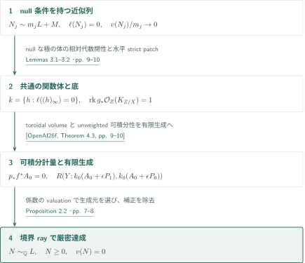
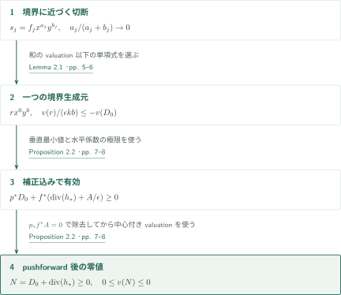
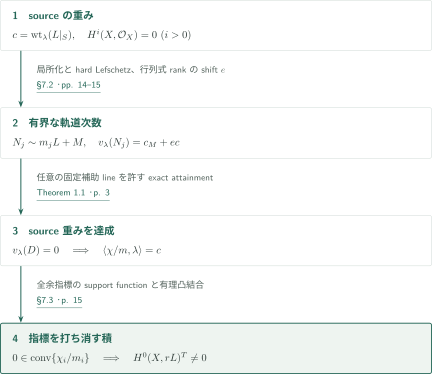
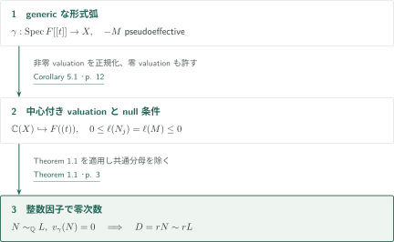
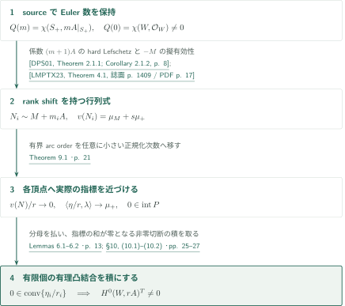
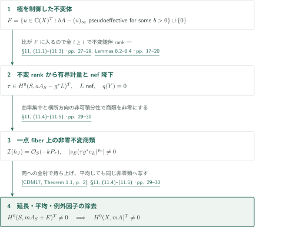
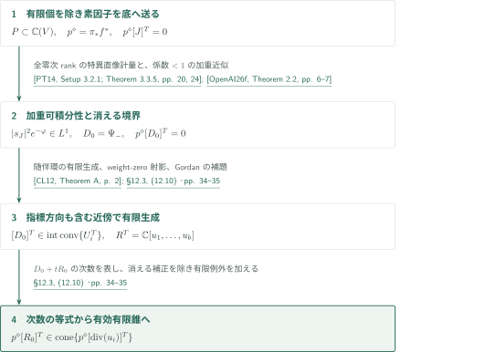

# Exact orders and invariant anticanonical linear systems

**有限生成環の境界rayで次数零を達成し、軌道次数から不変指標を得る**

$\operatorname{ord}(N_j)/m_j\to0$は、どの$N_j$も中心で消える可能性を排除しない。本稿は曲率のnull条件と有限生成を組み合わせ、同じ反標準$\mathbb Q$線形同値類にvaluationが厳密に零の有効因子を得る。その後、generic orbitに沿う次数を指標へ変換する。smooth semipositivityをnef性だけに弱める主張ではない。

## 1. 主要結果

### Theorem 1.1 — 零valuationの厳密達成

$X$を正次元$n$の滑らかな連結射影複素多様体とし、$L=-K_X$に滑らかな半正Hermitian計量を固定する。その曲率形式$\alpha$は$c_1(L)$を表し、最大複素rankを$\nu$とする。ample line bundle $G_0$に対し、

$$\ell(D)=\begin{cases}D\cdot L^\nu\cdot G_0^{n-\nu-1}&\nu<n,\\0&\nu=n\end{cases}$$

と置く。$v$を$X$上に中心を持つ$\mathbb C(X)$の離散valuation、または零valuationとし、$M$を**任意の固定line bundle**とする。有効整数因子$N_j$と正整数$m_j\to\infty$が

$$\begin{aligned}N_j&\sim m_jL+M,\\ \ell(N_j)&=0,\\ \frac{v(N_j)}{m_j}&\longrightarrow0.\end{aligned}$$

を満たせば、$N\geq0$、$N\sim_{\mathbb Q}L$、$v(N)=0$を満たす有理因子$N$が存在する。$-M$の擬有効性、$q(X)=0$、Euler数の条件はこの定理の仮定ではない。

<!-- cite:exact -->[Theorem 1.1 · p. 3](https://github.com/openai/math/blob/fd4aeeb2ee4fc729c18d98444fed42fd0529eeeb/preprints/Exact-orders-and-invariant-anticanonical-linear-systems-September-26-2026/main.pdf)<!-- /cite -->

### Theorem 1.2 — 自然な反標準線形化の不変切断

$X$を滑らかな連結射影複素多様体、$-K_X$をsmoothly semipositiveとし、すべての$i>0$で$H^i(X,\mathcal O_X)=0$を仮定する。$X$に作用する任意の代数トーラス$T$について、自然な反標準線形化に対し、ある正整数$m$で$H^0(X,-mK_X)^T\ne0$となる。

<!-- cite:invariant -->[Theorem 1.2 · p. 4](https://github.com/openai/math/blob/fd4aeeb2ee4fc729c18d98444fed42fd0529eeeb/preprints/Exact-orders-and-invariant-anticanonical-linear-systems-September-26-2026/main.pdf)<!-- /cite -->

### Corollary 5.1 — generic formal arc上の零次数

$X$を滑らかな整射影複素多様体、$L=-K_X$をsmoothly semipositiveとする。$-M$が擬有効なline bundle $M$とgeneric formal arc $\gamma:\operatorname{Spec}F[[t]]\to X$を取る。genericとはfraction pointが$X$の一般点に写ることをいう。有効整数因子$N_j\sim M+m_jL$、正整数$m_j\to\infty$について$v_\gamma(N_j)=o(m_j)$なら、ある整数$r>0$と有効整数因子$D\sim rL$が存在し、$v_\gamma(D)=0$となる。点多様体も含む。

<!-- cite:arc -->[Corollary 5.1 · p. 12](https://github.com/openai/math/blob/fd4aeeb2ee4fc729c18d98444fed42fd0529eeeb/preprints/Exact-orders-and-invariant-anticanonical-linear-systems-September-26-2026/main.pdf)<!-- /cite -->

### Proposition 10.1 — 非零Euler数の下での不変非消滅

$W$を滑らかな連結射影複素多様体、$q(W)=0$、$\chi(W,\mathcal O_W)\ne0$とする。$A=-K_W$は滑らかな半正値Hermitian計量を持ち、代数的トーラス$T$が$W$に忠実に作用し、同変線形化されたvery ample線束が存在すると仮定する。自然線形化について、ある整数$r>0$で$H^0(W,rA)^T\ne0$となる。

<!-- cite:additional-chi -->[Proposition 10.1 · p. 25](https://github.com/openai/math/blob/fd4aeeb2ee4fc729c18d98444fed42fd0529eeeb/preprints/Exact-orders-and-invariant-anticanonical-linear-systems-September-26-2026/main.pdf)<!-- /cite -->

### Theorem 11.1 — 固定した擬有効な同変誤差の除去

$X$を滑らかな連結射影複素多様体、$q(X)=0$、$A=-K_X$を滑らかに半正値とする。$T$は$X$に作用する代数的トーラスで、$A$に自然線形化を与える。固定した擬有効$T$-線形化線束$G$と非有界な正整数集合$I$について、各$j\in I$で$0\ne\delta_j\in H^0(X,jA-G)^T$が存在すれば、ある整数$m>0$について$H^0(X,mA)^T\ne0$となる。

<!-- cite:additional-conversion -->[Theorem 11.1 · p. 27](https://github.com/openai/math/blob/fd4aeeb2ee4fc729c18d98444fed42fd0529eeeb/preprints/Exact-orders-and-invariant-anticanonical-linear-systems-September-26-2026/main.pdf)<!-- /cite -->

### Proposition 12.1 — 制御された不変素因子を含む有限錐

$V$を滑らかな連結有理連結射影複素多様体とし、$L=-K_V$は滑らかな半正値計量を持つとする。$V$に代数的トーラス$T$が作用し、$L$には自然線形化を与える。このとき$\operatorname{Pic}^T(V)_{\mathbb R}$内に、不変有効有理因子の類で生成される有理多面錐が存在し、ある整数$a>0$で$aL-D$が擬有効になる**すべての不変素因子**$D$のdivisor linearizationの類$[D]^T$を含む。錐の生成元自体が同じ制御条件を満たすとは主張しない。

<!-- cite:additional-cone -->[Proposition 12.1 · p. 31](https://github.com/openai/math/blob/fd4aeeb2ee4fc729c18d98444fed42fd0529eeeb/preprints/Exact-orders-and-invariant-anticanonical-linear-systems-September-26-2026/main.pdf)<!-- /cite -->

## 図の矢印に付した引用

<!-- reference-guide -->
略号のない定理・補題・節・式番号は本原稿 [Exact orders and invariant anticanonical linear systems](https://github.com/openai/math/blob/fd4aeeb2ee4fc729c18d98444fed42fd0529eeeb/preprints/Exact-orders-and-invariant-anticanonical-linear-systems-September-26-2026/main.pdf) を指します。外部入力には次の略号を使います。

- [OpenAI26e](https://github.com/openai/math/blob/fd4aeeb2ee4fc729c18d98444fed42fd0529eeeb/preprints/Metric-descent-and-rank-preserving-contractions-September-26-2026/main.pdf) OpenAI — *Metric descent and rank-preserving contractions*：toroidal volume計量と消える有理補正。2026-09-26。
- [OpenAI26f](https://github.com/openai/math/blob/fd4aeeb2ee4fc729c18d98444fed42fd0529eeeb/preprints/Integrable-metrics-and-effectivity-with-controlled-boundary-September-26-2026/main.pdf) OpenAI — *Integrable metrics and effectivity with controlled boundary*：主経路の非加重有限生成と、有限錐経路の加重近似。2026-09-26。
- [DPS01](https://arxiv.org/pdf/math/0006205v2) J.-P. Demailly, T. Peternell, M. Schneider — *Pseudo-effective line bundles on compact Kähler manifolds*：smooth semipositive係数でのhard Lefschetz全射。arXiv:math/0006205v2。
- [CDM17](https://arxiv.org/pdf/1703.00292v2) Junyan Cao; Jean-Pierre Demailly; Shin-ichi Matsumura — *A general extension theorem for cohomology classes on non reduced analytic subspaces*：乗数イデアル商類の延長。arXiv:1703.00292v2。
- [CL12](https://arxiv.org/pdf/1009.3188v2) Paolo Cascini; Vladimir Lazić — *New outlook on the Minimal Model Program, I*：共通ample部分を持つ多重随伴環の有限生成。arXiv:1009.3188v2。
- [Leh15](https://arxiv.org/pdf/1109.4382v3) Brian Lehmann — *Numerical triviality and pullbacks*：全収縮曲線上の数値自明性から数値pullback。arXiv:1109.4382v3。
- [EKL95](https://arxiv.org/pdf/alg-geom/9408003v1) Lawrence Ein; Oliver Küchle; Robert Lazarsfeld — *Local positivity of ample line bundles*：very general点のSeshadri下界。arXiv:alg-geom/9408003v1。
- [PT14](https://arxiv.org/pdf/1409.5504v1) M. Păun, S. Takayama — *Positivity of twisted relative pluricanonical bundles and their direct images*：乗数イデアル条件を満たすrank一の特異直像計量。arXiv:1409.5504v1 (2014); published in 2018。
- [LMPTX23](https://ems.press/content/serial-article-files/31138) V. Lazić, S. Matsumura, T. Peternell, N. Tsakanikas, Z. Xie — *The Nonvanishing Problem for varieties with nef anticanonical bundle*：余接tensor内の行列式の負の擬有効性。Documenta Mathematica 28 (2023), 1393–1440。

各引用に結果番号とページを付します。誌面番号とPDF内の位置が異なる場合は両方を示します。GitHubの閲覧リンクではページ位置への自動移動を前提としません。
<!-- /reference-guide -->

## 2. Theorem 1.1 の証明 — nullな極の体から厳密達成へ

<!-- proof-target:1 -->証明対象：[Theorem 1.1 · p. 3](https://github.com/openai/math/blob/fd4aeeb2ee4fc729c18d98444fed42fd0529eeeb/preprints/Exact-orders-and-invariant-anticanonical-linear-systems-September-26-2026/main.pdf)<!-- /proof-target -->

**証明の道筋。** nullな極を持つ有理関数を一つの相対代数閉な体にまとめる。その底にrank一の体積計量と有限生成環を作る。二つの固定因子で元の列を表し、境界rayにある実際の生成元を選ぶ。補正を押し下げて消す最後の操作を次節で詳説する。

### 1. 曲率のnull条件が全rank一を保証する

$k=\{0\}\cup\{h\in\mathbb C(X)^\times:\ell((h)_\infty)=0\}$は体である。モニック方程式の係数の極が代数的元の極を抑えるので、$k$は相対代数閉で有限生成となる。$X\xleftarrow{\pi}Z\xrightarrow{g}Y$、$\mathbb C(Y)=k$を取る。底のvery ample系の比の極を一つのnull因子で抑えると$\ell(\pi_*g^*H)=0$となる。$E=K_{Z/X}$の一般ファイバー上の任意の切断をJacobian切断で割った関数もnullな極を持つため$k$に入り、**次数零の全随伴直像**のrankは一になる。

<!-- cite:null-field -->[Lemmas 3.1–3.2 · pp. 9–10](https://github.com/openai/math/blob/fd4aeeb2ee4fc729c18d98444fed42fd0529eeeb/preprints/Exact-orders-and-invariant-anticanonical-linear-systems-September-26-2026/main.pdf)<!-- /cite -->

### 2. 水平strict patchを可積分計量・有限生成へつなぐ

$\nu<n$では$\int_Z(\pi^*\alpha)^\nu\wedge g^*\omega_H\wedge\pi^*\omega_0^{n-\nu-1}=0$である。半正性により最高次数形式自体が零となり、最大rankの開集合で$\ker\pi^*\alpha\subseteq\ker dg$を得る。$\nu=n$の場合はこの包含が自明であり、いずれも小さいpatchで$\pi^*\alpha\geq c g^*\omega_H$となる。$\nu=0$なら正次元の底は起こらない。

体の拡大をしない双有理なequidimensional toroidalモデル$X\xleftarrow pW\xrightarrow fY$を準備する。Metric descentのTheorem 2.1は全rank一とこのpatchを入力とし、$p_*f^*A_0=0$となる有効有理補正と、$-K_Y+A_0$のunweighted可積分計量を供給する。その通常開集合上のstrict性から、Controlled boundaryのTheorem 4.3が有限個の方向に対する共通$\epsilon,k_0$と有限生成環を与える。patch上のstrict性を直接大域的下界と呼ぶことはしない。

<!-- cite:patch -->[§3.2, (3.4)–(3.6) · pp. 10–11](https://github.com/openai/math/blob/fd4aeeb2ee4fc729c18d98444fed42fd0529eeeb/preprints/Exact-orders-and-invariant-anticanonical-linear-systems-September-26-2026/main.pdf)<!-- /cite -->

<!-- cite:toroidal -->[&#91;OpenAI26e, Theorem 2.1, p. 7&#93;](https://github.com/openai/math/blob/fd4aeeb2ee4fc729c18d98444fed42fd0529eeeb/preprints/Metric-descent-and-rank-preserving-contractions-September-26-2026/main.pdf)<!-- /cite -->

<!-- cite:ring -->[&#91;OpenAI26f, Theorem 4.3, pp. 9–10&#93;](https://github.com/openai/math/blob/fd4aeeb2ee4fc729c18d98444fed42fd0529eeeb/preprints/Integrable-metrics-and-effectivity-with-controlled-boundary-September-26-2026/main.pdf)<!-- /cite -->

### 3. 任意の固定補助lineを二方向の問題にする

指数の異なる二つの入力$N_1,N_2$を取り、その指数を$u_1,u_2$とする。$u_1t_j^1+u_2t_j^2=1$、$t_j^1+t_j^2=1/m_j$を解くと、$D(\mathbf t)=t^1N_1+t^2N_2$に対し

$$N_j/m_j=D(\mathbf t_j)+\operatorname{div}_X(h_j),\qquad D(\mathbf t_*)\sim_{\mathbb Q}L$$

となる。$h_j$は有理関数の有理冪を形式的に扱う$k^\times\otimes_{\mathbb Z}\mathbb Q$の元であり、根を加える体の拡大ではない。主因子の極を$N_1,N_2$で抑えるから$h_j$はこの体に属する。$k=\mathbb C$なら固定台上の極限がそのまま所要の因子となる。それ以外では垂直最小係数が有限個の有理一次関数の最小値となるので、端点近くの短い有理区間上でaffineになる。両端の方向に有限生成を適用し、Proposition 2.2により$N\sim_{\mathbb Q}L$かつ$v(N)=0$を得る。

<!-- cite:exact-proof -->[§4, (4.1) · pp. 11–12](https://github.com/openai/math/blob/fd4aeeb2ee4fc729c18d98444fed42fd0529eeeb/preprints/Exact-orders-and-invariant-anticanonical-linear-systems-September-26-2026/main.pdf)<!-- /cite -->

## 3. Proposition 2.2 の証明 — 補正を消してからvaluationを比較する

<!-- proof-target:2 -->証明対象：[Proposition 2.2 · pp. 7–8](https://github.com/openai/math/blob/fd4aeeb2ee4fc729c18d98444fed42fd0529eeeb/preprints/Exact-orders-and-invariant-anticanonical-linear-systems-September-26-2026/main.pdf)<!-- /proof-target -->

<!-- statement:proposition-2-2 -->
### Proposition 2.2 — 境界生成元の双有理な帰還

$X,Y$を滑らかな整射影複素多様体、$W$を正規射影多様体、$p:W\to X$を双有理射、$f:W\to Y$を全射equidimensional射とする。$v$は$X$上に中心を持つ離散valuationまたは零valuation。$A\geq0$は$Y$上の有理因子で$p_*f^*A=0$、$D_0,D_1$は$X$上の有理Cartier因子とする。$D(t)=(1-t)D_0+tD_1$に対し

$$P(t)=\sum_Q\min_{E:f(E)=Q}\frac{\operatorname{coeff}_E p^*D(t)}{\operatorname{ord}_E(f^*Q)}Q=(1-t)P(0)+tP(1)$$

が$0\leq t\leq1$で成り立つと仮定する。有理数$t_j\in[0,1]$、$t_j\to0$、$h_j\in\mathbb C(Y)^\times\otimes\mathbb Q$が$N_j=D(t_j)+\operatorname{div}_X(h_j)\geq0$、$v(N_j)\to0$を満たすとする。ある$\epsilon\in\mathbb Q_{>0}$、整数$k>0$に対し$B_i=k(A+\epsilon P(i))$（$i=0,1$）がCartierで$R(Y;B_1,B_0)$が有限生成なら、$N\geq0$、$N\sim_{\mathbb Q}D_0$、$v(N)=0$を満たす有理因子が存在する。

<!-- cite:endpoint -->[Proposition 2.2 · pp. 7–8](https://github.com/openai/math/blob/fd4aeeb2ee4fc729c18d98444fed42fd0529eeeb/preprints/Exact-orders-and-invariant-anticanonical-linear-systems-September-26-2026/main.pdf)<!-- /cite -->
<!-- /statement -->

### 1. 有限個の実際の生成元から選ぶ

$t_j=a_j/d_j$、$d_j=a_j+b_j$とし、分母を除いて$s_j=h_j^{\epsilon kd_j}$を$bigraded$環の次数$(a_j,b_j)$の切断とする。各切断を生成元の単項式の和で書くと、和のvaluation以下の単項式が少なくとも一つある。境界ray外の生成元は第一次数を少なくとも一つ消費するので、その総寄与は$O(a_j)$。$a_j/d_j\to0$を使うと、次数$(0,b)$の生成元$r$で$v(r)/(\epsilon kb)\leq-v(D_0)$となるものが存在する。有限生成な数値錐だけでは、この有理関数$r$は得られない。

<!-- cite:generator -->[Lemma 2.1 · pp. 5–6](https://github.com/openai/math/blob/fd4aeeb2ee4fc729c18d98444fed42fd0529eeeb/preprints/Exact-orders-and-invariant-anticanonical-linear-systems-September-26-2026/main.pdf)<!-- /cite -->

### 2. 補正のvaluationを零と仮定しない

$h_*=r^{1/(\epsilon kb)}$と置く。生成元の切断不等式と垂直最小値から$p^*D_0+f^*(\operatorname{div}(h_*)+A/\epsilon)\geq0$を得る。水平係数の非負性は入力列の極限から従う。これを$p$で押し下げると補正が消え、$N=D_0+\operatorname{div}_X(h_*)\geq0$となる。ここで初めて中心付きvaluationの非負性を使い、$0\leq v(N)\leq0$と結ぶ。高次モデル上の例外補正が正のvaluationを持っていても支障はない。

<!-- cite:endpoint -->[Proposition 2.2 · pp. 7–8](https://github.com/openai/math/blob/fd4aeeb2ee4fc729c18d98444fed42fd0529eeeb/preprints/Exact-orders-and-invariant-anticanonical-linear-systems-September-26-2026/main.pdf)<!-- /cite -->

## 4. Theorem 1.2 の証明 — source重みから不変積へ

<!-- proof-target:3 -->証明対象：[Theorem 1.2 · p. 4](https://github.com/openai/math/blob/fd4aeeb2ee4fc729c18d98444fed42fd0529eeeb/preprints/Exact-orders-and-invariant-anticanonical-linear-systems-September-26-2026/main.pdf)<!-- /proof-target -->

**証明の道筋。** 各余指標のsource重みをcohomologyから取り出し、hard Lefschetzと行列式で有界な軌道次数を持つ因子列を作る。exact attainmentはsource重みを実際の切断の正規化指標として達成させ、有限個の指標の積で重み零を作る。

### 1. sourceの極端な重みを形式へ上げる

切断への左作用を$(g\cdot s)(x)=g(s(g^{-1}x))$とする。余指標$\lambda$のsource $S$上の自然な$L$の重みを$c$とすれば、非零の有効な余指標では$c>0$である。半正計量の軌道上の対数ノルムの凹性により$c$は固定成分の最大重みとなる。局所化公式の最高重みの係数は$\chi(S,(l-1)L|_S)$で、その零点値は1。従って大きい$l$で重み$(l-1)c$のcohomologyが非零となる。smooth係数$lL$のhard Lefschetzにより、固定次数の$\Omega_X^a\otimes lL$の固有切断へ持ち上がる。

<!-- cite:source -->[§7.1 · p. 14](https://github.com/openai/math/blob/fd4aeeb2ee4fc729c18d98444fed42fd0529eeeb/preprints/Exact-orders-and-invariant-anticanonical-linear-systems-September-26-2026/main.pdf)<!-- /cite -->

<!-- cite:hard-lefschetz -->[&#91;DPS01, Theorem 2.1.1; Corollary 2.1.2, p. 8&#93;](https://arxiv.org/pdf/math/0006205v2#page=8)<!-- /cite -->

### 2. 行列式rankのshiftを保持する

像の一般点でのspanのrankを$e$とし、その行列式を$\bigwedge^e\Omega_X^a$の中で飽和して$M$を固定する。原稿はCalabi–Yau計量と部分束の曲率評価から$\ell(M)\leq0$を示す。基底の$e-1$成分を固定して残りを変えると、$M+m_jL$の固有切断の重みは$(m_j-e)c$となる。$S$上の$M$の重み$c_M$を用いると

$$v_\lambda(N_j)=m_jc+c_M-(m_j-e)c=c_M+ec$$

は有界である。効果性と交点評価により$\ell(N_j)=0$。$-M$の擬有効性はこの構成で要求せず、Theorem 1.1の「任意の固定$M$」を使う。$m_jc$だけを書くと必要なrank shiftを失う。

<!-- cite:determinant -->[§7.2 · pp. 14–15](https://github.com/openai/math/blob/fd4aeeb2ee4fc729c18d98444fed42fd0529eeeb/preprints/Exact-orders-and-invariant-anticanonical-linear-systems-September-26-2026/main.pdf)<!-- /cite -->

### 3. exact orderを有限個の指標の積へ変える

generic orbitに対する$v_\lambda(\operatorname{div}s)=\mu-w$から、零次数の切断は正規化指標$\chi/m$について$\langle\chi/m,\lambda\rangle=c$を満たす。すべての余指標を動かすと、正規化切断重みの閉凸包のsupport functionはsource重み$c$に一致する。$c$が非零方向で正であるため零は内部に入り、有限個の実際の有理重みの凸包にも零が入る。有理凸結合の分母を除いて対応する固有切断を掛ければ、正の反標準倍数の非零不変切断を得る。自明トーラス・点は直接処理でき、非有効作用では有効商へ移る。有限部分を含む作用核は自然な反標準line上で自明なので、商からの不変性が元の$T$について成立する。

<!-- cite:orders -->[Lemmas 6.1–6.2 · p. 13](https://github.com/openai/math/blob/fd4aeeb2ee4fc729c18d98444fed42fd0529eeeb/preprints/Exact-orders-and-invariant-anticanonical-linear-systems-September-26-2026/main.pdf)<!-- /cite -->

<!-- cite:weights -->[§7.3 · p. 15](https://github.com/openai/math/blob/fd4aeeb2ee4fc729c18d98444fed42fd0529eeeb/preprints/Exact-orders-and-invariant-anticanonical-linear-systems-September-26-2026/main.pdf)<!-- /cite -->

## 5. Corollary 5.1 の証明 — 形式弧を中心付きvaluationへ

<!-- proof-target:4 -->証明対象：[Corollary 5.1 · p. 12](https://github.com/openai/math/blob/fd4aeeb2ee4fc729c18d98444fed42fd0529eeeb/preprints/Exact-orders-and-invariant-anticanonical-linear-systems-September-26-2026/main.pdf)<!-- /proof-target -->

**証明の道筋。** $-M$の擬有効性でnull条件を得る。genericityで関数体をLaurent級数体へ埋め込み、離散valuationまたは零valuationに帰着する。

### 1. null条件と中心を確認する

$\nu<n$では$\ell$は擬有効錐上非負、$\ell(L)=0$だから$0\leq\ell(N_j)=\ell(M)\leq0$となる。$\nu=n$では定義から$\ell=0$。generic arcは$\mathbb C(X)\hookrightarrow F((t))$を与え、$\operatorname{ord}_t$の像は零または$d\mathbb Z$である。閉点の像$\xi$で局所環が$F[[t]]$へ入り、単元の次数が零となるので中心条件が成立する。

<!-- cite:arc -->[Corollary 5.1 · p. 12](https://github.com/openai/math/blob/fd4aeeb2ee4fc729c18d98444fed42fd0529eeeb/preprints/Exact-orders-and-invariant-anticanonical-linear-systems-September-26-2026/main.pdf)<!-- /cite -->

### 2. 零次数を保って分母を除く

非零の場合は$d$で割り、零の場合もTheorem 1.1の許容するvaluationを使う。$o(m_j)$条件はこの固定正規化で保たれる。得られた$N\sim_{\mathbb Q}L$の係数と有理線形同値の分母を共通の$r>0$で除けば、$D=rN\sim rL$が有効整数因子で、弧の次数は厳密に零のままである。$X$が点なら零因子を使う。

<!-- cite:arc -->[Corollary 5.1 · p. 12](https://github.com/openai/math/blob/fd4aeeb2ee4fc729c18d98444fed42fd0529eeeb/preprints/Exact-orders-and-invariant-anticanonical-linear-systems-September-26-2026/main.pdf)<!-- /cite -->

## 6. Proposition 10.1 の証明 — Euler数から頂点を近似する

<!-- proof-target:5 -->証明対象：[Proposition 10.1 · p. 25](https://github.com/openai/math/blob/fd4aeeb2ee4fc729c18d98444fed42fd0529eeeb/preprints/Exact-orders-and-invariant-anticanonical-linear-systems-September-26-2026/main.pdf)<!-- /proof-target -->

主張は冒頭のProposition 10.1を参照する。Theorem 1.2より弱いコホモロジー仮定で、原典はTheorem 9.1の近似arc transferを使う。厳密な次数零の達成は必要ない。

### 1. 非零Euler数をsourceの係数に残す

固定成分上の$A=-K_W$のfiber characterの凸包を$P$とする。非零cocharacter $\lambda$に対し、source成分$S_+$の重み$\mu_+$はnef性とattracting decompositionにより$P$のsupport functionになる。忠実性と自然な反標準指標が接重みの和であることから$\mu_+>0$、従って$0$は$P$の内部にある。

固定点公式を無限大で展開すると、仮想コホモロジーの最大重み$m\mu_+$の係数は$Q(m)=\chi(S_+,mA|_{S_+})$である。他成分の負の法線重みがこの最高係数への寄与を消す。連結トーラスは$H^j(W,\mathcal O_W)$に自明に作用するため、$Q(0)=\chi(W,\mathcal O_W)\ne0$。Riemann–Rochとhard Lefschetzを係数$(m+1)A$で使い、一つの次数の捻った固有形式を非有界指数で得る。

<!-- cite:chi-proof -->[§10, (10.1)–(10.2) · pp. 25–27](https://github.com/openai/math/blob/fd4aeeb2ee4fc729c18d98444fed42fd0529eeeb/preprints/Exact-orders-and-invariant-anticanonical-linear-systems-September-26-2026/main.pdf)<!-- /cite --> <!-- cite:hard-lefschetz -->[&#91;DPS01, Theorem 2.1.1; Corollary 2.1.2, p. 8&#93;](https://arxiv.org/pdf/math/0006205v2#page=8)<!-- /cite -->

### 2. 行列式のrank shiftが固定arc orderになる

形式のgeneric spanのrankを$s$、飽和行列式を$M$とする。余接tensorへの包含とnef反標準性から$-M$は擬有効であり、$p=0$では自明束として処理する。固定した有限個の基底形式で補ってwedgeを取り、

$$N_i\sim M+m_iA,\qquad \text{section weight}=(m_i-s)\mu_+$$

を得る。generic orbit arcの次数はfiber weightからsection weightを引くので、$v(N_i)=\mu_M+s\mu_+$と一定になる。ここで$s$を落とすと次数計算が変わる。

<!-- cite:chi-proof -->[§10, (10.1)–(10.2) · pp. 25–27](https://github.com/openai/math/blob/fd4aeeb2ee4fc729c18d98444fed42fd0529eeeb/preprints/Exact-orders-and-invariant-anticanonical-linear-systems-September-26-2026/main.pdf)<!-- /cite --> <!-- cite:negative-det -->[&#91;LMPTX23, Theorem 4.1, 誌面 p. 1409 / PDF p. 17&#93;](https://ems.press/content/serial-article-files/31138)<!-- /cite --> <!-- cite:orders -->[Lemmas 6.1–6.2 · p. 13](https://github.com/openai/math/blob/fd4aeeb2ee4fc729c18d98444fed42fd0529eeeb/preprints/Exact-orders-and-invariant-anticanonical-linear-systems-September-26-2026/main.pdf)<!-- /cite -->

### 3. 各頂点に近い実際の指標を掛ける

Theorem 9.1は任意に小さい$v(N)/r$を持つ$rA$の切断を与える。その固有成分の一つは元の切断以下の次数を持ち、正規化指標は$\lambda$方向で$\mu_+$へ近づく。すべてのcocharacterに対する非負次数から、実際の正規化指標は$P$内にある。各頂点を露出する方向を選べばその頂点へ近づく指標が得られ、有限個を選んだ凸包にも$0$が残る。有理な凸結合の分母を払い、対応する非零切断の積を取ると自然不変切断になる。自明トーラスは近似transferの通常切断で終わる。

近似transfer自体は、固定因子のarc orderを零にし、nef reduction後の線束の一次jetを延長してbig性を得る経路である。その延長の全解析的証明はここでは再現しない。

<!-- cite:additional-approx -->[Theorem 9.1 · p. 21](https://github.com/openai/math/blob/fd4aeeb2ee4fc729c18d98444fed42fd0529eeeb/preprints/Exact-orders-and-invariant-anticanonical-linear-systems-September-26-2026/main.pdf)<!-- /cite --> <!-- cite:arc-transfer-proof -->[§9, (9.3)–(9.7) · pp. 22–24](https://github.com/openai/math/blob/fd4aeeb2ee4fc729c18d98444fed42fd0529eeeb/preprints/Exact-orders-and-invariant-anticanonical-linear-systems-September-26-2026/main.pdf)<!-- /cite --> <!-- cite:orders -->[Lemmas 6.1–6.2 · p. 13](https://github.com/openai/math/blob/fd4aeeb2ee4fc729c18d98444fed42fd0529eeeb/preprints/Exact-orders-and-invariant-anticanonical-linear-systems-September-26-2026/main.pdf)<!-- /cite -->

## 7. Theorem 11.1 の証明 — 不変な商類を直接延長する

<!-- proof-target:6 -->証明対象：[Theorem 11.1 · p. 27](https://github.com/openai/math/blob/fd4aeeb2ee4fc729c18d98444fed42fd0529eeeb/preprints/Exact-orders-and-invariant-anticanonical-linear-systems-September-26-2026/main.pdf)<!-- /proof-target -->

主張は冒頭のTheorem 11.1を参照する。ここでは不変性を最後まで保ち、頂点近似や一次jetの生成を経由しない。

### 1. 不変体が全正指数の不変rankを強制する

$F$を、ある$b>0$で$bA-(u)_\infty$が擬有効になる不変有理関数$u$と零からなる体とする。極の不等式と連結トーラスの有限軌道の自明性により、$F$は相対代数閉で有限生成である。底$Y$の作用は自明で、底の任意のample $H$に対し$bp^*A-f^*H$が擬有効になる。

三指数の不変比は$F$に入るため、$\delta_s/\delta_r$の水平次数は非負となる。normal equidimensionalモデル上で垂直最小値を引いて、底線束$B$と$\tau\in H^0(ap^*A-f^*B)^T$を得る。各底素因子上には$\tau$の次数零の成分がある。十分ampleな底捻りで不変随伴切断を大域化すると、その比の極も反標準で支配されるので$F$に入る。従って**すべての$l\ge1$**で不変随伴rankは一であり、通常rank一は仮定しない。

<!-- cite:controlled-field -->[§11, (11.1)–(11.3) · pp. 27–29](https://github.com/openai/math/blob/fd4aeeb2ee4fc729c18d98444fed42fd0529eeeb/preprints/Exact-orders-and-invariant-anticanonical-linear-systems-September-26-2026/main.pdf)<!-- /cite -->

### 2. 有界計量、nef reduction、局所的な極

Lemma 8.2ではsmoothな係数計量とcompact平均の直交商を使い、高次momentの極限から$B$の有界半正値計量を得る。$q(X)=0$は$q(Y)=0$を与える。Lemma 8.3でnef reductionをflat modelへ移し、全収縮曲線上の数値自明性を確保する。Lehmannの数値pullbackと$\operatorname{Pic}^0=0$によるtorsionの除去から、$B$はより小さい底のnef線束$L$へ**有理線形に**降りる。

$\dim Z=b>0$ならLemma 8.4で$B_k=kL+\epsilon H$に一点へ集中する曲率を作る。十分大きい$m=ap_0$に対し、式(11.4)の分解は$J=(m+1)A_S$上の不変計量$h_J$とneat analytic singularitiesを持つ$\Psi$を与え、

$$i\Theta_{h_J}+(1+t)i\partial\bar\partial\Psi\ge0\ (0\le t\le1),\qquad
\mathcal I(h_J)=\mathcal O_S(-kP_\tau)$$

となる。後者の等式は、残余特異因子の可積分性による十分性と、素因子上の整数極が可積分にならないことによる必要性を合わせたものである。

<!-- cite:nef-tools -->[Lemmas 8.2–8.4 · pp. 17–20](https://github.com/openai/math/blob/fd4aeeb2ee4fc729c18d98444fed42fd0529eeeb/preprints/Exact-orders-and-invariant-anticanonical-linear-systems-September-26-2026/main.pdf)<!-- /cite --> <!-- cite:lehmann -->[&#91;Leh15, Theorem 1.2, p. 1&#93;](https://arxiv.org/pdf/1109.4382v3#page=1)<!-- /cite --> <!-- cite:ekl -->[&#91;EKL95, Theorem 3.1, p. 14&#93;](https://arxiv.org/pdf/alg-geom/9408003v1#page=14)<!-- /cite --> <!-- cite:quotient-extension -->[§11, (11.4)–(11.5) · pp. 29–30](https://github.com/openai/math/blob/fd4aeeb2ee4fc729c18d98444fed42fd0529eeeb/preprints/Exact-orders-and-invariant-anticanonical-linear-systems-September-26-2026/main.pdf)<!-- /cite -->

### 3. 商類の非零性を保って平均し、例外因子を除く

Cao–Demailly–Matsumuraの延長定理は、$K_S+J$を係数に持つ$\mathcal I(h_J)/\mathcal I(h_Je^{-\Psi})$の大域商類を持ち上げる。選んだfiber近傍の$s_E(\tau g^*e_L)^{p_0}$は大きい方のイデアルに属し、fiber外で零と貼り合わさる。submersion点で係数がunitである一方、横断方向の極の指数$3b/2\ge b$は局所非可積分性を強制するため、この商類は非零である。

底作用と枠作用が自明なので商類は不変である。延長した切断をcompact torusで平均しても同じ非零商類へ写る。こうして$mA_S+E$の非零不変切断を得て、Jacobianの例外因子を除き$X$へ押し下げる。codimension二を越えて延長することで$mA$の大域不変切断を得る。底が点なら$\tau$の押下げで直ちに終わる。

<!-- cite:extension -->[&#91;CDM17, Theorem 1.1, p. 2&#93;](https://arxiv.org/pdf/1703.00292v2#page=2)<!-- /cite --> <!-- cite:quotient-extension -->[§11, (11.4)–(11.5) · pp. 29–30](https://github.com/openai/math/blob/fd4aeeb2ee4fc729c18d98444fed42fd0529eeeb/preprints/Exact-orders-and-invariant-anticanonical-linear-systems-September-26-2026/main.pdf)<!-- /cite -->

## 8. Proposition 12.1 の証明 — 指標も保持する有限有効錐

<!-- proof-target:7 -->証明対象：[Proposition 12.1 · p. 31](https://github.com/openai/math/blob/fd4aeeb2ee4fc729c18d98444fed42fd0529eeeb/preprints/Exact-orders-and-invariant-anticanonical-linear-systems-September-26-2026/main.pdf)<!-- /proof-target -->

主張は冒頭のProposition 12.1を参照する。これは一本のvaluationの零値達成ではなく、制御された不変素因子の類を一つの有限錐へ入れる主張である。

### 1. 有限個を除く素因子を同じ底から引く

制御された素因子上だけに極を持つ関数の体を$P$とする。有理連結性は$\operatorname{Pic}^0(V)=0$を与える。制御された素因子の類の有限個の基底を選ぶと、残りの素因子を含む主因子関係の関数は$P$に入り、その素因子は$P$の底へ垂直になる。適切なflat modelを経由して、$V$の素因子が底の余次元二以上へ写らないモデルを取る。

$p^\diamond=\pi_*f^*$はこのモデル上で定まり、底の修正の例外因子を**divisor linearizationも含めて**消す。有限個の例外を除き、制御された素因子$D$は底の素因子$Q$の$p^\diamond Q$に一致する。Lemma 12.2は全零次随伴rank一と有効不変補正$J$を与え、$p^\diamond[J]^T=0$となる。

<!-- cite:cone-field -->[§12.1; Lemma 12.2 · pp. 31–33](https://github.com/openai/math/blob/fd4aeeb2ee4fc729c18d98444fed42fd0529eeeb/preprints/Exact-orders-and-invariant-anticanonical-linear-systems-September-26-2026/main.pdf)<!-- /cite -->

### 2. 加重近似から消える補正を作る

底ample方向を支配する擬有効性とsmoothな計量を小さく混ぜ、$\mathcal I(h)=\mathcal O_U$かつ底方向にstrictな係数計量を取る。Păun–Takayamaの定理ではこの乗数イデアル条件が一般同型を保証する。rank一のfiber積分により$-K_Y+J$のstrict計量が得られるが、可積分なのは$|s_J|^2e^{-\varphi}$である。

Controlled boundaryのTheorem 2.2は、$\Psi=G/r-\sigma^*J-K_{Y'/Y}$の係数をすべて1未満にし、$D_0=\Psi_-$を$\sigma^*J$と例外台に支持させる。従って$p^\diamond[D_0]^T=0$である。この等式は通常Picard群だけの等式ではなく、標準不変有理切断の押下げによって指標成分も零になる。近似定理の通常有理線形同値をそのまま同変同値とみなすことはしない。

<!-- cite:pt-metric -->[&#91;PT14, Setup 3.2.1; Theorem 3.3.5, pp. 20, 24&#93;](https://arxiv.org/pdf/1409.5504v1#page=20)<!-- /cite --> <!-- cite:weighted-approx -->[&#91;OpenAI26f, Theorem 2.2, pp. 6–7&#93;](https://github.com/openai/math/blob/fd4aeeb2ee4fc729c18d98444fed42fd0529eeeb/preprints/Integrable-metrics-and-effectivity-with-controlled-boundary-September-26-2026/main.pdf)<!-- /cite --> <!-- cite:cone-metric -->[§12.2, (12.5)–(12.9) · pp. 33–34](https://github.com/openai/math/blob/fd4aeeb2ee4fc729c18d98444fed42fd0529eeeb/preprints/Exact-orders-and-invariant-anticanonical-linear-systems-September-26-2026/main.pdf)<!-- /cite -->

### 3. 不変環の有限生成を類の錐へ変換する

$D_0$の周囲の有理多面体を$\operatorname{Pic}^T(Y')_{\mathbb R}$内で選ぶ。小さい例外補正でample部分を確保し、各頂点の通常類を共通ample部分とSNC klt境界の随伴に書く。Cascini–Lazićの有限生成定理と共通可除指数により、多重次数環$R$は有限生成となる。境界の一般代表自体が不変である必要はなく、$T$作用は実際の線形化された線束が定める。

生成元を固有成分へ分け、weight-zeroへの射影とGordanの補題により$R^T$も有限個の多重斉次元$u_i$で生成される。任意の底の不変有効因子$R_0$に対し、小さい$t>0$で$[D_0]^T+t[R_0]^T$を頂点の有理凸結合にし、分母とtorsionを払う。その標準切断を$u_i$の多項式で表して、同じ多重次数の非零単項式を一つ選ぶ。必要なのは**次数の等式**であり、元の切断との零因子の一致ではない。

$p^\diamond[D_0]^T=0$を使えば$p^\diamond[R_0]^T$は$p^\diamond[\operatorname{div}u_i]^T$の錐に入る。最初に除いた有限個の不変素因子を加えれば、すべての制御された不変素因子を含む所要の有理多面錐となる。生成元は有効だが制御されるとは限らない。

<!-- cite:adjoint-fg -->[&#91;CL12, Theorem A, p. 2&#93;](https://arxiv.org/pdf/1009.3188v2#page=2)<!-- /cite --> <!-- cite:cone-ring -->[§12.3, (12.10) · pp. 34–35](https://github.com/openai/math/blob/fd4aeeb2ee4fc729c18d98444fed42fd0529eeeb/preprints/Exact-orders-and-invariant-anticanonical-linear-systems-September-26-2026/main.pdf)<!-- /cite -->

## 9. どの論文が、どの段階を担うか

| 入力 | 利用箇所 | 役割・必要条件 |
|---|---|---|
| Metric descent, Theorem 2.1 | §3.2、Theorem 1.1 | 全随伴rank一、equidimensional toroidalモデル、水平strict patchからunweighted計量と消える補正。 |
| Controlled boundary, Theorem 4.3 | §§3.2–4、Theorem 1.1 | 二つの有理因子方向に共通の$\epsilon,k_0$を選び、実際の因子の環を有限生成にする。 |
| DPSのhard Lefschetz | §7.1、Theorem 1.2 | $lL$のsmooth semipositivityで$(l-1)L$係数cohomologyの重みを形式へ上げる。 |

このexact attainment経路にはInvariant indicesの重み零指数定理を入力しない。局所化によるextremal weight計算は本文内で行う。§§8–12にはnef reductionによる近似的移送と不変変換、controlled primeの錐による別経路があり、§§13–14は幾何学的構造定理を使う降下である。これらをTheorem 1.1の直接入力として矢印にしない。

### 後半の追加出力と未詳説範囲

Proposition 10.1、Theorem 11.1、Proposition 12.1は上で主張と核心を説明した。以下は残る別経路の位置付けであり、その全証明は詳説しない。

- <!-- cite:additional-approx -->[Theorem 9.1 · p. 21](https://github.com/openai/math/blob/fd4aeeb2ee4fc729c18d98444fed42fd0529eeeb/preprints/Exact-orders-and-invariant-anticanonical-linear-systems-September-26-2026/main.pdf)<!-- /cite -->は、$q(W)=0$、滑らかな半正値性、$-M$の擬有効性と有界arc orderの下で、任意の$\delta>0$に対する正規化次数$<\delta$を与える。Corollary 5.1の厳密結論に包含されるが、nef reductionによる別証明である。
- <!-- cite:additional-rc -->[Theorem 12.4 · p. 36](https://github.com/openai/math/blob/fd4aeeb2ee4fc729c18d98444fed42fd0529eeeb/preprints/Exact-orders-and-invariant-anticanonical-linear-systems-September-26-2026/main.pdf)<!-- /cite -->は有理連結の場合の自然不変非消滅で、Theorem 1.2に包含される結論の別証明である。§13（p. 37）と§14（pp. 38–39）は通常非消滅へ降ろす二つの構成を記すが、その詳細は未確認である。

<!-- cite:additional-descent -->[§§13–14 · pp. 37–39](https://github.com/openai/math/blob/fd4aeeb2ee4fc729c18d98444fed42fd0529eeeb/preprints/Exact-orders-and-invariant-anticanonical-linear-systems-September-26-2026/main.pdf)<!-- /cite -->

## 10. 原典を読む入口と確認範囲

<!-- reading-list -->
- [Lemma 2.1 · pp. 5–6](https://github.com/openai/math/blob/fd4aeeb2ee4fc729c18d98444fed42fd0529eeeb/preprints/Exact-orders-and-invariant-anticanonical-linear-systems-September-26-2026/main.pdf) — 有限生成環から境界rayの元を実際に選ぶ。
- [Proposition 2.2 · pp. 7–8](https://github.com/openai/math/blob/fd4aeeb2ee4fc729c18d98444fed42fd0529eeeb/preprints/Exact-orders-and-invariant-anticanonical-linear-systems-September-26-2026/main.pdf) — 例外補正をpushforwardで消した後にvaluationを比較する。
- [Lemmas 3.1–3.2 · pp. 9–10](https://github.com/openai/math/blob/fd4aeeb2ee4fc729c18d98444fed42fd0529eeeb/preprints/Exact-orders-and-invariant-anticanonical-linear-systems-September-26-2026/main.pdf) — nullな極を持つ関数体と全rank一。
- [§4, (4.1) · pp. 11–12](https://github.com/openai/math/blob/fd4aeeb2ee4fc729c18d98444fed42fd0529eeeb/preprints/Exact-orders-and-invariant-anticanonical-linear-systems-September-26-2026/main.pdf) — 固定補助lineを二方向の因子へ符号付きで表す。
- [§7.1 · p. 14](https://github.com/openai/math/blob/fd4aeeb2ee4fc729c18d98444fed42fd0529eeeb/preprints/Exact-orders-and-invariant-anticanonical-linear-systems-September-26-2026/main.pdf) — sourceの極端なcohomological weight。
- [§7.3 · p. 15](https://github.com/openai/math/blob/fd4aeeb2ee4fc729c18d98444fed42fd0529eeeb/preprints/Exact-orders-and-invariant-anticanonical-linear-systems-September-26-2026/main.pdf) — exact orderから実際の指標と不変積へ。
- [§10, (10.1)–(10.2) · pp. 25–27](https://github.com/openai/math/blob/fd4aeeb2ee4fc729c18d98444fed42fd0529eeeb/preprints/Exact-orders-and-invariant-anticanonical-linear-systems-September-26-2026/main.pdf) — Euler数と行列式rank shiftから頂点近似へ。
- [§11, (11.4)–(11.5) · pp. 29–30](https://github.com/openai/math/blob/fd4aeeb2ee4fc729c18d98444fed42fd0529eeeb/preprints/Exact-orders-and-invariant-anticanonical-linear-systems-September-26-2026/main.pdf) — 不変商類を非零のまま持ち上げる。
- [§12.3, (12.10) · pp. 34–35](https://github.com/openai/math/blob/fd4aeeb2ee4fc729c18d98444fed42fd0529eeeb/preprints/Exact-orders-and-invariant-anticanonical-linear-systems-September-26-2026/main.pdf) — 次数の等式を指標付き有限錐に変換する。
<!-- /reading-list -->

著者の主張・証明経路を、固定版の§§1–7の本文に基づいて整理した。編集側では任意の固定$M$、中心付き／零valuation、全rank一、共通有限生成環、例外補正を消してからのvaluation評価、左作用の符号と行列式rank shiftを照合した。同カタログの非加重環・toroidal計量・加重近似の3入力、およびDPSの定理記述を照合した。追補ではCDM17の商類延長、CL12の多重随伴環、Leh15の数値pullback、EKL95のSeshadri下界、PT14の一般同型条件、LMPTX23の負の行列式の記述と使用箇所を確認した。局所化・attracting decomposition、Calabi–Yau、toroidal化の外部定理の全記述照合は未完了であり、追補では§§10–12.3の主要3結果と§8の入力、§9のtransfer核心も読解した。外部のnef reduction存在・Hilbert/flattening・Picard torsionの全記述再照合と、Theorem 12.4・§§13–14の証明詳細は範囲外である。全証明の独立再検証や専門家査読ではない。
