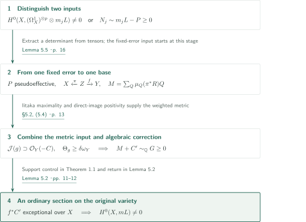
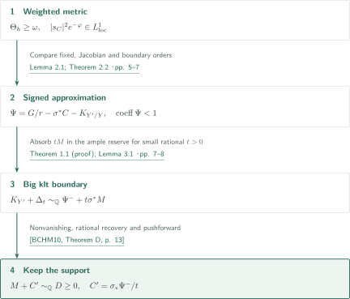
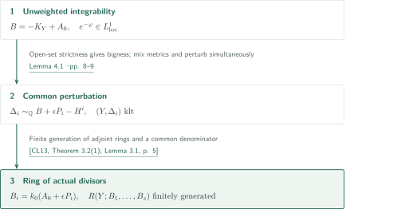
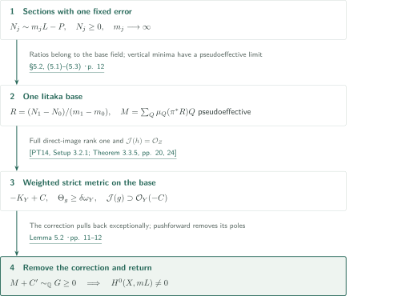
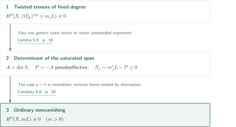
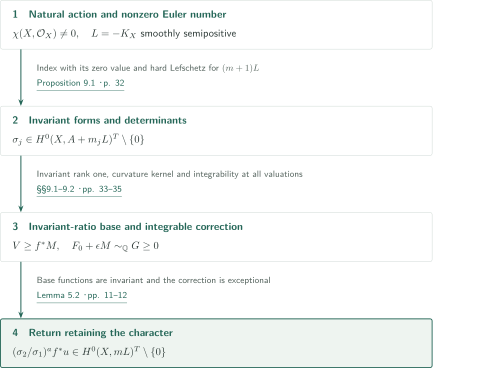

# Integrable metrics and effectivity with controlled boundary

**Turn integrability into a klt boundary, then remove an exceptional correction to return an anticanonical section**

The basic route derives effectivity with controlled correction support from integrability of a distinguished section, and then removes a fixed pseudoeffective error. Smooth semipositivity means that $L=-K_X$ admits a smooth Hermitian metric of semipositive curvature; nefness alone is not substituted for this hypothesis. The singular metrics on auxiliary bases satisfy two distinct conditions: weighted and unweighted integrability.

## 1. Main results

### Theorem 1.1 — Effectivity modulo a prescribed boundary

Let $Y$ be a smooth projective complex variety of positive dimension and $C\geq0$ an integral divisor. Suppose $-K_Y+C$ has a singular Hermitian metric $h$ whose curvature dominates a Kähler form and for which $\mathcal J(h)\supseteq\mathcal O_Y(-C)$. For every pseudoeffective rational divisor $M$, there is an effective rational divisor $C'$ supported on $C$ such that $M+C'$ is rationally linearly equivalent to an effective rational divisor.

<!-- cite:boundary -->[Theorem 1.1 · p. 2](https://github.com/openai/math/blob/fd4aeeb2ee4fc729c18d98444fed42fd0529eeeb/preprints/Integrable-metrics-and-effectivity-with-controlled-boundary-September-26-2026/main.pdf)<!-- /cite -->

### Theorem 4.3 — Finite generation near a correction divisor

Let $Y$ be smooth projective of positive dimension and $A_0$ a rational divisor. Suppose $-K_Y+A_0$ has a semipositive singular metric whose squared nonvanishing local frame norms are locally integrable, smooth and strictly positive on a nonempty ordinary open set. For any finite list of rational divisors $P_1,\ldots,P_s$, there are a common $\epsilon\in\mathbb Q_{>0}$ and an integer $k_0>0$ such that the actual divisors $B_i=k_0(A_0+\epsilon P_i)$ are Cartier and

$$R(Y;B_1,\ldots,B_s)=\bigoplus_{(a_1,\ldots,a_s)\in\mathbb N^s}H^0\!\left(Y,\mathcal O_Y\!\left(\sum_i a_iB_i\right)\right)$$

is a finitely generated $\mathbb C$-algebra. Effectivity of $A_0$ is not assumed here.

<!-- cite:ring -->[Theorem 4.3 · pp. 9–10](https://github.com/openai/math/blob/fd4aeeb2ee4fc729c18d98444fed42fd0529eeeb/preprints/Integrable-metrics-and-effectivity-with-controlled-boundary-September-26-2026/main.pdf)<!-- /cite -->

### Theorem 5.1 — Removing one fixed pseudoeffective error

Let $X$ be smooth connected projective over $\mathbb C$, and let $L=-K_X$ be smoothly semipositive. Fix a pseudoeffective Cartier divisor $P$. If effective integral divisors $N_j\sim m_jL-P$ exist for unbounded positive integers $m_j$, then $H^0(X,mL)\ne0$ for some positive integer $m$. Neither effectivity of $P$ nor $L\not\equiv0$ is assumed.

<!-- cite:conversion -->[Theorem 5.1 · p. 11](https://github.com/openai/math/blob/fd4aeeb2ee4fc729c18d98444fed42fd0529eeeb/preprints/Integrable-metrics-and-effectivity-with-controlled-boundary-September-26-2026/main.pdf)<!-- /cite -->

### Corollary 5.6 — Conversion of twisted differentials of fixed degree

For $X,L$ as in Theorem 5.1, if $H^0(X,(\Omega_X^1)^{\otimes p}\otimes mL)\ne0$ for one fixed integer $p\geq0$ and unbounded positive integers $m$, a positive multiple of $L$ has a nonzero section. The same conclusion holds with $\Omega_X^p$ in place of the tensor power. This is ordinary nonvanishing; the conclusion does not assert invariance.

<!-- cite:tensor -->[Corollary 5.6 · p. 16](https://github.com/openai/math/blob/fd4aeeb2ee4fc729c18d98444fed42fd0529eeeb/preprints/Integrable-metrics-and-effectivity-with-controlled-boundary-September-26-2026/main.pdf)<!-- /cite -->

### Theorem 9.2 — Invariant nonvanishing for the natural linearization

Let $X$ be smooth connected projective over $\mathbb C$ with $\chi(X,\mathcal O_X)\ne0$. If an algebraic torus $T$ acts on $X$ and $L=-K_X$ is smoothly semipositive, then $H^0(X,mL)^T\ne0$ for some positive integer $m$, for the natural tangent-determinant linearization.

<!-- cite:invariant -->[Theorem 9.2 · pp. 32–35](https://github.com/openai/math/blob/fd4aeeb2ee4fc729c18d98444fed42fd0529eeeb/preprints/Integrable-metrics-and-effectivity-with-controlled-boundary-September-26-2026/main.pdf)<!-- /cite -->

## References on the arrows

<!-- reference-guide -->
Unprefixed theorem, lemma, section and equation numbers refer to [Integrable metrics and effectivity with controlled boundary](https://github.com/openai/math/blob/fd4aeeb2ee4fc729c18d98444fed42fd0529eeeb/preprints/Integrable-metrics-and-effectivity-with-controlled-boundary-September-26-2026/main.pdf). External inputs use the following keys.

- [BCHM10](https://arxiv.org/pdf/math/0610203v2) C. Birkar, P. Cascini, C. D. Hacon, J. McKernan — *Existence of minimal models for varieties of log general type*: Nonvanishing for an adjoint with big klt boundary. arXiv:math/0610203v2.
- [CL13](https://arxiv.org/pdf/1005.0614v3) A. Corti, V. Lazić — *New outlook on the Minimal Model Program, II*: Finite generation of multigraded adjoint rings and Veronese subrings. arXiv:1005.0614v3.
- [PT14](https://arxiv.org/pdf/1409.5504v1) M. Păun, S. Takayama — *Positivity of twisted relative pluricanonical bundles and their direct images*: Extension of direct-image metrics when the multiplier-ideal inclusion is generically an isomorphism. arXiv:1409.5504v1 (2014); published in 2018.
- [OpenAI26b](https://github.com/openai/math/blob/fd4aeeb2ee4fc729c18d98444fed42fd0529eeeb/preprints/Invariant-anticanonical-indices-and-conversion-of-twisted-differentials-September-26-2026/main.pdf) OpenAI — *Invariant anticanonical indices and conversion of twisted differentials*: Invariant index including its value at zero. 2026-09-26.
- [OpenAI26e](https://github.com/openai/math/blob/fd4aeeb2ee4fc729c18d98444fed42fd0529eeeb/preprints/Metric-descent-and-rank-preserving-contractions-September-26-2026/main.pdf) OpenAI — *Metric descent and rank-preserving contractions*: Toroidal volume metric for the alternative ordinary conversion. 2026-09-26.
- [LMPTX23](https://ems.press/content/serial-article-files/31138) V. Lazić, S. Matsumura, T. Peternell, N. Tsakanikas, Z. Xie — *The Nonvanishing Problem for varieties with nef anticanonical bundle*: Pseudoeffectivity of the negative first Chern class of saturated cotangent-tensor subsheaves. Documenta Mathematica 28 (2023), 1393–1440.
- [DPS01](https://arxiv.org/pdf/math/0006205v2) J.-P. Demailly, T. Peternell, M. Schneider — *Pseudo-effective line bundles on compact Kähler manifolds*: Hard Lefschetz surjectivity with smooth semipositive coefficients. arXiv:math/0006205v2.

Each citation gives the result and pages. When printed pagination differs from the PDF position, both are shown. GitHub previews do not automatically jump to the cited page.
<!-- /reference-guide -->

## 2. Theorem 5.1 — Proof overview of the main theorem

<!-- proof-target:1 -->Proof target：[Theorem 5.1 · p. 11](https://github.com/openai/math/blob/fd4aeeb2ee4fc729c18d98444fed42fd0529eeeb/preprints/Integrable-metrics-and-effectivity-with-controlled-boundary-September-26-2026/main.pdf)<!-- /proof-target -->

**Proof route.** Start with the fixed-error input of [Theorem 5.1](#theorem-5-1). Corollary 5.6 first adds determinant extraction when starting from twisted tensors. The analytic input on the base meets the supported algebraic output of Theorem 1.1; returning after removing the exceptional correction completes the argument.

### 1. What remains fixed and what is converted on the base

The determinant fixes one pseudoeffective error $P$, while the Iitaka field places the ratios of all $N_j$ over one base. The vertical-minimum divisor $M$ and the metric on $-K_Y+C$ supplied by rank-one direct image have different roles and meet in Theorem 1.1. Details are separated into [supported effectivity](#proof-1), [fixed-error conversion](#proof-3), and [tensor extraction](#proof-4).

<!-- cite:conversion -->[Theorem 5.1 · p. 11](https://github.com/openai/math/blob/fd4aeeb2ee4fc729c18d98444fed42fd0529eeeb/preprints/Integrable-metrics-and-effectivity-with-controlled-boundary-September-26-2026/main.pdf)<!-- /cite -->

### 2. Treat rings and invariance as distinct outputs

[Theorem 4.3](#theorem-4-3) produces a finitely generated ring from unweighted integrability, supplying the subsequent Exact orders manuscript. This is not an output required by the main proof of ordinary conversion in 5.1. [Theorem 9.2](#theorem-9-2) chooses an invariant ratio field and corrects its rational section by invariant base functions. Its [invariant return](#proof-5) is followed separately; invariance is not inferred from ordinary conversion.

<!-- cite:ring -->[Theorem 4.3 · pp. 9–10](https://github.com/openai/math/blob/fd4aeeb2ee4fc729c18d98444fed42fd0529eeeb/preprints/Integrable-metrics-and-effectivity-with-controlled-boundary-September-26-2026/main.pdf)<!-- /cite -->

<!-- cite:invariant -->[Theorem 9.2 · pp. 32–35](https://github.com/openai/math/blob/fd4aeeb2ee4fc729c18d98444fed42fd0529eeeb/preprints/Integrable-metrics-and-effectivity-with-controlled-boundary-September-26-2026/main.pdf)<!-- /cite -->

## 3. Proof of Theorem 1.1 — From weighted approximation to supported nonvanishing

<!-- proof-target:2 -->Proof target：[Theorem 1.1 · p. 2](https://github.com/openai/math/blob/fd4aeeb2ee4fc729c18d98444fed42fd0529eeeb/preprints/Integrable-metrics-and-effectivity-with-controlled-boundary-September-26-2026/main.pdf)<!-- /proof-target -->

**Proof route.** Subtract the boundary and Jacobian from the approximation's fixed part, producing a signed divisor. Place its positive part in a big klt boundary. This effective boundary, rather than the signed divisor itself, is the nonvanishing input.

### 1. Integrability gives strict coefficient inequalities

Subtract a small ample rational divisor $A$ from the metric and resolve $|r(-K_Y+C-A)|$ into its fixed part $G$ and a free part. Lemma 2.1 uses Nadel vanishing, regularity, and comparison from point extension. At a prime with fixed, boundary, and Jacobian orders $a,j,k$, integrability gives $a/r-j-k<1$. Thus the positive part of $\Psi=G/r-\sigma^*C-K_{Y'/Y}$ is klt, while its negative part is supported on the boundary and exceptional locus. The condition $|s_C|^2e^{-\varphi}\in L^1$ must not be replaced by $e^{-\varphi}\in L^1$.

<!-- cite:approximation -->[Lemma 2.1; Theorem 2.2 · pp. 5–7](https://github.com/openai/math/blob/fd4aeeb2ee4fc729c18d98444fed42fd0529eeeb/preprints/Integrable-metrics-and-effectivity-with-controlled-boundary-September-26-2026/main.pdf)<!-- /cite -->

### 2. Insert $M$ into the ample reserve and retain only the correction

Choose small rational $t>0$ with $A+tM$ ample. General free and ample representatives with small coefficients give $\Delta_t\geq0$ such that $(Y',\Delta_t)$ is klt, $\Delta_t$ is big, and $K_{Y'}+\Delta_t\sim_{\mathbb Q}\Psi^-+t\sigma^*M$ is pseudoeffective. Big-boundary nonvanishing gives real-linear effectivity. A rational solution to finitely many rational coefficient inequalities recovers rational linear equivalence. Pushforward gives $C'=\sigma_*\Psi^-/t$ supported on $C$. The approximation can be fixed before $M$, whereas $t$ and $C'$ may depend on $M$.

<!-- cite:bchm -->[&#91;BCHM10, Theorem D, p. 13&#93;](https://arxiv.org/pdf/math/0610203v2#page=13)<!-- /cite -->

<!-- cite:boundary-proof -->[Theorem 1.1 (proof); Lemma 3.1 · pp. 7–8](https://github.com/openai/math/blob/fd4aeeb2ee4fc729c18d98444fed42fd0529eeeb/preprints/Integrable-metrics-and-effectivity-with-controlled-boundary-September-26-2026/main.pdf)<!-- /cite -->

## 4. Proof of Theorem 4.3 — From an unweighted metric to adjoint rings

<!-- proof-target:3 -->Proof target：[Theorem 4.3 · pp. 9–10](https://github.com/openai/math/blob/fd4aeeb2ee4fc729c18d98444fed42fd0529eeeb/preprints/Integrable-metrics-and-effectivity-with-controlled-boundary-September-26-2026/main.pdf)<!-- /proof-target -->

**Proof route.** Strictness on an ordinary open set gives bigness. Mixing metrics produces a global strict lower bound. Simultaneous perturbations retaining unweighted integrability supply several klt boundaries with a common ample reserve.

### 1. A metric allowing one common perturbation

Lemma 4.1 uses the volume criterion, strong openness, small-exponent integrability, and Hölder's inequality to mix the original metric with a big metric by a small rational fraction. Global strictness and frame integrability coexist, so smooth metrics in the finitely many directions $P_i$ can be added or subtracted. A common ample $H'$ and $\epsilon>0$ give effective klt divisors $\Delta_i\sim_{\mathbb Q}-K_Y+A_0+\epsilon P_i-H'$. The weighted hypothesis of Theorem 1.1 alone does not replace this step.

<!-- cite:neighborhood -->[Lemma 4.1 · pp. 8–9](https://github.com/openai/math/blob/fd4aeeb2ee4fc729c18d98444fed42fd0529eeeb/preprints/Integrable-metrics-and-effectivity-with-controlled-boundary-September-26-2026/main.pdf)<!-- /cite -->

### 2. Transfer finite generation to actual Cartier divisors

Apply multigraded adjoint finite generation to $K_Y+\Delta_i+H'$. A common $k_0$ clears divisors and rational linear equivalences. Multiplication by the rational functions defining these principal adjustments identifies the desired ring with a Veronese ring, compatibly with all multidegrees. Numerical equivalence would not supply this identification. This is the finite-generation input supplied to the subsequent Exact orders manuscript.

<!-- cite:fg -->[&#91;CL13, Theorem 3.2(1); Lemma 3.1, p. 5&#93;](https://arxiv.org/pdf/1005.0614v3#page=5)<!-- /cite -->

## 5. Proof of Theorem 5.1 — Collecting the error in one Iitaka field

<!-- proof-target:4 -->Proof target：[Theorem 5.1 · p. 11](https://github.com/openai/math/blob/fd4aeeb2ee4fc729c18d98444fed42fd0529eeeb/preprints/Integrable-metrics-and-effectivity-with-controlled-boundary-September-26-2026/main.pdf)<!-- /proof-target -->

**Proof route.** One Iitaka base for $N_1$ expresses the differences of all $N_j$ using base principal divisors. Vertical minima define a pseudoeffective divisor $M$. A rank-one direct image supplies the metric for Theorem 1.1; its exceptional correction can then be removed.

### 1. Ratio field, vertical minima, and rank one

After flattening, prepare $X\xleftarrow{\pi}Z\xrightarrow{f}Y$ so that primes mapping into base codimension at least two are $\pi$-exceptional. Flatness of the final smooth $Z$ is not asserted. With $R=(N_1-N_0)/(m_1-m_0)$, ratios in the same linear system belong to the base field, giving

$$\pi^*N_j=\pi^*N_0+(m_j-m_0)(\pi^*R+f^*Q_j),\qquad Q_j\sim_{\mathbb Q}0.$$

The horizontal part is nonnegative. The divisor $M$ formed from $\mu_Q(\pi^*R)=\min_{D\mapsto Q}\operatorname{ord}_D(\pi^*R)/\operatorname{ord}_D(f^*Q)$ is pseudoeffective by dividing a fixed effective error by $m_j-m_0$ and taking limits. If $Y$ is a point, effectivity is already obtained; if $\dim Y=\dim X$, $L$ is big. In intermediate dimension, direct-image rank at least two for $E=K_{Z/X}$ would, after an ample base twist, produce a ratio enlarging the Iitaka field, a contradiction.

<!-- cite:iitaka -->[§5.2, (5.1)–(5.3) · p. 12](https://github.com/openai/math/blob/fd4aeeb2ee4fc729c18d98444fed42fd0529eeeb/preprints/Integrable-metrics-and-effectivity-with-controlled-boundary-September-26-2026/main.pdf)<!-- /cite -->

### 2. Build a strict metric and remove the correction's poles

The identities $b\pi^*N_1\sim f^*H+D_1$ and $N_1\sim m_1L-P$ give a singular metric on $\pi^*L$ dominating a positive base curvature. A small mixture with its smooth semipositive metric yields $\Theta_h\geq\delta f^*\omega_Y$ and $\mathcal J(h)=\mathcal O_Z$ on the **total space**. The multiplier-ideal direct-image inclusion is therefore an isomorphism, so Păun–Takayama extension applies to the ordinary direct image. Its rank-one reflexive hull is $\mathcal O_Y(-K_Y+C)$. Here $C$ is integral and effective, $f^*C$ is exceptional, and Fubini gives integrability of $s_C$. Theorem 1.1 provides $M+C'\sim_{\mathbb Q}G\geq0$. Push forward $\pi^*R+f^*(G-M-C')$: possible negative coefficients lie only on exceptional primes, yielding an actual nonzero section on $X$.

<!-- cite:pt -->[&#91;PT14, Setup 3.2.1; Theorem 3.3.5, pp. 20, 24&#93;](https://arxiv.org/pdf/1409.5504v1#page=20)<!-- /cite -->

<!-- cite:direct-image -->[§5.2, (5.4) · p. 13](https://github.com/openai/math/blob/fd4aeeb2ee4fc729c18d98444fed42fd0529eeeb/preprints/Integrable-metrics-and-effectivity-with-controlled-boundary-September-26-2026/main.pdf)<!-- /cite -->

<!-- cite:return -->[Lemma 5.2 · pp. 11–12](https://github.com/openai/math/blob/fd4aeeb2ee4fc729c18d98444fed42fd0529eeeb/preprints/Integrable-metrics-and-effectivity-with-controlled-boundary-September-26-2026/main.pdf)<!-- /cite -->

The alternative route in §5.3 retains the original smooth coefficient metric. The toroidal volume theorem supplies a rational correction $A_0$ and an unweighted integrable metric, requiring full direct-image rank one and a horizontal strictness patch. Strictness on an ordinary open set is not a global Kähler lower bound; the metric mixing in Corollary 5.4 bridges the distinction.

<!-- cite:toroidal -->[&#91;OpenAI26e, Theorem 2.1, p. 7&#93;](https://github.com/openai/math/blob/fd4aeeb2ee4fc729c18d98444fed42fd0529eeeb/preprints/Metric-descent-and-rank-preserving-contractions-September-26-2026/main.pdf)<!-- /cite -->

<!-- cite:alternative -->[§5.3; Corollary 5.4 · pp. 13–15](https://github.com/openai/math/blob/fd4aeeb2ee4fc729c18d98444fed42fd0529eeeb/preprints/Integrable-metrics-and-effectivity-with-controlled-boundary-September-26-2026/main.pdf)<!-- /cite -->

## 6. Proof of Corollary 5.6 — Extracting a fixed error by determinants

<!-- proof-target:5 -->Proof target：[Corollary 5.6 · p. 16](https://github.com/openai/math/blob/fd4aeeb2ee4fc729c18d98444fed42fd0529eeeb/preprints/Integrable-metrics-and-effectivity-with-controlled-boundary-September-26-2026/main.pdf)<!-- /proof-target -->

**Proof route.** Saturate the span inside one fixed tensor bundle and fix its determinant. Replacing one generic basis vector by a section with large twist preserves unbounded exponents.

### 1. Fix one determinant

Saturate the generic span of the images of $\mathcal O_X(-mL)\to(\Omega_X^1)^{\otimes p}$ to obtain $S$, and set $A=(\bigwedge^{\mathrm{rk}S}S)^{**}$. The manuscript uses the cotangent-subsheaf consequence of generic tangent nefness to make $P=-A$ pseudoeffective. Replacing one member of a finite generic basis produces determinant sections valued in this same $A$ at unbounded positive twists. Saturation and reflexive extension ensure that the sections are global.

<!-- cite:generic-nefness -->[&#91;LMPTX23, Theorem 4.1, print p. 1409 / PDF p. 17&#93;](https://ems.press/content/serial-article-files/31138)<!-- /cite -->

<!-- cite:determinant -->[Lemma 5.5 · p. 16](https://github.com/openai/math/blob/fd4aeeb2ee4fc729c18d98444fed42fd0529eeeb/preprints/Integrable-metrics-and-effectivity-with-controlled-boundary-September-26-2026/main.pdf)<!-- /cite -->

### 2. Distinguish tensors, exterior forms, and degree zero

For $p>0$, apply Theorem 5.1. For $p=0$, an input section already proves the conclusion. In characteristic zero, alternation embeds exterior forms in tensor powers. The output is nonvanishing for some positive multiple, not every positive integer. Even invariant determinant sections do not allow the ordinary Theorem 5.1 to assert invariant nonvanishing.

<!-- cite:tensor -->[Corollary 5.6 · p. 16](https://github.com/openai/math/blob/fd4aeeb2ee4fc729c18d98444fed42fd0529eeeb/preprints/Integrable-metrics-and-effectivity-with-controlled-boundary-September-26-2026/main.pdf)<!-- /cite -->

## 7. Proof of Theorem 9.2 — Retaining an invariant rational section throughout

<!-- proof-target:6 -->Proof target：[Theorem 9.2 · pp. 32–35](https://github.com/openai/math/blob/fd4aeeb2ee4fc729c18d98444fed42fd0529eeeb/preprints/Integrable-metrics-and-effectivity-with-controlled-boundary-September-26-2026/main.pdf)<!-- /proof-target -->

**Proof route.** The invariant index retaining its zero value supplies invariant forms. Keep their invariant ratio field and an invariant rational section, and perform the correction using invariant base functions.

### 1. From the invariant index to base curvature

A connected torus acts trivially on $H^q(X,\mathcal O_X)$, so the zero-index value is $\chi(X,\mathcal O_X)\ne0$. The index theorem and compact-averaged hard Lefschetz give invariant sections in $H^0(X,\Omega_X^p\otimes(m+1)L)^T$ for fixed $p$ and unbounded $m$. The shift by one is required by $K_X+(m+1)L=mL$. Determinant sections $\sigma_j$ define the invariant ratio field; its relative algebraic closure remains invariant by connectedness. Lemma 9.3 and semipositive linear algebra put the curvature kernel in the vertical directions and give a horizontal strictness patch. The invariant direct image has rank one; full direct-image rank one is not asserted here.

<!-- cite:index -->[&#91;OpenAI26b, Theorem 1.1, p. 1&#93;](https://github.com/openai/math/blob/fd4aeeb2ee4fc729c18d98444fed42fd0529eeeb/preprints/Invariant-anticanonical-indices-and-conversion-of-twisted-differentials-September-26-2026/main.pdf)<!-- /cite -->

<!-- cite:hard-lefschetz -->[&#91;DPS01, Theorem 2.1.1; Corollary 2.1.2, p. 8&#93;](https://arxiv.org/pdf/math/0006205v2#page=8)<!-- /cite -->

<!-- cite:invariant-forms -->[Proposition 9.1 · p. 32](https://github.com/openai/math/blob/fd4aeeb2ee4fc729c18d98444fed42fd0529eeeb/preprints/Integrable-metrics-and-effectivity-with-controlled-boundary-September-26-2026/main.pdf)<!-- /cite -->

### 2. Check all valuations and return the invariant section

On a separate simplicial toroidal model $W$, put $V=(\operatorname{div}(p^*\sigma_2)-\operatorname{div}(p^*\sigma_1))/(m_2-m_1)$ and take its vertical minima $M$. Then $V\geq f^*M$, and $M$ is pseudoeffective. The smooth orthogonal quotient metric of the invariant direct image gives a volume density $\rho$. Its correction $F_0$ satisfies $f^*F_0\leq E_W=K_{W/X}$. On a resolution $h:W'\to W$, all coefficients of

$$K_{W'/W}+h^*(E_W-f^*F_0)$$

are greater than $-1$: the first term uses the klt property of $W$, and the second is effective. This verifies unweighted integrability including exceptional divisors over higher-codimension centers. Corollary 5.4 gives $F_0+\epsilon M\sim_{\mathbb Q}G\geq0$. Return a power of $\sigma_2/\sigma_1$ multiplied by a base function. Both factors are invariant, so the extended section after removing the exceptional correction remains invariant for the natural linearization.

<!-- cite:invariant-base -->[§§9.1–9.2 · pp. 33–35](https://github.com/openai/math/blob/fd4aeeb2ee4fc729c18d98444fed42fd0529eeeb/preprints/Integrable-metrics-and-effectivity-with-controlled-boundary-September-26-2026/main.pdf)<!-- /cite -->

## 8. Which papers supply which steps

| Input | Application | Role and checking scope |
|---|---|---|
| BCHM big-boundary nonvanishing | Theorem 1.1; Corollary 5.4 | Matched the klt, big-boundary and pseudoeffective-adjoint hypotheses; input proof not verified. |
| Corti–Lazić adjoint rings | Theorem 4.3 | Finite generation with a common ample part and klt boundaries; statement checked. |
| Păun–Takayama singular direct images | Theorem 5.1 | $\mathcal J(h)=\mathcal O_Z$ gives the required generic isomorphism; statement and application checked. |
| Invariant anticanonical indices | Proposition 9.1 → Theorem 9.2 | Index polynomial retaining the zero value; direct input to invariant conversion. |
| Metric descent and rank-preserving contractions | Alternative proof in §5.3 | Toroidal metric with full rank one; separate from the main ordinary-conversion proof. |

## 9. Return to the sources

<!-- reading-list -->
- [Lemma 2.1; Theorem 2.2 · pp. 5–7](https://github.com/openai/math/blob/fd4aeeb2ee4fc729c18d98444fed42fd0529eeeb/preprints/Integrable-metrics-and-effectivity-with-controlled-boundary-September-26-2026/main.pdf) — From weighted integrability to strict coefficient bounds.
- [Theorem 1.1 (proof); Lemma 3.1 · pp. 7–8](https://github.com/openai/math/blob/fd4aeeb2ee4fc729c18d98444fed42fd0529eeeb/preprints/Integrable-metrics-and-effectivity-with-controlled-boundary-September-26-2026/main.pdf) — Nonvanishing retaining correction support.
- [Theorem 4.3 · pp. 9–10](https://github.com/openai/math/blob/fd4aeeb2ee4fc729c18d98444fed42fd0529eeeb/preprints/Integrable-metrics-and-effectivity-with-controlled-boundary-September-26-2026/main.pdf) — From an unweighted metric to finite generation.
- [§5.2, (5.1)–(5.3) · p. 12](https://github.com/openai/math/blob/fd4aeeb2ee4fc729c18d98444fed42fd0529eeeb/preprints/Integrable-metrics-and-effectivity-with-controlled-boundary-September-26-2026/main.pdf) — One Iitaka field and vertical minima.
- [§5.2, (5.4) · p. 13](https://github.com/openai/math/blob/fd4aeeb2ee4fc729c18d98444fed42fd0529eeeb/preprints/Integrable-metrics-and-effectivity-with-controlled-boundary-September-26-2026/main.pdf) — Global strict lower bound and integrability of the distinguished section.
- [§§9.1–9.2 · pp. 33–35](https://github.com/openai/math/blob/fd4aeeb2ee4fc729c18d98444fed42fd0529eeeb/preprints/Integrable-metrics-and-effectivity-with-controlled-boundary-September-26-2026/main.pdf) — Invariant ratio field and all-valuation integrability.
<!-- /reading-list -->

This article reports the authors' statements and proof structure. The editorial reading covered statements and proof text in §§2–5.5 and §9, and matched the statements and uses of BCHM, Corti–Lazić, Păun–Takayama, and the same-catalogue inputs. The generic-nefness input and hard Lefschetz statement were also checked. Not all external statement checks for point extension and approximation, the volume criterion and strong openness, and toroidal preparation are complete. The alternative proofs and Fano-type model in §§6–8, and the alternative invariant constructions, descent, and extremal-character method in §§10–12 are outside this article's detailed checking scope. This is neither independent verification of every proof nor expert peer review.
