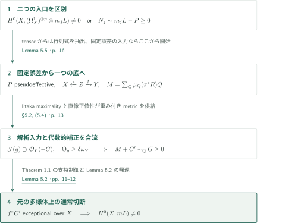
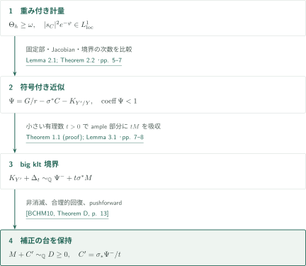
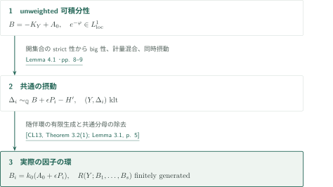
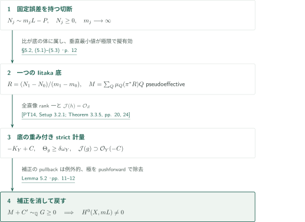
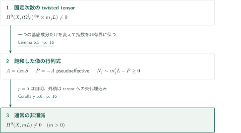
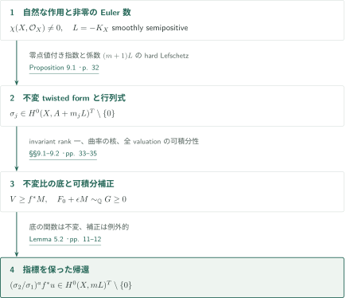

# Integrable metrics and effectivity with controlled boundary

**可積分性をklt境界へ変え、例外的な補正を消して反標準切断を戻す**

本稿の基本経路は、特定切断の可積分性から台を制御した有効性を得て、それを固定擬有効誤差の除去へ使うものである。smooth semipositivityは$L=-K_X$に滑らかな半正曲率計量が存在するという仮定であり、nef性のみへの置換は行わない。底に現れる特異計量には、重み付き可積分性とunweighted可積分性という異なる条件がある。

## 1. 主要結果

### Theorem 1.1 — 指定境界上の補正を許す有効性

$Y$を正次元の滑らかな射影複素多様体、$C\geq0$を整数因子とする。$-K_Y+C$に、曲率がKähler形式を支配し、$\mathcal J(h)\supseteq\mathcal O_Y(-C)$を満たす特異Hermitian計量$h$が存在すると仮定する。任意の擬有効有理因子$M$に対し、$C$上に台を持つ有効有理因子$C'$が存在し、$M+C'$は有効有理因子と$\mathbb Q$線形同値になる。

<!-- cite:boundary -->[Theorem 1.1 · p. 2](https://github.com/openai/math/blob/fd4aeeb2ee4fc729c18d98444fed42fd0529eeeb/preprints/Integrable-metrics-and-effectivity-with-controlled-boundary-September-26-2026/main.pdf)<!-- /cite -->

### Theorem 4.3 — 補正因子近傍の有限生成

$Y$を正次元の滑らかな射影多様体、$A_0$を有理因子とする。$-K_Y+A_0$が半正の特異計量を持ち、その非消滅局所frameの二乗ノルムが局所可積分で、非空の通常開集合上で滑らかかつstrictly positiveであると仮定する。任意の有限個の有理因子$P_1,\ldots,P_s$に対し、共通の$\epsilon\in\mathbb Q_{>0}$と整数$k_0>0$が存在し、実際の因子$B_i=k_0(A_0+\epsilon P_i)$はCartierで、

$$R(Y;B_1,\ldots,B_s)=\bigoplus_{(a_1,\ldots,a_s)\in\mathbb N^s}H^0\!\left(Y,\mathcal O_Y\!\left(\sum_i a_iB_i\right)\right)$$

は有限生成$\mathbb C$代数となる。ここでは$A_0$の有効性は仮定しない。

<!-- cite:ring -->[Theorem 4.3 · pp. 9–10](https://github.com/openai/math/blob/fd4aeeb2ee4fc729c18d98444fed42fd0529eeeb/preprints/Integrable-metrics-and-effectivity-with-controlled-boundary-September-26-2026/main.pdf)<!-- /cite -->

### Theorem 5.1 — 一つの固定擬有効誤差の除去

$X$を滑らかな連結射影複素多様体、$L=-K_X$をsmoothly semipositiveとする。$P$を固定した擬有効Cartier因子とする。非有界な正整数$m_j$に対し、有効整数因子$N_j\sim m_jL-P$が存在すれば、ある正整数$m$について$H^0(X,mL)\ne0$である。$P$自身の有効性や$L\not\equiv0$は仮定しない。

<!-- cite:conversion -->[Theorem 5.1 · p. 11](https://github.com/openai/math/blob/fd4aeeb2ee4fc729c18d98444fed42fd0529eeeb/preprints/Integrable-metrics-and-effectivity-with-controlled-boundary-September-26-2026/main.pdf)<!-- /cite -->

### Corollary 5.6 — 固定次数のtwisted differentialからの変換

Theorem 5.1の$X,L$に対し、ある固定整数$p\geq0$と非有界な正整数$m$について$H^0(X,(\Omega_X^1)^{\otimes p}\otimes mL)\ne0$なら、$L$の正の倍数に非零切断がある。$(\Omega_X^1)^{\otimes p}$を$\Omega_X^p$に置き換えても成立する。これは通常の切断の非消滅であり、不変切断という結論ではない。

<!-- cite:tensor -->[Corollary 5.6 · p. 16](https://github.com/openai/math/blob/fd4aeeb2ee4fc729c18d98444fed42fd0529eeeb/preprints/Integrable-metrics-and-effectivity-with-controlled-boundary-September-26-2026/main.pdf)<!-- /cite -->

### Theorem 9.2 — 自然な線形化についての不変非消滅

$X$を滑らかな連結射影複素多様体、$\chi(X,\mathcal O_X)\ne0$とする。代数トーラス$T$が$X$に作用し、$L=-K_X$がsmoothly semipositiveなら、自然な接束の行列式の線形化に対して、ある正整数$m$で$H^0(X,mL)^T\ne0$となる。

<!-- cite:invariant -->[Theorem 9.2 · pp. 32–35](https://github.com/openai/math/blob/fd4aeeb2ee4fc729c18d98444fed42fd0529eeeb/preprints/Integrable-metrics-and-effectivity-with-controlled-boundary-September-26-2026/main.pdf)<!-- /cite -->

## 図の矢印に付した引用

<!-- reference-guide -->
略号のない定理・補題・節・式番号は本原稿 [Integrable metrics and effectivity with controlled boundary](https://github.com/openai/math/blob/fd4aeeb2ee4fc729c18d98444fed42fd0529eeeb/preprints/Integrable-metrics-and-effectivity-with-controlled-boundary-September-26-2026/main.pdf) を指します。外部入力には次の略号を使います。

- [BCHM10](https://arxiv.org/pdf/math/0610203v2) C. Birkar, P. Cascini, C. D. Hacon, J. McKernan — *Existence of minimal models for varieties of log general type*：big klt境界の随伴因子の非消滅。arXiv:math/0610203v2。
- [CL13](https://arxiv.org/pdf/1005.0614v3) A. Corti, V. Lazić — *New outlook on the Minimal Model Program, II*：多重次数付き随伴環の有限生成とVeronese。arXiv:1005.0614v3。
- [PT14](https://arxiv.org/pdf/1409.5504v1) M. Păun, S. Takayama — *Positivity of twisted relative pluricanonical bundles and their direct images*：乗数イデアル直像が一般同型の場合の特異計量の延長。arXiv:1409.5504v1 (2014); published in 2018。
- [OpenAI26b](https://github.com/openai/math/blob/fd4aeeb2ee4fc729c18d98444fed42fd0529eeeb/preprints/Invariant-anticanonical-indices-and-conversion-of-twisted-differentials-September-26-2026/main.pdf) OpenAI — *Invariant anticanonical indices and conversion of twisted differentials*：零点での値を保持する不変指数。2026-09-26。
- [OpenAI26e](https://github.com/openai/math/blob/fd4aeeb2ee4fc729c18d98444fed42fd0529eeeb/preprints/Metric-descent-and-rank-preserving-contractions-September-26-2026/main.pdf) OpenAI — *Metric descent and rank-preserving contractions*：通常変換の別経路におけるtoroidal volume計量。2026-09-26。
- [LMPTX23](https://ems.press/content/serial-article-files/31138) V. Lazić, S. Matsumura, T. Peternell, N. Tsakanikas, Z. Xie — *The Nonvanishing Problem for varieties with nef anticanonical bundle*：cotangent tensorの飽和部分層の負の第一Chern類の擬有効性。Documenta Mathematica 28 (2023), 1393–1440。
- [DPS01](https://arxiv.org/pdf/math/0006205v2) J.-P. Demailly, T. Peternell, M. Schneider — *Pseudo-effective line bundles on compact Kähler manifolds*：滑らかな半正係数のhard Lefschetz全射。arXiv:math/0006205v2。

各引用に結果番号とページを付します。誌面番号とPDF内の位置が異なる場合は両方を示します。GitHubの閲覧リンクではページ位置への自動移動を前提としません。
<!-- /reference-guide -->

## 2. Theorem 5.1 — 主定理の証明概略

<!-- proof-target:1 -->証明対象：[Theorem 5.1 · p. 11](https://github.com/openai/math/blob/fd4aeeb2ee4fc729c18d98444fed42fd0529eeeb/preprints/Integrable-metrics-and-effectivity-with-controlled-boundary-September-26-2026/main.pdf)<!-- /proof-target -->

**証明の道筋。** [Theorem 5.1](#theorem-5-1)の固定誤差付き入力から始める。twisted tensorから出発するCorollary 5.6では、その前に行列式抽出を一段加える。底の解析入力とTheorem 1.1の台を制御した代数的出力が合流し、例外補正を消す帰還で結論に至る。

### 1. 固定するものと底で変換するもの

行列式は一つの擬有効誤差$P$を固定し、Iitaka体は全ての$N_j$の比を一つの底へ集める。底の垂直最小値$M$と、rank一の直像が与える$-K_Y+C$の計量は別の役割を持ち、Theorem 1.1で合流する。詳細は[支持付き有効性](#proof-1)、[固定誤差の変換](#proof-3)、[tensorの抽出](#proof-4)に分ける。

<!-- cite:conversion -->[Theorem 5.1 · p. 11](https://github.com/openai/math/blob/fd4aeeb2ee4fc729c18d98444fed42fd0529eeeb/preprints/Integrable-metrics-and-effectivity-with-controlled-boundary-September-26-2026/main.pdf)<!-- /cite -->

### 2. 環と不変性は別の出力として追う

[Theorem 4.3](#theorem-4-3)はunweighted可積分性から有限生成環を作り、後続のExact ordersに供給する。これは通常変換5.1の主証明が必要とする出力ではない。[Theorem 9.2](#theorem-9-2)は不変比の体を選び直し、底の不変関数で有理切断を補正する。通常の5.1から不変性を推論せず、[不変な帰還](#proof-5)を別に追う。

<!-- cite:ring -->[Theorem 4.3 · pp. 9–10](https://github.com/openai/math/blob/fd4aeeb2ee4fc729c18d98444fed42fd0529eeeb/preprints/Integrable-metrics-and-effectivity-with-controlled-boundary-September-26-2026/main.pdf)<!-- /cite -->

<!-- cite:invariant -->[Theorem 9.2 · pp. 32–35](https://github.com/openai/math/blob/fd4aeeb2ee4fc729c18d98444fed42fd0529eeeb/preprints/Integrable-metrics-and-effectivity-with-controlled-boundary-September-26-2026/main.pdf)<!-- /cite -->

## 3. Theorem 1.1 の証明 — 重み付き近似から支持付き非消滅へ

<!-- proof-target:2 -->証明対象：[Theorem 1.1 · p. 2](https://github.com/openai/math/blob/fd4aeeb2ee4fc729c18d98444fed42fd0529eeeb/preprints/Integrable-metrics-and-effectivity-with-controlled-boundary-September-26-2026/main.pdf)<!-- /proof-target -->

**証明の道筋。** 近似の固定部から境界とJacobianを引いた符号付き因子を作り、その正部をbig klt境界に組み込む。非消滅の入力はこの有効境界であり、符号付き因子そのものではない。

### 1. 可積分性が厳密な係数不等式を与える

小さいample有理因子$A$を計量から差し引き、$|r(-K_Y+C-A)|$を解消して固定部$G$と自由部を分ける。Lemma 2.1はNadel消滅・正則性と点延長による比較を使う。素因子沿いの固定部、$\sigma^*C$、Jacobianの次数を$a,j,k$とすると、可積分性から$a/r-j-k<1$を得る。従って$\Psi=G/r-\sigma^*C-K_{Y'/Y}$の正部はkltで、負部の台は境界と例外集合に限られる。$|s_C|^2e^{-\varphi}\in L^1$を$e^{-\varphi}\in L^1$へ読み替えてはいけない。

<!-- cite:approximation -->[Lemma 2.1; Theorem 2.2 · pp. 5–7](https://github.com/openai/math/blob/fd4aeeb2ee4fc729c18d98444fed42fd0529eeeb/preprints/Integrable-metrics-and-effectivity-with-controlled-boundary-September-26-2026/main.pdf)<!-- /cite -->

### 2. ampleの余地に$M$を入れ、補正だけを残す

$A+tM$がampleとなる小さい有理数$t>0$を取り、一般の自由因子と小係数のample代表を加えて$\Delta_t\geq0$を作る。すると$(Y',\Delta_t)$はklt、$\Delta_t$はbig、$K_{Y'}+\Delta_t\sim_{\mathbb Q}\Psi^-+t\sigma^*M$は擬有効である。big-boundary非消滅の実線形同値を、有限個の有理係数不等式の有理解により有理線形同値へ戻す。pushforward後の補正$C'=\sigma_*\Psi^-/t$は$C$上に台を持つ。近似を$M$より先に固定できるが、$t$と$C'$は$M$に依存してよい。

<!-- cite:bchm -->[&#91;BCHM10, Theorem D, p. 13&#93;](https://arxiv.org/pdf/math/0610203v2#page=13)<!-- /cite -->

<!-- cite:boundary-proof -->[Theorem 1.1 (proof); Lemma 3.1 · pp. 7–8](https://github.com/openai/math/blob/fd4aeeb2ee4fc729c18d98444fed42fd0529eeeb/preprints/Integrable-metrics-and-effectivity-with-controlled-boundary-September-26-2026/main.pdf)<!-- /cite -->

## 4. Theorem 4.3 の証明 — unweighted計量から随伴環へ

<!-- proof-target:3 -->証明対象：[Theorem 4.3 · pp. 9–10](https://github.com/openai/math/blob/fd4aeeb2ee4fc729c18d98444fed42fd0529eeeb/preprints/Integrable-metrics-and-effectivity-with-controlled-boundary-September-26-2026/main.pdf)<!-- /proof-target -->

**証明の道筋。** 通常開集合上のstrict性からbig性を得て、大域的strict下界を持つ計量へ混合する。unweighted可積分性を保持した同時摂動が、共通ample部分を持つ複数のklt境界を供給する。

### 1. 一つの共通摂動を許す計量

Lemma 4.1では体積判定、strong openness、小指数可積分性とHölder不等式を用い、元の計量とbig計量を小さい有理係数で混合する。全体でstrictな下界とframeの可積分性が両立し、有限個の$P_i$を滑らかな計量で加減できる。共通のample $H'$と$\epsilon>0$に対し、有効klt因子$\Delta_i\sim_{\mathbb Q}-K_Y+A_0+\epsilon P_i-H'$が得られる。Theorem 1.1の重み付き条件だけではこの段階を代用しない。

<!-- cite:neighborhood -->[Lemma 4.1 · pp. 8–9](https://github.com/openai/math/blob/fd4aeeb2ee4fc729c18d98444fed42fd0529eeeb/preprints/Integrable-metrics-and-effectivity-with-controlled-boundary-September-26-2026/main.pdf)<!-- /cite -->

### 2. 有限生成を実際のCartier因子へ運ぶ

$K_Y+\Delta_i+H'$の多重次数付き随伴環に有限生成を適用する。共通の$k_0$で因子と有理線形同値の分母を消し、それぞれの主因子を与える有理関数を掛けると、多重次数を保って所要の環とVeronese環が対応する。数値的同値だけではこの同一視はできない。これが後続のExact ordersに供給される有限生成である。

<!-- cite:fg -->[&#91;CL13, Theorem 3.2(1); Lemma 3.1, p. 5&#93;](https://arxiv.org/pdf/1005.0614v3#page=5)<!-- /cite -->

## 5. Theorem 5.1 の証明 — 一つのIitaka体に誤差を集める

<!-- proof-target:4 -->証明対象：[Theorem 5.1 · p. 11](https://github.com/openai/math/blob/fd4aeeb2ee4fc729c18d98444fed42fd0529eeeb/preprints/Integrable-metrics-and-effectivity-with-controlled-boundary-September-26-2026/main.pdf)<!-- /proof-target -->

**証明の道筋。** $N_1$の一つのIitaka底を選ぶと、全$N_j$の差を底の主因子で表せる。垂直方向の最小係数が底の擬有効因子$M$を作る。rank一の直像で得る計量へTheorem 1.1を適用し、例外的補正を消す。

### 1. 比の体・垂直最小値・rank一

平坦化を経て$X\xleftarrow{\pi}Z\xrightarrow{f}Y$を準備し、底の余次元2以上へ写る素因子が$\pi$例外的になるようにする。最終的な滑らかな$Z$の平坦性は主張しない。$R=(N_1-N_0)/(m_1-m_0)$に対し、同じ線形系の比が底の体に入ることから

$$\pi^*N_j=\pi^*N_0+(m_j-m_0)(\pi^*R+f^*Q_j),\qquad Q_j\sim_{\mathbb Q}0$$

を得る。水平方向は非負となり、$\mu_Q(\pi^*R)=\min_{D\mapsto Q}\operatorname{ord}_D(\pi^*R)/\operatorname{ord}_D(f^*Q)$の和$M$は、固定有効誤差を$m_j-m_0$で割った極限により擬有効である。$Y$が点なら既に有効性が得られ、$\dim Y=\dim X$なら$L$はbigである。中間次元では$E=K_{Z/X}$の直像のrankが2以上なら、底のample twistを使って$N_1$の比の体を広げられて矛盾する。

<!-- cite:iitaka -->[§5.2, (5.1)–(5.3) · p. 12](https://github.com/openai/math/blob/fd4aeeb2ee4fc729c18d98444fed42fd0529eeeb/preprints/Integrable-metrics-and-effectivity-with-controlled-boundary-September-26-2026/main.pdf)<!-- /cite -->

### 2. strict計量を作り、補正の極を消す

$b\pi^*N_1\sim f^*H+D_1$と$N_1\sim m_1L-P$から、$\pi^*L$に底の正曲率を支配する特異計量がある。smooth semipositive計量との小さい混合により、$\Theta_h\geq\delta f^*\omega_Y$と**全空間上**の$\mathcal J(h)=\mathcal O_Z$を得る。直像の乗数イデアル付き包含は同型なので、Păun–Takayamaの延長定理が通常の直像へ適用できる。そのrank一の二重双対は$\mathcal O_Y(-K_Y+C)$である。$C$は整数有効因子、$f^*C$は例外的であり、Fubiniにより$s_C$は可積分となる。Theorem 1.1で$M+C'\sim_{\mathbb Q}G\geq0$とし、$\pi^*R+f^*(G-M-C')$を押し下げる。負係数を許す場所は例外集合だけなので、$X$上に実際の非零切断を得る。

<!-- cite:pt -->[&#91;PT14, Setup 3.2.1; Theorem 3.3.5, pp. 20, 24&#93;](https://arxiv.org/pdf/1409.5504v1#page=20)<!-- /cite -->

<!-- cite:direct-image -->[§5.2, (5.4) · p. 13](https://github.com/openai/math/blob/fd4aeeb2ee4fc729c18d98444fed42fd0529eeeb/preprints/Integrable-metrics-and-effectivity-with-controlled-boundary-September-26-2026/main.pdf)<!-- /cite -->

<!-- cite:return -->[Lemma 5.2 · pp. 11–12](https://github.com/openai/math/blob/fd4aeeb2ee4fc729c18d98444fed42fd0529eeeb/preprints/Integrable-metrics-and-effectivity-with-controlled-boundary-September-26-2026/main.pdf)<!-- /cite -->

別経路である§5.3は元の滑らかな係数計量を保持し、toroidal volume定理から有理補正$A_0$とunweighted計量を得る。ここで必要なのは全直像rank一と水平strict patchである。通常開集合上のstrict性を大域的Kähler下界と同一視せず、Corollary 5.4の計量混合を経由する。

<!-- cite:toroidal -->[&#91;OpenAI26e, Theorem 2.1, p. 7&#93;](https://github.com/openai/math/blob/fd4aeeb2ee4fc729c18d98444fed42fd0529eeeb/preprints/Metric-descent-and-rank-preserving-contractions-September-26-2026/main.pdf)<!-- /cite -->

<!-- cite:alternative -->[§5.3; Corollary 5.4 · pp. 13–15](https://github.com/openai/math/blob/fd4aeeb2ee4fc729c18d98444fed42fd0529eeeb/preprints/Integrable-metrics-and-effectivity-with-controlled-boundary-September-26-2026/main.pdf)<!-- /cite -->

## 6. Corollary 5.6 の証明 — 行列式で固定誤差を抽出する

<!-- proof-target:5 -->証明対象：[Corollary 5.6 · p. 16](https://github.com/openai/math/blob/fd4aeeb2ee4fc729c18d98444fed42fd0529eeeb/preprints/Integrable-metrics-and-effectivity-with-controlled-boundary-September-26-2026/main.pdf)<!-- /proof-target -->

**証明の道筋。** 固定したtensor束内の像を飽和し、その行列式を固定する。一つの基底成分だけを高いtwistの切断で置き換えて、非有界性を保つ。

### 1. 一つの行列式を固定する

$\mathcal O_X(-mL)\to(\Omega_X^1)^{\otimes p}$の像の一般点でのspanを飽和して$S$とし、$A=(\bigwedge^{\mathrm{rk}S}S)^{**}$を取る。原稿はgeneric tangent nefnessのcotangent部分束版を使って$P=-A$を擬有効とする。有限個の元からなる一般基底の一つを順次置き換えれば、固定した$A$に値を取る行列式切断が非有界な正twistで得られる。飽和とreflexive延長が大域切断を保証する。

<!-- cite:generic-nefness -->[&#91;LMPTX23, Theorem 4.1, 誌面 p. 1409 / PDF p. 17&#93;](https://ems.press/content/serial-article-files/31138)<!-- /cite -->

<!-- cite:determinant -->[Lemma 5.5 · p. 16](https://github.com/openai/math/blob/fd4aeeb2ee4fc729c18d98444fed42fd0529eeeb/preprints/Integrable-metrics-and-effectivity-with-controlled-boundary-September-26-2026/main.pdf)<!-- /cite -->

### 2. tensor・外積・零次数を区別する

$p>0$ではTheorem 5.1を適用する。$p=0$なら入力自身が所要の切断であり、外積は標数0の交代埋込みによってtensorへ帰着する。指数は「ある正の倍数」であり、すべての正整数での非消滅は主張しない。行列式切断が不変でも、通常のTheorem 5.1だけで不変性の結論は得られない。

<!-- cite:tensor -->[Corollary 5.6 · p. 16](https://github.com/openai/math/blob/fd4aeeb2ee4fc729c18d98444fed42fd0529eeeb/preprints/Integrable-metrics-and-effectivity-with-controlled-boundary-September-26-2026/main.pdf)<!-- /cite -->

## 7. Theorem 9.2 の証明 — 不変な有理切断を最後まで保持する

<!-- proof-target:6 -->証明対象：[Theorem 9.2 · pp. 32–35](https://github.com/openai/math/blob/fd4aeeb2ee4fc729c18d98444fed42fd0529eeeb/preprints/Integrable-metrics-and-effectivity-with-controlled-boundary-September-26-2026/main.pdf)<!-- /proof-target -->

**証明の道筋。** 零点の値を保持する不変指数から不変形式を作る。通常変換へ渡すのではなく、不変比の体と不変有理切断を保持し、補正を底の不変関数で行う。

### 1. 不変指数から底の曲率へ

連結トーラスの作用は$H^q(X,\mathcal O_X)$に自明で、指数の零点値は$\chi(X,\mathcal O_X)\ne0$である。指数定理とcompact平均したhard Lefschetzは固定$p$の不変切断$H^0(X,\Omega_X^p\otimes(m+1)L)^T$を非有界な$m$で与える。$+1$は$K_X+(m+1)L=mL$に必要である。行列式の不変切断$\sigma_j$から不変比の体を作り、その相対代数閉包も連結性で不変になる。Lemma 9.3の曲率交点評価と半正性から曲率の核が底への射の垂直方向に入り、水平strict patchが得られる。不変直像のrankは一だが、全直像のrank一はここでは主張しない。

<!-- cite:index -->[&#91;OpenAI26b, Theorem 1.1, p. 1&#93;](https://github.com/openai/math/blob/fd4aeeb2ee4fc729c18d98444fed42fd0529eeeb/preprints/Invariant-anticanonical-indices-and-conversion-of-twisted-differentials-September-26-2026/main.pdf)<!-- /cite -->

<!-- cite:hard-lefschetz -->[&#91;DPS01, Theorem 2.1.1; Corollary 2.1.2, p. 8&#93;](https://arxiv.org/pdf/math/0006205v2#page=8)<!-- /cite -->

<!-- cite:invariant-forms -->[Proposition 9.1 · p. 32](https://github.com/openai/math/blob/fd4aeeb2ee4fc729c18d98444fed42fd0529eeeb/preprints/Integrable-metrics-and-effectivity-with-controlled-boundary-September-26-2026/main.pdf)<!-- /cite -->

### 2. 全valuationを検査し、不変な切断を戻す

別のsimplicial toroidalモデル$W$を用い、$V=(\operatorname{div}(p^*\sigma_2)-\operatorname{div}(p^*\sigma_1))/(m_2-m_1)$と垂直最小値$M$を取る。$V\geq f^*M$であり、$M$は擬有効。不変直像の滑らかな直交商計量から体積密度$\rho$を得る。補正$F_0$は$f^*F_0\leq E_W=K_{W/X}$を満たす。解消$h:W'\to W$上で

$$K_{W'/W}+h^*(E_W-f^*F_0)$$

の全係数は$-1$より大きい。第一項には$W$がkltであること、第二項には有効性を使う。これが高余次元上の例外素因子も含むunweighted可積分性を与える。Corollary 5.4を適用して$F_0+\epsilon M\sim_{\mathbb Q}G\geq0$とし、$\sigma_2/\sigma_1$の冪に底の関数を掛けて戻す。両方が不変なので、例外補正を除いて延長した切断も自然な線形化について不変である。

<!-- cite:invariant-base -->[§§9.1–9.2 · pp. 33–35](https://github.com/openai/math/blob/fd4aeeb2ee4fc729c18d98444fed42fd0529eeeb/preprints/Integrable-metrics-and-effectivity-with-controlled-boundary-September-26-2026/main.pdf)<!-- /cite -->

## 8. どの論文が、どの段階を担うか

| 入力 | 利用先 | 役割・確認範囲 |
|---|---|---|
| BCHMのbig-boundary非消滅 | Theorem 1.1、Corollary 5.4 | klt・big境界と擬有効随伴因子の仮定を照合。入力証明は未検証。 |
| Corti–Lazićの随伴環 | Theorem 4.3 | 共通ample部分とklt境界から有限生成。定理記述を照合。 |
| Păun–Takayamaの特異直像 | Theorem 5.1 | $\mathcal J(h)=\mathcal O_Z$により一般同型の仮定が成立。記述と適用を照合。 |
| Invariant anticanonical indices | Proposition 9.1 → Theorem 9.2 | 零点値を含む指数多項式。不変変換の直接入力。 |
| Metric descent and rank-preserving contractions | §5.3の別証明 | 全rank一のtoroidal metric。通常変換の主証明とは別経路。 |

## 9. 原典を読む入口と確認範囲

<!-- reading-list -->
- [Lemma 2.1; Theorem 2.2 · pp. 5–7](https://github.com/openai/math/blob/fd4aeeb2ee4fc729c18d98444fed42fd0529eeeb/preprints/Integrable-metrics-and-effectivity-with-controlled-boundary-September-26-2026/main.pdf) — 重み付き可積分性から係数の厳密不等式へ。
- [Theorem 1.1 (proof); Lemma 3.1 · pp. 7–8](https://github.com/openai/math/blob/fd4aeeb2ee4fc729c18d98444fed42fd0529eeeb/preprints/Integrable-metrics-and-effectivity-with-controlled-boundary-September-26-2026/main.pdf) — 補正の台を保持する非消滅。
- [Theorem 4.3 · pp. 9–10](https://github.com/openai/math/blob/fd4aeeb2ee4fc729c18d98444fed42fd0529eeeb/preprints/Integrable-metrics-and-effectivity-with-controlled-boundary-September-26-2026/main.pdf) — unweighted計量から有限生成環へ。
- [§5.2, (5.1)–(5.3) · p. 12](https://github.com/openai/math/blob/fd4aeeb2ee4fc729c18d98444fed42fd0529eeeb/preprints/Integrable-metrics-and-effectivity-with-controlled-boundary-September-26-2026/main.pdf) — 一つのIitaka体と垂直最小係数。
- [§5.2, (5.4) · p. 13](https://github.com/openai/math/blob/fd4aeeb2ee4fc729c18d98444fed42fd0529eeeb/preprints/Integrable-metrics-and-effectivity-with-controlled-boundary-September-26-2026/main.pdf) — 大域的strict下界と特定切断の可積分性。
- [§§9.1–9.2 · pp. 33–35](https://github.com/openai/math/blob/fd4aeeb2ee4fc729c18d98444fed42fd0529eeeb/preprints/Integrable-metrics-and-effectivity-with-controlled-boundary-September-26-2026/main.pdf) — 不変比の体と全valuationの可積分性。
<!-- /reading-list -->

上記は著者の主張と証明の構成の紹介である。編集側では§§2–5.5および§9の記述・証明本文を読み、BCHM、Corti–Lazić、Păun–Takayamaと同カタログの直接入力の記述・使用箇所を照合した。generic tangent nefnessの入力とhard Lefschetzの記述も照合した。点延長・近似、体積判定・strong openness、toroidal準備の外部原典すべての記述照合は完了していない。§§6–8の別証明・Fano-typeモデル、§§10–12の別不変構成・降下・extremal character法は本記事の詳細点検範囲外である。全証明の独立再検証や専門家査読を意味しない。
