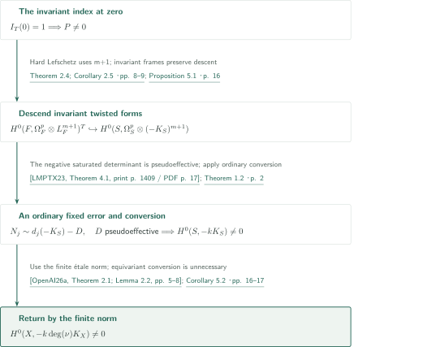
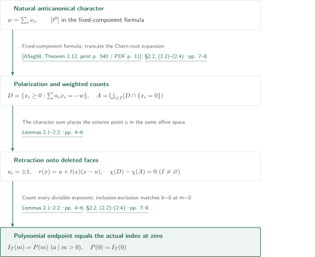
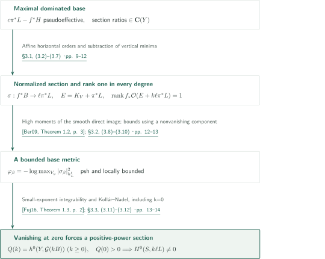
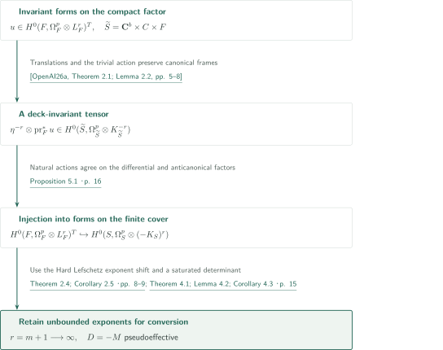

# Invariant anticanonical indices and conversion of twisted differentials

**Two endpoint arguments connected by descent of forms**

OpenAI, *Invariant anticanonical indices and conversion of twisted differentials* (September 26, 2026), proves independently an invariant Euler-index polynomial and an ordinary section theorem removing a fixed pseudoeffective error. In the application, torus-invariant forms descend to a finite cover before conversion. An equivariant conversion theorem is therefore unnecessary.

## Main results

### Theorem 1.1 — Invariant anticanonical index

Let a compact real torus $T$ act holomorphically on a compact complex manifold $F$, and equip $L_F=-K_F=\det T_F$ with its natural differential linearization. Put
$$I_T(m)=\sum_{q\ge0}(-1)^q\dim H^q(F,L_F^m)^T\qquad(m\ge0).$$
There are an integer $a>0$ and $P\in\mathbf Q[t]$ such that
$$\begin{aligned}I_T(m)&=P(m)\quad(m\in a\mathbf Z_{>0}),\\P(0)&=I_T(0).\end{aligned}$$
There is no projectivity, Kählerness or positivity assumption. The natural linearization cannot be replaced by an arbitrary character twist.

<!-- cite:index -->[Theorem 1.1 · p. 1](https://github.com/openai/math/blob/fd4aeeb2ee4fc729c18d98444fed42fd0529eeeb/preprints/Invariant-anticanonical-indices-and-conversion-of-twisted-differentials-September-26-2026/main.pdf)<!-- /cite -->

### Theorem 1.2 — Pseudoeffective-error conversion

Let $S$ be smooth connected projective over $\mathbf C$, and suppose $L=-K_S$ has a smooth semipositive Hermitian metric. Let $D$ be a pseudoeffective Cartier divisor. If, for a strictly increasing sequence of positive integers $m_j$,
$$H^0(S,\mathcal O_S(m_jL-D))\ne0,$$
then $H^0(S,\mathcal O_S(kL))\ne0$ for some integer $k>0$. The divisor $D$ need not be effective; rational connectedness and an Euler-characteristic hypothesis are unnecessary. The output is an ordinary section.

<!-- cite:conversion -->[Theorem 1.2 · p. 2](https://github.com/openai/math/blob/fd4aeeb2ee4fc729c18d98444fed42fd0529eeeb/preprints/Invariant-anticanonical-indices-and-conversion-of-twisted-differentials-September-26-2026/main.pdf)<!-- /cite -->

### Corollary 5.2 — Smooth anticanonical nonvanishing

Let $X$ be a smooth connected projective complex variety. If $-K_X$ has a smooth semipositive Hermitian metric, then $H^0(X,-mK_X)\ne0$ for some integer $m>0$. Neither a first-power section nor a uniform exponent is asserted.

<!-- cite:global -->[Corollary 5.2 · pp. 16–17](https://github.com/openai/math/blob/fd4aeeb2ee4fc729c18d98444fed42fd0529eeeb/preprints/Invariant-anticanonical-indices-and-conversion-of-twisted-differentials-September-26-2026/main.pdf)<!-- /cite -->

## References on the arrows

<!-- reference-guide -->
Unprefixed theorem, lemma, section and equation numbers refer to [Invariant anticanonical indices and conversion of twisted differentials](https://github.com/openai/math/blob/fd4aeeb2ee4fc729c18d98444fed42fd0529eeeb/preprints/Invariant-anticanonical-indices-and-conversion-of-twisted-differentials-September-26-2026/main.pdf). External inputs use the following keys.

- [Ber09](https://arxiv.org/pdf/math/0511225v2) Bo Berndtsson — *Curvature of vector bundles associated to holomorphic fibrations*: Semipositivity of the rank-one adjoint direct-image L² metric. arXiv:math/0511225v2, 2007-08-20; published 2009.
- [DPS01](https://arxiv.org/pdf/math/0006205v2) Jean-Pierre Demailly; Thomas Peternell; Michael Schneider — *Pseudo-effective line bundles on compact Kähler manifolds*: Hard Lefschetz with smooth coefficients, producing invariant twisted forms. arXiv:math/0006205v2, 2000-10-10; published 2001.
- [Fuj16](https://arxiv.org/pdf/1607.04684v1) Osamu Fujino — *Kollár–Nadel type vanishing theorem*: Vanishing from a singular metric positive in base directions. arXiv:1607.04684v1, 2016-07-15 (manuscript date 2016-07-10); published 2018.
- [DK01](https://arxiv.org/pdf/math/9910118v3) Jean-Pierre Demailly; János Kollár — *Semi-continuity of complex singularity exponents and Kähler–Einstein metrics on Fano orbifolds*: Small-exponent integrability of psh weights makes the multiplier ideal trivial. arXiv:math/9910118v3, 2013-11-14.
- [ASeg68](https://webhomes.maths.ed.ac.uk/~v1ranick/papers/as2.pdf) Michael F. Atiyah; Graeme B. Segal — *The index of elliptic operators. II*: Lefschetz localization to fixed components for compact-group actions. Annals of Mathematics 87 (1968), 531–545; scanned copy with one cover page.
- [ASin68](https://annals.math.princeton.edu/1968/87-3/p07) Michael F. Atiyah; Isadore M. Singer — *The index of elliptic operators. III*: Cohomological fixed-point formula and Riemann–Roch for compact complex manifolds. Annals of Mathematics 87 (1968), 546–604; scanned copy with one cover page.
- [LMPTX23](https://ems.press/content/serial-article-files/31138) Vladimir Lazić; Shin-ichi Matsumura; Thomas Peternell; Nikolaos Tsakanikas; Zhixin Xie — *The Nonvanishing Problem for varieties with nef anticanonical bundle*: Negative first Chern class of saturated cotangent tensor subsheaves is pseudoeffective. Documenta Mathematica 28 (2023), 1393–1440; published PDF.
- [OpenAI26a](https://github.com/openai/math/blob/fd4aeeb2ee4fc729c18d98444fed42fd0529eeeb/preprints/Anticanonical-nonvanishing-from-smooth-semipositivity-September-26-2026/main.pdf) OpenAI — *Anticanonical nonvanishing from smooth semipositivity*: Only the finite cover, residual torus, invariant canonical frames, and finite étale norm. September 26, 2026.

Each citation gives the result and pages. When printed pagination differs from the PDF position, both are shown. GitHub previews do not automatically jump to the cited page.
<!-- /reference-guide -->

## Corollary 5.2 — Proof overview of the main theorem

<!-- proof-target:1 -->Proof target：[Corollary 5.2 · pp. 16–17](https://github.com/openai/math/blob/fd4aeeb2ee4fc729c18d98444fed42fd0529eeeb/preprints/Invariant-anticanonical-indices-and-conversion-of-twisted-differentials-September-26-2026/main.pdf)<!-- /proof-target -->

**Proof route.** Theorems 1.1 and 1.2 are independent. The first produces invariant twisted forms on a compact factor. These descend to a finite cover, where the second converts them into ordinary anticanonical sections. A norm returns a section to $X$.

### 1. From invariant Euler index to invariant forms of one degree

Write the universal cover of a finite cover as $\widetilde S=\mathbf C^b\times C\times F$, with $C$ Ricci-flat and $F$ a compact factor without positive-degree holomorphic forms. Residual monodromy acts through a compact torus $T$. Hodge symmetry gives $H^q(F,\mathcal O_F)=0$ for $q>0$, hence $I_T(0)=1$. The polynomial in Theorem 1.1 is nonzero, so for one fixed $q$ there are invariant classes in $H^q(F,L_F^m)^T$ at unbounded exponents. Hard Lefschetz with coefficient $L_F^{m+1}$, followed by compact averaging, gives $H^0(F,\Omega_F^p\otimes L_F^{m+1})^T\ne0$ for one fixed $p$.

<!-- cite:openai26a -->[&#91;OpenAI26a, Theorem 2.1; Lemma 2.2, pp. 5–8&#93;](https://github.com/openai/math/blob/fd4aeeb2ee4fc729c18d98444fed42fd0529eeeb/preprints/Anticanonical-nonvanishing-from-smooth-semipositivity-September-26-2026/main.pdf)<!-- /cite --> <!-- cite:forms -->[Theorem 2.4; Corollary 2.5 · pp. 8–9](https://github.com/openai/math/blob/fd4aeeb2ee4fc729c18d98444fed42fd0529eeeb/preprints/Invariant-anticanonical-indices-and-conversion-of-twisted-differentials-September-26-2026/main.pdf)<!-- /cite --> <!-- cite:dps01 -->[&#91;DPS01, Theorem 2.1.1, p. 8&#93;](https://arxiv.org/pdf/math/0006205v2#page=8)<!-- /cite -->

### 2. Descend forms before constructing the pseudoeffective error

Multiplication by invariant canonical frames in Proposition 5.1 injects these forms into $H^0(S,\Omega_S^p\otimes(-K_S)^r)$. If $p>0$, a fixed determinant of their generic span yields a line bundle $M$ saturated in a cotangent tensor power. Nefness makes $-M$ pseudoeffective. Taking $D=-M$ turns the forms into effective divisors $N_j\sim d_j(-K_S)-D$ for unbounded $d_j$. If $p=0$, the forms are already anticanonical sections.

<!-- cite:descent -->[Proposition 5.1 · p. 16](https://github.com/openai/math/blob/fd4aeeb2ee4fc729c18d98444fed42fd0529eeeb/preprints/Invariant-anticanonical-indices-and-conversion-of-twisted-differentials-September-26-2026/main.pdf)<!-- /cite --> <!-- cite:determinant -->[Theorem 4.1; Lemma 4.2; Corollary 4.3 · p. 15](https://github.com/openai/math/blob/fd4aeeb2ee4fc729c18d98444fed42fd0529eeeb/preprints/Invariant-anticanonical-indices-and-conversion-of-twisted-differentials-September-26-2026/main.pdf)<!-- /cite --> <!-- cite:lmptx23 -->[&#91;LMPTX23, Theorem 4.1, print p. 1409 / PDF p. 17&#93;](https://ems.press/content/serial-article-files/31138)<!-- /cite -->

### 3. Ordinary conversion and the finite étale norm

The anticanonical metric on $S$ is the smooth semipositive pullback metric, so Theorem 1.2 applies. The norm for $d=\deg(S/X)$ sends its ordinary section of $-kK_S$ to a nonzero section of $-dkK_X$. No $T$-invariance of this section is required. The finite cover is never treated as a global product.

<!-- cite:conversion -->[Theorem 1.2 · p. 2](https://github.com/openai/math/blob/fd4aeeb2ee4fc729c18d98444fed42fd0529eeeb/preprints/Invariant-anticanonical-indices-and-conversion-of-twisted-differentials-September-26-2026/main.pdf)<!-- /cite --> <!-- cite:global -->[Corollary 5.2 · pp. 16–17](https://github.com/openai/math/blob/fd4aeeb2ee4fc729c18d98444fed42fd0529eeeb/preprints/Invariant-anticanonical-indices-and-conversion-of-twisted-differentials-September-26-2026/main.pdf)<!-- /cite --> <!-- cite:openai26a -->[&#91;OpenAI26a, Theorem 2.1; Lemma 2.2, pp. 5–8&#93;](https://github.com/openai/math/blob/fd4aeeb2ee4fc729c18d98444fed42fd0529eeeb/preprints/Anticanonical-nonvanishing-from-smooth-semipositivity-September-26-2026/main.pdf)<!-- /cite -->

## Theorem 1.1 — Retaining the lattice-count endpoint

<!-- proof-target:2 -->Proof target：[Theorem 1.1 · p. 1](https://github.com/openai/math/blob/fd4aeeb2ee4fc729c18d98444fed42fd0529eeeb/preprints/Invariant-anticanonical-indices-and-conversion-of-twisted-differentials-September-26-2026/main.pdf)<!-- /proof-target -->

See the [main results](#theorem-1-1) for the statement. Two combinatorial lemmas separately provide polynomiality and equality with the actual index at zero.

### 1. Fixed-component localization gives all divisible exponents

For a fixed component $Z\subset F^T$, let $\nu_i$ be the normal tangent characters and $x_i$ the formal Chern roots. The natural anticanonical character is $w=\sum_i\nu_i$, and the contribution is
$$\int_Z\operatorname{td}(Z)e^{m c_1(L_F|_Z)}t^{mw}\prod_i(1-t^{-\nu_i}e^{-x_i})^{-1}.$$
Polarize all denominators in one integral direction. The trivial-character coefficient becomes a weighted lattice count with $\sum_i\alpha_i b_i=-mw$, $b_i>0$ for $i\in I$, and $b_i\ge0$ otherwise; all $\alpha_i$ are positive under the same linear functional. Lemma 2.1 triangulates closed rational polytopes and uses a fundamental parallelepiped with binomial identity (2.1). This gives the polynomial at every divisible exponent, including small ones. Truncated cohomological degree makes the weights polynomial. Only the complete symmetric sum is interpreted as characteristic classes and integrated.

<!-- cite:localization -->[§2.2, (2.2)–(2.4) · pp. 7–8](https://github.com/openai/math/blob/fd4aeeb2ee4fc729c18d98444fed42fd0529eeeb/preprints/Invariant-anticanonical-indices-and-conversion-of-twisted-differentials-September-26-2026/main.pdf)<!-- /cite --> <!-- cite:weighted -->[Lemmas 2.1–2.2 · pp. 4–6](https://github.com/openai/math/blob/fd4aeeb2ee4fc729c18d98444fed42fd0529eeeb/preprints/Invariant-anticanonical-indices-and-conversion-of-twisted-differentials-September-26-2026/main.pdf)<!-- /cite --> <!-- cite:aseg68 -->[&#91;ASeg68, Theorem 2.12, print p. 540 / PDF p. 11&#93;](https://webhomes.maths.ed.ac.uk/~v1ranick/papers/as2.pdf#page=11)<!-- /cite --> <!-- cite:asin68 -->[&#91;ASin68, Theorems 3.9, 4.3, print pp. 562–565 / PDF pp. 18–21&#93;](https://annals.math.princeton.edu/1968/87-3/p07)<!-- /cite -->

### 2. The natural character supplies a retraction onto deleted faces

Set $D=\{x_i\ge0:\sum\alpha_i x_i=-w\}$ and $A=\bigcup_{i\in I}(D\cap\{x_i=0\})$. If $I\ne\varnothing$ and $D\ne\varnothing$, the vector $u_i=-1$ for $i\in I$ and $u_i=1$ otherwise lies in the same affine equation space. This is where $w=\sum\nu_i$ enters. With $t(x)=\max_{i\in I}(x_i+1)^{-1}$, the map $r(x)=u+t(x)(x-u)$ retracts $D$ onto $A$; the segment homotopy fixes $A$. Thus $\chi(D)=\chi(A)=1$, and inclusion–exclusion makes the polynomial constant term $(\chi(D)-\chi(A))W(0,0)=0$.

For $I=\varnothing$, the closed count retains $W(0,0)$. At the actual exponent $m=0$, positive pairing forces $b=0$, allowed precisely when $I=\varnothing$. Hence $P(0)=I_T(0)$. If $F^T=\varnothing$, localization and character continuity give $I_T=0$ at every exponent, so take $P=0$. Trivial actions and zero-dimensional polytopes are included. The argument uses the difference of Euler characteristics of compact sets, not the ordinary Euler characteristic of the nonclosed complement $D\setminus A$.

<!-- cite:weighted -->[Lemmas 2.1–2.2 · pp. 4–6](https://github.com/openai/math/blob/fd4aeeb2ee4fc729c18d98444fed42fd0529eeeb/preprints/Invariant-anticanonical-indices-and-conversion-of-twisted-differentials-September-26-2026/main.pdf)<!-- /cite --> <!-- cite:localization -->[§2.2, (2.2)–(2.4) · pp. 7–8](https://github.com/openai/math/blob/fd4aeeb2ee4fc729c18d98444fed42fd0529eeeb/preprints/Invariant-anticanonical-indices-and-conversion-of-twisted-differentials-September-26-2026/main.pdf)<!-- /cite -->

## Theorem 1.2 — A bounded base metric and vanishing at zero

<!-- proof-target:3 -->Proof target：[Theorem 1.2 · p. 2](https://github.com/openai/math/blob/fd4aeeb2ee4fc729c18d98444fed42fd0529eeeb/preprints/Invariant-anticanonical-indices-and-conversion-of-twisted-differentials-September-26-2026/main.pdf)<!-- /proof-target -->

See the [main results](#theorem-1-2) for the statement. This proof is independent of the index theorem and uses the anticanonical identity twice to control the Euler polynomial at zero.

### 1. A maximal dominated base and normalized vertical orders

Choose a rational map with largest base dimension among those satisfying $c\pi^*L-f^*H$ pseudoeffective on a resolution $\pi:V\to S$, with $H$ ample on the base $Y$. Make its function field relatively algebraically closed as well. If $c'L-A$ is pseudoeffective, any ratio of two sections of $A$ lies in $\mathbf C(Y)$: otherwise its pencil together with the chosen map would give a larger dominated base.

Equation (3.3) for $N_j\sim m_jL-D$ makes horizontal orders affine functions of $m_j$. Their nonnegativity and $m_j\to\infty$ imply horizontal effectivity of $N_2-N_1$. On a normal model, subtract the minimum normalized vertical order above each base prime and clear denominators. This gives $\sigma:f^*B\to\ell\pi^*L$, with $\ell>0$, nonvanishing on at least one component above every base prime. A point base already produces a section at this stage.

<!-- cite:base -->[§3.1, (3.2)–(3.7) · pp. 9–12](https://github.com/openai/math/blob/fd4aeeb2ee4fc729c18d98444fed42fd0529eeeb/preprints/Invariant-anticanonical-indices-and-conversion-of-twisted-differentials-September-26-2026/main.pdf)<!-- /cite -->

### 2. Rank-one integrals converge to a bounded maximum metric

The anticanonical identity gives an effective exceptional divisor $E=K_V-\pi^*K_S=K_V+\pi^*L$ and its canonical section $e$. Maximality forces $f_*\mathcal O_V(E+k\ell\pi^*L)$ to have generic rank one for every $k\ge0$. A larger rank would produce, after a sufficiently positive base twist, two sections with a ratio outside the base field, contradicting maximality after pushdown.

For a local frame $\beta$ of $B$, define on the smooth-fiber locus
$$\varphi_\beta=-\log\max_{V_y}|\sigma_\beta|^2_{h_L^\ell}.$$
Berndtsson's theorem gives psh weights from $-1/k$ times the logarithm of the $L^2$ integral of $e\sigma_\beta^k/f^*\tau$. High moments against a positive full-support measure, together with Dini's theorem, converge locally uniformly to $\varphi_\beta$. Properness gives a lower bound for the weight. A local power-map chart at a component where $\sigma$ is nonzero gives an upper bound. Extension across divisors and then codimension two produces a locally bounded semipositive metric $h_B$.

<!-- cite:metric -->[§3.2, (3.8)–(3.10) · pp. 12–13](https://github.com/openai/math/blob/fd4aeeb2ee4fc729c18d98444fed42fd0529eeeb/preprints/Invariant-anticanonical-indices-and-conversion-of-twisted-differentials-September-26-2026/main.pdf)<!-- /cite --> <!-- cite:ber09 -->[&#91;Ber09, Theorem 1.2, p. 3&#93;](https://arxiv.org/pdf/math/0511225v2#page=3)<!-- /cite -->

### 3. Vanishing including k=0 forces a nonzero polynomial

Pseudoeffective domination supplies a singular metric positive in base directions. Mix a small proportion of it with smooth $h_L$. Small-exponent integrability of psh weights gives $\Theta_h(\pi^*L)\ge\varepsilon f^*\omega_H$ for some $\varepsilon>0$, with $\mathcal I(h)=\mathcal O_V$. Boundedness of $h_B$ means multiplication by $f^*h_B^k$ preserves that ideal for each fixed $k\ge0$. Fujino's theorem with direct-image degree $q=0$ yields
$$H^i(Y,\mathcal G\otimes\mathcal O_Y(kB))=0\quad(i>0,k\ge0),\qquad\mathcal G=f_*\mathcal O_V(E).$$
Consequently $Q(k)=\chi(Y,\mathcal G(kB))=h^0(Y,\mathcal G(kB))$ at every nonnegative exponent, including zero. The section $e$ gives $Q(0)>0$, so this polynomial is nonzero and gives sections at positive exponents. Multiply one by $\sigma^k$ and use $\pi_*\mathcal O_V(E)=\mathcal O_S$ to obtain a section of $k\ell L$. The identity $L=-K_S$ is used both in the rank-one adjoint expression and in the fixed sheaf at exponent zero.

<!-- cite:vanishing -->[§3.3, (3.11)–(3.12) · pp. 13–14](https://github.com/openai/math/blob/fd4aeeb2ee4fc729c18d98444fed42fd0529eeeb/preprints/Invariant-anticanonical-indices-and-conversion-of-twisted-differentials-September-26-2026/main.pdf)<!-- /cite --> <!-- cite:dk01 -->[&#91;DK01, §1.4(8), p. 7&#93;](https://arxiv.org/pdf/math/9910118v3#page=7)<!-- /cite --> <!-- cite:fuj18 -->[&#91;Fuj16, Theorem 1.3, p. 2&#93;](https://arxiv.org/pdf/1607.04684v1#page=2)<!-- /cite -->

## Proposition 5.1 — Descent of forms before conversion

<!-- proof-target:4 -->Proof target：[Proposition 5.1 · p. 16](https://github.com/openai/math/blob/fd4aeeb2ee4fc729c18d98444fed42fd0529eeeb/preprints/Invariant-anticanonical-indices-and-conversion-of-twisted-differentials-September-26-2026/main.pdf)<!-- /proof-target -->

<!-- statement:proposition-5-1 -->
### Proposition 5.1 — Descent of invariant twisted forms

Let $\nu:S\to X$ be the finite cover above, with $\widetilde S=\mathbf C^b\times C\times F$. The deck group acts by translations on $\mathbf C^b$, trivially on $C$, and through a compact torus $T$ on $F$. After choosing deck-invariant canonical frames on $C$ and $\mathbf C^b$, there is, for every $r\ge0$ and $0\le p\le\dim F$, an injection
$$H^0(F,\Omega_F^p\otimes(-K_F)^r)^T\hookrightarrow H^0(S,\Omega_S^p\otimes(-K_S)^r).$$
For one fixed $p$, the target is nonzero at unbounded positive integers $r$.

<!-- cite:descent -->[Proposition 5.1 · p. 16](https://github.com/openai/math/blob/fd4aeeb2ee4fc729c18d98444fed42fd0529eeeb/preprints/Invariant-anticanonical-indices-and-conversion-of-twisted-differentials-September-26-2026/main.pdf)<!-- /cite -->
<!-- /statement -->

### 1. Natural actions agree on both tensor factors

Let $\eta$ be the product of the invariant canonical frames. Send an invariant form $u$ to $\eta^{-r}\otimes\operatorname{pr}_F^*u$. The natural actions on the differential and anticanonical factors agree with the deck action, so this tensor descends. Pullback of forms under the projection is injective, tensoring with the frame is invertible, and local covering charts preserve nonvanishing. Projectivity of $S$ makes the descended holomorphic section algebraic.

<!-- cite:descent -->[Proposition 5.1 · p. 16](https://github.com/openai/math/blob/fd4aeeb2ee4fc729c18d98444fed42fd0529eeeb/preprints/Invariant-anticanonical-indices-and-conversion-of-twisted-differentials-September-26-2026/main.pdf)<!-- /cite --> <!-- cite:openai26a -->[&#91;OpenAI26a, Theorem 2.1; Lemma 2.2, pp. 5–8&#93;](https://github.com/openai/math/blob/fd4aeeb2ee4fc729c18d98444fed42fd0529eeeb/preprints/Anticanonical-nonvanishing-from-smooth-semipositivity-September-26-2026/main.pdf)<!-- /cite -->

### 2. Keep the exponent shift and determinant saturation

Corollary 2.5, with $I_T(0)=1$, uses exponent $m+1$, so apply descent with $r=m+1$. A point factor gives the same conclusion with $p=0$. After descent, if $p>0$, fix a basis of the generic span and replace one basis vector with forms at infinitely many exponents. Their exterior products have exponents $m_j$ plus a fixed sum, still unbounded. The saturated line $M$ in $\bigwedge^{r'}\Omega_S^p$ is reflexive and hence invertible. Its inclusion in a cotangent tensor power preserves saturation because the exterior power is a direct summand. LMPTX23 makes $-M$ pseudoeffective. Ordinary Theorem 1.2 now applies; it is not claimed to convert invariant forms directly into invariant anticanonical sections.

<!-- cite:forms -->[Theorem 2.4; Corollary 2.5 · pp. 8–9](https://github.com/openai/math/blob/fd4aeeb2ee4fc729c18d98444fed42fd0529eeeb/preprints/Invariant-anticanonical-indices-and-conversion-of-twisted-differentials-September-26-2026/main.pdf)<!-- /cite --> <!-- cite:determinant -->[Theorem 4.1; Lemma 4.2; Corollary 4.3 · p. 15](https://github.com/openai/math/blob/fd4aeeb2ee4fc729c18d98444fed42fd0529eeeb/preprints/Invariant-anticanonical-indices-and-conversion-of-twisted-differentials-September-26-2026/main.pdf)<!-- /cite --> <!-- cite:lmptx23 -->[&#91;LMPTX23, Theorem 4.1, print p. 1409 / PDF p. 17&#93;](https://ems.press/content/serial-article-files/31138)<!-- /cite -->

## Dependencies and catalogue connections

From manuscript 01, *Anticanonical nonvanishing from smooth semipositivity*, this proof uses only the finite-cover Theorem 2.1 and norm Lemma 2.2. Its ordinary nonvanishing Theorem 1.2 and invariant nonvanishing Theorem 7.2 are not inputs to this manuscript's two main theorems. Corollary 5.2 gives another route to the same nonvanishing conclusion; shared geometric inputs must be distinguished from independence of the entire proof.

## Return to the sources

<!-- reading-list -->
- [Lemmas 2.1–2.2 · pp. 4–6](https://github.com/openai/math/blob/fd4aeeb2ee4fc729c18d98444fed42fd0529eeeb/preprints/Invariant-anticanonical-indices-and-conversion-of-twisted-differentials-September-26-2026/main.pdf) — Counts retaining every divisible exponent and the endpoint
- [§2.2, (2.2)–(2.4) · pp. 7–8](https://github.com/openai/math/blob/fd4aeeb2ee4fc729c18d98444fed42fd0529eeeb/preprints/Invariant-anticanonical-indices-and-conversion-of-twisted-differentials-September-26-2026/main.pdf) — Deleted faces determined by the natural anticanonical character
- [§3.1, (3.2)–(3.7) · pp. 9–12](https://github.com/openai/math/blob/fd4aeeb2ee4fc729c18d98444fed42fd0529eeeb/preprints/Invariant-anticanonical-indices-and-conversion-of-twisted-differentials-September-26-2026/main.pdf) — Maximal base, horizontal orders and rank one in every degree
- [§3.2, (3.8)–(3.10) · pp. 12–13](https://github.com/openai/math/blob/fd4aeeb2ee4fc729c18d98444fed42fd0529eeeb/preprints/Invariant-anticanonical-indices-and-conversion-of-twisted-differentials-September-26-2026/main.pdf) — Maximum metric and two-sided boundary bounds
- [§3.3, (3.11)–(3.12) · pp. 13–14](https://github.com/openai/math/blob/fd4aeeb2ee4fc729c18d98444fed42fd0529eeeb/preprints/Invariant-anticanonical-indices-and-conversion-of-twisted-differentials-September-26-2026/main.pdf) — Vanishing including k=0 and the nonzero Euler polynomial
- [Proposition 5.1 · p. 16](https://github.com/openai/math/blob/fd4aeeb2ee4fc729c18d98444fed42fd0529eeeb/preprints/Invariant-anticanonical-indices-and-conversion-of-twisted-differentials-September-26-2026/main.pdf) — Descent of invariant forms before conversion
<!-- /reading-list -->

The editorial reading checked the statements and proofs on pp.1–17; the original fixed-component formulas (scan print p.540/PDF p.11 and print pp.562–565/PDF pp.18–21); the indicated Berndtsson, Fujino, Demailly–Kollár, DPS and LMPTX input statements and uses; and manuscript 01's cover and norm. The original Hilbert-scheme model-construction source, every formal-root calculation and external proofs were not recursively verified. Weighted counting and boundary extension were traced rather than independently reproved. This is a reading guide to the authors' assertions, not expert peer review or formal verification.
