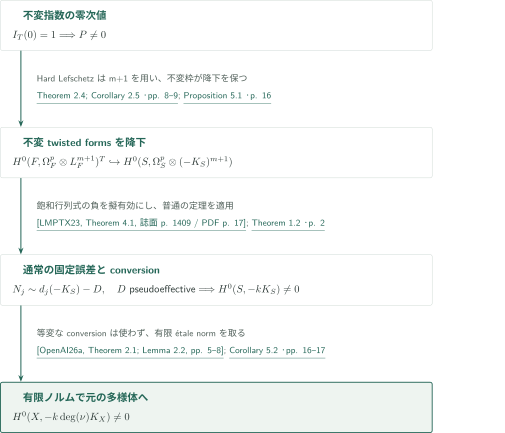
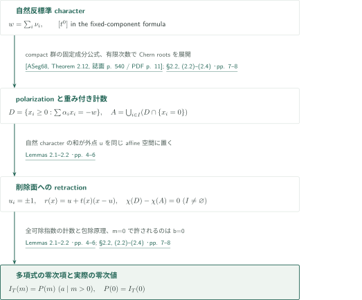
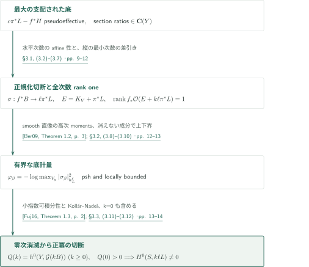
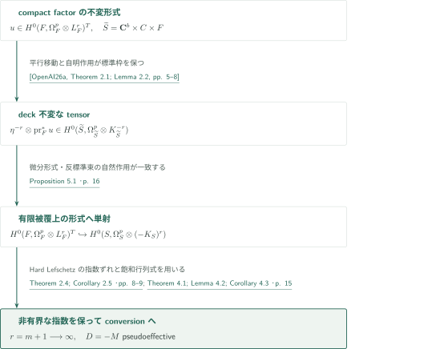

# 不変反標準指数とtwisted differentialsの変換

**零次の値を保つ二つの議論を、形式の降下で接続する**

OpenAI, *Invariant anticanonical indices and conversion of twisted differentials*（2026年9月26日版）は、不変Euler標数の多項式性と、固定した擬有効誤差を除く通常の非消滅を独立に証明する。応用では、トーラス不変の形式を有限被覆へ降下させた後でconversionを使う。この順序により、conversion自体の等変版を必要としない。

## 主要結果

### Theorem 1.1 — 不変反標準指数

compact complex manifold $F$にcompact real torus $T$が正則に作用し、$L_F=-K_F=\det T_F$に微分から来る自然線形化を入れる。
$$I_T(m)=\sum_{q\ge0}(-1)^q\dim H^q(F,L_F^m)^T\qquad(m\ge0)$$
と置くと、ある整数$a>0$と$P\in\mathbf Q[t]$が存在して
$$\begin{aligned}I_T(m)&=P(m)\quad(m\in a\mathbf Z_{>0}),\\P(0)&=I_T(0).\end{aligned}$$
射影性・Kähler性・正値性は仮定しない。自然線形化を任意のcharacter twistに変えることはできない。

<!-- cite:index -->[Theorem 1.1 · p. 1](https://github.com/openai/math/blob/fd4aeeb2ee4fc729c18d98444fed42fd0529eeeb/preprints/Invariant-anticanonical-indices-and-conversion-of-twisted-differentials-September-26-2026/main.pdf)<!-- /cite -->

### Theorem 1.2 — 擬有効誤差の除去

$S$は滑らかな連結複素射影多様体、$L=-K_S$は滑らかな半正値Hermitian計量を持つとする。$D$を擬有効Cartier因子とし、狭義増大する正整数列$m_j$に対して
$$H^0(S,\mathcal O_S(m_jL-D))\ne0$$
と仮定する。このときある整数$k>0$で$H^0(S,\mathcal O_S(kL))\ne0$となる。$D$が有効であること、$S$の有理連結性、Euler標数の仮定は不要であり、結論は通常の切断である。

<!-- cite:conversion -->[Theorem 1.2 · p. 2](https://github.com/openai/math/blob/fd4aeeb2ee4fc729c18d98444fed42fd0529eeeb/preprints/Invariant-anticanonical-indices-and-conversion-of-twisted-differentials-September-26-2026/main.pdf)<!-- /cite -->

### Corollary 5.2 — 滑らかな半正値性からの反標準非消滅

$X$を滑らかな連結複素射影多様体とする。$-K_X$が滑らかな半正値Hermitian計量を持つなら、ある整数$m>0$で$H^0(X,-mK_X)\ne0$である。第一冪や一様な指数は主張しない。

<!-- cite:global -->[Corollary 5.2 · pp. 16–17](https://github.com/openai/math/blob/fd4aeeb2ee4fc729c18d98444fed42fd0529eeeb/preprints/Invariant-anticanonical-indices-and-conversion-of-twisted-differentials-September-26-2026/main.pdf)<!-- /cite -->

## 図の矢印に付した引用

<!-- reference-guide -->
略号のない定理・補題・節・式番号は本原稿 [Invariant anticanonical indices and conversion of twisted differentials](https://github.com/openai/math/blob/fd4aeeb2ee4fc729c18d98444fed42fd0529eeeb/preprints/Invariant-anticanonical-indices-and-conversion-of-twisted-differentials-September-26-2026/main.pdf) を指します。外部入力には次の略号を使います。

- [Ber09](https://arxiv.org/pdf/math/0511225v2) Bo Berndtsson — *Curvature of vector bundles associated to holomorphic fibrations*：rank one随伴直像のL²計量の半正値性。arXiv:math/0511225v2, 2007-08-20; published 2009。
- [DPS01](https://arxiv.org/pdf/math/0006205v2) Jean-Pierre Demailly; Thomas Peternell; Michael Schneider — *Pseudo-effective line bundles on compact Kähler manifolds*：smooth係数Hard Lefschetzと不変twisted forms。arXiv:math/0006205v2, 2000-10-10; published 2001。
- [Fuj16](https://arxiv.org/pdf/1607.04684v1) Osamu Fujino — *Kollár–Nadel type vanishing theorem*：底方向に正な特異計量から高次直像の消滅。arXiv:1607.04684v1, 2016-07-15 (manuscript date 2016-07-10); published 2018。
- [DK01](https://arxiv.org/pdf/math/9910118v3) Jean-Pierre Demailly; János Kollár — *Semi-continuity of complex singularity exponents and Kähler–Einstein metrics on Fano orbifolds*：小さい指数でpsh重みを可積分にし乗数イデアルを自明にする。arXiv:math/9910118v3, 2013-11-14。
- [ASeg68](https://webhomes.maths.ed.ac.uk/~v1ranick/papers/as2.pdf) Michael F. Atiyah; Graeme B. Segal — *The index of elliptic operators. II*：compact群の固定成分に局所化するLefschetz公式。Annals of Mathematics 87 (1968), 531–545; scanned copy with one cover page。
- [ASin68](https://annals.math.princeton.edu/1968/87-3/p07) Michael F. Atiyah; Isadore M. Singer — *The index of elliptic operators. III*：固定点公式のcohomological表現とcompact complex Riemann–Roch。Annals of Mathematics 87 (1968), 546–604; scanned copy with one cover page。
- [LMPTX23](https://ems.press/content/serial-article-files/31138) Vladimir Lazić; Shin-ichi Matsumura; Thomas Peternell; Nikolaos Tsakanikas; Zhixin Xie — *The Nonvanishing Problem for varieties with nef anticanonical bundle*：nef反標準束のcotangent tensor部分層の負の第一Chern類が擬有効。Documenta Mathematica 28 (2023), 1393–1440; published PDF。
- [OpenAI26a](https://github.com/openai/math/blob/fd4aeeb2ee4fc729c18d98444fed42fd0529eeeb/preprints/Anticanonical-nonvanishing-from-smooth-semipositivity-September-26-2026/main.pdf) OpenAI — *Anticanonical nonvanishing from smooth semipositivity*：有限被覆・残余トーラス・不変標準枠と有限étale normのみ。September 26, 2026。

各引用に結果番号とページを付します。誌面番号とPDF内の位置が異なる場合は両方を示します。GitHubの閲覧リンクではページ位置への自動移動を前提としません。
<!-- /reference-guide -->

## Corollary 5.2 — 主定理の証明概略

<!-- proof-target:1 -->証明対象：[Corollary 5.2 · pp. 16–17](https://github.com/openai/math/blob/fd4aeeb2ee4fc729c18d98444fed42fd0529eeeb/preprints/Invariant-anticanonical-indices-and-conversion-of-twisted-differentials-September-26-2026/main.pdf)<!-- /proof-target -->

**証明の道筋。** Theorem 1.1とTheorem 1.2は互いに独立である。前者からcompact factor上の不変twisted formsを作り、有限被覆へ降下させる。そこで後者を用いて通常の反標準切断へ変換し、normで$X$へ戻す。

### 1. 不変Euler指数から固定次数の不変形式へ

有限被覆の普遍被覆を$\widetilde S=\mathbf C^b\times C\times F$とし、$C$はRicci平坦、$F$は無正次数形式のcompact factorとする。残余作用はcompact torus $T$を通る。Hodge対称性から$H^q(F,\mathcal O_F)=0$（$q>0$）なので$I_T(0)=1$である。Theorem 1.1の多項式は非零となり、ある固定$q$に対して$H^q(F,L_F^m)^T$が非有界な$m$で非零になる。係数を$L_F^{m+1}$としたHard Lefschetzとcompact averagingにより、固定$p$で$H^0(F,\Omega_F^p\otimes L_F^{m+1})^T\ne0$を得る。

<!-- cite:openai26a -->[&#91;OpenAI26a, Theorem 2.1; Lemma 2.2, pp. 5–8&#93;](https://github.com/openai/math/blob/fd4aeeb2ee4fc729c18d98444fed42fd0529eeeb/preprints/Anticanonical-nonvanishing-from-smooth-semipositivity-September-26-2026/main.pdf)<!-- /cite -->

<!-- cite:forms -->[Theorem 2.4; Corollary 2.5 · pp. 8–9](https://github.com/openai/math/blob/fd4aeeb2ee4fc729c18d98444fed42fd0529eeeb/preprints/Invariant-anticanonical-indices-and-conversion-of-twisted-differentials-September-26-2026/main.pdf)<!-- /cite --> <!-- cite:dps01 -->[&#91;DPS01, Theorem 2.1.1, p. 8&#93;](https://arxiv.org/pdf/math/0006205v2#page=8)<!-- /cite -->

### 2. 形式を降下してから擬有効誤差を作る

不変標準枠を掛けるProposition 5.1により、不変形式は$S$上の$H^0(S,\Omega_S^p\otimes(-K_S)^r)$へ単射で移る。$p>0$ならgeneric spanの固定した行列式を取り、cotangent tensor内で飽和した線束$M$を得る。nef性で$-M$が擬有効となり、$D=-M$と置けば、無限の形式は有効因子$N_j\sim d_j(-K_S)-D$へ変わる。$p=0$では既に反標準切断である。

<!-- cite:descent -->[Proposition 5.1 · p. 16](https://github.com/openai/math/blob/fd4aeeb2ee4fc729c18d98444fed42fd0529eeeb/preprints/Invariant-anticanonical-indices-and-conversion-of-twisted-differentials-September-26-2026/main.pdf)<!-- /cite --> <!-- cite:determinant -->[Theorem 4.1; Lemma 4.2; Corollary 4.3 · p. 15](https://github.com/openai/math/blob/fd4aeeb2ee4fc729c18d98444fed42fd0529eeeb/preprints/Invariant-anticanonical-indices-and-conversion-of-twisted-differentials-September-26-2026/main.pdf)<!-- /cite --> <!-- cite:lmptx23 -->[&#91;LMPTX23, Theorem 4.1, 誌面 p. 1409 / PDF p. 17&#93;](https://ems.press/content/serial-article-files/31138)<!-- /cite -->

### 3. 通常のconversionと有限étale norm

$S$の反標準計量は$X$からの滑らかな半正値引戻しであり、Theorem 1.2を適用できる。得られた$-kK_S$の通常の切断を、次数$d=\deg(S/X)$のnormで$-dkK_X$の非零切断へ送る。この段階で切断に$T$-不変性を要求しない。有限被覆を大域的直積と扱う必要もない。

<!-- cite:conversion -->[Theorem 1.2 · p. 2](https://github.com/openai/math/blob/fd4aeeb2ee4fc729c18d98444fed42fd0529eeeb/preprints/Invariant-anticanonical-indices-and-conversion-of-twisted-differentials-September-26-2026/main.pdf)<!-- /cite --> <!-- cite:global -->[Corollary 5.2 · pp. 16–17](https://github.com/openai/math/blob/fd4aeeb2ee4fc729c18d98444fed42fd0529eeeb/preprints/Invariant-anticanonical-indices-and-conversion-of-twisted-differentials-September-26-2026/main.pdf)<!-- /cite --> <!-- cite:openai26a -->[&#91;OpenAI26a, Theorem 2.1; Lemma 2.2, pp. 5–8&#93;](https://github.com/openai/math/blob/fd4aeeb2ee4fc729c18d98444fed42fd0529eeeb/preprints/Anticanonical-nonvanishing-from-smooth-semipositivity-September-26-2026/main.pdf)<!-- /cite -->

## Theorem 1.1 — 格子点計数の零次項を保持する

<!-- proof-target:2 -->証明対象：[Theorem 1.1 · p. 1](https://github.com/openai/math/blob/fd4aeeb2ee4fc729c18d98444fed42fd0529eeeb/preprints/Invariant-anticanonical-indices-and-conversion-of-twisted-differentials-September-26-2026/main.pdf)<!-- /proof-target -->

主張は[主要結果](#theorem-1-1)を参照。原稿の二つの組合せ補題が、多項式性と実際の零次指数の一致を別々に担う。

### 1. 固定成分公式を全ての可除指数の多項式へ

固定成分$Z\subset F^T$で、法接束のcharactersを$\nu_i$、形式的Chern rootsを$x_i$とする。自然反標準characterは$w=\sum_i\nu_i$であり、局所寄与は
$$\int_Z\operatorname{td}(Z)e^{m c_1(L_F|_Z)}t^{mw}\prod_i(1-t^{-\nu_i}e^{-x_i})^{-1}.$$
一つの整数方向で分母をpolarizeすると、自明characterの係数は$\sum_i\alpha_i b_i=-mw$、$b_i>0$（$i\in I$）、$b_i\ge0$（それ以外）の重み付き格子点計数となる。全$\alpha_i$は同じ線型汎函数で正である。Lemma 2.1は閉有理多面体を格子単体に分割し、基本平行多面体と二項係数恒等式(2.1)から小さい指数も含む全可除指数での多項式を得る。次数は切り詰めたcohomologyで有限となり、最後に対称な全寄与だけを特性類として積分する。

<!-- cite:localization -->[§2.2, (2.2)–(2.4) · pp. 7–8](https://github.com/openai/math/blob/fd4aeeb2ee4fc729c18d98444fed42fd0529eeeb/preprints/Invariant-anticanonical-indices-and-conversion-of-twisted-differentials-September-26-2026/main.pdf)<!-- /cite --> <!-- cite:weighted -->[Lemmas 2.1–2.2 · pp. 4–6](https://github.com/openai/math/blob/fd4aeeb2ee4fc729c18d98444fed42fd0529eeeb/preprints/Invariant-anticanonical-indices-and-conversion-of-twisted-differentials-September-26-2026/main.pdf)<!-- /cite --> <!-- cite:aseg68 -->[&#91;ASeg68, Theorem 2.12, 誌面 p. 540 / PDF p. 11&#93;](https://webhomes.maths.ed.ac.uk/~v1ranick/papers/as2.pdf#page=11)<!-- /cite --> <!-- cite:asin68 -->[&#91;ASin68, Theorems 3.9, 4.3, 誌面 pp. 562–565 / PDF pp. 18–21&#93;](https://annals.math.princeton.edu/1968/87-3/p07)<!-- /cite -->

### 2. 自然線形化が削除面へのretractionを与える

$D=\{x_i\ge0:\sum\alpha_i x_i=-w\}$、$A=\bigcup_{i\in I}(D\cap\{x_i=0\})$とする。$I\ne\varnothing,D\ne\varnothing$なら、$u_i=-1$（$i\in I$）、$u_i=1$（それ以外）が同じaffine空間に属す。これは$w=\sum\nu_i$を用いる箇所である。$t(x)=\max_{i\in I}(x_i+1)^{-1}$、$r(x)=u+t(x)(x-u)$は$D$から$A$へのretractionで、線分homotopyは$A$を固定する。従って$\chi(D)=\chi(A)=1$で、包除原理による多項式定数項は$(\chi(D)-\chi(A))W(0,0)=0$となる。

$I=\varnothing$なら閉計数の定数項$W(0,0)$が残る。実際の$m=0$でも正のpairingが$b=0$を強制し、これが許されるのは$I=\varnothing$の場合だけである。従って$P(0)=I_T(0)$。$F^T=\varnothing$なら固定点公式とcharacterの連続性から全指数で$I_T=0$、$P=0$とする。自明作用・零次元多面体も同じ式に含まれる。非閉集合$D\setminus A$の通常のEuler標数を用いるのではなく、compactな二つのEuler標数の差を用いる。

<!-- cite:weighted -->[Lemmas 2.1–2.2 · pp. 4–6](https://github.com/openai/math/blob/fd4aeeb2ee4fc729c18d98444fed42fd0529eeeb/preprints/Invariant-anticanonical-indices-and-conversion-of-twisted-differentials-September-26-2026/main.pdf)<!-- /cite --> <!-- cite:localization -->[§2.2, (2.2)–(2.4) · pp. 7–8](https://github.com/openai/math/blob/fd4aeeb2ee4fc729c18d98444fed42fd0529eeeb/preprints/Invariant-anticanonical-indices-and-conversion-of-twisted-differentials-September-26-2026/main.pdf)<!-- /cite -->

## Theorem 1.2 — 有界な底計量と零次の消滅

<!-- proof-target:3 -->証明対象：[Theorem 1.2 · p. 2](https://github.com/openai/math/blob/fd4aeeb2ee4fc729c18d98444fed42fd0529eeeb/preprints/Invariant-anticanonical-indices-and-conversion-of-twisted-differentials-September-26-2026/main.pdf)<!-- /proof-target -->

主張は[主要結果](#theorem-1-2)を参照。指数定理に依存せず、反標準恒等式を二度使ってEuler多項式の零次値を確保する。

### 1. 最大の支配された底と縦次数の正規化

$\pi:V\to S$上で$c\pi^*L-f^*H$が擬有効（$H$は底$Y$上のample divisor）となる有理写像のうち、底の次元が最大のものを選ぶ。函数体も相対代数閉にする。$c'L-A$が擬有効なら、$A$の二つの切断比は$\mathbf C(Y)$に属する。そうでなければpencilとの積がより大きい支配された底を与える。

$N_j\sim m_jL-D$の間の式(3.3)から水平次数は$m_j$のaffine函数となる。非負性と$m_j\to\infty$が$N_2-N_1$の水平有効性を与える。normal modelで各底素因子上の最小正規化次数を差し引き、分母を払えば$\sigma:f^*B\to\ell\pi^*L$（$\ell>0$）を得る。各底素因子上の少なくとも一成分で$\sigma$は消えない。底が点ならこの時点で正冪の切断が得られる。

<!-- cite:base -->[§3.1, (3.2)–(3.7) · pp. 9–12](https://github.com/openai/math/blob/fd4aeeb2ee4fc729c18d98444fed42fd0529eeeb/preprints/Invariant-anticanonical-indices-and-conversion-of-twisted-differentials-September-26-2026/main.pdf)<!-- /cite -->

### 2. rank oneの積分から有界最大値計量へ

$E=K_V-\pi^*K_S=K_V+\pi^*L$は有効例外因子で、標準切断を$e$とする。最大性は全$k\ge0$に対し$f_*\mathcal O_V(E+k\ell\pi^*L)$のgeneric rankを1にする。rankが大きければ、十分な底のample twistで二つの切断を作り、その比を押し下げることで最大性に反する。

$B$の局所枠$\beta$に対し、smooth-fiber locusで
$$\varphi_\beta=-\log\max_{V_y}|\sigma_\beta|^2_{h_L^\ell}$$
と置く。Berndtssonの定理は$e\sigma_\beta^k/f^*\tau$の$L^2$積分の$-1/k$倍対数にpsh性を与える。正の全台測度に対する高次momentsの極限とDiniの定理により、この極限は$\varphi_\beta$に局所一様収束する。propernessは重みの下界を与え、$\sigma$が消えない成分を使う局所power-map表示は上界を与える。divisorとcodimension twoを越えて延長し、局所有界な半正値計量$h_B$を得る。

<!-- cite:metric -->[§3.2, (3.8)–(3.10) · pp. 12–13](https://github.com/openai/math/blob/fd4aeeb2ee4fc729c18d98444fed42fd0529eeeb/preprints/Invariant-anticanonical-indices-and-conversion-of-twisted-differentials-September-26-2026/main.pdf)<!-- /cite --> <!-- cite:ber09 -->[&#91;Ber09, Theorem 1.2, p. 3&#93;](https://arxiv.org/pdf/math/0511225v2#page=3)<!-- /cite -->

### 3. k=0を含む消滅が非零多項式を保証する

擬有効支配から底方向に正の特異計量を作り、滑らかな$h_L$と小さい比率で混合する。psh重みの小指数可積分性により、ある$\varepsilon>0$で$\Theta_h(\pi^*L)\ge\varepsilon f^*\omega_H$かつ$\mathcal I(h)=\mathcal O_V$となる。$h_B$が有界なので全ての固定$k\ge0$について$f^*h_B^k$を掛けても乗数イデアルは変わらない。Fujinoの定理を$q=0$で用いると
$$H^i(Y,\mathcal G\otimes\mathcal O_Y(kB))=0\quad(i>0,k\ge0),\qquad\mathcal G=f_*\mathcal O_V(E).$$
従って$Q(k)=\chi(Y,\mathcal G(kB))=h^0(Y,\mathcal G(kB))$は零を含む全非負指数で成り立つ。$e$により$Q(0)>0$なので$Q$は非零、多くの正の$k$で切断がある。これに$\sigma^k$を掛け、$\pi_*\mathcal O_V(E)=\mathcal O_S$で押し下げれば$k\ell L$の切断を得る。$L=-K_S$はrank oneの随伴式と、この零次の固定層の両方に使われる。

<!-- cite:vanishing -->[§3.3, (3.11)–(3.12) · pp. 13–14](https://github.com/openai/math/blob/fd4aeeb2ee4fc729c18d98444fed42fd0529eeeb/preprints/Invariant-anticanonical-indices-and-conversion-of-twisted-differentials-September-26-2026/main.pdf)<!-- /cite --> <!-- cite:dk01 -->[&#91;DK01, §1.4(8), p. 7&#93;](https://arxiv.org/pdf/math/9910118v3#page=7)<!-- /cite --> <!-- cite:fuj18 -->[&#91;Fuj16, Theorem 1.3, p. 2&#93;](https://arxiv.org/pdf/1607.04684v1#page=2)<!-- /cite -->

## Proposition 5.1 — conversionより前に形式を降下する

<!-- proof-target:4 -->証明対象：[Proposition 5.1 · p. 16](https://github.com/openai/math/blob/fd4aeeb2ee4fc729c18d98444fed42fd0529eeeb/preprints/Invariant-anticanonical-indices-and-conversion-of-twisted-differentials-September-26-2026/main.pdf)<!-- /proof-target -->

<!-- statement:proposition-5-1 -->
### Proposition 5.1 — 不変twisted formsの降下

$\nu:S\to X$を上記の有限被覆とし、$\widetilde S=\mathbf C^b\times C\times F$、deck群は$\mathbf C^b$に平行移動、$C$に自明、$F$にcompact torus $T$を通って作用するとする。$C$と$\mathbf C^b$のdeck不変標準枠を選ぶと、全$r\ge0$、$0\le p\le\dim F$について単射
$$H^0(F,\Omega_F^p\otimes(-K_F)^r)^T\hookrightarrow H^0(S,\Omega_S^p\otimes(-K_S)^r)$$
が存在する。さらにある固定$p$で右辺は非有界な正整数$r$に対して非零である。

<!-- cite:descent -->[Proposition 5.1 · p. 16](https://github.com/openai/math/blob/fd4aeeb2ee4fc729c18d98444fed42fd0529eeeb/preprints/Invariant-anticanonical-indices-and-conversion-of-twisted-differentials-September-26-2026/main.pdf)<!-- /cite -->
<!-- /statement -->

### 1. 自然作用が二つのtensor因子で一致する

不変標準枠の積を$\eta$とする。不変形式$u$を$\eta^{-r}\otimes\operatorname{pr}_F^*u$へ送ると、微分形式と反標準束の双方の自然作用がdeck作用と一致するため降下できる。射影による形式の引戻しは単射で、枠とのtensorは可逆、局所被覆も非消滅を保つ。$S$の射影性により降下した正則切断は代数的である。

<!-- cite:descent -->[Proposition 5.1 · p. 16](https://github.com/openai/math/blob/fd4aeeb2ee4fc729c18d98444fed42fd0529eeeb/preprints/Invariant-anticanonical-indices-and-conversion-of-twisted-differentials-September-26-2026/main.pdf)<!-- /cite --> <!-- cite:openai26a -->[&#91;OpenAI26a, Theorem 2.1; Lemma 2.2, pp. 5–8&#93;](https://github.com/openai/math/blob/fd4aeeb2ee4fc729c18d98444fed42fd0529eeeb/preprints/Anticanonical-nonvanishing-from-smooth-semipositivity-September-26-2026/main.pdf)<!-- /cite -->

### 2. 指数のずれと行列式の飽和を保つ

$I_T(0)=1$とCorollary 2.5の指数は$m+1$なので、降下写像には$r=m+1$を入れる。$F$が点なら$p=0$で同じ結論を得る。降下後の$p>0$では、generic spanの基底$r'$本のうち一本を無限のtwisted formsで置き換えて外積を取る。新指数は$m_j+$固定和で非有界のままである。$\bigwedge^{r'}\Omega_S^p$内の飽和線束$M$は反射的なので線束となり、tensor powerの直和因子への包含で飽和性を保つ。LMPTX23の定理はこの$-M$を擬有効にする。そこで通常のTheorem 1.2を適用するので、不変形式を不変反標準切断に直接変換したとは述べない。

<!-- cite:forms -->[Theorem 2.4; Corollary 2.5 · pp. 8–9](https://github.com/openai/math/blob/fd4aeeb2ee4fc729c18d98444fed42fd0529eeeb/preprints/Invariant-anticanonical-indices-and-conversion-of-twisted-differentials-September-26-2026/main.pdf)<!-- /cite --> <!-- cite:determinant -->[Theorem 4.1; Lemma 4.2; Corollary 4.3 · p. 15](https://github.com/openai/math/blob/fd4aeeb2ee4fc729c18d98444fed42fd0529eeeb/preprints/Invariant-anticanonical-indices-and-conversion-of-twisted-differentials-September-26-2026/main.pdf)<!-- /cite --> <!-- cite:lmptx23 -->[&#91;LMPTX23, Theorem 4.1, 誌面 p. 1409 / PDF p. 17&#93;](https://ems.press/content/serial-article-files/31138)<!-- /cite -->

## 直接入力とカタログ内の接続

01「Anticanonical nonvanishing from smooth semipositivity」から使うのは有限被覆のTheorem 2.1とnormのLemma 2.2のみである。01の通常非消滅Theorem 1.2や不変非消滅Theorem 7.2は本稿の二つの主定理の入力ではない。本稿のCorollary 5.2は同じ非消滅結論への別経路であり、幾何入力の共有と証明全体の独立性を区別する。

## 原典を読む入口と確認範囲

<!-- reading-list -->
- [Lemmas 2.1–2.2 · pp. 4–6](https://github.com/openai/math/blob/fd4aeeb2ee4fc729c18d98444fed42fd0529eeeb/preprints/Invariant-anticanonical-indices-and-conversion-of-twisted-differentials-September-26-2026/main.pdf) — 全ての可除指数と零次項を保つ数え上げ
- [§2.2, (2.2)–(2.4) · pp. 7–8](https://github.com/openai/math/blob/fd4aeeb2ee4fc729c18d98444fed42fd0529eeeb/preprints/Invariant-anticanonical-indices-and-conversion-of-twisted-differentials-September-26-2026/main.pdf) — 自然反標準指標からdeleted facesを得る
- [§3.1, (3.2)–(3.7) · pp. 9–12](https://github.com/openai/math/blob/fd4aeeb2ee4fc729c18d98444fed42fd0529eeeb/preprints/Invariant-anticanonical-indices-and-conversion-of-twisted-differentials-September-26-2026/main.pdf) — 最大底・水平次数・全次数rank one
- [§3.2, (3.8)–(3.10) · pp. 12–13](https://github.com/openai/math/blob/fd4aeeb2ee4fc729c18d98444fed42fd0529eeeb/preprints/Invariant-anticanonical-indices-and-conversion-of-twisted-differentials-September-26-2026/main.pdf) — 最大値計量と境界の上下界
- [§3.3, (3.11)–(3.12) · pp. 13–14](https://github.com/openai/math/blob/fd4aeeb2ee4fc729c18d98444fed42fd0529eeeb/preprints/Invariant-anticanonical-indices-and-conversion-of-twisted-differentials-September-26-2026/main.pdf) — k=0を含む消滅と非零Euler多項式
- [Proposition 5.1 · p. 16](https://github.com/openai/math/blob/fd4aeeb2ee4fc729c18d98444fed42fd0529eeeb/preprints/Invariant-anticanonical-indices-and-conversion-of-twisted-differentials-September-26-2026/main.pdf) — conversionより前に不変形式を降下
<!-- /reading-list -->

編集側は原稿pp.1–17の主張と証明、固定成分公式の原典（スキャンの誌面540/PDF11、誌面562–565/PDF18–21）、Berndtsson・Fujino・Demailly–Kollár・DPS・LMPTXの入力記述と使用箇所、01の被覆・normを照合した。Hilbert schemeによるmodel構成の元文献、固定点計算の全ての形式的root操作、外部定理の証明を再帰的に検証してはいない。重み付き計数・境界延長は証明本文を追ったが独立再証明ではない。これは著者の主張への読解案内であり、専門家査読や形式検証ではない。
