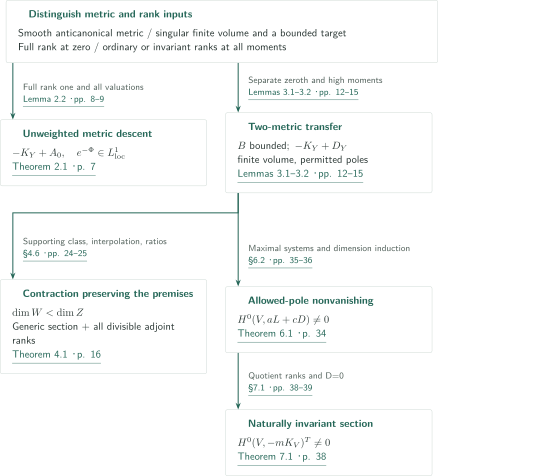
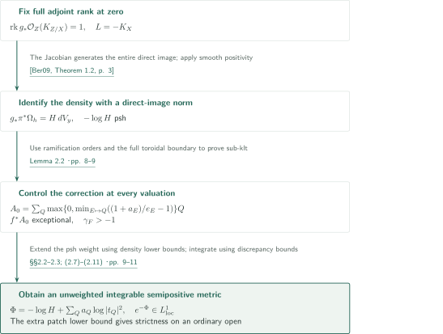
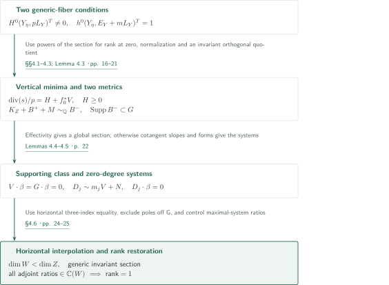
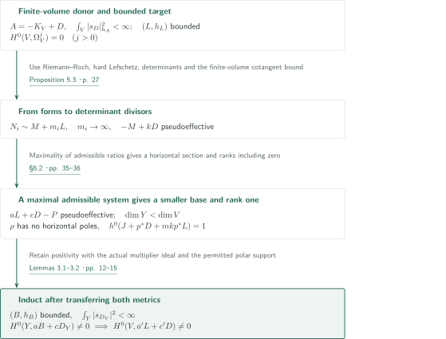
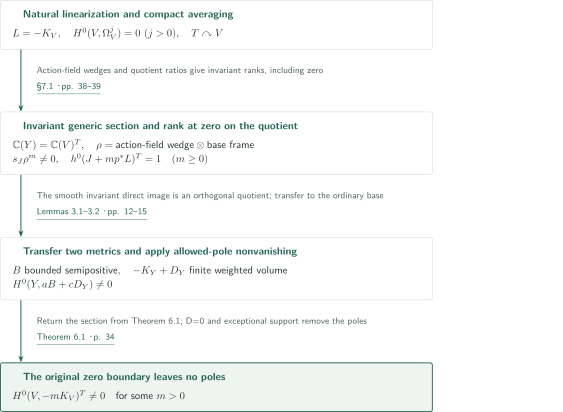

# Metric descent and rank-preserving contractions

**Adjoint rank at exponent zero, two metrics, and section ratios after contraction**

This manuscript separates descent of an anticanonical metric to a base from control of the poles of sections returning to the original variety. Its principal outputs are an unweighted integrable base metric, a contraction preserving a generic section and adjoint ranks, allowed-pole nonvanishing, and naturally invariant anticanonical sections. We present Theorems 2.1, 4.1, 6.1 and 7.1 in their original order.

## 1. Main results

### Theorem 2.1 — Toroidal volume metric

Let $X,Y$ be smooth connected projective complex varieties, $d=\dim Y>0$, and suppose $L=-K_X$ carries a smooth semipositive Hermitian metric $h$ with curvature $\alpha$. Let $W$ be normal and integral, with projective morphisms $p:W\to X$ birational and $f:W\to Y$ surjective, equidimensional and toroidal for strict toroidal embeddings. For a smooth projective resolution $\rho:Z\to W$, put $\pi=p\rho$, $g=f\rho$, $E_Z=K_{Z/X}$ and assume the **full** direct image satisfies $\operatorname{rk}g_*\mathcal O_Z(E_Z)=1$.

For a prime $Q$ on the base and a prime $E$ on $W$ dominating it, put $a_E=\operatorname{ord}_E K_{W/X}$ and $e_E=\operatorname{ord}_E f^*Q$. Then

$$
a_Q=\max\left\{0,\min_{f(E)=Q}\left(\frac{1+a_E}{e_E}-1\right)\right\},\qquad A_0=\sum_Q a_QQ
$$

is an effective rational divisor of finite support, and $f^*A_0$ is $p$-exceptional. The rational line bundle $-K_Y+A_0$ has a semipositive singular Hermitian metric whose squared frame norms are locally integrable **without a divisor weight**; the metric is smooth on a nonempty Zariski open subset.

Moreover, let $U\subset Y$ be a nonempty Zariski open where $g$ is smooth and adjoint direct-image base change holds. If some nonempty ordinary open patch $V\subset g^{-1}(U)\setminus\operatorname{Supp}E_Z$, Kähler form $\omega_Y$ and $c>0$ satisfy $\pi^*\alpha\ge cg^*\omega_Y$ on $V$, the constructed metric has strictly positive curvature on a nonempty ordinary open subset of $Y$. This is not a global Kähler lower bound.

<!-- cite:t21 -->[Theorem 2.1 · p. 7](https://github.com/openai/math/blob/fd4aeeb2ee4fc729c18d98444fed42fd0529eeeb/preprints/Metric-descent-and-rank-preserving-contractions-September-26-2026/main.pdf)<!-- /cite -->

### Theorem 4.1 — Rank-preserving contraction

Let $X$ be smooth connected projective over $\mathbb C$, with $H^0(X,\Omega_X^q)=0$ for every $q>0$, and let $L=-K_X$ carry a smooth semipositive metric. Let an algebraic torus $T$ act on $X$, with its natural linearization on $L$. Let $f:X\dashrightarrow Z$ be a dominant $T$-invariant rational map to a smooth connected projective variety, with $\mathbb C(Z)$ relatively algebraically closed in $\mathbb C(X)$. On a resolution $\pi:Y\to X$, $f_Y:Y\to Z$, put $L_Y=\pi^*L$, $E_Y=K_{Y/X}$ and $\eta=\operatorname{Spec}\mathbb C(Z)$. Assume

$$
H^0(Y_\eta,pL_Y|_{Y_\eta})^T\ne0\quad\text{for some }p>0,
$$

and that for **every positive multiple** $m$ of some $a>0$,

$$
\dim_{\mathbb C(Z)}H^0(Y_\eta,(E_Y+mL_Y)|_{Y_\eta})^T=1.
$$

Then either $H^0(X,rL)^T\ne0$ for some $r>0$, or there is a dominant rational map $Z\dashrightarrow W$ to a smooth connected projective variety with $\dim W<\dim Z$. In the latter case $X\dashrightarrow W$ satisfies the same two conditions, possibly with different integers, and $\mathbb C(W)$ is relatively algebraically closed in $\mathbb C(X)$.

<!-- cite:t41 -->[Theorem 4.1 · p. 16](https://github.com/openai/math/blob/fd4aeeb2ee4fc729c18d98444fed42fd0529eeeb/preprints/Metric-descent-and-rank-preserving-contractions-September-26-2026/main.pdf)<!-- /cite -->

### Theorem 6.1 — Allowed-pole nonvanishing

Let $V$ be smooth connected projective over $\mathbb C$ with $H^0(V,\Omega_V^j)=0$ for every $j>0$. Let $D\ge0$ be integral. Suppose $A=-K_V+D$ has a semipositive singular metric $h_A$ for which the measure $|s_D|_{h_A}^2$, viewing $s_D$ as an $A$-valued top form, has finite total mass. If $L$ has a semipositive metric with locally bounded weights, then

$$
H^0(V,aL+cD)\ne0\quad\text{for some integers }a>0,\ c\ge0.
$$

The same holds for a rational line bundle $L$, with $a$ clearing its denominator. Here $L$ need not be anticanonical.

<!-- cite:t61 -->[Theorem 6.1 · p. 34](https://github.com/openai/math/blob/fd4aeeb2ee4fc729c18d98444fed42fd0529eeeb/preprints/Metric-descent-and-rank-preserving-contractions-September-26-2026/main.pdf)<!-- /cite -->

### Theorem 7.1 — Naturally invariant anticanonical sections

Let $V$ be smooth connected projective over $\mathbb C$, with $H^0(V,\Omega_V^j)=0$ for every $j>0$, and suppose $-K_V$ has a smooth semipositive Hermitian metric. For **each** algebraic torus $T$ acting on $V$, there exists an integer $m>0$ such that, for the natural anticanonical action,

$$
H^0(V,-mK_V)^T\ne0.
$$

The statement neither fixes $m=1$ nor allows an arbitrary character twist of the linearization.

<!-- cite:t71 -->[Theorem 7.1 · p. 38](https://github.com/openai/math/blob/fd4aeeb2ee4fc729c18d98444fed42fd0529eeeb/preprints/Metric-descent-and-rank-preserving-contractions-September-26-2026/main.pdf)<!-- /cite -->

## References on the arrows

<!-- reference-guide -->
Unprefixed theorem, lemma, section and equation numbers refer to [Metric descent and rank-preserving contractions](https://github.com/openai/math/blob/fd4aeeb2ee4fc729c18d98444fed42fd0529eeeb/preprints/Metric-descent-and-rank-preserving-contractions-September-26-2026/main.pdf). External inputs use the following keys.

- [Ber09](https://arxiv.org/pdf/math/0511225v2) Bo Berndtsson — *Curvature of vector bundles associated to holomorphic fibrations*: Smooth direct-image positivity and its curvature formula, for full rank one or an invariant orthogonal quotient. arXiv:math/0511225v2, 20 August 2007.
- [DPS01](https://arxiv.org/pdf/math/0006205v2) Jean-Pierre Demailly; Thomas Peternell; Michael Schneider — *Pseudo-effective line bundles on compact Kähler manifolds*: Convert nonzero cohomology to twisted forms; bounded weights make all multiplier ideals trivial. arXiv:math/0006205v2, 10 October 2000.
- [CP19](https://www.numdam.org/item/10.1007/s10240-019-00105-w.pdf) Frédéric Campana; Mihai Păun — *Foliations with positive slopes and birational stability of orbifold cotangent bundles*: Use orbifold quotient slopes for an effective boundary with ample perturbation, not directly for a signed boundary. Publications Mathématiques de l’IHÉS 129 (2019), 1–49.
- [HPS](https://people.math.harvard.edu/~mpopa/papers/HPS.pdf) Christopher D. Hacon; Mihnea Popa; Christian Schnell — *Algebraic fiber spaces over abelian varieties: around a recent theorem by Cao and Păun*: Metric on the direct image with the actual multiplier ideal; an integrable generator spans the rank-one direct image. Author-hosted 53-page manuscript, retrieved 12 October 2026.
- [PT14](https://arxiv.org/pdf/1409.5504v1) Mihai Păun; Shigeharu Takayama — *Positivity of twisted relative pluricanonical bundles and their direct images*: Underlying singular L2 direct-image positivity, including the generic multiplier-ideal isomorphism condition. arXiv:1409.5504v1, 19 September 2014.
- [Ou23](https://arxiv.org/pdf/1703.03175v4) Wenhao Ou — *On generic nefness of tangent sheaves*: Relative pseudoeffectivity in Druel’s formulation and algebraicity of foliations, used for the finite-volume cotangent estimate. arXiv:1703.03175v4.
- [BDPP13](https://arxiv.org/pdf/math/0405285v1) Sébastien Boucksom; Jean-Pierre Demailly; Mihai Păun; Thomas Peternell — *The pseudo-effective cone of a compact Kähler manifold and varieties of negative Kodaira dimension*: Cone duality supplies a movable class annihilating a nonbig pseudoeffective divisor. arXiv:math/0405285v1, 14 May 2004.

Each citation gives the result and pages. When printed pagination differs from the PDF position, both are shown. GitHub previews do not automatically jump to the cited page.
<!-- /reference-guide -->

## 2. Theorem 4.1 — Proof overview of the main theorem

<!-- proof-target:1 -->Proof target：[Theorem 4.1 · p. 16](https://github.com/openai/math/blob/fd4aeeb2ee4fc729c18d98444fed42fd0529eeeb/preprints/Metric-descent-and-rank-preserving-contractions-September-26-2026/main.pdf)<!-- /proof-target -->

**Proof route.** Metric descent and section descent are separate operations. Section descent must restore adjoint ranks as well as existence so that another contraction is possible. The manuscript also has parallel routes: Theorem 7.1 follows from Theorem 6.1 and two-metric transfer, without Theorem 4.1.

### 1. Two base metrics and two exits

Theorem 2.1 uses full adjoint rank one at exponent zero and an explicit $A_0$ to construct an unweighted integrable metric on $-K_Y+A_0$. Lemmas 3.1–3.2 instead transfer two lines separately: a finite-volume donor and a bounded-metric target. Theorem 4.1 uses their smooth invariant version and ratios of divisors annihilated by a supporting movable class to choose a smaller base. Theorem 6.1 uses the ordinary singular version to close dimension induction. Their rank hypotheses are distinct.

<!-- cite:transfer -->[Lemmas 3.1–3.2 · pp. 12–15](https://github.com/openai/math/blob/fd4aeeb2ee4fc729c18d98444fed42fd0529eeeb/preprints/Metric-descent-and-rank-preserving-contractions-September-26-2026/main.pdf)<!-- /cite -->

### 2. The route to nonvanishing

On the generic quotient fiber in Theorem 7.1, a wedge of infinitesimal action fields gives an invariant section, and invariant section ratios descend to the quotient field. This supplies invariant adjoint rank one, including exponent zero. Apply Theorem 6.1 on the transferred base; the original allowed boundary $D=0$ ensures that no poles remain. This route does not assume the contraction theorem's premises without constructing them.

<!-- cite:quotient -->[§7.1 · pp. 38–39](https://github.com/openai/math/blob/fd4aeeb2ee4fc729c18d98444fed42fd0529eeeb/preprints/Metric-descent-and-rank-preserving-contractions-September-26-2026/main.pdf)<!-- /cite -->

## 3. Proof of Theorem 2.1 — Curvature and unweighted integrability

<!-- proof-target:2 -->Proof target：[Theorem 2.1 · p. 7](https://github.com/openai/math/blob/fd4aeeb2ee4fc729c18d98444fed42fd0529eeeb/preprints/Metric-descent-and-rank-preserving-contractions-September-26-2026/main.pdf)<!-- /proof-target -->

The statement appears above. Equidimensionality of $W$ is an assumption; the smooth resolution $Z$ need not be equidimensional.

### 1. Exceptional support and all valuations

If $a_Q>0$, every prime above $Q$ has $a_E>0$ and is exceptional over $X$. Equidimensionality makes every vertical prime dominate a base prime, preventing support from being hidden over higher codimension. Put $\Theta=-K_{W/X}+f^*A_0\le0$ and let $D_W$ be the full toroidal boundary. The effective rational Cartier divisor $B=D_W-\Theta$ contains $D_W$, and

$$
A_{W,\Theta}(v)=A_{W,D_W}(v)+v(B)>0
$$

for every divisorial valuation. Thus $\gamma_F=\operatorname{coeff}_F(K_{Z'/X}-(g')^*A_0)>-1$ also for new exceptional divisors above boundary intersections. Checking only the primes already visible on $W$ would not suffice.

<!-- cite:l22 -->[Lemma 2.2 · pp. 8–9](https://github.com/openai/math/blob/fd4aeeb2ee4fc729c18d98444fed42fd0529eeeb/preprints/Metric-descent-and-rank-preserving-contractions-September-26-2026/main.pdf)<!-- /cite -->

### 2. Identify the integrated density and extend its metric

Write $g_*\pi^*\Omega_h=H(y)dV_y$. Full rank one and the Jacobian section identify $g_*(K_{Z/Y}+\pi^*L)\simeq-K_Y$ on a smooth open, so $H$ is the $L^2$ norm on the direct-image line. Smooth direct-image positivity gives plurisubharmonicity of $-\log H$. This does not restrict a positive metric to an arbitrary subline.

The corrected weight is $\Phi=-\log H+\sum a_Q\log|t_Q|^2$. A **lower bound for the density** from ramification orders gives the local upper bound for $\Phi$ needed for psh extension. Separately,

$$
e^{-\Phi}dV_y=g'_*\!\left(\prod_Q|t_Q\circ g'|^{-2a_Q}(\pi')^*\Omega_h\right).
$$

The inequalities $\gamma_F>-1$ make the upstairs measure a bounded positive factor times $\prod|z_j|^{2\gamma_j}$, hence locally integrable. Properness supplies local integrability downstairs. This is integrability of the frame norm itself, not integrability after multiplication by $s_{A_0}$. The original smooth open retains a smooth density.

<!-- cite:ber -->[&#91;Ber09, Theorem 1.2, p. 3&#93;](https://arxiv.org/pdf/math/0511225v2#page=3)<!-- /cite -->

<!-- cite:metric-proof -->[§§2.2–2.3; (2.7)–(2.11) · pp. 9–11](https://github.com/openai/math/blob/fd4aeeb2ee4fc729c18d98444fed42fd0529eeeb/preprints/Metric-descent-and-rank-preserving-contractions-September-26-2026/main.pdf)<!-- /cite -->

### 3. Strict positivity on an ordinary open

On the extra patch $V$, the Jacobian generator is nonzero. The curvature formula for a Chern-normal generator separates the integral of coefficient curvature from a nonnegative primitive term. Integrating $\pi^*\alpha\ge cg^*\omega_Y$ over this patch supplies a positive contribution in each base tangent direction; smoothness extends strictness to an ordinary neighborhood. This calculation occurs away from the correction and supplies no global strict lower bound.

<!-- cite:ber-formula -->[&#91;Ber09, Proposition 4.2; (4.8), pp. 14, 17&#93;](https://arxiv.org/pdf/math/0511225v2#page=14)<!-- /cite -->

## 4. Proof of Theorem 4.1 — Restore the ranks after contraction

<!-- proof-target:3 -->Proof target：[Theorem 4.1 · p. 16](https://github.com/openai/math/blob/fd4aeeb2ee4fc729c18d98444fed42fd0529eeeb/preprints/Metric-descent-and-rank-preserving-contractions-September-26-2026/main.pdf)<!-- /proof-target -->

Refer to the statement above. A generic section and rank one in positive divisible degrees are different premises; together they imply rank one at exponent zero.

### 1. Normalize the section and locate the permitted poles

On a toroidal equidimensional model $Y_0\to Z$, write the generic section as $\operatorname{div}(s)/p=H+f_0^*V$. Coefficients of $V$ are minima of orders divided by vertical multiplicities; $H\ge0$, and above each base prime some component has coefficient zero in $H$. Let $G$ sum the base primes for which all such components are exceptional over $X$. For small $\delta>0$, $(H-\delta f_0^*G)_-$ is exceptional. A section of $V+\delta G$, multiplied by the normalized section and pushed down, therefore gives a global invariant section on $X$.

Multiplication by the generic section and the positive rank condition give rank one at zero. Compact averaging identifies the invariant direct image with an orthogonal quotient, permitting smooth direct-image positivity. High-moment limits give $V$ bounded semipositive weights. The zeroth density gives $K_Z+B^++M\sim_{\mathbb Q}B^-$ with $M$ nef and $\operatorname{Supp}B^-\subset G$. This signed boundary is not an effective klt boundary.

<!-- cite:normalization -->[§§4.1–4.3; Lemma 4.3 · pp. 16–21](https://github.com/openai/math/blob/fd4aeeb2ee4fc729c18d98444fed42fd0529eeeb/preprints/Metric-descent-and-rank-preserving-contractions-September-26-2026/main.pdf)<!-- /cite -->

### 2. Choose a smaller base from zero-degree systems

If $V+G$ is big, the preceding exit applies. Otherwise cone duality supplies a nonzero movable class $\beta$ with $V\cdot\beta=G\cdot\beta=B^-\cdot\beta=0$. Add a general effective representative of $M+tA$ to $B^+$, apply nonnegativity of orbifold cotangent quotients for this effective klt boundary, and let $t\downarrow0$. Every cotangent tensor line $N$ then has $c_1(N)\cdot\beta\le0$. The identity $\chi(\mathcal O_Z)=1$, Riemann–Roch, hard Lefschetz with multiplier ideals and determinant extraction give

$$
D_j\sim m_jV+N,\qquad m_j\longrightarrow\infty,\qquad D_j\cdot\beta=0.
$$

Maximize the image dimension of a zero-degree linear system and take its Stein factorization. The resulting base has $\dim W<\dim Z$, and ratios in every such system belong to $\mathbb C(W)$.

<!-- cite:bdpp -->[&#91;BDPP13, Theorem 2.2, p. 6&#93;](https://arxiv.org/pdf/math/0405285v1#page=6)<!-- /cite -->

<!-- cite:cp -->[&#91;CP19, Theorem 1.3, p. 3&#93;](https://www.numdam.org/item/10.1007/s10240-019-00105-w.pdf#page=3)<!-- /cite -->

<!-- cite:dps -->[&#91;DPS01, Theorem 2.1.1, p. 8&#93;](https://arxiv.org/pdf/math/0006205v2#page=8)<!-- /cite -->

<!-- cite:support -->[Lemmas 4.4–4.5 · p. 22](https://github.com/openai/math/blob/fd4aeeb2ee4fc729c18d98444fed42fd0529eeeb/preprints/Metric-descent-and-rank-preserving-contractions-September-26-2026/main.pdf)<!-- /cite -->

### 3. Recover existence and uniqueness from horizontal equality

In the three-index relation

$$
(m_\ell-m_j)D_k\sim(m_\ell-m_k)D_j+(m_k-m_j)D_\ell,
$$

the ratio comes from the base, so the horizontal parts over $W$ are equal as **actual divisors**. Horizontal multiplicities are affine in $m_j$; effectivity and $m_j\to\infty$ make their slopes nonnegative. This gives a generic effective representative of $V$, which combines with the normalized section to restore a generic invariant section of $L$.

Restoring rank needs further pole control. Clear the poles of two new generic adjoint sections with the same ample base twist, then divide by the Jacobian and a power of the normalized section. The old rank condition puts the results on the old base. Outside $G$, a nonexceptional component with $H=0$ prohibits poles. The remaining ratio belongs to one zero-degree system, hence to $\mathbb C(W)$. The rank is at most one; the new section and Jacobian supply a nonzero element in every sufficiently divisible positive degree, so it is exactly one. Relative algebraic closure is preserved through Stein factorization and the field inclusions.

<!-- cite:interpolation -->[Lemmas 4.6–4.7 · p. 23](https://github.com/openai/math/blob/fd4aeeb2ee4fc729c18d98444fed42fd0529eeeb/preprints/Metric-descent-and-rank-preserving-contractions-September-26-2026/main.pdf)<!-- /cite -->

<!-- cite:rank-restoration -->[§4.6 · pp. 24–25](https://github.com/openai/math/blob/fd4aeeb2ee4fc729c18d98444fed42fd0529eeeb/preprints/Metric-descent-and-rank-preserving-contractions-September-26-2026/main.pdf)<!-- /cite -->

## 5. Proof of Theorem 6.1 — Dimension induction retaining two metrics

<!-- proof-target:4 -->Proof target：[Theorem 6.1 · p. 34](https://github.com/openai/math/blob/fd4aeeb2ee4fc729c18d98444fed42fd0529eeeb/preprints/Metric-descent-and-rank-preserving-contractions-September-26-2026/main.pdf)<!-- /proof-target -->

Refer to the statement above. We follow the first proof in §6.2.

### 1. Turn twisted forms into effective divisors

Bounded weights on $L$ make the multiplier ideals of all powers trivial. Absence of positive-degree forms gives $\chi(\mathcal O_V)=1$, so $\chi(K_V+mL)$ is a polynomial with nonzero constant term. Hard Lefschetz converts nonzero cohomology in unbounded degrees into twisted forms. The determinant of their generic span supplies $N_i\sim M+m_iL$.

Finite **weighted** volume produces effective approximants to $-K_V+D+A/m$ whose subtraction by $D$ is sub-klt. Relative pseudoeffectivity of foliations and slope arguments give pseudoeffectivity of $-M+kD$. This step does not add smooth anticanonical semipositivity or a global strict curvature premise.

<!-- cite:forms -->[Lemma 3.3 · pp. 15–16](https://github.com/openai/math/blob/fd4aeeb2ee4fc729c18d98444fed42fd0529eeeb/preprints/Metric-descent-and-rank-preserving-contractions-September-26-2026/main.pdf)<!-- /cite -->

<!-- cite:finite-volume -->[Proposition 5.3 · p. 27](https://github.com/openai/math/blob/fd4aeeb2ee4fc729c18d98444fed42fd0529eeeb/preprints/Metric-descent-and-rank-preserving-contractions-September-26-2026/main.pdf)<!-- /cite -->

<!-- cite:ou -->[&#91;Ou23, Propositions 2.2, 3.1, pp. 5–6&#93;](https://arxiv.org/pdf/1703.03175v4#page=5)<!-- /cite -->

### 2. Maximal admissible systems force rank one

Call $|P|$ admissible if $aL+cD-P$ is pseudoeffective for some $a>0,c\ge0$. Products remain admissible, so choose a system of maximal image dimension. Full-dimensional image makes $aL+cD$ big and concludes the argument. Otherwise choose the smaller connected-fiber base $Y$; every admissible section ratio belongs to $\mathbb C(Y)$.

Horizontal parts of the three-index relations among $N_i$ produce a pole-free generic section $\rho$. If $J+p^*D+mp^*L$ had two independent generic sections, clearing their poles by a base twist would give an admissible ratio enlarging the chosen image. Thus in multiples of the degree of $\rho$ the generic ranks are one, including exponent zero.

<!-- cite:induction -->[§6.2 · pp. 35–36](https://github.com/openai/math/blob/fd4aeeb2ee4fc729c18d98444fed42fd0529eeeb/preprints/Metric-descent-and-rank-preserving-contractions-September-26-2026/main.pdf)<!-- /cite -->

### 3. Transfer finite volume and boundedness separately

Lemma 3.2 checks that $u_m=s_{J+p^*D}\rho^m$ belongs to the direct image with the **actual** multiplier ideal using its finite integral; rank one makes it a generator. Positivity of this $L^2$ direct image gives psh zeroth densities and high moments. Their normalized limit is a fiber supremum. Together with vertical-minimum normalization in Lemma 3.1 it gives bounded semipositive weights on a base line $B$. The different line $-K_Y+D_Y$ retains finite weighted volume.

The base inherits absence of positive-degree forms, so induction applies. Transfer of its section of $aB+cD_Y$ leaves poles only on $D$ or exceptional support. After pushdown an integral multiple of $D$ clears the finitely many poles. For rational $L$, clear denominators at the beginning and end. Identifying the two metrics would lose the hypotheses needed for this induction.

<!-- cite:hps -->[&#91;HPS, Theorem 21.1, pp. 31–32&#93;](https://people.math.harvard.edu/~mpopa/papers/HPS.pdf#page=31)<!-- /cite -->

<!-- cite:pt -->[&#91;PT14, Theorem 3.3.5, p. 24&#93;](https://arxiv.org/pdf/1409.5504v1#page=24)<!-- /cite -->

<!-- cite:transfer -->[Lemmas 3.1–3.2 · pp. 12–15](https://github.com/openai/math/blob/fd4aeeb2ee4fc729c18d98444fed42fd0529eeeb/preprints/Metric-descent-and-rank-preserving-contractions-September-26-2026/main.pdf)<!-- /cite -->

## 6. Proof of Theorem 7.1 — From the invariant quotient to a regular section

<!-- proof-target:5 -->Proof target：[Theorem 7.1 · p. 38](https://github.com/openai/math/blob/fd4aeeb2ee4fc729c18d98444fed42fd0529eeeb/preprints/Metric-descent-and-rank-preserving-contractions-September-26-2026/main.pdf)<!-- /proof-target -->

Refer to the statement above. We use the rank-one quotient construction in §7.1.

### 1. Construct quotient ranks starting at zero

Average metric weights over a compact real form. For a trivial action apply Theorem 6.1 with $D=0$, $A=L=-K_V$. Otherwise take a smooth projective model $Y$ of $\mathbb C(V)^T$. Connectedness of the torus makes this field relatively algebraically closed, and the general fiber has a dense orbit. Wedge independent infinitesimal action fields, then use a rational anticanonical base frame and the Jacobian to obtain a naturally invariant generic anticanonical section $\rho$.

Ratios of invariant adjoint sections are quotient functions. The sections $s_J\rho^m$ supply nonzero elements at all $m\ge0$, including zero, so the invariant adjoint ranks are one. With smooth coefficient metrics, compact averaging is an orthogonal holomorphic projection and the invariant metric equals a quotient metric. No positivity of an arbitrary invariant subbundle with singular metric is assumed.

<!-- cite:quotient -->[§7.1 · pp. 38–39](https://github.com/openai/math/blob/fd4aeeb2ee4fc729c18d98444fed42fd0529eeeb/preprints/Metric-descent-and-rank-preserving-contractions-September-26-2026/main.pdf)<!-- /cite -->

<!-- cite:ber -->[&#91;Ber09, Theorem 1.2, p. 3&#93;](https://arxiv.org/pdf/math/0511225v2#page=3)<!-- /cite -->

### 2. Use the zero allowed boundary at the last step

For a point quotient the full wedge of action fields already gives a global section. Otherwise transfer both metrics and apply Theorem 6.1 on the base, which has no positive-degree forms. The return map multiplies by base functions, preserving natural invariance. Since the original boundary is $D=0$, all poles disappear into exceptional support, giving a global section on smooth $V$.

Section 7.2 supplies an alternative proof of the two psh weights by logarithmic orbit integrals and suprema. Our principal route is §7.1; the alternative is not an additional necessary input.

<!-- cite:t61 -->[Theorem 6.1 · p. 34](https://github.com/openai/math/blob/fd4aeeb2ee4fc729c18d98444fed42fd0529eeeb/preprints/Metric-descent-and-rank-preserving-contractions-September-26-2026/main.pdf)<!-- /cite -->

<!-- cite:orbit -->[Lemma 7.2; §7.2 · pp. 39–42](https://github.com/openai/math/blob/fd4aeeb2ee4fc729c18d98444fed42fd0529eeeb/preprints/Metric-descent-and-rank-preserving-contractions-September-26-2026/main.pdf)<!-- /cite -->

## 7. Which papers supply which steps

- Smooth direct-image curvature supplies the density and strictness in Theorem 2.1 and the smooth invariant versions in Lemmas 3.2/4.3. Ordinary singular transfer uses HPS with the actual multiplier ideal and a separate integrability check for its generator.
- Hard Lefschetz supplies forms in Lemma 3.3. It uses trivial multiplier ideals for every power, furnished by bounded weights; nefness alone is not substituted.
- Orbifold cotangent positivity enters Lemma 4.4. Druel–Ou relative pseudoeffectivity enters the finite-volume slope bound in Proposition 5.3. Signed boundaries, effective boundaries and unweighted integrals remain distinct.
- Within this catalogue, *Integrable metrics and effectivity with controlled boundary* uses Theorem 2.1 in an alternative unweighted-transfer proof. We do not make the present Theorems 6.1/7.1 depend on that companion's main theorem. See the catalogue connection record for the precise interface.

## 8. Return to the sources

<!-- reading-list -->
- [Lemma 2.2 · pp. 8–9](https://github.com/openai/math/blob/fd4aeeb2ee4fc729c18d98444fed42fd0529eeeb/preprints/Metric-descent-and-rank-preserving-contractions-September-26-2026/main.pdf) — Check all valuations, including boundary intersections, and exceptional support.
- [§§2.2–2.3; (2.7)–(2.11) · pp. 9–11](https://github.com/openai/math/blob/fd4aeeb2ee4fc729c18d98444fed42fd0529eeeb/preprints/Metric-descent-and-rank-preserving-contractions-September-26-2026/main.pdf) — Separate curvature of the density from unweighted integrability.
- [Lemmas 3.1–3.2 · pp. 12–15](https://github.com/openai/math/blob/fd4aeeb2ee4fc729c18d98444fed42fd0529eeeb/preprints/Metric-descent-and-rank-preserving-contractions-September-26-2026/main.pdf) — Track the two metrics and the permitted polar support.
- [§4.6 · pp. 24–25](https://github.com/openai/math/blob/fd4aeeb2ee4fc729c18d98444fed42fd0529eeeb/preprints/Metric-descent-and-rank-preserving-contractions-September-26-2026/main.pdf) — Check how ratios return to the smaller base field.
- [§6.2 · pp. 35–36](https://github.com/openai/math/blob/fd4aeeb2ee4fc729c18d98444fed42fd0529eeeb/preprints/Metric-descent-and-rank-preserving-contractions-September-26-2026/main.pdf) — Read maximal admissible systems and dimension induction.
- [§7.1 · pp. 38–39](https://github.com/openai/math/blob/fd4aeeb2ee4fc729c18d98444fed42fd0529eeeb/preprints/Metric-descent-and-rank-preserving-contractions-September-26-2026/main.pdf) — Locate the natural invariant section and rank at exponent zero.
<!-- /reading-list -->

The editorial comparison covered the hypotheses, quantifiers and all conclusions of the four displayed theorems, the principal steps in §§2–4, Proposition 5.3, §6.2 and §7.1. We compared the statements and application conditions of Berndtsson's Theorem 1.2 and curvature formula, DPS Theorem 2.1.1, Campana–Păun Theorem 1.3, HPS Theorem 21.1, Păun–Takayama Theorem 3.3.5, Ou Propositions 2.2/3.1 and BDPP Theorem 2.2. This is an account of the manuscript's arguments, not independent verification of complete proofs or completed expert review.

The ratio-field variants, contractions with other boundary/rank data and finite-flat norm construction in §§8–12 lie outside this detailed account. We have not rechecked the original weak toroidalization/equidimensionalization sources, independently verified every valuation calculation or psh limit, or recursively verified the external proofs. Theorem 2.1 is stated with its toroidal equidimensional model as a hypothesis.
