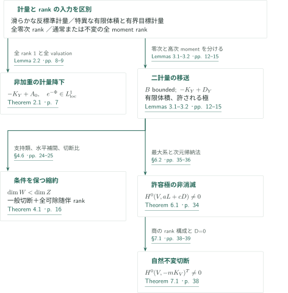
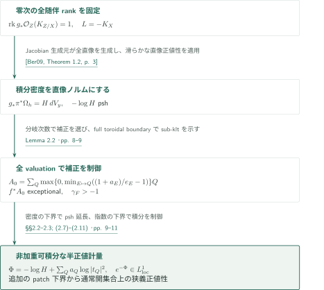
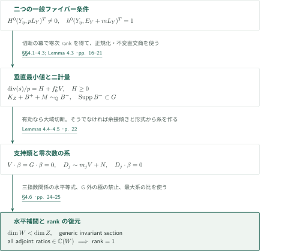
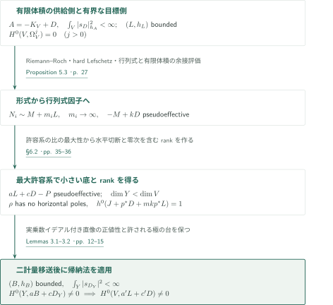
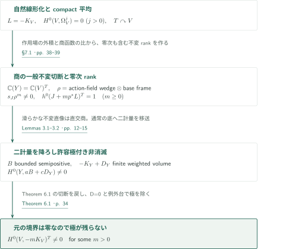

# Metric descent and rank-preserving contractions

**零次随伴rank、二つの計量、縮約後の切断比**

本原稿は、反標準計量を底へ降ろす操作と、得た切断を元の多様体へ戻す際の極の制御を扱う。主要な出力は、非加重可積分な底の計量、一般ファイバー上の切断と随伴rankを保つ縮約、許容境界上だけに極を持つ非消滅、自然なトーラス不変切断である。以下ではTheorems 2.1, 4.1, 6.1, 7.1を原典順に取り上げる。

## 1. 主要結果

### Theorem 2.1 — Toroidalな体積計量

$X,Y$を滑らかな連結射影複素多様体、$d=\dim Y>0$とし、$L=-K_X$が滑らかな半正値Hermitian計量$h$、曲率$\alpha$を持つとする。$W$を正規整多様体とし、射影射$p:W\to X$は双有理、$f:W\to Y$は全射・同次元でstrict toroidal embeddingsに関してtoroidalであるとする。滑らかな射影解消$\rho:Z\to W$について$\pi=p\rho$, $g=f\rho$, $E_Z=K_{Z/X}$と置き、**全直像**について$\operatorname{rk}g_*\mathcal O_Z(E_Z)=1$を仮定する。

底の素因子$Q$とそれを支配する$W$の素因子$E$に対し、$a_E=\operatorname{ord}_E K_{W/X}$, $e_E=\operatorname{ord}_E f^*Q$と置く。すると

$$
a_Q=\max\left\{0,\min_{f(E)=Q}\left(\frac{1+a_E}{e_E}-1\right)\right\},\qquad A_0=\sum_Q a_QQ
$$

は有限台を持つ有効有理因子で、$f^*A_0$は$p$-例外的である。$-K_Y+A_0$は半正値特異Hermitian計量を持ち、その局所枠の二乗ノルムは**因子による重みを掛けずに**局所可積分であり、計量は非空Zariski開集合上で滑らかである。

さらに$g$が滑らかで随伴直像のbase changeが成り立つ非空Zariski開集合$U\subset Y$を取る。ある非空通常開集合$V\subset g^{-1}(U)\setminus\operatorname{Supp}E_Z$、Kähler形式$\omega_Y$、$c>0$について$\pi^*\alpha\ge c g^*\omega_Y$が$V$上で成り立てば、構成した計量は$Y$の非空通常開集合上で曲率が狭義正となる。これは大域的なKähler下界ではない。

<!-- cite:t21 -->[Theorem 2.1 · p. 7](https://github.com/openai/math/blob/fd4aeeb2ee4fc729c18d98444fed42fd0529eeeb/preprints/Metric-descent-and-rank-preserving-contractions-September-26-2026/main.pdf)<!-- /cite -->

### Theorem 4.1 — 切断とrankを保つ縮約

$X$を滑らかな連結射影複素多様体で$H^0(X,\Omega_X^q)=0$（すべての$q>0$）を満たすものとし、$L=-K_X$が滑らかな半正値計量を持つとする。代数的トーラス$T$の作用と$L$の自然線形化を考える。$f:X\dashrightarrow Z$は滑らかな連結射影多様体への支配的$T$-不変有理写像で、$\mathbb C(Z)$は$\mathbb C(X)$内で相対代数閉とする。解消$\pi:Y\to X$, $f_Y:Y\to Z$、$L_Y=\pi^*L$, $E_Y=K_{Y/X}$、$\eta=\operatorname{Spec}\mathbb C(Z)$に対し、

$$
H^0(Y_\eta,pL_Y|_{Y_\eta})^T\ne0\quad\text{for some }p>0,
$$

かつ、ある$a>0$の**すべての正の倍数**$m$について

$$
\dim_{\mathbb C(Z)}H^0(Y_\eta,(E_Y+mL_Y)|_{Y_\eta})^T=1
$$

と仮定する。すると、ある$r>0$について$H^0(X,rL)^T\ne0$であるか、$Z\dashrightarrow W$という支配的有理写像が存在する。後者では$W$は滑らかな連結射影多様体、$\dim W<\dim Z$で、$X\dashrightarrow W$は同じ二条件を満たし（整数は変わってよい）、$\mathbb C(W)$も$\mathbb C(X)$内で相対代数閉である。

<!-- cite:t41 -->[Theorem 4.1 · p. 16](https://github.com/openai/math/blob/fd4aeeb2ee4fc729c18d98444fed42fd0529eeeb/preprints/Metric-descent-and-rank-preserving-contractions-September-26-2026/main.pdf)<!-- /cite -->

### Theorem 6.1 — 許された極の台を持つ非消滅

$V$を滑らかな連結射影複素多様体で$H^0(V,\Omega_V^j)=0$（すべての$j>0$）とする。$D\ge0$は整因子、$A=-K_V+D$は半正値特異計量$h_A$を持ち、標準切断$s_D$を$A$値最高次形式とみた測度$|s_D|_{h_A}^2$の全質量が有限であるとする。線束$L$が局所有界な重みを持つ半正値計量を持てば、

$$
H^0(V,aL+cD)\ne0\quad\text{for some integers }a>0,\ c\ge0.
$$

有理線束$L$についても$a$で分母を払えば同じ結論が成り立つ。$L$はこの定理では反標準束に限定されない。

<!-- cite:t61 -->[Theorem 6.1 · p. 34](https://github.com/openai/math/blob/fd4aeeb2ee4fc729c18d98444fed42fd0529eeeb/preprints/Metric-descent-and-rank-preserving-contractions-September-26-2026/main.pdf)<!-- /cite -->

### Theorem 7.1 — 自然線形化での不変反標準切断

$V$を滑らかな連結射影複素多様体で$H^0(V,\Omega_V^j)=0$（すべての$j>0$）とし、$-K_V$が滑らかな半正値Hermitian計量を持つとする。$V$に作用する**各**代数的トーラス$T$に対して、ある整数$m>0$が存在し、自然な反標準作用について

$$
H^0(V,-mK_V)^T\ne0
$$

となる。$m=1$や、指標で捻った任意の線形化の不変切断を主張しているわけではない。

<!-- cite:t71 -->[Theorem 7.1 · p. 38](https://github.com/openai/math/blob/fd4aeeb2ee4fc729c18d98444fed42fd0529eeeb/preprints/Metric-descent-and-rank-preserving-contractions-September-26-2026/main.pdf)<!-- /cite -->

## 図の矢印に付した引用

<!-- reference-guide -->
略号のない定理・補題・節・式番号は本原稿 [Metric descent and rank-preserving contractions](https://github.com/openai/math/blob/fd4aeeb2ee4fc729c18d98444fed42fd0529eeeb/preprints/Metric-descent-and-rank-preserving-contractions-September-26-2026/main.pdf) を指します。外部入力には次の略号を使います。

- [Ber09](https://arxiv.org/pdf/math/0511225v2) Bo Berndtsson — *Curvature of vector bundles associated to holomorphic fibrations*：滑らかな直像の半正値性と曲率式。全直像rank 1、または直交商となる不変部分に適用。arXiv:math/0511225v2, 20 August 2007。
- [DPS01](https://arxiv.org/pdf/math/0006205v2) Jean-Pierre Demailly; Thomas Peternell; Michael Schneider — *Pseudo-effective line bundles on compact Kähler manifolds*：有界計量の全冪で乗数イデアルが自明なことを使い、非零コホモロジーを捻った形式へ送る。arXiv:math/0006205v2, 10 October 2000。
- [CP19](https://www.numdam.org/item/10.1007/s10240-019-00105-w.pdf) Frédéric Campana; Mihai Păun — *Foliations with positive slopes and birational stability of orbifold cotangent bundles*：符号付き境界を直接代入せず、正の境界とample摂動に対するorbifold商の傾き非負性を使う。Publications Mathématiques de l’IHÉS 129 (2019), 1–49。
- [HPS](https://people.math.harvard.edu/~mpopa/papers/HPS.pdf) Christopher D. Hacon; Mihnea Popa; Christian Schnell — *Algebraic fiber spaces over abelian varieties: around a recent theorem by Cao and Păun*：実際の乗数イデアルを含む直像の計量。有限積分の生成元がrank 1直像を生成することを確認して使う。Author-hosted 53-page manuscript, retrieved 12 October 2026。
- [PT14](https://arxiv.org/pdf/1409.5504v1) Mihai Păun; Shigeharu Takayama — *Positivity of twisted relative pluricanonical bundles and their direct images*：HPSの定式化の基礎となる特異L2直像計量。generic multiplier-ideal inclusionの同型条件も照合。arXiv:1409.5504v1, 19 September 2014。
- [Ou23](https://arxiv.org/pdf/1703.03175v4) Wenhao Ou — *On generic nefness of tangent sheaves*：Druelの相対擬有効性の定式化と葉層の代数性。有限体積からの余接傾き評価で使用。arXiv:1703.03175v4。
- [BDPP13](https://arxiv.org/pdf/math/0405285v1) Sébastien Boucksom; Jean-Pierre Demailly; Mihai Păun; Thomas Peternell — *The pseudo-effective cone of a compact Kähler manifold and varieties of negative Kodaira dimension*：非bigな擬有効因子を消すmovable曲線類を選ぶ錐双対性。arXiv:math/0405285v1, 14 May 2004。

各引用に結果番号とページを付します。誌面番号とPDF内の位置が異なる場合は両方を示します。GitHubの閲覧リンクではページ位置への自動移動を前提としません。
<!-- /reference-guide -->

## 2. Theorem 4.1 — 主定理の証明概略

<!-- proof-target:1 -->証明対象：[Theorem 4.1 · p. 16](https://github.com/openai/math/blob/fd4aeeb2ee4fc729c18d98444fed42fd0529eeeb/preprints/Metric-descent-and-rank-preserving-contractions-September-26-2026/main.pdf)<!-- /proof-target -->

**証明の道筋。** 計量の降下と切断の降下を分け、後者では「存在」だけでなく、次の縮約で再び使える随伴rankまで回復する。原稿全体には並行する経路があり、Theorem 7.1はTheorem 6.1と二計量移送から従い、Theorem 4.1を必要としない。

### 1. 二種類の底計量と二つの出口

Theorem 2.1は全零次随伴rankが1のとき、明示的な$A_0$を用いて$-K_Y+A_0$上に非加重可積分な計量を作る。一方Lemmas 3.1–3.2は、有限体積を与える線束と切断を探す有界計量の線束を別々に降ろす。Theorem 4.1ではこの移送の滑らかな不変版を使い、支持movable類を消す因子の比から小さい底を選ぶ。Theorem 6.1では通常の特異版を使って次元帰納法を閉じる。両者のrank仮定を混同しない。

<!-- cite:transfer -->[Lemmas 3.1–3.2 · pp. 12–15](https://github.com/openai/math/blob/fd4aeeb2ee4fc729c18d98444fed42fd0529eeeb/preprints/Metric-descent-and-rank-preserving-contractions-September-26-2026/main.pdf)<!-- /cite -->

### 2. 非消滅への経路

Theorem 7.1の商の一般ファイバーでは、作用の無限小ベクトル場の外積が不変切断を与え、不変な切断比は商の函数体へ降りる。これが零次を含む不変随伴rank 1を供給する。移送後の底にTheorem 6.1を適用し、元の許容境界が$D=0$であることから極が残らない。この経路は縮約定理の条件を無条件に仮定するものではない。

<!-- cite:quotient -->[§7.1 · pp. 38–39](https://github.com/openai/math/blob/fd4aeeb2ee4fc729c18d98444fed42fd0529eeeb/preprints/Metric-descent-and-rank-preserving-contractions-September-26-2026/main.pdf)<!-- /cite -->

## 3. Theorem 2.1 の証明 — 曲率と非加重可積分性

<!-- proof-target:2 -->証明対象：[Theorem 2.1 · p. 7](https://github.com/openai/math/blob/fd4aeeb2ee4fc729c18d98444fed42fd0529eeeb/preprints/Metric-descent-and-rank-preserving-contractions-September-26-2026/main.pdf)<!-- /proof-target -->

主張は冒頭のTheorem 2.1を参照する。モデル$W$の同次元性は仮定であり、滑らかな解消$Z$にも同次元性を要求してはいない。

### 1. 例外台とすべてのvaluation

$a_Q>0$なら$Q$上のすべての素因子は$a_E>0$で、$X$上例外的である。同次元性により垂直素因子は底の素因子を支配するため、補正の台が高余次元の影に隠れない。$\Theta=-K_{W/X}+f^*A_0\le0$と置き、full toroidal boundaryを$D_W$とする。$B=D_W-\Theta$は$D_W$を含む有効有理Cartier因子で、

$$
A_{W,\Theta}(v)=A_{W,D_W}(v)+v(B)>0
$$

が全divisorial valuationで成り立つ。これが境界の交点上の新しい例外因子も含め、$\gamma_F=\operatorname{coeff}_F(K_{Z'/X}-(g')^*A_0)>-1$を与える。元の$W$に見える因子だけの検査では足りない。

<!-- cite:l22 -->[Lemma 2.2 · pp. 8–9](https://github.com/openai/math/blob/fd4aeeb2ee4fc729c18d98444fed42fd0529eeeb/preprints/Metric-descent-and-rank-preserving-contractions-September-26-2026/main.pdf)<!-- /cite -->

### 2. 積分密度を計量と同定して延長する

$g_*\pi^*\Omega_h=H(y)dV_y$と置く。全直像のrank 1とJacobian切断が、滑らかな開集合上で$g_*(K_{Z/Y}+\pi^*L)\simeq-K_Y$を与えるため、$H$はその直像線束の$L^2$ノルムになる。滑らかな直像正値性により$-\log H$はpshである。任意の部分線束への制限を正値とした議論ではない。

補正後の重みは$\Phi=-\log H+\sum a_Q\log|t_Q|^2$である。分岐次数からの**密度の下界**が$\Phi$の局所上界を与え、psh延長を可能にする。他方

$$
e^{-\Phi}dV_y=g'_*\!\left(\prod_Q|t_Q\circ g'|^{-2a_Q}(\pi')^*\Omega_h\right)
$$

と全valuationの$\gamma_F>-1$を使うと、右辺の被積分測度は局所的に有界な正因子と$\prod |z_j|^{2\gamma_j}$の積になり可積分である。propernessから底の局所可積分性を得る。$s_{A_0}$を掛けて有限にする結論ではなく、枠ノルム自体の有限性である。元の滑らかな開集合上では密度も滑らかである。

<!-- cite:ber -->[&#91;Ber09, Theorem 1.2, p. 3&#93;](https://arxiv.org/pdf/math/0511225v2#page=3)<!-- /cite -->

<!-- cite:metric-proof -->[§§2.2–2.3; (2.7)–(2.11) · pp. 9–11](https://github.com/openai/math/blob/fd4aeeb2ee4fc729c18d98444fed42fd0529eeeb/preprints/Metric-descent-and-rank-preserving-contractions-September-26-2026/main.pdf)<!-- /cite -->

### 3. 局所的な狭義正値性

追加仮定の開集合$V$ではJacobian切断が非零である。Chern-normalな生成元の曲率式は、係数曲率を積分する項と非負のprimitive項に分かれる。$\pi^*\alpha\ge c g^*\omega_Y$の下界を、生成元が消えないこのpatch上で積分すれば、各底接方向に正の寄与が得られる。滑らかさにより通常開近傍で狭義正となる。補正が消える開集合で行う議論なので、ここから大域的strict positivityは出ない。

<!-- cite:ber-formula -->[&#91;Ber09, Proposition 4.2; (4.8), pp. 14, 17&#93;](https://arxiv.org/pdf/math/0511225v2#page=14)<!-- /cite -->

## 4. Theorem 4.1 の証明 — 縮約後のrankを復元する

<!-- proof-target:3 -->証明対象：[Theorem 4.1 · p. 16](https://github.com/openai/math/blob/fd4aeeb2ee4fc729c18d98444fed42fd0529eeeb/preprints/Metric-descent-and-rank-preserving-contractions-September-26-2026/main.pdf)<!-- /proof-target -->

主張は冒頭のTheorem 4.1を参照する。一般切断の存在と正の可除指数におけるrank 1は別の仮定であり、両方を使って零次rank 1を導く。

### 1. 正規化した切断と許容極

一般切断$s$をtoroidal同次元モデル$Y_0\to Z$で$\operatorname{div}(s)/p=H+f_0^*V$と書く。$V$の係数は各垂直成分の重複度で割った次数の最小値で、$H\ge0$、各底素因子の上には$H$の係数が0の成分がある。そのような成分がすべて$X$上例外的になる底素因子の和を$G$とする。小さい$\delta>0$に対して$(H-\delta f_0^*G)_-$は例外的である。したがって$V+\delta G$の有効性が得られれば、その切断を正規化切断と掛け、$X$へ押し下げて大域不変切断を得る。

正のrank条件と$s$による乗法から零次rankも1となる。不変直像はcompact平均による直交商なので滑らかな直像正値性を使える。高次momentの極限は$V$の有界半正値計量を、零次密度は$K_Z+B^++M\sim_{\mathbb Q}B^-$（$M$ nef、$\operatorname{Supp}B^-\subset G$）を与える。後者は符号付き境界であり、有効klt境界と同一視しない。

<!-- cite:normalization -->[§§4.1–4.3; Lemma 4.3 · pp. 16–21](https://github.com/openai/math/blob/fd4aeeb2ee4fc729c18d98444fed42fd0529eeeb/preprints/Metric-descent-and-rank-preserving-contractions-September-26-2026/main.pdf)<!-- /cite -->

### 2. 零次数の系から小さい底を選ぶ

$V+G$がbigなら上の出口に入る。そうでなければ錐双対性により非零movable類$\beta$を選び、$V\cdot\beta=G\cdot\beta=B^-\cdot\beta=0$とする。$B^+$に$M+tA$の一般有効代表を加えた有効klt境界へorbifold余接商の非負性を適用し、$t\downarrow0$として余接tensor内の線束$N$について$c_1(N)\cdot\beta\le0$を得る。$\chi(\mathcal O_Z)=1$、Riemann–Roch、乗数イデアル付きhard Lefschetz、行列式抽出から

$$
D_j\sim m_jV+N,\qquad m_j\longrightarrow\infty,\qquad D_j\cdot\beta=0
$$

を得る。零次数線形系の像次元を最大にしStein分解を取ると、$\dim W<\dim Z$で、そのような系の切断比はすべて$\mathbb C(W)$へ入る。

<!-- cite:bdpp -->[&#91;BDPP13, Theorem 2.2, p. 6&#93;](https://arxiv.org/pdf/math/0405285v1#page=6)<!-- /cite -->

<!-- cite:cp -->[&#91;CP19, Theorem 1.3, p. 3&#93;](https://www.numdam.org/item/10.1007/s10240-019-00105-w.pdf#page=3)<!-- /cite -->

<!-- cite:dps -->[&#91;DPS01, Theorem 2.1.1, p. 8&#93;](https://arxiv.org/pdf/math/0006205v2#page=8)<!-- /cite -->

<!-- cite:support -->[Lemmas 4.4–4.5 · p. 22](https://github.com/openai/math/blob/fd4aeeb2ee4fc729c18d98444fed42fd0529eeeb/preprints/Metric-descent-and-rank-preserving-contractions-September-26-2026/main.pdf)<!-- /cite -->

### 3. 水平部分の等式から存在と一意性を戻す

三指数の線形同値

$$
(m_\ell-m_j)D_k\sim(m_\ell-m_k)D_j+(m_k-m_j)D_\ell
$$

の両辺の比が底函数なので、$W$上水平な部分は**実際の因子として**等しい。水平重複度は$m_j$のaffine関数となり、有効性と$m_j\to\infty$から傾きが非負になる。これが$V$の新しい一般ファイバー上の有効性を与え、正規化切断との積で$L$の一般不変切断を回復する。

rankの復元には追加の極の制御が要る。新しい一般ファイバーの二つの随伴切断の極を同じ底ample捻りで消し、Jacobianと正規化切断の冪で割る。旧rank条件から底の有理切断となり、$G$外では$H=0$かつ非例外的な成分が極を禁止する。残る比は$\beta$次数0の同じ系の比なので$\mathbb C(W)$に属する。これでrankは高々1、構成した切断とJacobianで十分可除な全正指数に非零元があり、ちょうど1になる。相対代数閉性はStein分解と体の包含を通じて保たれる。

<!-- cite:interpolation -->[Lemmas 4.6–4.7 · p. 23](https://github.com/openai/math/blob/fd4aeeb2ee4fc729c18d98444fed42fd0529eeeb/preprints/Metric-descent-and-rank-preserving-contractions-September-26-2026/main.pdf)<!-- /cite -->

<!-- cite:rank-restoration -->[§4.6 · pp. 24–25](https://github.com/openai/math/blob/fd4aeeb2ee4fc729c18d98444fed42fd0529eeeb/preprints/Metric-descent-and-rank-preserving-contractions-September-26-2026/main.pdf)<!-- /cite -->

## 5. Theorem 6.1 の証明 — 二計量を保つ次元帰納法

<!-- proof-target:4 -->証明対象：[Theorem 6.1 · p. 34](https://github.com/openai/math/blob/fd4aeeb2ee4fc729c18d98444fed42fd0529eeeb/preprints/Metric-descent-and-rank-preserving-contractions-September-26-2026/main.pdf)<!-- /proof-target -->

主張は冒頭のTheorem 6.1を参照する。ここでは原典§6.2の第一証明を追う。

### 1. 捻った形式を有効因子へ変える

$L$の有界重みは全冪の乗数イデアルを自明にする。正次数形式がないことから$\chi(\mathcal O_V)=1$、したがって$\chi(K_V+mL)$は定数項が非零の多項式である。無限に大きい指数で非零のコホモロジーをhard Lefschetzに通し、捻った形式のgeneric spanの行列式を取って$N_i\sim M+m_iL$を得る。

有限な**加重**体積は、$-K_V+D+A/m$に有効近似を作り、境界$D$を引いた対がsub-kltになることに使う。葉層の相対擬有効性と傾きの議論から$-M+kD$が擬有効になる。滑らかな反標準計量や大域strict curvatureをこの段階の仮定に追加していない。

<!-- cite:forms -->[Lemma 3.3 · pp. 15–16](https://github.com/openai/math/blob/fd4aeeb2ee4fc729c18d98444fed42fd0529eeeb/preprints/Metric-descent-and-rank-preserving-contractions-September-26-2026/main.pdf)<!-- /cite -->

<!-- cite:finite-volume -->[Proposition 5.3 · p. 27](https://github.com/openai/math/blob/fd4aeeb2ee4fc729c18d98444fed42fd0529eeeb/preprints/Metric-descent-and-rank-preserving-contractions-September-26-2026/main.pdf)<!-- /cite -->

<!-- cite:ou -->[&#91;Ou23, Propositions 2.2, 3.1, pp. 5–6&#93;](https://arxiv.org/pdf/1703.03175v4#page=5)<!-- /cite -->

### 2. 最大許容系でrankを強制する

$aL+cD-P$がある$a>0,c\ge0$について擬有効になる系$|P|$を許容とする。積を取っても許容なので像次元最大の系が選べる。像が全次元なら$aL+cD$はbigで終わる。そうでなければ小さい連結ファイバー底$Y$を取り、許容系の比は$\mathbb C(Y)$へ入る。

$N_i$の三指数関係の水平部分から極のない一般切断$\rho$を作る。さらに、$J+p^*D+mp^*L$に一般ファイバー上で独立な二切断があれば、底捻りで極を消した比が許容系を大きくし最大性に反する。従って$\rho$の指数の倍数で、零次を含むrank 1が得られる。

<!-- cite:induction -->[§6.2 · pp. 35–36](https://github.com/openai/math/blob/fd4aeeb2ee4fc729c18d98444fed42fd0529eeeb/preprints/Metric-descent-and-rank-preserving-contractions-September-26-2026/main.pdf)<!-- /cite -->

### 3. 有限体積と有界性を別々に渡す

Lemma 3.2では$u_m=s_{J+p^*D}\rho^m$が**実際の**乗数イデアル付き直像に属することを有限積分から確かめ、rank 1なのでその生成元にする。$L^2$直像の正値性が零次密度と高次momentのpsh性を与える。後者の正規化極限はfiber supremumになり、Lemma 3.1の垂直最小値による正規化と合わせて底の線束$B$の有界半正値計量を与える。別の線束$-K_Y+D_Y$には有限な加重体積が残る。

底にも正次数形式がないので帰納法を適用する。得た$aB+cD_Y$の切断を戻すと、極は$D$または例外台に限られる。押し下げ後、有限個の極を$D$の整倍で消して結論となる。有理線束では最初と最後に分母を払う。二つの計量を一つに置き換えると、この帰納法の仮定が保たれない。

<!-- cite:hps -->[&#91;HPS, Theorem 21.1, pp. 31–32&#93;](https://people.math.harvard.edu/~mpopa/papers/HPS.pdf#page=31)<!-- /cite -->

<!-- cite:pt -->[&#91;PT14, Theorem 3.3.5, p. 24&#93;](https://arxiv.org/pdf/1409.5504v1#page=24)<!-- /cite -->

<!-- cite:transfer -->[Lemmas 3.1–3.2 · pp. 12–15](https://github.com/openai/math/blob/fd4aeeb2ee4fc729c18d98444fed42fd0529eeeb/preprints/Metric-descent-and-rank-preserving-contractions-September-26-2026/main.pdf)<!-- /cite -->

## 6. Theorem 7.1 の証明 — 不変商から極のない切断へ

<!-- proof-target:5 -->証明対象：[Theorem 7.1 · p. 38](https://github.com/openai/math/blob/fd4aeeb2ee4fc729c18d98444fed42fd0529eeeb/preprints/Metric-descent-and-rank-preserving-contractions-September-26-2026/main.pdf)<!-- /proof-target -->

主張は冒頭のTheorem 7.1を参照する。ここでは§7.1のrank-one quotient構成を採る。

### 1. 商の上で零次からrankを作る

compact real formで計量の重みを平均する。作用が自明ならTheorem 6.1を$D=0$, $A=L=-K_V$で適用する。そうでなければ$\mathbb C(V)^T$の滑らかな射影商モデル$Y$を取る。トーラスの連結性からこの体は相対代数閉で、一般ファイバーに稠密軌道がある。独立な無限小作用場の外積と底の反標準有理枠、Jacobian切断から自然不変な一般反標準切断$\rho$を作る。

不変な二つの随伴切断の比は商函数である。$s_J\rho^m$が零次も含めて非零元を与えるため、不変随伴rankはすべての$m\ge0$で1になる。滑らかな係数計量の下ではcompact平均が直交holomorphic projectionを与え、不変部分の計量は商計量である。ここで特異計量の任意の不変部分束の正値性は仮定していない。

<!-- cite:quotient -->[§7.1 · pp. 38–39](https://github.com/openai/math/blob/fd4aeeb2ee4fc729c18d98444fed42fd0529eeeb/preprints/Metric-descent-and-rank-preserving-contractions-September-26-2026/main.pdf)<!-- /cite -->

<!-- cite:ber -->[&#91;Ber09, Theorem 1.2, p. 3&#93;](https://arxiv.org/pdf/math/0511225v2#page=3)<!-- /cite -->

### 2. 許容境界が零であることを最後に使う

商が点なら作用場の全外積が既に大域切断を与える。正次元なら二計量移送を適用し、正次数形式のない底でTheorem 6.1を使う。得た切断を戻す操作は底函数による乗法なので自然不変性を保つ。元の境界が$D=0$であるため、極は例外台へ消え、滑らかな$V$上の大域切断となる。

原典§7.2はlogarithmic orbit integralとsupremumのpsh性から同じ二計量移送へ入る別証明を与える。本記事の主経路は§7.1であり、別証明を追加の必要条件として接続していない。

<!-- cite:t61 -->[Theorem 6.1 · p. 34](https://github.com/openai/math/blob/fd4aeeb2ee4fc729c18d98444fed42fd0529eeeb/preprints/Metric-descent-and-rank-preserving-contractions-September-26-2026/main.pdf)<!-- /cite -->

<!-- cite:orbit -->[Lemma 7.2; §7.2 · pp. 39–42](https://github.com/openai/math/blob/fd4aeeb2ee4fc729c18d98444fed42fd0529eeeb/preprints/Metric-descent-and-rank-preserving-contractions-September-26-2026/main.pdf)<!-- /cite -->

## 7. どの論文が、どの段階を担うか

- 滑らかな直像曲率はTheorem 2.1の密度とstrictness、Lemmas 3.2/4.3の滑らかな不変版に使う。通常の特異版にはHPSの実乗数イデアル付き直像を使い、生成元の可積分性を別途確認する。
- hard LefschetzはLemma 3.3の形式を供給する。必要なのは有界重みから得る全冪の自明な乗数イデアルであり、nefだけを代入していない。
- orbifold余接正値性はLemma 4.4、Druel–Ouの相対擬有効性はProposition 5.3の有限体積型傾き評価で使う。符号付き境界・有効境界・非加重積分を区別する。
- 同カタログの *Integrable metrics and effectivity with controlled boundary* はTheorem 2.1を別証明の非加重移送に利用する。本稿のTheorems 6.1/7.1を同稿の主定理に依存させる接続は描かない。詳細はカタログの接続記録を参照する。

## 8. 原典を読む入口と確認範囲

<!-- reading-list -->
- [Lemma 2.2 · pp. 8–9](https://github.com/openai/math/blob/fd4aeeb2ee4fc729c18d98444fed42fd0529eeeb/preprints/Metric-descent-and-rank-preserving-contractions-September-26-2026/main.pdf) — 境界交点上を含む全valuationと例外台を確認する。
- [§§2.2–2.3; (2.7)–(2.11) · pp. 9–11](https://github.com/openai/math/blob/fd4aeeb2ee4fc729c18d98444fed42fd0529eeeb/preprints/Metric-descent-and-rank-preserving-contractions-September-26-2026/main.pdf) — 積分密度の曲率と非加重可積分性を別々に読む。
- [Lemmas 3.1–3.2 · pp. 12–15](https://github.com/openai/math/blob/fd4aeeb2ee4fc729c18d98444fed42fd0529eeeb/preprints/Metric-descent-and-rank-preserving-contractions-September-26-2026/main.pdf) — 二つの計量と許される極の台を追う。
- [§4.6 · pp. 24–25](https://github.com/openai/math/blob/fd4aeeb2ee4fc729c18d98444fed42fd0529eeeb/preprints/Metric-descent-and-rank-preserving-contractions-September-26-2026/main.pdf) — 縮約後の切断比が底体へ戻る仕組みを確認する。
- [§6.2 · pp. 35–36](https://github.com/openai/math/blob/fd4aeeb2ee4fc729c18d98444fed42fd0529eeeb/preprints/Metric-descent-and-rank-preserving-contractions-September-26-2026/main.pdf) — 許容線形系の最大性と次元帰納法を読む。
- [§7.1 · pp. 38–39](https://github.com/openai/math/blob/fd4aeeb2ee4fc729c18d98444fed42fd0529eeeb/preprints/Metric-descent-and-rank-preserving-contractions-September-26-2026/main.pdf) — 自然不変切断と零次rankを作る箇所。
<!-- /reading-list -->

編集側では、上記四定理の仮定・量化・全結論、§§2–4、Proposition 5.3、§6.2、§7.1の主要段階を照合した。BerndtssonのTheorem 1.2と曲率式、DPSのTheorem 2.1.1、Campana–PăunのTheorem 1.3、HPSのTheorem 21.1、Păun–TakayamaのTheorem 3.3.5、OuのPropositions 2.2/3.1、BDPPのTheorem 2.2の記述と使用条件を確認した。原稿中の結論を紹介するもので、全証明の独立検証や専門家査読の完了を意味しない。

§§8–12のratio fieldの各変種、異なるboundary/rank条件の縮約、finite-flat normによる別構成は今回の詳説対象外である。弱toroidal化・同次元化の外部原典の再照合、全valuation計算やpsh極限の独立検証、外部入力の証明そのものは未実施である。Theorem 2.1はtoroidal同次元モデルを仮定する定理として記載した。
