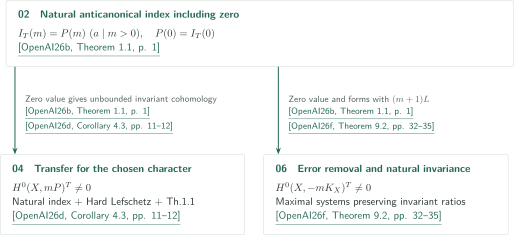
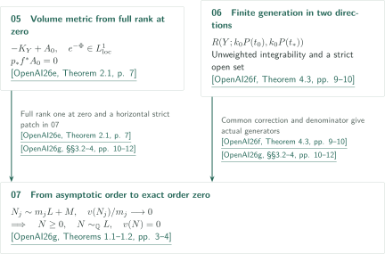

# Catalogue 068 — Anticanonical nonvanishing under smooth semipositivity

**Results and proof routes from smooth semipositivity to nonvanishing**

The seven manuscripts, in official order, total 270 pages. They approach positive-power anticanonical nonvanishing through distinct results on invariant indices, bounded metrics on klt pairs, chosen-character transfer, metric descent, boundary correction and exact orders. Smooth semipositivity means the existence of a smooth semipositive Hermitian metric; the hypotheses cannot be replaced by nefness alone.

Official catalogue PDF, entry 068: <!-- cite:catalog -->[OpenAI Research Catalog · Catalogue 068 · p. 8](https://github.com/openai/math/blob/fd4aeeb2ee4fc729c18d98444fed42fd0529eeeb/overview.pdf)<!-- /cite -->. Each row links to its manuscript PDF. Catalogue number 068 differs from the internal positions 01–07 below.

## Manuscripts in official order

CATALOGINVENTORYTOKEN

## Sources and citation keys

The text and diagrams use the author-derived keys below. All seven are the September 26, 2026 manuscripts at a fixed official-repository commit. GitHub PDF viewers need not jump to the cited page. Within each article, unprefixed results belong to that manuscript and keys identify external inputs.

<!-- reference-guide -->
- [OpenAI26a](https://github.com/openai/math/blob/fd4aeeb2ee4fc729c18d98444fed42fd0529eeeb/preprints/Anticanonical-nonvanishing-from-smooth-semipositivity-September-26-2026/main.pdf) OpenAI — *Anticanonical nonvanishing from smooth semipositivity*. Two-metric transfer and dimension induction prove ordinary nonvanishing; an invariant direct-image argument produces naturally invariant sections. The finite cover and norm also supply geometric inputs to other manuscripts. September 26, 2026 · 27 pages.

- [OpenAI26b](https://github.com/openai/math/blob/fd4aeeb2ee4fc729c18d98444fed42fd0529eeeb/preprints/Invariant-anticanonical-indices-and-conversion-of-twisted-differentials-September-26-2026/main.pdf) OpenAI — *Invariant anticanonical indices and conversion of twisted differentials*. Connects independent localization/deleted-face and bounded-metric/vanishing arguments. Invariant forms descend to the finite cover before ordinary conversion is applied. September 26, 2026 · 18 pages.

- [OpenAI26c](https://github.com/openai/math/blob/fd4aeeb2ee4fc729c18d98444fed42fd0529eeeb/preprints/Bounded-anticanonical-metrics-on-klt-pairs-and-torus-quotients-September-26-2026/main.pdf) OpenAI — *Bounded anticanonical metrics on klt pairs and torus quotients*. A maximal base and minimal vertical coefficients produce bounded metrics. A stable torus quotient preserves natural linearization and extends quotient sections globally. September 26, 2026 · 20 pages.

- [OpenAI26d](https://github.com/openai/math/blob/fd4aeeb2ee4fc729c18d98444fed42fd0529eeeb/preprints/Cohomological-transfer-and-equivariant-anticanonical-sections-September-26-2026/main.pdf) OpenAI — *Cohomological transfer and equivariant anticanonical sections*. A common invariant ratio field, a continuous maximum metric and a singular degree-zero integral remove the error using a fixed, possibly nontrivial multiplier ideal. September 26, 2026 · 43 pages.

- [OpenAI26e](https://github.com/openai/math/blob/fd4aeeb2ee4fc729c18d98444fed42fd0529eeeb/preprints/Metric-descent-and-rank-preserving-contractions-September-26-2026/main.pdf) OpenAI — *Metric descent and rank preserving contractions*. Separates toroidal volume from two-metric transfer and controls exceptional correction support, ratios after contraction and boundary poles. September 26, 2026 · 76 pages.

- [OpenAI26f](https://github.com/openai/math/blob/fd4aeeb2ee4fc729c18d98444fed42fd0529eeeb/preprints/Integrable-metrics-and-effectivity-with-controlled-boundary-September-26-2026/main.pdf) OpenAI — *Integrable metrics and effectivity with controlled boundary*. Weighted approximation controls correction support and returns sections from an Iitaka base; unweighted metrics separately supply finite generation of actual multigraded divisor rings. September 26, 2026 · 45 pages.

- [OpenAI26g](https://github.com/openai/math/blob/fd4aeeb2ee4fc729c18d98444fed42fd0529eeeb/preprints/Exact-orders-and-invariant-anticanonical-linear-systems-September-26-2026/main.pdf) OpenAI — *Exact orders and invariant anticanonical linear systems*. Combines the null-polar field, toroidal volume and finite generation; actual boundary-ray generators turn asymptotic order into exact attainment. September 26, 2026 · 41 pages.
<!-- /reference-guide -->

## Branching uses of the invariant index

For the natural anticanonical action, the index theorem in 02 asserts polynomiality on **every positive multiple** of one integer, with the actual invariant index at zero as constant term. The index theorem itself assumes neither projectivity nor positivity. Obtaining sections in 04 and 06 uses additional conditions: a nonzero index at zero, smooth semipositivity, hard Lefschetz and subsequent arguments. <!-- cite:b-index -->[&#91;OpenAI26b, Theorem 1.1, p. 1&#93;](https://github.com/openai/math/blob/fd4aeeb2ee4fc729c18d98444fed42fd0529eeeb/preprints/Invariant-anticanonical-indices-and-conversion-of-twisted-differentials-September-26-2026/main.pdf)<!-- /cite -->

04 first proves transfer for a chosen linearization, then sends naturally invariant cohomology through twisted forms and determinants to obtain natural invariant sections as a consequence. 06 uses the same index input with maximal systems preserving the invariant ratio field. Ordinary error removal in 02 does not by itself assert an invariant section. <!-- cite:d-index -->[&#91;OpenAI26d, Proposition 4.1; Corollary 4.3, pp. 10–12&#93;](https://github.com/openai/math/blob/fd4aeeb2ee4fc729c18d98444fed42fd0529eeeb/preprints/Cohomological-transfer-and-equivariant-anticanonical-sections-September-26-2026/main.pdf)<!-- /cite -->; <!-- cite:f-index -->[&#91;OpenAI26f, Proposition 9.1; Theorem 9.2, pp. 32–35&#93;](https://github.com/openai/math/blob/fd4aeeb2ee4fc729c18d98444fed42fd0529eeeb/preprints/Integrable-metrics-and-effectivity-with-controlled-boundary-September-26-2026/main.pdf)<!-- /cite -->

## Metric descent and finite generation meet at exact attainment

The main theorem of 07 starts with effective $N_j\sim m_jL+M$ in the curvature-null face, where $M$ is fixed and $m_j$ tends to infinity. If $v(N_j)/m_j$ tends to zero for a centered discrete valuation, including the zero valuation, it obtains $N\ge0$, $N\sim_{\mathbb Q}L$, $v(N)=0$. Here $M$ is arbitrary; pseudoeffectivity of $-M$ belongs to the separate formal-arc corollary. <!-- cite:g-main -->[&#91;OpenAI26g, Theorems 1.1–1.2, pp. 3–4&#93;](https://github.com/openai/math/blob/fd4aeeb2ee4fc729c18d98444fed42fd0529eeeb/preprints/Exact-orders-and-invariant-anticanonical-linear-systems-September-26-2026/main.pdf)<!-- /cite -->

07 constructs **full direct-image rank one at degree zero** and a horizontal strict patch, then applies the toroidal volume theorem of 05. This supplies an **unweighted** integrable metric on $-K_Y+A_0$ and an exceptional correction. The finite-generation theorem of 06 is applied to two rational directions with a common correction and denominator. An actual boundary-ray generator in the bigraded divisor ring is selected. The correction is pushed down before evaluation at the valuation center; its own valuation need not vanish. <!-- cite:e-metric -->[&#91;OpenAI26e, Theorem 2.1, p. 7&#93;](https://github.com/openai/math/blob/fd4aeeb2ee4fc729c18d98444fed42fd0529eeeb/preprints/Metric-descent-and-rank-preserving-contractions-September-26-2026/main.pdf)<!-- /cite -->; <!-- cite:f-ring -->[&#91;OpenAI26f, Theorem 4.3, pp. 9–10&#93;](https://github.com/openai/math/blob/fd4aeeb2ee4fc729c18d98444fed42fd0529eeeb/preprints/Integrable-metrics-and-effectivity-with-controlled-boundary-September-26-2026/main.pdf)<!-- /cite -->; <!-- cite:g-apply -->[&#91;OpenAI26g, §§3.2–4, pp. 10–12&#93;](https://github.com/openai/math/blob/fd4aeeb2ee4fc729c18d98444fed42fd0529eeeb/preprints/Exact-orders-and-invariant-anticanonical-linear-systems-September-26-2026/main.pdf)<!-- /cite -->

Metric descent from 05 is also used in the **alternative route** of 06 §5.3, separate from its main weighted support-control route. Weighted and unweighted integrability, strict positivity on an ordinary open set, and a global Kähler lower bound are distinct premises. <!-- cite:f-alt -->[&#91;OpenAI26f, §5.3, pp. 13–15&#93;](https://github.com/openai/math/blob/fd4aeeb2ee4fc729c18d98444fed42fd0529eeeb/preprints/Integrable-metrics-and-effectivity-with-controlled-boundary-September-26-2026/main.pdf)<!-- /cite -->; <!-- cite:f-weighted -->[&#91;OpenAI26f, Theorem 1.1, p. 2&#93;](https://github.com/openai/math/blob/fd4aeeb2ee4fc729c18d98444fed42fd0529eeeb/preprints/Integrable-metrics-and-effectivity-with-controlled-boundary-September-26-2026/main.pdf)<!-- /cite -->

## Result-level connections and independent routes

| Input result | Recipient and use | Type and role |
|---|---|---|
| [Anticanonical nonvanishing from smooth semipositivity](../anticanonical-smooth-semipositivity/article.en.md#proof-overview) · <!-- cite:a-structure -->[&#91;OpenAI26a, Theorem 2.1; Lemma 2.2, pp. 5, 8&#93;](https://github.com/openai/math/blob/fd4aeeb2ee4fc729c18d98444fed42fd0529eeeb/preprints/Anticanonical-nonvanishing-from-smooth-semipositivity-September-26-2026/main.pdf)<!-- /cite --> | [Invariant anticanonical indices and conversion of twisted differentials](../invariant-anticanonical-indices/article.en.md#proof-3) · <!-- cite:b-descent -->[&#91;OpenAI26b, Proposition 5.1; Corollary 5.2, pp. 16–17&#93;](https://github.com/openai/math/blob/fd4aeeb2ee4fc729c18d98444fed42fd0529eeeb/preprints/Invariant-anticanonical-indices-and-conversion-of-twisted-differentials-September-26-2026/main.pdf)<!-- /cite --> | **Input to consequences**。Descend invariant forms to a finite cover, apply ordinary conversion, then norm; the main nonvanishing theorem of 01 is not used. |
| [Anticanonical nonvanishing from smooth semipositivity](../anticanonical-smooth-semipositivity/article.en.md#proof-overview) · <!-- cite:a-structure -->[&#91;OpenAI26a, Theorem 2.1; Lemma 2.2, pp. 5, 8&#93;](https://github.com/openai/math/blob/fd4aeeb2ee4fc729c18d98444fed42fd0529eeeb/preprints/Anticanonical-nonvanishing-from-smooth-semipositivity-September-26-2026/main.pdf)<!-- /cite --> | [Bounded anticanonical metrics on klt pairs and torus quotients](../bounded-anticanonical-metrics/article.en.md#proof-3) · <!-- cite:c-cor -->[&#91;OpenAI26c, Corollary 4.1, p. 18&#93;](https://github.com/openai/math/blob/fd4aeeb2ee4fc729c18d98444fed42fd0529eeeb/preprints/Bounded-anticanonical-metrics-on-klt-pairs-and-torus-quotients-September-26-2026/main.pdf)<!-- /cite --> | **Input to a consequence**。Residual compact torus and invariant canonical frames descend the section of Th1.2, then finite étale norm applies. |
| [Anticanonical nonvanishing from smooth semipositivity](../anticanonical-smooth-semipositivity/article.en.md#proof-overview) · <!-- cite:a-structure -->[&#91;OpenAI26a, Theorem 2.1; Lemma 2.2, pp. 5, 8&#93;](https://github.com/openai/math/blob/fd4aeeb2ee4fc729c18d98444fed42fd0529eeeb/preprints/Anticanonical-nonvanishing-from-smooth-semipositivity-September-26-2026/main.pdf)<!-- /cite --> | [Cohomological transfer and equivariant anticanonical sections](../cohomological-transfer/article.en.md#proof-4) · <!-- cite:d-cor -->[&#91;OpenAI26d, §14.1, p. 39&#93;](https://github.com/openai/math/blob/fd4aeeb2ee4fc729c18d98444fed42fd0529eeeb/preprints/Cohomological-transfer-and-equivariant-anticanonical-sections-September-26-2026/main.pdf)<!-- /cite --> | **Input to a consequence**。Return the natural invariant section of Cor4.3 to general X, without assuming a product decomposition of the finite cover. |
| [Invariant anticanonical indices and conversion of twisted differentials](../invariant-anticanonical-indices/article.en.md#proof-1) · <!-- cite:b-index -->[&#91;OpenAI26b, Theorem 1.1, p. 1&#93;](https://github.com/openai/math/blob/fd4aeeb2ee4fc729c18d98444fed42fd0529eeeb/preprints/Invariant-anticanonical-indices-and-conversion-of-twisted-differentials-September-26-2026/main.pdf)<!-- /cite --> | [Cohomological transfer and equivariant anticanonical sections](../cohomological-transfer/article.en.md#proof-3) · <!-- cite:d-index -->[&#91;OpenAI26d, Proposition 4.1; Corollary 4.3, pp. 10–12&#93;](https://github.com/openai/math/blob/fd4aeeb2ee4fc729c18d98444fed42fd0529eeeb/preprints/Cohomological-transfer-and-equivariant-anticanonical-sections-September-26-2026/main.pdf)<!-- /cite --> | **Input to a consequence**。Actual index at zero gives unbounded cohomology for transfer by Th1.1. |
| [Invariant anticanonical indices and conversion of twisted differentials](../invariant-anticanonical-indices/article.en.md#proof-1) · <!-- cite:b-index -->[&#91;OpenAI26b, Theorem 1.1, p. 1&#93;](https://github.com/openai/math/blob/fd4aeeb2ee4fc729c18d98444fed42fd0529eeeb/preprints/Invariant-anticanonical-indices-and-conversion-of-twisted-differentials-September-26-2026/main.pdf)<!-- /cite --> | [Integrable metrics and effectivity with controlled boundary](../integrable-metrics-controlled-boundary/article.en.md#proof-5) · <!-- cite:f-index -->[&#91;OpenAI26f, Proposition 9.1; Theorem 9.2, pp. 32–35&#93;](https://github.com/openai/math/blob/fd4aeeb2ee4fc729c18d98444fed42fd0529eeeb/preprints/Integrable-metrics-and-effectivity-with-controlled-boundary-September-26-2026/main.pdf)<!-- /cite --> | **Direct input**。Produce invariant forms retaining the natural linearization and (m+1)L shift. |
| [Metric descent and rank-preserving contractions](../metric-descent-contractions/article.en.md#proof-1) · <!-- cite:e-metric -->[&#91;OpenAI26e, Theorem 2.1, p. 7&#93;](https://github.com/openai/math/blob/fd4aeeb2ee4fc729c18d98444fed42fd0529eeeb/preprints/Metric-descent-and-rank-preserving-contractions-September-26-2026/main.pdf)<!-- /cite --> | [Integrable metrics and effectivity with controlled boundary](../integrable-metrics-controlled-boundary/article.en.md#proof-3) · <!-- cite:f-alt -->[&#91;OpenAI26f, §5.3, pp. 13–15&#93;](https://github.com/openai/math/blob/fd4aeeb2ee4fc729c18d98444fed42fd0529eeeb/preprints/Integrable-metrics-and-effectivity-with-controlled-boundary-September-26-2026/main.pdf)<!-- /cite --> | **Alternative route**。Unweighted toroidal metric in §5.3, separate from the main weighted route in §5.2. |
| [Metric descent and rank-preserving contractions](../metric-descent-contractions/article.en.md#proof-1) · <!-- cite:e-metric -->[&#91;OpenAI26e, Theorem 2.1, p. 7&#93;](https://github.com/openai/math/blob/fd4aeeb2ee4fc729c18d98444fed42fd0529eeeb/preprints/Metric-descent-and-rank-preserving-contractions-September-26-2026/main.pdf)<!-- /cite --> | [Exact orders and invariant anticanonical linear systems](../exact-orders-anticanonical/article.en.md#proof-1) · <!-- cite:g-apply -->[&#91;OpenAI26g, §§3.2–4, pp. 10–12&#93;](https://github.com/openai/math/blob/fd4aeeb2ee4fc729c18d98444fed42fd0529eeeb/preprints/Exact-orders-and-invariant-anticanonical-linear-systems-September-26-2026/main.pdf)<!-- /cite --> | **Direct input**。Supply the metric and exceptional correction from full rank at zero and a horizontal strict patch. |
| [Integrable metrics and effectivity with controlled boundary](../integrable-metrics-controlled-boundary/article.en.md#proof-2) · <!-- cite:f-ring -->[&#91;OpenAI26f, Theorem 4.3, pp. 9–10&#93;](https://github.com/openai/math/blob/fd4aeeb2ee4fc729c18d98444fed42fd0529eeeb/preprints/Integrable-metrics-and-effectivity-with-controlled-boundary-September-26-2026/main.pdf)<!-- /cite --> | [Exact orders and invariant anticanonical linear systems](../exact-orders-anticanonical/article.en.md#proof-1) · <!-- cite:g-apply -->[&#91;OpenAI26g, §§3.2–4, pp. 10–12&#93;](https://github.com/openai/math/blob/fd4aeeb2ee4fc729c18d98444fed42fd0529eeeb/preprints/Exact-orders-and-invariant-anticanonical-linear-systems-September-26-2026/main.pdf)<!-- /cite --> | **Direct input**。Use common ε and k0 for finite generation of the actual two-direction divisor ring. |
| [Integrable metrics and effectivity with controlled boundary](../integrable-metrics-controlled-boundary/article.en.md#proof-1) · <!-- cite:f-approximation -->[&#91;OpenAI26f, Theorem 2.2, pp. 6–7&#93;](https://github.com/openai/math/blob/fd4aeeb2ee4fc729c18d98444fed42fd0529eeeb/preprints/Integrable-metrics-and-effectivity-with-controlled-boundary-September-26-2026/main.pdf)<!-- /cite --> | [Exact orders and invariant anticanonical linear systems](../exact-orders-anticanonical/article.en.md#proof-7) · <!-- cite:g-cone -->[&#91;OpenAI26g, Proposition 12.1; §12.2, pp. 31, 34&#93;](https://github.com/openai/math/blob/fd4aeeb2ee4fc729c18d98444fed42fd0529eeeb/preprints/Exact-orders-and-invariant-anticanonical-linear-systems-September-26-2026/main.pdf)<!-- /cite --> | **Direct input to an additional result**. Weighted approximation gives a klt boundary and a removable correction for the finite polyhedral cone of controlled classes, distinct from the finite-generation input to Th1.1. |

04 also supplies an independent harmonic mechanism: curvature domination from the base and a vanishing regularization error imply vanishing of higher base cohomology. <!-- cite:d-kernel -->[&#91;OpenAI26d, Theorem 7.2, pp. 17–19&#93;](https://github.com/openai/math/blob/fd4aeeb2ee4fc729c18d98444fed42fd0529eeeb/preprints/Cohomological-transfer-and-equivariant-anticanonical-sections-September-26-2026/main.pdf)<!-- /cite --> Additional outputs in 07 are invariant nonvanishing under $q=0$, $\chi\ne0$, a faithful action and an equivariant very ample bundle, rather than vanishing of every higher $H^i(\mathcal O)$, invariant fixed-error removal under $q=0$, and a finite polyhedral cone of controlled classes in the RC case. Their distinct hypotheses are stated in the article. <!-- cite:g-more -->[&#91;OpenAI26g, Proposition 10.1; Theorem 11.1, pp. 25, 27&#93;](https://github.com/openai/math/blob/fd4aeeb2ee4fc729c18d98444fed42fd0529eeeb/preprints/Exact-orders-and-invariant-anticanonical-linear-systems-September-26-2026/main.pdf)<!-- /cite -->; <!-- cite:g-cone -->[&#91;OpenAI26g, Proposition 12.1; §12.2, pp. 31, 34&#93;](https://github.com/openai/math/blob/fd4aeeb2ee4fc729c18d98444fed42fd0529eeeb/preprints/Exact-orders-and-invariant-anticanonical-linear-systems-September-26-2026/main.pdf)<!-- /cite -->

The main nonvanishing theorem of 01 must be distinguished from its structure theorem and norm. 01 supplies the finite-volume, two-metric route; 03 supplies a bounded-metric and Euler-polynomial route on klt pairs. No use of the main theorem of 03 as an input to transfer in 04 was found in the core passages read. Sharing the smooth nonvanishing conclusion is a comparison, not a proof-dependency arrow. <!-- cite:a-main -->[&#91;OpenAI26a, Theorems 1.1–1.2, pp. 2–3&#93;](https://github.com/openai/math/blob/fd4aeeb2ee4fc729c18d98444fed42fd0529eeeb/preprints/Anticanonical-nonvanishing-from-smooth-semipositivity-September-26-2026/main.pdf)<!-- /cite -->; <!-- cite:c-main -->[&#91;OpenAI26c, Theorems 1.1–1.2, p. 2&#93;](https://github.com/openai/math/blob/fd4aeeb2ee4fc729c18d98444fed42fd0529eeeb/preprints/Bounded-anticanonical-metrics-on-klt-pairs-and-torus-quotients-September-26-2026/main.pdf)<!-- /cite -->; <!-- cite:d-main -->[&#91;OpenAI26d, Theorem 1.1; Corollary 1.2, p. 2&#93;](https://github.com/openai/math/blob/fd4aeeb2ee4fc729c18d98444fed42fd0529eeeb/preprints/Cohomological-transfer-and-equivariant-anticanonical-sections-September-26-2026/main.pdf)<!-- /cite -->

The diagrams select two verified patterns of branching and convergence. Structural inputs from 01 and the alternative route remain in the table; the seven manuscripts do not form one dependency chain or an exclusive classification. Unexamined connections are not drawn.

## Originals and checking scope

The official overview.pdf, p.8, uses this heading; CONTENTS.md calls the same entry 068 *Anticanonical nonvanishing in every dimension*. Its official subject is *Algebraic and complex geometry*. The inventory records the fixed version, SHA-256 hashes, page counts and duplicate check.

Each article is a reading guide based on checking hypotheses and conclusions, selected core proof passages, and the statements and uses of direct external inputs. Authors’ theorems are distinguished from editorial checking. A second author’s content check is neither an independent verification of every proof nor specialist peer review. Proofs of external inputs have not been recursively verified.

Each article records its read and unread portions. In particular, auxiliary and alternative routes in 04 §§5–13 apart from Th7.2, later sections of 05 §§8–12, alternative routes of 06 §§6–8/10–12, and auxiliary and alternative routes of 07 §§8–14 beyond the added Prop10.1, Th11.1 and Prop12.1 have not received a complete detailed check. The proposed use of 01 in the compact-monodromy descent of 07 is excluded from the verified table.

This is AI-generated exposition; consult the linked originals for important statements, conditions and proofs.
