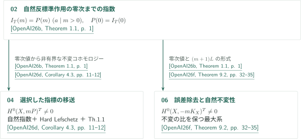
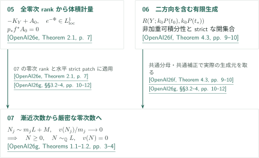

# Catalogue 068 — Anticanonical nonvanishing under smooth semipositivity

**滑らかな半正値性から非消滅へ：結果と証明経路の案内**

公式順の7稿、計270ページを扱う。共通する問いは反標準束の正冪の非消滅だが、各稿は不変指数、klt対上の有界計量、固定指標の移送、計量降下、境界補正、消滅次数の厳密達成という異なる結果を与える。smooth semipositivityは滑らかな半正値Hermitian計量の存在を意味し、nef性だけを仮定する結論への読み替えはしない。

公式カタログPDFの068項目：<!-- cite:catalog -->[OpenAI Research Catalog · Catalogue 068 · p. 8](https://github.com/openai/math/blob/fd4aeeb2ee4fc729c18d98444fed42fd0529eeeb/overview.pdf)<!-- /cite -->。原稿のPDFへのリンクは各行にある。カタログ番号068と、以下の内部掲載順01–07は別である。

## 公式順の記事一覧

CATALOGINVENTORYTOKEN

## 文献と引用の読み方

本文・図では以下の著者由来キーを使う。いずれも2026年9月26日稿を公式リポジトリの固定commitで参照する。GitHubのPDF閲覧リンクではページへの自動移動を前提としない。各記事ではその稿の内部結果に接頭辞を付けず、外部入力のみにキーを付ける。

<!-- reference-guide -->
- [OpenAI26a](https://github.com/openai/math/blob/fd4aeeb2ee4fc729c18d98444fed42fd0529eeeb/preprints/Anticanonical-nonvanishing-from-smooth-semipositivity-September-26-2026/main.pdf) OpenAI — *Anticanonical nonvanishing from smooth semipositivity*. 二計量の移送と次元帰納法で通常の非消滅を証明し、トーラス不変直像を通して自然不変切断を作る。有限被覆とnormは他稿にも幾何入力を供給する。 September 26, 2026 · 27 ページ.

- [OpenAI26b](https://github.com/openai/math/blob/fd4aeeb2ee4fc729c18d98444fed42fd0529eeeb/preprints/Invariant-anticanonical-indices-and-conversion-of-twisted-differentials-September-26-2026/main.pdf) OpenAI — *Invariant anticanonical indices and conversion of twisted differentials*. 局所化・削除面の相殺と、有界底計量・零次も含む消滅という独立な二経路を接続する。不変形式を有限被覆へ先に降下し、その後で通常のconversionを使う。 September 26, 2026 · 18 ページ.

- [OpenAI26c](https://github.com/openai/math/blob/fd4aeeb2ee4fc729c18d98444fed42fd0529eeeb/preprints/Bounded-anticanonical-metrics-on-klt-pairs-and-torus-quotients-September-26-2026/main.pdf) OpenAI — *Bounded anticanonical metrics on klt pairs and torus quotients*. 極大底と縦係数の最小値から有界計量を作る。安定トーラス商で自然線形化を保ち、商の切断を全域へ延長する。 September 26, 2026 · 20 ページ.

- [OpenAI26d](https://github.com/openai/math/blob/fd4aeeb2ee4fc729c18d98444fed42fd0529eeeb/preprints/Cohomological-transfer-and-equivariant-anticanonical-sections-September-26-2026/main.pdf) OpenAI — *Cohomological transfer and equivariant anticanonical sections*. 共通の不変切断比の体、連続最大値計量、零次数の特異積分を使い、非自明でも固定された乗数イデアルで誤差を除く。 September 26, 2026 · 43 ページ.

- [OpenAI26e](https://github.com/openai/math/blob/fd4aeeb2ee4fc729c18d98444fed42fd0529eeeb/preprints/Metric-descent-and-rank-preserving-contractions-September-26-2026/main.pdf) OpenAI — *Metric descent and rank preserving contractions*. Toroidal体積と二計量移送を区別し、補正の例外台・縮約後の切断比・境界上の極を制御する。 September 26, 2026 · 76 ページ.

- [OpenAI26f](https://github.com/openai/math/blob/fd4aeeb2ee4fc729c18d98444fed42fd0529eeeb/preprints/Integrable-metrics-and-effectivity-with-controlled-boundary-September-26-2026/main.pdf) OpenAI — *Integrable metrics and effectivity with controlled boundary*. 重み付き近似で補正の台を制御し、Iitaka底から切断を戻す。非加重計量は実際の多重次数付き因子環の有限生成を別途供給する。 September 26, 2026 · 45 ページ.

- [OpenAI26g](https://github.com/openai/math/blob/fd4aeeb2ee4fc729c18d98444fed42fd0529eeeb/preprints/Exact-orders-and-invariant-anticanonical-linear-systems-September-26-2026/main.pdf) OpenAI — *Exact orders and invariant anticanonical linear systems*. Nullな極の体、toroidal体積、有限生成環を合流させ、境界rayの実際の生成元で漸近次数を厳密達成へ変える。 September 26, 2026 · 41 ページ.
<!-- /reference-guide -->

## 不変指数から分岐する非消滅の経路

02の指数定理は、自然反標準作用について、ある整数の**すべての正の倍数**で不変Euler指数が多項式となり、その定数項が実際の零次指数であることを主張する。指数定理自体はprojectivityや半正値性を仮定しない。04・06で切断を取り出す際に、非零の零次指数、smooth semipositivity、Hard Lefschetz等の追加条件を使う。<!-- cite:b-index -->[&#91;OpenAI26b, Theorem 1.1, p. 1&#93;](https://github.com/openai/math/blob/fd4aeeb2ee4fc729c18d98444fed42fd0529eeeb/preprints/Invariant-anticanonical-indices-and-conversion-of-twisted-differentials-September-26-2026/main.pdf)<!-- /cite -->

04は任意に選んだ線形化に対する移送定理を先に証明し、自然指数から得たコホモロジーを微分形式・determinantへ送り、その帰結で自然不変切断を得る。06は不変な比の体を保った最大線形系に同じ指数入力を使う。02の通常の誤差除去だけから不変切断が自動的に得られる、と読み替えることはできない。<!-- cite:d-index -->[&#91;OpenAI26d, Proposition 4.1; Corollary 4.3, pp. 10–12&#93;](https://github.com/openai/math/blob/fd4aeeb2ee4fc729c18d98444fed42fd0529eeeb/preprints/Cohomological-transfer-and-equivariant-anticanonical-sections-September-26-2026/main.pdf)<!-- /cite -->、<!-- cite:f-index -->[&#91;OpenAI26f, Proposition 9.1; Theorem 9.2, pp. 32–35&#93;](https://github.com/openai/math/blob/fd4aeeb2ee4fc729c18d98444fed42fd0529eeeb/preprints/Integrable-metrics-and-effectivity-with-controlled-boundary-September-26-2026/main.pdf)<!-- /cite -->

## 計量と有限生成が合流する厳密達成

07の主定理は、固定線束$M$を伴う有効因子列$N_j\sim m_jL+M$が曲率null面にあり、中心付き離散valuation（零valuationを含む）の$v(N_j)/m_j$が零へ近づくとき、$N\ge0$, $N\sim_{\mathbb Q}L$, $v(N)=0$を得る。$M$はこの定理では任意であり、$-M$の擬有効性は別の形式弧の系の条件である。<!-- cite:g-main -->[&#91;OpenAI26g, Theorems 1.1–1.2, pp. 3–4&#93;](https://github.com/openai/math/blob/fd4aeeb2ee4fc729c18d98444fed42fd0529eeeb/preprints/Exact-orders-and-invariant-anticanonical-linear-systems-September-26-2026/main.pdf)<!-- /cite -->

まず07内で構成した**全直像の零次rank 1**と水平strict patchを05のtoroidal体積定理へ渡す。得られるのは$-K_Y+A_0$上の**非加重**可積分計量と例外的な補正である。06の有限生成定理を二つの有理方向へ共通の補正・分母で適用し、実際の二重次数付き因子環の境界ray生成元を取る。最後は補正をpushdownしてからvaluationの中心で評価する。補正自体のvaluationが零であるとは仮定しない。<!-- cite:e-metric -->[&#91;OpenAI26e, Theorem 2.1, p. 7&#93;](https://github.com/openai/math/blob/fd4aeeb2ee4fc729c18d98444fed42fd0529eeeb/preprints/Metric-descent-and-rank-preserving-contractions-September-26-2026/main.pdf)<!-- /cite -->、<!-- cite:f-ring -->[&#91;OpenAI26f, Theorem 4.3, pp. 9–10&#93;](https://github.com/openai/math/blob/fd4aeeb2ee4fc729c18d98444fed42fd0529eeeb/preprints/Integrable-metrics-and-effectivity-with-controlled-boundary-September-26-2026/main.pdf)<!-- /cite -->、<!-- cite:g-apply -->[&#91;OpenAI26g, §§3.2–4, pp. 10–12&#93;](https://github.com/openai/math/blob/fd4aeeb2ee4fc729c18d98444fed42fd0529eeeb/preprints/Exact-orders-and-invariant-anticanonical-linear-systems-September-26-2026/main.pdf)<!-- /cite -->

05→06の計量降下は06 §5.3の**別経路**でも使われるが、06の重み付き支持制御定理から始まる主経路とは区別する。重み付き可積分性、非加重可積分性、通常開集合上のstrict positivity、大域Kähler下界を同一条件として扱わない。<!-- cite:f-alt -->[&#91;OpenAI26f, §5.3, pp. 13–15&#93;](https://github.com/openai/math/blob/fd4aeeb2ee4fc729c18d98444fed42fd0529eeeb/preprints/Integrable-metrics-and-effectivity-with-controlled-boundary-September-26-2026/main.pdf)<!-- /cite -->、<!-- cite:f-weighted -->[&#91;OpenAI26f, Theorem 1.1, p. 2&#93;](https://github.com/openai/math/blob/fd4aeeb2ee4fc729c18d98444fed42fd0529eeeb/preprints/Integrable-metrics-and-effectivity-with-controlled-boundary-September-26-2026/main.pdf)<!-- /cite -->

## 結果単位の接続と独立した経路

| 供給元の結果 | 利用先・使用箇所 | 種類と役割 |
|---|---|---|
| [Anticanonical nonvanishing from smooth semipositivity](../anticanonical-smooth-semipositivity/article.ja.md#proof-overview) · <!-- cite:a-structure -->[&#91;OpenAI26a, Theorem 2.1; Lemma 2.2, pp. 5, 8&#93;](https://github.com/openai/math/blob/fd4aeeb2ee4fc729c18d98444fed42fd0529eeeb/preprints/Anticanonical-nonvanishing-from-smooth-semipositivity-September-26-2026/main.pdf)<!-- /cite --> | [Invariant anticanonical indices and conversion of twisted differentials](../invariant-anticanonical-indices/article.ja.md#proof-3) · <!-- cite:b-descent -->[&#91;OpenAI26b, Proposition 5.1; Corollary 5.2, pp. 16–17&#93;](https://github.com/openai/math/blob/fd4aeeb2ee4fc729c18d98444fed42fd0529eeeb/preprints/Invariant-anticanonical-indices-and-conversion-of-twisted-differentials-September-26-2026/main.pdf)<!-- /cite --> | **帰結での利用**。不変形式を有限被覆へ降下し、通常conversion後にnormを取る。01の非消滅主定理は使わない。 |
| [Anticanonical nonvanishing from smooth semipositivity](../anticanonical-smooth-semipositivity/article.ja.md#proof-overview) · <!-- cite:a-structure -->[&#91;OpenAI26a, Theorem 2.1; Lemma 2.2, pp. 5, 8&#93;](https://github.com/openai/math/blob/fd4aeeb2ee4fc729c18d98444fed42fd0529eeeb/preprints/Anticanonical-nonvanishing-from-smooth-semipositivity-September-26-2026/main.pdf)<!-- /cite --> | [Bounded anticanonical metrics on klt pairs and torus quotients](../bounded-anticanonical-metrics/article.ja.md#proof-3) · <!-- cite:c-cor -->[&#91;OpenAI26c, Corollary 4.1, p. 18&#93;](https://github.com/openai/math/blob/fd4aeeb2ee4fc729c18d98444fed42fd0529eeeb/preprints/Bounded-anticanonical-metrics-on-klt-pairs-and-torus-quotients-September-26-2026/main.pdf)<!-- /cite --> | **帰結での利用**。残存compact torusと不変canonical frameでTh1.2の切断を降下し、finite étale normを取る。 |
| [Anticanonical nonvanishing from smooth semipositivity](../anticanonical-smooth-semipositivity/article.ja.md#proof-overview) · <!-- cite:a-structure -->[&#91;OpenAI26a, Theorem 2.1; Lemma 2.2, pp. 5, 8&#93;](https://github.com/openai/math/blob/fd4aeeb2ee4fc729c18d98444fed42fd0529eeeb/preprints/Anticanonical-nonvanishing-from-smooth-semipositivity-September-26-2026/main.pdf)<!-- /cite --> | [Cohomological transfer and equivariant anticanonical sections](../cohomological-transfer/article.ja.md#proof-4) · <!-- cite:d-cor -->[&#91;OpenAI26d, §14.1, p. 39&#93;](https://github.com/openai/math/blob/fd4aeeb2ee4fc729c18d98444fed42fd0529eeeb/preprints/Cohomological-transfer-and-equivariant-anticanonical-sections-September-26-2026/main.pdf)<!-- /cite --> | **帰結での利用**。Cor4.3の自然不変切断を一般Xへ戻す。全被覆の積分解を仮定しない。 |
| [Invariant anticanonical indices and conversion of twisted differentials](../invariant-anticanonical-indices/article.ja.md#proof-1) · <!-- cite:b-index -->[&#91;OpenAI26b, Theorem 1.1, p. 1&#93;](https://github.com/openai/math/blob/fd4aeeb2ee4fc729c18d98444fed42fd0529eeeb/preprints/Invariant-anticanonical-indices-and-conversion-of-twisted-differentials-September-26-2026/main.pdf)<!-- /cite --> | [Cohomological transfer and equivariant anticanonical sections](../cohomological-transfer/article.ja.md#proof-3) · <!-- cite:d-index -->[&#91;OpenAI26d, Proposition 4.1; Corollary 4.3, pp. 10–12&#93;](https://github.com/openai/math/blob/fd4aeeb2ee4fc729c18d98444fed42fd0529eeeb/preprints/Cohomological-transfer-and-equivariant-anticanonical-sections-September-26-2026/main.pdf)<!-- /cite --> | **帰結での利用**。実際の零次指数から非有界コホモロジーを得て、Th1.1へ送る。 |
| [Invariant anticanonical indices and conversion of twisted differentials](../invariant-anticanonical-indices/article.ja.md#proof-1) · <!-- cite:b-index -->[&#91;OpenAI26b, Theorem 1.1, p. 1&#93;](https://github.com/openai/math/blob/fd4aeeb2ee4fc729c18d98444fed42fd0529eeeb/preprints/Invariant-anticanonical-indices-and-conversion-of-twisted-differentials-September-26-2026/main.pdf)<!-- /cite --> | [Integrable metrics and effectivity with controlled boundary](../integrable-metrics-controlled-boundary/article.ja.md#proof-5) · <!-- cite:f-index -->[&#91;OpenAI26f, Proposition 9.1; Theorem 9.2, pp. 32–35&#93;](https://github.com/openai/math/blob/fd4aeeb2ee4fc729c18d98444fed42fd0529eeeb/preprints/Integrable-metrics-and-effectivity-with-controlled-boundary-September-26-2026/main.pdf)<!-- /cite --> | **直接入力**。自然線形化と(m+1)L shiftを保って不変形式を作る。 |
| [Metric descent and rank-preserving contractions](../metric-descent-contractions/article.ja.md#proof-1) · <!-- cite:e-metric -->[&#91;OpenAI26e, Theorem 2.1, p. 7&#93;](https://github.com/openai/math/blob/fd4aeeb2ee4fc729c18d98444fed42fd0529eeeb/preprints/Metric-descent-and-rank-preserving-contractions-September-26-2026/main.pdf)<!-- /cite --> | [Integrable metrics and effectivity with controlled boundary](../integrable-metrics-controlled-boundary/article.ja.md#proof-3) · <!-- cite:f-alt -->[&#91;OpenAI26f, §5.3, pp. 13–15&#93;](https://github.com/openai/math/blob/fd4aeeb2ee4fc729c18d98444fed42fd0529eeeb/preprints/Integrable-metrics-and-effectivity-with-controlled-boundary-September-26-2026/main.pdf)<!-- /cite --> | **別経路**。§5.3の非加重toroidal計量。§5.2の重み付き主経路と区別する。 |
| [Metric descent and rank-preserving contractions](../metric-descent-contractions/article.ja.md#proof-1) · <!-- cite:e-metric -->[&#91;OpenAI26e, Theorem 2.1, p. 7&#93;](https://github.com/openai/math/blob/fd4aeeb2ee4fc729c18d98444fed42fd0529eeeb/preprints/Metric-descent-and-rank-preserving-contractions-September-26-2026/main.pdf)<!-- /cite --> | [Exact orders and invariant anticanonical linear systems](../exact-orders-anticanonical/article.ja.md#proof-1) · <!-- cite:g-apply -->[&#91;OpenAI26g, §§3.2–4, pp. 10–12&#93;](https://github.com/openai/math/blob/fd4aeeb2ee4fc729c18d98444fed42fd0529eeeb/preprints/Exact-orders-and-invariant-anticanonical-linear-systems-September-26-2026/main.pdf)<!-- /cite --> | **直接入力**。全零次rankと水平strict patchから計量と例外補正を供給する。 |
| [Integrable metrics and effectivity with controlled boundary](../integrable-metrics-controlled-boundary/article.ja.md#proof-2) · <!-- cite:f-ring -->[&#91;OpenAI26f, Theorem 4.3, pp. 9–10&#93;](https://github.com/openai/math/blob/fd4aeeb2ee4fc729c18d98444fed42fd0529eeeb/preprints/Integrable-metrics-and-effectivity-with-controlled-boundary-September-26-2026/main.pdf)<!-- /cite --> | [Exact orders and invariant anticanonical linear systems](../exact-orders-anticanonical/article.ja.md#proof-1) · <!-- cite:g-apply -->[&#91;OpenAI26g, §§3.2–4, pp. 10–12&#93;](https://github.com/openai/math/blob/fd4aeeb2ee4fc729c18d98444fed42fd0529eeeb/preprints/Exact-orders-and-invariant-anticanonical-linear-systems-September-26-2026/main.pdf)<!-- /cite --> | **直接入力**。共通ε・k0で実際の二方向因子環を有限生成にする。 |
| [Integrable metrics and effectivity with controlled boundary](../integrable-metrics-controlled-boundary/article.ja.md#proof-1) · <!-- cite:f-approximation -->[&#91;OpenAI26f, Theorem 2.2, pp. 6–7&#93;](https://github.com/openai/math/blob/fd4aeeb2ee4fc729c18d98444fed42fd0529eeeb/preprints/Integrable-metrics-and-effectivity-with-controlled-boundary-September-26-2026/main.pdf)<!-- /cite --> | [Exact orders and invariant anticanonical linear systems](../exact-orders-anticanonical/article.ja.md#proof-7) · <!-- cite:g-cone -->[&#91;OpenAI26g, Proposition 12.1; §12.2, pp. 31, 34&#93;](https://github.com/openai/math/blob/fd4aeeb2ee4fc729c18d98444fed42fd0529eeeb/preprints/Exact-orders-and-invariant-anticanonical-linear-systems-September-26-2026/main.pdf)<!-- /cite --> | **追加結果への直接入力**。加重近似でklt境界と消える補正を作り、controlled因子の有限多面錐を得る。Th1.1の有限生成入力とは別。 |

04は、底からの曲率下界と消えるregularization errorから、高次の底コホモロジーを消す独立の調和的機構も示す。<!-- cite:d-kernel -->[&#91;OpenAI26d, Theorem 7.2, pp. 17–19&#93;](https://github.com/openai/math/blob/fd4aeeb2ee4fc729c18d98444fed42fd0529eeeb/preprints/Cohomological-transfer-and-equivariant-anticanonical-sections-September-26-2026/main.pdf)<!-- /cite --> 07の追加出力は、高次$H^i(\mathcal O)$全消滅より弱い$q=0$, $\chi\ne0$とfaithful作用・同変very ample束の下での不変非消滅、$q=0$での不変固定誤差除去、RCでのcontrolled因子の有限多面錐である。前二者と錐の結論は各記事で仮定を分けて示す。<!-- cite:g-more -->[&#91;OpenAI26g, Proposition 10.1; Theorem 11.1, pp. 25, 27&#93;](https://github.com/openai/math/blob/fd4aeeb2ee4fc729c18d98444fed42fd0529eeeb/preprints/Exact-orders-and-invariant-anticanonical-linear-systems-September-26-2026/main.pdf)<!-- /cite -->、<!-- cite:g-cone -->[&#91;OpenAI26g, Proposition 12.1; §12.2, pp. 31, 34&#93;](https://github.com/openai/math/blob/fd4aeeb2ee4fc729c18d98444fed42fd0529eeeb/preprints/Exact-orders-and-invariant-anticanonical-linear-systems-September-26-2026/main.pdf)<!-- /cite -->

01の非消滅主定理そのものを、被覆の構造定理・normと取り違えない。01は有限体積と二計量の経路、03はklt対上の有界計量とEuler多項式の経路を与える。03の主定理を04の移送定理の入力とする関係は、今回読んだ核心箇所にはない。共通のsmoothな非消滅結論を持つという比較は、証明依存の矢印ではない。<!-- cite:a-main -->[&#91;OpenAI26a, Theorems 1.1–1.2, pp. 2–3&#93;](https://github.com/openai/math/blob/fd4aeeb2ee4fc729c18d98444fed42fd0529eeeb/preprints/Anticanonical-nonvanishing-from-smooth-semipositivity-September-26-2026/main.pdf)<!-- /cite -->、<!-- cite:c-main -->[&#91;OpenAI26c, Theorems 1.1–1.2, p. 2&#93;](https://github.com/openai/math/blob/fd4aeeb2ee4fc729c18d98444fed42fd0529eeeb/preprints/Bounded-anticanonical-metrics-on-klt-pairs-and-torus-quotients-September-26-2026/main.pdf)<!-- /cite -->、<!-- cite:d-main -->[&#91;OpenAI26d, Theorem 1.1; Corollary 1.2, p. 2&#93;](https://github.com/openai/math/blob/fd4aeeb2ee4fc729c18d98444fed42fd0529eeeb/preprints/Cohomological-transfer-and-equivariant-anticanonical-sections-September-26-2026/main.pdf)<!-- /cite -->

図は確認済みの二つの分岐・合流を選んで示す。01からの構造入力と別経路は表へ残し、七稿全体を単一の依存鎖や排他的な分類にはしない。未調査の接続は図に描かない。

## 原典と確認範囲

公式overview.pdfのp.8は本見出しを用い、CONTENTS.mdは同じ068を *Anticanonical nonvanishing in every dimension* と記す。公式分野は *Algebraic and complex geometry*。固定版、SHA-256、原稿のページ数、重複照合は台帳に記録した。

各記事は主張の仮定・結論と、選んだ核心証明の本文、直接使う外部結果の記述・使用箇所を照合した読解案内である。著者の定理を紹介することと、編集側の照合結果は区別する。別担当による点検も全証明の独立再検証や専門家査読ではない。外部文献の証明は再帰的に検証していない。

01–07の読解範囲・未確認入力は各記事末尾にある。とくに04のTh7.2以外の補助・別経路§§5–13、05の後半§§8–12、06の別経路§§6–8/10–12、07の今回追加したProp10.1・Th11.1・Prop12.1以外の補助・別経路§§8–14は全体の詳細点検を完了した範囲ではない。07のcompact-monodromy descentへの01の接続は今回の確認済み表に採用していない。

AI生成の解説なので、重要な主張・適用条件・証明はリンク先の原典で確認されたい。
