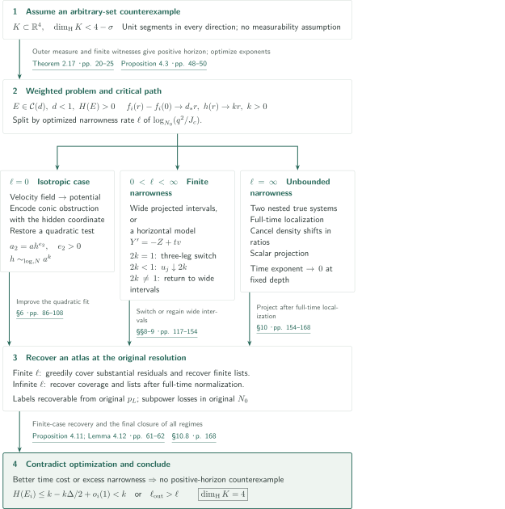
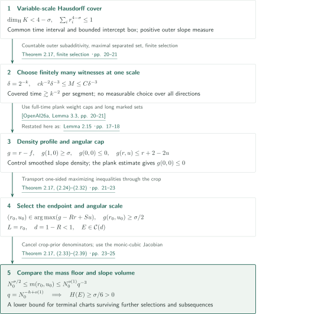

# Every four-dimensional Kakeya set has full Hausdorff dimension

**From variable-scale covers to positive horizon, then contradiction by improving quadratic local fits**

The manuscript translates the Hausdorff dimension problem for four-dimensional Kakeya sets into the exponent required to localize weighted trajectories in time. It selects a problem whose density decreases at a rate below one, improves quadratic fits, and contradicts the optimized time exponent or spatial width. A good local approximation must also return to the original problem as a chart with substantial incidence mass and a short list of labels recoverable from the original observation.

## 1. Main results

### Theorem 1.1 — Hausdorff dimension of arbitrary four-dimensional Kakeya sets

Let $K\subset\mathbb R^4$. Suppose that for every $e\in S^3$ there is $a_e\in\mathbb R^4$ such that

$$
\{a_e+te:0\le t\le1\}\subset K.
$$

The manuscript proves

$$
\dim_{\mathrm H}K=4.
$$

Neither $K$ nor the choice $e\mapsto a_e$ is assumed measurable. Compactness and stickiness are not assumed either. Hausdorff dimension is defined using countable covers of arbitrary sets. The conclusion concerns variable-scale covers; Theorem 1.1 does not assert a four-dimensional Kakeya maximal-function estimate.

<!-- cite:main-result -->[Theorem 1.1 · p. 3](https://github.com/openai/math/blob/1581d4cbdd69a0faf34b2089614fe2a814316a6a/preprints/Every-four-dimensional-Kakeya-set-has-full-Hausdorff-dimension-September-24-2026/paper.pdf)<!-- /cite -->

## References on the arrows

<!-- reference-guide -->
Unprefixed theorem, lemma, section and equation numbers refer to [Every four-dimensional Kakeya set has full Hausdorff dimension](https://github.com/openai/math/blob/1581d4cbdd69a0faf34b2089614fe2a814316a6a/preprints/Every-four-dimensional-Kakeya-set-has-full-Hausdorff-dimension-September-24-2026/paper.pdf). External inputs use the following keys.

- [OpenAI26a](https://github.com/openai/math/blob/1581d4cbdd69a0faf34b2089614fe2a814316a6a/preprints/The-Kakeya-maximal-conjecture-in-three-dimensions-September-23-2026/paper.pdf) OpenAI — *The Kakeya maximal conjecture in three dimensions*: Weighted full-time plank bound; the text records the discrepancy between the cited number 2.3 and the pinned version’s 3.3.. September 23, 2026; fixed commit 1581d4cbdd69a0faf34b2089614fe2a814316a6a.
- [CV13](https://arxiv.org/pdf/1205.6371v1) Anthony Carbery; Stefán Ingi Valdimarsson — *The endpoint multilinear Kakeya theorem via the Borsuk–Ulam theorem*: Determinant-weighted multilinear Kakeya for independent directions.. arXiv:1205.6371v1, 29 May 2012.
- [WZ25](https://arxiv.org/pdf/2210.09581v2) Hong Wang; Joshua Zahl — *Sticky Kakeya sets and the sticky Kakeya conjecture*: Restricted-triple dot-product alternative for the scalar-normal first jet.. arXiv:2210.09581v2, 7 October 2025.
- [OSS24](https://arxiv.org/pdf/2309.03068v2) Tuomas Orponen; Nicolas de Saxcé; Pablo Shmerkin — *On the Fourier decay of multiplicative convolutions*: Multiplicative-convolution Fourier decay and flat generated coefficients for planar rigidity.. arXiv:2309.03068v2, 27 February 2024.

Each citation gives the result and pages. When printed pagination differs from the PDF position, both are shown. GitHub previews do not automatically jump to the cited page.
<!-- /reference-guide -->

## 2. Theorem 1.1 — Proof overview of the main theorem

<!-- proof-target:1 -->Proof target：[Theorem 1.1 · p. 3](https://github.com/openai/math/blob/1581d4cbdd69a0faf34b2089614fe2a814316a6a/preprints/Every-four-dimensional-Kakeya-set-has-full-Hausdorff-dimension-September-24-2026/paper.pdf)<!-- /proof-target -->

**Proof route.** Assume $\dim_{\mathrm H}K<4$. The [reduction in the next section](#proof-1) produces a weighted problem with positive horizon. Successive optimization of density, time, and spatial narrowness leaves three cases for the optimized narrowness $\ell$. Each case gives local improvements, which must return to chart systems in the original problem before contradicting optimality.

Write $N_0\to\infty$ for the original resolution and $a_r=N_0^{-r}$ for thickness at depth $r$. Trajectories have the form $(t,y_0+tV,w_0+tW)$, with $y\in\mathbb R^2$. The observation $p_r$ retains exact $(t,y)$ and bins $w$ at width $a_r/B$, where $B$ is the hidden-derivative scale. Write $n(r)=N_0^{-f(r)}$ for its typical density. A chart of time length $q$, spatial Jacobian $J_c$, and selected mass $m_c$ is **true** when

$$
\frac{m_c}{q}\ge N_0^{-o(1)}n(r)J_c.
$$

The spatial box and quadratic small-value conditions hold along assigned trajectories throughout the whole time block; only the lower hidden-derivative bound is required on selected incidences. For true terminal systems at depth $L$ covering mass $N_0^{-o(1)}$, the horizon $H(E)$ is the infimum of the exponents in $q=N_0^{-h+o(1)}$. Subsequences and further permitted selections are included in this infimum.

<!-- cite:chart-horizon -->[Definitions 2.1, 2.6, 2.8 · pp. 8–12; Definition 2.14 · p. 17](https://github.com/openai/math/blob/1581d4cbdd69a0faf34b2089614fe2a814316a6a/preprints/Every-four-dimensional-Kakeya-set-has-full-Hausdorff-dimension-September-24-2026/paper.pdf)<!-- /cite -->

### 1. From positive horizon to linear critical paths

The reduction gives a cap class $\mathcal C(d)$ satisfying, for fixed $S,\eta>0$,

$$
f(L)-f(r)\le d(L-r),\qquad d<1,
$$

and a joint density ceiling $n(L)N_0^{-Su+o(1)}$ when a velocity bin is appended to the terminal observation, for $0<u\le\eta L$. Lemma 3.5 reduces the time exponent from $h$ to $h-e$ at the cost of at most $Ce$ in thickness depth. Its constant is independent of the individual problem's complexity, so the maximal time rate stays $0<k\le1$ as one approaches the least density exponent $d_*$ permitting positive horizon.

After normalizing length to one, optimize $d_*$ first, then $H(E)/L$, then narrowness. Proposition 4.3 produces paths with relative density $f_i(r)-f_i(0)\to d_*r$ and cumulative time exponent $kr$. Narrowness is $\log_{N_0}(q^2/J_c)$; for finite $\ell$, its cumulative value approaches $\ell r$. No bound on the absolute density exponent $f_i(0)$, and no single limiting problem realizing all optima, is required.

<!-- cite:critical-path -->[Lemma 3.5 · p. 36; Proposition 4.3; Lemmas 4.1–4.5 · pp. 47–51](https://github.com/openai/math/blob/1581d4cbdd69a0faf34b2089614fe2a814316a6a/preprints/Every-four-dimensional-Kakeya-set-has-full-Hausdorff-dimension-September-24-2026/paper.pdf)<!-- /cite -->

### 2. In the isotropic case, construct a potential and restore the quadratic class

When $\ell=0$, scalar-normal estimates provide polynomial fits along trajectories. Multilinear Kakeya for independent velocities and interpolation assemble them into a polynomial field. Switching between trajectories yields approximate conservativity and hence a potential. Its degree need not initially be at most two.

Proposition 6.8 identifies the cubic and quartic obstruction when broad directions remain close to a conic. The existing hidden coordinate encodes these terms as a quadratic correction, restoring the allowed chart test. Writing $a$ for local thickness and $h=N^{o(1)}a^k$ for block length, the resulting thickness is $a_2=ah^{e_2}$, with $e_2>0$, and mass divided by block length is at least $N^{-o(1)}\nu_Q(a_2/a)^{d_*}$. The fit holds throughout the same time block. Here $N$ is the local tangent resolution, and $\nu_Q$ is the original trajectory assignment mass, not a prior reconditioned on success. The scalar version of this argument first proves $H=0$ in Corollary 6.9 and supplies the later projection theorem.

<!-- cite:isotropic -->[Theorem 6.1 · p. 86; Proposition 6.8; Corollary 6.9 · pp. 104–108](https://github.com/openai/math/blob/1581d4cbdd69a0faf34b2089614fe2a814316a6a/preprints/Every-four-dimensional-Kakeya-set-has-full-Hausdorff-dimension-September-24-2026/paper.pdf)<!-- /cite -->

### 3. Finite narrowness leads through the horizontal model

For $0<\ell<\infty$, scalar projection yields quadratic graphs fitting whole trajectories. If projected intervals are sufficiently wide at three nearby depths, comparison gives a time improvement directly. Otherwise planar rigidity, retaining original incidence edges, reduces to the horizontal model $Y'=-Z+tv$. Its narrowness rate equals $k$, and its natural spatial widths are $H$ and $H^2$.

At the critical rate $2k=1$, a path with three refreshed line segments fills enough three-dimensional base volume to improve the fit. For $2k>1$, the argument returns to wide projected intervals. For $2k<1$, it first improves full-time predictions on parameter boxes of width $a_s^u$. The iteration in Proposition 9.5 is

$$
u_{j+1}=\frac{u_j}{1+\alpha(u_j-2k)},\qquad
u_0=1,\qquad \alpha=\frac{1-d_*}{10000},\qquad u_j\downarrow2k.
$$

Only after absorbing the losses from each finite iteration does the iteration count increase slowly. This constructs actual labels and mass floors at the endpoint width $h_s^2=a_s^{2k}$. Proposition 9.6 then restores the wide-interval hypotheses of Proposition 8.4. Substitution of a limiting exponent alone would not give these objects.

<!-- cite:finite-narrowness -->[Propositions 8.4–8.5 · pp. 124–130; Propositions 9.2, 9.5–9.6 · pp. 138–154](https://github.com/openai/math/blob/1581d4cbdd69a0faf34b2089614fe2a814316a6a/preprints/Every-four-dimensional-Kakeya-set-has-full-Hausdorff-dimension-September-24-2026/paper.pdf)<!-- /cite -->

### 4. Infinite narrowness and the return from local improvements to the original scale

When $\ell=\infty$, two nested true systems localize trajectories for the entire time interval. Further normalization may shift absolute density exponents substantially, but these shifts cancel in the density ratios used. Scalar projection and label recovery produce atlases at a fixed positive depth whose time exponents tend to zero, contradicting positive $k$.

For finite $\ell$, finding one local candidate also does not suffice. Proposition 4.11 assumes that every substantial residual supplies a candidate; greedy assignment obtains coverage, scalar-sheet comparison shortens label lists, and Lemma 4.12 recovers them in the original law. Success is at least $p_{\mathrm{path}}/\log N_0$, where $p_{\mathrm{path}}$ is the original path mass, and lists and slacks are subpower in the original resolution. Local $N^{o(1)}$ is not simply treated as $N_0^{o(1)}$: the original-scale exclusion is fixed before the diagonal is chosen.

The resulting atlas either has excess narrowness at the same depth and time, or gains depth $\Delta>0$ at time cost at most $k\Delta/2$. In the latter case, completion through the remaining depths gives

$$
H(E_i)\le h_i+\frac{k\Delta}{2}+k(d_i)(1-r_i-\Delta)
\le k-\frac{k\Delta}{2}+o_i(1),
$$

contradicting $H(E_i)\to k$. All three cases are excluded, so $\dim_{\mathrm H}K\ge4$; the ambient upper bound gives equality.

<!-- cite:conversion-completion -->[Lemma 4.5 · p. 51; Proposition 4.11; Lemma 4.12 · pp. 61–62; Proposition 10.1; §10.8 · pp. 154–168](https://github.com/openai/math/blob/1581d4cbdd69a0faf34b2089614fe2a814316a6a/preprints/Every-four-dimensional-Kakeya-set-has-full-Hausdorff-dimension-September-24-2026/paper.pdf)<!-- /cite -->

## 3. Proof of Theorem 2.17 — From arbitrary sets to positive horizon

<!-- proof-target:2 -->Proof target：[Theorem 2.17 · p. 20](https://github.com/openai/math/blob/1581d4cbdd69a0faf34b2089614fe2a814316a6a/preprints/Every-four-dimensional-Kakeya-set-has-full-Hausdorff-dimension-September-24-2026/paper.pdf)<!-- /proof-target -->

<!-- statement:theorem-2-17 -->
### Theorem 2.17 — From a counterexample to a positive-horizon problem

Suppose that a Kakeya set $K\subset\mathbb R^4$ with $\dim_{\mathrm H}K<4$ exists. Then there are $0<d<1$, $S,\eta>0$, and a tempered homogeneous version-2 exact problem $E\in\mathcal C(d)$ such that $H(E)>0$. The density and angular conditions defining $\mathcal C(d)$ are those stated above.

<!-- cite:reduction-target -->[Theorem 2.17 · p. 20](https://github.com/openai/math/blob/1581d4cbdd69a0faf34b2089614fe2a814316a6a/preprints/Every-four-dimensional-Kakeya-set-has-full-Hausdorff-dimension-September-24-2026/paper.pdf)<!-- /cite -->
<!-- /statement -->

This reduction supports the main theorem's absence of measurability assumptions. In its proof, take $\dim_{\mathrm H}K<4-\sigma$, with $0<\sigma<1$. In this section $k$ denotes a dyadic covering-scale index, distinct from the critical time rate above.

### 1. Use outer measure to choose a common scale, then select only finitely many witnesses

Restrict directions to a graph-slope chart. A countable decomposition by a common rational-endpoint time interval and bounded intercept box supplies a slope set $S_0$ of positive outer measure. Normalize its time interval to $[0,1]$.

Split a ball cover with $\sum_i r_i^{4-\sigma}\le1$ into dyadic scales, with unions $U_k$. Every eligible segment spends at least $ck^{-2}$ time in some $U_k$. Let $S_k$ consist of slopes for which such a segment exists. Countable outer subadditivity gives a scale also satisfying $|S_k|^*\gtrsim k^{-2}$. For $\delta=2^{-k}$, a finite maximal $\delta$-separated set has cardinality

$$
c k^{-2}\delta^{-3}\le M\le C\delta^{-3}.
$$

Only now choose one successful witness for each selected slope. There is no measurable selection over all directions. Powers of $k$ lost as $k\to\infty$ are subpower in $N_0=\delta^{-1}$.

<!-- cite:finite-selection -->[Theorem 2.17, finite selection · pp. 20–21](https://github.com/openai/math/blob/1581d4cbdd69a0faf34b2089614fe2a814316a6a/preprints/Every-four-dimensional-Kakeya-set-has-full-Hausdorff-dimension-September-24-2026/paper.pdf)<!-- /cite -->

### 2. Control the density profile by smoothing and the plank estimate

Give the finite line family uniform weights and independently smooth every intercept and slope coordinate at scale $O(\delta)$. Selected mass is at least $N_0^{-o(1)}$, and the three-dimensional slope density is at most $N_0^{o(1)}$. Jointly homogenize hidden depth $r$ and two-dimensional velocity-bin depth $u$, and put

$$
n(r,u)=N_0^{-f(r,u)},\qquad g(r,u)=r-f(r,u).
$$

The cover count, slope density, and three-dimensional weighted plank estimate give

$$
g(1,0)\ge\sigma,\qquad g(0,0)\le0,\qquad g(r,u)\le r+2-2u.
$$

The middle bound is the direct input from the three-dimensional paper. A cap on the weight of trajectories wholly contained in full-time planks controls average multiplicity for long marked sets. It supplies the starting point of the density profile, rather than replacing the original variable-scale cover by a single-scale volume conclusion.

Choose $R,S>0$ with $R+4S<\sigma/2$, and maximize $g(r,u)-Rr+Su$ on $[0,1]\times[0,4]$. A maximizer $(r_0,u_0)$ has $r_0>0$, $u_0<4$, and $g(r_0,u_0)\ge\sigma/2$. Cropping to the associated spatial and velocity boxes and normalizing yields a cap-class problem of length $L=r_0$ with $d=1-R<1$. The denominator introduced by conditioning the crop prior cancels exactly on return to original mass.

<!-- cite:profile-selection -->[Theorem 2.17, (2.24)–(2.32) · pp. 21–23](https://github.com/openai/math/blob/1581d4cbdd69a0faf34b2089614fe2a814316a6a/preprints/Every-four-dimensional-Kakeya-set-has-full-Hausdorff-dimension-September-24-2026/paper.pdf)<!-- /cite -->

### 3. Compare a chart's mass floor with the slope-volume ceiling

Let a terminal chart have time length $q$ and physical spatial Jacobian $J_{\mathrm{phys}}$. Returning its true floor to the original unnormalized prior gives, with $m(r_0,u_0)=N_0^{g(r_0,u_0)}$,

$$
\frac{m_{\mathrm{old},c}}q
\ge N_0^{-o(1)}m(r_0,u_0)a_{r_0}J_{\mathrm{phys}}.
$$

The set $\Sigma$ of slopes that can satisfy its geometric tests obeys

$$
|\Sigma|\le N_0^{o(1)}\frac{a_{r_0}J_{\mathrm{phys}}}{q^3}.
$$

Choose eligible intercepts semialgebraically with fixed complexity, $b=b(s)$. The Jacobian of $s\mapsto b(s)+ts$ is $\det(Db(s)+tI_3)$, a monic cubic in $t$. On good times of total length comparable to $q$, this Jacobian is bounded below by a constant times $q^3$, and the hidden derivative also has a lower bound. The area formula and quadratic sublevel estimate then control the image volume. Semialgebraic complexity gives a uniform multiplicity bound.

Compare with the original slope-density ceiling and cancel $a_{r_0}J_{\mathrm{phys}}$ to obtain $m(r_0,u_0)\le N_0^{o(1)}q^{-3}$. Every true terminal system therefore has $h\ge\sigma/6$, hence $H(E)\ge\sigma/6>0$. The same estimate survives all permitted selections and subsequences, so it bounds the horizon infimum itself.

<!-- cite:positive-horizon -->[Theorem 2.17, (2.33)–(2.39) · pp. 23–25](https://github.com/openai/math/blob/1581d4cbdd69a0faf34b2089614fe2a814316a6a/preprints/Every-four-dimensional-Kakeya-set-has-full-Hausdorff-dimension-September-24-2026/paper.pdf)<!-- /cite -->

## 4. Which papers supply which steps

| Source and result | Used at | Role and required hypotheses | Checking scope |
|---|---|---|---|
| The Kakeya maximal conjecture in three dimensions, Lemma 3.3 | Lemma 2.15, Proposition 2.16, Theorem 2.17 | Positive weights and repeated indices; a full-time plank cap and at least $D^{1-\eta}$ marks per trajectory yield $\sum_i\omega_i\#J_i\lesssim AD^\varepsilon\#E_{\mathrm{vis}}$. Applied after finite selection and smoothing. | Statement and application hypotheses compared. The four-dimensional paper cites “Lemma 2.3”; the matching statement is Lemma 3.3 in the pinned three-dimensional version. This does not independently verify the input's whole proof. |
| Carbery–Valdimarsson, determinant multilinear Kakeya | §6.3, (6.10), Proposition 6.2 | Converts independent-velocity contributions to a weighted volume estimate controlling physical support and parameter mass. | The external Theorem 1 was compared with p. 90 here: full-line tubes, nonnegative weights, equal wedge and ambient dimensions, and the radius-scaling factor $r^n$. |
| Wang–Zahl, restricted-triple dot-product alternative | Theorem 5.5, Proposition 5.4 | Under an upper covering condition, either restricted triple images expand or line concentration occurs. Scalar support exponent $d<1$ excludes expansion. | External Definition 4.2 and the §8 restatement of Theorem 5.2 were compared with p. 76 here. All downstream calculations were not checked. |
| Orponen–de Saxcé–Shmerkin, multiplicative convolution | Lemma 7.4, Proposition 7.6 | Produces coefficients with small interval probabilities from the planar ratio law, then localizes retained original incidence edges to parallel strips. | External Theorem 1.5 was compared with pp. 112–113 here: normalization to $[-1,1]$, $ns>1$, and smoothed-energy conditions. |

<!-- cite:plank-input -->[&#91;OpenAI26a, Lemma 3.3, pp. 20–21&#93;](https://github.com/openai/math/blob/1581d4cbdd69a0faf34b2089614fe2a814316a6a/preprints/The-Kakeya-maximal-conjecture-in-three-dimensions-September-23-2026/paper.pdf)<!-- /cite -->

<!-- cite:cv-input -->[&#91;CV13, Theorem 1, p. 2&#93;](https://arxiv.org/pdf/1205.6371v1#page=2)<!-- /cite -->

<!-- cite:wz-input -->[&#91;WZ25, Definition 4.2, p. 17; Theorem 5.2, §8 restatement, p. 49&#93;](https://arxiv.org/pdf/2210.09581v2#page=17)<!-- /cite -->

<!-- cite:oss-input -->[&#91;OSS24, Theorem 1.5, p. 2&#93;](https://arxiv.org/pdf/2309.03068v2#page=2)<!-- /cite -->

This direct input is not a dependence on the entire three-dimensional maximal-function theorem. Planar rigidity additionally uses graph Balog–Szemerédi–Gowers and fixed-iterate sumset calculus; the slope-volume argument uses parameter-uniform semialgebraic choice and cell decomposition. Proofs of these foundational results lie outside this article's checking scope.

## 5. Return to the sources

<!-- reading-list -->
- [Theorem 1.1 · p. 3](https://github.com/openai/math/blob/1581d4cbdd69a0faf34b2089614fe2a814316a6a/preprints/Every-four-dimensional-Kakeya-set-has-full-Hausdorff-dimension-September-24-2026/paper.pdf) — Quantification over arbitrary sets and the Hausdorff dimension convention.
- [Theorem 2.17 · pp. 20–25; §10.8 · p. 168](https://github.com/openai/math/blob/1581d4cbdd69a0faf34b2089614fe2a814316a6a/preprints/Every-four-dimensional-Kakeya-set-has-full-Hausdorff-dimension-September-24-2026/paper.pdf) — Variable-scale-cover reduction and the final closure of all three branches.
- [Lemma 3.5 · p. 36; Proposition 4.3; Lemmas 4.1–4.5 · pp. 47–51](https://github.com/openai/math/blob/1581d4cbdd69a0faf34b2089614fe2a814316a6a/preprints/Every-four-dimensional-Kakeya-set-has-full-Hausdorff-dimension-September-24-2026/paper.pdf) — Order of density, time, and narrowness optimization and composition.
- [Proposition 4.11; Lemma 4.12 · pp. 61–62](https://github.com/openai/math/blob/1581d4cbdd69a0faf34b2089614fe2a814316a6a/preprints/Every-four-dimensional-Kakeya-set-has-full-Hausdorff-dimension-September-24-2026/paper.pdf) — Conditions for returning local candidates to original coverage and finite lists.
- [Theorem 6.1 · p. 86; Proposition 6.8; Corollary 6.9 · pp. 104–108](https://github.com/openai/math/blob/1581d4cbdd69a0faf34b2089614fe2a814316a6a/preprints/Every-four-dimensional-Kakeya-set-has-full-Hausdorff-dimension-September-24-2026/paper.pdf) — Isotropic improvement, restoration of quadratic degree, and prior exclusion of the scalar model.
- [Proposition 9.5 · pp. 143–149](https://github.com/openai/math/blob/1581d4cbdd69a0faf34b2089614fe2a814316a6a/preprints/Every-four-dimensional-Kakeya-set-has-full-Hausdorff-dimension-September-24-2026/paper.pdf) — The iteration u_j→2k and construction of actual endpoint labels.
- [Proposition 10.1 · pp. 154–168](https://github.com/openai/math/blob/1581d4cbdd69a0faf34b2089614fe2a814316a6a/preprints/Every-four-dimensional-Kakeya-set-has-full-Hausdorff-dimension-September-24-2026/paper.pdf) — Nested localization, cancellation in density ratios, and recovery at the original scale.
<!-- /reading-list -->

We checked the main theorem's hypotheses and conclusion, the arbitrary-set reduction in §2.6, optimization in §4.1, the recovery conditions in Proposition 4.11, the output statements of the three branches, closure of the iteration in Proposition 9.5, and the connection to the conclusion in §10.8. The three-dimensional plank input was compared with Lemma 3.3 of the pinned version; the citation-number discrepancy is recorded above. The external inputs of Carbery–Valdimarsson, Wang–Zahl, and Orponen–de Saxcé–Shmerkin were also compared with the formulations and application conditions here, within the scope in the table.

This does not independently verify the full scalar-sheet comparison, conditional higher-jet estimates, construction of the potential and restoration of quadratic degree, or every exceptional-set and diagonal loss. The article explains the manuscript's argument with those results as inputs; it does not certify the entire 175-page proof. The geometric consequences in §11 are not proof targets here, and their separate transfer theorems remain unexamined.

<!-- cite:scope -->[Theorem 2.17 · pp. 20–25; §10.8 · p. 168](https://github.com/openai/math/blob/1581d4cbdd69a0faf34b2089614fe2a814316a6a/preprints/Every-four-dimensional-Kakeya-set-has-full-Hausdorff-dimension-September-24-2026/paper.pdf)<!-- /cite -->
