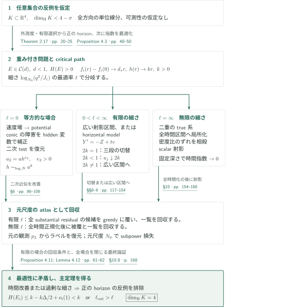
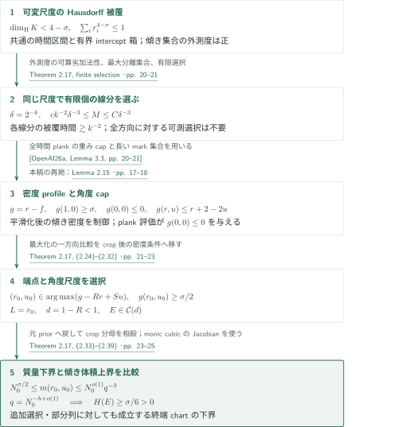

# Every four-dimensional Kakeya set has full Hausdorff dimension

**可変尺度被覆を正のhorizonへ移し、二次局所近似の改善で反例を排除する**

原稿は、4次元Kakeya集合のHausdorff次元を、重み付き軌道の時間局所化に必要な指数へ翻訳する。核心は、密度の減少率が1未満である問題を選び、二次多項式による近似を改善して、最適な時間指数または空間幅に矛盾させることである。局所的によい近似を作るだけでなく、元の観測から復元できる短いラベル一覧と十分なincidence質量を伴うchartへ戻す必要がある。

## 1. 主要結果

### Theorem 1.1 — 任意の4次元Kakeya集合のHausdorff次元

$K\subset\mathbb R^4$とする。すべての$e\in S^3$に対して$a_e\in\mathbb R^4$が存在し、

$$
\{a_e+te:0\le t\le1\}\subset K
$$

を満たすならば、原稿は

$$
\dim_{\mathrm H}K=4
$$

を示す。$K$にも線分の選択$e\mapsto a_e$にも可測性を仮定せず、コンパクト性やstickinessも仮定しない。Hausdorff次元は任意集合への可算被覆による定義を用いる。これは可変尺度被覆に対する結論であり、4次元のKakeya最大関数評価を主張する定理ではない。

<!-- cite:main-result -->[Theorem 1.1 · p. 3](https://github.com/openai/math/blob/1581d4cbdd69a0faf34b2089614fe2a814316a6a/preprints/Every-four-dimensional-Kakeya-set-has-full-Hausdorff-dimension-September-24-2026/paper.pdf)<!-- /cite -->

## 図の矢印に付した引用

<!-- reference-guide -->
略号のない定理・補題・節・式番号は本原稿 [Every four-dimensional Kakeya set has full Hausdorff dimension](https://github.com/openai/math/blob/1581d4cbdd69a0faf34b2089614fe2a814316a6a/preprints/Every-four-dimensional-Kakeya-set-has-full-Hausdorff-dimension-September-24-2026/paper.pdf) を指します。外部入力には次の略号を使います。

- [OpenAI26a](https://github.com/openai/math/blob/1581d4cbdd69a0faf34b2089614fe2a814316a6a/preprints/The-Kakeya-maximal-conjecture-in-three-dimensions-September-23-2026/paper.pdf) OpenAI — *The Kakeya maximal conjecture in three dimensions*：重み付きfull-time plank評価。4次元稿の引用番号2.3と現固定版3.3の不整合は本文参照。。September 23, 2026; fixed commit 1581d4cbdd69a0faf34b2089614fe2a814316a6a。
- [CV13](https://arxiv.org/pdf/1205.6371v1) Anthony Carbery; Stefán Ingi Valdimarsson — *The endpoint multilinear Kakeya theorem via the Borsuk–Ulam theorem*：独立な方向をdeterminantで重み付けしたmultilinear Kakeya評価。。arXiv:1205.6371v1, 29 May 2012。
- [WZ25](https://arxiv.org/pdf/2210.09581v2) Hong Wang; Joshua Zahl — *Sticky Kakeya sets and the sticky Kakeya conjecture*：scalar-normal first jetに使うrestricted-triple dot-product alternative。。arXiv:2210.09581v2, 7 October 2025。
- [OSS24](https://arxiv.org/pdf/2309.03068v2) Tuomas Orponen; Nicolas de Saxcé; Pablo Shmerkin — *On the Fourier decay of multiplicative convolutions*：平面剛性に使う、乗法的畳み込みのFourier減衰と平坦な係数の生成。。arXiv:2309.03068v2, 27 February 2024。

各引用に結果番号とページを付します。誌面番号とPDF内の位置が異なる場合は両方を示します。GitHubの閲覧リンクではページ位置への自動移動を前提としません。
<!-- /reference-guide -->

## 2. Theorem 1.1 — 主定理の証明概略

<!-- proof-target:1 -->証明対象：[Theorem 1.1 · p. 3](https://github.com/openai/math/blob/1581d4cbdd69a0faf34b2089614fe2a814316a6a/preprints/Every-four-dimensional-Kakeya-set-has-full-Hausdorff-dimension-September-24-2026/paper.pdf)<!-- /proof-target -->

**証明の道筋。** $\dim_{\mathrm H}K<4$を仮定し、[次節の帰着](#proof-1)で正のhorizonを持つ重み付き問題を作る。密度指数・時間指数・空間の細さを順に最適化すると、細さの極限$\ell$に応じた三つの場合が残る。各場合の局所改善を元の問題のchart系へ回収し、最適性に矛盾させる。

元の解像度を$N_0\to\infty$、深さ$r$の厚さを$a_r=N_0^{-r}$とする。軌道は$(t,y_0+tV,w_0+tW)$、$y\in\mathbb R^2$であり、観測$p_r$は$(t,y)$を正確に保持し、$w$を幅$a_r/B$で離散化する。$B$はhidden変数の微分の尺度である。観測の典型密度を$n(r)=N_0^{-f(r)}$と書く。時間長$q$、空間Jacobian $J_c$、選択質量$m_c$を持つchartが **true** である条件は

$$
\frac{m_c}{q}\ge N_0^{-o(1)}n(r)J_c.
$$

chartは割り当てた軌道を時間区間全体で空間箱と二次の小値条件に閉じ込める。hidden微分の下界だけは選択incidence上で要求する。終端深さ$L$のtrue系が質量$N_0^{-o(1)}$を覆うとき、$q=N_0^{-h+o(1)}$の指数$h$の下限を$H(E)$と呼ぶ。部分列と許された追加選択もこの下限に含む。

<!-- cite:chart-horizon -->[Definitions 2.1, 2.6, 2.8 · pp. 8–12; Definition 2.14 · p. 17](https://github.com/openai/math/blob/1581d4cbdd69a0faf34b2089614fe2a814316a6a/preprints/Every-four-dimensional-Kakeya-set-has-full-Hausdorff-dimension-September-24-2026/paper.pdf)<!-- /cite -->

### 1. 正のhorizonから線形のcritical pathを選ぶ

帰着で得るcap class $\mathcal C(d)$は、固定した$S,\eta>0$について

$$
f(L)-f(r)\le d(L-r),\qquad d<1,
$$

と、終端観測に速度binを付加した密度の上界$n(L)N_0^{-Su+o(1)}$（$0<u\le\eta L$）を満たす。Lemma 3.5は、時間指数を$h$から$h-e$へ下げる代わりに、厚さの深さを高々$Ce$失うatlasを作る。$C$が問題ごとの複雑度に依存しないため、正のhorizonを許す最小密度指数$d_*$へ近づけても、最大時間率$k$は$0<k\le1$を保つ。

長さ1に正規化し、まず$d_*$、次に$H(E)/L$、最後にnarrownessを最適化する。Proposition 4.3の経路では、相対密度は$f_i(r)-f_i(0)\to d_*r$、累積時間指数は$kr$となる。narrownessは$\log_{N_0}(q^2/J_c)$であり、有限$\ell$の場合には累積量が$\ell r$に近づく。絶対密度$f_i(0)$の有界性や、すべての最適値を実現する一つの極限問題は要求しない。

<!-- cite:critical-path -->[Lemma 3.5 · p. 36; Proposition 4.3; Lemmas 4.1–4.5 · pp. 47–51](https://github.com/openai/math/blob/1581d4cbdd69a0faf34b2089614fe2a814316a6a/preprints/Every-four-dimensional-Kakeya-set-has-full-Hausdorff-dimension-September-24-2026/paper.pdf)<!-- /cite -->

### 2. 等方の場合はpotentialを作り、二次の許容クラスへ戻す

$\ell=0$では、scalar-normal推定が軌道上の多項式近似を与え、独立な速度に対するmultilinear Kakeya評価と補間がこれを空間の多項式場へまとめる。軌道を切り替える議論で近似的な保存性を得てpotentialを作る。ただし、その次数は直ちに2以下とは限らない。

Proposition 6.8は、広い方向がconic近傍に残る場合の3次・4次の障害を特定する。それらを既存のhidden変数を使って二次の補正項として表し、許容されたchartの二次testへ戻す。局所の厚さを$a$、時間blockの長さを$h=N^{o(1)}a^k$とすると、得る厚さは$a_2=ah^{e_2}$（$e_2>0$）、質量は時間長で割って$N^{-o(1)}\nu_Q(a_2/a)^{d_*}$以上であり、近似は同じ時間block全体で成立する。ここで$N$は局所のtangent解像度、$\nu_Q$は選択後に取り直さない元の軌道割当質量である。同じ議論のscalar版からCorollary 6.9の$H=0$が先に得られ、後の射影定理の入力になる。

<!-- cite:isotropic -->[Theorem 6.1 · p. 86; Proposition 6.8; Corollary 6.9 · pp. 104–108](https://github.com/openai/math/blob/1581d4cbdd69a0faf34b2089614fe2a814316a6a/preprints/Every-four-dimensional-Kakeya-set-has-full-Hausdorff-dimension-September-24-2026/paper.pdf)<!-- /cite -->

### 3. 有限の細さではhorizontal modelを経由する

$0<\ell<\infty$では、scalar射影により軌道全体を近似する二次graphを得る。三つの近い深さで射影区間が十分広ければ、比較原理から直接時間改善を得る。そうでない場合は、元のincidence辺を保持する平面剛性を使い、$Y'=-Z+tv$というhorizontal modelへ帰着する。この段階ではnarrowness率が$k$となり、自然な箱の幅は$H$と$H^2$である。

臨界率$2k=1$では、三つの線分を更新する経路が十分な3次元base体積を覆い、より細い近似を得る。$2k>1$では広い射影区間へ戻す。$2k<1$ではその前に、パラメータ箱の幅$a_s^u$における全時間予測を改善する。Proposition 9.5の反復は

$$
u_{j+1}=\frac{u_j}{1+\alpha(u_j-2k)},\qquad
u_0=1,\qquad \alpha=\frac{1-d_*}{10000},\qquad u_j\downarrow2k
$$

である。各有限反復の損失を吸収した後に反復回数をゆっくり増やし、終端幅$h_s^2=a_s^{2k}$の実際のラベルと質量下界を作る。Proposition 9.6が広い区間の条件を回復し、Proposition 8.4の改善へつなぐ。極限指数だけを形式的に代入する段階ではない。

<!-- cite:finite-narrowness -->[Propositions 8.4–8.5 · pp. 124–130; Propositions 9.2, 9.5–9.6 · pp. 138–154](https://github.com/openai/math/blob/1581d4cbdd69a0faf34b2089614fe2a814316a6a/preprints/Every-four-dimensional-Kakeya-set-has-full-Hausdorff-dimension-September-24-2026/paper.pdf)<!-- /cite -->

### 4. 無限の細さと、局所改善を元尺度へ戻す手続き

$\ell=\infty$では、二重に入れ子になったtrue系から全時間区間に有効な細い局所化を得る。再正規化で絶対密度指数は大きくずれても、使用する密度比ではずれが相殺する。scalar射影とラベル回収により、固定された正の深さで時間指数が0へ近づくatlasを作り、正の$k$に矛盾させる。

有限$\ell$の場合も、局所で改善候補が一つ見つかるだけでは結論しない。Proposition 4.11は、どのsubstantial residualにも候補があるという条件からgreedyに被覆を確保し、scalar-sheet比較とLemma 4.12の有限一覧回収を行う。成功質量は元の経路質量$p_{\mathrm{path}}$に対して$p_{\mathrm{path}}/\log N_0$以上、ラベル一覧と誤差は元尺度でsubpowerとなる。局所の$N^{o(1)}$をそのまま$N_0^{o(1)}$と見なさず、先に元尺度の排除条件を固定してから対角化する。

その出力は、同じ深さ・時間で過剰なnarrownessを与えるか、深さを$\Delta>0$増やす費用が$k\Delta/2$以下となる。後者なら残りを完成させて

$$
H(E_i)\le h_i+\frac{k\Delta}{2}+k(d_i)(1-r_i-\Delta)
\le k-\frac{k\Delta}{2}+o_i(1),
$$

となり、$H(E_i)\to k$に反する。三分岐がすべて排除されるので$\dim_{\mathrm H}K\ge4$、周囲次元の上界と合わせて等号になる。

<!-- cite:conversion-completion -->[Lemma 4.5 · p. 51; Proposition 4.11; Lemma 4.12 · pp. 61–62; Proposition 10.1; §10.8 · pp. 154–168](https://github.com/openai/math/blob/1581d4cbdd69a0faf34b2089614fe2a814316a6a/preprints/Every-four-dimensional-Kakeya-set-has-full-Hausdorff-dimension-September-24-2026/paper.pdf)<!-- /cite -->

## 3. Theorem 2.17の証明 — 任意集合から正のhorizonへ

<!-- proof-target:2 -->証明対象：[Theorem 2.17 · p. 20](https://github.com/openai/math/blob/1581d4cbdd69a0faf34b2089614fe2a814316a6a/preprints/Every-four-dimensional-Kakeya-set-has-full-Hausdorff-dimension-September-24-2026/paper.pdf)<!-- /proof-target -->

<!-- statement:theorem-2-17 -->
### Theorem 2.17 — 反例から正のhorizonを持つ問題への帰着

$\mathbb R^4$のKakeya集合$K$で$\dim_{\mathrm H}K<4$となるものが存在すると仮定する。このとき、ある$0<d<1$、$S,\eta>0$と、version 2のtempered homogeneous exact problem $E\in\mathcal C(d)$が存在して、$H(E)>0$となる。$\mathcal C(d)$の密度条件と角度条件は前節の通りである。

<!-- cite:reduction-target -->[Theorem 2.17 · p. 20](https://github.com/openai/math/blob/1581d4cbdd69a0faf34b2089614fe2a814316a6a/preprints/Every-four-dimensional-Kakeya-set-has-full-Hausdorff-dimension-September-24-2026/paper.pdf)<!-- /cite -->
<!-- /statement -->

この帰着が主定理の可測性なしという範囲を支える。証明では$\dim_{\mathrm H}K<4-\sigma$、$0<\sigma<1$と置く。記号$k$はこの節では被覆のdyadic尺度番号であり、前節のcritical time rateとは異なる。

### 1. 外測度で尺度をそろえ、有限個の証人だけを選ぶ

方向をgraph-slope chartへ制限する。共通の有理端点時間区間と有界なintercept箱の可算分解により、正の外測度を持つ傾き集合$S_0$を取れる。座標変換後の時間区間を$[0,1]$とする。

$\sum_i r_i^{4-\sigma}\le1$を満たす球被覆を尺度別に分け、その合併を$U_k$とする。各線分ではある$k$について$U_k$内の時間が$ck^{-2}$以上となる。「そのような線分が存在する」傾き集合$S_k$を使えば、外測度の可算劣加法性から同時に$|S_k|^*\gtrsim k^{-2}$となる尺度を選べる。$\delta=2^{-k}$とし、有限な最大$\delta$-分離集合を取ると

$$
c k^{-2}\delta^{-3}\le M\le C\delta^{-3}.
$$

ここで初めて各傾きに一つの成功線分を選ぶ。方向全体にわたる可測選択は用いない。$k\to\infty$で失う$k$の冪は、$N_0=\delta^{-1}$に対してsubpowerである。

<!-- cite:finite-selection -->[Theorem 2.17, finite selection · pp. 20–21](https://github.com/openai/math/blob/1581d4cbdd69a0faf34b2089614fe2a814316a6a/preprints/Every-four-dimensional-Kakeya-set-has-full-Hausdorff-dimension-September-24-2026/paper.pdf)<!-- /cite -->

### 2. 平滑化とplank評価で密度profileを制御する

有限線族に一様重みを付け、interceptと傾きの各座標を$O(\delta)$だけ独立に平滑化する。選択質量は$N_0^{-o(1)}$以上で、3次元傾き密度は$N_0^{o(1)}$以下となる。hidden深さ$r$と2次元速度bin深さ$u$を同時に均質化し、

$$
n(r,u)=N_0^{-f(r,u)},\qquad g(r,u)=r-f(r,u)
$$

と置く。被覆の個数、傾き密度、3次元の重み付きplank評価から

$$
g(1,0)\ge\sigma,\qquad g(0,0)\le0,\qquad g(r,u)\le r+2-2u
$$

を得る。中央の評価が3次元論文の直接入力である。全時間plankに収まる軌道の重みを制御し、長いmark集合に対する平均多重度を制御する。球被覆を単一尺度の体積結論へ置き換えるのではなく、以後の密度profileの起点を保証するために使う。

$R,S>0$を$R+4S<\sigma/2$となるように選び、$[0,1]\times[0,4]$上で$g(r,u)-Rr+Su$を最大化する。最大点$(r_0,u_0)$は$r_0>0$、$u_0<4$、$g(r_0,u_0)\ge\sigma/2$を満たす。対応する空間・速度箱でcropして正規化すると、$L=r_0$、$d=1-R<1$のcap classが得られる。cropの条件付きpriorによる分母は、元の質量へ戻すと正確に相殺する。

<!-- cite:profile-selection -->[Theorem 2.17, (2.24)–(2.32) · pp. 21–23](https://github.com/openai/math/blob/1581d4cbdd69a0faf34b2089614fe2a814316a6a/preprints/Every-four-dimensional-Kakeya-set-has-full-Hausdorff-dimension-September-24-2026/paper.pdf)<!-- /cite -->

### 3. chartの質量下界と傾き体積上界を比較する

終端chartの時間長を$q$、物理座標の空間Jacobianを$J_{\mathrm{phys}}$とする。true floorを元の非正規化priorへ戻すと、$m(r_0,u_0)=N_0^{g(r_0,u_0)}$について

$$
\frac{m_{\mathrm{old},c}}q
\ge N_0^{-o(1)}m(r_0,u_0)a_{r_0}J_{\mathrm{phys}}.
$$

一方、chartの幾何条件を満たし得る傾きの集合$\Sigma$には

$$
|\Sigma|\le N_0^{o(1)}\frac{a_{r_0}J_{\mathrm{phys}}}{q^3}
$$

という上界がある。証明は、固定複雑度の半代数的選択$b=b(s)$に対し、$s\mapsto b(s)+ts$のJacobian $\det(Db(s)+tI_3)$が$t$のmonic cubicになることを使う。長さ$\asymp q$の良い時間でJacobianは$\gtrsim q^3$、hidden微分も下から有界であり、area formulaと二次sublevel評価で像の体積を押さえる。多重度は半代数的複雑度により一様に制御する。

元の傾き密度上界と比較して$a_{r_0}J_{\mathrm{phys}}$を消去すると、$m(r_0,u_0)\le N_0^{o(1)}q^{-3}$となる。したがって任意のtrue終端系に対して$h\ge\sigma/6$、すなわち$H(E)\ge\sigma/6>0$である。許された追加選択と部分列にも同じ比較が成立するため、horizonの下限自体が正となる。

<!-- cite:positive-horizon -->[Theorem 2.17, (2.33)–(2.39) · pp. 23–25](https://github.com/openai/math/blob/1581d4cbdd69a0faf34b2089614fe2a814316a6a/preprints/Every-four-dimensional-Kakeya-set-has-full-Hausdorff-dimension-September-24-2026/paper.pdf)<!-- /cite -->

## 4. どの論文が、どの段階を担うか

| 供給元と結果 | 利用箇所 | 使用内容・必要な仮定 | 確認範囲 |
|---|---|---|---|
| The Kakeya maximal conjecture in three dimensions、Lemma 3.3 | Lemma 2.15、Proposition 2.16、Theorem 2.17 | 正の重みと反復indexを許すfull-time plank cap、各軌道の$D^{1-\eta}$以上のmarksから$\sum_i\omega_i\#J_i\lesssim AD^\varepsilon\#E_{\mathrm{vis}}$。有限選択と平滑化の後に適用。 | 記述と適用条件を照合。4次元稿の引用番号「Lemma 2.3」は固定した3次元稿の番号と不一致。対応する記述はLemma 3.3。入力証明全体の独立検証ではない。 |
| Carbery–Valdimarsson、determinant multilinear Kakeya | §6.3、(6.10)、Proposition 6.2 | 独立な速度の寄与を重み付き体積評価へ変換し、物理support・parameter質量を制御する。 | 外部Theorem 1と本稿p.90を照合。full-line tube、非負重み、wedge次元と周囲次元の一致、半径の変更による$r^n$を確認。 |
| Wang–Zahl、restricted-triple dot-product alternative | Theorem 5.5、Proposition 5.4 | 上からのcovering条件の下で、restricted triplesの像の拡大か直線集中を得る。scalar supportの指数$d<1$が拡大を排除する。 | 外部Definition 4.2とTheorem 5.2の§8再掲、本稿p.76の記述を照合。下流の全計算は未検証。 |
| Orponen–de Saxcé–Shmerkin、multiplicative convolution | Lemma 7.4、Proposition 7.6 | 平面比率分布からinterval確率の小さい係数を作り、残存する元のincidence辺を平行stripへ局所化する。 | 外部Theorem 1.5と本稿pp.112–113を照合。$[-1,1]$への正規化、$ns>1$、平滑化energyの条件を確認。 |

<!-- cite:plank-input -->[&#91;OpenAI26a, Lemma 3.3, pp. 20–21&#93;](https://github.com/openai/math/blob/1581d4cbdd69a0faf34b2089614fe2a814316a6a/preprints/The-Kakeya-maximal-conjecture-in-three-dimensions-September-23-2026/paper.pdf)<!-- /cite -->

<!-- cite:cv-input -->[&#91;CV13, Theorem 1, p. 2&#93;](https://arxiv.org/pdf/1205.6371v1#page=2)<!-- /cite -->

<!-- cite:wz-input -->[&#91;WZ25, Definition 4.2, p. 17; Theorem 5.2, §8 restatement, p. 49&#93;](https://arxiv.org/pdf/2210.09581v2#page=17)<!-- /cite -->

<!-- cite:oss-input -->[&#91;OSS24, Theorem 1.5, p. 2&#93;](https://arxiv.org/pdf/2309.03068v2#page=2)<!-- /cite -->

この直接入力を、3次元の最大関数主定理全体への依存と同一視しない。平面剛性にはさらにgraph Balog–Szemerédi–Gowersと固定回数のsumset calculus、傾き体積にはパラメータ一様な半代数的選択・cell decompositionを使う。これらの基礎結果の証明は本記事の確認範囲外である。

## 5. 原典を読む入口と確認範囲

<!-- reading-list -->
- [Theorem 1.1 · p. 3](https://github.com/openai/math/blob/1581d4cbdd69a0faf34b2089614fe2a814316a6a/preprints/Every-four-dimensional-Kakeya-set-has-full-Hausdorff-dimension-September-24-2026/paper.pdf) — 任意集合に対する量化と、Hausdorff次元の定義。
- [Theorem 2.17 · pp. 20–25; §10.8 · p. 168](https://github.com/openai/math/blob/1581d4cbdd69a0faf34b2089614fe2a814316a6a/preprints/Every-four-dimensional-Kakeya-set-has-full-Hausdorff-dimension-September-24-2026/paper.pdf) — 可変尺度被覆からの帰着と、三分岐を閉じる最終証明。
- [Lemma 3.5 · p. 36; Proposition 4.3; Lemmas 4.1–4.5 · pp. 47–51](https://github.com/openai/math/blob/1581d4cbdd69a0faf34b2089614fe2a814316a6a/preprints/Every-four-dimensional-Kakeya-set-has-full-Hausdorff-dimension-September-24-2026/paper.pdf) — 密度・時間・細さを最適化する順序と合成。
- [Proposition 4.11; Lemma 4.12 · pp. 61–62](https://github.com/openai/math/blob/1581d4cbdd69a0faf34b2089614fe2a814316a6a/preprints/Every-four-dimensional-Kakeya-set-has-full-Hausdorff-dimension-September-24-2026/paper.pdf) — 局所候補を十分な元尺度の被覆と有限ラベルへ戻す条件。
- [Theorem 6.1 · p. 86; Proposition 6.8; Corollary 6.9 · pp. 104–108](https://github.com/openai/math/blob/1581d4cbdd69a0faf34b2089614fe2a814316a6a/preprints/Every-four-dimensional-Kakeya-set-has-full-Hausdorff-dimension-September-24-2026/paper.pdf) — 等方改善、二次への復元、scalarモデルの先行排除。
- [Proposition 9.5 · pp. 143–149](https://github.com/openai/math/blob/1581d4cbdd69a0faf34b2089614fe2a814316a6a/preprints/Every-four-dimensional-Kakeya-set-has-full-Hausdorff-dimension-September-24-2026/paper.pdf) — u_j→2kの反復と実際のendpointラベルの構成。
- [Proposition 10.1 · pp. 154–168](https://github.com/openai/math/blob/1581d4cbdd69a0faf34b2089614fe2a814316a6a/preprints/Every-four-dimensional-Kakeya-set-has-full-Hausdorff-dimension-September-24-2026/paper.pdf) — 二重局所化、密度比の相殺、元尺度への回収。
<!-- /reading-list -->

主定理の仮定と結論、§2.6の任意集合からの帰着、§4.1の最適化、Proposition 4.11の回収条件、各分岐の出力記述、Proposition 9.5の反復の閉じ方、§10.8の結論への接続を確認した。3次元plank入力は固定版のLemma 3.3と照合し、引用番号の不整合を上記の通り記録した。Carbery–Valdimarsson、Wang–Zahl、Orponen–de Saxcé–Shmerkinの入力定理も、上表の範囲で原典の記述と本稿の使用条件を照合した。

scalar-sheet比較の全証明、条件付きhigher-jet推定、potential構成と二次への復元、各段階の例外集合・対角化の全損失を独立に検証したわけではない。本文はこれらの結果を入力とする原稿の論証を説明しており、175頁全体の正しさを認定するものではない。§11の幾何学的帰結は本記事の証明対象に含めず、そこで使う別のtransfer定理も未調査である。

<!-- cite:scope -->[Theorem 2.17 · pp. 20–25; §10.8 · p. 168](https://github.com/openai/math/blob/1581d4cbdd69a0faf34b2089614fe2a814316a6a/preprints/Every-four-dimensional-Kakeya-set-has-full-Hausdorff-dimension-September-24-2026/paper.pdf)<!-- /cite -->
