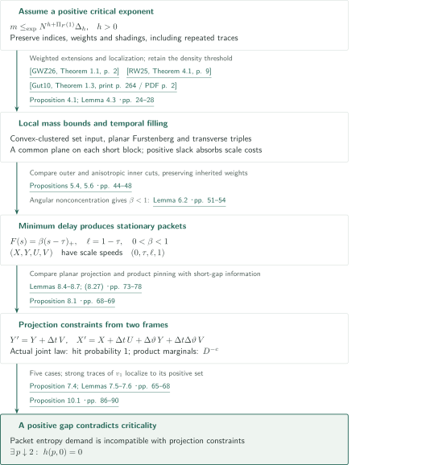
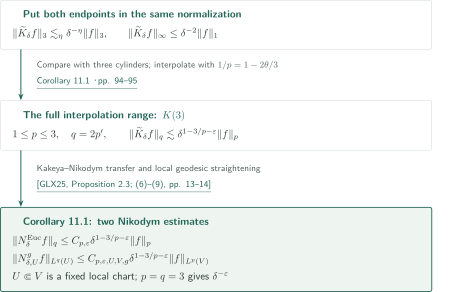
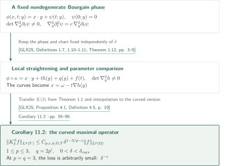

# The Kakeya maximal conjecture in three dimensions

**A density-sensitive critical exponent, stationary plates, and information comparison between two frames**

The manuscript claims the three-dimensional Kakeya maximal estimate from $L^3$ to $L^3$, with an arbitrarily small power loss in scale. It sets up an extremal problem that preserves weighted line indices and their marked times, then makes the geometry required by a positive critical exponent incompatible with projection information. The Kakeya set theorem is an input; the passage to maximal estimates, including low-density shadings, requires a separate argument.

## 1. Main results

### Theorem 1.1 — The three-dimensional Kakeya maximal estimate

For $a\in\mathbb R^3$, $\omega\in S^2$, and $0<\delta<1$, put

$$
T_\delta(a,\omega)=\{a+t\omega+u:|t|\leq\tfrac12,\ u\cdot\omega=0,\ |u|\leq\delta\},\qquad
K_\delta f(\omega)=\sup_{a\in\mathbb R^3}\frac1{\pi\delta^2}\int_{T_\delta(a,\omega)}|f(x)|\,dx.
$$

For every $\varepsilon>0$ there is a finite $C_\varepsilon$ such that, for every $0<\delta<1$ and every complex-valued $f\in L^3(\mathbb R^3)$,

$$
\|K_\delta f\|_{L^3(S^2)}\leq C_\varepsilon\delta^{-\varepsilon}\|f\|_{L^3(\mathbb R^3)}.
$$

The sphere carries its usual surface measure. The constant is independent of $\delta,f$, and all tube centers and directions.

<!-- cite:main -->[Theorem 1.1 · p. 2](https://github.com/openai/math/blob/1581d4cbdd69a0faf34b2089614fe2a814316a6a/preprints/The-Kakeya-maximal-conjecture-in-three-dimensions-September-23-2026/paper.pdf)<!-- /cite -->

### Corollary 11.1 — Euclidean and local constant-curvature Nikodym estimates

For a unit line segment $\gamma\subset\mathbb R^3$, let $T^{\mathrm{Euc}}_\delta(\gamma)$ be its $\delta$-neighborhood and define

$$
N^{\mathrm{Euc}}_\delta f(x)=\sup_{\gamma\ni x}\delta^{-2}\int_{T^{\mathrm{Euc}}_\delta(\gamma)}|f(y)|\,dy.
$$

For $1\leq p\leq3$, $q=2p'$ (with $q=\infty$ at $p=1$), and $\varepsilon>0$, one has, for every $0<\delta<1$,

$$
\|N^{\mathrm{Euc}}_\delta f\|_{L^q(\mathbb R^3)}\leq C_{p,\varepsilon}\delta^{1-3/p-\varepsilon}\|f\|_{L^p(\mathbb R^3)}.
$$

Also fix a smooth three-dimensional Riemannian manifold $(M,g)$ of constant sectional curvature and $U\Subset V$, with $\overline V$ compact in a local chart straightening geodesics. Normalize a fixed segment length to one by a fixed metric rescaling. Choose $0<\delta_0<1$ so that the $\delta_0$-neighborhoods of unit segments contained in $U$ lie in $V$. For $x\in U$, put

$$
N^g_{\delta,U}f(x)=\sup_{\substack{\gamma\ni x\\\gamma\subset U}}\delta^{-2}\int_{T^g_\delta(\gamma)}|f|\,dV_g,
$$

where the segments are unit geodesic segments and an empty supremum is zero. For the same $p,q,\varepsilon$ and $0<\delta<\delta_0$,

$$
\|N^g_{\delta,U}f\|_{L^q(U,dV_g)}\leq C_{p,\varepsilon,U,V,g}\delta^{1-3/p-\varepsilon}\|f\|_{L^p(V,dV_g)}.
$$

In particular both operator norms at $p=q=3$ have loss $\delta^{-\varepsilon}$. The manifold constant depends on the fixed local geometry.

<!-- cite:nikodym -->[Corollary 11.1 · pp. 94–95](https://github.com/openai/math/blob/1581d4cbdd69a0faf34b2089614fe2a814316a6a/preprints/The-Kakeya-maximal-conjecture-in-three-dimensions-September-23-2026/paper.pdf)<!-- /cite -->

### Corollary 11.2 — A local curved Kakeya estimate for a fixed phase

Fix sufficiently small $\rho>0$, $\Omega=B^2_\rho\times(-\rho,\rho)$, and $Y=B^2_\rho$. On a neighborhood of this chart, take a smooth real phase

$$
\phi(x,t;y)=x\cdot y+\psi(t;y),\qquad \psi(0;y)=0.
$$

Assume Hörmander's mixed-rank and curvature nondegeneracy conditions and Bourgain's condition. For this phase form the mixed-rank condition is automatic, and the other conditions become

$$
\det\nabla_y^2\partial_t\psi(t;y)\ne0,\qquad
\nabla_y^2\partial_t^2\psi(t;y)=c(t;y)\nabla_y^2\partial_t\psi(t;y).
$$

Fix the phase and chart after the shrinking required by the local theorem, and define

$$
T^\phi_{\delta,y}(\omega)=\{(x,t)\in\Omega:|\nabla_y\phi(x,t;y)-\nabla_y\phi(\omega,0;y)|<\delta\},\quad
K^\phi_\delta f(y)=\sup_{\omega\in B^2_\rho}\delta^{-2}\int_{T^\phi_{\delta,y}(\omega)}|f|\,dx\,dt.
$$

There exists $0<\delta_{\mathrm{curv}}\leq\rho$ such that, for every $1\leq p\leq3$, $q=2p'$ (with $q=\infty$ at $p=1$), and $\varepsilon>0$,

$$
\|K^\phi_\delta f\|_{L^q(Y)}\leq C_{p,\varepsilon,\phi,\Omega,Y}\delta^{1-3/p-\varepsilon}\|f\|_{L^p(\Omega)},\qquad 0<\delta<\delta_{\mathrm{curv}}.
$$

In particular the $p=q=3$ loss is $\delta^{-\varepsilon}$. The phase and localization are fixed independently of $\delta$.

<!-- cite:curved -->[Corollary 11.2 · pp. 95–96](https://github.com/openai/math/blob/1581d4cbdd69a0faf34b2089614fe2a814316a6a/preprints/The-Kakeya-maximal-conjecture-in-three-dimensions-September-23-2026/paper.pdf)<!-- /cite -->

## References on the arrows

<!-- reference-guide -->
Unprefixed theorem, lemma, section and equation numbers refer to [The Kakeya maximal conjecture in three dimensions](https://github.com/openai/math/blob/1581d4cbdd69a0faf34b2089614fe2a814316a6a/preprints/The-Kakeya-maximal-conjecture-in-three-dimensions-September-23-2026/paper.pdf). External inputs use the following keys.

- [GWZ26](https://arxiv.org/pdf/2601.14411v1) Larry Guth; Hong Wang; Joshua Zahl — *A streamlined proof of the Kakeya set conjecture in R3*: Set estimate with convex clustering and a density threshold, extended to weighted line charts. arXiv:2601.14411v1, 20 January 2026.
- [RW25](https://arxiv.org/pdf/2308.08819v3) Kevin Ren; Hong Wang — *Furstenberg sets estimate in the plane*: Planar Furstenberg input for plate filling and conditional projection bounds. arXiv:2308.08819v3, 19 January 2025.
- [Gut10](https://archive.ymsc.tsinghua.edu.cn/pacm_download/117/6731-11511_2010_Article_55.pdf) Larry Guth — *The endpoint case of the Bennett–Carbery–Tao multilinear Kakeya conjecture*: Multilinear estimate with explicit transversality loss, used for local planiness. Acta Mathematica 205 (2010), 263–286; published version.
- [GLX25](https://arxiv.org/pdf/2503.11574v1) Chuanwei Gao; Diankun Liu; Yakun Xi — *Curved Kakeya sets and Nikodym problems on manifolds*: Transfers to Nikodym and fixed-phase curved Kakeya estimates after the main theorem. arXiv:2503.11574v1, 14 March 2025.
- [OpenAI26b](https://github.com/openai/math/blob/1581d4cbdd69a0faf34b2089614fe2a814316a6a/preprints/Every-four-dimensional-Kakeya-set-has-full-Hausdorff-dimension-September-24-2026/paper.pdf) OpenAI — *Every four-dimensional Kakeya set has full Hausdorff dimension*: Downstream user of the weighted plank estimate; its citation number mismatches the fixed version. September 24, 2026; commit 1581d4cbdd69a0faf34b2089614fe2a814316a6a.

Each citation gives the result and pages. When printed pagination differs from the PDF position, both are shown. GitHub previews do not automatically jump to the cited page.
<!-- /reference-guide -->

## 2. Proof of Theorem 1.1 — From critical vanishing to general functions

<!-- proof-target:1 -->Proof target：[Theorem 1.1 · p. 2](https://github.com/openai/math/blob/1581d4cbdd69a0faf34b2089614fe2a814316a6a/preprints/The-Kakeya-maximal-conjecture-in-three-dimensions-September-23-2026/paper.pdf)<!-- /proof-target -->

**Proof route.** Proposition 10.1, explained in the [next section](#proof-2), gives $h(p,0)=0$ for $p>2$ arbitrarily close to two. Direction separation controls plank concentration. A discrete shading estimate then yields an indicator distribution bound, followed by a finite level decomposition of cell averages. The intermediate density power is $\lambda^{p+1}$; one does not set $p=2$ at this stage.

Use a dyadic resolution $N$ comparable to $\delta^{-1}$. Below, $|A|$ denotes a cell count, whereas $|E|$ denotes the Lebesgue volume of an indicator set.

### 1. Direction separation controls full-time planks

In a bounded line chart write $M_i(t)=b_i+tu_i$. An index has a positive weight $\omega_i$ and marked time bins $S_i$. Repeated traces with different indices or shadings are not identified. Distinguish total weight $n=\sum_i\omega_i$, incidence $I=\sum_i\omega_i|S_i|$, mean marked count $k=I/n$, and raw multiplicity $m=I/\#E$ on occupied cells. A plank of widths $a,b$ counts the weight $n_B$ of indices whose entire time trace it contains; a single marked point in the plank does not establish membership.

For the maximal reduction, return to unit weights and $c/N$-separated slopes. Comparing a plank's two endpoint sections places its slopes in an $O(a/N)\times O(b/N)$ rectangle. Thus $n_B\lesssim ab$, and $\Delta_0=\sup_B n_B/(ab)\lesssim1$ persists for every subfamily.

<!-- cite:model -->[Definition 2.3; (2.1)–(2.8) · pp. 6–8](https://github.com/openai/math/blob/1581d4cbdd69a0faf34b2089614fe2a814316a6a/preprints/The-Kakeya-maximal-conjecture-in-three-dimensions-September-23-2026/paper.pdf)<!-- /cite --> <!-- cite:discrete -->[Proposition 10.2; (10.19)–(10.23) · pp. 91–92](https://github.com/openai/math/blob/1581d4cbdd69a0faf34b2089614fe2a814316a6a/preprints/The-Kakeya-maximal-conjecture-in-three-dimensions-September-23-2026/paper.pdf)<!-- /cite -->

### 2. A uniform discrete bound and the indicator estimate

Assume $h(p,0)=0$. If each line has $\gtrsim\max\{1,\lambda N\}$ marked bins, then for every $\xi>0$,

$$
|A|\gtrsim_{p,\xi}N^{-\xi}nN\max\{N^{-1},\lambda\}^{p+1}.
$$

If no uniform constant existed, regularize a violating sequence with $\theta=\max\{N^{-1},\lambda\}=N^{-\alpha+o(1)}$. Incidence retention forces $F(1)=\alpha$. At $q=0$ the temporal cost is exactly $p\alpha$, so the violating multiplicity $N^{p\alpha+\xi-o(1)}$ contradicts the critical bound $N^{p\alpha+o(1)}$. This is the passage from asymptotic exponent notation to a constant uniform over all finite configurations.

For the auxiliary operator $K_N$ on cylinders of length 4 and radius $4/N$, direction charts and grouping centers into unit cubes give

$$
\sigma\{K_N1_E>\lambda\}\lesssim_{p,\xi}N^\xi|E|\max\{N^{-1},\lambda\}^{-(p+1)}.
$$

For $\lambda\geq N^{-1}$ this implies $\lambda^3\sigma\{K_N1_E>\lambda\}\lesssim N^{p-2+\xi}|E|$. The smaller-density range is handled separately using the finite surface measure and $|E|\geq N^{-3}$ for a nonempty grid set. Integrating the distribution gives $\|K_N1_E\|_3^3\lesssim N^{p-2+\xi}(1+\log N)|E|$.

<!-- cite:discrete -->[Proposition 10.2; (10.19)–(10.23) · pp. 91–92](https://github.com/openai/math/blob/1581d4cbdd69a0faf34b2089614fe2a814316a6a/preprints/The-Kakeya-maximal-conjecture-in-three-dimensions-September-23-2026/paper.pdf)<!-- /cite -->

### 3. Cell averages, level sets, and an arbitrary power loss

Normalize $\|f\|_3=1$ and choose $N^{-1}\leq\delta<2N^{-1}$. The cell average $F_N$ of $|f|$ on each $N^{-1}$-cube satisfies $0\leq F_N\leq N$ and $\|F_N\|_3\leq1$. A fixed cylinder enlargement gives $K_\delta f\leq64K_NF_N$. Bound the part $F_N<N^{-1}$ directly and split the remaining values into $O(\log N)$ dyadic levels. The indicator estimate and Hölder for the finite sum give

$$
\|K_\delta f\|_3\lesssim_{p,\xi}N^{(p-2+\xi)/3}(1+\log N)
\lesssim_{p,\kappa}\delta^{-(p-2)/3-\kappa}.
$$

For a fixed $\varepsilon$, choose once a $p$ with $h(p,0)=0$ and $(p-2)/3<\varepsilon/2$, then set $\kappa=\varepsilon/2$. Restoring homogeneity proves the full statement. The source also establishes measurability: continuity of tube integrals in their parameters allows the supremum over centers to be restricted to a countable dense set.

Applying the final theorem to indicators yields $|\bigcup_TY(T)|\gtrsim_\varepsilon\delta^\varepsilon\lambda^3\sum_T|T|$ for direction-separated shadings, uniformly over $0<\lambda\leq1$. This final cubic density power is distinct from the intermediate $p+1>3$.

<!-- cite:functions -->[Proposition 10.2; (10.24)–(10.25) · p. 93](https://github.com/openai/math/blob/1581d4cbdd69a0faf34b2089614fe2a814316a6a/preprints/The-Kakeya-maximal-conjecture-in-three-dimensions-September-23-2026/paper.pdf)<!-- /cite --> <!-- cite:finish -->[Proof of Theorem 1.1 · p. 94](https://github.com/openai/math/blob/1581d4cbdd69a0faf34b2089614fe2a814316a6a/preprints/The-Kakeya-maximal-conjecture-in-three-dimensions-September-23-2026/paper.pdf)<!-- /cite -->

## 3. Proof of Proposition 10.1 — Stationary geometry versus projection constraints

<!-- proof-target:2 -->Proof target：[Proposition 10.1 · pp. 86–90](https://github.com/openai/math/blob/1581d4cbdd69a0faf34b2089614fe2a814316a6a/preprints/The-Kakeya-maximal-conjecture-in-three-dimensions-September-23-2026/paper.pdf)<!-- /proof-target -->

<!-- statement:proposition-10-1 -->
### Proposition 10.1 — Critical vanishing at the maximal endpoint

Let $0<\eta<1/2$, $p>2$, $z=-q\in[-1,0]$, and $d=2-q$. A temporal profile $F$ is nondecreasing and 1-Lipschitz, with $F(0)=0$; each occupied block of $N^\kappa$ bins has $N^{\kappa-F(\kappa)+o(1)}$ marked bins. The manuscript defines

$$
D(q,e)=\eta^{-1}\int_{1/2-\eta}^{1/2}\min(q,re)\,dr,\quad
\Pi_F(1)=\int_0^1[pF'(u)-D(q,F'(u))]\,du,
$$

$$
\Delta_A=\sup_B\frac{n_B}{a^{d-1-A}b^{1+A}},\qquad
h(p,z)=\min\{A\in[0,d-1]:m\leq_{\exp}N^{A+\Pi_F(1)}\Delta_A\text{ for every uniform-profile sequence}\}.
$$

Here $\leq_{\exp}$ means comparison up to $N^{o(1)}$. Proposition 10.1 asserts that $h(p,0)=0$ for values $p>2$ arbitrarily close to two. At $q=0$, $\Pi_F(1)=pF(1)$ and the conclusion is independent of $\eta$.

<!-- cite:model -->[Definition 2.3; (2.1)–(2.8) · pp. 6–8](https://github.com/openai/math/blob/1581d4cbdd69a0faf34b2089614fe2a814316a6a/preprints/The-Kakeya-maximal-conjecture-in-three-dimensions-September-23-2026/paper.pdf)<!-- /cite --> <!-- cite:critical -->[Proposition 10.1 · pp. 86–90](https://github.com/openai/math/blob/1581d4cbdd69a0faf34b2089614fe2a814316a6a/preprints/The-Kakeya-maximal-conjecture-in-three-dimensions-September-23-2026/paper.pdf)<!-- /cite -->
<!-- /statement -->

**Proof route.** Positive critical exponent gives an extremal sequence. Local mass bounds, temporal filling, and anisotropic rescaling produce a canonical profile. The coordinate entropy demanded by its packets is compared with projection constraints from two events on one index. This outlines the connections; the complete simultaneous finite-test construction and pinning iteration are outside the checked scope.

### 1. Weighted set input and local planiness

The set input requires convex clustering $\sum_{T\subset K}|T|\leq\delta^{-\eta_{\mathrm{in}}}|K|$ and mean shading density $\lambda\geq\delta^{\eta_{\mathrm{in}}}$. It is not applied as an arbitrary-density estimate. Lemma 3.2 samples according to weights, controls finitely many box tests, and selects representatives of repeated tubes. Lemma 3.3 converts full-time plank bounds into convex clustering; disjoint small balls at marked times relate cell counts to shading volume.

An excessive local packet mass would contradict criticality after rescaling. The multilinear input's $\theta^{-1/2}$ cost and cap counts become powers of a sufficiently short block scale and are absorbed by positive slack. Blocks with three transverse rich directions can therefore be discarded, leaving, within each short block, a common direction plane along the reference index's retained times. The planar Furstenberg estimate fills plates while preserving the original shading's Frostman conditions.

<!-- cite:gwz -->[&#91;GWZ26, Theorem 1.1, p. 2&#93;](https://arxiv.org/pdf/2601.14411v1#page=2)<!-- /cite --> <!-- cite:geometric -->[Theorem 3.1; Lemmas 3.2–3.3 · pp. 18–21](https://github.com/openai/math/blob/1581d4cbdd69a0faf34b2089614fe2a814316a6a/preprints/The-Kakeya-maximal-conjecture-in-three-dimensions-September-23-2026/paper.pdf)<!-- /cite --> <!-- cite:guth -->[&#91;Gut10, Theorem 1.3, print p. 264 / PDF p. 2&#93;](https://archive.ymsc.tsinghua.edu.cn/pacm_download/117/6731-11511_2010_Article_55.pdf#page=2)<!-- /cite --> <!-- cite:local -->[Proposition 4.1; Lemma 4.3 · pp. 24–28](https://github.com/openai/math/blob/1581d4cbdd69a0faf34b2089614fe2a814316a6a/preprints/The-Kakeya-maximal-conjecture-in-three-dimensions-September-23-2026/paper.pdf)<!-- /cite --> <!-- cite:rw -->[&#91;RW25, Theorem 4.1, p. 9&#93;](https://arxiv.org/pdf/2308.08819v3#page=9)<!-- /cite --> <!-- cite:planar -->[Theorem 3.4; Corollary 3.5 · pp. 21–22](https://github.com/openai/math/blob/1581d4cbdd69a0faf34b2089614fe2a814316a6a/preprints/The-Kakeya-maximal-conjecture-in-three-dimensions-September-23-2026/paper.pdf)<!-- /cite -->

### 2. The temporal profile and compatible packets across scales

Replacing the temporal deficit by total density alone would lose the cost after cutting a time block. The manuscript retains $F$, obtains an initial flat interval by plate filling, and compares an outer scale cut with an inner cut after plate alignment. A minimum-delay choice produces

$$
F(s)=\beta(s-\tau)_+,\quad 0<\tau<1,\quad \ell=1-\tau,\quad 0<\beta<1,
$$

together with stationary packets preserving the weights of their original indices at every scale. The strict bound $\beta<1$ uses the later angular nonconcentration conclusion of Lemma 6.2. Stationarity means that repeated cuts reproduce the normalized profile and packet shape.

In an event's normal frame $\vartheta$, use $X=M_i(t)_1+\vartheta M_i(t)_2$, $Y=M_i(t)_2$, $U=u_{i,1}+\vartheta u_{i,2}$, and $V=u_{i,2}$. Their scale speeds are $(0,\tau,\ell,1)$. Packet mass lower bounds become a demand on conditional coordinate entropy.

<!-- cite:canonical -->[Propositions 5.4, 5.6 · pp. 44–48](https://github.com/openai/math/blob/1581d4cbdd69a0faf34b2089614fe2a814316a6a/preprints/The-Kakeya-maximal-conjecture-in-three-dimensions-September-23-2026/paper.pdf)<!-- /cite --> <!-- cite:angular -->[Lemma 6.2 · pp. 51–54](https://github.com/openai/math/blob/1581d4cbdd69a0faf34b2089614fe2a814316a6a/preprints/The-Kakeya-maximal-conjecture-in-three-dimensions-September-23-2026/paper.pdf)<!-- /cite --> <!-- cite:entropy -->[Proposition 7.4; Lemmas 7.5–7.6 · pp. 65–68](https://github.com/openai/math/blob/1581d4cbdd69a0faf34b2089614fe2a814316a6a/preprints/The-Kakeya-maximal-conjecture-in-three-dimensions-September-23-2026/paper.pdf)<!-- /cite -->

### 3. Two events on one index are not independent

The two-frame transformation is

$$
\begin{pmatrix}X'&Y'\\ U'&V'\end{pmatrix}
=\begin{pmatrix}1&\Delta t\\0&1\end{pmatrix}
\begin{pmatrix}X&Y\\U&V\end{pmatrix}
\begin{pmatrix}1&0\\\Delta\vartheta&1\end{pmatrix}.
$$

Time and normal differences give scalar projections of coordinate pairs. When the middle speeds tie, $\tau=\ell=1/2$, the joint $Y,U$ rate must be retained. After fixing these coordinates, the term $\Delta t\Delta\vartheta\,V$ in $X'$ requires product-slope pinning.

The manuscript compares the actual same-index joint law with the product of its conditional matrix and label marginals. If the recorded support fell below the required projection exponent, its hit probability under the product law would be $D^{-c}$, while the actual law hits with probability one because both events use the same matrix. Data processing for relative entropy would require mutual information $\gtrsim\log D$, contradicting the short-gap bound $o(\log D)$ in Lemma 8.5. Bias introduced by pinning is charged through domination bounds for both marginals.

<!-- cite:projection -->[Proposition 8.1 · pp. 68–69](https://github.com/openai/math/blob/1581d4cbdd69a0faf34b2089614fe2a814316a6a/preprints/The-Kakeya-maximal-conjecture-in-three-dimensions-September-23-2026/paper.pdf)<!-- /cite --> <!-- cite:information -->[Lemmas 8.4–8.7; (8.27) · pp. 73–78](https://github.com/openai/math/blob/1581d4cbdd69a0faf34b2089614fe2a814316a6a/preprints/The-Kakeya-maximal-conjecture-in-three-dimensions-September-23-2026/paper.pdf)<!-- /cite --> <!-- cite:pinning -->[Sections 9.1–9.2 · pp. 79–85](https://github.com/openai/math/blob/1581d4cbdd69a0faf34b2089614fe2a814316a6a/preprints/The-Kakeya-maximal-conjecture-in-three-dimensions-September-23-2026/paper.pdf)<!-- /cite -->

### 4. Closing the contradiction with the prescribed loss and limit order

For distinct speeds, the conditional rates $a_1,y_1,u_1,v_1$ satisfy, among other constraints, $a_1\geq y_1$, $u_1\geq v_1$, and $a_1<1\Rightarrow u_1\leq(a_1-s_0)_+$, where $s_0=1-\beta>0$. Five cases, determined by speed ties and the parameter regime, give a positive gap between these constraints and packet demand. Localization to $v_1>0$ cannot use weak convergence alone; Lemma 7.5 supplies strong $L^1$ traces or subsequential compactness.

Restrictions retain $N^{-o(1)}$ of incidence. Finite tests, scales, and positive gaps are fixed before increasing resolution. The smoothing width $\eta$ is fixed at the start in terms of $p_{\min}-2$, not readjusted after selecting $h,\tau,\beta$. With this order, the contradiction excludes a positive critical exponent and supplies the analytic reduction in the preceding section.

<!-- cite:critical -->[Proposition 10.1 · pp. 86–90](https://github.com/openai/math/blob/1581d4cbdd69a0faf34b2089614fe2a814316a6a/preprints/The-Kakeya-maximal-conjecture-in-three-dimensions-September-23-2026/paper.pdf)<!-- /cite -->

## 4. Proof of Corollary 11.1 — Interpolation and Nikodym transfer

<!-- proof-target:3 -->Proof target：[Corollary 11.1 · pp. 94–95](https://github.com/openai/math/blob/1581d4cbdd69a0faf34b2089614fe2a814316a6a/preprints/The-Kakeya-maximal-conjecture-in-three-dimensions-September-23-2026/paper.pdf)<!-- /proof-target -->

**Proof route.** Interpolate the main $L^3$ estimate with the elementary $L^1\to L^\infty$ estimate to obtain the full range required by the transfer. The same proposition supplies the Euclidean and local constant-curvature conclusions.

### 1. Obtain the full range and transfer to Euclidean Nikodym

The external source uses $\delta$-neighborhoods of unit segments with normalization $\delta^{-2}$. Covering such a neighborhood by three manuscript cylinders gives $\widetilde K_\delta f\leq3\pi K_\delta f$. Also $\|\widetilde K_\delta f\|_\infty\leq\delta^{-2}\|f\|_1$. Interpolation with $1/p=1-2\theta/3$ and $1/q=\theta/3$ gives $q=2p'$ and exponent $1-3/p-\eta\theta$. The loss $\eta>0$ is arbitrary; including both endpoints gives $K(3)$. Proposition 2.3 of GLX25 transfers this full range to the Euclidean Nikodym operator.

<!-- cite:nikodym -->[Corollary 11.1 · pp. 94–95](https://github.com/openai/math/blob/1581d4cbdd69a0faf34b2089614fe2a814316a6a/preprints/The-Kakeya-maximal-conjecture-in-three-dimensions-September-23-2026/paper.pdf)<!-- /cite --> <!-- cite:glx-n -->[&#91;GLX25, Proposition 2.3; (6)–(9), pp. 13–14&#93;](https://arxiv.org/pdf/2503.11574v1#page=13)<!-- /cite -->

### 2. Fix the local geometry on a constant-curvature manifold

Apply the same proposition's geodesic-straightening diffeomorphism on a fixed compact chart. Bounded bi-Lipschitz and volume-comparison constants compare tube averages on $U\Subset V$; the choice of $\delta_0$ keeps the input inside $V$. Start with a smaller loss to absorb the transfer's arbitrarily small additional loss. Setting $p=q=3$ yields the local endpoint.

<!-- cite:glx-n -->[&#91;GLX25, Proposition 2.3; (6)–(9), pp. 13–14&#93;](https://arxiv.org/pdf/2503.11574v1#page=13)<!-- /cite --> <!-- cite:nikodym -->[Corollary 11.1 · pp. 94–95](https://github.com/openai/math/blob/1581d4cbdd69a0faf34b2089614fe2a814316a6a/preprints/The-Kakeya-maximal-conjecture-in-three-dimensions-September-23-2026/paper.pdf)<!-- /cite -->

## 5. Proof of Corollary 11.2 — Straightening the phase

<!-- proof-target:4 -->Proof target：[Corollary 11.2 · pp. 95–96](https://github.com/openai/math/blob/1581d4cbdd69a0faf34b2089614fe2a814316a6a/preprints/The-Kakeya-maximal-conjecture-in-three-dimensions-September-23-2026/paper.pdf)<!-- /proof-target -->

**Proof route.** Feed the full $K(3)$ range from the preceding section into the local transfer for a fixed translation-invariant phase satisfying Bourgain's condition.

### 1. Preserve the phase hypotheses and operator normalization

Theorem 1.12 of GLX25 transforms the phase locally into $x\cdot y+t h(y)+q(y)+f(t)$ with nondegenerate $\nabla_y^2h$. Terms depending only on $y$ cancel in the gradient difference, and terms depending only on $(x,t)$ do not contribute to $\nabla_y$. The curves become straight lines $x=\omega-t\nabla h(y)$. Proposition 4.1 makes the ordinary and curved $K(3)$ assertions equivalent, giving the same $p,q$ range and $\delta^{1-3/p-\varepsilon}$ power. Spatial and direction-parameter comparison constants may depend on the fixed phase and chart, which also determine $\delta_{\mathrm{curv}}$. The $p=q=3$ conclusion is included.

<!-- cite:glx-phase -->[&#91;GLX25, Definitions 1.7, 1.10–1.11; Theorem 1.12, pp. 3–5&#93;](https://arxiv.org/pdf/2503.11574v1#page=3)<!-- /cite --> <!-- cite:glx-c -->[&#91;GLX25, Proposition 4.1; Definition 4.5, p. 19&#93;](https://arxiv.org/pdf/2503.11574v1#page=19)<!-- /cite --> <!-- cite:curved -->[Corollary 11.2 · pp. 95–96](https://github.com/openai/math/blob/1581d4cbdd69a0faf34b2089614fe2a814316a6a/preprints/The-Kakeya-maximal-conjecture-in-three-dimensions-September-23-2026/paper.pdf)<!-- /cite -->

## 6. Which papers supply which steps

| Source and result | Used at | Role and required hypotheses | Checking scope |
|---|---|---|---|
| <!-- cite:gwz -->[&#91;GWZ26, Theorem 1.1, p. 2&#93;](https://arxiv.org/pdf/2601.14411v1#page=2)<!-- /cite --> | <!-- cite:geometric -->[Theorem 3.1; Lemmas 3.2–3.3 · pp. 18–21](https://github.com/openai/math/blob/1581d4cbdd69a0faf34b2089614fe2a814316a6a/preprints/The-Kakeya-maximal-conjecture-in-three-dimensions-September-23-2026/paper.pdf)<!-- /cite --> | Convex clustering and a density threshold; sampling and plank-to-convex-body comparison give a weighted extension | Statement, weighted extension and use compared; complete source proof not checked |
| <!-- cite:rw -->[&#91;RW25, Theorem 4.1, p. 9&#93;](https://arxiv.org/pdf/2308.08819v3#page=9)<!-- /cite --> | <!-- cite:planar -->[Theorem 3.4; Corollary 3.5 · pp. 21–22](https://github.com/openai/math/blob/1581d4cbdd69a0faf34b2089614fe2a814316a6a/preprints/The-Kakeya-maximal-conjecture-in-three-dimensions-September-23-2026/paper.pdf)<!-- /cite -->; §9.1 | Frostman conditions on line parameters and shadings; projection exponent $\min\{t,(s+t)/2,1\}$ | Statement and the manuscript's duality explanation compared; complete quantitative reconstruction not checked |
| <!-- cite:guth -->[&#91;Gut10, Theorem 1.3, print p. 264 / PDF p. 2&#93;](https://archive.ymsc.tsinghua.edu.cn/pacm_download/117/6731-11511_2010_Article_55.pdf#page=2)<!-- /cite --> | <!-- cite:multilinear -->[Theorem 3.7; Corollary 3.8 · p. 23](https://github.com/openai/math/blob/1581d4cbdd69a0faf34b2089614fe2a814316a6a/preprints/The-Kakeya-maximal-conjecture-in-three-dimensions-September-23-2026/paper.pdf)<!-- /cite -->; Lemma 4.3 | Determinant lower bound $\theta$ for every triple, loss $\theta^{-1/2}$, extension to positive weights and repetitions | Published statement, weighted extension and use compared |
| <!-- cite:glx-n -->[&#91;GLX25, Proposition 2.3; (6)–(9), pp. 13–14&#93;](https://arxiv.org/pdf/2503.11574v1#page=13)<!-- /cite --> | Corollary 11.1 | Full interpolated Kakeya range; constant curvature and a fixed local chart | Statement, exponents, normalization and application compared |
| <!-- cite:glx-c -->[&#91;GLX25, Proposition 4.1; Definition 4.5, p. 19&#93;](https://arxiv.org/pdf/2503.11574v1#page=19)<!-- /cite --> | Corollary 11.2 | A fixed nondegenerate translation-invariant Bourgain phase | Statement and locality compared |

**Input to the four-dimensional manuscript.** Lemma 3.3 here assumes, in a bounded line chart, $\sum_{i:M_i\subset P}\omega_i\leq Aab$ for all full-time planks with $1\leq a\leq b\leq D$, and $\#J_i\geq D^{1-\eta_{\mathrm{in}}}$ for each index. For every target loss $\varepsilon>0$, a suitable $\eta_{\mathrm{in}}>0$ gives $\sum_i\omega_i\#J_i\leq CAD^\varepsilon\#E$. Repeated traces and positive weights are allowed. The four-dimensional manuscript's Lemma 2.15 uses this content directly but cites “Lemma 2.3,” a number absent from the present version. The statement correspondence and the unresolved numbering/version discrepancy are recorded separately; this is not a dependency on Theorem 1.1 itself.

<!-- cite:weighted-chart -->[Lemma 3.3 · pp. 20–21](https://github.com/openai/math/blob/1581d4cbdd69a0faf34b2089614fe2a814316a6a/preprints/The-Kakeya-maximal-conjecture-in-three-dimensions-September-23-2026/paper.pdf)<!-- /cite --> <!-- cite:four-use -->[&#91;OpenAI26b, Lemma 2.15, pp. 17–18&#93;](https://github.com/openai/math/blob/1581d4cbdd69a0faf34b2089614fe2a814316a6a/preprints/Every-four-dimensional-Kakeya-set-has-full-Hausdorff-dimension-September-24-2026/paper.pdf)<!-- /cite -->

## 7. Return to the sources

<!-- reading-list -->
- [Definition 2.3; (2.1)–(2.8) · pp. 6–8](https://github.com/openai/math/blob/1581d4cbdd69a0faf34b2089614fe2a814316a6a/preprints/The-Kakeya-maximal-conjecture-in-three-dimensions-September-23-2026/paper.pdf) — Definitions of weights, full-time planks, density cost and critical exponent
- [Theorem 3.1; Lemmas 3.2–3.3 · pp. 18–21](https://github.com/openai/math/blob/1581d4cbdd69a0faf34b2089614fe2a814316a6a/preprints/The-Kakeya-maximal-conjecture-in-three-dimensions-September-23-2026/paper.pdf) — Weighted extension and rescaling of the set input
- [Propositions 5.4, 5.6 · pp. 44–48](https://github.com/openai/math/blob/1581d4cbdd69a0faf34b2089614fe2a814316a6a/preprints/The-Kakeya-maximal-conjecture-in-three-dimensions-September-23-2026/paper.pdf) — Canonical temporal profile and stationary packets
- [Lemmas 8.4–8.7; (8.27) · pp. 73–78](https://github.com/openai/math/blob/1581d4cbdd69a0faf34b2089614fe2a814316a6a/preprints/The-Kakeya-maximal-conjecture-in-three-dimensions-September-23-2026/paper.pdf) — Same-index two-event law compared with its independent marginals
- [Proposition 10.1 · pp. 86–90](https://github.com/openai/math/blob/1581d4cbdd69a0faf34b2089614fe2a814316a6a/preprints/The-Kakeya-maximal-conjecture-in-three-dimensions-September-23-2026/paper.pdf) — The five-case contradiction and the role of strong traces
- [Proposition 10.2; (10.19)–(10.23) · pp. 91–92](https://github.com/openai/math/blob/1581d4cbdd69a0faf34b2089614fe2a814316a6a/preprints/The-Kakeya-maximal-conjecture-in-three-dimensions-September-23-2026/paper.pdf) — Direction separation and the uniform discrete density bound
- [Proposition 10.2; (10.24)–(10.25) · p. 93](https://github.com/openai/math/blob/1581d4cbdd69a0faf34b2089614fe2a814316a6a/preprints/The-Kakeya-maximal-conjecture-in-three-dimensions-September-23-2026/paper.pdf) — Cell averages and finitely many level sets for general functions
- [Corollary 11.1 · pp. 94–95](https://github.com/openai/math/blob/1581d4cbdd69a0faf34b2089614fe2a814316a6a/preprints/The-Kakeya-maximal-conjecture-in-three-dimensions-September-23-2026/paper.pdf) — Transfer to Euclidean and local constant-curvature Nikodym operators
- [Corollary 11.2 · pp. 95–96](https://github.com/openai/math/blob/1581d4cbdd69a0faf34b2089614fe2a814316a6a/preprints/The-Kakeya-maximal-conjecture-in-three-dimensions-September-23-2026/paper.pdf) — Local curved Kakeya transfer for a fixed phase
<!-- /reading-list -->

The editorial reading covered the weighted model and three geometric inputs, canonical-profile and stationary-data statements, entropy demand and the two-event information comparison, the final five-case contradiction, the discrete-to-general-function reduction, and both transfer corollaries. Input statements and use were compared with four external sources. The simultaneous finite tests, complete regularization and compactness details in §§2,4–9, and the full product-pinning iteration remain unchecked. This is not a certification of the complete 97-page proof.

The radial-projection references in §9 are methodological precedents for pinning; the required finite-scale version is proved within this manuscript. The spherical Fourier restriction route cited in §1.3 is an alternative proof. Neither relationship is turned into a direct-input arrow here. The four-dimensional manuscript's citation-number mismatch with the fixed version remains unresolved.
