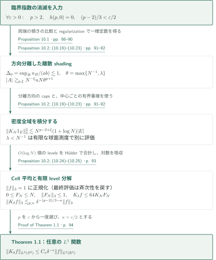
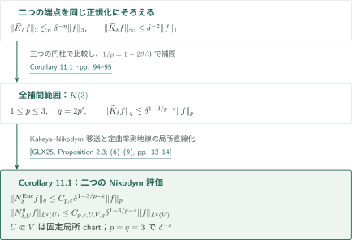
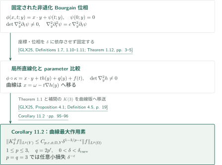

# The Kakeya maximal conjecture in three dimensions

**密度損失を追う臨界指数、定常的なplate構造、二つの座標系の情報量比較**

原稿は、3次元Kakeya最大作用素の $L^3\to L^3$ 評価を、任意に小さい尺度損失で主張する。証明は、重み付きの直線とそのmarked timesを保った極値問題を設け、正の臨界指数が要求する幾何構造と射影の情報量を両立不能にする。集合版のKakeya定理を入力に使うが、密度の小さいshadingを含む最大作用素評価への接続は別途必要である。

## 1. 主要結果

### Theorem 1.1 — 3次元Kakeya最大作用素

$a\in\mathbb R^3$、$\omega\in S^2$、$0<\delta<1$ に対し

$$
T_\delta(a,\omega)=\{a+t\omega+u:|t|\leq\tfrac12,\ u\cdot\omega=0,\ |u|\leq\delta\},\qquad
K_\delta f(\omega)=\sup_{a\in\mathbb R^3}\frac1{\pi\delta^2}\int_{T_\delta(a,\omega)}|f(x)|\,dx.
$$

任意の $\varepsilon>0$ に対して有限な $C_\varepsilon$ が存在し、すべての $0<\delta<1$ と複素数値 $f\in L^3(\mathbb R^3)$ について

$$
\|K_\delta f\|_{L^3(S^2)}\leq C_\varepsilon\delta^{-\varepsilon}\|f\|_{L^3(\mathbb R^3)}.
$$

球面上の測度は通常の面積測度である。定数は $\delta,f$、tubeの中心・方向に依存しない。

<!-- cite:main -->[Theorem 1.1 · p. 2](https://github.com/openai/math/blob/1581d4cbdd69a0faf34b2089614fe2a814316a6a/preprints/The-Kakeya-maximal-conjecture-in-three-dimensions-September-23-2026/paper.pdf)<!-- /cite -->

### Corollary 11.1 — Euclideanおよび局所定曲率Nikodym評価

$\mathbb R^3$ の単位線分 $\gamma$ の $\delta$ 近傍を $T^{\mathrm{Euc}}_\delta(\gamma)$ とし、

$$
N^{\mathrm{Euc}}_\delta f(x)=\sup_{\gamma\ni x}\delta^{-2}\int_{T^{\mathrm{Euc}}_\delta(\gamma)}|f(y)|\,dy.
$$

$1\leq p\leq3$、$q=2p'$（$p=1$ では $q=\infty$）、$\varepsilon>0$ に対し、すべての $0<\delta<1$ で

$$
\|N^{\mathrm{Euc}}_\delta f\|_{L^q(\mathbb R^3)}\leq C_{p,\varepsilon}\delta^{1-3/p-\varepsilon}\|f\|_{L^p(\mathbb R^3)}.
$$

さらに、滑らかな3次元定曲率Riemann多様体 $(M,g)$ 上で、測地線を直線に移す局所座標内に $U\Subset V$、$\overline V$ compact を固定する。固定線分長を計量の固定rescalingで1にし、$U$ 内の単位測地線分の $\delta_0$ 近傍が $V$ に入る $0<\delta_0<1$ を選ぶ。$x\in U$ で

$$
N^g_{\delta,U}f(x)=\sup_{\substack{\gamma\ni x\\\gamma\subset U}}\delta^{-2}\int_{T^g_\delta(\gamma)}|f|\,dV_g
$$

と置く（空の上限は0）。同じ $p,q,\varepsilon$ と $0<\delta<\delta_0$ に対し

$$
\|N^g_{\delta,U}f\|_{L^q(U,dV_g)}\leq C_{p,\varepsilon,U,V,g}\delta^{1-3/p-\varepsilon}\|f\|_{L^p(V,dV_g)}.
$$

特に両方の $p=q=3$ の作用素ノルムは $\delta^{-\varepsilon}$ で抑えられる。多様体側の定数は固定局所幾何に依存する。

<!-- cite:nikodym -->[Corollary 11.1 · pp. 94–95](https://github.com/openai/math/blob/1581d4cbdd69a0faf34b2089614fe2a814316a6a/preprints/The-Kakeya-maximal-conjecture-in-three-dimensions-September-23-2026/paper.pdf)<!-- /cite -->

### Corollary 11.2 — 固定位相の局所曲線Kakeya評価

十分小さい $\rho>0$ と $\Omega=B^2_\rho\times(-\rho,\rho)$、$Y=B^2_\rho$ を固定し、その近傍で滑らかな実位相

$$
\phi(x,t;y)=x\cdot y+\psi(t;y),\qquad \psi(0;y)=0
$$

を取る。Hörmanderのmixed-rank条件と曲率非退化条件、およびBourgain条件を仮定する。この形ではmixed-rankは自動的で、残る条件は

$$
\det\nabla_y^2\partial_t\psi(t;y)\ne0,\qquad
\nabla_y^2\partial_t^2\psi(t;y)=c(t;y)\nabla_y^2\partial_t\psi(t;y)
$$

である。局所定理に必要な縮小後の位相と座標を固定し、

$$
T^\phi_{\delta,y}(\omega)=\{(x,t)\in\Omega:|\nabla_y\phi(x,t;y)-\nabla_y\phi(\omega,0;y)|<\delta\},\quad
K^\phi_\delta f(y)=\sup_{\omega\in B^2_\rho}\delta^{-2}\int_{T^\phi_{\delta,y}(\omega)}|f|\,dx\,dt.
$$

ある $0<\delta_{\mathrm{curv}}\leq\rho$ が存在し、任意の $1\leq p\leq3$、$q=2p'$（$p=1$ では $q=\infty$）、$\varepsilon>0$ に対して

$$
\|K^\phi_\delta f\|_{L^q(Y)}\leq C_{p,\varepsilon,\phi,\Omega,Y}\delta^{1-3/p-\varepsilon}\|f\|_{L^p(\Omega)},\qquad 0<\delta<\delta_{\mathrm{curv}}.
$$

特に $p=q=3$ で損失は $\delta^{-\varepsilon}$ となる。位相と局所化は $\delta$ に依存させない。

<!-- cite:curved -->[Corollary 11.2 · pp. 95–96](https://github.com/openai/math/blob/1581d4cbdd69a0faf34b2089614fe2a814316a6a/preprints/The-Kakeya-maximal-conjecture-in-three-dimensions-September-23-2026/paper.pdf)<!-- /cite -->

## 図の矢印に付した引用

<!-- reference-guide -->
略号のない定理・補題・節・式番号は本原稿 [The Kakeya maximal conjecture in three dimensions](https://github.com/openai/math/blob/1581d4cbdd69a0faf34b2089614fe2a814316a6a/preprints/The-Kakeya-maximal-conjecture-in-three-dimensions-September-23-2026/paper.pdf) を指します。外部入力には次の略号を使います。

- [GWZ26](https://arxiv.org/pdf/2601.14411v1) Larry Guth; Hong Wang; Joshua Zahl — *A streamlined proof of the Kakeya set conjecture in R3*：凸集中と密度閾値を持つ集合評価を重み付きline chartへ移す。arXiv:2601.14411v1, 20 January 2026。
- [RW25](https://arxiv.org/pdf/2308.08819v3) Kevin Ren; Hong Wang — *Furstenberg sets estimate in the plane*：平面Furstenberg評価からplateの充填と条件付き射影評価を得る。arXiv:2308.08819v3, 19 January 2025。
- [Gut10](https://archive.ymsc.tsinghua.edu.cn/pacm_download/117/6731-11511_2010_Article_55.pdf) Larry Guth — *The endpoint case of the Bennett–Carbery–Tao multilinear Kakeya conjecture*：明示的な横断性損失を持つ多重線形評価から局所的な平面性を得る。Acta Mathematica 205 (2010), 263–286; published version。
- [GLX25](https://arxiv.org/pdf/2503.11574v1) Chuanwei Gao; Diankun Liu; Yakun Xi — *Curved Kakeya sets and Nikodym problems on manifolds*：主定理の帰結としてNikodymおよび固定位相の曲線Kakeya評価を移送。arXiv:2503.11574v1, 14 March 2025。
- [OpenAI26b](https://github.com/openai/math/blob/1581d4cbdd69a0faf34b2089614fe2a814316a6a/preprints/Every-four-dimensional-Kakeya-set-has-full-Hausdorff-dimension-September-24-2026/paper.pdf) OpenAI — *Every four-dimensional Kakeya set has full Hausdorff dimension*：本稿の重み付きplank評価の利用先。引用番号に固定版との不整合がある。September 24, 2026; commit 1581d4cbdd69a0faf34b2089614fe2a814316a6a。

各引用に結果番号とページを付します。誌面番号とPDF内の位置が異なる場合は両方を示します。GitHubの閲覧リンクではページ位置への自動移動を前提としません。
<!-- /reference-guide -->

## 2. Theorem 1.1 の証明 — 臨界指数から任意の関数へ

<!-- proof-target:1 -->証明対象：[Theorem 1.1 · p. 2](https://github.com/openai/math/blob/1581d4cbdd69a0faf34b2089614fe2a814316a6a/preprints/The-Kakeya-maximal-conjecture-in-three-dimensions-September-23-2026/paper.pdf)<!-- /proof-target -->

**証明の道筋。** [次節](#proof-2)で説明する Proposition 10.1 が $p>2$ を2へ任意に近づけながら $h(p,0)=0$ とする。方向分離からplankの集中を抑え、離散shading評価、指示関数の分布評価、cell平均の有限level分解を順につなぐ。中間段階の密度冪は $\lambda^{p+1}$ であり、この段階で $p=2$ を代入しない。

$N=\delta^{-1}$ に相当するdyadic解像度を使う。$|A|$ は以下ではcell数、$|E|$ は指示関数の集合のLebesgue体積である。

### 1. 全時間plankの集中を方向分離で抑える

有界line chartで $M_i(t)=b_i+tu_i$ を用いる。indexは正の重み $\omega_i$ とmarked time bins $S_i$ を持ち、同じ直線でも異なるindex・shadingを同一視しない。総重み $n=\sum_i\omega_i$、incidence $I=\sum_i\omega_i|S_i|$、平均marked数 $k=I/n$、占有cell集合 $E$ の平均多重度 $m=I/\#E$ を区別する。幅 $a,b$ のplankは全時間のtraceを含むindexの重み $n_B$ を数える。marked点がplankに一度入るだけでは所属にならない。

最大作用素への適用時には単位重み、$c/N$ 分離した傾きに戻る。plankの両端でtraceを比較すると傾きは $O(a/N)\times O(b/N)$ の長方形に入り、$n_B\lesssim ab$。従って $\Delta_0=\sup_B n_B/(ab)\lesssim1$ はすべての部分族にも保たれる。

<!-- cite:model -->[Definition 2.3; (2.1)–(2.8) · pp. 6–8](https://github.com/openai/math/blob/1581d4cbdd69a0faf34b2089614fe2a814316a6a/preprints/The-Kakeya-maximal-conjecture-in-three-dimensions-September-23-2026/paper.pdf)<!-- /cite --> <!-- cite:discrete -->[Proposition 10.2; (10.19)–(10.23) · pp. 91–92](https://github.com/openai/math/blob/1581d4cbdd69a0faf34b2089614fe2a814316a6a/preprints/The-Kakeya-maximal-conjecture-in-three-dimensions-September-23-2026/paper.pdf)<!-- /cite -->

### 2. 密度に一様な離散評価と指示関数評価

$h(p,0)=0$ とする。各直線が $\gtrsim\max\{1,\lambda N\}$ 個のmarked binsを持つなら、任意の $\xi>0$ に対し

$$
|A|\gtrsim_{p,\xi}N^{-\xi}nN\max\{N^{-1},\lambda\}^{p+1}.
$$

一様定数の不存在を仮定した反例列をregularizeすると、$\theta=\max\{N^{-1},\lambda\}=N^{-\alpha+o(1)}$ と $F(1)=\alpha$ が得られる。$q=0$ では時間costが正確に $p\alpha$ なので、反例の多重度 $N^{p\alpha+\xi-o(1)}$ は臨界評価 $N^{p\alpha+o(1)}$ に反する。ここが漸近記法から有限配置すべてに一様な定数を取り出す接続である。

長さ4、半径 $4/N$ の補助作用素 $K_N$ について、方向chartと中心の単位cubeへの分割から

$$
\sigma\{K_N1_E>\lambda\}\lesssim_{p,\xi}N^\xi|E|\max\{N^{-1},\lambda\}^{-(p+1)}.
$$

$\lambda\geq N^{-1}$ では $\lambda^3\sigma\{K_N1_E>\lambda\}\lesssim N^{p-2+\xi}|E|$。小密度範囲は球面の有限測度と非空の格子集合の $|E|\geq N^{-3}$ で別に処理する。分布関数を積分して $\|K_N1_E\|_3^3\lesssim N^{p-2+\xi}(1+\log N)|E|$ を得る。

<!-- cite:discrete -->[Proposition 10.2; (10.19)–(10.23) · pp. 91–92](https://github.com/openai/math/blob/1581d4cbdd69a0faf34b2089614fe2a814316a6a/preprints/The-Kakeya-maximal-conjecture-in-three-dimensions-September-23-2026/paper.pdf)<!-- /cite -->

### 3. Cell平均、level分解、任意の尺度損失

$\|f\|_3=1$ と正規化し、$N^{-1}\leq\delta<2N^{-1}$ を選ぶ。各 $N^{-1}$-cubeでの $|f|$ の平均 $F_N$ は $0\leq F_N\leq N$、$\|F_N\|_3\leq1$ を満たし、tubeの固定拡大により $K_\delta f\leq64K_NF_N$。$F_N<N^{-1}$ は直接抑え、残る値を $O(\log N)$ 個のdyadic levelsに分ける。指示関数評価と有限和のHölderから

$$
\|K_\delta f\|_3\lesssim_{p,\xi}N^{(p-2+\xi)/3}(1+\log N)
\lesssim_{p,\kappa}\delta^{-(p-2)/3-\kappa}
$$

となる。$\varepsilon$ を固定して $(p-2)/3<\varepsilon/2$ となる $h(p,0)=0$ の $p$ を一度選び、$\kappa=\varepsilon/2$ とする。斉次性を戻せば主張全体が得られる。原典はtube積分のパラメータ連続性から中心の上限を可算稠密集合に制限し、可測性も確認する。

最終定理を指示関数に適用すれば、$\delta$ 分離方向のshadingに対する $|\bigcup_TY(T)|\gtrsim_\varepsilon\delta^\varepsilon\lambda^3\sum_T|T|$ が全 $0<\lambda\leq1$ で得られる。この最終的な立方密度冪と、証明途中の $p+1>3$ を区別する。

<!-- cite:functions -->[Proposition 10.2; (10.24)–(10.25) · p. 93](https://github.com/openai/math/blob/1581d4cbdd69a0faf34b2089614fe2a814316a6a/preprints/The-Kakeya-maximal-conjecture-in-three-dimensions-September-23-2026/paper.pdf)<!-- /cite --> <!-- cite:finish -->[Proof of Theorem 1.1 · p. 94](https://github.com/openai/math/blob/1581d4cbdd69a0faf34b2089614fe2a814316a6a/preprints/The-Kakeya-maximal-conjecture-in-three-dimensions-September-23-2026/paper.pdf)<!-- /cite -->

## 3. Proposition 10.1 の証明 — 定常幾何と射影制約の不整合

<!-- proof-target:2 -->証明対象：[Proposition 10.1 · pp. 86–90](https://github.com/openai/math/blob/1581d4cbdd69a0faf34b2089614fe2a814316a6a/preprints/The-Kakeya-maximal-conjecture-in-three-dimensions-September-23-2026/paper.pdf)<!-- /proof-target -->

<!-- statement:proposition-10-1 -->
### Proposition 10.1 — 最大作用素端点での臨界指数の消滅

$0<\eta<1/2$、$p>2$、$z=-q\in[-1,0]$、$d=2-q$ とする。時間プロファイル $F$ は非減少1-Lipschitz、$F(0)=0$ であり、$N^\kappa$ binsの各占有blockのmarked数が $N^{\kappa-F(\kappa)+o(1)}$ となる。原典は

$$
D(q,e)=\eta^{-1}\int_{1/2-\eta}^{1/2}\min(q,re)\,dr,\quad
\Pi_F(1)=\int_0^1[pF'(u)-D(q,F'(u))]\,du,
$$

$$
\Delta_A=\sup_B\frac{n_B}{a^{d-1-A}b^{1+A}},\qquad
h(p,z)=\min\{A\in[0,d-1]:m\leq_{\exp}N^{A+\Pi_F(1)}\Delta_A\text{ for every uniform-profile sequence}\}
$$

と定義する。$\leq_{\exp}$ は $N^{o(1)}$ までの指数比較を意味する。Proposition 10.1 は、2に任意に近い $p>2$ で $h(p,0)=0$ が成立すると主張する。$q=0$ では $\Pi_F(1)=pF(1)$ であり、結論は $\eta$ に依存しない。

<!-- cite:model -->[Definition 2.3; (2.1)–(2.8) · pp. 6–8](https://github.com/openai/math/blob/1581d4cbdd69a0faf34b2089614fe2a814316a6a/preprints/The-Kakeya-maximal-conjecture-in-three-dimensions-September-23-2026/paper.pdf)<!-- /cite --> <!-- cite:critical -->[Proposition 10.1 · pp. 86–90](https://github.com/openai/math/blob/1581d4cbdd69a0faf34b2089614fe2a814316a6a/preprints/The-Kakeya-maximal-conjecture-in-three-dimensions-September-23-2026/paper.pdf)<!-- /cite -->
<!-- /statement -->

**証明の道筋。** 正の臨界指数からextremal sequenceを取り、局所質量上界、時間充填、異方的rescalingで正準プロファイルを得る。そのpacketが要求する座標entropyを、同じindexに属する二つのeventの射影制約と比較する。以下はこの論理の接続の概略であり、有限テストの全同時化やpinning反復の全証明は確認範囲外である。

### 1. 重みを保つ集合入力と局所平面性

集合入力は凸体 $K$ ごとの集中 $\sum_{T\subset K}|T|\leq\delta^{-\eta_{\mathrm{in}}}|K|$ と平均密度 $\lambda\geq\delta^{\eta_{\mathrm{in}}}$ を要求する。任意密度の評価として使わない。Lemma 3.2 は重みに比例したsampling、有限個のbox tests、重複tubeからの代表選択でこれを反復index付きの重み評価へ移す。Lemma 3.3 は全時間plank条件を凸集中へ変換し、marked binsに置く互いに離れた小球でcell数とshading体積を比較する。

局所質量が上界を超えるpacketはrescaling後に臨界性へ反する。さらに、多重線形入力の $\theta^{-1/2}$ 損失と方向cap数を小さいblock尺度の冪として計上し、正のslackで吸収する。これにより三方向が横断的なblockを捨て、各短いblock内で、残るreference indexのretained marked timesに共通の方向平面を選ぶ。平面Furstenberg入力は元のshadingのFrostman条件を保持してplate内を充填する。

<!-- cite:gwz -->[&#91;GWZ26, Theorem 1.1, p. 2&#93;](https://arxiv.org/pdf/2601.14411v1#page=2)<!-- /cite --> <!-- cite:geometric -->[Theorem 3.1; Lemmas 3.2–3.3 · pp. 18–21](https://github.com/openai/math/blob/1581d4cbdd69a0faf34b2089614fe2a814316a6a/preprints/The-Kakeya-maximal-conjecture-in-three-dimensions-September-23-2026/paper.pdf)<!-- /cite --> <!-- cite:guth -->[&#91;Gut10, Theorem 1.3, 誌面 p. 264 / PDF p. 2&#93;](https://archive.ymsc.tsinghua.edu.cn/pacm_download/117/6731-11511_2010_Article_55.pdf#page=2)<!-- /cite --> <!-- cite:local -->[Proposition 4.1; Lemma 4.3 · pp. 24–28](https://github.com/openai/math/blob/1581d4cbdd69a0faf34b2089614fe2a814316a6a/preprints/The-Kakeya-maximal-conjecture-in-three-dimensions-September-23-2026/paper.pdf)<!-- /cite --> <!-- cite:rw -->[&#91;RW25, Theorem 4.1, p. 9&#93;](https://arxiv.org/pdf/2308.08819v3#page=9)<!-- /cite --> <!-- cite:planar -->[Theorem 3.4; Corollary 3.5 · pp. 21–22](https://github.com/openai/math/blob/1581d4cbdd69a0faf34b2089614fe2a814316a6a/preprints/The-Kakeya-maximal-conjecture-in-three-dimensions-September-23-2026/paper.pdf)<!-- /cite -->

### 2. 時間プロファイルと尺度間で両立するpacket

時間欠損を総密度だけに置き換えると、時間blockを切り取った後のcostを追えない。原稿は $F$ を保持し、plateの充填から初期のflat intervalを得て、外側のscale cutとplateを整列させた内側のcutを比較する。最小delayの選択により

$$
F(s)=\beta(s-\tau)_+,\quad 0<\tau<1,\quad \ell=1-\tau,\quad 0<\beta<1
$$

という正準形と、各尺度で所属indexの重みを保つstationary packetsを得る。最後の $\beta<1$ は角度非集中を調べる Lemma 6.2 まで含めた結論である。ここでstationaryとは、cutの反復後に同じ正規化プロファイルとpacket形状が現れるという意味である。

eventの法線パラメータ $\vartheta$ に対し $X=M_i(t)_1+\vartheta M_i(t)_2$、$Y=M_i(t)_2$、$U=u_{i,1}+\vartheta u_{i,2}$、$V=u_{i,2}$ と取る。四つの座標の尺度速度は $(0,\tau,\ell,1)$。packet質量の下界をconditional entropyの需要へ変換する。

<!-- cite:canonical -->[Propositions 5.4, 5.6 · pp. 44–48](https://github.com/openai/math/blob/1581d4cbdd69a0faf34b2089614fe2a814316a6a/preprints/The-Kakeya-maximal-conjecture-in-three-dimensions-September-23-2026/paper.pdf)<!-- /cite --> <!-- cite:angular -->[Lemma 6.2 · pp. 51–54](https://github.com/openai/math/blob/1581d4cbdd69a0faf34b2089614fe2a814316a6a/preprints/The-Kakeya-maximal-conjecture-in-three-dimensions-September-23-2026/paper.pdf)<!-- /cite --> <!-- cite:entropy -->[Proposition 7.4; Lemmas 7.5–7.6 · pp. 65–68](https://github.com/openai/math/blob/1581d4cbdd69a0faf34b2089614fe2a814316a6a/preprints/The-Kakeya-maximal-conjecture-in-three-dimensions-September-23-2026/paper.pdf)<!-- /cite -->

### 3. 同じindexの二eventを独立と扱わない

二event間の変換は

$$
\begin{pmatrix}X'&Y'\\ U'&V'\end{pmatrix}
=\begin{pmatrix}1&\Delta t\\0&1\end{pmatrix}
\begin{pmatrix}X&Y\\U&V\end{pmatrix}
\begin{pmatrix}1&0\\\Delta\vartheta&1\end{pmatrix}.
$$

時間差と法線差が二次元のscalar projectionを作る。中間速度が一致する $\tau=\ell=1/2$ では $Y,U$ のjoint rateを保持し、両座標を固定した後の $X'$ に残る $\Delta t\Delta\vartheta\,V$ のproduct slopeをpinningで扱う。

同じindexから選ぶ二eventは一般に従属する。原稿はその実際のjoint lawと、条件付きmatrix・label周辺分布の積を比較する。射影の必要指数を下回るsupportなら、積法則のhit確率は $D^{-c}$ だが、実際のlawでは同じmatrixから来るためhit確率は1。相対entropyのdata processingが $\gtrsim\log D$ の相互情報を要求し、Lemma 8.5 のshort-gap評価 $o(\log D)$ と矛盾する。pinningによるlawの偏りも両周辺の支配定数で計上する。

<!-- cite:projection -->[Proposition 8.1 · pp. 68–69](https://github.com/openai/math/blob/1581d4cbdd69a0faf34b2089614fe2a814316a6a/preprints/The-Kakeya-maximal-conjecture-in-three-dimensions-September-23-2026/paper.pdf)<!-- /cite --> <!-- cite:information -->[Lemmas 8.4–8.7; (8.27) · pp. 73–78](https://github.com/openai/math/blob/1581d4cbdd69a0faf34b2089614fe2a814316a6a/preprints/The-Kakeya-maximal-conjecture-in-three-dimensions-September-23-2026/paper.pdf)<!-- /cite --> <!-- cite:pinning -->[Sections 9.1–9.2 · pp. 79–85](https://github.com/openai/math/blob/1581d4cbdd69a0faf34b2089614fe2a814316a6a/preprints/The-Kakeya-maximal-conjecture-in-three-dimensions-September-23-2026/paper.pdf)<!-- /cite -->

### 4. 損失と極限の順序を保って矛盾を閉じる

異なる速度の場合の条件付きrate $a_1,y_1,u_1,v_1$ には、例えば $a_1\geq y_1$、$u_1\geq v_1$、$a_1<1\Rightarrow u_1\leq(a_1-s_0)_+$、$s_0=1-\beta>0$ が課される。原稿は速度の一致とparameterの位置を五つに分け、packetの需要とこれらの制約の間に正のgapを得る。$v_1>0$ の集合への局所化には弱収束だけでは足りず、Lemma 7.5 の強い $L^1$ trace／部分列compactnessを使う。

尺度ごとの制限で失うincidenceは $N^{-o(1)}$ とし、固定された有限テスト・尺度・正のgapを先に選んでから解像度を上げる。smoothing幅 $\eta$ は初めに $p_{\min}-2$ に従って固定する。最後の矛盾のために $h,\tau,\beta$ を見てから $\eta$ を小さくする循環は用いない。この順序の下で正の臨界指数を排除し、前節の解析的帰着に渡す。

<!-- cite:critical -->[Proposition 10.1 · pp. 86–90](https://github.com/openai/math/blob/1581d4cbdd69a0faf34b2089614fe2a814316a6a/preprints/The-Kakeya-maximal-conjecture-in-three-dimensions-September-23-2026/paper.pdf)<!-- /cite -->

## 4. Corollary 11.1 の証明 — 補間とNikodymへの移送

<!-- proof-target:3 -->証明対象：[Corollary 11.1 · pp. 94–95](https://github.com/openai/math/blob/1581d4cbdd69a0faf34b2089614fe2a814316a6a/preprints/The-Kakeya-maximal-conjecture-in-three-dimensions-September-23-2026/paper.pdf)<!-- /proof-target -->

**証明の道筋。** 主定理の $L^3$ 評価と自明な $L^1\to L^\infty$ 評価を補間して、移送定理が要求する全 $p$ 範囲をそろえる。Euclideanと局所定曲率多様体の二つの結論は同じ移送命題から得る。

### 1. 全補間範囲をそろえてEuclideanへ移す

単位線分の $\delta$ 近傍を用い $\delta^{-2}$ で正規化する外部文献の作用素 $\widetilde K_\delta$ は、三つの原稿の円柱で覆えて $\widetilde K_\delta f\leq3\pi K_\delta f$。他方、$\|\widetilde K_\delta f\|_\infty\leq\delta^{-2}\|f\|_1$。補間parameter $\theta$ に対して $1/p=1-2\theta/3$、$1/q=\theta/3$ なので $q=2p'$、尺度冪は $1-3/p-\eta\theta$ となる。主定理の $\eta>0$ は任意に選べ、両端点を含む $K(3)$ が得られる。GLX25のProposition 2.3によりEuclidean Nikodymの全範囲へ移送する。

<!-- cite:nikodym -->[Corollary 11.1 · pp. 94–95](https://github.com/openai/math/blob/1581d4cbdd69a0faf34b2089614fe2a814316a6a/preprints/The-Kakeya-maximal-conjecture-in-three-dimensions-September-23-2026/paper.pdf)<!-- /cite --> <!-- cite:glx-n -->[&#91;GLX25, Proposition 2.3; (6)–(9), pp. 13–14&#93;](https://arxiv.org/pdf/2503.11574v1#page=13)<!-- /cite -->

### 2. 定曲率多様体では局所幾何を固定する

同じ命題の測地線を直線化する局所微分同相を、固定compact chart上で使う。bi-Lipschitz定数と体積比較定数が有界なので $U\Subset V$ 上のtube平均を比較でき、原典の $\delta_0$ の選び方により入力は $V$ 内に収まる。移送の任意小損失は開始時の損失を小さくして吸収する。$p=q=3$ を代入すれば局所端点が得られる。

<!-- cite:glx-n -->[&#91;GLX25, Proposition 2.3; (6)–(9), pp. 13–14&#93;](https://arxiv.org/pdf/2503.11574v1#page=13)<!-- /cite --> <!-- cite:nikodym -->[Corollary 11.1 · pp. 94–95](https://github.com/openai/math/blob/1581d4cbdd69a0faf34b2089614fe2a814316a6a/preprints/The-Kakeya-maximal-conjecture-in-three-dimensions-September-23-2026/paper.pdf)<!-- /cite -->

## 5. Corollary 11.2 の証明 — 位相の直線化

<!-- proof-target:4 -->証明対象：[Corollary 11.2 · pp. 95–96](https://github.com/openai/math/blob/1581d4cbdd69a0faf34b2089614fe2a814316a6a/preprints/The-Kakeya-maximal-conjecture-in-three-dimensions-September-23-2026/paper.pdf)<!-- /proof-target -->

**証明の道筋。** 前節で得た全範囲の $K(3)$ を、translation-invariantかつBourgain条件を満たす固定位相に対する局所移送へ入力する。

### 1. 直線化の仮定と作用素の正規化を保つ

GLX25のTheorem 1.12は局所微分同相で位相を $x\cdot y+t h(y)+q(y)+f(t)$ に移し、$\nabla_y^2h$ を非退化にする。$y$ のみに依存する項はgradientの差で消え、$(x,t)$ のみの項は $\nabla_y$ に寄与しない。対応する曲線は $x=\omega-t\nabla h(y)$ という直線になる。Proposition 4.1はこの局所比較で通常の $K(3)$ と曲線版を同値にするので、同じ $p,q$、同じ $\delta^{1-3/p-\varepsilon}$ の範囲を得る。空間座標と方向parameterの比較定数を位相・chartに依存させ、$\delta_{\mathrm{curv}}$ をその固定幾何から選ぶ。$p=q=3$ の結論もこれに含まれる。

<!-- cite:glx-phase -->[&#91;GLX25, Definitions 1.7, 1.10–1.11; Theorem 1.12, pp. 3–5&#93;](https://arxiv.org/pdf/2503.11574v1#page=3)<!-- /cite --> <!-- cite:glx-c -->[&#91;GLX25, Proposition 4.1; Definition 4.5, p. 19&#93;](https://arxiv.org/pdf/2503.11574v1#page=19)<!-- /cite --> <!-- cite:curved -->[Corollary 11.2 · pp. 95–96](https://github.com/openai/math/blob/1581d4cbdd69a0faf34b2089614fe2a814316a6a/preprints/The-Kakeya-maximal-conjecture-in-three-dimensions-September-23-2026/paper.pdf)<!-- /cite -->

## 6. どの論文が、どの段階を担うか

| 供給元と結果 | 利用箇所 | 使用内容・必要な仮定 | 確認範囲 |
|---|---|---|---|
| <!-- cite:gwz -->[&#91;GWZ26, Theorem 1.1, p. 2&#93;](https://arxiv.org/pdf/2601.14411v1#page=2)<!-- /cite --> | <!-- cite:geometric -->[Theorem 3.1; Lemmas 3.2–3.3 · pp. 18–21](https://github.com/openai/math/blob/1581d4cbdd69a0faf34b2089614fe2a814316a6a/preprints/The-Kakeya-maximal-conjecture-in-three-dimensions-September-23-2026/paper.pdf)<!-- /cite --> | 凸集中と密度閾値のある集合評価。samplingとplankから凸体への比較で重み付きへ拡張 | 入力記述、重み付け・使用箇所を照合。入力定理の全証明は未検証 |
| <!-- cite:rw -->[&#91;RW25, Theorem 4.1, p. 9&#93;](https://arxiv.org/pdf/2308.08819v3#page=9)<!-- /cite --> | <!-- cite:planar -->[Theorem 3.4; Corollary 3.5 · pp. 21–22](https://github.com/openai/math/blob/1581d4cbdd69a0faf34b2089614fe2a814316a6a/preprints/The-Kakeya-maximal-conjecture-in-three-dimensions-September-23-2026/paper.pdf)<!-- /cite -->、§9.1 | line parameterとshadingのFrostman条件、$\min\{t,(s+t)/2,1\}$ の射影指数 | 記述とdualityの説明を照合。全量的再構成は未検証 |
| <!-- cite:guth -->[&#91;Gut10, Theorem 1.3, 誌面 p. 264 / PDF p. 2&#93;](https://archive.ymsc.tsinghua.edu.cn/pacm_download/117/6731-11511_2010_Article_55.pdf#page=2)<!-- /cite --> | <!-- cite:multilinear -->[Theorem 3.7; Corollary 3.8 · p. 23](https://github.com/openai/math/blob/1581d4cbdd69a0faf34b2089614fe2a814316a6a/preprints/The-Kakeya-maximal-conjecture-in-three-dimensions-September-23-2026/paper.pdf)<!-- /cite -->、Lemma 4.3 | 各三つ組の行列式下界 $\theta$、$\theta^{-1/2}$ 損失、正重み・反復tubeへの拡張 | 出版版の記述、重み拡張、使用箇所を照合 |
| <!-- cite:glx-n -->[&#91;GLX25, Proposition 2.3; (6)–(9), pp. 13–14&#93;](https://arxiv.org/pdf/2503.11574v1#page=13)<!-- /cite --> | Corollary 11.1 | 全補間範囲のKakeya評価、定曲率、固定局所chart | 記述・指数・正規化と適用を照合 |
| <!-- cite:glx-c -->[&#91;GLX25, Proposition 4.1; Definition 4.5, p. 19&#93;](https://arxiv.org/pdf/2503.11574v1#page=19)<!-- /cite --> | Corollary 11.2 | 固定された非退化translation-invariant Bourgain位相 | 記述と局所性を照合 |

**4次元原稿への入力。** 本稿のLemma 3.3は、有界line chartで全時間plankの各幅 $1\leq a\leq b\leq D$ に対し $\sum_{i:M_i\subset P}\omega_i\leq Aab$、各indexのmarked数 $\#J_i\geq D^{1-\eta_{\mathrm{in}}}$ を仮定し、任意の目標損失 $\varepsilon>0$ に適した $\eta_{\mathrm{in}}>0$ の下で $\sum_i\omega_i\#J_i\leq CAD^\varepsilon\#E$ を与える。重複したtraceと正の重みを許す。4次元原稿のLemma 2.15はこの内容を直接入力に使うが、引用番号は本稿の今回版にない「Lemma 2.3」となっている。内容の対応と番号・版の不整合を分けて記録し、Theorem 1.1そのものへの依存とはしない。

<!-- cite:weighted-chart -->[Lemma 3.3 · pp. 20–21](https://github.com/openai/math/blob/1581d4cbdd69a0faf34b2089614fe2a814316a6a/preprints/The-Kakeya-maximal-conjecture-in-three-dimensions-September-23-2026/paper.pdf)<!-- /cite --> <!-- cite:four-use -->[&#91;OpenAI26b, Lemma 2.15, pp. 17–18&#93;](https://github.com/openai/math/blob/1581d4cbdd69a0faf34b2089614fe2a814316a6a/preprints/Every-four-dimensional-Kakeya-set-has-full-Hausdorff-dimension-September-24-2026/paper.pdf)<!-- /cite -->

## 7. 原典を読む入口と確認範囲

<!-- reading-list -->
- [Definition 2.3; (2.1)–(2.8) · pp. 6–8](https://github.com/openai/math/blob/1581d4cbdd69a0faf34b2089614fe2a814316a6a/preprints/The-Kakeya-maximal-conjecture-in-three-dimensions-September-23-2026/paper.pdf) — 重み・全時間plank・密度損失と臨界指数の定義
- [Theorem 3.1; Lemmas 3.2–3.3 · pp. 18–21](https://github.com/openai/math/blob/1581d4cbdd69a0faf34b2089614fe2a814316a6a/preprints/The-Kakeya-maximal-conjecture-in-three-dimensions-September-23-2026/paper.pdf) — 三つの幾何入力のうち集合評価の重み付けと尺度変換
- [Propositions 5.4, 5.6 · pp. 44–48](https://github.com/openai/math/blob/1581d4cbdd69a0faf34b2089614fe2a814316a6a/preprints/The-Kakeya-maximal-conjecture-in-three-dimensions-September-23-2026/paper.pdf) — 正準時間プロファイルとstationary packetの取得
- [Lemmas 8.4–8.7; (8.27) · pp. 73–78](https://github.com/openai/math/blob/1581d4cbdd69a0faf34b2089614fe2a814316a6a/preprints/The-Kakeya-maximal-conjecture-in-three-dimensions-September-23-2026/paper.pdf) — 同一indexの二事象と独立積法則の比較
- [Proposition 10.1 · pp. 86–90](https://github.com/openai/math/blob/1581d4cbdd69a0faf34b2089614fe2a814316a6a/preprints/The-Kakeya-maximal-conjecture-in-three-dimensions-September-23-2026/paper.pdf) — 五つの場合分けと強いtraceによる矛盾の閉じ方
- [Proposition 10.2; (10.19)–(10.23) · pp. 91–92](https://github.com/openai/math/blob/1581d4cbdd69a0faf34b2089614fe2a814316a6a/preprints/The-Kakeya-maximal-conjecture-in-three-dimensions-September-23-2026/paper.pdf) — 方向分離から密度に一様な離散評価へ
- [Proposition 10.2; (10.24)–(10.25) · p. 93](https://github.com/openai/math/blob/1581d4cbdd69a0faf34b2089614fe2a814316a6a/preprints/The-Kakeya-maximal-conjecture-in-three-dimensions-September-23-2026/paper.pdf) — cell平均と有限個のlevel setから任意の関数へ
- [Corollary 11.1 · pp. 94–95](https://github.com/openai/math/blob/1581d4cbdd69a0faf34b2089614fe2a814316a6a/preprints/The-Kakeya-maximal-conjecture-in-three-dimensions-September-23-2026/paper.pdf) — Euclidean／局所定曲率Nikodymへの移送
- [Corollary 11.2 · pp. 95–96](https://github.com/openai/math/blob/1581d4cbdd69a0faf34b2089614fe2a814316a6a/preprints/The-Kakeya-maximal-conjecture-in-three-dimensions-September-23-2026/paper.pdf) — 固定位相に対する局所曲線Kakeyaへの移送
<!-- /reading-list -->

編集側では、重み付きモデルと三つの幾何入力、正準プロファイル・stationary dataの主張、entropy需要と二eventの情報比較、最後の五場合分け、離散評価から任意の関数への帰着、両系の移送を読んだ。外部4文献の入力定理の記述と利用先を照合した。§§2,4–9の有限テストの同時化、全regularization・compactnessの詳細、product-pinning反復全体は未検証であり、これらを含む97頁の証明全体の正しさを認定したものではない。

原典§9のradial-projection文献はpinning法の方法的先行例として位置付けられ、ここで必要な有限尺度版は原稿内で証明される。別論文の球面Fourier restrictionからの経路も原典§1.3では別証明として挙げられる。この二種類の関係を本証明への直接入力の矢印に加えていない。4次元原稿からの引用番号と固定版の対応は未解消として残す。
