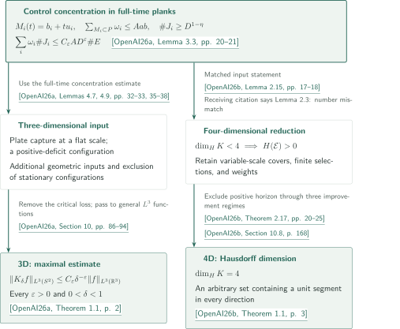

# Kakeya in three and four dimensions

**Two conclusions and one result-level input**

The three-dimensional paper addresses density dependence in a maximal estimate; the four-dimensional paper treats Hausdorff dimension for arbitrary sets. Their recorded connection is a weighted plank lemma in the three-dimensional paper, rather than its maximal theorem.

<!-- Stage 2: insert actual bilingual booklet PDF links before the inventory; no PDF exists in Stage 1. -->

## 1. Papers in official catalogue order

CATALOGINVENTORYTOKEN

## References on the arrows

This guide uses the author-derived keys below and distinguishes manuscript claims from the editorial checking scope.

- **OpenAI26a** — OpenAI, *The Kakeya maximal conjecture in three dimensions*, September 23, 2026. Role: Weighted configurations retain density dependence; exclusion of stationary extremizers yields the maximal bound. A separate plank lemma also enters the 4D reduction. <!-- cite:three-main -->[&#91;OpenAI26a, Theorem 1.1, p. 2&#93;](https://github.com/openai/math/blob/1581d4cbdd69a0faf34b2089614fe2a814316a6a/preprints/The-Kakeya-maximal-conjecture-in-three-dimensions-September-23-2026/paper.pdf)<!-- /cite -->
- **OpenAI26b** — OpenAI, *Every four-dimensional Kakeya set has full Hausdorff dimension*, September 24, 2026. Role: Variable-scale covers yield a weighted problem with positive horizon; improvements in three geometric regimes contradict extremality. <!-- cite:four-main -->[&#91;OpenAI26b, Theorem 1.1, p. 3&#93;](https://github.com/openai/math/blob/1581d4cbdd69a0faf34b2089614fe2a814316a6a/preprints/Every-four-dimensional-Kakeya-set-has-full-Hausdorff-dimension-September-24-2026/paper.pdf)<!-- /cite -->

## 2. Two conclusions and the shared plank input

The diagram records the principal connection, not a deduction of either main theorem from the displayed lemma alone. The articles explain the additional geometric inputs and conditions on iteration.

On the three-dimensional side, the weighted full-time plank estimate supplies plate capture at a flat scale and configurations with positive deficit. The main theorem additionally requires exclusion of stationary configurations and the passage from discrete estimates to general $L^3$ functions; a set-volume bound alone does not replace that passage.

<!-- cite:three-use -->[&#91;OpenAI26a, Lemmas 4.7, 4.9, pp. 32–33, 35–38&#93;](https://github.com/openai/math/blob/1581d4cbdd69a0faf34b2089614fe2a814316a6a/preprints/The-Kakeya-maximal-conjecture-in-three-dimensions-September-23-2026/paper.pdf)<!-- /cite --> <!-- cite:three-end -->[&#91;OpenAI26a, Section 10, pp. 86–94&#93;](https://github.com/openai/math/blob/1581d4cbdd69a0faf34b2089614fe2a814316a6a/preprints/The-Kakeya-maximal-conjecture-in-three-dimensions-September-23-2026/paper.pdf)<!-- /cite -->

On the four-dimensional side, the matching weighted plank estimate is used as Lemma 2.15 in the reduction from a Hausdorff counterexample to a weighted problem with positive horizon. The subsequent geometric improvements and recovery at the original scale belong to the four-dimensional argument. The conclusion is $\dim_H K=4$; this guide makes no four-dimensional maximal-operator claim.

<!-- cite:four-reduction -->[&#91;OpenAI26b, Theorem 2.17, pp. 20–25&#93;](https://github.com/openai/math/blob/1581d4cbdd69a0faf34b2089614fe2a814316a6a/preprints/Every-four-dimensional-Kakeya-set-has-full-Hausdorff-dimension-September-24-2026/paper.pdf)<!-- /cite --> <!-- cite:four-end -->[&#91;OpenAI26b, Section 10.8, p. 168&#93;](https://github.com/openai/math/blob/1581d4cbdd69a0faf34b2089614fe2a814316a6a/preprints/Every-four-dimensional-Kakeya-set-has-full-Hausdorff-dimension-September-24-2026/paper.pdf)<!-- /cite -->

**Citation-number check.** The four-dimensional manuscript cites [24, Lemma 2.3]. In the pinned three-dimensional version, the corresponding full-time plank hypothesis, long-mark condition, and conclusion occur in Lemma 3.3. These interfaces were compared, but the revision history explaining the changed number has not been checked. We retain this discrepancy rather than silently rewriting the receiving citation.

<!-- cite:three-plank -->[&#91;OpenAI26a, Lemma 3.3, pp. 20–21&#93;](https://github.com/openai/math/blob/1581d4cbdd69a0faf34b2089614fe2a814316a6a/preprints/The-Kakeya-maximal-conjecture-in-three-dimensions-September-23-2026/paper.pdf)<!-- /cite --> <!-- cite:four-plank -->[&#91;OpenAI26b, Lemma 2.15, pp. 17–18&#93;](https://github.com/openai/math/blob/1581d4cbdd69a0faf34b2089614fe2a814316a6a/preprints/Every-four-dimensional-Kakeya-set-has-full-Hausdorff-dimension-September-24-2026/paper.pdf)<!-- /cite -->

See the [three-dimensional article](../kakeya-maximal-three/article.en.md) and the [four-dimensional article](../kakeya-hausdorff-four/article.en.md) for the conditions and proof steps.

## 3. Sources and checking scope

The official subject is **Real and complex analysis** (071–086). This catalogue appears on overview PDF p.9; the two papers are listed in official order.

<!-- cite:catalogue -->[OpenAI Research Catalog · 074 · p. 9](https://github.com/openai/math/blob/1581d4cbdd69a0faf34b2089614fe2a814316a6a/overview.pdf)<!-- /cite -->

The source commit is `1581d4cbdd69a0faf34b2089614fe2a814316a6a`. The main statements, selected proof passages, and statements and applications of direct inputs were compared. This is not an independent verification of the complete 97- and 175-page proofs; each article identifies unchecked passages. Unlisted connections with other catalogues remain uninvestigated, not absent.
