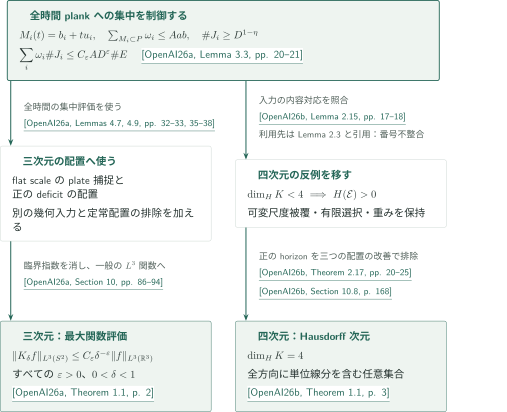

# Kakeya in three and four dimensions

**三次元と四次元のKakeya問題**

三次元では最大関数の密度依存、四次元では任意集合のHausdorff次元を扱う。両者をつなぐのは三次元原稿内の重み付きplank補題であり、最大関数定理そのものではない。

<!-- Stage 2: insert actual bilingual booklet PDF links before the inventory; no PDF exists in Stage 1. -->

## 1. 公式順の記事一覧

CATALOGINVENTORYTOKEN

## 図の矢印に付した引用

この案内では、以下の著者由来キーを使う。原稿の主張と編集側の照合範囲を区別する。

- **OpenAI26a** — OpenAI, *The Kakeya maximal conjecture in three dimensions*, September 23, 2026. 用途：密度依存を保つ重み付き配置と定常極値配置の排除から最大関数へ。独立のplank補題が4Dの帰着にも使われる。 <!-- cite:three-main -->[&#91;OpenAI26a, Theorem 1.1, p. 2&#93;](https://github.com/openai/math/blob/1581d4cbdd69a0faf34b2089614fe2a814316a6a/preprints/The-Kakeya-maximal-conjecture-in-three-dimensions-September-23-2026/paper.pdf)<!-- /cite -->
- **OpenAI26b** — OpenAI, *Every four-dimensional Kakeya set has full Hausdorff dimension*, September 24, 2026. 用途：可変尺度被覆から正のhorizonを持つ重み付き問題へ帰着し、三つの配置で改善を構成して矛盾させる。 <!-- cite:four-main -->[&#91;OpenAI26b, Theorem 1.1, p. 3&#93;](https://github.com/openai/math/blob/1581d4cbdd69a0faf34b2089614fe2a814316a6a/preprints/Every-four-dimensional-Kakeya-set-has-full-Hausdorff-dimension-September-24-2026/paper.pdf)<!-- /cite -->

## 2. 二つの結論と、共有されるplank入力

図は主要な接続をまとめたもので、各矢印に書いた補題だけで主定理が従うという意味ではない。追加の幾何入力と反復の条件は個別記事で示す。

三次元側では、全時間のplank集中を制御する重み付き評価を、flat scaleでのplate捕捉と正のdeficitを持つ配置の構成に使う。主結果へは定常配置の排除に加え、離散評価から一般の $L^3$ 関数への移行が必要であり、集合の体積下界だけで最大関数評価を代用しない。

<!-- cite:three-use -->[&#91;OpenAI26a, Lemmas 4.7, 4.9, pp. 32–33, 35–38&#93;](https://github.com/openai/math/blob/1581d4cbdd69a0faf34b2089614fe2a814316a6a/preprints/The-Kakeya-maximal-conjecture-in-three-dimensions-September-23-2026/paper.pdf)<!-- /cite --> <!-- cite:three-end -->[&#91;OpenAI26a, Section 10, pp. 86–94&#93;](https://github.com/openai/math/blob/1581d4cbdd69a0faf34b2089614fe2a814316a6a/preprints/The-Kakeya-maximal-conjecture-in-three-dimensions-September-23-2026/paper.pdf)<!-- /cite -->

四次元側では、同型の重み付きplank評価をLemma 2.15として用い、Hausdorff反例を正のhorizonを持つ重み付き問題へ移す。その後の配置別の改善と元の尺度への回収は四次元原稿の議論である。結論は $\dim_H K=4$ であり、四次元の最大関数評価はここでは主張しない。

<!-- cite:four-reduction -->[&#91;OpenAI26b, Theorem 2.17, pp. 20–25&#93;](https://github.com/openai/math/blob/1581d4cbdd69a0faf34b2089614fe2a814316a6a/preprints/Every-four-dimensional-Kakeya-set-has-full-Hausdorff-dimension-September-24-2026/paper.pdf)<!-- /cite --> <!-- cite:four-end -->[&#91;OpenAI26b, Section 10.8, p. 168&#93;](https://github.com/openai/math/blob/1581d4cbdd69a0faf34b2089614fe2a814316a6a/preprints/Every-four-dimensional-Kakeya-set-has-full-Hausdorff-dimension-September-24-2026/paper.pdf)<!-- /cite -->

**引用番号の照合。** 四次元原稿は入力を [24, Lemma 2.3] と記す。今回固定した三次元版では、対応する全時間plankの仮定・長いmark条件・結論はLemma 3.3にある。この内容対応を照合したが、番号が変わった版履歴は未確認である。利用先の番号を黙って修正せず、この差を保持する。

<!-- cite:three-plank -->[&#91;OpenAI26a, Lemma 3.3, pp. 20–21&#93;](https://github.com/openai/math/blob/1581d4cbdd69a0faf34b2089614fe2a814316a6a/preprints/The-Kakeya-maximal-conjecture-in-three-dimensions-September-23-2026/paper.pdf)<!-- /cite --> <!-- cite:four-plank -->[&#91;OpenAI26b, Lemma 2.15, pp. 17–18&#93;](https://github.com/openai/math/blob/1581d4cbdd69a0faf34b2089614fe2a814316a6a/preprints/Every-four-dimensional-Kakeya-set-has-full-Hausdorff-dimension-September-24-2026/paper.pdf)<!-- /cite -->

詳細は[三次元の記事](../kakeya-maximal-three/article.ja.md)と[四次元の記事](../kakeya-hausdorff-four/article.ja.md)へ。

## 3. 原典・確認範囲

公式分野は **Real and complex analysis**（実解析・複素解析、071–086）。本カタログは概要PDF p.9にあり、公式順の2本を掲載する。

<!-- cite:catalogue -->[OpenAI Research Catalog · 074 · p. 9](https://github.com/openai/math/blob/1581d4cbdd69a0faf34b2089614fe2a814316a6a/overview.pdf)<!-- /cite -->

参照commitは `1581d4cbdd69a0faf34b2089614fe2a814316a6a`。主結果、選んだ証明本文、直接入力の記述と使用箇所を照合した。全97頁・175頁の証明を独立に検証したものではなく、各記事末尾に未確認箇所を明記する。他カタログとの未掲載の接続は未調査であり、依存なしを意味しない。
