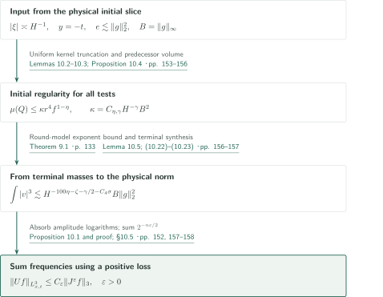
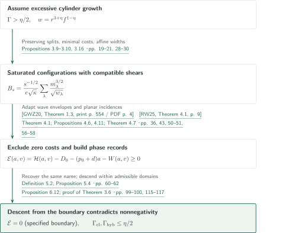
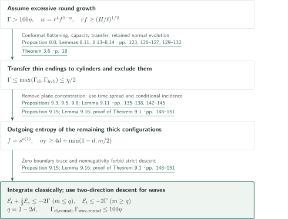
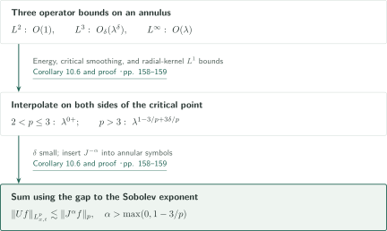
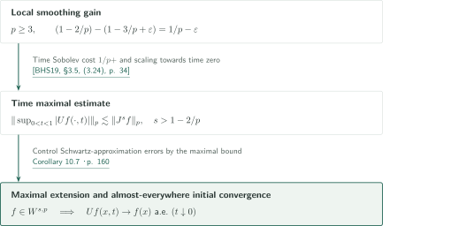
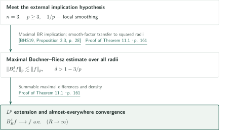
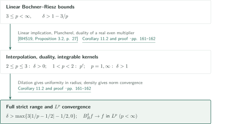

# Critical local smoothing for the three-dimensional wave equation

**From entropy contradictions in cylinder models to regularity on the physical initial slice and critical $L^3$ smoothing**

The manuscript derives the critical estimate for the three-dimensional Euclidean half-wave from packet masses and multiscale phase information. It incorporates planar incidence bounds and a lower-dimensional wave-envelope estimate into cylinder models, transfers thin round configurations to those models, and connects initial regularity and terminal packet masses to the physical $L^3$ norm.

## 1. Main results

Write $Uf(x,t)=e^{it|D|}f(x)$ and $J^s=(1-\Delta)^{s/2}$. Constants below may depend on the stated exponents, but not on the input function.

### Theorem 1.1 — Critical local smoothing in three dimensions

For every $\varepsilon>0$ there is a finite $C_\varepsilon$ such that every $f\in\mathcal S(\mathbb R^3)$ satisfies
\[
 \|Uf\|_{L^3(\mathbb R^3\times[1,2])}\le C_\varepsilon\|J^\varepsilon f\|_{L^3(\mathbb R^3)}.
\]
The lossless assertion $\varepsilon=0$ is not included.

<!-- cite:main -->[Theorem 1.1 · p. 1](https://github.com/openai/math/blob/7ef5c0cc5ca4b0e072b7a050fca09ab24bc6fa3a/preprints/Critical-local-smoothing-for-the-three-dimensional-wave-equation-September-24-2026/paper.pdf)<!-- /cite -->

### Corollary 10.6 — The full strict positive-regularity range

For $2<p<\infty$ and $\alpha>\max\{0,1-3/p\}$, every Schwartz function satisfies
\[
 \|Uf\|_{L^p(\mathbb R^3\times[1,2])}\le C_{p,\alpha}\|J^\alpha f\|_{L^p(\mathbb R^3)}.
\]

<!-- cite:range -->[Corollary 10.6 · p. 158](https://github.com/openai/math/blob/7ef5c0cc5ca4b0e072b7a050fca09ab24bc6fa3a/preprints/Critical-local-smoothing-for-the-three-dimensional-wave-equation-September-24-2026/paper.pdf)<!-- /cite -->

### Corollary 10.7 — Maximal half-waves and convergence to the initial data

Let $3\le p<\infty$ and $s>1-2/p$. For Schwartz functions,
\[
 \left\|\sup_{0<t<1}|Uf(\cdot,t)|\right\|_p\le C_{p,s}\|J^sf\|_p.
\]
The family has a bounded maximal extension to $W^{s,p}(\mathbb R^3)=\{f\in\mathcal S':J^sf\in L^p\}$. In that extension, $Uf(x,t)\to f(x)$ almost everywhere as $t\downarrow0$, for every $f\in W^{s,p}$.

<!-- cite:maxwave -->[Corollary 10.7 · p. 160](https://github.com/openai/math/blob/7ef5c0cc5ca4b0e072b7a050fca09ab24bc6fa3a/preprints/Critical-local-smoothing-for-the-three-dimensional-wave-equation-September-24-2026/paper.pdf)<!-- /cite -->

### Theorem 11.1 — Maximal Bochner–Riesz bounds and almost-everywhere summation

Let $B_R^\delta$ have multiplier $(1-|\xi|^2/R^2)_+^\delta$, and put $B_*^\delta f=\sup_{R>0}|B_R^\delta f|$. If $3\le p<\infty$ and $\delta>1-3/p$, then
\[
 \|B_*^\delta f\|_p\le C_{p,\delta}\|f\|_p\qquad(f\in\mathcal S(\mathbb R^3)).
\]
There is a bounded maximal extension to $L^p$; in this extension, $B_R^\delta f\to f$ almost everywhere as $R\to\infty$, for every $f\in L^p$. In particular, every $\delta>0$ is allowed at $p=3$.

<!-- cite:maxbr -->[Theorem 11.1 · pp. 160–161](https://github.com/openai/math/blob/7ef5c0cc5ca4b0e072b7a050fca09ab24bc6fa3a/preprints/Critical-local-smoothing-for-the-three-dimensional-wave-equation-September-24-2026/paper.pdf)<!-- /cite -->

### Corollary 11.2 — The full strict nonmaximal Bochner–Riesz range

For $1\le p\le\infty$, with $1/\infty=0$, put
\[
 \delta_{\mathrm{BR}}(p)=\max\{3|1/p-1/2|-1/2,0\}.
\]
If $\delta>\delta_{\mathrm{BR}}(p)$, then $B_R^\delta$ extends boundedly to $L^p(\mathbb R^3)$, with
\[
 \|B_R^\delta f\|_p\le C_{p,\delta}\|f\|_p\qquad(R>0)
\]
uniformly in the radius. The following proof also gives convergence in $L^p$ when $p<\infty$. This is a range for the individual linear operators, not an enlargement of the maximal range in Theorem 11.1.

<!-- cite:br -->[Corollary 11.2 and proof · pp. 161–162](https://github.com/openai/math/blob/7ef5c0cc5ca4b0e072b7a050fca09ab24bc6fa3a/preprints/Critical-local-smoothing-for-the-three-dimensional-wave-equation-September-24-2026/paper.pdf)<!-- /cite -->

## References on the arrows

<!-- reference-guide -->
Unprefixed theorem, lemma, section and equation numbers refer to [Critical local smoothing for the three-dimensional wave equation](https://github.com/openai/math/blob/7ef5c0cc5ca4b0e072b7a050fca09ab24bc6fa3a/preprints/Critical-local-smoothing-for-the-three-dimensional-wave-equation-September-24-2026/paper.pdf). External inputs use the following keys.

- [GWZ20](https://annals.math.princeton.edu/wp-content/uploads/annals-v192-n2-p06-s.pdf) Larry Guth, Hong Wang, and Ruixiang Zhang — *A sharp square function estimate for the cone in R3*: The manuscript extends the cone wave-envelope estimate to Hilbert-valued and weighted forms for cylinder kinetic and angular-memory bounds. Annals of Mathematics 192 (2020), 551–581.
- [RW25](https://arxiv.org/pdf/2308.08819v3) Kevin Ren and Hong Wang — *Furstenberg sets estimate in the plane*: The discretized planar Furstenberg estimate is converted to a probability form for zero-cost exclusion and conditional incidence/projection. arXiv:2308.08819v3, January 19, 2025.
- [BHS19](https://arxiv.org/pdf/1812.11616v2) David Beltran, Jonathan Hickman, and Christopher D. Sogge — *Sharp local smoothing estimates for Fourier integral operators*: Implications from local smoothing to maximal half-waves and linear/maximal Bochner–Riesz estimates. arXiv:1812.11616v2, September 5, 2019.

Each citation gives the result and pages. When printed pagination differs from the PDF position, both are shown. GitHub previews do not automatically jump to the cited page.
<!-- /reference-guide -->

## 2. Proof of Theorem 1.1 — Returning from the model to the physical wave

<!-- proof-target:1 -->Proof target：[Theorem 1.1 · p. 1](https://github.com/openai/math/blob/7ef5c0cc5ca4b0e072b7a050fca09ab24bc6fa3a/preprints/Critical-local-smoothing-for-the-three-dimensional-wave-equation-September-24-2026/paper.pdf)<!-- /proof-target -->

**Proof route.** Transfer the [cylinder estimate](#proof-2) to the [round model](#proof-3), then obtain an estimate on each annulus $|\xi|\asymp H^{-1}$. Initial regularity and synthesis from terminal masses require separate arguments. A positive Sobolev loss finally makes the frequency sum converge.

### 1. Prove regularity on the initial slice

Localize the negative half-wave $Wg(x,\tau)=e^{-i\tau|D|}g(x)$ to finitely many angular charts and bounded spatial regions. In null coordinates
\[
 t=\tau+x_3,\quad b=(x_1,x_2),\quad y=\tau-x_3,
 \qquad \rho=(|\xi|+\xi_3)/2,\quad A=\xi_\perp/(2\rho),
\]
the velocities become $(A,|A|^2)$, but the original initial slice is $y=-t$, rather than $t=0$. The uniform kernel truncation in Lemma 10.2 permits restriction of the input to the predecessor set $E$ of a regularity test. Lemma 10.3 bounds its volume by $C\Lambda^{C_1}r^4f^{1-\eta}$, where $f$ denotes relative test thickness, not the input function. The gradient lower bound for the restricted polynomial also handles nonround tests.

With $B=\|g\|_\infty$ and $e\lesssim\|g\|_2^2$, Proposition 10.4 gives initial regularity constant $\kappa=C_{\eta,\gamma}H^{-\gamma}B^2$, for every $\gamma>0$. This verifies the model hypothesis from the original datum.

<!-- cite:physical -->[Lemmas 10.2–10.3; Proposition 10.4 · pp. 153–156](https://github.com/openai/math/blob/7ef5c0cc5ca4b0e072b7a050fca09ab24bc6fa3a/preprints/Critical-local-smoothing-for-the-three-dimensional-wave-equation-September-24-2026/paper.pdf)<!-- /cite -->

### 2. Synthesize the cubic sum of terminal masses

Let $m_{j,Q}$ be the energy assigned to a spatial $H$-cube in a terminal time interval of length $H$. The test weights are comparable to one, and assignments within each interval sum to at most its row energy. Lemma 10.5 and Theorem 9.1 give, for arbitrarily small positive $\sigma,\zeta$,
\[
 \int|v|^3\lesssim H^{-C_4\sigma}H^{-1/2}\sum_{j,Q}m_{j,Q}^{3/2}+\text{negligible error},
 \quad
 H^{-1/2}\sum_{j,Q}m_{j,Q}^{3/2}\lesssim H^{-100\eta-\zeta}e\sqrt\kappa.
\]
Consequently,
\[
 \int|v|^3\lesssim H^{-100\eta-\zeta-\gamma/2-C_4\sigma}B\|g\|_2^2.
\]
Choose a desired loss first, then take $\eta,\zeta,\gamma,\sigma$ sufficiently small. Evolution copies energy into descendant time intervals; these descendants are not mutually orthogonal pieces of the initial datum.

<!-- cite:synthesis -->[Lemma 10.5; (10.22)–(10.23) · pp. 156–157](https://github.com/openai/math/blob/7ef5c0cc5ca4b0e072b7a050fca09ab24bc6fa3a/preprints/Critical-local-smoothing-for-the-three-dimensional-wave-equation-September-24-2026/paper.pdf)<!-- /cite -->

### 3. Decompose amplitudes and sum frequencies

Apply spatial and dyadic amplitude decompositions to the input. Each amplitude piece satisfies $B_\nu\|g_\nu\|_2^2\le2\|g_\nu\|_3^3$, and the logarithmic number of pieces is absorbed into an arbitrarily small power loss. This proves Proposition 10.1, uniformly for smooth symbol families on a fixed annulus:
\[
 \|W_Hg\|_{L^3_{x,\tau}}\le C_\delta H^{-\delta}\|g\|_3
 \qquad(\delta>0).
\]
Set $h=J^\varepsilon f$, $H=2^{-n}$, and $\delta=\varepsilon/2$. Inserting $J^{-\varepsilon}$ into the annular symbol gives summable terms $2^{-n\varepsilon/2}\|h\|_3$. Uniformly integrable kernels handle low frequencies, and complex conjugation restores the positive sign.

<!-- cite:summation -->[Proposition 10.1 and proof; §10.5 · pp. 152, 157–158](https://github.com/openai/math/blob/7ef5c0cc5ca4b0e072b7a050fca09ab24bc6fa3a/preprints/Critical-local-smoothing-for-the-three-dimensional-wave-equation-September-24-2026/paper.pdf)<!-- /cite -->

## 3. Proof of Theorem 3.6 — Entropy excess in the cylinder model

<!-- proof-target:2 -->Proof target：[Theorem 3.6 · p. 18](https://github.com/openai/math/blob/7ef5c0cc5ca4b0e072b7a050fca09ab24bc6fa3a/preprints/Critical-local-smoothing-for-the-three-dimensional-wave-equation-September-24-2026/paper.pdf)<!-- /proof-target -->

<!-- statement:theorem-3-6 -->
### Theorem 3.6 — Cylinder growth exponents

Consider the classical and hybrid cylinder experiments of Definitions 3.1–3.3. Classical velocities are $(X,X^2,N)$. The hybrid model retains classical parabolic base variables and one-dimensional Schrödinger evolution in the normal variable. Tests use position and velocity windows after subtracting polynomial shears, with weight $w=r^{3+\eta}f^{1-\eta}$, $0<\eta<1$. The angular width is $r>0$, the normal width is $f>0$, and hybrid tests require $f\ge(H/\ell)^{1/2}$. Impose initial mass $e>0$ and regularity $\mu(Q)\le\kappa w(Q)$. At the final cut of length $s$, assign masses $m_\lambda$ to tests, with assignments within each interval dominated in sum by its row energy.

\[
 B_s=\frac{s^{-1/2}}{e\sqrt\kappa}\sum_\lambda\frac{m_\lambda^{3/2}}{\sqrt{w_\lambda}}.
\]
Under the fixed finite operator-cut and polynomial support, density, and negligible-error conventions, the supremal upper $\log_{1/s}$ growth exponents over admissible setups satisfy
\[
 \Gamma_{\rm cl}\le\eta/2,\qquad\Gamma_{\rm hyb}\le\eta/2.
\]
The setup, number of cuts, and error tolerances are fixed before the inner scale limit.

<!-- cite:cylinder -->[Definitions 3.1–3.3; Theorem 3.6 · pp. 14–18](https://github.com/openai/math/blob/7ef5c0cc5ca4b0e072b7a050fca09ab24bc6fa3a/preprints/Critical-local-smoothing-for-the-three-dimensional-wave-equation-September-24-2026/paper.pdf)<!-- /cite -->
<!-- /statement -->

### 1. Preserving extremality forces compatible shears

Assume growth beyond the asserted bound. Propositions 3.9–3.10 show that ordinary regularity splits preserving the extremal exponent must saturate the energy and regularity budgets at the exponent level. Comparing tests at different cuts then controls their shear coefficients and permits selection of minimal shear costs. Proposition 3.16 restricts to a short depth interval and renormalizes, obtaining $u(i)=J(1-i)$ and affine normal-width exponents. The extraction preserves enough compatibility to recover earlier frames from later finite records; selecting large masses independently at each depth would not suffice.

<!-- cite:extremal -->[Propositions 3.9–3.10, 3.16 · pp. 19–21, 28–30](https://github.com/openai/math/blob/7ef5c0cc5ca4b0e072b7a050fca09ab24bc6fa3a/preprints/Critical-local-smoothing-for-the-three-dimensional-wave-equation-September-24-2026/paper.pdf)<!-- /cite -->

### 2. External inputs exclude zero costs and supply conditional projections

The wave-envelope theorem of [GWZ20] concerns scalar functions near the cone. Theorem 4.1 derives a Hilbert-valued version by Gaussian averaging and a weighted version by summing tiles. The kinetic estimate for parabolic rays in Lemma 4.2 and the angular-memory estimate in Proposition 4.3 lead to Proposition 4.6, excluding hybrid zero costs when the hybrid exponent strictly exceeds the classical one.

Theorem 4.7 converts the discretized Furstenberg theorem of [RW25] into a probability-measure statement by point–line duality and sampling. Nonconcentration exponents $b$ for the line family and $a$ along its lines give union covering exponent
\[
 F(a,b)=a+\min\{1,b,(a+b)/2\}.
\]
It enters the classical zero-cost exclusion in Proposition 4.11 and the subsequent conditional incidence and projection estimates. The probability and Hilbert-valued extensions are proved in this manuscript, rather than attributed to the external theorems themselves.

<!-- cite:gwz -->[&#91;GWZ20, Theorem 1.3, print p. 554 / PDF p. 4&#93;](https://annals.math.princeton.edu/wp-content/uploads/annals-v192-n2-p06-s.pdf#page=4)<!-- /cite -->

<!-- cite:rw -->[&#91;RW25, Theorem 4.1, p. 9&#93;](https://arxiv.org/pdf/2308.08819v3#page=9)<!-- /cite -->

<!-- cite:lower-inputs -->[Theorem 4.1; Propositions 4.6, 4.11; Theorem 4.7 · pp. 36, 43, 50–51, 56–58](https://github.com/openai/math/blob/7ef5c0cc5ca4b0e072b7a050fca09ab24bc6fa3a/preprints/Critical-local-smoothing-for-the-three-dimensional-wave-equation-September-24-2026/paper.pdf)<!-- /cite -->

### 3. Nonnegativity conflicts with descent for one finite phase record

The canonical name $C(a,v)$ of Definition 5.2 records time, shear coefficients, base position and direction, and dyadic cells of the residual normal phase at time depth $a$ and angular resolution $v$. Subtract from its normalized entropy $\mathcal H(a,v)$ the initial ratio $D_0=\lim\log_{1/s}(e/\kappa)$, the saturated mass baseline $(p_0+d)a$, and the test-weight exponent $W(a,v)$. Then
\[
 \mathcal E(a,v)=\mathcal H(a,v)-D_0-(p_0+d)a-W(a,v)\ge0.
\]
Here $p_0$ is the manuscript's mass exponent $p$, distinguished from the $L^p$ exponent. Proposition 5.4 gives equality only at specified terminal and boundary resolutions. Hybrid use is restricted to normal-width exponent $w<0$; boundary equality is not available at arbitrary resolutions.

Section 6 collects local inequalities into the admissible motions of Proposition 6.12. Section 7 builds backward paths from equality boundaries, staying inside the domains of the applicable inequalities. A strictly positive drop contradicts $\mathcal E\ge0$. Unit-cost boundaries, intervals with no angular entropy growth, and quadratic versus linear shears require separate cases. This overview does not independently verify every case of that argument.

<!-- cite:entropy -->[Definition 5.2; Proposition 5.4 · pp. 60–62](https://github.com/openai/math/blob/7ef5c0cc5ca4b0e072b7a050fca09ab24bc6fa3a/preprints/Critical-local-smoothing-for-the-three-dimensional-wave-equation-September-24-2026/paper.pdf)<!-- /cite -->

<!-- cite:cylinder-close -->[Proposition 6.12; proof of Theorem 3.6 · pp. 99–100, 115–117](https://github.com/openai/math/blob/7ef5c0cc5ca4b0e072b7a050fca09ab24bc6fa3a/preprints/Critical-local-smoothing-for-the-three-dimensional-wave-equation-September-24-2026/paper.pdf)<!-- /cite -->

## 4. Proof of Theorem 9.1 — Transferring thin shapes and excluding round configurations

<!-- proof-target:3 -->Proof target：[Theorem 9.1 · p. 133](https://github.com/openai/math/blob/7ef5c0cc5ca4b0e072b7a050fca09ab24bc6fa3a/preprints/Critical-local-smoothing-for-the-three-dimensional-wave-equation-September-24-2026/paper.pdf)<!-- /proof-target -->

<!-- statement:theorem-9-1 -->
### Theorem 9.1 — Round-cone growth exponents

Consider the classical and wave experiments of Definitions 8.1–8.2, with velocities $(A,|A|^2)$, $A\in\mathbb R^2$. At time length $\ell$, tests have angular width $r$, position widths $\ell r,\ell r^2$, and may have relative thickness $0<f\le1$ near a hyperquadric. Wave tests satisfy $rf\ge(H/\ell)^{1/2}$. Use initial regularity with weight $w=r^4f^{1-\eta}$, and the same normalized functional $B_s$ as above.

For every $0<\eta<1$,
\[
 \Gamma_{\rm cl,round}\le100\eta,\qquad\Gamma_{\rm wav,round}\le100\eta.
\]
The bounds also hold with a fixed finite list of admissible row contractions, arbitrary separable Hilbert multiplicity, and the model's finite-power support and error conventions.

<!-- cite:round -->[Definitions 8.1–8.2; Theorem 9.1 · pp. 117–118, 133](https://github.com/openai/math/blob/7ef5c0cc5ca4b0e072b7a050fca09ab24bc6fa3a/preprints/Critical-local-smoothing-for-the-three-dimensional-wave-equation-September-24-2026/paper.pdf)<!-- /cite -->
<!-- /statement -->

### 1. Transfer thin endings to cylinders

Proposition 8.8 reduces saturated configurations with a positive limiting terminal-thickness exponent to cylinders. It gives $\Gamma\le\Gamma_{\rm cl}$ classically, and $\Gamma\le\max\{\Gamma_{\rm cl},\Gamma_{\rm hyb}\}$ for waves. Group tests near a common hyperquadric, flatten it in a conformal chart, and transfer both initial regularity and terminal capacities. Freezing fine base variables must retain the normal quantum evolution, which is why the hybrid cylinder model is needed. The input/output weight comparison of Lemma 8.13 accounts for cancellation of the normal rescaling factors.

<!-- cite:thin -->[Proposition 8.8; Lemmas 8.11, 8.13–8.14 · pp. 123, 126–127, 129–132](https://github.com/openai/math/blob/7ef5c0cc5ca4b0e072b7a050fca09ab24bc6fa3a/preprints/Critical-local-smoothing-for-the-three-dimensional-wave-equation-September-24-2026/paper.pdf)<!-- /cite -->

### 2. Obtain angular transversality for the remaining configurations

After Theorem 3.6 excludes thin endings, saturated configurations have $f=s^{o(1)}$. The classical case is closed first. For a wave configuration strictly exceeding that classical exponent, Proposition 9.3 fixes the angular width at the uncertainty scale. The plane-slab estimate in Proposition 9.5 and Lemma 9.11 remove conditional plane concentration. Proposition 9.8 gives a nonnegative phase-record entropy excess, zero on $v=(1-a)/2$.

<!-- cite:round-profiles -->[Propositions 9.3, 9.5, 9.8; Lemma 9.11 · pp. 135–138, 142–145](https://github.com/openai/math/blob/7ef5c0cc5ca4b0e072b7a050fca09ab24bc6fa3a/preprints/Critical-local-smoothing-for-the-three-dimensional-wave-equation-September-24-2026/paper.pdf)<!-- /cite -->

### 3. Two-direction descent of the outgoing entropy

Proposition 9.15 combines time nonconcentration with transverse angular samples to give outgoing entropy rate
\[
 o_T\ge4d+\min\{1-d,m/2\}.
\]
Four transverse directions supply $4d$; conditional planar incidence gives the improvement. Classically, integration gives $D(1,0)\ge1+3d$, contradicting the terminal upper bound $D(1,0)\le1+3d-2\Gamma$.

For waves put $t=1-a$ and $q=2-2d$. Then
\[
 \mathcal E_t+\tfrac12\mathcal E_v\le-2\Gamma\quad(m\le q),
 \qquad \mathcal E_t\le-2\Gamma\quad(m\ge q).
\]
Monotonicity of $m$ in $t$ at fixed $v$ permits switching between these directions without losing the negative decrease. Lemma 9.16 contradicts nonnegativity and the zero boundary trace. This supplies the model loss $100\eta$ used in Theorem 1.1.

<!-- cite:round-close -->[Proposition 9.15; Lemma 9.16; proof of Theorem 9.1 · pp. 148–151](https://github.com/openai/math/blob/7ef5c0cc5ca4b0e072b7a050fca09ab24bc6fa3a/preprints/Critical-local-smoothing-for-the-three-dimensional-wave-equation-September-24-2026/paper.pdf)<!-- /cite -->

## 5. Proof of Corollary 10.6 — Interpolating $L^2,L^3,L^\infty$

<!-- proof-target:4 -->Proof target：[Corollary 10.6 · p. 158](https://github.com/openai/math/blob/7ef5c0cc5ca4b0e072b7a050fca09ab24bc6fa3a/preprints/Critical-local-smoothing-for-the-three-dimensional-wave-equation-September-24-2026/paper.pdf)<!-- /proof-target -->

### 1. Interpolate on an annulus and use the strict inequality to sum

For a smooth annular projection $P_\lambda$, $\lambda\ge1$, the operator norms are $O(1)$ from $L^2$ to spacetime $L^2$, $O_\delta(\lambda^\delta)$ from $L^3$ to spacetime $L^3$, and $O(\lambda)$ from $L^\infty$ to spacetime $L^\infty$. The last follows by integrating the radial three-dimensional kernel in absolute value.

Interpolation gives an arbitrarily small positive power for $2<p\le3$, and $\lambda^{1-3/p+3\delta/p}$ for $p>3$. Choose $\delta$ so that this exponent is below $\alpha$, insert $J^{-\alpha}$, and sum geometrically. The appended estimate for independent displacement and velocity data follows from both signs and the order $-1$ velocity multiplier:
\[
 \|u\|_{L^p_{x,t}}\lesssim\|J^\alpha u_0\|_p+\|J^{\alpha-1}u_1\|_p.
\]
At low frequency retain the combined multiplier $\sin(t|\xi|)/|\xi|$.

<!-- cite:range-proof -->[Corollary 10.6 and proof · pp. 158–159](https://github.com/openai/math/blob/7ef5c0cc5ca4b0e072b7a050fca09ab24bc6fa3a/preprints/Critical-local-smoothing-for-the-three-dimensional-wave-equation-September-24-2026/paper.pdf)<!-- /cite -->

## 6. Proof of Corollary 10.7 — Time Sobolev embedding and density

<!-- proof-target:5 -->Proof target：[Corollary 10.7 · p. 160](https://github.com/openai/math/blob/7ef5c0cc5ca4b0e072b7a050fca09ab24bc6fa3a/preprints/Critical-local-smoothing-for-the-three-dimensional-wave-equation-September-24-2026/paper.pdf)<!-- /proof-target -->

### 1. Take the time supremum and control approximation errors

For $p\ge3$, the gain over the fixed-time loss $1-2/p$ is $1/p-$. The implication in [BHS19, §3.5, (3.24)] combines time Sobolev embedding, costing $1/p+$, with scaling to give the $0<t<1$ maximal estimate when $s>1-2/p$. Corollary 10.6 supplies its hypothesis; one is not simply quoting the older paper's established exponent range.

Schwartz data converge uniformly as $t\downarrow0$. Approximate in $W^{s,p}$, then use the maximal estimate and Chebyshev's inequality to make the exceptional limsup set have measure zero. At $p=3$ the maximal conclusion requires $s>1/3$, unlike the spacetime estimate with every positive loss.

<!-- cite:bhs-wave -->[&#91;BHS19, §3.5, (3.24), p. 34&#93;](https://arxiv.org/pdf/1812.11616v2#page=34)<!-- /cite -->

<!-- cite:maxwave -->[Corollary 10.7 · p. 160](https://github.com/openai/math/blob/7ef5c0cc5ca4b0e072b7a050fca09ab24bc6fa3a/preprints/Critical-local-smoothing-for-the-three-dimensional-wave-equation-September-24-2026/paper.pdf)<!-- /cite -->

## 7. Proof of Theorem 11.1 — From local smoothing to maximal Bochner–Riesz

<!-- proof-target:6 -->Proof target：[Theorem 11.1 · pp. 160–161](https://github.com/openai/math/blob/7ef5c0cc5ca4b0e072b7a050fca09ab24bc6fa3a/preprints/Critical-local-smoothing-for-the-three-dimensional-wave-equation-September-24-2026/paper.pdf)<!-- /proof-target -->

### 1. Match the threshold and multiplier convention

[BHS19, Proposition 3.3] assumes $1/p-$ local smoothing for $p\ge2n/(n-1)$. With $n=3$ and $p\ge3$, Corollary 10.6 meets this hypothesis and the required order becomes $\delta>1-3/p$. Its multiplier $(1-|\xi|/R)_+^\delta$ is related to the squared-radius convention by the smooth factor $(1+|\xi|/R)^\delta$ near the boundary and a smooth interior remainder. Their Schwartz kernels and the Hardy–Littlewood maximal operator transfer the bound for the supremum over all radii.

<!-- cite:bhs-maxbr -->[&#91;BHS19, Proposition 3.3, p. 28&#93;](https://arxiv.org/pdf/1812.11616v2#page=28)<!-- /cite -->

<!-- cite:maxbr-proof -->[Proof of Theorem 11.1 · p. 161](https://github.com/openai/math/blob/7ef5c0cc5ca4b0e072b7a050fca09ab24bc6fa3a/preprints/Critical-local-smoothing-for-the-three-dimensional-wave-equation-September-24-2026/paper.pdf)<!-- /cite -->

### 2. Construct the maximal extension and almost-everywhere sum

Choose Schwartz approximants whose successive $L^p$ differences are summable. The maximal functions of their differences are also summable in $L^p$, defining an extension uniform over all radii at almost every point. Then
\[
 \limsup_{R\to\infty}|B_R^\delta f-f|
 \le B_*^\delta(f-g)+|f-g|
\]
transfers convergence for Schwartz $g$ to arbitrary $L^p$ data. No Sobolev regularity of the input is required.

<!-- cite:maxbr-proof -->[Proof of Theorem 11.1 · p. 161](https://github.com/openai/math/blob/7ef5c0cc5ca4b0e072b7a050fca09ab24bc6fa3a/preprints/Critical-local-smoothing-for-the-three-dimensional-wave-equation-September-24-2026/paper.pdf)<!-- /cite -->

## 8. Proof of Corollary 11.2 — Interpolation and duality for linear means

<!-- proof-target:7 -->Proof target：[Corollary 11.2 and proof · pp. 161–162](https://github.com/openai/math/blob/7ef5c0cc5ca4b0e072b7a050fca09ab24bc6fa3a/preprints/Critical-local-smoothing-for-the-three-dimensional-wave-equation-September-24-2026/paper.pdf)<!-- /proof-target -->

### 1. Complete the exponent range and norm convergence

[BHS19, Proposition 3.2] and the same smooth-factor transfer give the linear bounds for $3\le p<\infty$, $\delta>1-3/p$. At fixed $\delta>0$, interpolate the $p=3$ bound with Plancherel to fill $2\le p\le3$. Duality of the real even multiplier supplies $1<p<2$. At $p=1,\infty$, the condition $\delta>1$ makes the kernel decay $(1+|x|)^{-2-\delta}$ integrable. Dilation gives constants uniform in the radius.

For $p<\infty$, first prove $L^p$ convergence for Schwartz functions with compact Fourier support; uniform linear operator bounds and density then extend it. This duality argument is not applied to the maximal operator.

<!-- cite:bhs-br -->[&#91;BHS19, Proposition 3.2, p. 27&#93;](https://arxiv.org/pdf/1812.11616v2#page=27)<!-- /cite -->

<!-- cite:br -->[Corollary 11.2 and proof · pp. 161–162](https://github.com/openai/math/blob/7ef5c0cc5ca4b0e072b7a050fca09ab24bc6fa3a/preprints/Critical-local-smoothing-for-the-three-dimensional-wave-equation-September-24-2026/paper.pdf)<!-- /cite -->

## 9. Which papers supply which steps

| Source and result | Used at | Role and hypotheses | Checking scope |
|---|---|---|---|
| Guth–Wang–Zhang, Theorem 1.3 | Theorem 4.1, Lemmas 4.2–4.4, Proposition 4.6 | Cone wave envelopes lead to Hilbert-valued and weighted estimates, then cylinder angular memory | External statement and the manuscript's extension/application route compared; complete external proof excluded |
| Ren–Wang, Theorem 4.1 | Theorem 4.7, §§4.5, 5–6, Proposition 9.15 | Covering lower bounds for nonconcentrated point–line configurations become conditional incidence estimates | External statement, probability conversion, and central uses compared; all conditional lemmas not independently verified |
| Beltran–Hickman–Sogge, §3.5 (3.24), Propositions 3.2–3.3 | Corollary 10.7, Theorem 11.1, Corollary 11.2 | $1/p-$ smoothing implies maximal half-wave and linear/maximal BR bounds | Exponent hypotheses and the multiplier-convention transfer compared |

*Bochner–Riesz multipliers in three dimensions* in catalogue 078 is cited on p.162 as a different proof of the same nonmaximal range, explicitly not an input to this deduction. No direct citation to either catalogue 074 manuscript was found in this manuscript's bibliography. Section 11.1 derives spherical restriction and Kakeya maximal estimates through a different external chain.

<!-- cite:comparison -->[Corollary 11.2, final paragraph; §11.1 · p. 162](https://github.com/openai/math/blob/7ef5c0cc5ca4b0e072b7a050fca09ab24bc6fa3a/preprints/Critical-local-smoothing-for-the-three-dimensional-wave-equation-September-24-2026/paper.pdf)<!-- /cite -->

## 10. Return to the sources

<!-- reading-list -->
- [Definitions 3.1–3.3; Theorem 3.6 · pp. 14–18](https://github.com/openai/math/blob/7ef5c0cc5ca4b0e072b7a050fca09ab24bc6fa3a/preprints/Critical-local-smoothing-for-the-three-dimensional-wave-equation-September-24-2026/paper.pdf) — Cylinder regularity, assignments, and growth exponents
- [Definition 5.2; Proposition 5.4 · pp. 60–62](https://github.com/openai/math/blob/7ef5c0cc5ca4b0e072b7a050fca09ab24bc6fa3a/preprints/Critical-local-smoothing-for-the-three-dimensional-wave-equation-September-24-2026/paper.pdf) — Phase names recording shears and endpoint recovery
- [Proposition 8.8; Lemmas 8.11, 8.13–8.14 · pp. 123, 126–127, 129–132](https://github.com/openai/math/blob/7ef5c0cc5ca4b0e072b7a050fca09ab24bc6fa3a/preprints/Critical-local-smoothing-for-the-three-dimensional-wave-equation-September-24-2026/paper.pdf) — The thin-shape transfer to cylinders
- [Proposition 9.15; Lemma 9.16; proof of Theorem 9.1 · pp. 148–151](https://github.com/openai/math/blob/7ef5c0cc5ca4b0e072b7a050fca09ab24bc6fa3a/preprints/Critical-local-smoothing-for-the-three-dimensional-wave-equation-September-24-2026/paper.pdf) — Outgoing entropy and the final two-direction contradiction
- [Lemmas 10.2–10.3; Proposition 10.4 · pp. 153–156](https://github.com/openai/math/blob/7ef5c0cc5ca4b0e072b7a050fca09ab24bc6fa3a/preprints/Critical-local-smoothing-for-the-three-dimensional-wave-equation-September-24-2026/paper.pdf) — Regularity on the original initial slice
- [Proposition 10.1 and proof; §10.5 · pp. 152, 157–158](https://github.com/openai/math/blob/7ef5c0cc5ca4b0e072b7a050fca09ab24bc6fa3a/preprints/Critical-local-smoothing-for-the-three-dimensional-wave-equation-September-24-2026/paper.pdf) — From annular bounds to Sobolev summation
- [Corollary 10.6 and proof · pp. 158–159](https://github.com/openai/math/blob/7ef5c0cc5ca4b0e072b7a050fca09ab24bc6fa3a/preprints/Critical-local-smoothing-for-the-three-dimensional-wave-equation-September-24-2026/paper.pdf) — Other exponents and independent initial data
- [Corollary 10.7 · p. 160](https://github.com/openai/math/blob/7ef5c0cc5ca4b0e072b7a050fca09ab24bc6fa3a/preprints/Critical-local-smoothing-for-the-three-dimensional-wave-equation-September-24-2026/paper.pdf) — Time maxima and initial convergence
- [Corollary 11.2 and proof · pp. 161–162](https://github.com/openai/math/blob/7ef5c0cc5ca4b0e072b7a050fca09ab24bc6fa3a/preprints/Critical-local-smoothing-for-the-three-dimensional-wave-equation-September-24-2026/paper.pdf) — Distinguishing maximal and nonmaximal BR ranges
<!-- /reading-list -->

Reading focused on the statements, model definitions, extremal configurations, phase records and entropy endpoint conditions, thin-shape reduction, final round-model contradiction, physical initial regularity, frequency summation, and proofs of the numbered consequences. The quantitative GWZ and Ren–Wang inputs and the BHS maximal implications were compared with their statements and application hypotheses. This is not an independent verification of every lemma and case in the 165-page manuscript. In particular, checking of conditional-information transfers and boundary paths in §§5–7 and all conformal-transfer error calculations in §8 is limited.

The manuscript's deductions of spherical restriction, Kakeya maximal bounds, and the dimension of compact Kakeya sets in §11.1 (p.162) were read, but source comparison of the external Tao and Wolff implications is outside this overview's scope. Their checking status is distinct from that of the numbered results above. No expert review or certification of the complete proof is claimed.
