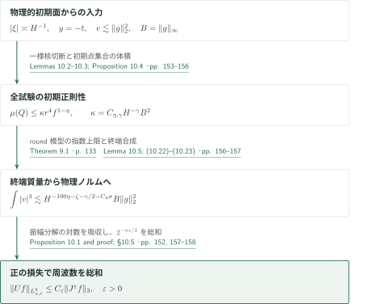
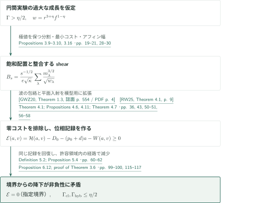
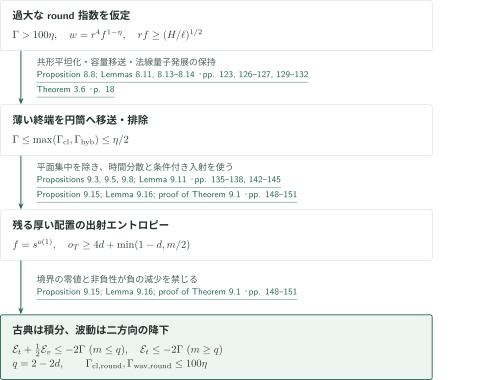
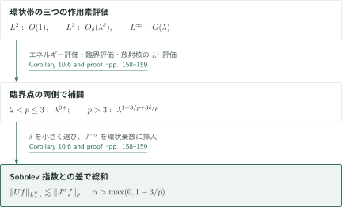
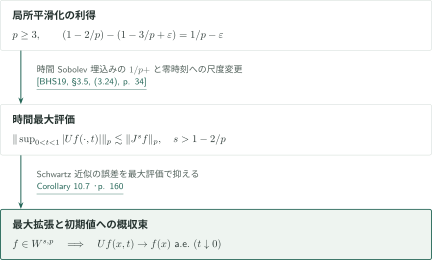
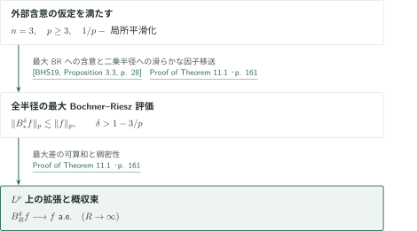
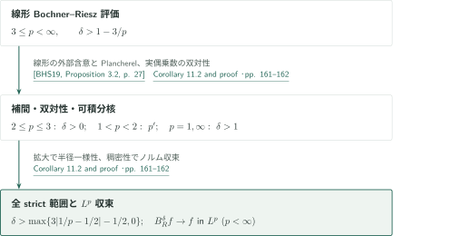

# Critical local smoothing for the three-dimensional wave equation

**円筒模型のエントロピー矛盾から、物理的初期面上の正則性と臨界 $L^3$ 評価へ**

本原稿は三次元ユークリッド半波動作用素の臨界評価を、波束の質量と多尺度の位相情報から導く。外部の平面入射評価と二次元波動のwave-envelope評価を円筒模型へ組み込み、薄い球面状配置をその模型へ移す。最後に初期面と終端波束を物理的な $L^3$ ノルムへ結び付ける。

## 1. 主要結果

$U f(x,t)=e^{it|D|}f(x)$、$J^s=(1-\Delta)^{s/2}$ とする。以下の定数は明記した指数には依存するが入力関数には依存しない。

### Theorem 1.1 — 三次元の臨界局所平滑化

任意の $\varepsilon>0$ に対し有限な $C_\varepsilon$ が存在し、すべての $f\in\mathcal S(\mathbb R^3)$ に対して
\[
 \|Uf\|_{L^3(\mathbb R^3\times[1,2])}\le C_\varepsilon\|J^\varepsilon f\|_{L^3(\mathbb R^3)}.
\]
損失ゼロの $\varepsilon=0$ はこの主張に含まれない。

<!-- cite:main -->[Theorem 1.1 · p. 1](https://github.com/openai/math/blob/7ef5c0cc5ca4b0e072b7a050fca09ab24bc6fa3a/preprints/Critical-local-smoothing-for-the-three-dimensional-wave-equation-September-24-2026/paper.pdf)<!-- /cite -->

### Corollary 10.6 — 全ての正則性の厳密範囲

$2<p<\infty$、$\alpha>\max\{0,1-3/p\}$ なら、すべてのSchwartz関数について
\[
 \|Uf\|_{L^p(\mathbb R^3\times[1,2])}\le C_{p,\alpha}\|J^\alpha f\|_{L^p(\mathbb R^3)}.
\]

<!-- cite:range -->[Corollary 10.6 · p. 158](https://github.com/openai/math/blob/7ef5c0cc5ca4b0e072b7a050fca09ab24bc6fa3a/preprints/Critical-local-smoothing-for-the-three-dimensional-wave-equation-September-24-2026/paper.pdf)<!-- /cite -->

### Corollary 10.7 — 最大半波動と初期値への概収束

$3\le p<\infty$、$s>1-2/p$ とする。Schwartz関数について
\[
 \left\|\sup_{0<t<1}|Uf(\cdot,t)|\right\|_p\le C_{p,s}\|J^sf\|_p.
\]
この族は $W^{s,p}(\mathbb R^3)=\{f\in\mathcal S':J^sf\in L^p\}$ へ有界な最大作用素として拡張され、その拡張では全ての $f\in W^{s,p}$ に対し $Uf(x,t)\to f(x)$ が $t\downarrow0$ でほとんど至る所成立する。

<!-- cite:maxwave -->[Corollary 10.7 · p. 160](https://github.com/openai/math/blob/7ef5c0cc5ca4b0e072b7a050fca09ab24bc6fa3a/preprints/Critical-local-smoothing-for-the-three-dimensional-wave-equation-September-24-2026/paper.pdf)<!-- /cite -->

### Theorem 11.1 — 最大Bochner–Riesz評価と概収束

$B_R^\delta$ を乗数 $(1-|\xi|^2/R^2)_+^\delta$ の作用素、$B_*^\delta f=\sup_{R>0}|B_R^\delta f|$ とする。$3\le p<\infty$、$\delta>1-3/p$ なら
\[
 \|B_*^\delta f\|_p\le C_{p,\delta}\|f\|_p\qquad(f\in\mathcal S(\mathbb R^3)).
\]
有界な最大拡張を $L^p$ 上に持ち、全ての $f\in L^p$ に対し $B_R^\delta f\to f$ が $R\to\infty$ でほとんど至る所成立する。特に $p=3$ では任意の $\delta>0$ を許す。

<!-- cite:maxbr -->[Theorem 11.1 · pp. 160–161](https://github.com/openai/math/blob/7ef5c0cc5ca4b0e072b7a050fca09ab24bc6fa3a/preprints/Critical-local-smoothing-for-the-three-dimensional-wave-equation-September-24-2026/paper.pdf)<!-- /cite -->

### Corollary 11.2 — 非最大Bochner–Riesz評価の全厳密範囲

$1\le p\le\infty$、$1/\infty=0$ とし、
\[
 \delta_{\mathrm{BR}}(p)=\max\{3|1/p-1/2|-1/2,0\}.
\]
$\delta>\delta_{\mathrm{BR}}(p)$ なら $B_R^\delta$ は $L^p(\mathbb R^3)$ 上に有界に拡張され、
\[
 \|B_R^\delta f\|_p\le C_{p,\delta}\|f\|_p\qquad(R>0)
\]
が半径によらず成立する。続く証明では $p<\infty$ のときの $L^p$ 収束も導く。この指数範囲は個々の線形作用素に対するもので、Theorem 11.1の最大評価の範囲を広げるものではない。

<!-- cite:br -->[Corollary 11.2 and proof · pp. 161–162](https://github.com/openai/math/blob/7ef5c0cc5ca4b0e072b7a050fca09ab24bc6fa3a/preprints/Critical-local-smoothing-for-the-three-dimensional-wave-equation-September-24-2026/paper.pdf)<!-- /cite -->

## 図の矢印に付した引用

<!-- reference-guide -->
略号のない定理・補題・節・式番号は本原稿 [Critical local smoothing for the three-dimensional wave equation](https://github.com/openai/math/blob/7ef5c0cc5ca4b0e072b7a050fca09ab24bc6fa3a/preprints/Critical-local-smoothing-for-the-three-dimensional-wave-equation-September-24-2026/paper.pdf) を指します。外部入力には次の略号を使います。

- [GWZ20](https://annals.math.princeton.edu/wp-content/uploads/annals-v192-n2-p06-s.pdf) Larry Guth, Hong Wang, and Ruixiang Zhang — *A sharp square function estimate for the cone in R3*：円錐のwave-envelope評価を本稿でHilbert値・重み付きに拡張し、円筒模型のkinetic評価と角度記憶へ使う。Annals of Mathematics 192 (2020), 551–581。
- [RW25](https://arxiv.org/pdf/2308.08819v3) Kevin Ren and Hong Wang — *Furstenberg sets estimate in the plane*：離散平面Furstenberg評価を確率版へ移し、零コスト排除と条件付き入射・射影に使う。arXiv:2308.08819v3, January 19, 2025。
- [BHS19](https://arxiv.org/pdf/1812.11616v2) David Beltran, Jonathan Hickman, and Christopher D. Sogge — *Sharp local smoothing estimates for Fourier integral operators*：局所平滑化から最大半波動および線形・最大Bochner–Riesz評価への含意。arXiv:1812.11616v2, September 5, 2019。

各引用に結果番号とページを付します。誌面番号とPDF内の位置が異なる場合は両方を示します。GitHubの閲覧リンクではページ位置への自動移動を前提としません。
<!-- /reference-guide -->

## 2. Theorem 1.1 の証明 — 模型評価を物理的な波へ戻す

<!-- proof-target:1 -->証明対象：[Theorem 1.1 · p. 1](https://github.com/openai/math/blob/7ef5c0cc5ca4b0e072b7a050fca09ab24bc6fa3a/preprints/Critical-local-smoothing-for-the-three-dimensional-wave-equation-September-24-2026/paper.pdf)<!-- /proof-target -->

**証明の道筋。** [円筒模型](#proof-2)の評価を[球面状模型](#proof-3)へ移し、周波数 $|\xi|\asymp H^{-1}$ ごとの評価を得る。模型の初期正則性と終端質量からの合成は別々に確認する必要がある。最後に正のSobolev損失を使って周波数を総和する。

### 1. 初期面で正則性を証明する

負符号の半波動 $Wg(x,\tau)=e^{-i\tau|D|}g(x)$ を有限個の角チャートと有界な空間領域へ局所化する。null座標
\[
 t=\tau+x_3,\quad b=(x_1,x_2),\quad y=\tau-x_3,
 \qquad \rho=(|\xi|+\xi_3)/2,\quad A=\xi_\perp/(2\rho)
\]
では速度が $(A,|A|^2)$ となるが、元の初期面は $y=-t$ であり $t=0$ ではない。Lemma 10.2の一様な核切断により、正則性試験に到達する初期点集合 $E$ に入力を制限できる。Lemma 10.3はその体積を $C\Lambda^{C_1}r^4f^{1-\eta}$ で抑える。ここで $f$ は試験の相対厚さであり入力関数ではない。非球面試験にも制限多項式の勾配下界を示すことが重要である。

$B=\|g\|_\infty$、$e\lesssim\|g\|_2^2$ とすると、Proposition 10.4は任意の $\gamma>0$ に対して初期正則性定数 $\kappa=C_{\eta,\gamma}H^{-\gamma}B^2$ を与える。これは模型の仮定を元のデータから供給する段階である。

<!-- cite:physical -->[Lemmas 10.2–10.3; Proposition 10.4 · pp. 153–156](https://github.com/openai/math/blob/7ef5c0cc5ca4b0e072b7a050fca09ab24bc6fa3a/preprints/Critical-local-smoothing-for-the-three-dimensional-wave-equation-September-24-2026/paper.pdf)<!-- /cite -->

### 2. 終端質量の三乗和を合成する

時間長 $H$ の終端区間と空間 $H$-立方体に割り当てたエネルギーを $m_{j,Q}$ とする。試験の重みは定数と同程度で、同一区間の割当て総和は行エネルギー以下である。Lemma 10.5とTheorem 9.1より、任意に小さい正数 $\sigma,\zeta$ に対して
\[
 \int|v|^3\lesssim H^{-C_4\sigma}H^{-1/2}\sum_{j,Q}m_{j,Q}^{3/2}+\text{微小誤差},
 \quad
 H^{-1/2}\sum_{j,Q}m_{j,Q}^{3/2}\lesssim H^{-100\eta-\zeta}e\sqrt\kappa.
\]
したがって局所的な三乗ノルムは
\[
 \int|v|^3\lesssim H^{-100\eta-\zeta-\gamma/2-C_4\sigma}B\|g\|_2^2.
\]
まず損失を指定し、その後に $\eta,\zeta,\gamma,\sigma$ を小さく選ぶ。子時間区間へエネルギーは複製されるため、それらを互いに直交する入力片として数えない。

<!-- cite:synthesis -->[Lemma 10.5; (10.22)–(10.23) · pp. 156–157](https://github.com/openai/math/blob/7ef5c0cc5ca4b0e072b7a050fca09ab24bc6fa3a/preprints/Critical-local-smoothing-for-the-three-dimensional-wave-equation-September-24-2026/paper.pdf)<!-- /cite -->

### 3. 振幅分解と周波数総和

入力を空間・振幅の二進分解にかける。各振幅片では $B_\nu\|g_\nu\|_2^2\le2\|g_\nu\|_3^3$ となり、片数の対数損失を任意の正のべき損失へ吸収する。これにより滑らかな固定環状帯の乗数族について一様に
\[
 \|W_Hg\|_{L^3_{x,\tau}}\le C_\delta H^{-\delta}\|g\|_3
 \qquad(\delta>0)
\]
を得る（Proposition 10.1）。$h=J^\varepsilon f$、$H=2^{-n}$、$\delta=\varepsilon/2$ とし、環状乗数へ $J^{-\varepsilon}$ を入れると各項は $2^{-n\varepsilon/2}\|h\|_3$ で総和できる。低周波は一様な $L^1$ 核評価、正符号への変更は複素共役で処理する。

<!-- cite:summation -->[Proposition 10.1 and proof; §10.5 · pp. 152, 157–158](https://github.com/openai/math/blob/7ef5c0cc5ca4b0e072b7a050fca09ab24bc6fa3a/preprints/Critical-local-smoothing-for-the-three-dimensional-wave-equation-September-24-2026/paper.pdf)<!-- /cite -->

## 3. Theorem 3.6 の証明 — 円筒模型の余剰エントロピー

<!-- proof-target:2 -->証明対象：[Theorem 3.6 · p. 18](https://github.com/openai/math/blob/7ef5c0cc5ca4b0e072b7a050fca09ab24bc6fa3a/preprints/Critical-local-smoothing-for-the-three-dimensional-wave-equation-September-24-2026/paper.pdf)<!-- /proof-target -->

<!-- statement:theorem-3-6 -->
### Theorem 3.6 — 円筒模型の成長指数

Definitions 3.1–3.3の古典・hybrid円筒実験を考える。古典模型の速度は $(X,X^2,N)$。hybrid模型は基底の放物線方向を古典的に保持し、法線方向に一次元Schrödinger発展を残す。試験は多項式shearを引いた位置・速度窓を持ち、重みは $w=r^{3+\eta}f^{1-\eta}$、$0<\eta<1$。角幅 $r>0$、法線幅 $f>0$ とし、hybridでは $f\ge(H/\ell)^{1/2}$ を課す。初期質量 $e>0$、初期正則性 $\mu(Q)\le\kappa w(Q)$ を課し、終端長 $s$ の各区間で試験へ質量 $m_\lambda$ を割り当てる。割当ては同一区間の行エネルギーを超えない。

\[
 B_s=\frac{s^{-1/2}}{e\sqrt\kappa}\sum_\lambda\frac{m_\lambda^{3/2}}{\sqrt{w_\lambda}}.
\]
有限個の作用素切断、固定された多項式支持・密度・微小誤差の条件の下で、全許容setupにわたる $B_s$ の上側 $\log_{1/s}$ 成長指数は
\[
 \Gamma_{\rm cl}\le\eta/2,\qquad\Gamma_{\rm hyb}\le\eta/2.
\]
setup、切断数、誤差許容量を固定してから内側の尺度極限を取る。

<!-- cite:cylinder -->[Definitions 3.1–3.3; Theorem 3.6 · pp. 14–18](https://github.com/openai/math/blob/7ef5c0cc5ca4b0e072b7a050fca09ab24bc6fa3a/preprints/Critical-local-smoothing-for-the-three-dimensional-wave-equation-September-24-2026/paper.pdf)<!-- /cite -->
<!-- /statement -->

### 1. 極値を保つ分割からshearの整合性を得る

許容値を超える成長を仮定する。Propositions 3.9–3.10は、極値指数を保持する通常の正則化分割ではエネルギー予算と正則性予算が指数の段階で飽和することを示す。そこから異なる切断の試験のshear係数を比較し、最小shearコストを選ぶ。Proposition 3.16は短い深度区間への制限と再正規化により、幅の指数を $u(i)=J(1-i)$ とアフィンな法線幅へ帰着する。単に各深度で大きい質量だけを選ぶのでなく、後の有限記録が過去の座標系を復元できる整合性を保持する。

<!-- cite:extremal -->[Propositions 3.9–3.10, 3.16 · pp. 19–21, 28–30](https://github.com/openai/math/blob/7ef5c0cc5ca4b0e072b7a050fca09ab24bc6fa3a/preprints/Critical-local-smoothing-for-the-three-dimensional-wave-equation-September-24-2026/paper.pdf)<!-- /cite -->

### 2. 外部入力は零コスト配置を排除し、条件付き射影を供給する

[GWZ20]のwave-envelope定理は円錐近傍のスカラー関数を扱う。Theorem 4.1はGaussian平均によってHilbert値版へ、タイルの総和によって重み付き版へ拡張する。Lemma 4.2の放物線軌道評価とProposition 4.3の角度記憶評価を経て、Proposition 4.6で古典指数を真に超えるhybrid零コスト配置を排除する。

[RW25]の離散Furstenberg定理はTheorem 4.7で点・直線双対性と標本抽出を用いて確率測度版へ移される。直線族の非集中指数 $b$、各直線上の指数 $a$ に対し、和集合の被覆指数
\[
 F(a,b)=a+\min\{1,b,(a+b)/2\}
\]
を供給する。この入力はProposition 4.11の古典零コスト排除と、後の条件付き入射・射影評価に使う。確率版やHilbert値版そのものを外部論文の主張として引用しない。

<!-- cite:gwz -->[&#91;GWZ20, Theorem 1.3, 誌面 p. 554 / PDF p. 4&#93;](https://annals.math.princeton.edu/wp-content/uploads/annals-v192-n2-p06-s.pdf#page=4)<!-- /cite -->

<!-- cite:rw -->[&#91;RW25, Theorem 4.1, p. 9&#93;](https://arxiv.org/pdf/2308.08819v3#page=9)<!-- /cite -->

<!-- cite:lower-inputs -->[Theorem 4.1; Propositions 4.6, 4.11; Theorem 4.7 · pp. 36, 43, 50–51, 56–58](https://github.com/openai/math/blob/7ef5c0cc5ca4b0e072b7a050fca09ab24bc6fa3a/preprints/Critical-local-smoothing-for-the-three-dimensional-wave-equation-September-24-2026/paper.pdf)<!-- /cite -->

### 3. 同一の有限位相記録に対する非負性と減少を衝突させる

Definition 5.2の $C(a,v)$ は、時間深度 $a$、角度解像度 $v$ における時刻、shear係数、基底位置・方向、shearを差し引いた法線位相の二進セルを記録する。正規化エントロピー $\mathcal H(a,v)$ から初期比 $D_0=\lim\log_{1/s}(e/\kappa)$、飽和質量の基準 $(p_0+d)a$、試験重みの指数 $W(a,v)$ を引くと
\[
 \mathcal E(a,v)=\mathcal H(a,v)-D_0-(p_0+d)a-W(a,v)\ge0.
\]
ここで $p_0$ は原稿の質量指数 $p$ で、$L^p$ の指数と区別した。Proposition 5.4は指定された終端・境界でのみ等号を与える。hybridで使う領域は法線幅指数 $w<0$ に制限され、任意の解像度で境界等号を仮定しない。

§6の局所不等式をProposition 6.12の許容移動方向へまとめ、§7で等号境界から逆向きの経路を構成する。経路は各不等式の成立領域に留まり、正の減少量が $\mathcal E\ge0$ と矛盾する。単位コスト境界、角度エントロピーが増えない区間、二次・一次shearの分岐は別に処理する。この概説ではその全場合分けの独立検証までは行っていない。

<!-- cite:entropy -->[Definition 5.2; Proposition 5.4 · pp. 60–62](https://github.com/openai/math/blob/7ef5c0cc5ca4b0e072b7a050fca09ab24bc6fa3a/preprints/Critical-local-smoothing-for-the-three-dimensional-wave-equation-September-24-2026/paper.pdf)<!-- /cite -->

<!-- cite:cylinder-close -->[Proposition 6.12; proof of Theorem 3.6 · pp. 99–100, 115–117](https://github.com/openai/math/blob/7ef5c0cc5ca4b0e072b7a050fca09ab24bc6fa3a/preprints/Critical-local-smoothing-for-the-three-dimensional-wave-equation-September-24-2026/paper.pdf)<!-- /cite -->

## 4. Theorem 9.1 の証明 — 薄い配置の移送と残る球面状配置

<!-- proof-target:3 -->証明対象：[Theorem 9.1 · p. 133](https://github.com/openai/math/blob/7ef5c0cc5ca4b0e072b7a050fca09ab24bc6fa3a/preprints/Critical-local-smoothing-for-the-three-dimensional-wave-equation-September-24-2026/paper.pdf)<!-- /proof-target -->

<!-- statement:theorem-9-1 -->
### Theorem 9.1 — round-cone模型の成長指数

Definitions 8.1–8.2の速度 $(A,|A|^2)$、$A\in\mathbb R^2$ の古典・波動実験を考える。時間長 $\ell$ の試験は角幅 $r$、位置幅 $\ell r,\ell r^2$ を持ち、二次超曲面への相対厚さ $0<f\le1$ を許す。波動の場合は不確定性条件 $rf\ge(H/\ell)^{1/2}$ を課す。重み $w=r^4f^{1-\eta}$ と初期正則性を用い、前節と同じ $B_s$ を定める。

全ての $0<\eta<1$ に対して
\[
 \Gamma_{\rm cl,round}\le100\eta,\qquad\Gamma_{\rm wav,round}\le100\eta.
\]
この上限は固定有限個の許容行収縮、任意の可分Hilbert多重度、および模型の有限べき支持・誤差規約の下でも成立する。

<!-- cite:round -->[Definitions 8.1–8.2; Theorem 9.1 · pp. 117–118, 133](https://github.com/openai/math/blob/7ef5c0cc5ca4b0e072b7a050fca09ab24bc6fa3a/preprints/Critical-local-smoothing-for-the-three-dimensional-wave-equation-September-24-2026/paper.pdf)<!-- /cite -->
<!-- /statement -->

### 1. 薄い終端を円筒へ移す

Proposition 8.8は終端厚さが正の極限指数を持つ飽和配置を円筒へ帰着する。古典なら $\Gamma\le\Gamma_{\rm cl}$、波動なら $\Gamma\le\max\{\Gamma_{\rm cl},\Gamma_{\rm hyb}\}$ である。共通の二次超曲面の近くで試験をまとめ、共形チャートで平坦化し、入力正則性と終端容量の両方を移す。細かい基底変数を凍結しても法線方向の量子的発展は残す必要があり、これがhybrid模型を用意した理由である。法線再尺度化の重みを帳尻合わせせず、Lemma 8.13の入力・出力重みの対応で相殺する。

<!-- cite:thin -->[Proposition 8.8; Lemmas 8.11, 8.13–8.14 · pp. 123, 126–127, 129–132](https://github.com/openai/math/blob/7ef5c0cc5ca4b0e072b7a050fca09ab24bc6fa3a/preprints/Critical-local-smoothing-for-the-three-dimensional-wave-equation-September-24-2026/paper.pdf)<!-- /cite -->

### 2. 残る配置に角度の横断性を作る

Theorem 3.6で薄い配置を除くと、飽和配置の終端厚さは $f=s^{o(1)}$ に限られる。古典の場合を先に閉じ、その指数を真に超える波動配置ではProposition 9.3から角幅が不確定性尺度に固定される。Proposition 9.5の平面スラブ評価とLemma 9.11により条件付きの平面集中を排除する。Proposition 9.8は位相記録のエントロピー余剰を非負、かつ境界 $v=(1-a)/2$ で零とする。

<!-- cite:round-profiles -->[Propositions 9.3, 9.5, 9.8; Lemma 9.11 · pp. 135–138, 142–145](https://github.com/openai/math/blob/7ef5c0cc5ca4b0e072b7a050fca09ab24bc6fa3a/preprints/Critical-local-smoothing-for-the-three-dimensional-wave-equation-September-24-2026/paper.pdf)<!-- /cite -->

### 3. 出射エントロピーの二方向降下

Proposition 9.15は時間の非集中と横断的な角度標本を用い、出射エントロピー率に
\[
 o_T\ge4d+\min\{1-d,m/2\}
\]
を与える。四つの横断的方向が $4d$ を供給し、条件付き平面入射評価が残る改善を供給する。古典では積分した下界 $D(1,0)\ge1+3d$ が終端上界 $D(1,0)\le1+3d-2\Gamma$ と矛盾する。

波動では $t=1-a$、$q=2-2d$ とおくと
\[
 \mathcal E_t+\tfrac12\mathcal E_v\le-2\Gamma\quad(m\le q),
 \qquad \mathcal E_t\le-2\Gamma\quad(m\ge q).
\]
$m$ の固定 $v$ における $t$-単調性により、一方の方向から他方へ切り替えても負の減少を失わない。Lemma 9.16が非負性と境界の零値との矛盾を与える。これでTheorem 1.1へ渡す $100\eta$ の模型損失が得られる。

<!-- cite:round-close -->[Proposition 9.15; Lemma 9.16; proof of Theorem 9.1 · pp. 148–151](https://github.com/openai/math/blob/7ef5c0cc5ca4b0e072b7a050fca09ab24bc6fa3a/preprints/Critical-local-smoothing-for-the-three-dimensional-wave-equation-September-24-2026/paper.pdf)<!-- /cite -->

## 5. Corollary 10.6 の証明 — $L^2,L^3,L^\infty$ の補間

<!-- proof-target:4 -->証明対象：[Corollary 10.6 · p. 158](https://github.com/openai/math/blob/7ef5c0cc5ca4b0e072b7a050fca09ab24bc6fa3a/preprints/Critical-local-smoothing-for-the-three-dimensional-wave-equation-September-24-2026/paper.pdf)<!-- /proof-target -->

### 1. 環状帯上で補間し、厳密不等式で総和する

周波数 $\lambda\ge1$ の滑らかな環状射影を $P_\lambda$ とすると、作用素ノルムは $L^2\to L^2_{x,t}$ で $O(1)$、$L^3\to L^3_{x,t}$ で $O_\delta(\lambda^\delta)$、$L^\infty\to L^\infty_{x,t}$ で $O(\lambda)$。最後の評価は三次元放射核を積分した $L^1$ ノルムから得る。

$2<p\le3$ では任意の小さい正のべき、$p>3$ では $\lambda^{1-3/p+3\delta/p}$ となる。指数が $\alpha$ より小さくなるように $\delta$ を選び、$J^{-\alpha}$ を挿入して幾何級数を総和する。付記された波動方程式の独立な初期変位・初期速度に対する評価は、二つの符号と次数 $-1$ の速度乗数から
\[
 \|u\|_{L^p_{x,t}}\lesssim\|J^\alpha u_0\|_p+\|J^{\alpha-1}u_1\|_p
\]
となる。低周波では $\sin(t|\xi|)/|\xi|$ を一体で扱う。

<!-- cite:range-proof -->[Corollary 10.6 and proof · pp. 158–159](https://github.com/openai/math/blob/7ef5c0cc5ca4b0e072b7a050fca09ab24bc6fa3a/preprints/Critical-local-smoothing-for-the-three-dimensional-wave-equation-September-24-2026/paper.pdf)<!-- /cite -->

## 6. Corollary 10.7 の証明 — 時間Sobolev埋込みと稠密性

<!-- proof-target:5 -->証明対象：[Corollary 10.7 · p. 160](https://github.com/openai/math/blob/7ef5c0cc5ca4b0e072b7a050fca09ab24bc6fa3a/preprints/Critical-local-smoothing-for-the-three-dimensional-wave-equation-September-24-2026/paper.pdf)<!-- /proof-target -->

### 1. 時間最大を取り、近似誤差を制御する

$p\ge3$ では固定時刻の損失 $1-2/p$ に比べて $1/p-$ の平滑化が得られた。[BHS19, §3.5, (3.24)]の含意は時間Sobolev埋込みの $1/p+$ の費用と尺度変更を組み合わせ、$s>1-2/p$ で $0<t<1$ の最大評価を与える。これは同論文の既知の指数範囲をそのまま引用するのではなく、含意の仮定をCorollary 10.6で満たす適用である。

Schwartz入力では $t\downarrow0$ の一様収束が成立する。$W^{s,p}$ でSchwartz近似を取り、最大評価とChebyshevの不等式で近似誤差の上極限集合の測度を零にする。臨界 $p=3$ の最大結論は $s>1/3$ を要求し、時空間評価の任意の正の損失と区別する。

<!-- cite:bhs-wave -->[&#91;BHS19, §3.5, (3.24), p. 34&#93;](https://arxiv.org/pdf/1812.11616v2#page=34)<!-- /cite -->

<!-- cite:maxwave -->[Corollary 10.7 · p. 160](https://github.com/openai/math/blob/7ef5c0cc5ca4b0e072b7a050fca09ab24bc6fa3a/preprints/Critical-local-smoothing-for-the-three-dimensional-wave-equation-September-24-2026/paper.pdf)<!-- /cite -->

## 7. Theorem 11.1 の証明 — 局所平滑化から最大Bochner–Rieszへ

<!-- proof-target:6 -->証明対象：[Theorem 11.1 · pp. 160–161](https://github.com/openai/math/blob/7ef5c0cc5ca4b0e072b7a050fca09ab24bc6fa3a/preprints/Critical-local-smoothing-for-the-three-dimensional-wave-equation-September-24-2026/paper.pdf)<!-- /proof-target -->

### 1. 外部命題の閾値と乗数の規約を合わせる

[BHS19, Proposition 3.3]の仮定は $p\ge2n/(n-1)$ での $1/p-$ 局所平滑化である。$n=3$、$p\ge3$ とするとCorollary 10.6がこれを満たし、必要な次数は $\delta>1-3/p$ となる。外部命題の乗数 $(1-|\xi|/R)_+^\delta$ と本稿の二乗半径の規約は、境界近傍の滑らかな因子 $(1+|\xi|/R)^\delta$ と内部の滑らかな剰余で結び付く。そのSchwartz核とHardy–Littlewood最大作用素を使い、全半径の最大評価も移せる。

<!-- cite:bhs-maxbr -->[&#91;BHS19, Proposition 3.3, p. 28&#93;](https://arxiv.org/pdf/1812.11616v2#page=28)<!-- /cite -->

<!-- cite:maxbr-proof -->[Proof of Theorem 11.1 · p. 161](https://github.com/openai/math/blob/7ef5c0cc5ca4b0e072b7a050fca09ab24bc6fa3a/preprints/Critical-local-smoothing-for-the-three-dimensional-wave-equation-September-24-2026/paper.pdf)<!-- /cite -->

### 2. 最大拡張とほとんど至る所の総和

Schwartz関数への近似列を $L^p$ 差のノルムが総和可能になるように取る。差の最大作用素も $L^p$ で総和できるので、ほとんど全ての点で全半径に一様な拡張を定義できる。その上で
\[
 \limsup_{R\to\infty}|B_R^\delta f-f|
 \le B_*^\delta(f-g)+|f-g|
\]
を用い、Schwartz入力 $g$ の収束を任意の $L^p$ 入力へ移す。入力にSobolev正則性を課す必要はない。

<!-- cite:maxbr-proof -->[Proof of Theorem 11.1 · p. 161](https://github.com/openai/math/blob/7ef5c0cc5ca4b0e072b7a050fca09ab24bc6fa3a/preprints/Critical-local-smoothing-for-the-three-dimensional-wave-equation-September-24-2026/paper.pdf)<!-- /cite -->

## 8. Corollary 11.2 の証明 — 線形作用素の補間・双対性

<!-- proof-target:7 -->証明対象：[Corollary 11.2 and proof · pp. 161–162](https://github.com/openai/math/blob/7ef5c0cc5ca4b0e072b7a050fca09ab24bc6fa3a/preprints/Critical-local-smoothing-for-the-three-dimensional-wave-equation-September-24-2026/paper.pdf)<!-- /proof-target -->

### 1. 指数範囲とノルム収束を閉じる

[BHS19, Proposition 3.2]と同じ滑らかな因子の移送により、$3\le p<\infty$、$\delta>1-3/p$ の線形評価を得る。固定した $\delta>0$ で $p=3$ とPlancherelを補間して $2\le p\le3$ を埋め、実かつ偶な乗数の双対性で $1<p<2$ へ移る。端点 $p=1,\infty$ は $\delta>1$ で核の減衰 $(1+|x|)^{-2-\delta}$ が可積分になることから従う。拡大で半径に一様な定数を得る。

$p<\infty$ の $L^p$ 収束は、Fourier支持がコンパクトなSchwartz関数で先に示し、一様な線形作用素ノルムと稠密性で拡張する。最大作用素にこの双対性を適用してはいない。

<!-- cite:bhs-br -->[&#91;BHS19, Proposition 3.2, p. 27&#93;](https://arxiv.org/pdf/1812.11616v2#page=27)<!-- /cite -->

<!-- cite:br -->[Corollary 11.2 and proof · pp. 161–162](https://github.com/openai/math/blob/7ef5c0cc5ca4b0e072b7a050fca09ab24bc6fa3a/preprints/Critical-local-smoothing-for-the-three-dimensional-wave-equation-September-24-2026/paper.pdf)<!-- /cite -->

## 9. どの論文が、どの段階を担うか

| 供給元と結果 | 利用箇所 | 使用内容・必要な仮定 | 確認範囲 |
|---|---|---|---|
| Guth–Wang–Zhang, Theorem 1.3 | Theorem 4.1、Lemmas 4.2–4.4、Proposition 4.6 | 円錐近傍のwave-envelope評価からHilbert値・重み付き評価と円筒の角度記憶へ | 外部主張と本稿の拡張・使用経路を照合。外部全証明は対象外 |
| Ren–Wang, Theorem 4.1 | Theorem 4.7、§§4.5、5–6、Proposition 9.15 | 非集中する点・直線配置の被覆下界を条件付き入射へ | 外部主張、確率版への移行、核心での使用箇所を照合。全条件付き補題の独立検証は未実施 |
| Beltran–Hickman–Sogge, §3.5 (3.24)、Propositions 3.2–3.3 | Corollary 10.7、Theorem 11.1、Corollary 11.2 | $1/p-$ 局所平滑化を最大半波動・線形／最大BRへ | 指数条件と乗数の規約変更を照合 |

カタログ078の *Bochner–Riesz multipliers in three dimensions* はp.162で同じ非最大範囲を得る別証明として引用され、この導出の入力ではない。カタログ074の二論文への直接引用は本稿の参考文献では確認していない。§11.1は別の外部連鎖で球面restrictionとKakeya最大評価を導く。

<!-- cite:comparison -->[Corollary 11.2, final paragraph; §11.1 · p. 162](https://github.com/openai/math/blob/7ef5c0cc5ca4b0e072b7a050fca09ab24bc6fa3a/preprints/Critical-local-smoothing-for-the-three-dimensional-wave-equation-September-24-2026/paper.pdf)<!-- /cite -->

## 10. 原典を読む入口と確認範囲

<!-- reading-list -->
- [Definitions 3.1–3.3; Theorem 3.6 · pp. 14–18](https://github.com/openai/math/blob/7ef5c0cc5ca4b0e072b7a050fca09ab24bc6fa3a/preprints/Critical-local-smoothing-for-the-three-dimensional-wave-equation-September-24-2026/paper.pdf) — 円筒実験の正則性・割当て・成長指数
- [Definition 5.2; Proposition 5.4 · pp. 60–62](https://github.com/openai/math/blob/7ef5c0cc5ca4b0e072b7a050fca09ab24bc6fa3a/preprints/Critical-local-smoothing-for-the-three-dimensional-wave-equation-September-24-2026/paper.pdf) — shearを記録した位相名と境界回復
- [Proposition 8.8; Lemmas 8.11, 8.13–8.14 · pp. 123, 126–127, 129–132](https://github.com/openai/math/blob/7ef5c0cc5ca4b0e072b7a050fca09ab24bc6fa3a/preprints/Critical-local-smoothing-for-the-three-dimensional-wave-equation-September-24-2026/paper.pdf) — 薄い配置を円筒へ移す帰着
- [Proposition 9.15; Lemma 9.16; proof of Theorem 9.1 · pp. 148–151](https://github.com/openai/math/blob/7ef5c0cc5ca4b0e072b7a050fca09ab24bc6fa3a/preprints/Critical-local-smoothing-for-the-three-dimensional-wave-equation-September-24-2026/paper.pdf) — 出射エントロピーと二方向の最終矛盾
- [Lemmas 10.2–10.3; Proposition 10.4 · pp. 153–156](https://github.com/openai/math/blob/7ef5c0cc5ca4b0e072b7a050fca09ab24bc6fa3a/preprints/Critical-local-smoothing-for-the-three-dimensional-wave-equation-September-24-2026/paper.pdf) — 元の初期面での正則性
- [Proposition 10.1 and proof; §10.5 · pp. 152, 157–158](https://github.com/openai/math/blob/7ef5c0cc5ca4b0e072b7a050fca09ab24bc6fa3a/preprints/Critical-local-smoothing-for-the-three-dimensional-wave-equation-September-24-2026/paper.pdf) — 環状評価からSobolev総和へ
- [Corollary 10.6 and proof · pp. 158–159](https://github.com/openai/math/blob/7ef5c0cc5ca4b0e072b7a050fca09ab24bc6fa3a/preprints/Critical-local-smoothing-for-the-three-dimensional-wave-equation-September-24-2026/paper.pdf) — 他の指数と独立な初期データ
- [Corollary 10.7 · p. 160](https://github.com/openai/math/blob/7ef5c0cc5ca4b0e072b7a050fca09ab24bc6fa3a/preprints/Critical-local-smoothing-for-the-three-dimensional-wave-equation-September-24-2026/paper.pdf) — 時間最大と初期値への収束
- [Corollary 11.2 and proof · pp. 161–162](https://github.com/openai/math/blob/7ef5c0cc5ca4b0e072b7a050fca09ab24bc6fa3a/preprints/Critical-local-smoothing-for-the-three-dimensional-wave-equation-September-24-2026/paper.pdf) — 最大・非最大BRの範囲の区別
<!-- /reading-list -->

主張、模型の定義、極値配置・位相記録・エントロピー終端条件、薄い配置の帰着、round模型の最終矛盾、物理初期面の正則性、周波数総和と番号付きの帰結の証明を重点的に読んだ。直接定量入力のGWZ・Ren–Wangと、最大作用素へのBHSの記述・適用条件を照合した。これは165頁の全補題・全場合分けの独立検証ではない。特に§§5–7の条件付き情報量の移送と境界経路、§8の共形移送の全誤差計算は確認を限定している。

§11.1（p.162）の球面restriction・Kakeya最大評価・コンパクトKakeya集合の次元の帰結は原稿内の導出を読んだが、TaoおよびWolffの外部含意の原典照合は本概説の範囲外とした。上記の番号付き結果の証明と、この追加連鎖の確認状態を区別する。専門家査読や証明全体の正しさの認定を行ったものではない。
