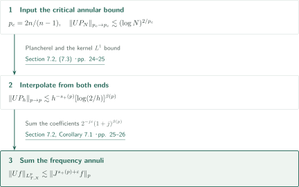
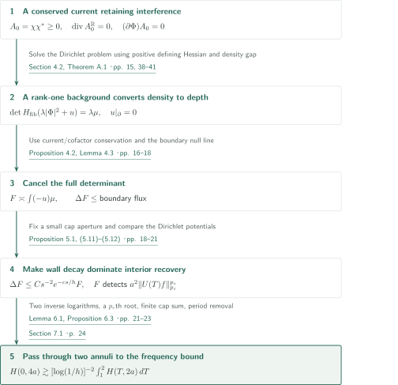
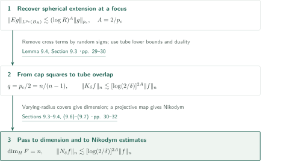
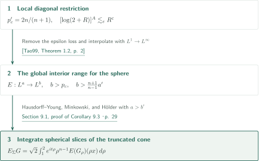
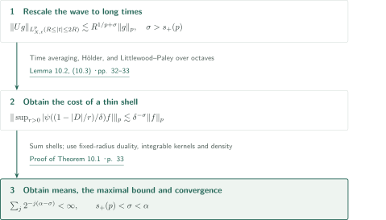
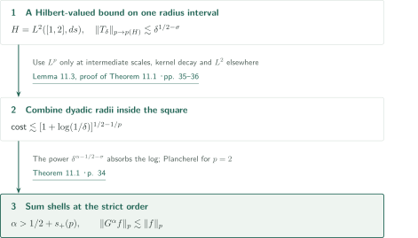
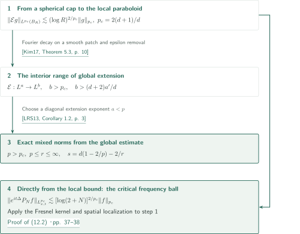

# Local smoothing for the Euclidean wave equation

**A determinant energy for a conserved current: from the critical logarithm to restriction and maximal estimates**

The manuscript claims an annular logarithmic estimate at $p_c=2n/(n-1)$ for the Euclidean half wave in every spatial dimension $n\ge2$. Its central construction retains the interference in a superposition of waves, builds a positive conserved current, and uses its time component as the density of a quaternionic Hessian Dirichlet problem. This article explains the manuscript's claims and reductions; it is not an independent verification of the complete proof.

## 1. Main results

Put $U(T)=e^{-iT|D|}$, $I=[1,2]$, $J=(1-\Delta)^{1/2}$ and $s_+(p)=\max\{0,(n-1)/2-n/p\}$. Wave data are complex Schwartz functions, with extensions by density in the indicated spatial norms. Constants depend on the displayed dimensions, exponents, fixed cutoffs and time intervals, but not on the data or the large frequency parameter.

### Theorem 1.1 — Wave local smoothing

For $n\ge2$, $2\le p<\infty$ and $\varepsilon>0$,

$$
\|U(T)f\|_{L^p(\mathbb R^n\times I)}\le C_{n,p,\varepsilon}\|J^{s_+(p)+\varepsilon}f\|_{L^p(\mathbb R^n)}.
$$

At $p=2$ one may take $\varepsilon=0$. For $p\ge p_c$ this gains every amount strictly below $1/p$ over the fixed-time order $(n-1)(1/2-1/p)$; for $2<p<p_c$ any positive regularity suffices. This theorem does not assert the lossless Sobolev endpoint for $p>2$.

<!-- cite:main-wave -->[Theorem 1.1 · p. 1](https://github.com/openai/math/blob/7ef5c0cc5ca4b0e072b7a050fca09ab24bc6fa3a/preprints/Local-smoothing-for-the-Euclidean-wave-equation-October-25-2026/paper.pdf)<!-- /cite -->

### Theorem 1.2 — The critical annular logarithm

For $n\ge2$, $p=p_c$, $\varphi\in C_c^\infty(\mathbb R^n\setminus\{0\})$, $N\ge2$ and $P_N=\varphi(D/N)$,

$$
\|U(T)P_Nf\|_{L^p(\mathbb R^n\times I)}\le C_{n,\varphi}[\log(2+N)]^{2/p}\|f\|_{L^p(\mathbb R^n)}.
$$

This is not an $L^{p_c}\to L^{p_c}_{T,X}$ bound uniform over all frequencies. The focusing example in Proposition 8.1 requires logarithmic power at least $1/p_c$, leaving a gap to the upper power $2/p_c$ for unrestricted data. Proposition 8.2 asserts that Sobolev order zero fails for $2<p\le p_c$ even in the weak spacetime norm.

<!-- cite:main-annulus -->[Theorem 1.2 · p. 4](https://github.com/openai/math/blob/7ef5c0cc5ca4b0e072b7a050fca09ab24bc6fa3a/preprints/Local-smoothing-for-the-Euclidean-wave-equation-October-25-2026/paper.pdf)<!-- /cite -->
<!-- cite:obstructions -->[Propositions 8.1–8.2 · pp. 26–27](https://github.com/openai/math/blob/7ef5c0cc5ca4b0e072b7a050fca09ab24bc6fa3a/preprints/Local-smoothing-for-the-Euclidean-wave-equation-October-25-2026/paper.pdf)<!-- /cite -->

### Corollary 9.1 — Local spherical extension and the Kakeya maximal function

Let $Eg(X)=\int_{S^{n-1}}e^{iX\cdot\omega}g(\omega)\,d\sigma(\omega)$, and let $K_\delta f(\omega)$ be the supremum of the averages of $|f|$ over all translates of a length-one, radius-$\delta$ tube in direction $\omega$. For $n\ge2$, $R\ge2$, $z\in\mathbb R^n$ and $0<\delta\le1$,

$$
\|Eg\|_{L^{p_c}(B(z,R))}\le C_n[\log(2+R)]^{2/p_c}\|g\|_{L^{p_c}(S^{n-1})},
$$

$$
\|K_\delta f\|_{L^n(S^{n-1})}\le C_n[\log(2/\delta)]^{4/p_c}\|f\|_{L^n(\mathbb R^n)}.
$$

Every subset containing a unit line segment in every direction has Hausdorff dimension $n$. The maximal estimate and the dimension assertion are distinct conclusions: the latter requires a covering argument with varying radii.

<!-- cite:main-kakeya -->[Corollary 9.1 · p. 27](https://github.com/openai/math/blob/7ef5c0cc5ca4b0e072b7a050fca09ab24bc6fa3a/preprints/Local-smoothing-for-the-Euclidean-wave-equation-October-25-2026/paper.pdf)<!-- /cite -->

### Corollary 9.3 — Global extension for the sphere and truncated cone

Let $1<a\le\infty$, $b<\infty$, with $a'$ the conjugate exponent, and assume

$$
b>\frac{2n}{n-1},\qquad b>\frac{n+1}{n-1}a'.
$$

For spherical extension $E$ and extension $E_\Sigma$ from the induced surface measure on $\Sigma=\{(\rho\omega,\rho):1\le\rho\le2,\ \omega\in S^{n-1}\}\subset\mathbb R^{n+1}$,

$$
\|Eg\|_{L^b(\mathbb R^n)}\lesssim_{n,a,b}\|g\|_{L^a(S^{n-1})},\qquad
\|E_\Sigma G\|_{L^b(\mathbb R^{n+1})}\lesssim_{n,a,b}\|G\|_{L^a(\Sigma)}.
$$

These are strong estimates, including $a=\infty$. For $b=\infty$, both hold for every $1\le a\le\infty$. The boundaries of the two strict inequalities for finite $b$ are excluded.

<!-- cite:main-restriction -->[Corollary 9.3 · pp. 28–29](https://github.com/openai/math/blob/7ef5c0cc5ca4b0e072b7a050fca09ab24bc6fa3a/preprints/Local-smoothing-for-the-Euclidean-wave-equation-October-25-2026/paper.pdf)<!-- /cite -->

### Theorem 10.1 — Bochner–Riesz means, the maximal function and convergence

Put $B_r^\alpha=(1-|D|^2/r^2)_+^\alpha$, $B_*^\alpha f=\sup_{r>0}|B_r^\alpha f|$ and $\delta(p)=\max\{0,n|1/p-1/2|-1/2\}$. If $n\ge2$, $1\le p\le\infty$ and $\alpha>\delta(p)$, then

$$
\sup_{r>0}\|B_r^\alpha f\|_p\le C_{n,p,\alpha}\|f\|_p.
$$

For $p<\infty$, $B_r^\alpha f\to f$ in $L^p$ as $r\to\infty$. Moreover, for $2\le p<\infty$ and $\alpha>s_+(p)$,

$$
\|B_*^\alpha f\|_p\le C_{n,p,\alpha}\|f\|_p,
$$

and $B_r^\alpha f\to f$ almost everywhere. The fixed-radius range $1\le p<2$ is not asserted for the maximal operator.

<!-- cite:main-br -->[Theorem 10.1 · p. 32](https://github.com/openai/math/blob/7ef5c0cc5ca4b0e072b7a050fca09ab24bc6fa3a/preprints/Local-smoothing-for-the-Euclidean-wave-equation-October-25-2026/paper.pdf)<!-- /cite -->

### Theorem 11.1 — Stein's square function

$$
G^\alpha f(x)=\left(\int_0^\infty|r\partial_r B_r^\alpha f(x)|^2\frac{dr}{r}\right)^{1/2}.
$$

For $n\ge2$, $2\le p<\infty$ and $\alpha>\max\{1/2,n(1/2-1/p)\}=1/2+s_+(p)$, one has $\|G^\alpha f\|_p\le C_{n,p,\alpha}\|f\|_p$. The assertion includes extension from Schwartz data to $L^p$.

<!-- cite:main-square -->[Theorem 11.1 · p. 34](https://github.com/openai/math/blob/7ef5c0cc5ca4b0e072b7a050fca09ab24bc6fa3a/preprints/Local-smoothing-for-the-Euclidean-wave-equation-October-25-2026/paper.pdf)<!-- /cite -->

### Corollary 12.1 — The compact paraboloid and Schrödinger local smoothing

In this result write $d\ge1$ for spatial dimension, $p_c=2(d+1)/d$, $B^d$ for the unit ball, and $\mathcal Eg(x,t)=\int_{B^d}e^{i(x\cdot v+t|v|^2)}g(v)\,dv$.

If $1<a\le\infty$, $p_c<b<\infty$ and $b>(d+2)a'/d$, then

$$
\|\mathcal Eg\|_{L^b(\mathbb R^{d+1})}\lesssim_{d,a,b}\|g\|_{L^a(B^d)}.
$$

For a compact time interval $I\subset\mathbb R$, $N\ge2$ and Schwartz $f$ with $\operatorname{supp}\widehat f\subset B(0,N)$,

$$
\|e^{it\Delta}f\|_{L^{p_c}(\mathbb R^d\times I)}\lesssim_{d,I}[\log(2+N)]^{2/p_c}\|f\|_{p_c}.
$$

For $p_c<p<\infty$, $p\le r\le\infty$ and arbitrary Schwartz data, setting $s=d(1-2/p)-2/r$ gives

$$
\|e^{it\Delta}f\|_{L^p(\mathbb R^d;L^r(I))}\lesssim_{d,p,r,I}\|f\|_{B^s_{p,p}(\mathbb R^d)}\lesssim_{d,p,s}\|(1-\Delta)^{s/2}f\|_p.
$$

Thus $r=p$ gives the exact spacetime Sobolev order $d-2(d+1)/p$, and $r=\infty$ gives the maximal estimate on the same finite time interval. This does not include a logarithm-free estimate at $p=p_c$.

<!-- cite:main-schrodinger -->[Corollary 12.1 · p. 37](https://github.com/openai/math/blob/7ef5c0cc5ca4b0e072b7a050fca09ab24bc6fa3a/preprints/Local-smoothing-for-the-Euclidean-wave-equation-October-25-2026/paper.pdf)<!-- /cite -->

## References on the arrows

<!-- reference-guide -->
Unprefixed theorem, lemma, section and equation numbers refer to [Local smoothing for the Euclidean wave equation](https://github.com/openai/math/blob/7ef5c0cc5ca4b0e072b7a050fca09ab24bc6fa3a/preprints/Local-smoothing-for-the-Euclidean-wave-equation-October-25-2026/paper.pdf). External inputs use the following keys.

- [Tao99](https://www.math.ucla.edu/~tao/preprints/restriction.dvi) Terence Tao — *The Bochner-Riesz conjecture implies the restriction conjecture*: Epsilon removal from local spherical restriction to global estimates. Author-hosted undated preprint; accessed October 28, 2026 (DVI converted to PDF).
- [Kim17](https://arxiv.org/pdf/1702.01231v2) Jongchon Kim — *Some remarks on Fourier restriction estimates*: Epsilon removal on compact hypersurfaces with Fourier decay. arXiv:1702.01231v2, February 9, 2017.
- [LRS13](https://arxiv.org/pdf/1108.1518v2) Sanghyuk Lee, Keith M. Rogers, Andreas Seeger — *On space-time estimates for the Schrödinger operator*: Diagonal extension implies mixed-norm bounds at the exact Besov order. arXiv:1108.1518v2, March 19, 2012; published 2013.
- [GT01](https://doi.org/10.1007/978-3-642-61798-0) David Gilbarg, Neil S. Trudinger — *Elliptic Partial Differential Equations of Second Order*: Direct input for periodic-fiber Dirichlet invertibility and boundary/interior regularity. Theorems 6.14 (printed p. 107), 6.19 (p. 111), 17.14 (p. 461), 17.26′ (p. 481), and structural conditions (p. 456) were independently checked after the draft; the external proofs were not verified. Classics in Mathematics, Springer, 2001; reprint of the 1998 edition (bibliography [31] of the manuscript).

Each citation gives the result and pages. When printed pagination differs from the PDF position, both are shown. GitHub previews do not automatically jump to the cited page.
<!-- /reference-guide -->

## 2. Theorem 1.1 — From the critical annulus to all exponents

<!-- proof-target:1 -->Proof target：[Theorem 1.1 · p. 1](https://github.com/openai/math/blob/7ef5c0cc5ca4b0e072b7a050fca09ab24bc6fa3a/preprints/Local-smoothing-for-the-Euclidean-wave-equation-October-25-2026/paper.pdf)<!-- /proof-target -->

**Proof route.** First obtain Theorem 1.2, interpolate on either side with $L^2$ conservation and the fixed-time $L^\infty$ kernel estimate, and spend $\varepsilon$ on the frequency sum. The next section explains the critical estimate itself.

### 1. Interpolation at the two ends

With $h=N^{-1}$, Plancherel gives a uniform $L^2_X\to L^2_{T,X}$ bound, while $L^\infty_X\to L^\infty_{T,X}$ costs $O(h^{-(n-1)/2})$. For the latter, split into caps of width $h^{1/2}$ and remove the linear phase; each remaining kernel has uniformly bounded $L^1$ norm. Riesz–Thorin yields

$$
\|UP_hf\|_{L^p_{T,X}}\lesssim h^{-s_+(p)}[\log(2/h)]^{\beta(p)}\|f\|_p,\quad
\beta(p)=\min\{(n-1)(1-2/p),2/p\}.
$$

<!-- cite:interpolation -->[Section 7.2, (7.3) · pp. 24–25](https://github.com/openai/math/blob/7ef5c0cc5ca4b0e072b7a050fca09ab24bc6fa3a/preprints/Local-smoothing-for-the-Euclidean-wave-equation-October-25-2026/paper.pdf)<!-- /cite -->

### 2. Spending the positive loss on summation

For $g=J^{s_+(p)+\varepsilon}f$, the coefficient on the $j$th annulus is $2^{-j\varepsilon}(1+j)^{\beta(p)}$, an absolutely summable sequence. Mihlin handles low frequencies; Plancherel directly gives the lossless $p=2$ case. Corollary 7.1 refines this sum to logarithmic Sobolev bounds with $B>\beta(p)+1/2-1/p$ (or equality with an additional iterated-logarithm condition), but does not generally give $B=C=0$.

<!-- cite:sobolev-sum -->[Section 7.2, Corollary 7.1 · pp. 25–26](https://github.com/openai/math/blob/7ef5c0cc5ca4b0e072b7a050fca09ab24bc6fa3a/preprints/Local-smoothing-for-the-Euclidean-wave-equation-October-25-2026/paper.pdf)<!-- /cite -->

## 3. Theorem 1.2 — The conserved current and two annular comparisons

<!-- proof-target:2 -->Proof target：[Theorem 1.2 · p. 4](https://github.com/openai/math/blob/7ef5c0cc5ca4b0e072b7a050fca09ab24bc6fa3a/preprints/Local-smoothing-for-the-Euclidean-wave-equation-October-25-2026/paper.pdf)<!-- /proof-target -->

**Proof route.** Lift a cap-localized wave on a fixed torus to a conserved current. A determinant equation on spatial fibers produces an energy detecting the $p_c$th power. Gaussian decay at the wall yields a nonnegative scalar supersolution; two annular comparisons then give the logarithm, after which the spatial period is removed.

### 1. Preserving interference and producing the critical power

Two auxiliary flows of a symmetric first-order system produce $A_0=\chi\chi^*$. The vector $\chi$ is formed by **summing** the Gaussian-weighted waves before taking the square. Every real column is divergence free, and $(\partial\Phi)A_0=0$. For frequency $N=h^{-1}$ in a fixed small cap, the time component recovers the wave when the auxiliary radius is comparable to $h$.

The fiber defining function satisfies $H_{\rm fib}(r)>0$. The null line of the full $H(r)$ is orthogonal both to the boundary normal and to the image of $H(|\Phi|^2)$. Smooth and cut off the current, then add a small cofactor current to obtain $\mu=A_{TT}>0$. For $B_0=\lambda|\Phi|^2$, $\lambda=h^{-30n}$, solve

$$
\det H_{\rm fib}(B_0+u)=\lambda\mu,\qquad u|_{\partial\Omega_z}=0,\qquad H_{\rm fib}(B_0+u)>0.
$$

The positive defining Hessian and density gap satisfy Theorem A.1. The spatial background has rank one, so $\det(B_{\rm fib}+\alpha I)=(\beta+\alpha)\alpha^{n-1}$ with $\beta\asymp\lambda$. A density lower bound $m$ on a small ball forces $-u\gtrsim h^2m^{1/(n-1)}$; consequently $(-u)\mu$ detects $m^{n/(n-1)}$, hence the wave's $2n/(n-1)$ power.

<!-- cite:current -->[Proposition 2.2, (2.15), Lemma 4.1 · pp. 9–10, 14](https://github.com/openai/math/blob/7ef5c0cc5ca4b0e072b7a050fca09ab24bc6fa3a/preprints/Local-smoothing-for-the-Euclidean-wave-equation-October-25-2026/paper.pdf)<!-- /cite -->
<!-- cite:dirichlet -->[Section 4.2, Theorem A.1 · pp. 15, 38–41](https://github.com/openai/math/blob/7ef5c0cc5ca4b0e072b7a050fca09ab24bc6fa3a/preprints/Local-smoothing-for-the-Euclidean-wave-equation-October-25-2026/paper.pdf)<!-- /cite -->

### 2. Cancelling the indefinite determinant, retaining only boundary flux

The Laplacian of $X_0=\int_{\Omega_z}(-u)\mu$ contains a full determinant of uncontrolled sign. Correct it by

$$
F=X_0+\lambda^{-1}\int_{\Omega_z}u\int_0^1\det H_{\rm fib}(B_0+\theta u)\,d\theta.
$$

Integration by parts with the two conservation laws, for the current and the Hessian cofactor, cancels that determinant. The null line makes the cofactor's normal–normal coefficient vanish, including on the moving boundary. Proposition 4.2 identifies $\Delta F+\int A:\Sigma$ with the wave's boundary flux, with $A,\Sigma\ge0$. Lemma 4.3 gives

$$
\frac{n-1}{n+1}X_0\le F\le\frac n{n+1}X_0,
$$

so the correction retains the required quantity.

<!-- cite:balance -->[Proposition 4.2, Lemma 4.3 · pp. 16–18](https://github.com/openai/math/blob/7ef5c0cc5ca4b0e072b7a050fca09ab24bc6fa3a/preprints/Local-smoothing-for-the-Euclidean-wave-equation-October-25-2026/paper.pdf)<!-- /cite -->

### 3. Comparing decay at the wall with recovery in the interior

Write $z=(T,\tau)\in\mathbb R\times\mathbb R^2$ and $a=Kh$. The flux-carrying wall stays a fixed angular distance from the cap, giving Gaussian decay $e^{-c_0|\tau|/h}$. Inverting the interior multiplier costs $e^{C\gamma^2|\tau|/h}$. Choose the aperture $\gamma$ small first, then the fixed $K$ large, so the wall decay dominates. The comparison function and small-ball determinant comparison yield Proposition 5.1:

$$
F(0,\tau)\lesssim a^2\|f\|_{p_c}^{p_c}\ (|\tau|=4a),\qquad
F(T,\tau)\gtrsim a^2\|U(T)f\|_{p_c}^{p_c}\ (|\tau|=2a),
$$

$$
\Delta_{T,\tau}F\le V(|\tau|)F,\qquad V(s)=Cs^{-2}e^{-cs/h}.
$$

The comparison uses a density lower bound throughout the small ball and the ceiling $\mu^{1/(n-1)}\le\lambda$.

<!-- cite:fiber-estimate -->[Proposition 5.1, (5.11)–(5.12) · pp. 18–21](https://github.com/openai/math/blob/7ef5c0cc5ca4b0e072b7a050fca09ab24bc6fa3a/preprints/Local-smoothing-for-the-Euclidean-wave-equation-October-25-2026/paper.pdf)<!-- /cite -->

### 4. Accounting for both logarithms and removing the period

Let $H(T,s)$ be the circular mean of $F$ at $|\tau|=s$. Lemma 6.1 with $b=2a$, $r=2b$ gives

$$
H(0,2b)\gtrsim[\log(3/b)]^{-2}\int_1^2H(T,b)\,dT.
$$

The steps are an outward annular comparison, a mean inequality at fixed radius, and an inward comparison. A radial planar harmonic function is affine in $\log s$, so each passage costs one inverse logarithm. Exponential decay uniformly bounds the weighted integral of the positive potential. Cancel the factors $a^2$ and take $p_c$th roots to obtain Proposition 6.3. Sum a fixed finite family of caps. Outside $|X|\ge3$, nonstationary phase bounds the wave kernel by $O(h^M(1+|X|)^{-M})$. Local periodization on unit cubes and bounded overlap then transfer the estimate to $\mathbb R^n$.

<!-- cite:propagation -->[Lemma 6.1, Proposition 6.3 · pp. 21–23](https://github.com/openai/math/blob/7ef5c0cc5ca4b0e072b7a050fca09ab24bc6fa3a/preprints/Local-smoothing-for-the-Euclidean-wave-equation-October-25-2026/paper.pdf)<!-- /cite -->
<!-- cite:period-removal -->[Section 7.1 · p. 24](https://github.com/openai/math/blob/7ef5c0cc5ca4b0e072b7a050fca09ab24bc6fa3a/preprints/Local-smoothing-for-the-Euclidean-wave-equation-October-25-2026/paper.pdf)<!-- /cite -->

## 4. Corollary 9.1 — From focusing to tubes and Hausdorff dimension

<!-- proof-target:3 -->Proof target：[Corollary 9.1 · p. 27](https://github.com/openai/math/blob/7ef5c0cc5ca4b0e072b7a050fca09ab24bc6fa3a/preprints/Local-smoothing-for-the-Euclidean-wave-equation-October-25-2026/paper.pdf)<!-- /proof-target -->

**Proof route.** Keep the wave logarithmic power as $A$. Local spherical extension retains $A$, whereas tube overlap and the Kakeya maximal operator carry $2A$. Here $A=2/p_c$.

### 1. Recovering local extension near a focus

The time average $M_Nf=\int\psi(T)e^{iNT}U(T)\chi(|D|/N)f\,dT$ selects a frequency shell of width one. Its leading kernel is $cN^{(n-1)/2}|Z|^{-(n-1)/2}e^{iN|Z|}\psi(|Z|)$. Insert $f_N(r\omega)=e^{-iNr}\psi(r)g(\omega)$ and linearize the distance phase at $X/N$ near the focus. Taking $N$ to be a sufficiently large fixed power of $R$ bounds the error, while $n/p_c=(n-1)/2$ cancels the scaling factor. Only $\log N\asymp\log R$ remains.

<!-- cite:local-extension -->[Lemma 9.2 · p. 28](https://github.com/openai/math/blob/7ef5c0cc5ca4b0e072b7a050fca09ab24bc6fa3a/preprints/Local-smoothing-for-the-Euclidean-wave-equation-October-25-2026/paper.pdf)<!-- /cite -->

### 2. Randomizing caps and dualizing the maximal function

Modulated disjoint $\delta$-caps have extension bounded below on tubes of length $\delta^{-2}$ and width $\delta^{-1}$. Independent signs turn the expected square into the sum of the squared cap extensions, which bounds a weighted sum of tube indicators from below. Combining this with local extension gives Lemma 9.4's overlap estimate at $q=p_c/2=n/(n-1)$. Grouping tube centers into cubes keeps the constant uniform for arbitrary locations. A $\delta$-net of directions, $L^n$–$L^q$ duality and the supremum over centers give the Kakeya maximal estimate.

<!-- cite:tubes -->[Lemma 9.4, Section 9.3 · pp. 29–30](https://github.com/openai/math/blob/7ef5c0cc5ca4b0e072b7a050fca09ab24bc6fa3a/preprints/Local-smoothing-for-the-Euclidean-wave-equation-October-25-2026/paper.pdf)<!-- /cite -->

### 3. Varying-radius covers and the projective Nikodym argument

A single scale only gives $|F_\delta|\gtrsim[\log(1/\delta)]^{-2(n-1)}$. Hausdorff dimension requires grouping a cover by balls of different radii. Section 9.3 obtains infinite Hausdorff measure for the gauge $r^n[\log(1/r)]^{2(n-1)}[\log\log(1/r)]^\gamma$, $\gamma>n-1$, hence full dimension.

In Section 9.4, $N_\delta f(x)$ is the supremum of tube averages over unit segments through $x$, and

$$
\|N_\delta f\|_{L^n(\mathbb R^n)}\lesssim_n[\log(2/\delta)]^{4/p_c}\|f\|_{L^n(\mathbb R^n)}.
$$

A projective map sends portions a fixed distance from the base point into tubes whose direction records that base point; its Jacobian is locally bounded above and below. Pieces near the base point are summed by dyadic distance $s$ with weight $O(s)$. The same covering argument gives dimension $n$ for a Borel set meeting a suitable unit segment through every point of a positive-measure set in uniformly positive length. No converse implication from dimension alone to a maximal estimate is asserted.

<!-- cite:dimension-nikodym -->[Sections 9.3–9.4, (9.6)–(9.7) · pp. 30–32](https://github.com/openai/math/blob/7ef5c0cc5ca4b0e072b7a050fca09ab24bc6fa3a/preprints/Local-smoothing-for-the-Euclidean-wave-equation-October-25-2026/paper.pdf)<!-- /cite -->

## 5. Corollary 9.3 — Epsilon removal and cone slices

<!-- proof-target:4 -->Proof target：[Corollary 9.3 · pp. 28–29](https://github.com/openai/math/blob/7ef5c0cc5ca4b0e072b7a050fca09ab24bc6fa3a/preprints/Local-smoothing-for-the-Euclidean-wave-equation-October-25-2026/paper.pdf)<!-- /proof-target -->

**Proof route.** Turn the local diagonal spherical bound into a global estimate at strictly larger output exponents, interpolate to the interior range, then integrate spherical slices of the cone.

### 1. Removing the loss and interpolating exponents

The inequality $[\log(2+R)]^A\lesssim_\varepsilon R^\varepsilon$ and duality give local $L^{p_c'}\to L^{p_c'}$ restriction. Since $1<p_c'<2$, [Tao99] applies. Duality gives $E:L^s\to L^s$ for every $s>p_c$. When $a\ge b$, use the finite measure of the sphere. When $a<b$, set $s=1+b/a'$ and interpolate with $L^1\to L^\infty$; the hypothesis $b>(n+1)a'/(n-1)$ guarantees $s>p_c$.

<!-- cite:epsilon-removal -->[Section 9.1, proof of Corollary 9.3 · p. 29](https://github.com/openai/math/blob/7ef5c0cc5ca4b0e072b7a050fca09ab24bc6fa3a/preprints/Local-smoothing-for-the-Euclidean-wave-equation-October-25-2026/paper.pdf)<!-- /cite -->
<!-- cite:tao-removal -->[&#91;Tao99, Theorem 1.2, p. 2&#93;](https://www.math.ucla.edu/~tao/preprints/restriction.dvi)<!-- /cite -->

### 2. Integrating the cone slices

For $G_\rho(\omega)=G(\rho\omega,\rho)$,
$E_\Sigma G=\sqrt2\int_1^2e^{it\rho}\rho^{n-1}E(G_\rho)(\rho x)\,d\rho$.
Apply Hausdorff–Young in time, Minkowski using $b\ge b'$, and spatial dilation. The final $L^{b'}_\rho$ norm is controlled by $L^a_\rho$ because $a>b'$, which follows from the stated hypotheses. For $b=\infty$, Hölder directly bounds the defining integrals on both compact surfaces.

<!-- cite:epsilon-removal -->[Section 9.1, proof of Corollary 9.3 · p. 29](https://github.com/openai/math/blob/7ef5c0cc5ca4b0e072b7a050fca09ab24bc6fa3a/preprints/Local-smoothing-for-the-Euclidean-wave-equation-October-25-2026/paper.pdf)<!-- /cite -->

## 6. Theorem 10.1 — Summing thin-shell maximal estimates

<!-- proof-target:5 -->Proof target：[Theorem 10.1 · p. 32](https://github.com/openai/math/blob/7ef5c0cc5ca4b0e072b7a050fca09ab24bc6fa3a/preprints/Local-smoothing-for-the-Euclidean-wave-equation-October-25-2026/paper.pdf)<!-- /proof-target -->

**Proof route.** Rescale to unit frequency and long wave times, express a shell as a time average, and sum shell thicknesses. Duality and density then supply the remaining conclusions.

### 1. The time average costs an inverse power of shell thickness

For $\sigma>s_+(p)$, $2\le p<\infty$ and $g$ in a fixed frequency annulus,
$\|U(t)g\|_{L^p(\mathbb R^n\times\{R\le|t|\le2R\})}\lesssim R^{1/p+\sigma}\|g\|_p$.
Fourier inversion writes $A_{\delta,r}=\psi((1-|D|/r)/\delta)$ as $\delta r\int e^{itr}\widehat\psi(\delta rt)U(t)g\,dt/(2\pi)$. Time Hölder and the long-time estimate bound the supremum on $r\in[1,2]$ by $O(\delta^{-\sigma})$. Dyadic radius octaves and Littlewood–Paley for $p\ge2$ give the supremum over all radii.

<!-- cite:shell-maximal -->[Lemma 10.2, (10.3) · pp. 32–33](https://github.com/openai/math/blob/7ef5c0cc5ca4b0e072b7a050fca09ab24bc6fa3a/preprints/Local-smoothing-for-the-Euclidean-wave-equation-October-25-2026/paper.pdf)<!-- /cite -->

### 2. Strict order and three extensions

Choose $s_+(p)<\sigma<\alpha$. Splitting the multiplier near its boundary into shells of thickness $\delta=2^{-j}$ costs $\sum_j\delta^{\alpha-\sigma}$; the smooth remainder is controlled by the Hardy–Littlewood maximal function. This proves the maximal bound and the fixed-radius bound for $p\ge2$. Self-adjointness gives the latter for $1<p<2$; the integrable Bessel kernel gives $p=1,\infty$. Convergence for Schwartz functions with compact Fourier support and density give $L^p$ convergence. In the maximal range $2\le p<\infty$, almost-everywhere approximation uniform in $r$ gives pointwise convergence.

<!-- cite:br-proof -->[Proof of Theorem 10.1 · p. 33](https://github.com/openai/math/blob/7ef5c0cc5ca4b0e072b7a050fca09ab24bc6fa3a/preprints/Local-smoothing-for-the-Euclidean-wave-equation-October-25-2026/paper.pdf)<!-- /cite -->

## 7. Theorem 11.1 — Combining radii inside the square norm

<!-- proof-target:6 -->Proof target：[Theorem 11.1 · p. 34](https://github.com/openai/math/blob/7ef5c0cc5ca4b0e072b7a050fca09ab24bc6fa3a/preprints/Local-smoothing-for-the-Euclidean-wave-equation-October-25-2026/paper.pdf)<!-- /proof-target -->

**Proof route.** Recover $\delta^{1/2}$ on one radius interval, then use a Hilbert-valued estimate to combine all dyadic intervals inside the square norm.

### 1. Three powers: differentiation, the square norm and smoothing

On a shell of thickness $\delta$, radial differentiation costs $\delta^{\alpha-1}$, the square integral restores $\delta^{1/2}$, and the wave costs $\delta^{-\sigma}$. Lemma 11.2 combines Plancherel in the radius variable with the long-time wave estimate. For $H=L^2([1,2],ds)$, the shell operator has $L^p\to L^p(H)$ norm $O(\delta^{1/2-\sigma})$ and $L^2\to L^2(H)$ norm $O(\delta^{1/2})$.

<!-- cite:shell-square -->[Lemma 11.2 · p. 34](https://github.com/openai/math/blob/7ef5c0cc5ca4b0e072b7a050fca09ab24bc6fa3a/preprints/Local-smoothing-for-the-Euclidean-wave-equation-October-25-2026/paper.pdf)<!-- /cite -->

### 2. Combining different scales inside the square

Lemma 11.3 combines dilates under decay bounds for a Hilbert-valued kernel and its first derivative. On a test cube, only $O(1+\log(1/\delta))$ intermediate scales use the $L^p$ bound; Hölder costs $[1+\log(1/\delta)]^{1/2-1/p}$. Distant scales use a kernel derivative or $L^2$. Choosing $\sigma<\alpha-1/2$ leaves $\delta^{\alpha-1/2-\sigma}$, absorbing this logarithm. The multiplier away from the boundary vanishes quadratically at zero, giving another summable series. For $p=2$, directly $\|G^\alpha f\|_2^2=\alpha(2\alpha-1)^{-1}\|f\|_2^2$. Fatou and monotone convergence pass from finite sums to the full operator, and density extends the linear map into $L^p_x(L^2(dr/r))$.

<!-- cite:combine-square -->[Lemma 11.3, proof of Theorem 11.1 · pp. 35–36](https://github.com/openai/math/blob/7ef5c0cc5ca4b0e072b7a050fca09ab24bc6fa3a/preprints/Local-smoothing-for-the-Euclidean-wave-equation-October-25-2026/paper.pdf)<!-- /cite -->

## 8. Corollary 12.1 — The paraboloid limit and the Fresnel transform

<!-- proof-target:7 -->Proof target：[Corollary 12.1 · p. 37](https://github.com/openai/math/blob/7ef5c0cc5ca4b0e072b7a050fca09ab24bc6fa3a/preprints/Local-smoothing-for-the-Euclidean-wave-equation-October-25-2026/paper.pdf)<!-- /proof-target -->

**Proof route.** Rescale a spherical cap in dimension $n=d+1$ to the paraboloid while retaining the critical local logarithm. Distinguish three exits: epsilon removal, the Fresnel kernel, and an external mixed-norm theorem.

### 1. The interior range of paraboloid extension

Parametrize the cap by $(\delta v,\sqrt{1-\delta^2|v|^2})$ and rescale physical variables to $(x/\delta,-2t/\delta^2)$. The new phase is $q_\delta(v)=2(1-\sqrt{1-\delta^2|v|^2})/\delta^2=|v|^2+O(\delta^2)$. At $p_c=2(d+1)/d$, the Jacobian and input powers cancel. Taking $\delta$ to be a fixed negative power of $R$ preserves $[\log(2+R)]^{2/p_c}$ in the local estimate (12.4). For [Kim17]'s compact-surface epsilon removal, stationary phase gives Fourier decay of a smooth density on a slightly larger patch. Duality and interpolation then give the interior range in (12.1).

<!-- cite:paraboloid-proof -->[Proof of Corollary 12.1, (12.4) · pp. 36–37](https://github.com/openai/math/blob/7ef5c0cc5ca4b0e072b7a050fca09ab24bc6fa3a/preprints/Local-smoothing-for-the-Euclidean-wave-equation-October-25-2026/paper.pdf)<!-- /cite -->
<!-- cite:kim-removal -->[&#91;Kim17, Theorem 5.3, p. 10&#93;](https://arxiv.org/pdf/1702.01231v2#page=10)<!-- /cite -->

### 2. The critical Schrödinger estimate retains a logarithm on a frequency ball

Localize frequency-ball data to spatial cubes of side $N$. Treat distant input by nonstationary phase for $S(t)P_N$. For the nearby input $h=f1_{30Q}$, the Fresnel kernel expresses the wave through $\mathcal E[g](-\lambda x/(2t),\lambda^2/(4t))$, where $g(v)=h(\lambda v)$ and $\lambda\asymp N$. Keep the multiplier outside, as $P_NS(t)h$, because the spatial truncation creates high frequencies. On $t\in[1/2,1]$, the Jacobian and input norm leave $\lambda^{d-(2d+2)/p_c}=1$, so only the logarithm in (12.4) remains. Bounded overlap of cubes, dyadic time intervals and conjugation give any compact $I$.

<!-- cite:fresnel-proof -->[Proof of (12.2) · pp. 37–38](https://github.com/openai/math/blob/7ef5c0cc5ca4b0e072b7a050fca09ab24bc6fa3a/preprints/Local-smoothing-for-the-Euclidean-wave-equation-October-25-2026/paper.pdf)<!-- /cite -->

### 3. Exact mixed-norm order strictly above the critical exponent

Choose $p_c<a<p$. Equation (12.1) gives $\mathcal E:L^a\to L^a$. Apply [LRS13, Corollary 1.2] with $p_0=q_0=a$ and both spatial exponents equal to $p$. This gives $B^s_{p,p}\to L^p_xL^r_t$ at exactly $s=d(1-2/p)-2/r$ for $p\le r\le\infty$. Littlewood–Paley and $\ell^p\le\ell^2$ for $p>2$ give the Sobolev input bound. The room to choose $a<p$ distinguishes this conclusion from the critical logarithmic estimate.

<!-- cite:mixed-proof -->[Proof of (12.3) · p. 38](https://github.com/openai/math/blob/7ef5c0cc5ca4b0e072b7a050fca09ab24bc6fa3a/preprints/Local-smoothing-for-the-Euclidean-wave-equation-October-25-2026/paper.pdf)<!-- /cite -->
<!-- cite:lrs-mixed -->[&#91;LRS13, Corollary 1.2, p. 3&#93;](https://arxiv.org/pdf/1108.1518v2#page=3)<!-- /cite -->

## 9. Which papers supply which steps

| Source and result | Used at | Role and required hypotheses | Checking scope |
|---|---|---|---|
| Tao's epsilon-removal theorem | Corollary 9.3, p. 29 | Local spherical restriction at $1<p_c'<2$ gives global restriction at smaller input exponents | Theorem 1.2, p. 2 of the author's DVI and its application checked; the full external proof not verified |
| Kim's compact-surface form | Corollary 12.1, p. 37 | A smooth compact patch with Fourier decay, $1\le p\le q\le2$, and arbitrarily small local losses | arXiv v2 Theorem 5.3, p. 10 and the application checked |
| Lee–Rogers–Seeger's mixed-norm consequence | (12.3), p. 38 | Diagonal extension at $a<p$, $p\le r\le\infty$, exact Besov order | arXiv v2 Corollary 1.2, p. 3 and the exponent substitution checked |
| Gilbarg–Trudinger [GT01], elliptic regularity | Theorem A.1, pp. 39–41 | Theorems 6.14 (printed p. 107)/6.19 (p. 111) give linear Dirichlet invertibility and higher regularity. Theorems 17.14 (p. 461)/17.26′ (p. 481) give interior/boundary $C^{2,\alpha}$ bounds from uniform ellipticity and concavity on the solution Hessian range (p. 456) | An independent reviewer checked the printed statements, application hypotheses, and finite-chart reduction on periodic fibers after the draft. This is not a reproof of GT or all boundary calculations |

<!-- cite:tao-removal -->[&#91;Tao99, Theorem 1.2, p. 2&#93;](https://www.math.ucla.edu/~tao/preprints/restriction.dvi)<!-- /cite -->
<!-- cite:kim-removal -->[&#91;Kim17, Theorem 5.3, p. 10&#93;](https://arxiv.org/pdf/1702.01231v2#page=10)<!-- /cite -->
<!-- cite:lrs-mixed -->[&#91;LRS13, Corollary 1.2, p. 3&#93;](https://arxiv.org/pdf/1108.1518v2#page=3)<!-- /cite -->

The main proof does not take the estimate in the second paper, *Critical local smoothing for the three-dimensional wave equation*, as an input. The three-dimensional Kakeya maximal manuscript and four-dimensional Hausdorff-dimension manuscript in catalogue 074 are cited for comparison on p. 27. The spherical restriction manuscript in catalogue 077 is likewise a comparison on p. 29, not an input to the all-dimensional main theorem. Shell lemmas for Bochner–Riesz and square functions, cone slicing, and randomized caps are proved within this manuscript; historical citations are not automatically counted as separate proof inputs.

<!-- cite:comparisons -->[Sections 9–9.1 · pp. 27–29](https://github.com/openai/math/blob/7ef5c0cc5ca4b0e072b7a050fca09ab24bc6fa3a/preprints/Local-smoothing-for-the-Euclidean-wave-equation-October-25-2026/paper.pdf)<!-- /cite -->

## 10. Return to the sources

<!-- reading-list -->
- [Theorem 1.2 · p. 4](https://github.com/openai/math/blob/7ef5c0cc5ca4b0e072b7a050fca09ab24bc6fa3a/preprints/Local-smoothing-for-the-Euclidean-wave-equation-October-25-2026/paper.pdf) — The quantitative core and its logarithmic loss
- [Proposition 4.2, Lemma 4.3 · pp. 16–18](https://github.com/openai/math/blob/7ef5c0cc5ca4b0e072b7a050fca09ab24bc6fa3a/preprints/Local-smoothing-for-the-Euclidean-wave-equation-October-25-2026/paper.pdf) — Cancellation of the indefinite full determinant and boundary flux
- [Proposition 5.1, (5.11)–(5.12) · pp. 18–21](https://github.com/openai/math/blob/7ef5c0cc5ca4b0e072b7a050fca09ab24bc6fa3a/preprints/Local-smoothing-for-the-Euclidean-wave-equation-October-25-2026/paper.pdf) — Gaussian decay at the wall versus interior wave recovery
- [Lemma 6.1, Proposition 6.3 · pp. 21–23](https://github.com/openai/math/blob/7ef5c0cc5ca4b0e072b7a050fca09ab24bc6fa3a/preprints/Local-smoothing-for-the-Euclidean-wave-equation-October-25-2026/paper.pdf) — The two logarithms from two annular passages
- [Sections 9.3–9.4, (9.6)–(9.7) · pp. 30–32](https://github.com/openai/math/blob/7ef5c0cc5ca4b0e072b7a050fca09ab24bc6fa3a/preprints/Local-smoothing-for-the-Euclidean-wave-equation-October-25-2026/paper.pdf) — Separate the maximal estimates from the Hausdorff-dimension argument
- [Theorem 10.1 · p. 32](https://github.com/openai/math/blob/7ef5c0cc5ca4b0e072b7a050fca09ab24bc6fa3a/preprints/Local-smoothing-for-the-Euclidean-wave-equation-October-25-2026/paper.pdf) — The distinct ranges for fixed radii, the maximal function and convergence
- [Lemma 11.3, proof of Theorem 11.1 · pp. 35–36](https://github.com/openai/math/blob/7ef5c0cc5ca4b0e072b7a050fca09ab24bc6fa3a/preprints/Local-smoothing-for-the-Euclidean-wave-equation-October-25-2026/paper.pdf) — Combining radius intervals inside the square norm
- [Corollary 12.1 · p. 37](https://github.com/openai/math/blob/7ef5c0cc5ca4b0e072b7a050fca09ab24bc6fa3a/preprints/Local-smoothing-for-the-Euclidean-wave-equation-October-25-2026/paper.pdf) — Paraboloid extension, the critical logarithm and exact mixed norms
- [Section 4.2, Theorem A.1 · pp. 15, 38–41](https://github.com/openai/math/blob/7ef5c0cc5ca4b0e072b7a050fca09ab24bc6fa3a/preprints/Local-smoothing-for-the-Euclidean-wave-equation-October-25-2026/paper.pdf) — The periodic-fiber Dirichlet problem and external regularity whose input hypotheses were checked after the draft
<!-- /reading-list -->

The statements of Theorems 1.1/1.2, Corollaries 9.1/9.3/12.1 and Theorems 10.1/11.1, the reductions described above in Sections 2–7 and 9–12, and Appendix A's Dirichlet construction were read. After the draft, an independent reviewer compared the statements and application hypotheses of the GT regularity theorems used directly in Appendix A with the printed source, resolving the initial reservation. The full current-coordinate calculations, all cofactor components, the proofs of the GT theorems themselves, all boundary calculations in Theorem A.1, and the complete proofs in Appendices B–E were not independently verified. Propositions 8.1–8.2 were checked as statements to distinguish lossless endpoints; the focusing calculation in the former was read. Appendix B's angular regularity, the planar linear Dirichlet method, general symmetric systems, and derived statements for curve families are outside this article's detailed coverage.
