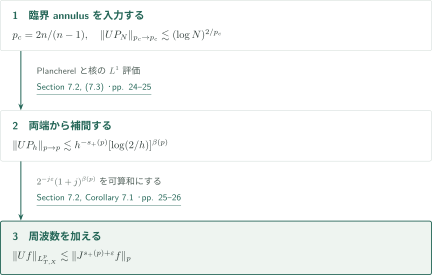
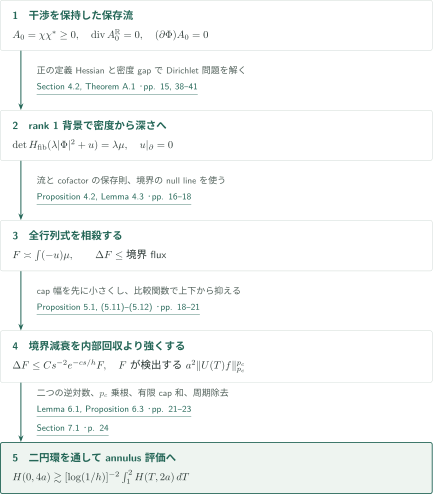
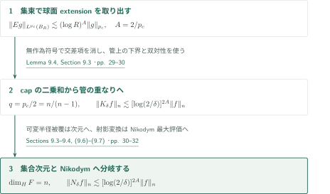
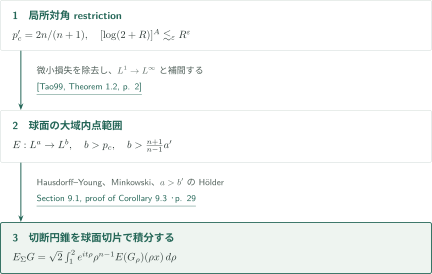
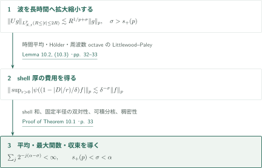
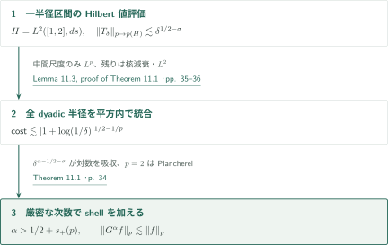
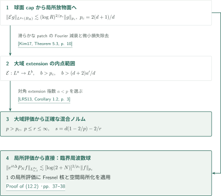

# Local smoothing for the Euclidean wave equation

**保存流の行列式エネルギーから臨界対数評価へ、さらにrestrictionと最大評価へ**

本原稿は全空間次元 $n\ge2$ のユークリッド半波動について、臨界指数 $p_c=2n/(n-1)$ で周波数環ごとの対数評価を主張する。核心は方向別の二乗和ではなく、波の重ね合わせを保持した正の保存流を作り、その時間成分を四元数HessianのDirichlet問題へ入力する点にある。以下は原稿の主張と帰着の解説であり、全証明の独立検証ではない。

## 1. 主要結果

$U(T)=e^{-iT|D|}$、$I=[1,2]$、$J=(1-\Delta)^{1/2}$、$s_+(p)=\max\{0,(n-1)/2-n/p\}$ とする。波動の初期データは複素Schwartz関数で、表示した空間ノルムに関して稠密性で拡張する。定数は表示した次元・指数・固定cutoff・時間区間に依存し、データや大きな周波数には依存しない。

### Theorem 1.1 — 波動の局所平滑化

$n\ge2$、$2\le p<\infty$、$\varepsilon>0$ に対し

$$
\|U(T)f\|_{L^p(\mathbb R^n\times I)}\le C_{n,p,\varepsilon}\|J^{s_+(p)+\varepsilon}f\|_{L^p(\mathbb R^n)}.
$$

$p=2$ では $\varepsilon=0$ とできる。$p\ge p_c$ では固定時刻の必要正則性 $(n-1)(1/2-1/p)$ から $1/p$ 未満の任意の改善、$2<p<p_c$ では任意の正の正則性を得る。$p>2$ の無損失Sobolev端点を主張した定理ではない。

<!-- cite:main-wave -->[Theorem 1.1 · p. 1](https://github.com/openai/math/blob/7ef5c0cc5ca4b0e072b7a050fca09ab24bc6fa3a/preprints/Local-smoothing-for-the-Euclidean-wave-equation-October-25-2026/paper.pdf)<!-- /cite -->

### Theorem 1.2 — 臨界周波数環の対数評価

$n\ge2$、$p=p_c$、$\varphi\in C_c^\infty(\mathbb R^n\setminus\{0\})$、$N\ge2$、$P_N=\varphi(D/N)$ に対し

$$
\|U(T)P_Nf\|_{L^p(\mathbb R^n\times I)}\le C_{n,\varphi}[\log(2+N)]^{2/p}\|f\|_{L^p(\mathbb R^n)}.
$$

これは全周波数を一様定数で扱う $L^{p_c}\to L^{p_c}_{T,X}$ 評価ではない。Proposition 8.1の集束例が対数冪 $1/p_c$ 以上を必要とするため、本稿の一般データに対する上界 $2/p_c$ との間には余地が残る。Proposition 8.2は $2<p\le p_c$ でSobolev次数ゼロが弱時空ノルムでも不可能であることを主張する。

<!-- cite:main-annulus -->[Theorem 1.2 · p. 4](https://github.com/openai/math/blob/7ef5c0cc5ca4b0e072b7a050fca09ab24bc6fa3a/preprints/Local-smoothing-for-the-Euclidean-wave-equation-October-25-2026/paper.pdf)<!-- /cite -->
<!-- cite:obstructions -->[Propositions 8.1–8.2 · pp. 26–27](https://github.com/openai/math/blob/7ef5c0cc5ca4b0e072b7a050fca09ab24bc6fa3a/preprints/Local-smoothing-for-the-Euclidean-wave-equation-October-25-2026/paper.pdf)<!-- /cite -->

### Corollary 9.1 — 局所球面extensionとKakeya最大評価

$Eg(X)=\int_{S^{n-1}}e^{iX\cdot\omega}g(\omega)\,d\sigma(\omega)$ とし、$K_\delta f(\omega)$ は方向 $\omega$ の長さ1・半径 $\delta$ の管上の $|f|$ の平均を位置全体で最大化したものとする。$n\ge2$、$R\ge2$、$z\in\mathbb R^n$、$0<\delta\le1$ に対し

$$
\|Eg\|_{L^{p_c}(B(z,R))}\le C_n[\log(2+R)]^{2/p_c}\|g\|_{L^{p_c}(S^{n-1})},
$$

$$
\|K_\delta f\|_{L^n(S^{n-1})}\le C_n[\log(2/\delta)]^{4/p_c}\|f\|_{L^n(\mathbb R^n)}.
$$

特に、各方向に単位線分を含む任意の集合はHausdorff次元 $n$ を持つ。最大関数評価と集合次元の結論は別の主張であり、後者には可変半径の被覆の議論が必要になる。

<!-- cite:main-kakeya -->[Corollary 9.1 · p. 27](https://github.com/openai/math/blob/7ef5c0cc5ca4b0e072b7a050fca09ab24bc6fa3a/preprints/Local-smoothing-for-the-Euclidean-wave-equation-October-25-2026/paper.pdf)<!-- /cite -->

### Corollary 9.3 — 球面・切断円錐の大域extension

$1<a\le\infty$、$b<\infty$、$a'$ を共役指数とし、

$$
b>\frac{2n}{n-1},\qquad b>\frac{n+1}{n-1}a'
$$

とする。球面extension $E$ と、誘導面積測度を備えた $\Sigma=\{(\rho\omega,\rho):1\le\rho\le2,\ \omega\in S^{n-1}\}\subset\mathbb R^{n+1}$ のextension $E_\Sigma$ について

$$
\|Eg\|_{L^b(\mathbb R^n)}\lesssim_{n,a,b}\|g\|_{L^a(S^{n-1})},\qquad
\|E_\Sigma G\|_{L^b(\mathbb R^{n+1})}\lesssim_{n,a,b}\|G\|_{L^a(\Sigma)}.
$$

$a=\infty$ を含む強型評価である。$b=\infty$ なら両者とも $1\le a\le\infty$ で成り立つ。有限の $b$ に課す二つの厳密不等式の境界はここに含めない。

<!-- cite:main-restriction -->[Corollary 9.3 · pp. 28–29](https://github.com/openai/math/blob/7ef5c0cc5ca4b0e072b7a050fca09ab24bc6fa3a/preprints/Local-smoothing-for-the-Euclidean-wave-equation-October-25-2026/paper.pdf)<!-- /cite -->

### Theorem 10.1 — Bochner–Riesz平均・最大関数・収束

$B_r^\alpha=(1-|D|^2/r^2)_+^\alpha$、$B_*^\alpha f=\sup_{r>0}|B_r^\alpha f|$、$\delta(p)=\max\{0,n|1/p-1/2|-1/2\}$ とする。$n\ge2$、$1\le p\le\infty$、$\alpha>\delta(p)$ なら

$$
\sup_{r>0}\|B_r^\alpha f\|_p\le C_{n,p,\alpha}\|f\|_p.
$$

$p<\infty$ なら $r\to\infty$ で $B_r^\alpha f\to f$ in $L^p$。さらに $2\le p<\infty$、$\alpha>s_+(p)$ では

$$
\|B_*^\alpha f\|_p\le C_{n,p,\alpha}\|f\|_p,
$$

かつほとんど至る所で $B_r^\alpha f\to f$。固定半径評価の $1\le p<2$ の範囲を最大評価へ移してはいない。

<!-- cite:main-br -->[Theorem 10.1 · p. 32](https://github.com/openai/math/blob/7ef5c0cc5ca4b0e072b7a050fca09ab24bc6fa3a/preprints/Local-smoothing-for-the-Euclidean-wave-equation-October-25-2026/paper.pdf)<!-- /cite -->

### Theorem 11.1 — Stein平方関数

$$
G^\alpha f(x)=\left(\int_0^\infty|r\partial_r B_r^\alpha f(x)|^2\frac{dr}{r}\right)^{1/2}.
$$

$n\ge2$、$2\le p<\infty$、$\alpha>\max\{1/2,n(1/2-1/p)\}=1/2+s_+(p)$ に対して $\|G^\alpha f\|_p\le C_{n,p,\alpha}\|f\|_p$。Schwartzデータから $L^p$ への拡張も結論に含む。

<!-- cite:main-square -->[Theorem 11.1 · p. 34](https://github.com/openai/math/blob/7ef5c0cc5ca4b0e072b7a050fca09ab24bc6fa3a/preprints/Local-smoothing-for-the-Euclidean-wave-equation-October-25-2026/paper.pdf)<!-- /cite -->

### Corollary 12.1 — コンパクト放物面とSchrödinger局所平滑化

ここだけ空間次元を $d\ge1$、$p_c=2(d+1)/d$ とし、$B^d$ は単位球、$\mathcal Eg(x,t)=\int_{B^d}e^{i(x\cdot v+t|v|^2)}g(v)\,dv$ とする。

$1<a\le\infty$、$p_c<b<\infty$、$b>(d+2)a'/d$ なら

$$
\|\mathcal Eg\|_{L^b(\mathbb R^{d+1})}\lesssim_{d,a,b}\|g\|_{L^a(B^d)}.
$$

コンパクト時間区間 $I\subset\mathbb R$、$N\ge2$、$\operatorname{supp}\widehat f\subset B(0,N)$ のSchwartz関数に対して

$$
\|e^{it\Delta}f\|_{L^{p_c}(\mathbb R^d\times I)}\lesssim_{d,I}[\log(2+N)]^{2/p_c}\|f\|_{p_c}.
$$

さらに $p_c<p<\infty$、$p\le r\le\infty$、任意のSchwartzデータについて、$s=d(1-2/p)-2/r$ とおけば

$$
\|e^{it\Delta}f\|_{L^p(\mathbb R^d;L^r(I))}\lesssim_{d,p,r,I}\|f\|_{B^s_{p,p}(\mathbb R^d)}\lesssim_{d,p,s}\|(1-\Delta)^{s/2}f\|_p.
$$

$r=p$ では正確な時空Sobolev次数 $d-2(d+1)/p$、$r=\infty$ では同じ有限時間区間上の最大評価になる。これは $p=p_c$ における対数なし評価を含まない。

<!-- cite:main-schrodinger -->[Corollary 12.1 · p. 37](https://github.com/openai/math/blob/7ef5c0cc5ca4b0e072b7a050fca09ab24bc6fa3a/preprints/Local-smoothing-for-the-Euclidean-wave-equation-October-25-2026/paper.pdf)<!-- /cite -->

## 図の矢印に付した引用

<!-- reference-guide -->
略号のない定理・補題・節・式番号は本原稿 [Local smoothing for the Euclidean wave equation](https://github.com/openai/math/blob/7ef5c0cc5ca4b0e072b7a050fca09ab24bc6fa3a/preprints/Local-smoothing-for-the-Euclidean-wave-equation-October-25-2026/paper.pdf) を指します。外部入力には次の略号を使います。

- [Tao99](https://www.math.ucla.edu/~tao/preprints/restriction.dvi) Terence Tao — *The Bochner-Riesz conjecture implies the restriction conjecture*：球面の局所restrictionから大域評価への微小損失除去。Author-hosted undated preprint; accessed October 28, 2026 (DVI converted to PDF)。
- [Kim17](https://arxiv.org/pdf/1702.01231v2) Jongchon Kim — *Some remarks on Fourier restriction estimates*：Fourier減衰を持つコンパクト曲面の微小損失除去。arXiv:1702.01231v2, February 9, 2017。
- [LRS13](https://arxiv.org/pdf/1108.1518v2) Sanghyuk Lee, Keith M. Rogers, Andreas Seeger — *On space-time estimates for the Schrödinger operator*：対角extensionから正確なBesov次数の混合ノルム評価。arXiv:1108.1518v2, March 19, 2012; published 2013。
- [GT01](https://doi.org/10.1007/978-3-642-61798-0) David Gilbarg, Neil S. Trudinger — *Elliptic Partial Differential Equations of Second Order*：周期fiberのDirichlet可逆性と境界/内部正則性への直接入力。Theorems 6.14（誌面107頁）、6.19（111頁）、17.14（461頁）、17.26′（481頁）と構造条件（456頁）を初稿後の別担当が照合。外部証明自体は未検証。Classics in Mathematics, Springer, 2001; reprint of the 1998 edition (bibliography [31] of the manuscript)。

各引用に結果番号とページを付します。誌面番号とPDF内の位置が異なる場合は両方を示します。GitHubの閲覧リンクではページ位置への自動移動を前提としません。
<!-- /reference-guide -->

## 2. Theorem 1.1 の証明 — 臨界周波数環から全指数へ

<!-- proof-target:1 -->証明対象：[Theorem 1.1 · p. 1](https://github.com/openai/math/blob/7ef5c0cc5ca4b0e072b7a050fca09ab24bc6fa3a/preprints/Local-smoothing-for-the-Euclidean-wave-equation-October-25-2026/paper.pdf)<!-- /proof-target -->

**証明の道筋。** Theorem 1.2を先に得て、$L^2$保存と固定時刻の $L^\infty$ 核評価を両側から補間する。最後に $\varepsilon$ を周波数和へ使う。次節が臨界評価そのものの核心を扱う。

### 1. 二つの端の補間

$h=N^{-1}$ とすると、$L^2_X\to L^2_{T,X}$ はPlancherelにより一様、$L^\infty_X\to L^\infty_{T,X}$ は $O(h^{-(n-1)/2})$。後者は幅 $h^{1/2}$ のcapへ分け、線形位相を除いた各核の $L^1$ ノルムを一様に抑えて得る。Riesz–Thorin補間によって

$$
\|UP_hf\|_{L^p_{T,X}}\lesssim h^{-s_+(p)}[\log(2/h)]^{\beta(p)}\|f\|_p,\quad
\beta(p)=\min\{(n-1)(1-2/p),2/p\}.
$$

<!-- cite:interpolation -->[Section 7.2, (7.3) · pp. 24–25](https://github.com/openai/math/blob/7ef5c0cc5ca4b0e072b7a050fca09ab24bc6fa3a/preprints/Local-smoothing-for-the-Euclidean-wave-equation-October-25-2026/paper.pdf)<!-- /cite -->

### 2. 微小損失を和へ使う

$g=J^{s_+(p)+\varepsilon}f$ とおくと第 $j$ 周波数環の係数は $2^{-j\varepsilon}(1+j)^{\beta(p)}$ で可算和が収束する。低周波はMihlin、$p=2$ は直接Plancherelで処理する。Corollary 7.1はこの和を精密化し、$B>\beta(p)+1/2-1/p$（または等号と追加の二重対数条件）の対数Sobolev評価を与えるが、$B=C=0$ を一般には得ていない。

<!-- cite:sobolev-sum -->[Section 7.2, Corollary 7.1 · pp. 25–26](https://github.com/openai/math/blob/7ef5c0cc5ca4b0e072b7a050fca09ab24bc6fa3a/preprints/Local-smoothing-for-the-Euclidean-wave-equation-October-25-2026/paper.pdf)<!-- /cite -->

## 3. Theorem 1.2 の証明 — 保存流と二つの円環比較

<!-- proof-target:2 -->証明対象：[Theorem 1.2 · p. 4](https://github.com/openai/math/blob/7ef5c0cc5ca4b0e072b7a050fca09ab24bc6fa3a/preprints/Local-smoothing-for-the-Euclidean-wave-equation-October-25-2026/paper.pdf)<!-- /proof-target -->

**証明の道筋。** 固定トーラス上でcapの波を保存流に持ち上げ、空間fiber上の行列式方程式から $p_c$ 乗を検出するエネルギーを作る。境界のGaussian減衰により非負のscalar supersolutionを得て、二つの円環比較を通した後に周期を除く。

### 1. 干渉を保持して臨界冪を作る

対称一次系の二つの補助流から $A_0=\chi\chi^*$ を作る。$\chi$ は各波をGaussian重み付きで**加えた後**のベクトルであり、実表示の各列は発散ゼロ、$(\partial\Phi)A_0=0$。周波数 $N=h^{-1}$、固定小capに対し、補助変数の半径が $h$ 程度なら時間成分から元の波を回収できる。

fiberの定義関数 $r$ は $H_{\rm fib}(r)>0$ を満たす。一方、全Hessian $H(r)$ のnull lineは境界法線にも $H(|\Phi|^2)$ にも直交する。平滑化・cutoff後の流に小さいcofactorを加えて $\mu=A_{TT}>0$ とし、$B_0=\lambda|\Phi|^2$、$\lambda=h^{-30n}$ に対して

$$
\det H_{\rm fib}(B_0+u)=\lambda\mu,\qquad u|_{\partial\Omega_z}=0,\qquad H_{\rm fib}(B_0+u)>0
$$

を解く。Theorem A.1の正の定義Hessian・正の密度gapをここで満たす。背景の空間Hessianはrank 1なので $\det(B_{\rm fib}+\alpha I)=(\beta+\alpha)\alpha^{n-1}$、$\beta\asymp\lambda$。小球上の密度下界 $m$ が $-u\gtrsim h^2m^{1/(n-1)}$ を生み、$(-u)\mu$ が $m^{n/(n-1)}$、したがって波の $2n/(n-1)$ 乗を検出する。

<!-- cite:current -->[Proposition 2.2, (2.15), Lemma 4.1 · pp. 9–10, 14](https://github.com/openai/math/blob/7ef5c0cc5ca4b0e072b7a050fca09ab24bc6fa3a/preprints/Local-smoothing-for-the-Euclidean-wave-equation-October-25-2026/paper.pdf)<!-- /cite -->
<!-- cite:dirichlet -->[Section 4.2, Theorem A.1 · pp. 15, 38–41](https://github.com/openai/math/blob/7ef5c0cc5ca4b0e072b7a050fca09ab24bc6fa3a/preprints/Local-smoothing-for-the-Euclidean-wave-equation-October-25-2026/paper.pdf)<!-- /cite -->

### 2. 不定符号の行列式を消し、境界だけを残す

$X_0=\int_{\Omega_z}(-u)\mu$ のLaplacianには符号不定の全行列式が残る。そこで

$$
F=X_0+\lambda^{-1}\int_{\Omega_z}u\int_0^1\det H_{\rm fib}(B_0+\theta u)\,d\theta
$$

と修正する。流とHessian cofactorの二つの保存則による部分積分で、全行列式が相殺する。cofactorの法線–法線成分は上のnull lineによりゼロで、移動境界でも余計なcofactor fluxは出ない。Proposition 4.2では $\Delta F+\int A:\Sigma$ が波の境界fluxに等しく、$A,\Sigma\ge0$。Lemma 4.3が

$$
\frac{n-1}{n+1}X_0\le F\le\frac n{n+1}X_0
$$

を与え、修正後も必要な量を失わない。

<!-- cite:balance -->[Proposition 4.2, Lemma 4.3 · pp. 16–18](https://github.com/openai/math/blob/7ef5c0cc5ca4b0e072b7a050fca09ab24bc6fa3a/preprints/Local-smoothing-for-the-Euclidean-wave-equation-October-25-2026/paper.pdf)<!-- /cite -->

### 3. 境界減衰と内部回収を比較する

$z=(T,\tau)\in\mathbb R\times\mathbb R^2$、$a=Kh$ とする。壁でfluxを持つ領域は波のcap方向から一定距離離れ、Gaussianは $e^{-c_0|\tau|/h}$ で減衰する。内部回収の逆乗数の費用は $e^{C\gamma^2|\tau|/h}$。先にcap幅 $\gamma$ を小さくし、次に固定 $K$ を大きくして、前者が勝つようにする。比較関数と小球の行列式比較を組み合わせ、Proposition 5.1は

$$
F(0,\tau)\lesssim a^2\|f\|_{p_c}^{p_c}\ (|\tau|=4a),\qquad
F(T,\tau)\gtrsim a^2\|U(T)f\|_{p_c}^{p_c}\ (|\tau|=2a),
$$

$$
\Delta_{T,\tau}F\le V(|\tau|)F,\qquad V(s)=Cs^{-2}e^{-cs/h}
$$

を与える。ここで小球における密度の下限と背景の上限 $\mu^{1/(n-1)}\le\lambda$ が比較に必要になる。

<!-- cite:fiber-estimate -->[Proposition 5.1, (5.11)–(5.12) · pp. 18–21](https://github.com/openai/math/blob/7ef5c0cc5ca4b0e072b7a050fca09ab24bc6fa3a/preprints/Local-smoothing-for-the-Euclidean-wave-equation-October-25-2026/paper.pdf)<!-- /cite -->

### 4. 二つの対数を追い、周期を除く

$H(T,s)$ を $F$ の $|\tau|=s$ の円周平均とする。Lemma 6.1は $b=2a$、$r=2b$ で

$$
H(0,2b)\gtrsim[\log(3/b)]^{-2}\int_1^2H(T,b)\,dT.
$$

外向きの円環比較、固定半径での平均値不等式、内向きの円環比較を使う。二次元の調和関数が $\log s$ に一次なので各通過が一つの逆対数を費やす。正のpotentialの重み付き積分は指数減衰により一様に有界。両側の $a^2$ を消して $p_c$ 乗根を取り、Proposition 6.3を得る。有限個の固定capを加え、$|X|\ge3$ の波の核を非停留位相で $O(h^M(1+|X|)^{-M})$ と抑え、単位cubeの局所周期化と有限重複を使って $\mathbb R^n$ へ移す。

<!-- cite:propagation -->[Lemma 6.1, Proposition 6.3 · pp. 21–23](https://github.com/openai/math/blob/7ef5c0cc5ca4b0e072b7a050fca09ab24bc6fa3a/preprints/Local-smoothing-for-the-Euclidean-wave-equation-October-25-2026/paper.pdf)<!-- /cite -->
<!-- cite:period-removal -->[Section 7.1 · p. 24](https://github.com/openai/math/blob/7ef5c0cc5ca4b0e072b7a050fca09ab24bc6fa3a/preprints/Local-smoothing-for-the-Euclidean-wave-equation-October-25-2026/paper.pdf)<!-- /cite -->

## 4. Corollary 9.1 の証明 — 波の集束から管と集合次元へ

<!-- proof-target:3 -->証明対象：[Corollary 9.1 · p. 27](https://github.com/openai/math/blob/7ef5c0cc5ca4b0e072b7a050fca09ab24bc6fa3a/preprints/Local-smoothing-for-the-Euclidean-wave-equation-October-25-2026/paper.pdf)<!-- /proof-target -->

**証明の道筋。** 対数冪を $A$ と記しておくと、局所球面extensionには $A$、管の重なりとKakeya最大関数には $2A$ が残る。本稿では $A=2/p_c$。

### 1. 集束により局所extensionを回収する

$M_Nf=\int\psi(T)e^{iNT}U(T)\chi(|D|/N)f\,dT$ は厚さ1の周波数shellを選ぶ。その核の主要項は $cN^{(n-1)/2}|Z|^{-(n-1)/2}e^{iN|Z|}\psi(|Z|)$。$f_N(r\omega)=e^{-iNr}\psi(r)g(\omega)$ を入れ、集束付近 $X/N$ で距離位相を線形化する。$N$ を $R$ の十分大きい固定冪に取れば誤差は有界で、$n/p_c=(n-1)/2$ がスケール係数を消す。従って $\log N\asymp\log R$ の損失だけが残る。

<!-- cite:local-extension -->[Lemma 9.2 · p. 28](https://github.com/openai/math/blob/7ef5c0cc5ca4b0e072b7a050fca09ab24bc6fa3a/preprints/Local-smoothing-for-the-Euclidean-wave-equation-October-25-2026/paper.pdf)<!-- /cite -->

### 2. capの符号を無作為化し最大関数を双対化する

互いに素な $\delta$-capを位置に応じてmodulateすると、長さ $\delta^{-2}$・幅 $\delta^{-1}$ の管上でextensionが下から抑えられる。独立符号を付けると二乗の期待値は各capのextensionの二乗和になり、それを対応する管の指示関数の重み付き和で下から抑える。これと局所extension評価から、$q=p_c/2=n/(n-1)$ についてLemma 9.4の重なり評価を得る。位置ごとのcubeへの分割は無限遠の管配置にも一様な定数を与える。方向の $\delta$-net、$L^n$–$L^q$ 双対性、中心位置の上限からKakeya最大評価を得る。

<!-- cite:tubes -->[Lemma 9.4, Section 9.3 · pp. 29–30](https://github.com/openai/math/blob/7ef5c0cc5ca4b0e072b7a050fca09ab24bc6fa3a/preprints/Local-smoothing-for-the-Euclidean-wave-equation-October-25-2026/paper.pdf)<!-- /cite -->

### 3. 可変半径被覆とNikodymへの射影変換

単一スケールでは $|F_\delta|\gtrsim[\log(1/\delta)]^{-2(n-1)}$ に留まり、Hausdorff次元には半径の異なる球を群分けする。§9.3は $\gamma>n-1$ に対し $r^n[\log(1/r)]^{2(n-1)}[\log\log(1/r)]^\gamma$ のHausdorff測度が無限であることまで示し、全次元を導く。

§9.4の $N_\delta f(x)$ は $x$ を通る単位線分の管平均の最大値で、

$$
\|N_\delta f\|_{L^n(\mathbb R^n)}\lesssim_n[\log(2/\delta)]^{4/p_c}\|f\|_{L^n(\mathbb R^n)}.
$$

$x$ から一定距離離れた線分片を射影変換すると、基点が方向に変わり、変換のJacobianは局所的に上下有界。基点近傍はdyadic距離 $s$ ごとの重み $O(s)$ で足す。同じ被覆論法により、正測度の基点集合の各点から出る適切な単位線分と一様正長さだけ交わるBorel集合もHausdorff次元 $n$。集合次元だけから最大関数評価を逆に推論してはいない。

<!-- cite:dimension-nikodym -->[Sections 9.3–9.4, (9.6)–(9.7) · pp. 30–32](https://github.com/openai/math/blob/7ef5c0cc5ca4b0e072b7a050fca09ab24bc6fa3a/preprints/Local-smoothing-for-the-Euclidean-wave-equation-October-25-2026/paper.pdf)<!-- /cite -->

## 5. Corollary 9.3 の証明 — 微小損失除去と円錐の切片

<!-- proof-target:4 -->証明対象：[Corollary 9.3 · pp. 28–29](https://github.com/openai/math/blob/7ef5c0cc5ca4b0e072b7a050fca09ab24bc6fa3a/preprints/Local-smoothing-for-the-Euclidean-wave-equation-October-25-2026/paper.pdf)<!-- /proof-target -->

**証明の道筋。** 球面の局所対角評価から厳密に大きい出力指数の大域評価へ進み、補間で内点範囲を満たす。円錐はその球面切片を積分する。

### 1. 損失を除去して指数を補間する

$[\log(2+R)]^A\lesssim_\varepsilon R^\varepsilon$ と双対性から局所 $L^{p_c'}\to L^{p_c'}$ restrictionを得る。$1<p_c'<2$ なので[Tao99]の微小損失除去が適用され、双対化して全 $s>p_c$ に $E:L^s\to L^s$。$a\ge b$ は球面の有限測度、$a<b$ は $s=1+b/a'$ として $L^1\to L^\infty$ と補間する。$b>(n+1)a'/(n-1)$ が $s>p_c$ を保証する。

<!-- cite:epsilon-removal -->[Section 9.1, proof of Corollary 9.3 · p. 29](https://github.com/openai/math/blob/7ef5c0cc5ca4b0e072b7a050fca09ab24bc6fa3a/preprints/Local-smoothing-for-the-Euclidean-wave-equation-October-25-2026/paper.pdf)<!-- /cite -->
<!-- cite:tao-removal -->[&#91;Tao99, Theorem 1.2, p. 2&#93;](https://www.math.ucla.edu/~tao/preprints/restriction.dvi)<!-- /cite -->

### 2. 円錐切片を積分する

$G_\rho(\omega)=G(\rho\omega,\rho)$ とすると $E_\Sigma G=\sqrt2\int_1^2e^{it\rho}\rho^{n-1}E(G_\rho)(\rho x)\,d\rho$。時間のHausdorff–Young、$b\ge b'$ によるMinkowski、空間の拡大縮小を使う。最後の $L^{b'}_\rho$ を $L^a_\rho$ で抑える条件は $a>b'$ で、上の仮定から満たされる。$b=\infty$ は両コンパクト曲面の定義積分に直接Hölderを適用する。

<!-- cite:epsilon-removal -->[Section 9.1, proof of Corollary 9.3 · p. 29](https://github.com/openai/math/blob/7ef5c0cc5ca4b0e072b7a050fca09ab24bc6fa3a/preprints/Local-smoothing-for-the-Euclidean-wave-equation-October-25-2026/paper.pdf)<!-- /cite -->

## 6. Theorem 10.1 の証明 — 薄いshellの最大評価を加算する

<!-- proof-target:5 -->証明対象：[Theorem 10.1 · p. 32](https://github.com/openai/math/blob/7ef5c0cc5ca4b0e072b7a050fca09ab24bc6fa3a/preprints/Local-smoothing-for-the-Euclidean-wave-equation-October-25-2026/paper.pdf)<!-- /proof-target -->

**証明の道筋。** 単位周波数・長時間の波へ拡大縮小し、shellを波の時間平均として書く。shell厚の和を取った後、双対性と稠密性で全結論を得る。

### 1. 時間平均の費用はshell厚の負冪

$\sigma>s_+(p)$、$2\le p<\infty$ で、固定annulusの $g$ に対し $\|U(t)g\|_{L^p(\mathbb R^n\times\{R\le|t|\le2R\})}\lesssim R^{1/p+\sigma}\|g\|_p$。$A_{\delta,r}=\psi((1-|D|/r)/\delta)$ をFourier反転すると $\delta r\int e^{itr}\widehat\psi(\delta rt)U(t)g\,dt/(2\pi)$。時間Hölderと長時間評価から $r\in[1,2]$ の上限は $O(\delta^{-\sigma})$。全 $r$ はdyadic octaveに分け、$p\ge2$ のLittlewood–Paley評価で加える。

<!-- cite:shell-maximal -->[Lemma 10.2, (10.3) · pp. 32–33](https://github.com/openai/math/blob/7ef5c0cc5ca4b0e072b7a050fca09ab24bc6fa3a/preprints/Local-smoothing-for-the-Euclidean-wave-equation-October-25-2026/paper.pdf)<!-- /cite -->

### 2. 厳密な次数条件と三つの拡張

$s_+(p)<\sigma<\alpha$ を選び、$B_r^\alpha$ の境界付近をshell厚 $\delta=2^{-j}$ に分解すると費用は $\sum_j\delta^{\alpha-\sigma}$。滑らかな残りはHardy–Littlewood最大関数で抑える。これが最大評価と $p\ge2$ の固定半径評価を同時に与える。固定半径作用素の自己共役性により $1<p<2$、$L^1$ 可積分なBessel核により $p=1,\infty$ へ拡張する。コンパクトFourier台のSchwartzデータでの収束と稠密性が $L^p$ 収束を与え、最大評価のある $2\le p<\infty$ では $r$ に一様なほとんど至る所の近似から点収束を得る。

<!-- cite:br-proof -->[Proof of Theorem 10.1 · p. 33](https://github.com/openai/math/blob/7ef5c0cc5ca4b0e072b7a050fca09ab24bc6fa3a/preprints/Local-smoothing-for-the-Euclidean-wave-equation-October-25-2026/paper.pdf)<!-- /cite -->

## 7. Theorem 11.1 の証明 — 平方ノルムを保って半径をまとめる

<!-- proof-target:6 -->証明対象：[Theorem 11.1 · p. 34](https://github.com/openai/math/blob/7ef5c0cc5ca4b0e072b7a050fca09ab24bc6fa3a/preprints/Local-smoothing-for-the-Euclidean-wave-equation-October-25-2026/paper.pdf)<!-- /proof-target -->

**証明の道筋。** 一つの半径区間で $\delta^{1/2}$ を回収し、Hilbert空間値の評価で全dyadic区間を平方ノルム内にまとめる。

### 1. 微分・平方積分・局所平滑化の三つの冪

厚さ $\delta$ のshellで半径微分は $\delta^{\alpha-1}$、半径の平方積分は $\delta^{1/2}$、波は $\delta^{-\sigma}$ を与える。Lemma 11.2では半径変数のPlancherelと長時間波動評価を組み合わせ、$H=L^2([1,2],ds)$ に値を取るshell作用素を $L^p\to L^p(H)$ の $\delta^{1/2-\sigma}$ と $L^2\to L^2(H)$ の $\delta^{1/2}$ で抑える。

<!-- cite:shell-square -->[Lemma 11.2 · p. 34](https://github.com/openai/math/blob/7ef5c0cc5ca4b0e072b7a050fca09ab24bc6fa3a/preprints/Local-smoothing-for-the-Euclidean-wave-equation-October-25-2026/paper.pdf)<!-- /cite -->

### 2. 異なる尺度を平方ノルム内で統合する

Lemma 11.3はHilbert空間値核とその一次微分の減衰の下でdyadic dilateをまとめる。検査cube上で中間の $O(1+\log(1/\delta))$ 尺度だけに $L^p$ 評価を使い、そのHölder費用は $[1+\log(1/\delta)]^{1/2-1/p}$。遠い尺度には核の微分または $L^2$ を使う。$\sigma<\alpha-1/2$ を選ぶと $\delta^{\alpha-1/2-\sigma}$ が対数費用も吸収する。境界から離れた乗数は原点で二次消滅するため別の可算和になる。$p=2$ では直接 $\|G^\alpha f\|_2^2=\alpha(2\alpha-1)^{-1}\|f\|_2^2$。有限和からFatouと単調収束へ進み、線形な $L^p_x(L^2(dr/r))$ 作用素を稠密性で拡張する。

<!-- cite:combine-square -->[Lemma 11.3, proof of Theorem 11.1 · pp. 35–36](https://github.com/openai/math/blob/7ef5c0cc5ca4b0e072b7a050fca09ab24bc6fa3a/preprints/Local-smoothing-for-the-Euclidean-wave-equation-October-25-2026/paper.pdf)<!-- /cite -->

## 8. Corollary 12.1 の証明 — 放物面極限とFresnel変換

<!-- proof-target:7 -->証明対象：[Corollary 12.1 · p. 37](https://github.com/openai/math/blob/7ef5c0cc5ca4b0e072b7a050fca09ab24bc6fa3a/preprints/Local-smoothing-for-the-Euclidean-wave-equation-October-25-2026/paper.pdf)<!-- /proof-target -->

**証明の道筋。** $n=d+1$ の球面capを放物面へ拡大し、臨界局所extensionの対数を保存する。そこから微小損失除去、Fresnel核、外部の混合ノルム定理という三つの出口を区別する。

### 1. 放物面extensionの内点範囲

capを $(\delta v,\sqrt{1-\delta^2|v|^2})$ と書き、物理変数を $(x/\delta,-2t/\delta^2)$ に拡大する。新しい位相は $q_\delta(v)=2(1-\sqrt{1-\delta^2|v|^2})/\delta^2=|v|^2+O(\delta^2)$。$p_c=2(d+1)/d$ によりJacobianと入力の冪が相殺し、$\delta$ を $R$ の負の固定冪に取ると局所放物面extension (12.4) に同じ $[\log(2+R)]^{2/p_c}$ が残る。[Kim17]のコンパクト曲面版の微小損失除去には、少し大きいpatchの滑らかな密度のFourier減衰を停留位相で与える。その後の双対性・補間が (12.1) の内点範囲を得る。

<!-- cite:paraboloid-proof -->[Proof of Corollary 12.1, (12.4) · pp. 36–37](https://github.com/openai/math/blob/7ef5c0cc5ca4b0e072b7a050fca09ab24bc6fa3a/preprints/Local-smoothing-for-the-Euclidean-wave-equation-October-25-2026/paper.pdf)<!-- /cite -->
<!-- cite:kim-removal -->[&#91;Kim17, Theorem 5.3, p. 10&#93;](https://arxiv.org/pdf/1702.01231v2#page=10)<!-- /cite -->

### 2. 臨界Schrödinger評価は周波数球に対する対数評価

周波数球 $B(0,N)$ のデータを辺長 $N$ の空間cubeで局所化する。遠方は $S(t)P_N$ の非停留位相、近傍 $h=f1_{30Q}$ はFresnel核で $\mathcal E[g](-\lambda x/(2t),\lambda^2/(4t))$、$g(v)=h(\lambda v)$、$\lambda\asymp N$ と書く。切断が生んだ高周波を避けるため $P_NS(t)h$ として乗数を外側に保つ。$t\in[1/2,1]$ のJacobianと入力normが $\lambda^{d-(2d+2)/p_c}=1$ となり、(12.4)の対数のみが残る。cubeの有限重複と時間のdyadic分割・共役により任意のコンパクト $I$ へ進む。

<!-- cite:fresnel-proof -->[Proof of (12.2) · pp. 37–38](https://github.com/openai/math/blob/7ef5c0cc5ca4b0e072b7a050fca09ab24bc6fa3a/preprints/Local-smoothing-for-the-Euclidean-wave-equation-October-25-2026/paper.pdf)<!-- /cite -->

### 3. 臨界を超える指数では正確な混合ノルム次数

$p_c<a<p$ を選ぶと (12.1) は $\mathcal E:L^a\to L^a$ を与える。[LRS13, Corollary 1.2]を $p_0=q_0=a$、入力・出力空間指数とも $p$ に適用すると、$p\le r\le\infty$ に対し正確な $s=d(1-2/p)-2/r$ の $B^s_{p,p}\to L^p_xL^r_t$ 評価になる。$p>2$ の $\ell^p\le\ell^2$ とLittlewood–PaleyからSobolev入力でも成り立つ。ここで $a<p$ を選べる余地が、臨界対数評価から区別すべき点である。

<!-- cite:mixed-proof -->[Proof of (12.3) · p. 38](https://github.com/openai/math/blob/7ef5c0cc5ca4b0e072b7a050fca09ab24bc6fa3a/preprints/Local-smoothing-for-the-Euclidean-wave-equation-October-25-2026/paper.pdf)<!-- /cite -->
<!-- cite:lrs-mixed -->[&#91;LRS13, Corollary 1.2, p. 3&#93;](https://arxiv.org/pdf/1108.1518v2#page=3)<!-- /cite -->

## 9. どの論文が、どの段階を担うか

| 供給元と結果 | 利用箇所 | 使用内容・必要な仮定 | 確認範囲 |
|---|---|---|---|
| Taoの微小損失除去定理 | Corollary 9.3, p. 29 | $1<p_c'<2$ の球面局所restrictionを、より小さい入力指数の大域restrictionへ移す | 著者公開DVIのTheorem 1.2, p. 2と適用を照合。外部証明全体は未検証 |
| Kimのコンパクト曲面版 | Corollary 12.1, p. 37 | Fourier減衰を持つ滑らかなコンパクトpatchで $1\le p\le q\le2$。局所損失を任意に小さく取る | arXiv v2 Theorem 5.3, p. 10と適用を照合 |
| Lee–Rogers–Seegerの混合ノルム帰結 | (12.3), p. 38 | 対角extension指数 $a<p$、$p\le r\le\infty$、正確なBesov次数 | arXiv v2 Corollary 1.2, p. 3と指数代入を照合 |
| Gilbarg–Trudinger [GT01] の楕円型正則性 | Theorem A.1, pp. 39–41 | Theorems 6.14（誌面107頁）/6.19（111頁）で線形Dirichlet可逆性と高階正則性。17.14（461頁）/17.26′（481頁）で解のHessian範囲上の一様楕円性・凹性（456頁）から内部/境界 $C^{2,\alpha}$ 評価 | 初稿後の別担当が原書誌面と適用仮定を照合。周期商への有限チャートによる帰着も確認。GT証明と全境界計算の再検証ではない |

<!-- cite:tao-removal -->[&#91;Tao99, Theorem 1.2, p. 2&#93;](https://www.math.ucla.edu/~tao/preprints/restriction.dvi)<!-- /cite -->
<!-- cite:kim-removal -->[&#91;Kim17, Theorem 5.3, p. 10&#93;](https://arxiv.org/pdf/1702.01231v2#page=10)<!-- /cite -->
<!-- cite:lrs-mixed -->[&#91;LRS13, Corollary 1.2, p. 3&#93;](https://arxiv.org/pdf/1108.1518v2#page=3)<!-- /cite -->

本稿の主証明は、第2論文 *Critical local smoothing for the three-dimensional wave equation* の評価を入力にしていない。074の三次元Kakeya最大関数原稿と四次元Hausdorff次元原稿はp. 27で比較として引用される。077の球面restriction原稿もp. 29の比較であり、そこから本稿の全次元主定理への依存矢印は作らない。Bochner–Rieszと平方関数のshell補題、円錐切片、管への無作為化は本稿内で証明を与えており、歴史的引用をそのまま独立の証明入力と数えていない。

<!-- cite:comparisons -->[Sections 9–9.1 · pp. 27–29](https://github.com/openai/math/blob/7ef5c0cc5ca4b0e072b7a050fca09ab24bc6fa3a/preprints/Local-smoothing-for-the-Euclidean-wave-equation-October-25-2026/paper.pdf)<!-- /cite -->

## 10. 原典を読む入口と確認範囲

<!-- reading-list -->
- [Theorem 1.2 · p. 4](https://github.com/openai/math/blob/7ef5c0cc5ca4b0e072b7a050fca09ab24bc6fa3a/preprints/Local-smoothing-for-the-Euclidean-wave-equation-October-25-2026/paper.pdf) — 主定理の定量的な核心と対数損失
- [Proposition 4.2, Lemma 4.3 · pp. 16–18](https://github.com/openai/math/blob/7ef5c0cc5ca4b0e072b7a050fca09ab24bc6fa3a/preprints/Local-smoothing-for-the-Euclidean-wave-equation-October-25-2026/paper.pdf) — 不定符号の全行列式の相殺と境界flux
- [Proposition 5.1, (5.11)–(5.12) · pp. 18–21](https://github.com/openai/math/blob/7ef5c0cc5ca4b0e072b7a050fca09ab24bc6fa3a/preprints/Local-smoothing-for-the-Euclidean-wave-equation-October-25-2026/paper.pdf) — 壁でのGaussian減衰と内部での波の回収
- [Lemma 6.1, Proposition 6.3 · pp. 21–23](https://github.com/openai/math/blob/7ef5c0cc5ca4b0e072b7a050fca09ab24bc6fa3a/preprints/Local-smoothing-for-the-Euclidean-wave-equation-October-25-2026/paper.pdf) — 二つの円環通過が費やす二対数
- [Sections 9.3–9.4, (9.6)–(9.7) · pp. 30–32](https://github.com/openai/math/blob/7ef5c0cc5ca4b0e072b7a050fca09ab24bc6fa3a/preprints/Local-smoothing-for-the-Euclidean-wave-equation-October-25-2026/paper.pdf) — 最大関数とHausdorff次元の接続を区別して読む
- [Theorem 10.1 · p. 32](https://github.com/openai/math/blob/7ef5c0cc5ca4b0e072b7a050fca09ab24bc6fa3a/preprints/Local-smoothing-for-the-Euclidean-wave-equation-October-25-2026/paper.pdf) — 固定半径・最大関数・収束の異なる指数範囲
- [Lemma 11.3, proof of Theorem 11.1 · pp. 35–36](https://github.com/openai/math/blob/7ef5c0cc5ca4b0e072b7a050fca09ab24bc6fa3a/preprints/Local-smoothing-for-the-Euclidean-wave-equation-October-25-2026/paper.pdf) — 半径を平方ノルム内でまとめる接続
- [Corollary 12.1 · p. 37](https://github.com/openai/math/blob/7ef5c0cc5ca4b0e072b7a050fca09ab24bc6fa3a/preprints/Local-smoothing-for-the-Euclidean-wave-equation-October-25-2026/paper.pdf) — 放物面・臨界対数・正確な混合ノルムの三結論
- [Section 4.2, Theorem A.1 · pp. 15, 38–41](https://github.com/openai/math/blob/7ef5c0cc5ca4b0e072b7a050fca09ab24bc6fa3a/preprints/Local-smoothing-for-the-Euclidean-wave-equation-October-25-2026/paper.pdf) — 周期fiberのDirichlet問題と、初稿後に入力条件を照合した外部正則性
<!-- /reading-list -->

Theorems 1.1/1.2、Corollaries 9.1/9.3/12.1、Theorems 10.1/11.1の主張と、§§2–7・9–12の上記帰着、Appendix AのDirichlet構成を読解した。Appendix Aで直接使うGT正則性定理の記述・適用仮定は、初稿後に別担当が原書誌面と照合し、初稿時の留保を解消した。保存流の座標変換、cofactorの全成分計算、GT定理自体の証明、Theorem A.1の全境界計算、Appendices B–Eの全証明は独立検証していない。Propositions 8.1–8.2は無損失端点との区別のため主張を確認し、前者の集束計算を読んだ。角度正則性を加えたAppendix B、二次元の線形Dirichlet法、一般の対称系、曲線族への派生結論は本記事の詳説対象外である。
