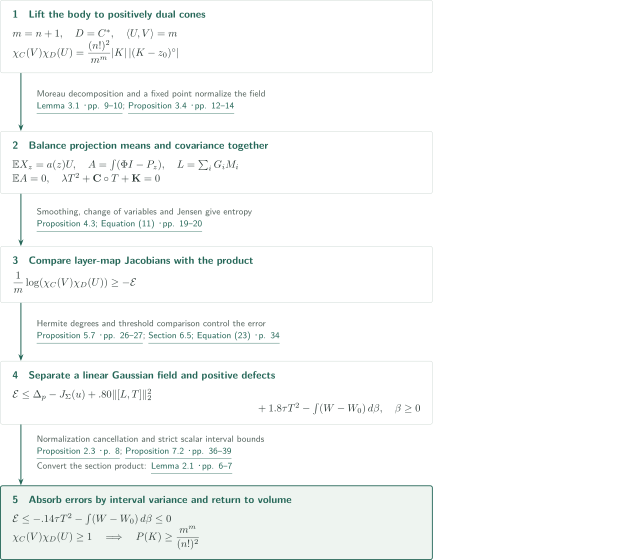
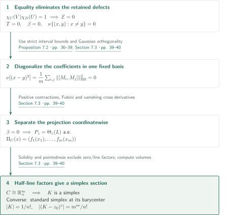
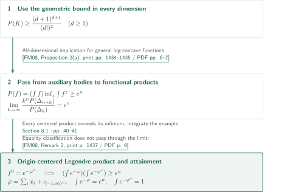
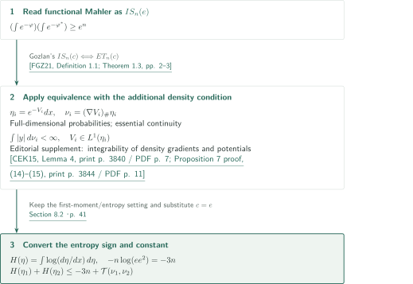

# The Mahler Conjecture for General Convex Bodies

**Dual-cone Laplace products, Gaussian projection fields, and simplex rigidity**

OpenAI’s manuscript dated 22 September 2026 claims the sharp Santaló-centered volume-product bound for general convex bodies, with a complete simplex equality classification. Its proof lifts a body to a cone in one higher dimension and closes an entropy estimate from Gaussian projection fields through interval inequalities for noncommuting matrices. This article explains that argument; it does not independently verify the entire proof, including its extensive scalar estimates.

## 1. Main results

### Theorem 1.1 — General Mahler inequality and equality

For every integer $n\ge1$ and every convex body $K\subset\mathbb R^n$,
$$
P(K):=|K|\,|(K-s(K))^\circ|\ge\frac{(n+1)^{n+1}}{(n!)^2},
$$
with equality if and only if $K$ is a simplex. A convex body is compact, convex and has nonempty interior. The Santaló point $s(K)\in\operatorname{int}K$ uniquely minimizes $z\mapsto|(K-z)^\circ|$, where
$$
(K-z)^\circ=\{y:\langle y,x-z\rangle\le1\text{ for all }x\in K\}.
$$
No symmetry or boundary regularity is assumed. Since $P(K)$ is the **minimum** over centers, the same lower bound holds for $|K|\,|(K-z)^\circ|$ at every interior $z$. Equality is not asserted at every center.

<!-- cite:main -->[Theorem 1.1 · p. 1](https://github.com/openai/math/blob/1581d4cbdd69a0faf34b2089614fe2a814316a6a/preprints/The-Mahler-Conjecture-for-General-Convex-Bodies-September-22-2026/paper.pdf)<!-- /cite -->

### Corollary 1.2 — Functional inequality

Let $n\ge1$ and let $\varphi:\mathbb R^n\to\mathbb R\cup\{+\infty\}$ be proper, lower semicontinuous and convex, with $0<\int e^{-\varphi}<\infty$. For the Fenchel–Legendre transform $\varphi^*(y)=\sup_x(\langle x,y\rangle-\varphi(x))$,
$$
\left(\int_{\mathbb R^n}e^{-\varphi(x)}\,dx\right)
\left(\int_{\mathbb R^n}e^{-\varphi^*(y)}\,dy\right)\ge e^n.
$$
The second integral may be infinite. No centering, evenness or normalization is required. An extremizing example establishes sharpness; a complete functional equality classification is not a conclusion of this corollary.

<!-- cite:functional -->[Corollary 1.2 · p. 4](https://github.com/openai/math/blob/1581d4cbdd69a0faf34b2089614fe2a814316a6a/preprints/The-Mahler-Conjecture-for-General-Convex-Bodies-September-22-2026/paper.pdf)<!-- /cite -->

### Corollary 8.1 — Entropy–transport inequality

Let $n\ge1$ and let $\eta_i(dx)=e^{-V_i(x)}dx$, $i=1,2$, be full-dimensional log-concave probability measures with proper lower-semicontinuous convex potentials. Assume essentially continuous densities: $e^{-V_i}=0$ at $\mathcal H^{n-1}$-almost every point of $\partial\operatorname{supp}\eta_i$. Then the moment measures $\nu_i=(\nabla V_i)_\#\eta_i$ have finite first moments,
$$
H(\eta_i):=\int\log(d\eta_i/dx)\,d\eta_i=-\int V_i\,d\eta_i
$$
is finite, and
$$
H(\eta_1)+H(\eta_2)\le-3n+\mathcal T(\nu_1,\nu_2),\qquad
\mathcal T(\mu_1,\mu_2):=\inf_f\left\{\int f\,d\mu_1+\int f^*\,d\mu_2\right\}.
$$
The infimum ranges over proper lower-semicontinuous convex $f$; $\mathcal T$ may be infinite. Here $H$ is the negative of differential Shannon entropy. Essential continuity is an additional assumption for this consequence.

<!-- cite:transport -->[Corollary 8.1 · p. 41](https://github.com/openai/math/blob/1581d4cbdd69a0faf34b2089614fe2a814316a6a/preprints/The-Mahler-Conjecture-for-General-Convex-Bodies-September-22-2026/paper.pdf)<!-- /cite -->

## References on the arrows

<!-- reference-guide -->
Unprefixed theorem, lemma, section and equation numbers refer to [The Mahler Conjecture for General Convex Bodies](https://github.com/openai/math/blob/1581d4cbdd69a0faf34b2089614fe2a814316a6a/preprints/The-Mahler-Conjecture-for-General-Convex-Bodies-September-22-2026/paper.pdf). External inputs use the following keys.

- [Kla18](https://arxiv.org/pdf/1710.08084v2) Bo’az Klartag — *Isotropic constants and Mahler volumes*: Cone/Laplace correspondence, recalculated with signs and factorials in Lemma 2.1. arXiv:1710.08084v2, 1 March 2018.
- [Sol19](https://arxiv.org/pdf/1810.04206v1) Valeriu Soltan — *Moreau-Type Characterizations of Polar Cones*: Moreau decomposition, reproved with positive duality in Lemma 3.1. arXiv:1810.04206v1, 9 October 2018 (published 2019).
- [Cha13](https://arxiv.org/pdf/1305.2471) Pattrawut Chansangiam — *Operator Monotone Functions: Characterizations and Integral Representations*: Operator monotonicity of square roots keeps the covariance update in its spectral box. arXiv:1305.2471v1, 11 May 2013.
- [HP02](https://houdre.math.gatech.edu/research/papers/mbernoulli7aout.pdf) Christian Houdré and Nicolas Privault — *Concentration and deviation inequalities in infinite dimensions via covariance representations*: Semigroup covariance representation, reproved by Hermite expansion in Lemma 5.1. Author manuscript for Bernoulli 8(6), 2002; manuscript pagination.
- [Nof17](https://eprints.maths.manchester.ac.uk/2544/1/gendk_SIMAX_rev2c.pdf) Vanni Noferini — *A formula for the Fréchet derivative of a generalized matrix function*: Divided-difference differentiation of symmetric matrix functions gives interval averages between eigenvalues. Author accepted manuscript gendk_SIMAX_rev2c; SIAM J. Matrix Anal. Appl. 38(2), 2017.
- [FM08](https://perso.math.u-pem.fr/fradelizi.matthieu/pdf/Santaloadvances.pdf) Matthieu Fradelizi and Mathieu Meyer — *Some functional inverse Santaló inequalities*: All-dimensional geometric Mahler implies the functional lower bound for general log-concave functions. Advances in Mathematics 218 (2008), 1430–1452; author personal copy with cover sheet.
- [FGZ21](https://arxiv.org/pdf/2109.00871v3) Matthieu Fradelizi, Nathael Gozlan, and Simon Zugmeyer — *Transport proofs of some functional inverse Santaló inequalities*: Gozlan’s equivalence of functional inverse Santaló and entropy–transport inequalities. arXiv:2109.00871v3, 9 September 2021.
- [CEK15](https://webusers.imj-prg.fr/~dario.cordero/Docs/articles/2015_moment_measures.pdf) Dario Cordero-Erausquin; Bo’az Klartag — *Moment measures*: Editorial supplement for finite moment-measure first moments and entropy; not an explicit citation in manuscript §8.2. Journal of Functional Analysis 268 (2015), 3834–3866; published PDF.

Each citation gives the result and pages. When printed pagination differs from the PDF position, both are shown. GitHub previews do not automatically jump to the cited page.
<!-- /reference-guide -->

## 2. Theorem 1.1 — Cone-product bound and equality

<!-- proof-target:1 -->Proof target：[Theorem 1.1 · p. 1](https://github.com/openai/math/blob/1581d4cbdd69a0faf34b2089614fe2a814316a6a/preprints/The-Mahler-Conjecture-for-General-Convex-Bodies-September-22-2026/paper.pdf)<!-- /proof-target -->

**Proof route.** Set $m=n+1$ and transfer the volume product to Laplace integrals on positively dual cones. Simultaneously normalize coordinates and Gaussian covariance, then apply change of variables to maps obtained by integrating projections over layers. Split the remaining error into a linear Gaussian matrix field and a positive layer defect. A strict interval inequality between eigenvalues absorbs the error. Equality eliminates the defects and separates the projection into individual coordinates in one fixed basis.

### 1. Fix the center and convert volume to Laplace integrals

Fix any $z_0\in\operatorname{int}K$. Let $C=\{(tx,t):t\ge0,\ x\in K-z_0\}$ and $D=C^*=\{y:\langle y,x\rangle\ge0\ (x\in C)\}$. The cone star denotes **positive duality**, unlike body polarity $\circ$. For $U=(0,m)$ and $V=(0,1)$,
$$
\chi_C(V)\chi_D(U)=\frac{(n!)^2}{m^m}|K|\,|(K-z_0)^\circ|,
\qquad \chi_C(V)=\int_Ce^{-\langle V,x\rangle}dx.
$$
The height-$t$ slice of $D$ is $-t(K-z_0)^\circ$. This sign and $\int_0^\infty t^ne^{-at}dt=n!a^{-m}$ fix the constant. It suffices to prove that the Laplace product is at least $1$ for closed solid pointed convex cones, with interior $U,V$ and $\langle U,V\rangle=m$. The transformation $(C,D,U,V)\mapsto(BC,B^{-T}D,BU,B^{-T}V)$ preserves both the product and the pairing. Klartag states the correspondence using negative duality; the manuscript recalculates it with positive duality.

<!-- cite:cone -->[Lemma 2.1 · pp. 6–7](https://github.com/openai/math/blob/1581d4cbdd69a0faf34b2089614fe2a814316a6a/preprints/The-Mahler-Conjecture-for-General-Convex-Bodies-September-22-2026/paper.pdf)<!-- /cite -->
<!-- cite:klartag -->[&#91;Kla18, Lemma 2.1; Corollary 4.1, pp. 6–7, 15&#93;](https://arxiv.org/pdf/1710.08084v2#page=6)<!-- /cite -->

### 2. Normalize the projection means and covariance together

Let $G$ be standard Gaussian, $\Sigma=I+T$, $Z=\Sigma^{1/2}G$, and $a(z)=\phi(z)+z\Phi(z)$, where $\phi,\Phi$ are the one-dimensional Gaussian density and distribution function. Choose a bias $\xi_z$ at every layer $z\in\mathbb R$ such that
$$
X_z=\Pi_C(Z+\xi_z),\quad Y_z=\Pi_D(-Z-\xi_z),\quad \mathbb EX_z=a(z)U
$$
Moreau’s decomposition gives $X_z-Y_z=Z+\xi_z$ and $\langle X_z,Y_z\rangle=0$. The bias exists by coercivity and strict convexity of $\mathbb E\frac12|\Pi_C(Z+\xi)|^2-a(z)U\cdot\xi$. The weak projection derivative $P_z=D\Pi_C(Z+\xi_z)$ satisfies $0\le P_z\le I$, but the layers need not commute or be nested.

<!-- cite:projection -->[Lemma 3.1 · pp. 9–10](https://github.com/openai/math/blob/1581d4cbdd69a0faf34b2089614fe2a814316a6a/preprints/The-Mahler-Conjecture-for-General-Convex-Bodies-September-22-2026/paper.pdf)<!-- /cite -->
<!-- cite:moreau -->[&#91;Sol19, Theorem 1.1, p. 1&#93;](https://arxiv.org/pdf/1810.04206v1#page=1)<!-- /cite -->

Put $A=\int(\Phi(z)I-P_z)dz$, $M_i=\mathbb E(G_iA)$, and $L=\sum_iG_iM_i$. Denote the manuscript’s fixed scalar profiles by $\mathsf C,\mathsf K$, and distinguish their matrix averages $\mathbf C=\mathbb E\mathsf C(L)$ and $\mathbf K=\mathbb E\mathsf K(L)$. Proposition 3.4 simultaneously chooses linear coordinates and $T$ so that
$$
\mathbb EA=0,\qquad \lambda T^2+\mathbf C\circ T+\mathbf K=0,
\qquad -\mathbf C-2\lambda T\ge m_*I,
$$
Here $\circ$ is the Jordan product, $\lambda=.65$, $m_*=.352$, and $-.022I\le T\le.064I$. Operator monotonicity of the square root keeps the covariance update inside this box; an inward coordinate estimate and Brouwer’s fixed point theorem also enforce mean balance. Fixing the covariance to $I$ beforehand would lose the matrix cancellation needed later.

<!-- cite:field -->[Equation (7) · p. 11](https://github.com/openai/math/blob/1581d4cbdd69a0faf34b2089614fe2a814316a6a/preprints/The-Mahler-Conjecture-for-General-Convex-Bodies-September-22-2026/paper.pdf)<!-- /cite -->
<!-- cite:normalization -->[Proposition 3.4 · pp. 12–14](https://github.com/openai/math/blob/1581d4cbdd69a0faf34b2089614fe2a814316a6a/preprints/The-Mahler-Conjecture-for-General-Convex-Bodies-September-22-2026/paper.pdf)<!-- /cite -->
<!-- cite:sqrt -->[&#91;Cha13, Theorem 2.3, p. 4&#93;](https://arxiv.org/pdf/1305.2471#page=4)<!-- /cite -->

### 3. Split the entropy error into a linear field and layer defects

Integrating $X_z,Y_z$ against positive weights and smoothing produces injective cone-valued maps. Change of variables and Jensen’s inequality compare their log Jacobians and linear costs to the Laplace integrals. Proposition 4.3 yields
$$
\frac1m\log(\chi_C(V)\chi_D(U))\ge-\mathcal E
$$
where $\mathcal E$ is the manuscript’s entropy error functional. This estimate alone does not yet prove the product bound.

<!-- cite:entropy -->[Proposition 4.3; Equation (11) · pp. 19–20](https://github.com/openai/math/blob/1581d4cbdd69a0faf34b2089614fe2a814316a6a/preprints/The-Mahler-Conjecture-for-General-Convex-Bodies-September-22-2026/paper.pdf)<!-- /cite -->

The Gaussian degrees of $R=A-L$ start at $2$, and those of its odd part start at $3$. The covariance formula, expressed through $(1+N_G)^{-1}$, controls the coefficients in each degree. It is applied to Gaussian Sobolev **vector fields**, without differentiating the measurable $P_z$ again. Lemma 5.1 reproves the Houdré–Privault semigroup identity by Hermite expansion.

<!-- cite:covariance -->[Lemma 5.1 · pp. 20–21](https://github.com/openai/math/blob/1581d4cbdd69a0faf34b2089614fe2a814316a6a/preprints/The-Mahler-Conjecture-for-General-Convex-Bodies-September-22-2026/paper.pdf)<!-- /cite -->
<!-- cite:hp -->[&#91;HP02, Proposition 2.1, Equation (2.4), p. 3&#93;](https://houdre.math.gatech.edu/research/papers/mbernoulli7aout.pdf#page=3)<!-- /cite -->

Comparison with $\Theta_z(L)=1_{(-\infty,z]}(L)$ defines a positive measure $\beta$ through the nonnegative quantities $((P_z)_{ii}-1_{x_i\le z})(x_i-z)$ in a spectral basis of $L$. This retains the non-nesting and noncommutation of the layers. Proposition 5.7 and the estimates of Section 6 give
$$
\mathcal E\le\Delta_p-J_\Sigma(u)+.80\|[L,T]\|_2^2
+1.8\tau T^2-\int(W-W_0)\,d\beta,
\qquad W-W_0>0.
$$
Here $\tau B=m^{-1}\mathbb E\operatorname{tr}B$ and $\|B\|_2^2=\tau(B^TB)$. The terms $\Delta_p,J_\Sigma(u)$ are a profile mean discrepancy and a Dirichlet term evaluated on the linear field. Apart from the final integral, the right side now depends only on $L,T$.

<!-- cite:threshold -->[Section 5.3; Lemma 5.4 · pp. 23–24](https://github.com/openai/math/blob/1581d4cbdd69a0faf34b2089614fe2a814316a6a/preprints/The-Mahler-Conjecture-for-General-Convex-Bodies-September-22-2026/paper.pdf)<!-- /cite -->
<!-- cite:decomposition -->[Proposition 5.7 · pp. 26–27](https://github.com/openai/math/blob/1581d4cbdd69a0faf34b2089614fe2a814316a6a/preprints/The-Mahler-Conjecture-for-General-Convex-Bodies-September-22-2026/paper.pdf)<!-- /cite -->
<!-- cite:errors -->[Section 6.5; Equation (23) · p. 34](https://github.com/openai/math/blob/1581d4cbdd69a0faf34b2089614fe2a814316a6a/preprints/The-Mahler-Conjecture-for-General-Convex-Bodies-September-22-2026/paper.pdf)<!-- /cite -->

### 4. Close the bound with strict spectral interval estimates

Divided-difference differentiation of matrix functions produces uniform averages between eigenvalues $x_i,x_j$. The Daleckiĭ–Kreĭn formula needs no differentiation of eigenvectors; symmetric matrices and smooth profiles suffice. Gaussian integration by parts and the normalization equation cancel the term involving $S-I$, where $S=\sum_iM_i^2$, despite its lack of sign. The strict interval inequality in Proposition 2.3 absorbs the remaining error for distinct endpoints into the interval variance of the profile.

<!-- cite:spectral -->[Lemma 7.1 · pp. 35–36](https://github.com/openai/math/blob/1581d4cbdd69a0faf34b2089614fe2a814316a6a/preprints/The-Mahler-Conjecture-for-General-Convex-Bodies-September-22-2026/paper.pdf)<!-- /cite -->
<!-- cite:dk -->[&#91;Nof17, Theorem 2.11, print p. 6 / PDF p. 7&#93;](https://eprints.maths.manchester.ac.uk/2544/1/gendk_SIMAX_rev2c.pdf#page=7)<!-- /cite -->
The profile is $u=(\pi,q)$: $\pi$ is a circular component with angle proportional to $\operatorname{arsinh}(x/s)$, and $q=k-\sqrt{b-r^2-d}$. The identity $d+|u|^2=c+2kq$ reduces the quadratic correction to one component, while variation of the circular component supplies strict variance on every nontrivial interval. That variance simultaneously controls divided-difference errors and the covariance commutator cost.

<!-- cite:scalar -->[Proposition 2.3 · p. 8](https://github.com/openai/math/blob/1581d4cbdd69a0faf34b2089614fe2a814316a6a/preprints/The-Mahler-Conjecture-for-General-Convex-Bodies-September-22-2026/paper.pdf)<!-- /cite -->

Proposition 7.2 gives $\Delta_p-J_\Sigma(u)+.80\|[L,T]\|_2^2\le-1.94\tau T^2$, hence
$$
\mathcal E\le-.14\tau T^2-\int(W-W_0)\,d\beta\le0.
$$
Returning to the entropy estimate proves that the cone product is at least $1$. The slice formula gives the lower bound at every $z_0$, and choosing $z_0=s(K)$ proves the inequality in Theorem 1.1. Appendices A/B supply rational interval certificates at nodes, analytic interpolation between nodes and estimates on the unbounded tails. This article has not rerun all certificates or independently checked every estimate; Proposition 2.3 is a substantial internal proof input, not a verified numerical experiment.

<!-- cite:linear -->[Proposition 7.2 · pp. 36–39](https://github.com/openai/math/blob/1581d4cbdd69a0faf34b2089614fe2a814316a6a/preprints/The-Mahler-Conjecture-for-General-Convex-Bodies-September-22-2026/paper.pdf)<!-- /cite -->
<!-- cite:appendices -->[Appendix A.2; Proposition B.1 · pp. 43–45, 54–55](https://github.com/openai/math/blob/1581d4cbdd69a0faf34b2089614fe2a814316a6a/preprints/The-Mahler-Conjecture-for-General-Convex-Bodies-September-22-2026/paper.pdf)<!-- /cite -->

### 5. Recover the simplex from zero defects and compute the converse

If the cone product equals $1$, then $0\ge-\mathcal E\ge0$, so $\mathcal E=0$. The strictness retained in Proposition 7.2 forces $T=0$, $\beta=0$, and diagonal support for the eigenvalue-pair measure $\nu$. Moreover,
$$
\nu[(x-y)^2]=\frac1m\sum_{i,j}\|[M_i,M_j]\|_{\mathrm{HS}}^2=0
$$
All $M_i$ therefore diagonalize in one fixed orthonormal basis. The vanishing of $\beta$, together with $0\le P_z\le I$, gives $P_z=\Theta_z(L)$ almost everywhere. Fubini fixes one layer, and the everywhere positive Gaussian density makes $D\Pi_C$ diagonal Lebesgue-almost everywhere in that same basis.

A Lipschitz projection with vanishing cross weak derivatives separates coordinatewise. Its image $C$ is thus a product of one-dimensional closed convex cones. Solidity excludes a zero factor and pointedness excludes a line, leaving half-lines. Undoing the linear change gives $m=n+1$ independent rays; the height-one section is a simplex. Equality for $P(K)$ enters this argument at its attaining point $s(K)$.

Conversely, for $K=\operatorname{conv}(0,e_1,\ldots,e_n)$ and $z_0=\mathbf1/m$, the polar is $\operatorname{conv}(m\mathbf1,-me_1,\ldots,-me_n)$, of volume $m^m/n!$, while $|K|=1/n!$. Together with the lower bound this proves attainment and minimality at that center; affine invariance covers every simplex. In dimension $1$, the direct formula $(b-a)((z-a)^{-1}+(b-z)^{-1})\ge4$ gives equality at the midpoint of the interval.

<!-- cite:rigidity -->[Section 7.3 · pp. 39–40](https://github.com/openai/math/blob/1581d4cbdd69a0faf34b2089614fe2a814316a6a/preprints/The-Mahler-Conjecture-for-General-Convex-Bodies-September-22-2026/paper.pdf)<!-- /cite -->
<!-- cite:center -->[Section 2.1 · pp. 5–6](https://github.com/openai/math/blob/1581d4cbdd69a0faf34b2089614fe2a814316a6a/preprints/The-Mahler-Conjecture-for-General-Convex-Bodies-September-22-2026/paper.pdf)<!-- /cite -->

## 3. Corollary 1.2 — From all dimensions to the functional bound

<!-- proof-target:2 -->Proof target：[Corollary 1.2 · p. 4](https://github.com/openai/math/blob/1581d4cbdd69a0faf34b2089614fe2a814316a6a/preprints/The-Mahler-Conjecture-for-General-Convex-Bodies-September-22-2026/paper.pdf)<!-- /proof-target -->

**Proof route.** Use the Fradelizi–Meyer implication through auxiliary bodies in increasing dimensions. The translation-minimized functional product controls the origin-centered Legendre product, and a separate calculation supplies an extremizer.

### 1. Use the translation-minimized functional product

For $f=e^{-\varphi}$ define $f^z(y)=\inf_{x:f(x)>0}e^{-\langle x-z,y-z\rangle}/f(x)$ and $P(f)=(\int f)\inf_z\int f^z$. Fradelizi–Meyer Proposition 2(a) derives $P(f)\ge e^n$ from general geometric Mahler in every dimension. With an auxiliary simplex in dimension $k$, the ratio $k^nP(\Delta_{n+k})/P(\Delta_k)$ tends to $e^n$. Theorem 1.1 supplies exactly the all-dimensional hypothesis.

Since $f^0=e^{-\varphi^*}$, the product at the origin is at least the minimized product $P(f)$. This adds no centering assumption on $\varphi$. An infinite dual integral makes the requested inequality immediate.

<!-- cite:fm -->[&#91;FM08, Proposition 2(a), print pp. 1434–1435 / PDF pp. 6–7&#93;](https://perso.math.u-pem.fr/fradelizi.matthieu/pdf/Santaloadvances.pdf#page=6)<!-- /cite -->
<!-- cite:func-proof -->[Section 8.1 · pp. 40–41](https://github.com/openai/math/blob/1581d4cbdd69a0faf34b2089614fe2a814316a6a/preprints/The-Mahler-Conjecture-for-General-Convex-Bodies-September-22-2026/paper.pdf)<!-- /cite -->

### 2. Separate attainment from classification

Writing $\iota_A$ for the convex indicator, take
$$
\varphi(x)=\sum_i x_i+\iota_{[-1,\infty)^n}(x),\qquad
\varphi^*(y)=n-\sum_i y_i+\iota_{(-\infty,1]^n}(y).
$$
Then $\int e^{-\varphi}=e^n$ and $\int e^{-\varphi^*}=1$, proving sharpness. The high-dimensional limit in Fradelizi–Meyer does not transfer equality cases, so geometric simplex rigidity does not yield a complete functional classification.

<!-- cite:func-proof -->[Section 8.1 · pp. 40–41](https://github.com/openai/math/blob/1581d4cbdd69a0faf34b2089614fe2a814316a6a/preprints/The-Mahler-Conjecture-for-General-Convex-Bodies-September-22-2026/paper.pdf)<!-- /cite -->
<!-- cite:fm-equality -->[&#91;FM08, Remark 2, print p. 1437 / PDF p. 9&#93;](https://perso.math.u-pem.fr/fradelizi.matthieu/pdf/Santaloadvances.pdf#page=9)<!-- /cite -->

## 4. Corollary 8.1 — From functional products to entropy–transport

<!-- proof-target:3 -->Proof target：[Corollary 8.1 · p. 41](https://github.com/openai/math/blob/1581d4cbdd69a0faf34b2089614fe2a814316a6a/preprints/The-Mahler-Conjecture-for-General-Convex-Bodies-September-22-2026/paper.pdf)<!-- /proof-target -->

**Proof route.** Read Corollary 1.2 as functional inverse Santaló $IS_n(c)$ with $c=e$, then apply Gozlan’s equivalence to essentially continuous densities.

### 1. Preserve the hypotheses and convert the constant

Definition 1.1 and Theorem 1.3 of Fradelizi–Gozlan–Zugmeyer identify $IS_n(c)$ with
$$
H(\eta_1)+H(\eta_2)\le-n\log(ce^2)+\mathcal T(\nu_1,\nu_2)
$$
for full-dimensional log-concave probability measures with essentially continuous densities. Matching these measure and moment-measure conventions to Corollary 8.1 and setting $c=e$ gives $-n\log(e^3)=-3n$. The manuscript also asserts finite moment-measure first moments and entropy. The following is an editorial supplement explaining finiteness, not a route explicitly cited in manuscript §8.2. Lemma 4 of Cordero-Erausquin–Klartag gives $\int|\nabla\rho|<\infty$ for an integrable log-concave density $\rho=e^{-V}$. Hence for $\nu=(\nabla V)_\#\eta$, $\int|y|\,d\nu=\int|\nabla V|e^{-V}dx<\infty$. Equations (14)–(15) in the proof of their Proposition 7 show $V\in L^1(\eta)$ for convex $V$ with $0<\int e^{-V}<\infty$; thus $H(\eta)=-\int V\,d\eta$ is finite. Applying these facts to each $i$ supplies the finiteness conclusions. The direct statements and their application were checked; the complete external equivalence and integrability proofs were not independently verified.

<!-- cite:cek-finite -->[&#91;CEK15, Lemma 4, print p. 3840 / PDF p. 7; Proposition 7 proof, (14)–(15), print p. 3844 / PDF p. 11&#93;](https://webusers.imj-prg.fr/~dario.cordero/Docs/articles/2015_moment_measures.pdf#page=7)<!-- /cite -->

<!-- cite:fgz -->[&#91;FGZ21, Definition 1.1; Theorem 1.3, pp. 2–3&#93;](https://arxiv.org/pdf/2109.00871v3#page=2)<!-- /cite -->
<!-- cite:et-proof -->[Section 8.2 · p. 41](https://github.com/openai/math/blob/1581d4cbdd69a0faf34b2089614fe2a814316a6a/preprints/The-Mahler-Conjecture-for-General-Convex-Bodies-September-22-2026/paper.pdf)<!-- /cite -->

## 5. Which papers supply which steps

| Input | Used at | Role and hypotheses | Checking scope |
|---|---|---|---|
| Klartag’s cone correspondence | Lemma 2.1 | Section volumes and Laplace products for proper convex cones; signs and factorials recalculated for positive duality | Original statement and manuscript calculation compared |
| Moreau decomposition, as stated by Soltan | Lemma 3.1 | Orthogonal projection decomposition for a closed convex cone and its negative polar; convert signs for positive $D$ | Theorem 1.1 and the manuscript’s reproof compared |
| Chansangiam’s Löwner–Heinz inequality | Proposition 3.4 | Monotonicity of square roots of positive matrices without commutation | Statement at $r=1/2$ and covariance update compared |
| Houdré–Privault covariance representation | Lemma 5.1 | Gaussian Sobolev covariance through an inverse generator | Semigroup formula and manuscript’s Hermite reproof compared |
| Daleckiĭ–Kreĭn formula recorded by Noferini | Lemma 7.1 | Differentiate smooth symmetric-matrix functions by divided differences | Statement and application compared |
| Fradelizi–Meyer Proposition 2(a) | Section 8.1 | All-dimensional general geometric bound implies the functional bound | Statement, high-dimensional limit and equality caveat compared |
| Cordero-Erausquin–Klartag Lemma 4 and Proposition 7 proof | Editorial supplement to Corollary 8.1, not explicitly cited in manuscript §8.2 | Finite moment-measure first moments and entropy | Direct integrability statements and application checked; full proofs unchecked |
| Gozlan equivalence, Fradelizi–Gozlan–Zugmeyer Theorem 1.3 | Section 8.2 | Entropy–transport under essential continuity | Equivalence statement, sign and constant compared; external proof unchecked |

These checks do not independently verify the full external proofs. The symmetric Mahler manuscript in catalog 087 treats a stronger constant on the symmetric class and is a comparison, not an input to this manuscript’s Theorem 1.1. No direct dependence on Symplectic Balls in Symmetric Polar Products is recorded in the passages read here.

## 6. Return to the sources

<!-- reading-list -->
- [Lemma 2.1 · pp. 6–7](https://github.com/openai/math/blob/1581d4cbdd69a0faf34b2089614fe2a814316a6a/preprints/The-Mahler-Conjecture-for-General-Convex-Bodies-September-22-2026/paper.pdf) — Fix the center, dual sign and factorials.
- [Proposition 3.4 · pp. 12–14](https://github.com/openai/math/blob/1581d4cbdd69a0faf34b2089614fe2a814316a6a/preprints/The-Mahler-Conjecture-for-General-Convex-Bodies-September-22-2026/paper.pdf) — The simultaneous coordinate/covariance fixed point.
- [Proposition 4.3; Equation (11) · pp. 19–20](https://github.com/openai/math/blob/1581d4cbdd69a0faf34b2089614fe2a814316a6a/preprints/The-Mahler-Conjecture-for-General-Convex-Bodies-September-22-2026/paper.pdf) — Reduce the logarithmic product to the error functional.
- [Proposition 7.2 · pp. 36–39](https://github.com/openai/math/blob/1581d4cbdd69a0faf34b2089614fe2a814316a6a/preprints/The-Mahler-Conjecture-for-General-Convex-Bodies-September-22-2026/paper.pdf) — Interval estimates and normalization cancellation.
- [Section 7.3 · pp. 39–40](https://github.com/openai/math/blob/1581d4cbdd69a0faf34b2089614fe2a814316a6a/preprints/The-Mahler-Conjecture-for-General-Convex-Bodies-September-22-2026/paper.pdf) — Extract fixed-basis commutation and a simplex from equality.
- [Appendix A.2; Proposition B.1 · pp. 43–45, 54–55](https://github.com/openai/math/blob/1581d4cbdd69a0faf34b2089614fe2a814316a6a/preprints/The-Mahler-Conjecture-for-General-Convex-Bodies-September-22-2026/paper.pdf) — Rational certificates, interpolation and tails underlying the constants; independent checking incomplete.
- [Section 8.1 · pp. 40–41](https://github.com/openai/math/blob/1581d4cbdd69a0faf34b2089614fe2a814316a6a/preprints/The-Mahler-Conjecture-for-General-Convex-Bodies-September-22-2026/paper.pdf) — The all-dimensional limit and extremizing example.
- [Section 8.2 · p. 41](https://github.com/openai/math/blob/1581d4cbdd69a0faf34b2089614fe2a814316a6a/preprints/The-Mahler-Conjecture-for-General-Convex-Bodies-September-22-2026/paper.pdf) — Essential continuity and transport/entropy sign conventions.
<!-- /reading-list -->

The source is the 72-page manuscript at fixed commit `1581d4cbdd69`. Reading covered the principal statements, center and cone conversion, simultaneous normalization, the principal entropy-to-linear-field connections, equality recovery in Section 7, and both consequences in Section 8. External statements and their applications were compared as recorded above.

Outstanding work includes rerunning the rational certificates and checking all interpolation/tail estimates in Appendices A/B, independently recalculating every integrability and noncommutative-kernel estimate in Sections 4–6, and verifying full external proofs. These are important ingredients supporting the sharp constant and equality classification; completing this overview does not certify the manuscript’s correctness. Written anew from the original sources by explicitly assigned `gpt-6-astra`.
