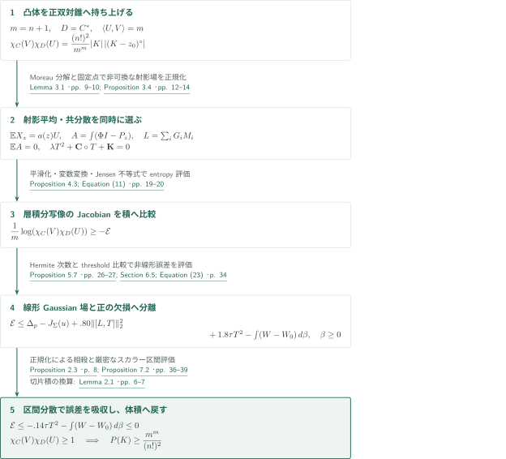
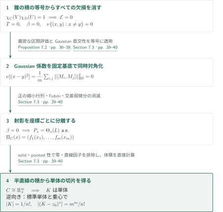
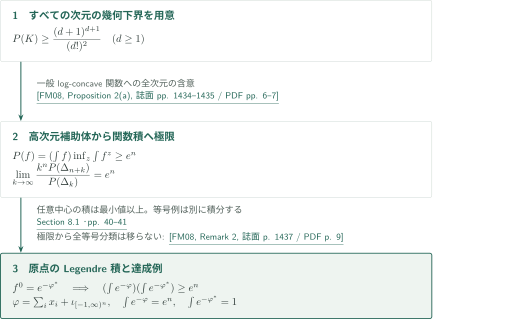
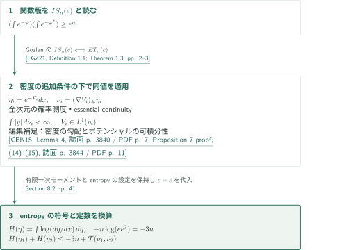

# The Mahler Conjecture for General Convex Bodies

**双対錐のLaplace積、Gaussian射影場、等号からの単体剛性**

OpenAIの2026年9月22日原稿は、一般凸体のSantaló中心での体積積の下界と、等号成立の単体による完全分類を主張する。証明は凸体を一つ高い次元の錐に持ち上げ、Gaussian射影場から得るentropy評価を非可換行列の区間平均不等式で閉じる。以下はその論証の概説であり、長いスカラー評価を含む全証明の独立検証ではない。

## 1. 主要結果

### Theorem 1.1 — 一般凸体のMahler不等式と等号

整数 $n\ge1$ と凸体 $K\subset\mathbb R^n$ に対して
$$
P(K):=|K|\,|(K-s(K))^\circ|\ge\frac{(n+1)^{n+1}}{(n!)^2},
$$
等号成立は $K$ が単体であることと同値である。ここで凸体は内部が空でないコンパクト凸集合、$s(K)\in\operatorname{int}K$ は $z\mapsto|(K-z)^\circ|$ の一意的最小点であり、
$$
(K-z)^\circ=\{y:\langle y,x-z\rangle\le1\text{ for all }x\in K\}.
$$
中心対称性や境界の滑らかさは仮定しない。$P(K)$ は中心についての**最小値**なので、同じ下界はすべての内部点 $z$ での $|K|\,|(K-z)^\circ|$ にも成立する。任意中心で等号になる、という主張ではない。

<!-- cite:main -->[Theorem 1.1 · p. 1](https://github.com/openai/math/blob/1581d4cbdd69a0faf34b2089614fe2a814316a6a/preprints/The-Mahler-Conjecture-for-General-Convex-Bodies-September-22-2026/paper.pdf)<!-- /cite -->

### Corollary 1.2 — 関数版

$n\ge1$、$\varphi:\mathbb R^n\to\mathbb R\cup\{+\infty\}$ はproper、下半連続、凸とし、$0<\int e^{-\varphi}<\infty$ とする。Fenchel–Legendre変換 $\varphi^*(y)=\sup_x(\langle x,y\rangle-\varphi(x))$ に対して
$$
\left(\int_{\mathbb R^n}e^{-\varphi(x)}\,dx\right)
\left(\int_{\mathbb R^n}e^{-\varphi^*(y)}\,dy\right)\ge e^n.
$$
第二積分は $+\infty$ でもよい。中心条件・偶性・正規化は不要である。定数の達成例は与えられるが、関数版の全等号例の分類はこの系の結論ではない。

<!-- cite:functional -->[Corollary 1.2 · p. 4](https://github.com/openai/math/blob/1581d4cbdd69a0faf34b2089614fe2a814316a6a/preprints/The-Mahler-Conjecture-for-General-Convex-Bodies-September-22-2026/paper.pdf)<!-- /cite -->

### Corollary 8.1 — Entropy–transport不等式

$n\ge1$ とし、$\eta_i(dx)=e^{-V_i(x)}dx$、$i=1,2$ は全次元のlog-concave確率測度、$V_i$ はproper、下半連続、凸とする。密度がessentially continuous、すなわち $\mathcal H^{n-1}$-ほとんどすべての $\partial\operatorname{supp}\eta_i$ 上で $e^{-V_i}=0$ と仮定する。するとmoment measure $\nu_i=(\nabla V_i)_\#\eta_i$ は有限一次モーメントを持ち、
$$
H(\eta_i):=\int\log(d\eta_i/dx)\,d\eta_i=-\int V_i\,d\eta_i
$$
は有限であり、
$$
H(\eta_1)+H(\eta_2)\le-3n+\mathcal T(\nu_1,\nu_2),\qquad
\mathcal T(\mu_1,\mu_2):=\inf_f\left\{\int f\,d\mu_1+\int f^*\,d\mu_2\right\}.
$$
下限はproper、下半連続、凸な $f$ 全体でとる。$\mathcal T$ は $+\infty$ を許す。$H$ はShannon微分entropyの負号であり、essential continuityはこの系に追加される仮定である。

<!-- cite:transport -->[Corollary 8.1 · p. 41](https://github.com/openai/math/blob/1581d4cbdd69a0faf34b2089614fe2a814316a6a/preprints/The-Mahler-Conjecture-for-General-Convex-Bodies-September-22-2026/paper.pdf)<!-- /cite -->

## 図の矢印に付した引用

<!-- reference-guide -->
略号のない定理・補題・節・式番号は本原稿 [The Mahler Conjecture for General Convex Bodies](https://github.com/openai/math/blob/1581d4cbdd69a0faf34b2089614fe2a814316a6a/preprints/The-Mahler-Conjecture-for-General-Convex-Bodies-September-22-2026/paper.pdf) を指します。外部入力には次の略号を使います。

- [Kla18](https://arxiv.org/pdf/1710.08084v2) Bo’az Klartag — *Isotropic constants and Mahler volumes*：錐のLaplace積への対応。本稿Lemma 2.1で符号・階乗を再計算。arXiv:1710.08084v2, 1 March 2018。
- [Sol19](https://arxiv.org/pdf/1810.04206v1) Valeriu Soltan — *Moreau-Type Characterizations of Polar Cones*：Moreau分解。本稿Lemma 3.1では正双対の符号で再証明。arXiv:1810.04206v1, 9 October 2018 (published 2019)。
- [Cha13](https://arxiv.org/pdf/1305.2471) Pattrawut Chansangiam — *Operator Monotone Functions: Characterizations and Integral Representations*：平方根の作用素単調性により共分散更新をspectral box内に保つ。arXiv:1305.2471v1, 11 May 2013。
- [HP02](https://houdre.math.gatech.edu/research/papers/mbernoulli7aout.pdf) Christian Houdré and Nicolas Privault — *Concentration and deviation inequalities in infinite dimensions via covariance representations*：Gaussian covarianceの半群表示。本稿Lemma 5.1でHermite展開による再証明。Author manuscript for Bernoulli 8(6), 2002; manuscript pagination。
- [Nof17](https://eprints.maths.manchester.ac.uk/2544/1/gendk_SIMAX_rev2c.pdf) Vanni Noferini — *A formula for the Fréchet derivative of a generalized matrix function*：対称行列関数の差商微分公式を固有値間の区間平均に変換。Author accepted manuscript gendk_SIMAX_rev2c; SIAM J. Matrix Anal. Appl. 38(2), 2017。
- [FM08](https://perso.math.u-pem.fr/fradelizi.matthieu/pdf/Santaloadvances.pdf) Matthieu Fradelizi and Mathieu Meyer — *Some functional inverse Santaló inequalities*：全次元の幾何不等式から一般log-concave関数の積下界を導く。Advances in Mathematics 218 (2008), 1430–1452; author personal copy with cover sheet。
- [FGZ21](https://arxiv.org/pdf/2109.00871v3) Matthieu Fradelizi, Nathael Gozlan, and Simon Zugmeyer — *Transport proofs of some functional inverse Santaló inequalities*：Gozlanのfunctional inverse Santalóとentropy–transportの同値を使用。arXiv:2109.00871v3, 9 September 2021。
- [CEK15](https://webusers.imj-prg.fr/~dario.cordero/Docs/articles/2015_moment_measures.pdf) Dario Cordero-Erausquin; Bo’az Klartag — *Moment measures*：編集補足：moment measureの有限一次モーメントとentropyの有限性を説明（原稿§8.2の明示引用ではない）。Journal of Functional Analysis 268 (2015), 3834–3866; published PDF。

各引用に結果番号とページを付します。誌面番号とPDF内の位置が異なる場合は両方を示します。GitHubの閲覧リンクではページ位置への自動移動を前提としません。
<!-- /reference-guide -->

## 2. Theorem 1.1 — 錐の積下界と等号の証明概略

<!-- proof-target:1 -->証明対象：[Theorem 1.1 · p. 1](https://github.com/openai/math/blob/1581d4cbdd69a0faf34b2089614fe2a814316a6a/preprints/The-Mahler-Conjecture-for-General-Convex-Bodies-September-22-2026/paper.pdf)<!-- /proof-target -->

**証明の道筋。** $m=n+1$ として凸体の積を正双対錐のLaplace積へ移す。座標とGaussian共分散を同時に正規化し、射影を層に沿って積分した写像に変数変換を適用する。残る誤差を線形Gaussian行列場と非負の層欠損に分け、固有値間の厳密な区間評価で吸収する。等号では捨てた欠損がすべて消え、射影が固定基底で座標ごとに分離する。

### 1. 中心を固定し、体積を錐のLaplace積へ移す

$z_0\in\operatorname{int}K$ を任意に固定し、$C=\{(tx,t):t\ge0,\ x\in K-z_0\}$、$D=C^*=\{y:\langle y,x\rangle\ge0\ (x\in C)\}$ とする。錐の $*$ は**正双対**であり、凸体の $\circ$ とは規約が異なる。$U=(0,m)$、$V=(0,1)$ に対して
$$
\chi_C(V)\chi_D(U)=\frac{(n!)^2}{m^m}|K|\,|(K-z_0)^\circ|,
\qquad \chi_C(V)=\int_Ce^{-\langle V,x\rangle}dx.
$$
$D$ の高さ $t$ の切片は $-t(K-z_0)^\circ$ であり、この負号と $\int_0^\infty t^ne^{-at}dt=n!a^{-m}$ が定数を決める。一般のclosed、solid、pointedな凸錐と内部の対 $U,V$、$\langle U,V\rangle=m$ について積が $1$ 以上なら十分である。$(C,D,U,V)\mapsto(BC,B^{-T}D,BU,B^{-T}V)$ は積とpairingを保存する。Klartagの対応は負双対規約で述べられており、本稿はこの計算を正双対でやり直す。

<!-- cite:cone -->[Lemma 2.1 · pp. 6–7](https://github.com/openai/math/blob/1581d4cbdd69a0faf34b2089614fe2a814316a6a/preprints/The-Mahler-Conjecture-for-General-Convex-Bodies-September-22-2026/paper.pdf)<!-- /cite -->
<!-- cite:klartag -->[&#91;Kla18, Lemma 2.1; Corollary 4.1, pp. 6–7, 15&#93;](https://arxiv.org/pdf/1710.08084v2#page=6)<!-- /cite -->

### 2. 射影の平均と共分散を同時に正規化する

$G$ を標準Gaussian、$\Sigma=I+T$、$Z=\Sigma^{1/2}G$、$a(z)=\phi(z)+z\Phi(z)$ とする。$\phi,\Phi$ は一次元標準Gaussianの密度・分布関数である。各層 $z\in\mathbb R$ に対してbias $\xi_z$ を選び、
$$
X_z=\Pi_C(Z+\xi_z),\quad Y_z=\Pi_D(-Z-\xi_z),\quad \mathbb EX_z=a(z)U
$$
とする。Moreau分解は $X_z-Y_z=Z+\xi_z$ と $\langle X_z,Y_z\rangle=0$ を与える。biasの存在は $\mathbb E\frac12|\Pi_C(Z+\xi)|^2-a(z)U\cdot\xi$ のcoercivityと厳密凸性から従う。射影の弱微分 $P_z=D\Pi_C(Z+\xi_z)$ は $0\le P_z\le I$ を満たすが、異なる層で可換・単調とは限らない。

<!-- cite:projection -->[Lemma 3.1 · pp. 9–10](https://github.com/openai/math/blob/1581d4cbdd69a0faf34b2089614fe2a814316a6a/preprints/The-Mahler-Conjecture-for-General-Convex-Bodies-September-22-2026/paper.pdf)<!-- /cite -->
<!-- cite:moreau -->[&#91;Sol19, Theorem 1.1, p. 1&#93;](https://arxiv.org/pdf/1810.04206v1#page=1)<!-- /cite -->

$A=\int(\Phi(z)I-P_z)dz$、$M_i=\mathbb E(G_iA)$、$L=\sum_iG_iM_i$ とおく。原稿の固定スカラープロファイルを $\mathsf C,\mathsf K$ と表記し、$\mathbf C=\mathbb E\mathsf C(L)$、$\mathbf K=\mathbb E\mathsf K(L)$ と区別する。Proposition 3.4は線形座標と $T$ を同時に選び、
$$
\mathbb EA=0,\qquad \lambda T^2+\mathbf C\circ T+\mathbf K=0,
\qquad -\mathbf C-2\lambda T\ge m_*I,
$$
を満たす。$\circ$ はJordan積、$\lambda=.65$、$m_*=.352$、$-.022I\le T\le.064I$ である。平方根の作用素単調性が共分散更新をこの範囲に保ち、座標方向の内向き評価とBrouwer固定点が平均の釣合いも実現する。共分散を先に $I$ に固定すると、後段で必要な行列相殺を得られない。

<!-- cite:field -->[Equation (7) · p. 11](https://github.com/openai/math/blob/1581d4cbdd69a0faf34b2089614fe2a814316a6a/preprints/The-Mahler-Conjecture-for-General-Convex-Bodies-September-22-2026/paper.pdf)<!-- /cite -->
<!-- cite:normalization -->[Proposition 3.4 · pp. 12–14](https://github.com/openai/math/blob/1581d4cbdd69a0faf34b2089614fe2a814316a6a/preprints/The-Mahler-Conjecture-for-General-Convex-Bodies-September-22-2026/paper.pdf)<!-- /cite -->
<!-- cite:sqrt -->[&#91;Cha13, Theorem 2.3, p. 4&#93;](https://arxiv.org/pdf/1305.2471#page=4)<!-- /cite -->

### 3. Entropy誤差を、線形場と層欠損に分離する

正の重みで $X_z,Y_z$ を積分し、平滑化した単射の錐値写像を作る。変数変換とJensen不等式で、そのlog Jacobianと線形コストをLaplace積へ比較する。Proposition 4.3は
$$
\frac1m\log(\chi_C(V)\chi_D(U))\ge-\mathcal E
$$
を与える。ここで $\mathcal E$ は原稿のentropy誤差汎関数である。この段階は積下界そのものをまだ証明しない。

<!-- cite:entropy -->[Proposition 4.3; Equation (11) · pp. 19–20](https://github.com/openai/math/blob/1581d4cbdd69a0faf34b2089614fe2a814316a6a/preprints/The-Mahler-Conjecture-for-General-Convex-Bodies-September-22-2026/paper.pdf)<!-- /cite -->

$R=A-L$ のGaussian次数は2以上、奇部分では3以上である。Gaussian covariance公式を $(1+N_G)^{-1}$ の形で使い、各次数の係数を評価する。適用先はGaussian Sobolev空間の**ベクトル場**であり、可測な $P_z$ をさらに微分する議論ではない。原稿Lemma 5.1はHoudré–Privaultの半群公式をHermite展開で再証明する。

<!-- cite:covariance -->[Lemma 5.1 · pp. 20–21](https://github.com/openai/math/blob/1581d4cbdd69a0faf34b2089614fe2a814316a6a/preprints/The-Mahler-Conjecture-for-General-Convex-Bodies-September-22-2026/paper.pdf)<!-- /cite -->
<!-- cite:hp -->[&#91;HP02, Proposition 2.1, Equation (2.4), p. 3&#93;](https://houdre.math.gatech.edu/research/papers/mbernoulli7aout.pdf#page=3)<!-- /cite -->

$\Theta_z(L)=1_{(-\infty,z]}(L)$ と比べた欠損は、固有値 $x_i$ ごとの $( (P_z)_{ii}-1_{x_i\le z})(x_i-z)\ge0$ を通して正測度 $\beta$ を作る。層の非単調性や非可換性を捨てずに残す点が重要である。Proposition 5.7と§6の評価を合わせると、
$$
\mathcal E\le\Delta_p-J_\Sigma(u)+.80\|[L,T]\|_2^2
+1.8\tau T^2-\int(W-W_0)\,d\beta,
\qquad W-W_0>0.
$$
$\tau B=m^{-1}\mathbb E\operatorname{tr}B$、$\|B\|_2^2=\tau(B^TB)$。$\Delta_p,J_\Sigma(u)$ は固定プロファイル $u$ の線形場 $L$ 上での平均差とDirichlet項であり、ここで右辺の最後の積分以外は $L,T$ だけに依存する。

<!-- cite:threshold -->[Section 5.3; Lemma 5.4 · pp. 23–24](https://github.com/openai/math/blob/1581d4cbdd69a0faf34b2089614fe2a814316a6a/preprints/The-Mahler-Conjecture-for-General-Convex-Bodies-September-22-2026/paper.pdf)<!-- /cite -->
<!-- cite:decomposition -->[Proposition 5.7 · pp. 26–27](https://github.com/openai/math/blob/1581d4cbdd69a0faf34b2089614fe2a814316a6a/preprints/The-Mahler-Conjecture-for-General-Convex-Bodies-September-22-2026/paper.pdf)<!-- /cite -->
<!-- cite:errors -->[Section 6.5; Equation (23) · p. 34](https://github.com/openai/math/blob/1581d4cbdd69a0faf34b2089614fe2a814316a6a/preprints/The-Mahler-Conjecture-for-General-Convex-Bodies-September-22-2026/paper.pdf)<!-- /cite -->

### 4. 固有値間の厳密な区間評価で下界を閉じる

行列関数の微分を差商で書くと、固有値 $x_i,x_j$ 間の区間平均が現れる。Daleckiĭ–Kreĭn公式の適用には固有ベクトルの微分を要せず、対称行列と滑らかなプロファイルで十分である。Gaussian部分積分と正規化式が $S-I$、$S=\sum_iM_i^2$ にかかる符号不定項を相殺する。Proposition 2.3の厳密な区間不等式は、非一致の固有値対に残る誤差をプロファイルの区間分散に吸収する。

<!-- cite:spectral -->[Lemma 7.1 · pp. 35–36](https://github.com/openai/math/blob/1581d4cbdd69a0faf34b2089614fe2a814316a6a/preprints/The-Mahler-Conjecture-for-General-Convex-Bodies-September-22-2026/paper.pdf)<!-- /cite -->
<!-- cite:dk -->[&#91;Nof17, Theorem 2.11, 誌面 p. 6 / PDF p. 7&#93;](https://eprints.maths.manchester.ac.uk/2544/1/gendk_SIMAX_rev2c.pdf#page=7)<!-- /cite -->
このプロファイルは $u=(\pi,q)$ で、$\pi$ は $w\operatorname{arsinh}(x/s)$ を角度に持つ円周成分、$q=k-\sqrt{b-r^2-d}$ である。恒等式 $d+|u|^2=c+2kq$ が二次補正を一成分に集約し、円周成分の変動が非自明な区間の厳密な分散を供給する。区間不等式はこの分散で差商誤差と共分散の交換子コストを同時に支配する。

<!-- cite:scalar -->[Proposition 2.3 · p. 8](https://github.com/openai/math/blob/1581d4cbdd69a0faf34b2089614fe2a814316a6a/preprints/The-Mahler-Conjecture-for-General-Convex-Bodies-September-22-2026/paper.pdf)<!-- /cite -->

Proposition 7.2は $\Delta_p-J_\Sigma(u)+.80\|[L,T]\|_2^2\le-1.94\tau T^2$ を与え、したがって
$$
\mathcal E\le-.14\tau T^2-\int(W-W_0)\,d\beta\le0.
$$
これをentropy評価に戻して錐の積を $1$ 以上とし、切片の公式から任意中心 $z_0$ の下界を得る。$z_0=s(K)$ を選べばTheorem 1.1の不等式となる。Appendices A/Bは節点の有理区間計算だけでなく、節点間の解析的補間と無限遠の評価を含む。これらの全証明書の再実行・全評価の独立検証は本概説では未完了であり、Proposition 2.3を確認済みの数値実験として扱わない。

<!-- cite:linear -->[Proposition 7.2 · pp. 36–39](https://github.com/openai/math/blob/1581d4cbdd69a0faf34b2089614fe2a814316a6a/preprints/The-Mahler-Conjecture-for-General-Convex-Bodies-September-22-2026/paper.pdf)<!-- /cite -->
<!-- cite:appendices -->[Appendix A.2; Proposition B.1 · pp. 43–45, 54–55](https://github.com/openai/math/blob/1581d4cbdd69a0faf34b2089614fe2a814316a6a/preprints/The-Mahler-Conjecture-for-General-Convex-Bodies-September-22-2026/paper.pdf)<!-- /cite -->

### 5. 消える欠損から単体を復元し、逆向きを計算する

錐の積が $1$ なら $0\ge-\mathcal E\ge0$ なので $\mathcal E=0$。Proposition 7.2の証明で保持された厳密性から $T=0$、$\beta=0$、固有値対の測度 $\nu$ は対角に台を持つ。さらに
$$
\nu[(x-y)^2]=\frac1m\sum_{i,j}\|[M_i,M_j]\|_{\mathrm{HS}}^2=0
$$
より、すべての $M_i$ は一つの固定直交基底で同時対角化できる。$\beta=0$ と $0\le P_z\le I$ を使うと $P_z=\Theta_z(L)$ がほとんど至る所で従う。Fubiniで一つの層を固定し、Gaussian密度が全点で正であることから $D\Pi_C$ はLebesgue-a.e.にその基底で対角となる。

交差弱微分が消えるLipschitz射影は座標ごとに分離する。その像である錐 $C$ は一次元閉凸錐の直積であり、solid性が $\{0\}$、pointed性が $\mathbb R$ の因子を排除するので各因子は半直線になる。元の錐に戻すと独立な $m=n+1$ 本のrayがあり、高さ1の切片が単体になる。$P(K)$ の等号は達成点 $s(K)$ でこの議論に入る。

逆に標準単体 $K=\operatorname{conv}(0,e_1,\ldots,e_n)$ と $z_0=\mathbf1/m$ に対し、極体は $\operatorname{conv}(m\mathbf1,-me_1,\ldots,-me_n)$、その体積は $m^m/n!$、$|K|=1/n!$。下界と合わせてこの中心が最小を達成し、affine invarianceがすべての単体へ運ぶ。$n=1$ は区間で $(b-a)((z-a)^{-1}+(b-z)^{-1})\ge4$、等号は中点、という直接計算で処理される。

<!-- cite:rigidity -->[Section 7.3 · pp. 39–40](https://github.com/openai/math/blob/1581d4cbdd69a0faf34b2089614fe2a814316a6a/preprints/The-Mahler-Conjecture-for-General-Convex-Bodies-September-22-2026/paper.pdf)<!-- /cite -->
<!-- cite:center -->[Section 2.1 · pp. 5–6](https://github.com/openai/math/blob/1581d4cbdd69a0faf34b2089614fe2a814316a6a/preprints/The-Mahler-Conjecture-for-General-Convex-Bodies-September-22-2026/paper.pdf)<!-- /cite -->

## 3. Corollary 1.2 — 全次元の幾何結果から関数版へ

<!-- proof-target:2 -->証明対象：[Corollary 1.2 · p. 4](https://github.com/openai/math/blob/1581d4cbdd69a0faf34b2089614fe2a814316a6a/preprints/The-Mahler-Conjecture-for-General-Convex-Bodies-September-22-2026/paper.pdf)<!-- /proof-target -->

**証明の道筋。** 一定次元の体積不等式の言い換えではなく、補助凸体を高次元に作って極限をとるFradelizi–Meyerの含意を使う。中心で最小化した関数積から原点でのLegendre変換の積へ戻り、別に達成例を計算する。

### 1. 中心最小化された関数積を使う

$f=e^{-\varphi}$ とし、$f^z(y)=\inf_{x:f(x)>0}e^{-\langle x-z,y-z\rangle}/f(x)$、$P(f)=(\int f)\inf_z\int f^z$ とおく。Fradelizi–Meyer Proposition 2(a)は、すべての次元の一般凸体Mahler下界から $P(f)\ge e^n$ を与える。補助次元 $k$ で単体を用いた比 $k^nP(\Delta_{n+k})/P(\Delta_k)$ の極限が $e^n$ になる。Theorem 1.1はこの全次元仮定を満たす。

$f^0=e^{-\varphi^*}$ なので、原点での積は中心最小値 $P(f)$ 以上である。ここで中心を $0$ に正規化したという仮定は加えない。第二積分が無限の場合は不等式が直ちに成立する。

<!-- cite:fm -->[&#91;FM08, Proposition 2(a), 誌面 pp. 1434–1435 / PDF pp. 6–7&#93;](https://perso.math.u-pem.fr/fradelizi.matthieu/pdf/Santaloadvances.pdf#page=6)<!-- /cite -->
<!-- cite:func-proof -->[Section 8.1 · pp. 40–41](https://github.com/openai/math/blob/1581d4cbdd69a0faf34b2089614fe2a814316a6a/preprints/The-Mahler-Conjecture-for-General-Convex-Bodies-September-22-2026/paper.pdf)<!-- /cite -->

### 2. 定数の達成と分類の区別

$\iota_A$ を凸解析のindicatorとし、
$$
\varphi(x)=\sum_i x_i+\iota_{[-1,\infty)^n}(x),\qquad
\varphi^*(y)=n-\sum_i y_i+\iota_{(-\infty,1]^n}(y).
$$
このとき $\int e^{-\varphi}=e^n$、$\int e^{-\varphi^*}=1$ である。したがって下界は鋭い。一方、Fradelizi–Meyerの高次元極限は等号例をそのまま移す議論ではなく、幾何側の単体分類から関数側の完全分類は従わない。

<!-- cite:func-proof -->[Section 8.1 · pp. 40–41](https://github.com/openai/math/blob/1581d4cbdd69a0faf34b2089614fe2a814316a6a/preprints/The-Mahler-Conjecture-for-General-Convex-Bodies-September-22-2026/paper.pdf)<!-- /cite -->
<!-- cite:fm-equality -->[&#91;FM08, Remark 2, 誌面 p. 1437 / PDF p. 9&#93;](https://perso.math.u-pem.fr/fradelizi.matthieu/pdf/Santaloadvances.pdf#page=9)<!-- /cite -->

## 4. Corollary 8.1 — 関数積からentropy–transportへ

<!-- proof-target:3 -->証明対象：[Corollary 8.1 · p. 41](https://github.com/openai/math/blob/1581d4cbdd69a0faf34b2089614fe2a814316a6a/preprints/The-Mahler-Conjecture-for-General-Convex-Bodies-September-22-2026/paper.pdf)<!-- /proof-target -->

**証明の道筋。** Corollary 1.2をfunctional inverse Santaló $IS_n(c)$ の $c=e$ と読んで、Gozlanの同値定理をessentially continuousな密度に適用する。

### 1. 仮定を保ったまま定数を換算する

Fradelizi–Gozlan–ZugmeyerのDefinition 1.1とTheorem 1.3は、$IS_n(c)$ と
$$
H(\eta_1)+H(\eta_2)\le-n\log(ce^2)+\mathcal T(\nu_1,\nu_2)
$$
の同値を、全次元log-concave確率測度のessentially continuousな密度のクラスで述べる。この入力の測度・moment measureの設定に本稿Corollary 8.1の仮定を合わせ、$c=e$ を代入すると $-n\log(e^3)=-3n$ を得る。原稿はmoment measureの一次モーメントとentropyの有限性もこの設定で述べる。以下はその有限性を説明する編集補足であり、原稿§8.2が明示的に引用した経路ではない。Cordero-Erausquin–KlartagのLemma 4は可積分log-concave密度 $\rho=e^{-V}$ に対して $\int|\nabla\rho|<\infty$ を与える。したがって $\nu=(\nabla V)_\#\eta$ について $\int|y|\,d\nu=\int|\nabla V|e^{-V}dx<\infty$。同論文Proposition 7の証明(14)–(15)は $0<\int e^{-V}<\infty$ の凸 $V$ に対して $V\in L^1(\eta)$ を示すので、$H(\eta)=-\int V\,d\eta$ は有限である。これらを各 $i$ に適用して系の有限性の結論を得る。直接使う記述と適用を確認したが、外部同値定理・可積分性定理の全証明は独立検証していない。

<!-- cite:cek-finite -->[&#91;CEK15, Lemma 4, 誌面 p. 3840 / PDF p. 7; Proposition 7 proof, (14)–(15), 誌面 p. 3844 / PDF p. 11&#93;](https://webusers.imj-prg.fr/~dario.cordero/Docs/articles/2015_moment_measures.pdf#page=7)<!-- /cite -->

<!-- cite:fgz -->[&#91;FGZ21, Definition 1.1; Theorem 1.3, pp. 2–3&#93;](https://arxiv.org/pdf/2109.00871v3#page=2)<!-- /cite -->
<!-- cite:et-proof -->[Section 8.2 · p. 41](https://github.com/openai/math/blob/1581d4cbdd69a0faf34b2089614fe2a814316a6a/preprints/The-Mahler-Conjecture-for-General-Convex-Bodies-September-22-2026/paper.pdf)<!-- /cite -->

## 5. どの論文が、どの段階を担うか

| 入力 | 利用箇所 | 役割・適用条件 | 確認範囲 |
|---|---|---|---|
| Klartagの錐対応 | Lemma 2.1 | proper convex coneの断面積とLaplace積。正双対への符号変更と階乗を本稿で再計算 | 原典の記述・本稿の計算を照合 |
| Moreau分解（Soltanの記述） | Lemma 3.1 | 閉凸錐への射影と負双対への射影を直交分解。$D$ は正双対なので符号を変える | Theorem 1.1と本稿の再証明を照合 |
| ChansangiamのLöwner–Heinz不等式 | Proposition 3.4 | 正行列の平方根の単調性。行列の可換性は不要 | $r=1/2$ の記述と共分散更新を照合 |
| Houdré–Privaultのcovariance公式 | Lemma 5.1 | Sobolev場のGaussian covarianceを逆生成作用素で表す | 半群公式と本稿のHermite再証明を照合 |
| Noferini所収のDaleckiĭ–Kreĭn公式 | Lemma 7.1 | 滑らかな関数の対称行列微分を差商に変える | 記述・適用箇所を照合 |
| Fradelizi–Meyer Proposition 2(a) | §8.1 | 全次元の一般凸体下界から関数下界へ | 記述、高次元の極限、等号の留保を照合 |
| Cordero-Erausquin–Klartag Lemma 4・Proposition 7証明 | Corollary 8.1への編集補足（原稿§8.2の明示引用ではない） | moment measureの有限一次モーメントと有限entropy | 直接の可積分性記述と適用を確認。全証明は未検証 |
| Gozlanの同値（Fradelizi–Gozlan–Zugmeyer Theorem 1.3） | §8.2 | essential continuity付きのentropy–transportへ | 同値の記述・符号・定数を照合。外部証明は未検証 |

以上の外部入力の証明全体を独立検証したものではない。カタログ087の対称Mahler原稿は、本稿の一般定数より強い対称体用の定数を扱う比較対象であり、本稿Theorem 1.1の証明入力ではない。Symplectic Balls in Symmetric Polar Productsへの直接依存も、本稿の読解範囲には記録されていない。

## 6. 原典を読む入口と確認範囲

<!-- reading-list -->
- [Lemma 2.1 · pp. 6–7](https://github.com/openai/math/blob/1581d4cbdd69a0faf34b2089614fe2a814316a6a/preprints/The-Mahler-Conjecture-for-General-Convex-Bodies-September-22-2026/paper.pdf) — 中心・符号・階乗を固定する。
- [Proposition 3.4 · pp. 12–14](https://github.com/openai/math/blob/1581d4cbdd69a0faf34b2089614fe2a814316a6a/preprints/The-Mahler-Conjecture-for-General-Convex-Bodies-September-22-2026/paper.pdf) — 座標と共分散を同時に選ぶ固定点。
- [Proposition 4.3; Equation (11) · pp. 19–20](https://github.com/openai/math/blob/1581d4cbdd69a0faf34b2089614fe2a814316a6a/preprints/The-Mahler-Conjecture-for-General-Convex-Bodies-September-22-2026/paper.pdf) — 積の対数を誤差汎関数へ帰着する。
- [Proposition 7.2 · pp. 36–39](https://github.com/openai/math/blob/1581d4cbdd69a0faf34b2089614fe2a814316a6a/preprints/The-Mahler-Conjecture-for-General-Convex-Bodies-September-22-2026/paper.pdf) — 区間評価と正規化の相殺。
- [Section 7.3 · pp. 39–40](https://github.com/openai/math/blob/1581d4cbdd69a0faf34b2089614fe2a814316a6a/preprints/The-Mahler-Conjecture-for-General-Convex-Bodies-September-22-2026/paper.pdf) — 等号から固定基底での可換性と単体を得る。
- [Appendix A.2; Proposition B.1 · pp. 43–45, 54–55](https://github.com/openai/math/blob/1581d4cbdd69a0faf34b2089614fe2a814316a6a/preprints/The-Mahler-Conjecture-for-General-Convex-Bodies-September-22-2026/paper.pdf) — 定数を支える有理証明書・補間・尾部評価。独立検証は未完了。
- [Section 8.1 · pp. 40–41](https://github.com/openai/math/blob/1581d4cbdd69a0faf34b2089614fe2a814316a6a/preprints/The-Mahler-Conjecture-for-General-Convex-Bodies-September-22-2026/paper.pdf) — 全次元極限と等号例。
- [Section 8.2 · p. 41](https://github.com/openai/math/blob/1581d4cbdd69a0faf34b2089614fe2a814316a6a/preprints/The-Mahler-Conjecture-for-General-Convex-Bodies-September-22-2026/paper.pdf) — essential continuityと輸送の符号規約。
<!-- /reading-list -->

固定commit `1581d4cbdd69` の72ページ原稿を使用した。主定理の仮定・結論、中心と錐の換算、同時正規化、entropyから線形場への主要接続、§7の等号回収、§8の二つの帰結を読んだ。外部入力は上表の記述と利用先を照合した。

未確認として残るのは、Appendices A/Bの有理証明書の再実行と全補間・尾部評価、§§4–6の全可積分性・非可換核評価の独立再計算、外部結果の全証明である。これらは鋭い定数と等号分類を支える重要部分であり、概説の完成を論文全体の正しさの認定とはしない。担当は明示指定の `gpt-6-astra`。原典から新規に執筆した。
