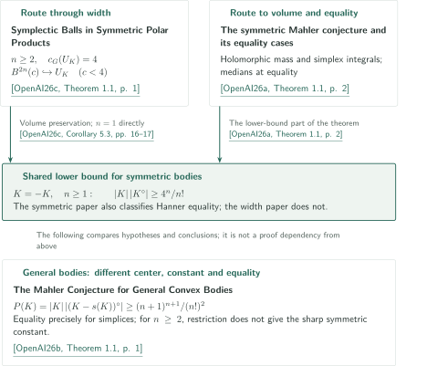

# The Mahler conjectures and symplectic width

**Sharp volume products and equality classifications, alongside ball embeddings in symmetric polar products**

Catalogue 087 contains three manuscripts on the symmetric Mahler inequality and Hanner equality classification, the Santaló-centered inequality and simplex rigidity for general convex bodies, and the Gromov width of symmetric polar products. This guide describes the authors' claims in fixed source versions and the routes to their proofs. The three papers do not form a sequential chain of assumptions.

## 1. Papers and guides in official order

CATALOGINVENTORYTOKEN

## 2. Where conclusions meet and where hypotheses differ

The diagram's citation keys all refer to OpenAI manuscripts dated September 22, 2026: **[OpenAI26a]**, *The symmetric Mahler conjecture and its equality cases*; **[OpenAI26b]**, *The Mahler Conjecture for General Convex Bodies*; and **[OpenAI26c]**, *Symplectic Balls in Symmetric Polar Products*. Citations in the diagram open the original sources.

The symmetric paper turns mass at a holomorphic zero into a real simplex integral. When missing volume vanishes, a common feasibility witness yields metric medians. This supplies both the lower bound and the direction asserting that equality forces a linear Hanner body. See the [symmetric theorem and both directions of equality](../symmetric-mahler/article.en.md#proof-overview).

The width paper combines a ball from holomorphic vanishing with a uniform horizontal integral estimate, embedding balls of every capacity $c<4$ into the real $2n$-dimensional domain $U_K=\operatorname{int}K\times\operatorname{int}K^\circ$. Volume preservation yields the same symmetric lower bound $4^n/n!$, but not the Hanner classification. The papers describe a shared lens construction as background; the width proof does not use the symmetric paper's volume theorem or equality classification. See the [width construction and independent upper bound](../symplectic-polar-products/article.en.md#proof-1), and the [volume consequence](../symplectic-polar-products/article.en.md#proof-4).

<!-- cite:symplectic-background -->[&#91;OpenAI26c, Background and prior constructions, p. 2&#93;](https://github.com/openai/math/blob/1581d4cbdd69a0faf34b2089614fe2a814316a6a/preprints/Symplectic-Balls-in-Symmetric-Polar-Products-September-22-2026/paper.pdf)<!-- /cite -->

The general paper studies $P(K)=|K|\,|(K-s(K))^\circ|$. It passes to Laplace integrals on positive-dual cones, then uses simultaneous normalization of Gaussian projections, noncommutative layer defects, and strict spectral interval estimates to obtain simplex rigidity. For $n\ge2$, its constant $(n+1)^{n+1}/(n!)^2$ is smaller than the symmetric constant $4^n/n!$. Restricting the general theorem to symmetric bodies therefore does not give the sharp symmetric result or the Hanner classification. See the [general lower bound](../general-mahler/article.en.md#general-bound) and [simplex equality classification](../general-mahler/article.en.md#general-equality).

<!-- cite:general-comparison -->[&#91;OpenAI26b, Introduction, comparison with symmetric case, p. 1&#93;](https://github.com/openai/math/blob/1581d4cbdd69a0faf34b2089614fe2a814316a6a/preprints/The-Mahler-Conjecture-for-General-Convex-Bodies-September-22-2026/paper.pdf)<!-- /cite -->
<!-- cite:symmetric-comparison -->[&#91;OpenAI26a, §1.1, comparison with general case, p. 3&#93;](https://github.com/openai/math/blob/1581d4cbdd69a0faf34b2089614fe2a814316a6a/preprints/The-symmetric-Mahler-conjecture-and-its-equality-cases-September-22-2026/paper.pdf)<!-- /cite -->

## 3. Consequences branching after the main theorems

The geometric-to-functional passage uses the Fradelizi–Meyer implication through auxiliary convex bodies of increasing dimension, rather than a reformulation in one fixed dimension. For even proper lower-semicontinuous convex potentials, the integral product is at least $4^n$; for general potentials without evenness, it is at least $e^n$. Both require $0<\int e^{-\varphi}<\infty$ and allow an infinite conjugate integral. The geometric equality classifications do not automatically classify all functional equality cases.

<!-- cite:symmetric-functional -->[&#91;OpenAI26a, Corollaries 1.2–1.3 and proofs, pp. 4–5&#93;](https://github.com/openai/math/blob/1581d4cbdd69a0faf34b2089614fe2a814316a6a/preprints/The-symmetric-Mahler-conjecture-and-its-equality-cases-September-22-2026/paper.pdf)<!-- /cite -->
<!-- cite:general-functional -->[&#91;OpenAI26b, §8; Corollaries 1.2 and 8.1, pp. 40–41&#93;](https://github.com/openai/math/blob/1581d4cbdd69a0faf34b2089614fe2a814316a6a/preprints/The-Mahler-Conjecture-for-General-Convex-Bodies-September-22-2026/paper.pdf)<!-- /cite -->

| Starting point | Consequence and conditions | Guide |
|---|---|---|
| The all-dimensional symmetric lower bound | Even functional product $\ge4^n$; for symmetric full-dimensional log-concave probability measures, essential continuity additionally gives entropy–transport | [Functional](../symmetric-mahler/article.en.md#proof-4) · [transport](../symmetric-mahler/article.en.md#proof-5) |
| The all-dimensional general lower bound | General functional product $\ge e^n$; full-dimensional log-concave probability measures with essential continuity give entropy–transport | [Functional](../general-mahler/article.en.md#proof-2) · [transport](../general-mahler/article.en.md#proof-3) |
| Balls of every capacity $c<4$ in the width paper | For $n\ge3$, strict volume and pairwise-capacity conditions on finitely many positive $R_i$ give disjoint neighborhood embeddings of closed balls | [Sufficient packing criterion](../symplectic-polar-products/article.en.md#proof-5) |

The last row uses Theorem 1.1 of catalogue 343's *Symplectic Ball Packings in Higher Dimensions*, OpenAI, September 23, 2026 (**[OpenAI26p]**). Its application is Corollary 5.5 of the width paper, not the main width theorem or the Mahler inequality. The inequalities $\sum_iR_i^n<4^n$ and $R_i+R_j<4$ ($i<j$) allow one $c<4$; a packing into that ball is composed with the width embedding. The resulting conditions for the polar product are sufficient, not claimed necessary and sufficient.

<!-- cite:packing-source -->[&#91;OpenAI26p, Theorem 1.1, p. 2&#93;](https://github.com/openai/math/blob/1581d4cbdd69a0faf34b2089614fe2a814316a6a/preprints/Symplectic-Ball-Packings-in-Higher-Dimensions-September-23-2026/paper.pdf)<!-- /cite -->
<!-- cite:packing-use -->[&#91;OpenAI26c, Corollary 5.5, p. 17&#93;](https://github.com/openai/math/blob/1581d4cbdd69a0faf34b2089614fe2a814316a6a/preprints/Symplectic-Balls-in-Symmetric-Polar-Products-September-22-2026/paper.pdf)<!-- /cite -->

## 4. Sources, versions, and checking scope

The official heading is *The Mahler conjectures and symplectic width*. The subject is the fourth field in the official table of contents, *Convex and metric geometry* (087–101), following print/PDF p.10 of overview.pdf. The alternate CONTENTS heading, *The Mahler conjectures, functional inequalities and polar-product symplectic width*, is retained in the inventory.

<!-- cite:catalog-source -->[OpenAI Research Catalog · Catalogue 087, Convex and metric geometry · p. 10](https://github.com/openai/math/blob/1581d4cbdd69a0faf34b2089614fe2a814316a6a/overview.pdf)<!-- /cite -->

All three manuscripts are dated September 22, 2026, at fixed official commit `1581d4c`. The bilingual writing and content checks use explicitly selected `gpt-6-astra`, comparing the manuscripts' hypotheses and conclusions with selected direct inputs and their uses. Each article states its scope. Complete recomputation of the general paper's rational certificates, interpolation and tail bounds, full external proofs, and recursive verification of the bibliography remain incomplete. These checks are not expert peer review or independent verification of complete proofs.
