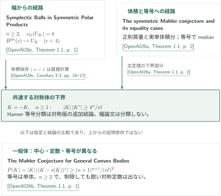

# Mahler予想とシンプレクティック幅

**体積積の鋭い下界・等号分類と、対称凸体と極体の積への球埋込み**

カタログ087は、対称凸体のMahler不等式とHanner等号分類、一般凸体のSantaló中心での不等式と単体剛性、対称凸体と極体の積のGromov幅を扱う3原稿からなる。以下は固定版の著者の主張とその証明経路への案内であり、3本を順に仮定する依存鎖ではない。

## 1. 公式順の論文と概説

CATALOGINVENTORYTOKEN

## 2. 結論が合流する箇所と、仮定が異なる箇所

図の引用キーは、いずれもOpenAI、September 22, 2026の原稿を表す。**[OpenAI26a]** *The symmetric Mahler conjecture and its equality cases*、**[OpenAI26b]** *The Mahler Conjecture for General Convex Bodies*、**[OpenAI26c]** *Symplectic Balls in Symmetric Polar Products*。原典へのリンクは図の引用から開ける。

対称版は、正則零点の質量評価を実単体積分に変え、欠損体積が消える場合の共通実行可能ベクトルからmetric medianを取り出す。これが下界だけでなく、等号が線形Hanner体に限られるという方向を担う。[対称版の主定理と両方向の等号説明](../symmetric-mahler/article.ja.md#proof-overview)へ。

幅論文は、正則零点からの球と一様な水平積分評価を組み合わせ、容量 $c<4$ の球を実次元 $2n$ の $U_K=\operatorname{int}K\times\operatorname{int}K^\circ$ に入れる。体積保存から対称版と同じ $4^n/n!$ の下界が得られるが、Hanner分類は含まない。両原稿はレンズを共有する背景を述べる一方、幅の証明は対称版の体積定理・等号分類を使わない。[幅の構成と独立な上界](../symplectic-polar-products/article.ja.md#proof-1)、[体積への帰結](../symplectic-polar-products/article.ja.md#proof-4)へ。

<!-- cite:symplectic-background -->[&#91;OpenAI26c, Background and prior constructions, p. 2&#93;](https://github.com/openai/math/blob/1581d4cbdd69a0faf34b2089614fe2a814316a6a/preprints/Symplectic-Balls-in-Symmetric-Polar-Products-September-22-2026/paper.pdf)<!-- /cite -->

一般版は $P(K)=|K|\,|(K-s(K))^\circ|$ を対象とする。正双対錐のLaplace積へ帰着し、Gaussian射影の同時正規化、非可換な層欠損、厳密な固有値区間評価を通して単体剛性まで導く。一般版の定数 $(n+1)^{n+1}/(n!)^2$ は、$n\ge2$ では対称版の $4^n/n!$ より小さい。一般版を対称体に制限するだけでは鋭い対称版やHanner分類は得られない。[一般版の下界](../general-mahler/article.ja.md#general-bound)と[単体等号分類](../general-mahler/article.ja.md#general-equality)へ。

<!-- cite:general-comparison -->[&#91;OpenAI26b, Introduction, comparison with symmetric case, p. 1&#93;](https://github.com/openai/math/blob/1581d4cbdd69a0faf34b2089614fe2a814316a6a/preprints/The-Mahler-Conjecture-for-General-Convex-Bodies-September-22-2026/paper.pdf)<!-- /cite -->
<!-- cite:symmetric-comparison -->[&#91;OpenAI26a, §1.1, comparison with general case, p. 3&#93;](https://github.com/openai/math/blob/1581d4cbdd69a0faf34b2089614fe2a814316a6a/preprints/The-symmetric-Mahler-conjecture-and-its-equality-cases-September-22-2026/paper.pdf)<!-- /cite -->

## 3. 主定理の後に分岐する帰結

幾何から関数型への移行は、補助凸体の次元を増やすFradelizi–Meyerの含意を使う。幾何定理を固定した次元だけで使う書換えではない。偶なproper下半連続凸ポテンシャルでは積分積の下界は $4^n$、偶性のない一般ポテンシャルでは $e^n$ となる（いずれも $0<\int e^{-\varphi}<\infty$、双対積分は無限でもよい）。幾何的な等号分類から、関数型の全等号例の分類は自動的には移らない。

<!-- cite:symmetric-functional -->[&#91;OpenAI26a, Corollaries 1.2–1.3 and proofs, pp. 4–5&#93;](https://github.com/openai/math/blob/1581d4cbdd69a0faf34b2089614fe2a814316a6a/preprints/The-symmetric-Mahler-conjecture-and-its-equality-cases-September-22-2026/paper.pdf)<!-- /cite -->
<!-- cite:general-functional -->[&#91;OpenAI26b, §8; Corollaries 1.2 and 8.1, pp. 40–41&#93;](https://github.com/openai/math/blob/1581d4cbdd69a0faf34b2089614fe2a814316a6a/preprints/The-Mahler-Conjecture-for-General-Convex-Bodies-September-22-2026/paper.pdf)<!-- /cite -->

| 出発点 | 帰結と使用条件 | 説明先 |
|---|---|---|
| 対称版の全次元の下界 | 偶関数の積分積 $\ge4^n$。対称な全次元log-concave確率測度では、さらにessential continuityの下でentropy–transportへ | [関数型](../symmetric-mahler/article.ja.md#proof-4)・[輸送](../symmetric-mahler/article.ja.md#proof-5) |
| 一般版の全次元の下界 | 一般関数の積分積 $\ge e^n$。全次元log-concave確率測度のessential continuityの下でentropy–transportへ | [関数型](../general-mahler/article.ja.md#proof-2)・[輸送](../general-mahler/article.ja.md#proof-3) |
| 幅論文の容量 $c<4$ の球 | $n\ge3$、有限正容量 $R_i$ の厳密な体積・対容量条件から閉球近傍の非交差埋込み | [充填の十分条件](../symplectic-polar-products/article.ja.md#proof-5) |

最後の行はカタログ343の *Symplectic Ball Packings in Higher Dimensions*、OpenAI、September 23, 2026（**[OpenAI26p]**）のTheorem 1.1を使う。利用先は幅論文のCorollary 5.5であり、主幅定理やMahler不等式の証明入力ではない。全ての $R_i$ に対し $\sum_iR_i^n<4^n$、$R_i+R_j<4$ ($i<j$) から一つの $c<4$ を選び、球内充填と幅の埋込みを合成する。この極体との積への十分条件を必要十分条件とは扱わない。

<!-- cite:packing-source -->[&#91;OpenAI26p, Theorem 1.1, p. 2&#93;](https://github.com/openai/math/blob/1581d4cbdd69a0faf34b2089614fe2a814316a6a/preprints/Symplectic-Ball-Packings-in-Higher-Dimensions-September-23-2026/paper.pdf)<!-- /cite -->
<!-- cite:packing-use -->[&#91;OpenAI26c, Corollary 5.5, p. 17&#93;](https://github.com/openai/math/blob/1581d4cbdd69a0faf34b2089614fe2a814316a6a/preprints/Symplectic-Balls-in-Symmetric-Polar-Products-September-22-2026/paper.pdf)<!-- /cite -->

## 4. 原典・版と確認範囲

公式見出しは *The Mahler conjectures and symplectic width*。公式分野は公式目次の第4分野 *Convex and metric geometry*（087–101）、overview.pdfの誌面/PDF p.10に従う。CONTENTSの別見出し *The Mahler conjectures, functional inequalities and polar-product symplectic width* も台帳に保持した。

<!-- cite:catalog-source -->[OpenAI Research Catalog · Catalogue 087, Convex and metric geometry · p. 10](https://github.com/openai/math/blob/1581d4cbdd69a0faf34b2089614fe2a814316a6a/overview.pdf)<!-- /cite -->

各原稿の版はSeptember 22, 2026、公式固定commitは `1581d4c`。日英記事の執筆・内容点検には明示指定した `gpt-6-astra` を用い、原稿の仮定・結論と選んだ直接入力の使用箇所を照合する。各記事末尾に確認範囲を記した。一般版の有理証明書・補間・尾部評価の全再計算、外部定理の全証明、参考文献の再帰的検証は完了していない。これらを専門家査読や全証明の独立検証とは呼ばない。
