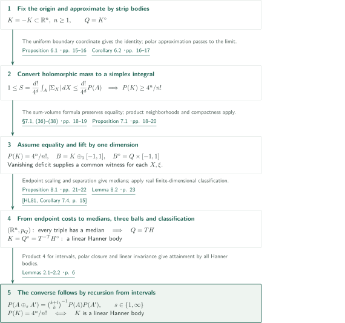
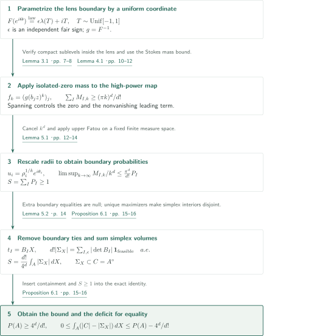
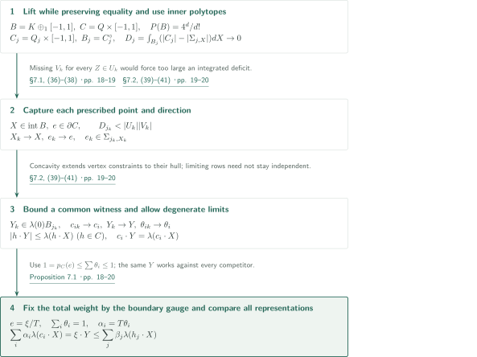
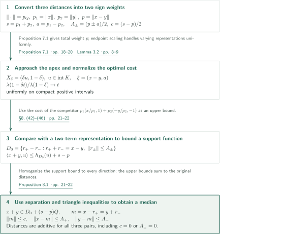
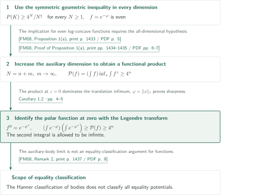
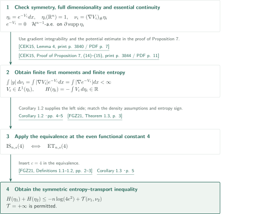

# The symmetric Mahler conjecture and its equality cases

**From a conformal boundary law to simplex volumes, and from equality to the three-ball property**

OpenAI's September 22, 2026 manuscript claims the symmetric Mahler inequality in every dimension, with equality precisely for linear Hanner bodies. Its central device is an integral identity for feasible simplices, obtained from a planar conformal map and the mass of an isolated holomorphic zero. For equality, adjoining one dimension turns vanishing integrated deficit into an optimal representation at each point and direction, and then into metric medians for the norm with the polar body as unit ball.

This article explains the manuscript's argument and its direct inputs. The editorial checking scope and the unverified scope, including complete proofs of external theorems, are distinguished at the end.

## 1. Main results

Write $|K|$ for Lebesgue volume in the dimension of $K$, $K^\circ=\{y:\langle x,y\rangle\le1\ (x\in K)\}$ for polarity at the **fixed origin**, and $P(K)=|K||K^\circ|$. Hanner polytopes are obtained from centered nondegenerate intervals by finitely many operations $H_1\oplus_\infty H_2=H_1\times H_2$ and $H_1\oplus_1H_2=\operatorname{conv}((H_1\times\{0\})\cup(\{0\}\times H_2))$. A linear Hanner body is an invertible linear image of such a polytope; translations are not included.

### Theorem 1.1 — The symmetric Mahler inequality and equality classification

For every integer $n\ge1$ and every origin-symmetric compact convex body $K=-K\subset\mathbb R^n$ with nonempty interior,

$$P(K)\ge\frac{4^n}{n!}.$$

Equality holds if and only if $K$ is a linear Hanner body.

<!-- cite:main -->[Theorem 1.1 · p. 2](https://github.com/openai/math/blob/1581d4cbdd69a0faf34b2089614fe2a814316a6a/preprints/The-symmetric-Mahler-conjecture-and-its-equality-cases-September-22-2026/paper.pdf)<!-- /cite -->

### Corollary 1.2 — The even functional Mahler inequality

Let $n\ge1$ and let $\varphi:\mathbb R^n\to\mathbb R\cup\{+\infty\}$ be even, proper, lower-semicontinuous and convex, with $0<\int_{\mathbb R^n}e^{-\varphi}<\infty$. For its Fenchel–Legendre transform $\varphi^*(y)=\sup_x(\langle x,y\rangle-\varphi(x))$,

$$\left(\int_{\mathbb R^n}e^{-\varphi(x)}\,dx\right)\left(\int_{\mathbb R^n}e^{-\varphi^*(y)}\,dy\right)\ge4^n.$$

The second integral may be $+\infty$. The constant is sharp: for $\varphi(x)=\sum_i|x_i|$, both integrals equal $2^n$. The corollary does not classify all equality potentials.

<!-- cite:functional -->[Corollary 1.2 · pp. 4–5](https://github.com/openai/math/blob/1581d4cbdd69a0faf34b2089614fe2a814316a6a/preprints/The-symmetric-Mahler-conjecture-and-its-equality-cases-September-22-2026/paper.pdf)<!-- /cite -->

### Corollary 1.3 — The symmetric entropy–transport inequality

Let $n\ge1$. For $i=1,2$, let $\eta_i(dx)=e^{-V_i(x)}dx$ be full-dimensional origin-symmetric log-concave probability measures, with proper lower-semicontinuous convex potentials $V_i$. Assume their densities are essentially continuous: $e^{-V_i}=0$ at $\mathcal H^{n-1}$-almost every point of $\partial\operatorname{supp}\eta_i$. Then the moment measures $\nu_i=(\nabla V_i)_\#\eta_i$ have finite first moments, the entropies $H(\eta_i)=\int\log(d\eta_i/dx)\,d\eta_i=-\int V_i\,d\eta_i$ are finite, and

$$H(\eta_1)+H(\eta_2)\le-n\log(4e^2)+\mathcal T(\nu_1,\nu_2).$$

Here, for the class $\mathcal F$ of proper lower-semicontinuous convex functions,

$$\mathcal T(\mu_1,\mu_2)=\inf_{f\in\mathcal F}\left\{\int f\,d\mu_1+\int f^*\,d\mu_2\right\}$$

is allowed to be $+\infty$. The sign convention for $H$ is the negative of differential Shannon entropy.

<!-- cite:entropy -->[Corollary 1.3 · p. 5](https://github.com/openai/math/blob/1581d4cbdd69a0faf34b2089614fe2a814316a6a/preprints/The-symmetric-Mahler-conjecture-and-its-equality-cases-September-22-2026/paper.pdf)<!-- /cite -->

## References on the arrows

<!-- reference-guide -->
Unprefixed theorem, lemma, section and equation numbers refer to [The symmetric Mahler conjecture and its equality cases](https://github.com/openai/math/blob/1581d4cbdd69a0faf34b2089614fe2a814316a6a/preprints/The-symmetric-Mahler-conjecture-and-its-equality-cases-September-22-2026/paper.pdf). External inputs use the following keys.

- [HL81](https://archive.ymsc.tsinghua.edu.cn/pacm_download/117/6287-11511_2006_Article_BF02392457.pdf) Allan B. Hansen; Åsvald Lima — *The structure of finite dimensional Banach spaces with the 3.2. intersection property*: Classify finite-dimensional real Banach spaces with the three-ball property by ℓ1 and ℓ∞ sums. Acta Mathematica 146 (1981), 1–23; published PDF.
- [FM08](https://perso.math.u-pem.fr/fradelizi.matthieu/pdf/Santaloadvances.pdf) Matthieu Fradelizi; Mathieu Meyer — *Some functional inverse Santaló inequalities*: Pass from the symmetric geometric inequality in all dimensions to the even functional inequality. Advances in Mathematics 218 (2008), 1430–1452; author's personal copy with cover.
- [CEK15](https://webusers.imj-prg.fr/~dario.cordero/Docs/articles/2015_moment_measures.pdf) Dario Cordero-Erausquin; Bo’az Klartag — *Moment measures*: Supply finite first moments of moment measures and finite entropy. Journal of Functional Analysis 268 (2015), 3834–3866; published PDF.
- [FGZ21](https://arxiv.org/pdf/2109.00871v3) Matthieu Fradelizi; Nathael Gozlan; Simon Zugmeyer — *Transport proofs of some functional inverse Santaló inequalities*: Use the equivalence of even inverse Santaló and symmetric entropy–transport inequalities. arXiv:2109.00871v3, 9 September 2021.

Each citation gives the result and pages. When printed pagination differs from the PDF position, both are shown. GitHub previews do not automatically jump to the cited page.
<!-- /reference-guide -->

## 2. Theorem 1.1 — Proof overview of the main theorem

<!-- proof-target:1 -->Proof target：[Theorem 1.1 · p. 2](https://github.com/openai/math/blob/1581d4cbdd69a0faf34b2089614fe2a814316a6a/preprints/The-symmetric-Mahler-conjecture-and-its-equality-cases-September-22-2026/paper.pdf)<!-- /proof-target -->

**Proof route.** The argument joins the lower bound, classification under equality, and attainment by Hanner bodies. The next section explains the real simplex identity underlying the bound; the following two sections explain the common witness and median constructions underlying classification. The general nonsymmetric Mahler manuscript is not an input.

### 1. From integrated simplex volume to arbitrary convex bodies

Start with a finite strip body $A=\{X:|b_i\cdot X|\le1\}$. Using the conformal lens width $\lambda$, Proposition 6.1 constructs a union of feasible simplices $\Sigma_X\subset A^\circ$ such that

$$1\le S=\frac{d!}{4^d}\int_A|\Sigma_X|\,dX\le\frac{d!}{4^d}|A||A^\circ|$$

The first inequality comes from holomorphic mass, the identity from the uniform boundary law, and the last inequality from containment in the polar. For an arbitrary $K$, approximate $Q=K^\circ$ by inner symmetric polytopes $Q_j$. The inclusions $(1-\delta_j)Q\subset Q_j\subset Q$ give $K\subset Q_j^\circ\subset(1-\delta_j)^{-1}K$ by polarity. Taking the limits of both volumes proves the bound, without smoothness or general-position assumptions.

<!-- cite:simplex -->[Proposition 6.1 · pp. 15–16](https://github.com/openai/math/blob/1581d4cbdd69a0faf34b2089614fe2a814316a6a/preprints/The-symmetric-Mahler-conjecture-and-its-equality-cases-September-22-2026/paper.pdf)<!-- /cite -->
<!-- cite:approx -->[Corollary 6.2 · pp. 16–17](https://github.com/openai/math/blob/1581d4cbdd69a0faf34b2089614fe2a814316a6a/preprints/The-symmetric-Mahler-conjecture-and-its-equality-cases-September-22-2026/paper.pdf)<!-- /cite -->

### 2. From equality to the three-ball property of the polar

If $P(K)=4^n/n!$, then $B=K\oplus_1[-1,1]$ also attains equality in dimension $d=n+1$. The integrated missing volume for approximations to $B^\circ=Q\times[-1,1]$ tends to zero. Proposition 7.1 thereby obtains, at every $X\in\operatorname{int}B$ and for every $\xi\ne0$, **one** feasibility witness that compares with all competing representations. Proposition 8.1 lets $X$ approach the apex $(0,1)$ and uses the cost comparison to construct a median for each triple in $(\mathbb R^n,p_Q)$.

Lemma 8.2 converts medians to the three-ball property for arbitrary radii. For pairwise-intersecting balls with centers $x_i$ and radii $r_i$, their distances $d_i$ to a median $m$ satisfy $d_i+d_j\le r_i+r_j$. If $m$ is outside one ball, moving it toward that center by the excess distance places it in all three balls. Radius zero is included. The normed space is finite-dimensional, real and complete, so Hansen–Lima's classification applies and gives $Q=TH$. Polarity yields $K=T^{-T}H^\circ$; closure of the Hanner class under polarity finishes the necessary classification.

<!-- cite:witness -->[Proposition 7.1 · pp. 18–20](https://github.com/openai/math/blob/1581d4cbdd69a0faf34b2089614fe2a814316a6a/preprints/The-symmetric-Mahler-conjecture-and-its-equality-cases-September-22-2026/paper.pdf)<!-- /cite -->
<!-- cite:median -->[Proposition 8.1 · pp. 21–22](https://github.com/openai/math/blob/1581d4cbdd69a0faf34b2089614fe2a814316a6a/preprints/The-symmetric-Mahler-conjecture-and-its-equality-cases-September-22-2026/paper.pdf)<!-- /cite -->
<!-- cite:balls -->[Lemma 8.2 · p. 23](https://github.com/openai/math/blob/1581d4cbdd69a0faf34b2089614fe2a814316a6a/preprints/The-symmetric-Mahler-conjecture-and-its-equality-cases-September-22-2026/paper.pdf)<!-- /cite -->
<!-- cite:hl -->[&#91;HL81, Corollary 7.4, p. 15&#93;](https://archive.ymsc.tsinghua.edu.cn/pacm_download/117/6287-11511_2006_Article_BF02392457.pdf#page=15)<!-- /cite -->
<!-- cite:classification -->[Theorem 8.3; Proposition 8.4 · p. 23](https://github.com/openai/math/blob/1581d4cbdd69a0faf34b2089614fe2a814316a6a/preprints/The-symmetric-Mahler-conjecture-and-its-equality-cases-September-22-2026/paper.pdf)<!-- /cite -->

### 3. Every linear Hanner body attains equality

The converse does not require the classification theorem. An interval has volume product 4, and for bodies $A,A'$ of dimensions $k,l$ and $s\in\{1,\infty\}$,

$$P(A\oplus_sA')=\binom{k+l}{k}^{-1}P(A)P(A')$$

The recursive construction thus preserves $4^{k+l}/(k+l)!$. Polarity exchanges the $\ell_1$ and $\ell_\infty$ sums, and the two determinant factors of an invertible linear map cancel in the volume product. This proves attainment for the whole equality family, including the base dimension $n=1$.

<!-- cite:sums -->[Lemmas 2.1–2.2 · p. 6](https://github.com/openai/math/blob/1581d4cbdd69a0faf34b2089614fe2a814316a6a/preprints/The-symmetric-Mahler-conjecture-and-its-equality-cases-September-22-2026/paper.pdf)<!-- /cite -->

## 3. Proposition 6.1 — From holomorphic mass to the real simplex identity

<!-- proof-target:2 -->Proof target：[Proposition 6.1 · pp. 15–16](https://github.com/openai/math/blob/1581d4cbdd69a0faf34b2089614fe2a814316a6a/preprints/The-symmetric-Mahler-conjecture-and-its-equality-cases-September-22-2026/paper.pdf)<!-- /proof-target -->

<!-- statement:proposition-6-1 -->
### Proposition 6.1 — The feasible-simplex identity

Let $d\ge1$ and let $b_1,\ldots,b_m$ be nonzero, pairwise nonproportional real rows spanning $(\mathbb R^d)^*$. Put $A=\{X:|b_iX|\le1\}$, $C=A^\circ$, and use the lens width $\lambda$ from Lemma 3.1. For $X\in\operatorname{int}A$, let $L_X=\{Y:|b_iY|\le\lambda(b_iX)\ \forall i\}$. For a basis $I$ and signs $\epsilon_i$, the pair is feasible if $Y_{I,\epsilon}=B_I^{-1}(\epsilon_i\lambda(b_iX))_{i\in I}$ belongs to $L_X$. Let $\Sigma_X$ be the union of the corresponding simplices $\operatorname{conv}(0,\epsilon_i b_i:i\in I)$.

For independent uniform boundary angles form $Z_I=B_I^{-1}(F(e^{i\theta_i}))_{i\in I}$. Let $P_I$ be the probability that every row coordinate lies in the closed lens $\overline D$, and $S=\sum_I P_I$. Then

$$1\le S=\frac{d!}{4^d}\int_A|\Sigma_X|\,dX\le\frac{d!}{4^d}|A||A^\circ|,$$
$$0\le\int_A(|A^\circ|-|\Sigma_X|)\,dX\le |A||A^\circ|-\frac{4^d}{d!}.$$

<!-- cite:simplex -->[Proposition 6.1 · pp. 15–16](https://github.com/openai/math/blob/1581d4cbdd69a0faf34b2089614fe2a814316a6a/preprints/The-symmetric-Mahler-conjecture-and-its-equality-cases-September-22-2026/paper.pdf)<!-- /cite -->
<!-- /statement -->

### 1. High powers at an isolated zero produce boundary probabilities

The conformal map of Lemma 3.1 is $F(z)=\frac8{\pi^2}\sum_{j\ge0}(-1)^jz^{2j+1}/(2j+1)^2$. Its boundary law is $\epsilon\lambda(T)+iT$, where $T$ is uniform on $[-1,1]$ and $\epsilon$ is an independent fair sign. Set $g=F^{-1}$ and $f_k=(g(b_jz)^k)_j$ on $\Omega=\{z:b_jz\in D\ \forall j\}$. Spanning ensures the zero is unique and the degree-$k$ homogeneous leading term is nonzero away from the origin. A sublevel $|f_k|^2\le s<1$ confines every row coordinate to a fixed compact subset of the lens, also verifying the compact-sublevel hypothesis of Lemma 4.1.

With $d^c=\frac i4(\bar\partial-\partial)$, Lemma 4.1 bounds the integrated sum of squared Jacobian minors below by $(\pi k)^d/d!$. Its proof compares sublevel mass by Stokes using the positivity of $dd^c\log|f_k|^2$, and calculates the homogeneous leading term's sphere flux as $(\pi k)^d$. Invariance under common phase rotation makes the correction to radial homogeneous flux vanish; this is the normalization step.

For each basis $I$, change variables to $u_i=g(b_iz)$, then set $u_i=\rho_i^{1/k}e^{i\theta_i}$. The factor $k^d$ cancels. On the fixed region $\sum_i\rho_i^2<1$, the inferred coordinates approach the boundary samples. Upper Fatou on a finite measure space yields $\limsup M_{I,k}/k^d\le(\pi^d/d!)P_I$. Summing over finitely many bases gives $S\ge1$. Additional boundary equalities do not have to be excluded at this stage.

<!-- cite:lens -->[Lemma 3.1 · pp. 7–8](https://github.com/openai/math/blob/1581d4cbdd69a0faf34b2089614fe2a814316a6a/preprints/The-symmetric-Mahler-conjecture-and-its-equality-cases-September-22-2026/paper.pdf)<!-- /cite -->
<!-- cite:mass -->[Lemma 4.1 · pp. 10–12](https://github.com/openai/math/blob/1581d4cbdd69a0faf34b2089614fe2a814316a6a/preprints/The-symmetric-Mahler-conjecture-and-its-equality-cases-September-22-2026/paper.pdf)<!-- /cite -->
<!-- cite:boundary -->[Lemma 5.1 · pp. 12–14](https://github.com/openai/math/blob/1581d4cbdd69a0faf34b2089614fe2a814316a6a/preprints/The-symmetric-Mahler-conjecture-and-its-equality-cases-September-22-2026/paper.pdf)<!-- /cite -->

### 2. Avoid double counting and retain the deficit

For each fixed sign choice the boundary law has measure $4^{-d}dt_I$. With $t_I=B_IX$ and $D_I=|\det B_I|$, it gives $P_I=4^{-d}D_I\int_A\sum_\epsilon\mathbf1_{(I,\epsilon)\text{ feasible}}\,dX$. By strict curvature of the lens boundary and nonproportionality of the rows, Lemma 5.2 makes the angles at which an extra row also lies on the boundary a null set. Thus, for almost every $X$, different feasible pairs give different vertices of $L_X$.

A vector in the interior of a feasible simplex defines a linear functional uniquely maximized at the corresponding vertex. Hence distinct simplices have disjoint interiors, allowing their volumes $D_I/d!$ to be summed. This proves the central identity. Containment $\Sigma_X\subset C$ and $S\ge1$ then give

$$\int_A(|C|-|\Sigma_X|)\,dX=|A||C|-\frac{4^d}{d!}S$$

and its nonnegative upper bound. The output for the equality argument is this **integrated deficit**; it does not assert $\Sigma_X=C$ at each $X$.

<!-- cite:null -->[Lemma 5.2 · p. 14](https://github.com/openai/math/blob/1581d4cbdd69a0faf34b2089614fe2a814316a6a/preprints/The-symmetric-Mahler-conjecture-and-its-equality-cases-September-22-2026/paper.pdf)<!-- /cite -->
<!-- cite:simplex -->[Proposition 6.1 · pp. 15–16](https://github.com/openai/math/blob/1581d4cbdd69a0faf34b2089614fe2a814316a6a/preprints/The-symmetric-Mahler-conjecture-and-its-equality-cases-September-22-2026/paper.pdf)<!-- /cite -->

## 4. Proposition 7.1 — From vanishing deficit to one common witness

<!-- proof-target:3 -->Proof target：[Proposition 7.1 · pp. 18–20](https://github.com/openai/math/blob/1581d4cbdd69a0faf34b2089614fe2a814316a6a/preprints/The-symmetric-Mahler-conjecture-and-its-equality-cases-September-22-2026/paper.pdf)<!-- /proof-target -->

<!-- statement:proposition-7-1 -->
### Proposition 7.1 — A representation minimizing the lens cost

Let $K=-K\subset\mathbb R^n$, $n\ge1$, be a convex body with $P(K)=4^n/n!$. Put $Q=K^\circ$, $d=n+1$, $B=K\oplus_1[-1,1]$ and $C=Q\times[-1,1]$. For every $X\in\operatorname{int}B$ and $0\ne\xi=(q,a)\in\mathbb R^{n+1}$, set $T=p_C(\xi)=\max\{p_Q(q),|a|\}$. There are $1\le r\le d$ rows $c_i\in Q\times\{-1,1\}$, weights $\alpha_i\ge0$ and $Y\in\mathbb R^d$ satisfying

$$\xi=\sum_i\alpha_i c_i,\qquad\sum_i\alpha_i=T,$$
$$|h\cdot Y|\le\lambda(h\cdot X)\quad(h\in C),\qquad c_i\cdot Y=\lambda(c_i\cdot X)\quad(1\le i\le r)$$

In particular, for every finite representation $\xi=\sum_j\beta_jh_j$ with $\beta_j\ge0$ and $h_j\in C$,

$$\sum_i\alpha_i\lambda(c_i\cdot X)\le\sum_j\beta_j\lambda(h_j\cdot X).$$

The choice may depend on $X,\xi$, but one choice works for all competing representations.

<!-- cite:witness -->[Proposition 7.1 · pp. 18–20](https://github.com/openai/math/blob/1581d4cbdd69a0faf34b2089614fe2a814316a6a/preprints/The-symmetric-Mahler-conjecture-and-its-equality-cases-September-22-2026/paper.pdf)<!-- /cite -->
<!-- /statement -->

### 1. Product neighborhoods capture every point and direction

We have $|B||C|=\frac4{n+1}P(K)=4^d/d!$. Choose symmetric inner polytopes $t_jQ\subset Q_j\subset Q$ with $t_j\to1$, and put $C_j=Q_j\times[-1,1]$, $B_j=C_j^\circ$. Proposition 6.1 gives $D_j=\int_{B_j}(|C_j|-|\Sigma_{j,X}|)dX\to0$.

For prescribed $X\in\operatorname{int}B$ and $e\in\partial C$, choose small positive-volume balls $U_k\subset\operatorname{int}B$ and $V_k\subset\operatorname{int}C$ close to $X$ and $e$. Choose $\overline{V_k}\subset\operatorname{int}C$; then $t_jC\subset C_j$ and $t_j\to1$ let us take $j_k$ large enough to ensure both $V_k\subset C_{j_k}$ and $D_{j_k}<|U_k||V_k|$. If every $\Sigma_{j_k,Z}$ with $Z\in U_k$ missed $V_k$, the deficit would be at least that product. Therefore there are $X_k\to X$, $e_k\to e$ with $e_k\in\Sigma_{j_k,X_k}$. This uses product neighborhoods, not a claim of pointwise convergence of the deficit at the prescribed point.

<!-- cite:deficit -->[§7.1, (36)–(38) · pp. 18–19](https://github.com/openai/math/blob/1581d4cbdd69a0faf34b2089614fe2a814316a6a/preprints/The-symmetric-Mahler-conjecture-and-its-equality-cases-September-22-2026/paper.pdf)<!-- /cite -->
<!-- cite:compact -->[§7.2, (39)–(41) · pp. 19–20](https://github.com/openai/math/blob/1581d4cbdd69a0faf34b2089614fe2a814316a6a/preprints/The-symmetric-Mahler-conjecture-and-its-equality-cases-September-22-2026/paper.pdf)<!-- /cite -->

### 2. Preserve the witness even when bases become singular

A simplex containing $e_k$ supplies $d$ rows $c_{ik}$, weights $\theta_{ik}\ge0$ with $\sum_i\theta_{ik}\le1$, and a common witness $Y_k$. Concavity of $\lambda$ extends feasibility from vertices to all of $C_{j_k}$. Since $\lambda\le\lambda(0)$, we have $Y_k\in\lambda(0)B_{j_k}$; the polar sandwich makes these witnesses uniformly bounded. No uniform bound on the inverse basis matrices is needed, and the limiting rows may be dependent.

Take a simultaneous convergent subsequence of $Y_k,c_{ik},\theta_{ik}$. For any $h\in C$, use $t_{j_k}h\in C_{j_k}$ to pass to all feasibility inequalities with the same limit $Y$. Since $p_C(e)=1$, we get $1\le\sum_i\theta_i\le1$, so no mass remains at the simplex vertex 0. Setting $e=\xi/T$ and $\alpha_i=T\theta_i$ gives the desired representation. Finally,

$$\sum_i\alpha_i\lambda(c_i\cdot X)=\xi\cdot Y=\sum_j\beta_jh_j\cdot Y\le\sum_j\beta_j\lambda(h_j\cdot X)$$

proves optimality against every competitor using that common witness.

<!-- cite:compact -->[§7.2, (39)–(41) · pp. 19–20](https://github.com/openai/math/blob/1581d4cbdd69a0faf34b2089614fe2a814316a6a/preprints/The-symmetric-Mahler-conjecture-and-its-equality-cases-September-22-2026/paper.pdf)<!-- /cite -->
<!-- cite:witness -->[Proposition 7.1 · pp. 18–20](https://github.com/openai/math/blob/1581d4cbdd69a0faf34b2089614fe2a814316a6a/preprints/The-symmetric-Mahler-conjecture-and-its-equality-cases-September-22-2026/paper.pdf)<!-- /cite -->

## 5. Proposition 8.1 — From apex cost comparison to medians

<!-- proof-target:4 -->Proof target：[Proposition 8.1 · pp. 21–22](https://github.com/openai/math/blob/1581d4cbdd69a0faf34b2089614fe2a814316a6a/preprints/The-symmetric-Mahler-conjecture-and-its-equality-cases-September-22-2026/paper.pdf)<!-- /proof-target -->

<!-- statement:proposition-8-1 -->
### Proposition 8.1 — Metric medians of an equality body

Let $n\ge1$ and let $K=-K\subset\mathbb R^n$ be a convex body with $P(K)=4^n/n!$. Put $Q=K^\circ$. Every triple $x_0,x_1,x_2$ in $(\mathbb R^n,p_Q)$ admits a point $m$ such that, for all $0\le i<j\le2$,

$$p_Q(x_i-x_j)=p_Q(x_i-m)+p_Q(m-x_j)$$

Uniqueness of the median is not asserted.

<!-- cite:median -->[Proposition 8.1 · pp. 21–22](https://github.com/openai/math/blob/1581d4cbdd69a0faf34b2089614fe2a814316a6a/preprints/The-symmetric-Mahler-conjecture-and-its-equality-cases-September-22-2026/paper.pdf)<!-- /cite -->
<!-- /statement -->

### 1. Compare the two sign costs at the apex

Translate the triple to $0,x,y$. Write $\|\cdot\|=p_Q$, $p_1=\|x\|$, $p_2=\|y\|$, $p=\|x-y\|$, $s=p_1+p_2$, $a=p_1-p_2$, $A_\pm=(p\pm a)/2$ and $c=(s-p)/2$. Repeated points are immediate, so consider distinct points. Fix $u\in\operatorname{int}K$ and apply Proposition 7.1 at $X_\delta=(\delta u,1-\delta)\in\operatorname{int}B$ to $\xi=(x-y,a)$. Since $p\ge|a|$, the total weight is $p$ and the two sign weights are $A_\pm$.

The aggregates $r_\pm=\sum_{\sigma_i=\pm1}\alpha_i b_i$ satisfy $r_++r_-=x-y$ and $\|r_\pm\|\le A_\pm$. Their possible differences form the compact convex set

$$D_0=\{r_+-r_-:r_++r_-=x-y,\ \|r_\pm\|\le A_\pm\}$$

Lemma 3.2 gives $\lambda(1-\eta)=\frac2\pi\eta\log(1/\eta)+O(\eta)$, hence $\lambda(1-\delta t)/\lambda(1-\delta)\to t$ uniformly on compact positive intervals. Here $t=1-\sigma\langle b,u\rangle$ lies in $[1-p_K(u),1+p_K(u)]\subset(0,\infty)$. This uniformity gives the lower bound $p-h_{D_0}(u)$ for the limiting normalized optimal cost, even though the chosen representation varies with $\delta$.

Compare with $(x-y,a)=p_1(x/p_1,1)+p_2(-y/p_2,-1)$. Its normalized cost tends to $s-\langle x+y,u\rangle$, so optimality yields

$$\langle x+y,u\rangle\le h_{D_0}(u)+s-p\qquad(u\in\operatorname{int}K)$$

No uniform selection of representations across $u$ is needed.

<!-- cite:endpoint -->[Lemma 3.2 · pp. 8–9](https://github.com/openai/math/blob/1581d4cbdd69a0faf34b2089614fe2a814316a6a/preprints/The-symmetric-Mahler-conjecture-and-its-equality-cases-September-22-2026/paper.pdf)<!-- /cite -->
<!-- cite:endpoint-cost -->[§8, (42)–(46) · pp. 21–22](https://github.com/openai/math/blob/1581d4cbdd69a0faf34b2089614fe2a814316a6a/preprints/The-symmetric-Mahler-conjecture-and-its-equality-cases-September-22-2026/paper.pdf)<!-- /cite -->

### 2. Convex separation forces additive distances

Extend the inequality to $K$ by continuity and use $p_K=h_Q$ to homogenize it. For every direction $v$ we obtain $h_{\{x+y\}}(v)\le h_{D_0}(v)+(s-p)h_Q(v)$. Convex separation gives $x+y\in D_0+(s-p)Q$. Choose the corresponding $r_\pm$ and let $m=x-r_+=y+r_-$. Then

$$\|m\|\le c,\qquad\|x-m\|\le A_+,\qquad\|y-m\|\le A_-.$$

Because $c+A_+=p_1$, $c+A_-=p_2$ and $A_++A_-=p$, all three triangle inequalities become equalities. The same argument permits $c=0$ or $A_\pm=0$. This is the median used in the main theorem's classification.

<!-- cite:median -->[Proposition 8.1 · pp. 21–22](https://github.com/openai/math/blob/1581d4cbdd69a0faf34b2089614fe2a814316a6a/preprints/The-symmetric-Mahler-conjecture-and-its-equality-cases-September-22-2026/paper.pdf)<!-- /cite -->

## 6. Corollary 1.2 — From geometry in all dimensions to even functions

<!-- proof-target:5 -->Proof target：[Corollary 1.2 · pp. 4–5](https://github.com/openai/math/blob/1581d4cbdd69a0faf34b2089614fe2a814316a6a/preprints/The-symmetric-Mahler-conjecture-and-its-equality-cases-September-22-2026/paper.pdf)<!-- /proof-target -->

### 1. Return from translation minimization to the origin

Set $f=e^{-\varphi}$. Fradelizi–Meyer's product is $\mathcal P(f)=(\int f)\inf_z\int f^z$, where $f^z(y)=\inf_{f(x)>0}e^{-\langle x-z,y-z\rangle}/f(x)$. Their Proposition 1(a) assumes the symmetric geometric Mahler inequality in every dimension and concludes $\mathcal P(f)\ge4^n$ for even log-concave $f$. Theorem 1.1 supplies this assumption. Since $f^0=e^{-\varphi^*}$, the product at the origin is at least $\mathcal P(f)$. If the second integral is infinite, the required bound is immediate.

The external implication uses auxiliary bodies in dimension $n+m$ and lets $m\to\infty$; the geometric inequality in dimension $n$ alone is insufficient. For $\varphi=\|x\|_1$, the conjugate is zero on the cube and $+\infty$ outside, proving sharpness. This limiting argument does not classify equality for general functions.

<!-- cite:fm -->[&#91;FM08, Proposition 1(a), print p. 1433 / PDF p. 5&#93;](https://perso.math.u-pem.fr/fradelizi.matthieu/pdf/Santaloadvances.pdf#page=5)<!-- /cite -->
<!-- cite:fm-limit -->[&#91;FM08, Proof of Proposition 1(a), print pp. 1434–1435 / PDF pp. 6–7&#93;](https://perso.math.u-pem.fr/fradelizi.matthieu/pdf/Santaloadvances.pdf#page=6)<!-- /cite -->
<!-- cite:fm-equality -->[&#91;FM08, Remark 2, print p. 1437 / PDF p. 9&#93;](https://perso.math.u-pem.fr/fradelizi.matthieu/pdf/Santaloadvances.pdf#page=9)<!-- /cite -->
<!-- cite:functional -->[Corollary 1.2 · pp. 4–5](https://github.com/openai/math/blob/1581d4cbdd69a0faf34b2089614fe2a814316a6a/preprints/The-symmetric-Mahler-conjecture-and-its-equality-cases-September-22-2026/paper.pdf)<!-- /cite -->

## 7. Corollary 1.3 — Establish integrability before applying entropy–transport equivalence

<!-- proof-target:6 -->Proof target：[Corollary 1.3 · p. 5](https://github.com/openai/math/blob/1581d4cbdd69a0faf34b2089614fe2a814316a6a/preprints/The-symmetric-Mahler-conjecture-and-its-equality-cases-September-22-2026/paper.pdf)<!-- /proof-target -->

### 1. Establish the domains of the cost and entropy

For $\rho_i=e^{-V_i}$, the identity $|\nabla\rho_i|=|\nabla V_i|e^{-V_i}$ holds almost everywhere in the support's interior. Cordero-Erausquin–Klartag's Lemma 4 gives $\int|\nabla\rho_i|<\infty$, so the pushforward definition implies $\int|y|\,d\nu_i(y)<\infty$. The proof of their Proposition 7 also gives $V_i\in L^1(\eta_i)$, making $H(\eta_i)=-\int V_i\,d\eta_i$ finite. The **statement** of the external Proposition 7 concerns integrability of $V_i^*$ against the moment measure; the integrability of $V_i$ used here is obtained from equations (14)–(15) in its proof.

<!-- cite:cek-gradient -->[&#91;CEK15, Lemma 4, print p. 3840 / PDF p. 7&#93;](https://webusers.imj-prg.fr/~dario.cordero/Docs/articles/2015_moment_measures.pdf#page=7)<!-- /cite -->
<!-- cite:cek-entropy -->[&#91;CEK15, Proof of Proposition 7, (14)–(15), print p. 3844 / PDF p. 11&#93;](https://webusers.imj-prg.fr/~dario.cordero/Docs/articles/2015_moment_measures.pdf#page=11)<!-- /cite -->

### 2. Insert the constant 4 in the symmetric equivalence

Fradelizi–Gozlan–Zugmeyer Theorem 1.3 states, with credit to Gozlan, the equivalence of $\mathrm{IS}_{n,s}(c)$ and $\mathrm{ET}_{n,s}(c)$. Their Definitions 1.1–1.2 match the manuscript's essential continuity, entropy sign and cost $\mathcal T$. Apply Corollary 1.2 with $c=4$ to obtain $-n\log(4e^2)$. Origin symmetry places the potentials and moment measures in the even/symmetric setting, while full dimensionality supplies the setting of log-concave probabilities with densities. The conclusion remains meaningful if $\mathcal T=+\infty$.

<!-- cite:fgz-def -->[&#91;FGZ21, Definitions 1.1–1.2, pp. 2–3&#93;](https://arxiv.org/pdf/2109.00871v3#page=2)<!-- /cite -->
<!-- cite:fgz -->[&#91;FGZ21, Theorem 1.3, p. 3&#93;](https://arxiv.org/pdf/2109.00871v3#page=3)<!-- /cite -->
<!-- cite:entropy -->[Corollary 1.3 · p. 5](https://github.com/openai/math/blob/1581d4cbdd69a0faf34b2089614fe2a814316a6a/preprints/The-symmetric-Mahler-conjecture-and-its-equality-cases-September-22-2026/paper.pdf)<!-- /cite -->

## 8. Which papers supply which steps

| Source and result | Used at | Role and required hypotheses | Checking scope |
|---|---|---|---|
| <!-- cite:hl -->[&#91;HL81, Corollary 7.4, p. 15&#93;](https://archive.ymsc.tsinghua.edu.cn/pacm_download/117/6287-11511_2006_Article_BF02392457.pdf#page=15)<!-- /cite --> | Theorem 8.3 / Proposition 8.4, p. 23; [classification](#proof-overview-step-2) | The 3.2 intersection property of a finite-dimensional **real** Banach space gives iterated $\ell_1/\ell_\infty$ sums | Statement on p. 15, closed-ball/arbitrary-radius convention in §1, and application checked; complete classification proof unverified |
| <!-- cite:fm -->[&#91;FM08, Proposition 1(a), print p. 1433 / PDF p. 5&#93;](https://perso.math.u-pem.fr/fradelizi.matthieu/pdf/Santaloadvances.pdf#page=5)<!-- /cite --> | Corollary 1.2, pp. 4–5; [functional inequality](#proof-4-step-1) | Transfer the symmetric geometric inequality in **all dimensions** to even functional products | Print p. 1433 / PDF p. 5 and application checked; auxiliary-body setup read; complete limit argument unverified |
| <!-- cite:cek-gradient -->[&#91;CEK15, Lemma 4, print p. 3840 / PDF p. 7&#93;](https://webusers.imj-prg.fr/~dario.cordero/Docs/articles/2015_moment_measures.pdf#page=7)<!-- /cite -->; <!-- cite:cek-entropy -->[&#91;CEK15, Proof of Proposition 7, (14)–(15), print p. 3844 / PDF p. 11&#93;](https://webusers.imj-prg.fr/~dario.cordero/Docs/articles/2015_moment_measures.pdf#page=11)<!-- /cite --> | Corollary 1.3, p. 5; [finiteness](#proof-5-step-1) | Integrability of log-concave gradients and of the convex potential | Statements and relevant proof paragraph on print pp. 3840, 3844 / PDF pp. 7, 11 checked |
| <!-- cite:fgz -->[&#91;FGZ21, Theorem 1.3, p. 3&#93;](https://arxiv.org/pdf/2109.00871v3#page=3)<!-- /cite --> | Corollary 1.3, p. 5; [equivalence](#proof-5-step-2) | Symmetric inverse Santaló gives entropy–transport for essentially continuous densities | Definitions and statement in cited v3, pp. 2–3 checked; Gozlan's original proof not recursively verified |

Gross's conformal construction and Demailly's generalized Lelong numbers are cited as background in the manuscript, but the required lens properties and mass bound are proved internally; they are not counted here as external direct inputs. Section 1.1 explicitly states independence from the general nonsymmetric Mahler paper. The nonsymmetric constant $(n+1)^{n+1}/(n!)^2$ alone does not yield the symmetric constant $4^n/n!$.

<!-- cite:independent -->[§1.1 · p. 3](https://github.com/openai/math/blob/1581d4cbdd69a0faf34b2089614fe2a814316a6a/preprints/The-symmetric-Mahler-conjecture-and-its-equality-cases-September-22-2026/paper.pdf)<!-- /cite -->

## 9. Return to the sources

<!-- reading-list -->
- [Lemma 4.1 · pp. 10–12](https://github.com/openai/math/blob/1581d4cbdd69a0faf34b2089614fe2a814316a6a/preprints/The-symmetric-Mahler-conjecture-and-its-equality-cases-September-22-2026/paper.pdf) — Check the isolated-zero hypotheses and mass normalization.
- [Proposition 6.1 · pp. 15–16](https://github.com/openai/math/blob/1581d4cbdd69a0faf34b2089614fe2a814316a6a/preprints/The-symmetric-Mahler-conjecture-and-its-equality-cases-September-22-2026/paper.pdf) — Read the exact conversion from probability to real simplex volume.
- [Proposition 7.1 · pp. 18–20](https://github.com/openai/math/blob/1581d4cbdd69a0faf34b2089614fe2a814316a6a/preprints/The-symmetric-Mahler-conjecture-and-its-equality-cases-September-22-2026/paper.pdf) — Follow the passage from integral deficit to each point and direction.
- [Proposition 8.1 · pp. 21–22](https://github.com/openai/math/blob/1581d4cbdd69a0faf34b2089614fe2a814316a6a/preprints/The-symmetric-Mahler-conjecture-and-its-equality-cases-September-22-2026/paper.pdf) — Read endpoint cost comparison and convex separation.
- [Theorem 8.3; Proposition 8.4 · p. 23](https://github.com/openai/math/blob/1581d4cbdd69a0faf34b2089614fe2a814316a6a/preprints/The-symmetric-Mahler-conjecture-and-its-equality-cases-September-22-2026/paper.pdf) — Read the final three-ball, classification and polarity steps.
- [Corollary 1.2 · pp. 4–5](https://github.com/openai/math/blob/1581d4cbdd69a0faf34b2089614fe2a814316a6a/preprints/The-symmetric-Mahler-conjecture-and-its-equality-cases-September-22-2026/paper.pdf) — Check the functional consequence requiring all dimensions.
- [Corollary 1.3 · p. 5](https://github.com/openai/math/blob/1581d4cbdd69a0faf34b2089614fe2a814316a6a/preprints/The-symmetric-Mahler-conjecture-and-its-equality-cases-September-22-2026/paper.pdf) — Check finiteness and application of the equivalence theorem.
<!-- /reading-list -->

The source is OpenAI's September 22, 2026 manuscript, a 26-page PDF at official commit `1581d4cbdd69a0faf34b2089614fe2a814316a6a`. Printed and PDF pages agree. This editorial pass newly read and compared the principal proof passages in §§2–8, the proofs of Corollaries 1.2–1.3, and the identified passages in four direct external sources. The specific checks concern mass normalization, simplex double counting, passage from integrated deficit to prescribed points, common-witness quantifiers under degenerate bases, uniformity of the endpoint estimate, and arbitrary-radius balls.

This is not an independent reproof of every calculation or measure-theoretic detail, or expert peer review. Complete proofs of the external classification theorem, the Fradelizi–Meyer limiting argument, and Gozlan's equivalence remain unverified. Use by other catalogue papers is reserved for the catalogue-level comparison of the receiving manuscript; a shared Mahler topic does not establish dependency. Source passages, file hashes and unverified scope are recorded in [sources.json](sources.json), and production and checks in [status.md](status.md).
