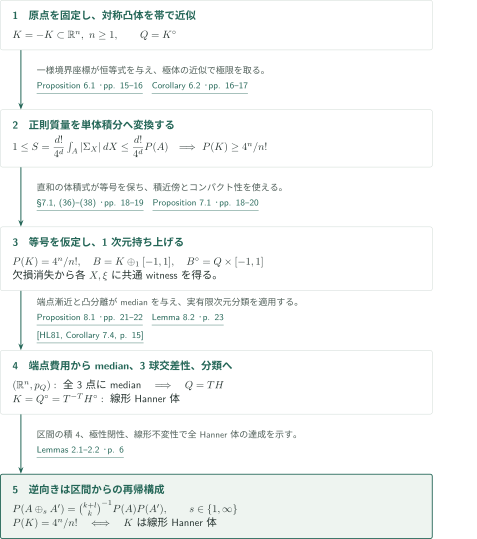
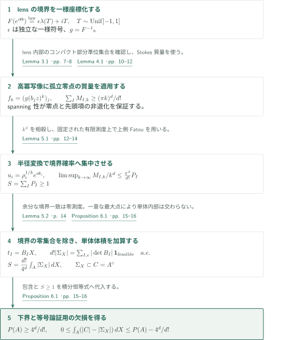
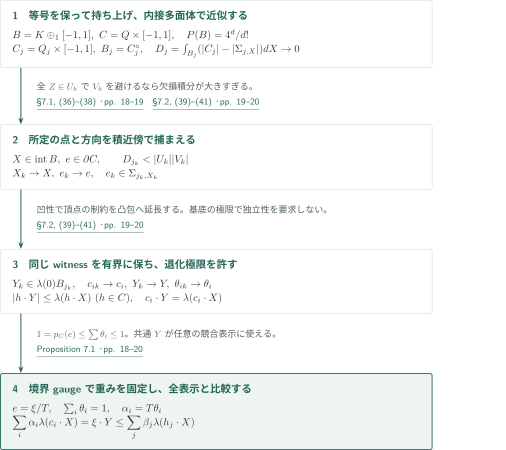
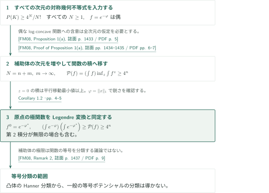
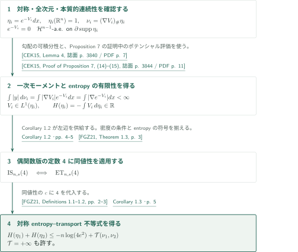

# The symmetric Mahler conjecture and its equality cases

**等角境界分布を単体体積へ移し、等号を3球交差性へ帰着する**

OpenAIの2026年9月22日原稿は、原点対称凸体のMahler不等式を全次元で示し、等号を線形Hanner体に分類すると主張する。証明の中心は、平面の等角写像と孤立零点の質量から得る「実現可能な単体」の積分恒等式である。等号の場合には1次元を付加し、積分欠損の消失を各点・各方向の最適表示へ強め、極体のノルムにmetric medianを構成する。

ここで紹介するのは原稿の論証と直接入力の接続である。編集側の照合範囲と、外部定理の全証明を含む未検証範囲は末尾に分けて記す。

## 1. 主要結果

$|K|$はその次元のLebesgue体積、$K^\circ=\{y:\langle x,y\rangle\le1\ (x\in K)\}$は**固定した原点**に関する極体、$P(K)=|K||K^\circ|$とする。Hanner多面体は原点中心の非退化区間から、$H_1\oplus_\infty H_2=H_1\times H_2$と$H_1\oplus_1H_2=\operatorname{conv}((H_1\times\{0\})\cup(\{0\}\times H_2))$を有限回反復して得る。線形Hanner体とはその可逆線形像であり、平行移動は含めない。

### Theorem 1.1 — 対称Mahler不等式と等号分類

すべての整数$n\ge1$と、非空な内部を持つ原点対称コンパクト凸体$K=-K\subset\mathbb R^n$に対し、

$$P(K)\ge\frac{4^n}{n!}.$$

等号が成立することと、$K$が線形Hanner体であることは同値である。

<!-- cite:main -->[Theorem 1.1 · p. 2](https://github.com/openai/math/blob/1581d4cbdd69a0faf34b2089614fe2a814316a6a/preprints/The-symmetric-Mahler-conjecture-and-its-equality-cases-September-22-2026/paper.pdf)<!-- /cite -->

### Corollary 1.2 — 偶関数型の関数的Mahler不等式

$n\ge1$とし、$\varphi:\mathbb R^n\to\mathbb R\cup\{+\infty\}$を偶なproper下半連続凸関数、$0<\int_{\mathbb R^n}e^{-\varphi}<\infty$とする。Fenchel–Legendre変換$\varphi^*(y)=\sup_x(\langle x,y\rangle-\varphi(x))$に対し、

$$\left(\int_{\mathbb R^n}e^{-\varphi(x)}\,dx\right)\left(\int_{\mathbb R^n}e^{-\varphi^*(y)}\,dy\right)\ge4^n.$$

第2積分は$+\infty$でもよい。$\varphi(x)=\sum_i|x_i|$では両積分が$2^n$であり定数は鋭いが、この系は一般の等号ポテンシャルを分類しない。

<!-- cite:functional -->[Corollary 1.2 · pp. 4–5](https://github.com/openai/math/blob/1581d4cbdd69a0faf34b2089614fe2a814316a6a/preprints/The-symmetric-Mahler-conjecture-and-its-equality-cases-September-22-2026/paper.pdf)<!-- /cite -->

### Corollary 1.3 — 対称entropy–transport不等式

$n\ge1$、$i=1,2$に対し、$\eta_i(dx)=e^{-V_i(x)}dx$を全次元の原点対称log-concave確率測度とし、$V_i$はproper下半連続凸関数とする。密度は本質的に連続、すなわち$\partial\operatorname{supp}\eta_i$上の$\mathcal H^{n-1}$ほとんどすべての点で$e^{-V_i}=0$と仮定する。moment measure $\nu_i=(\nabla V_i)_\#\eta_i$は有限一次モーメントを持ち、$H(\eta_i)=\int\log(d\eta_i/dx)\,d\eta_i=-\int V_i\,d\eta_i$は有限で、

$$H(\eta_1)+H(\eta_2)\le-n\log(4e^2)+\mathcal T(\nu_1,\nu_2).$$

ここでproper下半連続凸関数全体を$\mathcal F$として、

$$\mathcal T(\mu_1,\mu_2)=\inf_{f\in\mathcal F}\left\{\int f\,d\mu_1+\int f^*\,d\mu_2\right\}$$

であり、$+\infty$を許す。$H$の符号は微分Shannon entropyの負である。

<!-- cite:entropy -->[Corollary 1.3 · p. 5](https://github.com/openai/math/blob/1581d4cbdd69a0faf34b2089614fe2a814316a6a/preprints/The-symmetric-Mahler-conjecture-and-its-equality-cases-September-22-2026/paper.pdf)<!-- /cite -->

## 図の矢印に付した引用

<!-- reference-guide -->
略号のない定理・補題・節・式番号は本原稿 [The symmetric Mahler conjecture and its equality cases](https://github.com/openai/math/blob/1581d4cbdd69a0faf34b2089614fe2a814316a6a/preprints/The-symmetric-Mahler-conjecture-and-its-equality-cases-September-22-2026/paper.pdf) を指します。外部入力には次の略号を使います。

- [HL81](https://archive.ymsc.tsinghua.edu.cn/pacm_download/117/6287-11511_2006_Article_BF02392457.pdf) Allan B. Hansen; Åsvald Lima — *The structure of finite dimensional Banach spaces with the 3.2. intersection property*：3球交差性から有限次元実Banach空間をℓ1・ℓ∞直和へ分類する。Acta Mathematica 146 (1981), 1–23; published PDF。
- [FM08](https://perso.math.u-pem.fr/fradelizi.matthieu/pdf/Santaloadvances.pdf) Matthieu Fradelizi; Mathieu Meyer — *Some functional inverse Santaló inequalities*：全次元の対称幾何不等式から偶関数版を導く。Advances in Mathematics 218 (2008), 1430–1452; author's personal copy with cover。
- [CEK15](https://webusers.imj-prg.fr/~dario.cordero/Docs/articles/2015_moment_measures.pdf) Dario Cordero-Erausquin; Bo’az Klartag — *Moment measures*：moment measureの一次モーメントとentropyの有限性を保証する。Journal of Functional Analysis 268 (2015), 3834–3866; published PDF。
- [FGZ21](https://arxiv.org/pdf/2109.00871v3) Matthieu Fradelizi; Nathael Gozlan; Simon Zugmeyer — *Transport proofs of some functional inverse Santaló inequalities*：偶関数型逆Santalóと対称entropy–transportの同値性を使う。arXiv:2109.00871v3, 9 September 2021。

各引用に結果番号とページを付します。誌面番号とPDF内の位置が異なる場合は両方を示します。GitHubの閲覧リンクではページ位置への自動移動を前提としません。
<!-- /reference-guide -->

## 2. Theorem 1.1 — 主定理の証明概略

<!-- proof-target:1 -->証明対象：[Theorem 1.1 · p. 2](https://github.com/openai/math/blob/1581d4cbdd69a0faf34b2089614fe2a814316a6a/preprints/The-symmetric-Mahler-conjecture-and-its-equality-cases-September-22-2026/paper.pdf)<!-- /proof-target -->

**証明の道筋。** 下界、等号からの分類、Hanner体での等号成立の3部分を結ぶ。下界に必要な実単体恒等式を次節で説明し、等号分類の核心である共通witnessとmedianをその後の2節で説明する。一般の非対称Mahler原稿を入力には用いない。

### 1. 単体の積分から任意の凸体の下界へ

まず$A=\{X:|b_i\cdot X|\le1\}$を有限個の帯の共通部分とする。等角lensの幅$\lambda$から作る実現可能単体の和集合$\Sigma_X\subset A^\circ$について、Proposition 6.1は

$$1\le S=\frac{d!}{4^d}\int_A|\Sigma_X|\,dX\le\frac{d!}{4^d}|A||A^\circ|$$

を与える。左端は正則写像の質量、中央は境界分布の一様性、右端は極体への包含による。一般の$K$に対しては$Q=K^\circ$を内接する対称多面体$Q_j$で近似し、$(1-\delta_j)Q\subset Q_j\subset Q$と極性から$K\subset Q_j^\circ\subset(1-\delta_j)^{-1}K$を得る。両体積の極限を取れば下界が従う。滑らかさや一般位置は仮定しない。

<!-- cite:simplex -->[Proposition 6.1 · pp. 15–16](https://github.com/openai/math/blob/1581d4cbdd69a0faf34b2089614fe2a814316a6a/preprints/The-symmetric-Mahler-conjecture-and-its-equality-cases-September-22-2026/paper.pdf)<!-- /cite -->
<!-- cite:approx -->[Corollary 6.2 · pp. 16–17](https://github.com/openai/math/blob/1581d4cbdd69a0faf34b2089614fe2a814316a6a/preprints/The-symmetric-Mahler-conjecture-and-its-equality-cases-September-22-2026/paper.pdf)<!-- /cite -->

### 2. 等号から極体の3球交差性へ

$P(K)=4^n/n!$なら$B=K\oplus_1[-1,1]$も$d=n+1$次元で等号を満たす。$B^\circ=Q\times[-1,1]$を近似したときの積分欠損が0へ収束するため、Proposition 7.1は各$X\in\operatorname{int}B$・各$\xi\ne0$に対して、すべての競合表示と比較できる**1つの**feasibility witnessを与える。Proposition 8.1は$X$を頂点$(0,1)$へ近づけ、その費用比較から$(\mathbb R^n,p_Q)$の任意の3点にmedianを構成する。

Lemma 8.2ではmedianから任意半径の3球交差性を得る。中心$x_i$・半径$r_i$の球が2つずつ交われば、median $m$との距離$d_i$は$d_i+d_j\le r_i+r_j$を満たす。$m$が1つの球の外なら、外れた距離だけその中心へ動かすと3球すべてに入る。半径0も扱える。有限次元実ノルム空間は完備なのでHansen–Limaの分類が適用でき、$Q=TH$となる。極性で$K=T^{-T}H^\circ$、さらにHanner体の極性閉性から必要な分類が従う。

<!-- cite:witness -->[Proposition 7.1 · pp. 18–20](https://github.com/openai/math/blob/1581d4cbdd69a0faf34b2089614fe2a814316a6a/preprints/The-symmetric-Mahler-conjecture-and-its-equality-cases-September-22-2026/paper.pdf)<!-- /cite -->
<!-- cite:median -->[Proposition 8.1 · pp. 21–22](https://github.com/openai/math/blob/1581d4cbdd69a0faf34b2089614fe2a814316a6a/preprints/The-symmetric-Mahler-conjecture-and-its-equality-cases-September-22-2026/paper.pdf)<!-- /cite -->
<!-- cite:balls -->[Lemma 8.2 · p. 23](https://github.com/openai/math/blob/1581d4cbdd69a0faf34b2089614fe2a814316a6a/preprints/The-symmetric-Mahler-conjecture-and-its-equality-cases-September-22-2026/paper.pdf)<!-- /cite -->
<!-- cite:hl -->[&#91;HL81, Corollary 7.4, p. 15&#93;](https://archive.ymsc.tsinghua.edu.cn/pacm_download/117/6287-11511_2006_Article_BF02392457.pdf#page=15)<!-- /cite -->
<!-- cite:classification -->[Theorem 8.3; Proposition 8.4 · p. 23](https://github.com/openai/math/blob/1581d4cbdd69a0faf34b2089614fe2a814316a6a/preprints/The-symmetric-Mahler-conjecture-and-its-equality-cases-September-22-2026/paper.pdf)<!-- /cite -->

### 3. すべての線形Hanner体が等号を達成する

逆向きは上の分類定理を必要としない。区間の体積積は4で、$k,l$次元の体$A,A'$と$s\in\{1,\infty\}$について

$$P(A\oplus_sA')=\binom{k+l}{k}^{-1}P(A)P(A')$$

が成立する。したがって再帰構成で$4^{k+l}/(k+l)!$を保つ。極性は$\ell_1$和と$\ell_\infty$和を交換し、可逆線形変換の2つの行列式因子は体積積で相殺する。これで全等号族と$n=1$を含む逆向きが閉じる。

<!-- cite:sums -->[Lemmas 2.1–2.2 · p. 6](https://github.com/openai/math/blob/1581d4cbdd69a0faf34b2089614fe2a814316a6a/preprints/The-symmetric-Mahler-conjecture-and-its-equality-cases-September-22-2026/paper.pdf)<!-- /cite -->

## 3. Proposition 6.1 — 正則質量から実単体恒等式へ

<!-- proof-target:2 -->証明対象：[Proposition 6.1 · pp. 15–16](https://github.com/openai/math/blob/1581d4cbdd69a0faf34b2089614fe2a814316a6a/preprints/The-symmetric-Mahler-conjecture-and-its-equality-cases-September-22-2026/paper.pdf)<!-- /proof-target -->

<!-- statement:proposition-6-1 -->
### Proposition 6.1 — 実現可能単体の積分恒等式

$d\ge1$、$b_1,\ldots,b_m$を$(\mathbb R^d)^*$を張る非零かつ互いに非比例の実行ベクトルとする。$A=\{X:|b_iX|\le1\}$、$C=A^\circ$とし、Lemma 3.1のlens幅$\lambda$を使う。$X\in\operatorname{int}A$に対し$L_X=\{Y:|b_iY|\le\lambda(b_iX)\ \forall i\}$とする。独立な$d$行の集合$I$と符号$\epsilon_i$について$Y_{I,\epsilon}=B_I^{-1}(\epsilon_i\lambda(b_iX))_{i\in I}$が$L_X$に属するとき、その組を実現可能といい、$\Sigma_X$を対応する$\operatorname{conv}(0,\epsilon_i b_i:i\in I)$の和集合とする。

独立一様な境界角から$Z_I=B_I^{-1}(F(e^{i\theta_i}))_{i\in I}$を作り、全行座標が閉lens $\overline D$に入る確率を$P_I$、$S=\sum_I P_I$とおく。このとき

$$1\le S=\frac{d!}{4^d}\int_A|\Sigma_X|\,dX\le\frac{d!}{4^d}|A||A^\circ|,$$
$$0\le\int_A(|A^\circ|-|\Sigma_X|)\,dX\le |A||A^\circ|-\frac{4^d}{d!}.$$

<!-- cite:simplex -->[Proposition 6.1 · pp. 15–16](https://github.com/openai/math/blob/1581d4cbdd69a0faf34b2089614fe2a814316a6a/preprints/The-symmetric-Mahler-conjecture-and-its-equality-cases-September-22-2026/paper.pdf)<!-- /cite -->
<!-- /statement -->

### 1. 高冪の孤立零点を境界確率へ移す

Lemma 3.1の等角写像は$F(z)=\frac8{\pi^2}\sum_{j\ge0}(-1)^jz^{2j+1}/(2j+1)^2$であり、境界値は$\epsilon\lambda(T)+iT$、$T$は$[-1,1]$上一様、$\epsilon$は独立な一様符号となる。$g=F^{-1}$とし、$\Omega=\{z:b_jz\in D\ \forall j\}$上で$f_k=(g(b_jz)^k)_j$を用いる。行のspanning性は零点の一意性と、次数$k$の斉次先頭項が原点外で零にならないことを保証する。$|f_k|^2\le s<1$は各行座標をlens内部の固定コンパクト集合に閉じ込めるため、Lemma 4.1のコンパクト部分準位集合の仮定も満たす。

Lemma 4.1は$d^c=\frac i4(\bar\partial-\partial)$の規約で、Jacobian小行列式の二乗積分和を$(\pi k)^d/d!$以上とする。論証は$\log|f_k|^2$の半正値性を使ったStokes比較と、斉次先頭項の球面flux $(\pi k)^d$の計算である。共通位相回転に不変な補正項がfluxを変えないことが正規化の要点となる。

基底$I$ごとに$u_i=g(b_iz)$へ変数変換し、$u_i=\rho_i^{1/k}e^{i\theta_i}$と置くと$k^d$が相殺される。固定領域$\sum_i\rho_i^2<1$上で指示関数は境界標本へ収束し、有限測度上の上側Fatou評価から$\limsup M_{I,k}/k^d\le(\pi^d/d!)P_I$を得る。有限個の基底について和を取って$S\ge1$となる。この段階では余分な境界一致を排除する必要はない。

<!-- cite:lens -->[Lemma 3.1 · pp. 7–8](https://github.com/openai/math/blob/1581d4cbdd69a0faf34b2089614fe2a814316a6a/preprints/The-symmetric-Mahler-conjecture-and-its-equality-cases-September-22-2026/paper.pdf)<!-- /cite -->
<!-- cite:mass -->[Lemma 4.1 · pp. 10–12](https://github.com/openai/math/blob/1581d4cbdd69a0faf34b2089614fe2a814316a6a/preprints/The-symmetric-Mahler-conjecture-and-its-equality-cases-September-22-2026/paper.pdf)<!-- /cite -->
<!-- cite:boundary -->[Lemma 5.1 · pp. 12–14](https://github.com/openai/math/blob/1581d4cbdd69a0faf34b2089614fe2a814316a6a/preprints/The-symmetric-Mahler-conjecture-and-its-equality-cases-September-22-2026/paper.pdf)<!-- /cite -->

### 2. 体積の二重計数を防ぎ、欠損を記録する

固定符号の境界分布は$4^{-d}dt_I$、$t_I=B_IX$なので、$D_I=|\det B_I|$として$P_I=4^{-d}D_I\int_A\sum_\epsilon\mathbf1_{(I,\epsilon)\text{ feasible}}\,dX$となる。Lemma 5.2はlens境界のstrict curvatureと非比例性から、基底外の行まで境界上に来る角度集合が零測度であることを示す。したがってほとんどすべての$X$で異なる実現可能な組は異なる$L_X$の頂点を与える。

単体内部のベクトルは対応する頂点で一意に最大となる線形汎関数を定めるため、異なる単体の内部は交わらない。各体積$D_I/d!$を足せることが中央の恒等式を与え、$\Sigma_X\subset C$と$S\ge1$から

$$\int_A(|C|-|\Sigma_X|)\,dX=|A||C|-\frac{4^d}{d!}S$$

とその非負上界を得る。この**積分された欠損**が等号論証への出力であり、各$X$で$\Sigma_X=C$と断定するものではない。

<!-- cite:null -->[Lemma 5.2 · p. 14](https://github.com/openai/math/blob/1581d4cbdd69a0faf34b2089614fe2a814316a6a/preprints/The-symmetric-Mahler-conjecture-and-its-equality-cases-September-22-2026/paper.pdf)<!-- /cite -->
<!-- cite:simplex -->[Proposition 6.1 · pp. 15–16](https://github.com/openai/math/blob/1581d4cbdd69a0faf34b2089614fe2a814316a6a/preprints/The-symmetric-Mahler-conjecture-and-its-equality-cases-September-22-2026/paper.pdf)<!-- /cite -->

## 4. Proposition 7.1 — 欠損消失から共通witnessへ

<!-- proof-target:3 -->証明対象：[Proposition 7.1 · pp. 18–20](https://github.com/openai/math/blob/1581d4cbdd69a0faf34b2089614fe2a814316a6a/preprints/The-symmetric-Mahler-conjecture-and-its-equality-cases-September-22-2026/paper.pdf)<!-- /proof-target -->

<!-- statement:proposition-7-1 -->
### Proposition 7.1 — lens費用を最小化する表示

$K=-K\subset\mathbb R^n$、$n\ge1$を$P(K)=4^n/n!$の凸体とし、$Q=K^\circ$、$d=n+1$、$B=K\oplus_1[-1,1]$、$C=Q\times[-1,1]$とする。すべての$X\in\operatorname{int}B$と$0\ne\xi=(q,a)\in\mathbb R^{n+1}$に対し、$T=p_C(\xi)=\max\{p_Q(q),|a|\}$とおくと、$1\le r\le d$個の$c_i\in Q\times\{-1,1\}$、$\alpha_i\ge0$と$Y\in\mathbb R^d$が存在して、

$$\xi=\sum_i\alpha_i c_i,\qquad\sum_i\alpha_i=T,$$
$$|h\cdot Y|\le\lambda(h\cdot X)\quad(h\in C),\qquad c_i\cdot Y=\lambda(c_i\cdot X)\quad(1\le i\le r)$$

を満たす。特に任意の有限表示$\xi=\sum_j\beta_jh_j$、$\beta_j\ge0$、$h_j\in C$に対し、

$$\sum_i\alpha_i\lambda(c_i\cdot X)\le\sum_j\beta_j\lambda(h_j\cdot X).$$

選択は$X,\xi$に依存してよいが、同じ選択で全競合表示を扱う。

<!-- cite:witness -->[Proposition 7.1 · pp. 18–20](https://github.com/openai/math/blob/1581d4cbdd69a0faf34b2089614fe2a814316a6a/preprints/The-symmetric-Mahler-conjecture-and-its-equality-cases-September-22-2026/paper.pdf)<!-- /cite -->
<!-- /statement -->

### 1. 各点・各方向を積近傍で捕まえる

$|B||C|=\frac4{n+1}P(K)=4^d/d!$である。$t_jQ\subset Q_j\subset Q$、$t_j\to1$となる対称内接多面体から$C_j=Q_j\times[-1,1]$、$B_j=C_j^\circ$を作ると、Proposition 6.1は$D_j=\int_{B_j}(|C_j|-|\Sigma_{j,X}|)dX\to0$を与える。

所定の$X\in\operatorname{int}B$、$e\in\partial C$に近い正体積の小球$U_k\subset\operatorname{int}B$、$V_k\subset\operatorname{int}C$を選ぶ。$\overline{V_k}\subset\operatorname{int}C$となるように取り、$t_jC\subset C_j$と$t_j\to1$により、$j_k$を十分大きくして$V_k\subset C_{j_k}$と$D_{j_k}<|U_k||V_k|$を同時に確保する。すべての$Z\in U_k$で$\Sigma_{j_k,Z}$が$V_k$を避けるなら欠損積分がこの積以上となり矛盾する。よって$X_k\to X$、$e_k\to e$、$e_k\in\Sigma_{j_k,X_k}$を選べる。積分収束を所定点での点wise収束へ取り違えないことが重要である。

<!-- cite:deficit -->[§7.1, (36)–(38) · pp. 18–19](https://github.com/openai/math/blob/1581d4cbdd69a0faf34b2089614fe2a814316a6a/preprints/The-symmetric-Mahler-conjecture-and-its-equality-cases-September-22-2026/paper.pdf)<!-- /cite -->
<!-- cite:compact -->[§7.2, (39)–(41) · pp. 19–20](https://github.com/openai/math/blob/1581d4cbdd69a0faf34b2089614fe2a814316a6a/preprints/The-symmetric-Mahler-conjecture-and-its-equality-cases-September-22-2026/paper.pdf)<!-- /cite -->

### 2. 特異化する基底でもwitnessを保つ

$e_k$を含む単体から$d$個の行$c_{ik}$、重み$\theta_{ik}\ge0$、$\sum_i\theta_{ik}\le1$と共通の$Y_k$を得る。頂点でのfeasibilityは$\lambda$の凹性により$C_{j_k}$全体へ延びる。$\lambda\le\lambda(0)$だから$Y_k\in\lambda(0)B_{j_k}$であり、極体のsandwichが$Y_k$を一様有界にする。基底の逆行列に一様評価を課す必要はなく、極限の行が従属してもよい。

コンパクト性で$Y_k,c_{ik},\theta_{ik}$を同時に収束させ、任意の$h\in C$には$t_{j_k}h\in C_{j_k}$を用いて、同じ極限$Y$で全不等式を得る。$p_C(e)=1$より$1\le\sum_i\theta_i\le1$で、原点頂点の重みは消える。$e=\xi/T$として$\alpha_i=T\theta_i$とすれば表示を得る。最後は

$$\sum_i\alpha_i\lambda(c_i\cdot X)=\xi\cdot Y=\sum_j\beta_jh_j\cdot Y\le\sum_j\beta_j\lambda(h_j\cdot X)$$

であり、この共通witnessが全競合表示に対する最適性を保証する。

<!-- cite:compact -->[§7.2, (39)–(41) · pp. 19–20](https://github.com/openai/math/blob/1581d4cbdd69a0faf34b2089614fe2a814316a6a/preprints/The-symmetric-Mahler-conjecture-and-its-equality-cases-September-22-2026/paper.pdf)<!-- /cite -->
<!-- cite:witness -->[Proposition 7.1 · pp. 18–20](https://github.com/openai/math/blob/1581d4cbdd69a0faf34b2089614fe2a814316a6a/preprints/The-symmetric-Mahler-conjecture-and-its-equality-cases-September-22-2026/paper.pdf)<!-- /cite -->

## 5. Proposition 8.1 — 頂点近傍の費用比較からmedianへ

<!-- proof-target:4 -->証明対象：[Proposition 8.1 · pp. 21–22](https://github.com/openai/math/blob/1581d4cbdd69a0faf34b2089614fe2a814316a6a/preprints/The-symmetric-Mahler-conjecture-and-its-equality-cases-September-22-2026/paper.pdf)<!-- /proof-target -->

<!-- statement:proposition-8-1 -->
### Proposition 8.1 — 等号体のmetric median

$n\ge1$、$K=-K\subset\mathbb R^n$を$P(K)=4^n/n!$の凸体、$Q=K^\circ$とする。このとき$(\mathbb R^n,p_Q)$の任意の3点$x_0,x_1,x_2$に対して点$m$が存在し、すべての$0\le i<j\le2$で

$$p_Q(x_i-x_j)=p_Q(x_i-m)+p_Q(m-x_j)$$

となる。medianの一意性は要求しない。

<!-- cite:median -->[Proposition 8.1 · pp. 21–22](https://github.com/openai/math/blob/1581d4cbdd69a0faf34b2089614fe2a814316a6a/preprints/The-symmetric-Mahler-conjecture-and-its-equality-cases-September-22-2026/paper.pdf)<!-- /cite -->
<!-- /statement -->

### 1. 2符号の費用を頂点で比較する

平行移動で3点を$0,x,y$とし、$\|\cdot\|=p_Q$、$p_1=\|x\|$、$p_2=\|y\|$、$p=\|x-y\|$、$s=p_1+p_2$、$a=p_1-p_2$、$A_\pm=(p\pm a)/2$、$c=(s-p)/2$と置く。重複点は自明なのでそれ以外を扱う。$u\in\operatorname{int}K$を固定し、$X_\delta=(\delta u,1-\delta)\in\operatorname{int}B$でProposition 7.1を$\xi=(x-y,a)$に適用する。$p\ge|a|$なので全重みは$p$、符号別の重みは$A_\pm$である。

$r_\pm=\sum_{\sigma_i=\pm1}\alpha_i b_i$とすると$r_++r_-=x-y$、$\|r_\pm\|\le A_\pm$。これらが定める差のコンパクト凸集合を

$$D_0=\{r_+-r_-:r_++r_-=x-y,\ \|r_\pm\|\le A_\pm\}$$

とする。Lemma 3.2の$\lambda(1-\eta)=\frac2\pi\eta\log(1/\eta)+O(\eta)$から、$\lambda(1-\delta t)/\lambda(1-\delta)\to t$が正のコンパクト区間で一様に成り立つ。ここで$t=1-\sigma\langle b,u\rangle$は$[1-p_K(u),1+p_K(u)]\subset(0,\infty)$に入る。この一様性により、選択された表示が$\delta$で変動しても最適費用を$p-h_{D_0}(u)$で下から評価できる。

比較相手を$(x-y,a)=p_1(x/p_1,1)+p_2(-y/p_2,-1)$とすると、その正規化費用は$s-\langle x+y,u\rangle$へ収束する。最適性から

$$\langle x+y,u\rangle\le h_{D_0}(u)+s-p\qquad(u\in\operatorname{int}K)$$

を得る。$u$に一様な表示選択は不要である。

<!-- cite:endpoint -->[Lemma 3.2 · pp. 8–9](https://github.com/openai/math/blob/1581d4cbdd69a0faf34b2089614fe2a814316a6a/preprints/The-symmetric-Mahler-conjecture-and-its-equality-cases-September-22-2026/paper.pdf)<!-- /cite -->
<!-- cite:endpoint-cost -->[§8, (42)–(46) · pp. 21–22](https://github.com/openai/math/blob/1581d4cbdd69a0faf34b2089614fe2a814316a6a/preprints/The-symmetric-Mahler-conjecture-and-its-equality-cases-September-22-2026/paper.pdf)<!-- /cite -->

### 2. 凸分離が距離の加法性を与える

連続性で上の不等式を$K$へ延長し、$p_K=h_Q$による斉次化を使うと、全方向$v$で$h_{\{x+y\}}(v)\le h_{D_0}(v)+(s-p)h_Q(v)$となる。凸分離から$x+y\in D_0+(s-p)Q$。対応する$r_\pm$を取り$m=x-r_+=y+r_-$とすれば、

$$\|m\|\le c,\qquad\|x-m\|\le A_+,\qquad\|y-m\|\le A_-.$$

$c+A_+=p_1$、$c+A_-=p_2$、$A_++A_-=p$のため、3つの三角不等式はすべて等号になる。$c=0$や$A_\pm=0$も同じ議論で扱う。これが主定理の分類で用いるmedianである。

<!-- cite:median -->[Proposition 8.1 · pp. 21–22](https://github.com/openai/math/blob/1581d4cbdd69a0faf34b2089614fe2a814316a6a/preprints/The-symmetric-Mahler-conjecture-and-its-equality-cases-September-22-2026/paper.pdf)<!-- /cite -->

## 6. Corollary 1.2 — 全次元の幾何から偶関数へ

<!-- proof-target:5 -->証明対象：[Corollary 1.2 · pp. 4–5](https://github.com/openai/math/blob/1581d4cbdd69a0faf34b2089614fe2a814316a6a/preprints/The-symmetric-Mahler-conjecture-and-its-equality-cases-September-22-2026/paper.pdf)<!-- /proof-target -->

### 1. 平行移動最小化を経て原点の積へ戻す

$f=e^{-\varphi}$とする。Fradelizi–Meyerの$\mathcal P(f)=(\int f)\inf_z\int f^z$では$f^z(y)=\inf_{f(x)>0}e^{-\langle x-z,y-z\rangle}/f(x)$を用いる。Proposition 1(a)は、全次元の対称凸体のMahler不等式を仮定して、偶なlog-concave $f$に$\mathcal P(f)\ge4^n$を与える。Theorem 1.1がこの仮定を供給し、$f^0=e^{-\varphi^*}$なので原点での積は$\mathcal P(f)$以上である。第2積分が無限なら不等式は直ちに成立する。

外部の移行は$n+m$次元の補助凸体を用い$m\to\infty$とするため、同じ$n$の幾何不等式だけを入力にすることはできない。$\varphi=\|x\|_1$では$\varphi^*$が立方体上0・外で$+\infty$となり鋭さを確認できる。一方、この極限操作から一般の関数の等号分類を読み取ることはできない。

<!-- cite:fm -->[&#91;FM08, Proposition 1(a), 誌面 p. 1433 / PDF p. 5&#93;](https://perso.math.u-pem.fr/fradelizi.matthieu/pdf/Santaloadvances.pdf#page=5)<!-- /cite -->
<!-- cite:fm-limit -->[&#91;FM08, Proof of Proposition 1(a), 誌面 pp. 1434–1435 / PDF pp. 6–7&#93;](https://perso.math.u-pem.fr/fradelizi.matthieu/pdf/Santaloadvances.pdf#page=6)<!-- /cite -->
<!-- cite:fm-equality -->[&#91;FM08, Remark 2, 誌面 p. 1437 / PDF p. 9&#93;](https://perso.math.u-pem.fr/fradelizi.matthieu/pdf/Santaloadvances.pdf#page=9)<!-- /cite -->
<!-- cite:functional -->[Corollary 1.2 · pp. 4–5](https://github.com/openai/math/blob/1581d4cbdd69a0faf34b2089614fe2a814316a6a/preprints/The-symmetric-Mahler-conjecture-and-its-equality-cases-September-22-2026/paper.pdf)<!-- /cite -->

## 7. Corollary 1.3 — 可積分性を確保してentropy–transportへ

<!-- proof-target:6 -->証明対象：[Corollary 1.3 · p. 5](https://github.com/openai/math/blob/1581d4cbdd69a0faf34b2089614fe2a814316a6a/preprints/The-symmetric-Mahler-conjecture-and-its-equality-cases-September-22-2026/paper.pdf)<!-- /proof-target -->

### 1. 輸送費用とentropyの定義域を確保する

$\rho_i=e^{-V_i}$には$|\nabla\rho_i|=|\nabla V_i|e^{-V_i}$が支持内部のほとんど至る所で成り立つ。Cordero-Erausquin–KlartagのLemma 4より$\int|\nabla\rho_i|<\infty$なので、押し出しの定義から$\int|y|\,d\nu_i(y)<\infty$である。またProposition 7の証明は$V_i\in L^1(\eta_i)$を示しており、$H(\eta_i)=-\int V_i\,d\eta_i$は有限となる。ここで外部Proposition 7の**主張そのもの**は$V_i^*$のmoment measureに関する可積分性であり、本稿が使う$V_i$の可積分性はその証明中の式(14)–(15)から取る。

<!-- cite:cek-gradient -->[&#91;CEK15, Lemma 4, 誌面 p. 3840 / PDF p. 7&#93;](https://webusers.imj-prg.fr/~dario.cordero/Docs/articles/2015_moment_measures.pdf#page=7)<!-- /cite -->
<!-- cite:cek-entropy -->[&#91;CEK15, Proof of Proposition 7, (14)–(15), 誌面 p. 3844 / PDF p. 11&#93;](https://webusers.imj-prg.fr/~dario.cordero/Docs/articles/2015_moment_measures.pdf#page=11)<!-- /cite -->

### 2. 対称版の同値性に定数4を入れる

Fradelizi–Gozlan–Zugmeyer Theorem 1.3はGozlanの結果として、$\mathrm{IS}_{n,s}(c)$と$\mathrm{ET}_{n,s}(c)$の同値性を記載する。Definitions 1.1–1.2の本質的連続性、entropyの符号、費用$\mathcal T$を本稿と照合すると、Corollary 1.2を$c=4$として適用して$-n\log(4e^2)$が得られる。原点対称性により偶なポテンシャルと対称moment measureを用いる設定に入り、全次元性は密度を持つ確率測度としての適用条件を確保する。$\mathcal T=+\infty$でも結論の意味は保たれる。

<!-- cite:fgz-def -->[&#91;FGZ21, Definitions 1.1–1.2, pp. 2–3&#93;](https://arxiv.org/pdf/2109.00871v3#page=2)<!-- /cite -->
<!-- cite:fgz -->[&#91;FGZ21, Theorem 1.3, p. 3&#93;](https://arxiv.org/pdf/2109.00871v3#page=3)<!-- /cite -->
<!-- cite:entropy -->[Corollary 1.3 · p. 5](https://github.com/openai/math/blob/1581d4cbdd69a0faf34b2089614fe2a814316a6a/preprints/The-symmetric-Mahler-conjecture-and-its-equality-cases-September-22-2026/paper.pdf)<!-- /cite -->

## 8. どの論文が、どの段階を担うか

| 供給元と結果 | 利用箇所 | 使用内容・必要な仮定 | 確認範囲 |
|---|---|---|---|
| <!-- cite:hl -->[&#91;HL81, Corollary 7.4, p. 15&#93;](https://archive.ymsc.tsinghua.edu.cn/pacm_download/117/6287-11511_2006_Article_BF02392457.pdf#page=15)<!-- /cite --> | Theorem 8.3 / Proposition 8.4、p. 23；[等号分類](#proof-overview-step-2) | 有限次元**実**Banach空間の3.2交差性から反復$\ell_1/\ell_\infty$和へ | 原典p. 15の主張、§1の閉球・任意半径の規約、利用先を照合。分類の全証明は未検証 |
| <!-- cite:fm -->[&#91;FM08, Proposition 1(a), 誌面 p. 1433 / PDF p. 5&#93;](https://perso.math.u-pem.fr/fradelizi.matthieu/pdf/Santaloadvances.pdf#page=5)<!-- /cite --> | Corollary 1.2、pp. 4–5；[関数版](#proof-4-step-1) | **全次元**の対称幾何不等式を偶関数の積へ移す | 原典誌面p. 1433 / PDF p. 5と適用を照合。補助体の導入を読解し、全極限証明は未検証 |
| <!-- cite:cek-gradient -->[&#91;CEK15, Lemma 4, 誌面 p. 3840 / PDF p. 7&#93;](https://webusers.imj-prg.fr/~dario.cordero/Docs/articles/2015_moment_measures.pdf#page=7)<!-- /cite -->; <!-- cite:cek-entropy -->[&#91;CEK15, Proof of Proposition 7, (14)–(15), 誌面 p. 3844 / PDF p. 11&#93;](https://webusers.imj-prg.fr/~dario.cordero/Docs/articles/2015_moment_measures.pdf#page=11)<!-- /cite --> | Corollary 1.3、p. 5；[有限性](#proof-5-step-1) | log-concave密度の勾配可積分性とポテンシャルの可積分性 | 誌面pp. 3840, 3844 / PDF pp. 7, 11の記述・該当証明段落を照合 |
| <!-- cite:fgz -->[&#91;FGZ21, Theorem 1.3, p. 3&#93;](https://arxiv.org/pdf/2109.00871v3#page=3)<!-- /cite --> | Corollary 1.3、p. 5；[同値性](#proof-5-step-2) | 本質的に連続な密度で対称逆Santalóからentropy–transportへ | 指定v3、pp. 2–3の定義と主張を照合。Gozlan原論文の証明まで再帰検証していない |

Grossの等角構成とDemaillyの一般化Lelong数は原稿で背景として挙げられるが、必要なlensの性質と質量評価は本稿内で証明され、ここでは外部の直接入力に数えない。一般の非対称Mahler論文についても、原稿§1.1は本証明の独立性を明記する。非対称版の定数$(n+1)^{n+1}/(n!)^2$だけから対称版の$4^n/n!$は従わない。

<!-- cite:independent -->[§1.1 · p. 3](https://github.com/openai/math/blob/1581d4cbdd69a0faf34b2089614fe2a814316a6a/preprints/The-symmetric-Mahler-conjecture-and-its-equality-cases-September-22-2026/paper.pdf)<!-- /cite -->

## 9. 原典を読む入口と確認範囲

<!-- reading-list -->
- [Lemma 4.1 · pp. 10–12](https://github.com/openai/math/blob/1581d4cbdd69a0faf34b2089614fe2a814316a6a/preprints/The-symmetric-Mahler-conjecture-and-its-equality-cases-September-22-2026/paper.pdf) — 孤立零点の仮定と質量定数を確認する。
- [Proposition 6.1 · pp. 15–16](https://github.com/openai/math/blob/1581d4cbdd69a0faf34b2089614fe2a814316a6a/preprints/The-symmetric-Mahler-conjecture-and-its-equality-cases-September-22-2026/paper.pdf) — 確率から実単体体積への恒等式を読む。
- [Proposition 7.1 · pp. 18–20](https://github.com/openai/math/blob/1581d4cbdd69a0faf34b2089614fe2a814316a6a/preprints/The-symmetric-Mahler-conjecture-and-its-equality-cases-September-22-2026/paper.pdf) — 積分欠損から全点・全方向の共通witnessへの移行を読む。
- [Proposition 8.1 · pp. 21–22](https://github.com/openai/math/blob/1581d4cbdd69a0faf34b2089614fe2a814316a6a/preprints/The-symmetric-Mahler-conjecture-and-its-equality-cases-September-22-2026/paper.pdf) — 端点費用の比較と凸分離を読む。
- [Theorem 8.3; Proposition 8.4 · p. 23](https://github.com/openai/math/blob/1581d4cbdd69a0faf34b2089614fe2a814316a6a/preprints/The-symmetric-Mahler-conjecture-and-its-equality-cases-September-22-2026/paper.pdf) — 3球交差性、分類、極性の最後の接続を読む。
- [Corollary 1.2 · pp. 4–5](https://github.com/openai/math/blob/1581d4cbdd69a0faf34b2089614fe2a814316a6a/preprints/The-symmetric-Mahler-conjecture-and-its-equality-cases-September-22-2026/paper.pdf) — 全次元性を用いる関数版帰結を確認する。
- [Corollary 1.3 · p. 5](https://github.com/openai/math/blob/1581d4cbdd69a0faf34b2089614fe2a814316a6a/preprints/The-symmetric-Mahler-conjecture-and-its-equality-cases-September-22-2026/paper.pdf) — 有限性と同値性定理の適用を確認する。
<!-- /reading-list -->

参照版はOpenAI、2026年9月22日、公式commit `1581d4cbdd69a0faf34b2089614fe2a814316a6a`の26頁PDFである。誌面とPDF位置は一致する。今回の編集では§§2–8の主要な証明本文、Corollaries 1.2–1.3の証明、直接入力4文献の上記箇所を新規に読解・照合した。特に質量の正規化、単体の二重計数、積分欠損から所定点への移行、退化基底でも同じwitnessを保つ量化、端点評価の一様性、任意半径の球への接続を対象とした。

これは全計算・測度論的細部の独立再証明や専門家査読ではない。外部分類定理、Fradelizi–Meyerの全極限論証、Gozlanの同値性の全証明は未検証である。カタログ内の利用先からの引用・適用は本部の接続照合で扱い、単に同じMahler問題を扱うことから依存を推定しない。参照箇所・ファイルハッシュ・未確認範囲は[sources.json](sources.json)、制作と検査は[status.md](status.md)に記録する。
