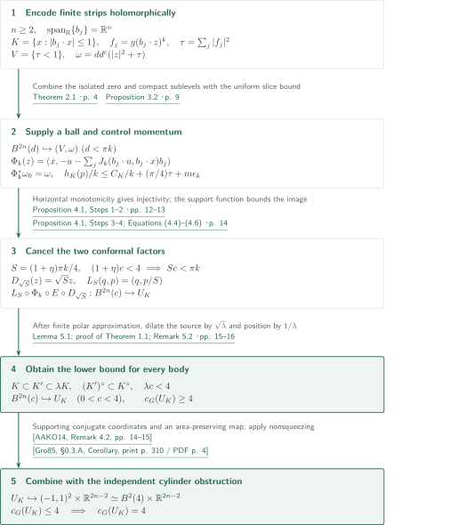
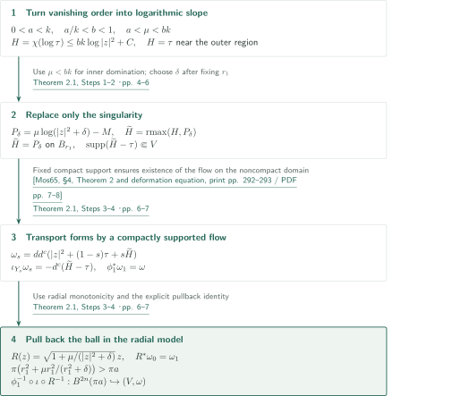
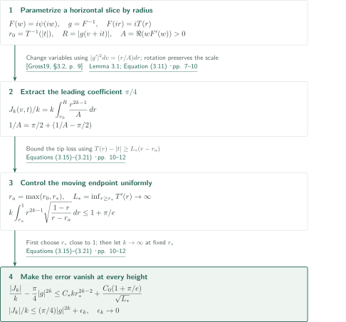
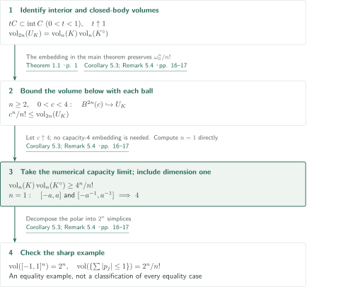
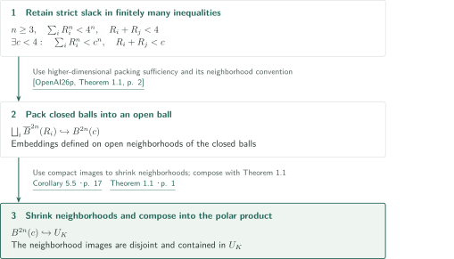

# Symplectic Balls in Symmetric Polar Products

**Combining holomorphic vanishing with a uniform lens estimate to embed balls in polar products**

OpenAI's manuscript of September 22, 2026 constructs smooth symplectic embeddings of every standard ball of capacity below 4 into the Lagrangian product of an origin-symmetric convex body and its polar. The actual embeddings giving the lower bound, the cylinder obstruction giving the upper bound, and the Mahler inequality obtained by volume preservation are separate parts of the argument.

## 1. Main results

Let $K\subset\mathbb R^n$ be compact and convex, with nonempty interior and $K=-K$, and put $K^\circ=\{p:\langle q,p\rangle\le1\ (q\in K)\}$. In position and conjugate momentum coordinates, set

$$
\omega_0=\sum_{j=1}^n dq_j\wedge dp_j,\qquad U_K=\operatorname{int}K\times\operatorname{int}K^\circ,\qquad
B^{2n}(c)=\{\pi(|q|^2+|p|^2)<c\}.
$$

Here $c$ is capacity, the radius is $\sqrt{c/\pi}$, and the volume is $c^n/n!$. The Gromov width $c_G$ is the supremum of capacities admitting a smooth symplectic ball embedding.

### Theorem 1.1 — Gromov width of a symmetric polar product

For every integer $n\ge2$ and every origin-symmetric convex body $K\subset\mathbb R^n$, one has $c_G(U_K)=4$. More precisely, for each $0<c<4$ there exists $B^{2n}(c)\hookrightarrow U_K$. No smoothness, strict convexity, or coordinatewise sign symmetry of $K$ is assumed. An embedding at the supremum 4 is not asserted.

<!-- cite:main -->[Theorem 1.1 · p. 1](https://github.com/openai/math/blob/1581d4cbdd69a0faf34b2089614fe2a814316a6a/preprints/Symplectic-Balls-in-Symmetric-Polar-Products-September-22-2026/paper.pdf)<!-- /cite -->

### Corollary 5.3 — Symmetric Mahler inequality

For every integer $n\ge1$ and every origin-symmetric convex body $K\subset\mathbb R^n$,

$$\operatorname{vol}_n(K)\operatorname{vol}_n(K^\circ)\ge\frac{4^n}{n!}.$$

The cube and its crosspolytope polar attain this constant. The manuscript does not classify all equality cases.

<!-- cite:volume -->[Corollary 5.3; Remark 5.4 · pp. 16–17](https://github.com/openai/math/blob/1581d4cbdd69a0faf34b2089614fe2a814316a6a/preprints/Symplectic-Balls-in-Symmetric-Polar-Products-September-22-2026/paper.pdf)<!-- /cite -->

### Corollary 5.5 — A sufficient finite packing criterion

Let $n\ge3$ and $k\ge1$ be integers, let $K\subset\mathbb R^n$ be an origin-symmetric convex body, and suppose positive capacities $R_1,\ldots,R_k$ satisfy

$$\sum_{i=1}^kR_i^n<4^n,\qquad R_i+R_j<4\quad(i<j).$$

There are symplectic embeddings of open neighborhoods of the closed balls $\overline B^{2n}(R_i)$ into $U_K$ with pairwise disjoint images. The pairwise condition is vacuous for $k=1$. These are sufficient conditions for the polar product, not a claimed necessary and sufficient criterion.

<!-- cite:packing -->[Corollary 5.5 · p. 17](https://github.com/openai/math/blob/1581d4cbdd69a0faf34b2089614fe2a814316a6a/preprints/Symplectic-Balls-in-Symmetric-Polar-Products-September-22-2026/paper.pdf)<!-- /cite -->

## References on the arrows

<!-- reference-guide -->
Unprefixed theorem, lemma, section and equation numbers refer to [Symplectic Balls in Symmetric Polar Products](https://github.com/openai/math/blob/1581d4cbdd69a0faf34b2089614fe2a814316a6a/preprints/Symplectic-Balls-in-Symmetric-Polar-Products-September-22-2026/paper.pdf). External inputs use the following keys.

- [AAKO14](https://arxiv.org/pdf/1303.4197v2) Shiri Artstein-Avidan, Roman Karasev, Yaron Ostrover — *From symplectic measurements to the Mahler conjecture*: Supporting-square cylinder, used for the upper bound. arXiv:1303.4197v2.
- [Gro85](https://www.ihes.fr/~gromov/wp-content/uploads/2018/08/945.pdf) Mikhael Gromov — *Pseudo holomorphic curves in symplectic manifolds*: Nonsqueezing bounds the capacity of an embedded ball. Inventiones Mathematicae 82 (1985), 307–347; published PDF.
- [Gross19](https://arxiv.org/pdf/1905.00852v1) Renan Gross — *A conformal Skorokhod embedding*: Uniform-distribution coordinate, rotated here; needed properties are proved locally. arXiv:1905.00852v1.
- [Mos65](https://people.math.harvard.edu/~dafr/M392C-2018-MorseTheory/Readings/Moser.pdf) Jürgen Moser — *On the Volume Elements on a Manifold*: Deformation of forms; compact support is verified locally. Transactions of the American Mathematical Society 120 (1965), 286–294; published PDF.
- [OpenAI26p](https://github.com/openai/math/blob/1581d4cbdd69a0faf34b2089614fe2a814316a6a/preprints/Symplectic-Ball-Packings-in-Higher-Dimensions-September-23-2026/paper.pdf) OpenAI — *Symplectic Ball Packings in Higher Dimensions*: Higher-dimensional packing for the corollary only; capacity and neighborhood conventions checked. September 23, 2026; commit 1581d4cbdd69a0faf34b2089614fe2a814316a6a.

Each citation gives the result and pages. When printed pagination differs from the PDF position, both are shown. GitHub previews do not automatically jump to the cited page.
<!-- /reference-guide -->

## 2. Theorem 1.1 — Comparing two scales and the cylinder obstruction

<!-- proof-target:1 -->Proof target：[Theorem 1.1 · p. 1](https://github.com/openai/math/blob/1581d4cbdd69a0faf34b2089614fe2a814316a6a/preprints/Symplectic-Balls-in-Symmetric-Polar-Products-September-22-2026/paper.pdf)<!-- /proof-target -->

**Proof route.** For a body defined by finitely many symmetric strips, Theorem 2.1 supplies balls of capacity below $\pi k$, while Proposition 3.2 bounds the required momentum enlargement by $(1+o(1))\pi k/4$. Proposition 4.1 combines these inputs; finite approximation on the polar side then handles arbitrary $K$. A supporting cylinder and nonsqueezing independently give the upper bound. The two analytic inputs are explained in the following proof sections.

### 1. From finite strips to phase space

Write $K=\{x:|b_j\cdot x|\le1,\ 1\le j\le m\}$, where the $b_j$ span $\mathbb R^n$. Using the lens $D$ and its inverse coordinate $g:D\to\mathbb D$ below, put $\ell_j(z)=b_j\cdot z$, $\Omega=\bigcap_j\ell_j^{-1}(D)$, $f_j=g(\ell_j)^k$, and $\tau=\sum_j|f_j|^2$. The domain $\Omega$ is bounded and the common zero is 0. On $\{\tau\le s\}$ each $\ell_j(z)$ lies in $F(\{|w|\le s^{1/(2k)}\})\Subset D$. Injectivity of the linear map $(\ell_j)_j$ makes these closed sublevels compact, verifying the hypotheses of Theorem 2.1.

Writing $z=u+ix$, the convention is $dd^c|z|^2=\sum du_j\wedge dx_j$. Thus target position is $q=x$ and the original momentum is $-u$. Correct it by

$$\Phi_k(z)=(q,p),\qquad q=x,\quad p=-u-\sum_jJ_k(b_j\cdot u,b_j\cdot x)b_j.$$

The identity $\partial_vJ_k=|(g^k)'|^2$ gives $\Phi_k^*\omega_0=dd^c(|z|^2+\tau)$. This local identity alone does not prove embedding. For two points with the same $x$, monotonicity on the horizontal slices gives

$$(p_2-p_1)\cdot(u_2-u_1)\le-|u_2-u_1|^2,$$

which proves global injectivity. The comparison uses the entire horizontal interval and remains valid even if a fiber of the sublevel domain is disconnected.

<!-- cite:realization -->[Proposition 4.1, Steps 1–2 · pp. 12–13](https://github.com/openai/math/blob/1581d4cbdd69a0faf34b2089614fe2a814316a6a/preprints/Symplectic-Balls-in-Symmetric-Polar-Products-September-22-2026/paper.pdf)<!-- /cite -->

### 2. Polar control and cancelling dilations

For the support function $h_K$, one has $h_K(\pm b_j)\le1$. Proposition 3.2 therefore yields

$$\frac{h_K(p)}k\le\frac{C_K}k+\frac\pi4\tau+m\epsilon_k,\qquad \epsilon_k\to0.$$

Fix $K,m,C_K$ before increasing $k$. For any $\eta>0$, the image lies in $\operatorname{int}K\times S\operatorname{int}K^\circ$ with $S=(1+\eta)\pi k/4$ once $k$ is large enough. If $(1+\eta)c<4$, then $Sc<\pi k$, so Theorem 2.1 supplies $B^{2n}(Sc)$. Precomposing by $D_{\sqrt S}(z)=\sqrt S z$ and postcomposing by $L_S(q,p)=(q,p/S)$ cancels the factors $S$ and $S^{-1}$ in the symplectic forms. This gives $B^{2n}(c)\hookrightarrow U_K$.

<!-- cite:scale -->[Proposition 4.1, Steps 3–4; Equations (4.4)–(4.6) · p. 14](https://github.com/openai/math/blob/1581d4cbdd69a0faf34b2089614fe2a814316a6a/preprints/Symplectic-Balls-in-Symmetric-Polar-Products-September-22-2026/paper.pdf)<!-- /cite -->

### 3. Finite approximation for an arbitrary body

For each $c<4$, choose $\lambda=1+\alpha>1$ with $\lambda c<4$. Lemma 5.1 takes the polar of the symmetric convex hull of a finite net in $K^\circ$ to obtain a finite strip body $K'$ satisfying

$$K\subset K'\subset\lambda K,\qquad (K')^\circ\subset K^\circ.$$

View $B^{2n}(\lambda c)\hookrightarrow\operatorname{int}K'\times\operatorname{int}(K')^\circ$ as an embedding into $\lambda\operatorname{int}K\times\operatorname{int}K^\circ$. A source dilation by $\sqrt\lambda$ and a position contraction by $1/\lambda$ again cancel their conformal factors. The choices are made in the order $c$, $\alpha$, $K'$ and its finite constraint list, $\eta$, then $k$. Each prescribed capacity uses one finite construction; no limiting embedding or smoothing of the convex boundary is required.

<!-- cite:approximation -->[Lemma 5.1; proof of Theorem 1.1; Remark 5.2 · pp. 15–16](https://github.com/openai/math/blob/1581d4cbdd69a0faf34b2089614fe2a814316a6a/preprints/Symplectic-Balls-in-Symmetric-Polar-Products-September-22-2026/paper.pdf)<!-- /cite -->

### 4. The supporting-cylinder upper bound

Choose $q_0\in K$ and $p_0\in K^\circ$ with $\langle q_0,p_0\rangle=1$. Complete $q_0$ by a basis of $\ker p_0$ to obtain a matrix $A$. The symplectic change $Q=A^{-1}q$, $P=A^Tp$ gives $|Q_1|,|P_1|<1$. Thus $U_K$ embeds into the cylinder over a square of area 4 in the first conjugate coordinate pair. An area-preserving map sends that square to the disk of area 4, and Gromov's nonsqueezing bounds the capacity of any embedded ball by 4. The lower bound is not inferred from the value of the Hofer–Zehnder capacity.

<!-- cite:upper -->[Proof of Theorem 1.1, upper bound · p. 16](https://github.com/openai/math/blob/1581d4cbdd69a0faf34b2089614fe2a814316a6a/preprints/Symplectic-Balls-in-Symmetric-Polar-Products-September-22-2026/paper.pdf)<!-- /cite -->
<!-- cite:aako -->[&#91;AAKO14, Remark 4.2, pp. 14–15&#93;](https://arxiv.org/pdf/1303.4197v2#page=14)<!-- /cite -->
<!-- cite:gromov -->[&#91;Gro85, §0.3.A, Corollary, print p. 310 / PDF p. 4&#93;](https://www.ihes.fr/~gromov/wp-content/uploads/2018/08/945.pdf#page=4)<!-- /cite -->

## 3. Theorem 2.1 — Turning a holomorphic zero into a ball

<!-- proof-target:2 -->Proof target：[Theorem 2.1 · p. 4](https://github.com/openai/math/blob/1581d4cbdd69a0faf34b2089614fe2a814316a6a/preprints/Symplectic-Balls-in-Symmetric-Polar-Products-September-22-2026/paper.pdf)<!-- /proof-target -->

<!-- statement:theorem-2-1 -->
### Theorem 2.1 — A ball from a holomorphic zero

Let $n,m\ge1$, let $\Omega\subset\mathbb C^n$ be open with $0\in\Omega$, and let $f:\Omega\to\mathbb C^m$ be holomorphic. Suppose some integer $k\ge1$ satisfies $f^{-1}(0)=\{0\}$ and $|f(z)|=O(|z|^k)$, and that $\{|f|^2\le s\}\Subset\Omega$ for every $0<s<1$. Set $\tau=|f|^2$, $V=\{\tau<1\}$, $d^c\phi(X)=-\frac14d\phi(iX)$, and $\omega=dd^c(|z|^2+\tau)$. Then $(B^{2n}(c),\omega_0)\hookrightarrow(V,\omega)$ for each $0<c<\pi k$.

<!-- cite:holomorphic -->[Theorem 2.1 · p. 4](https://github.com/openai/math/blob/1581d4cbdd69a0faf34b2089614fe2a814316a6a/preprints/Symplectic-Balls-in-Symmetric-Polar-Products-September-22-2026/paper.pdf)<!-- /cite -->
<!-- /statement -->

**Proof route.** Convert vanishing order into a logarithmic slope, replace the singularity near 0 by a smooth radial potential, and use the compactly supported difference to obtain a complete Moser flow. The ball visible in the radial model is transported back to the original form.

### 1. Logarithmic slope and the regularized maximum

Write the capacity as $c=\pi a$. Choose $0<a<k$, $a/k<b<1$, and $a<\mu<bk$. An increasing convex function $\chi$ makes $H=\chi(\log\tau)$ agree with $\tau$ near the outer part of the domain and satisfy $H\le bk\log|z|^2+C$ near 0. For $P_\delta=\mu\log(|z|^2+\delta)-M$, first arrange $P_\delta<H-2$ on an outer sphere, then $P_\delta>H+2$ on an inner ball whose radius is independent of $\delta$. The strict inequality $\mu<bk$ provides the latter comparison. Only afterwards is $\delta>0$ chosen small.

A regularized maximum produces a smooth plurisubharmonic $\widetilde H$, equal to $P_\delta$ inside and to $H$ outside. The support of $\widetilde H-\tau$ lies in some $\{\tau\le\sigma\}$ with $\sigma<1$, compact by hypothesis.

<!-- cite:smoothing -->[Theorem 2.1, Steps 1–2 · pp. 4–6](https://github.com/openai/math/blob/1581d4cbdd69a0faf34b2089614fe2a814316a6a/preprints/Symplectic-Balls-in-Symmetric-Polar-Products-September-22-2026/paper.pdf)<!-- /cite -->

### 2. Moser transport and the radial capacity

The forms $\omega_s=dd^c(|z|^2+(1-s)\tau+s\widetilde H)$ remain nondegenerate. The solution of $\iota_{Y_s}\omega_s=-d^c(\widetilde H-\tau)$ has fixed compact support, so its flow exists for $0\le s\le1$ even though $V$ is noncompact, and satisfies $\phi_1^*\omega_1=\omega$. The manuscript proves the needed local version of Moser's deformation method; it does not apply the original compact-manifold theorem to a noncompact domain without a support argument.

Inside, $\Psi(t)=t+\mu\log(t+\delta)$ and $R(z)=\sqrt{\Psi'(|z|^2)}z$ carry the radial form to the standard one. The image of the radius-$r_1$ ball has capacity $\pi(r_1^2+\mu r_1^2/(r_1^2+\delta))>\pi a$. Pull the smaller standard ball back by $R^{-1}$, inclusion, and $\phi_1^{-1}$. Neither a regular-value condition on the sublevel boundary nor connectedness of $V$ is needed.

<!-- cite:transport -->[Theorem 2.1, Steps 3–4 · pp. 6–7](https://github.com/openai/math/blob/1581d4cbdd69a0faf34b2089614fe2a814316a6a/preprints/Symplectic-Balls-in-Symmetric-Polar-Products-September-22-2026/paper.pdf)<!-- /cite -->
<!-- cite:moser -->[&#91;Mos65, §4, Theorem 2 and deformation equation, print pp. 292–293 / PDF pp. 7–8&#93;](https://people.math.harvard.edu/~dafr/M392C-2018-MorseTheory/Readings/Moser.pdf#page=7)<!-- /cite -->

## 4. Proposition 3.2 — Uniform horizontal integrals up to the tips

<!-- proof-target:3 -->Proof target：[Proposition 3.2 · p. 9](https://github.com/openai/math/blob/1581d4cbdd69a0faf34b2089614fe2a814316a6a/preprints/Symplectic-Balls-in-Symmetric-Polar-Products-September-22-2026/paper.pdf)<!-- /proof-target -->

<!-- statement:proposition-3-2 -->
### Proposition 3.2 — The uniform slice estimate

Use the biholomorphism of Lemma 3.1,

$$F(w)=\frac8{\pi^2}\sum_{\ell\ge0}\frac{(-1)^\ell w^{2\ell+1}}{(2\ell+1)^2}:\mathbb D\longrightarrow D,\qquad g=F^{-1}.$$

The domain $D$ is bounded, with horizontal slice $(-V(t),V(t))+it$ at each $-1<t<1$. For integers $k\ge2$, define

$$J_k(v,t)=k^2\int_0^v|g(h+it)|^{2k-2}|g'(h+it)|^2\,dh.$$

The function $J_k$ is smooth on $D$, odd in $v$, and satisfies $\partial_vJ_k=k^2|g|^{2k-2}|g'|^2\ge0$. There are $\epsilon_k\ge0$, depending only on $F$, with $\epsilon_k\to0$, such that simultaneously for every $v+it\in D$,

$$\frac{|J_k(v,t)|}{k}\le\frac\pi4|g(v+it)|^{2k}+\epsilon_k.$$

<!-- cite:slice -->[Proposition 3.2 · p. 9](https://github.com/openai/math/blob/1581d4cbdd69a0faf34b2089614fe2a814316a6a/preprints/Symplectic-Balls-in-Symmetric-Polar-Products-September-22-2026/paper.pdf)<!-- /cite -->
<!-- /statement -->

**Proof route.** Rotate Gross's uniform-distribution coordinate in source and target, $F(w)=i\psi(iw)$, without scaling it. Convert horizontal integration into radial integration in the disk, separating the leading constant $\pi/4$ from a uniform error at the tips.

<!-- cite:gross -->[&#91;Gross19, §3.2, p. 9&#93;](https://arxiv.org/pdf/1905.00852v1#page=9)<!-- /cite -->

### 1. Radial integration and the leading coefficient

Write $F(ir)=iT(r)$, with $T'(r)=8\operatorname{arctanh}r/(\pi^2r)\to\infty$. On a positive horizontal slice, write $w=re^{i\theta(r,t)}$. Its radius increases from $r_0=T^{-1}(|t|)$ to $R=|g(v+it)|$, and

$$A(r,\theta)=\Re(wF'(w))=\frac4{\pi^2}\arctan\frac{2r\cos\theta}{1-r^2},\qquad
\frac{J_k(v,t)}k=k\int_{r_0}^R\frac{r^{2k-1}}{A(r,\theta(r,t))}\,dr.$$

The constant part $\pi/2$ of $1/A$ contributes $\frac\pi4(R^{2k}-r_0^{2k})$. A boundary limit at fixed $t$ alone would not control the remainder when $t=t_k\to\pm1$.

<!-- cite:radial -->[Lemma 3.1; Equation (3.11) · pp. 7–10](https://github.com/openai/math/blob/1581d4cbdd69a0faf34b2089614fe2a814316a6a/preprints/Symplectic-Balls-in-Symmetric-Polar-Products-September-22-2026/paper.pdf)<!-- /cite -->

### 2. Moving endpoints and the order of limits

Split at $r_*\in(1/2,1)$. The inner contribution is bounded by $C_*kr_*^{2k-2}$. Outside, put $r_a=\max(r_0,r_*)$ and $L_* =\inf_{r_*\le r<1}T'(r)$. Then

$$\frac1A\le\frac\pi2+C_0\sqrt{\frac{1-r}{T(r)-|t|}},\qquad
T(r)-|t|\ge L_*(r-r_a).$$

For the remaining integral $I=k\int_{r_a}^1r^{2k-1}\sqrt{(1-r)/(r-r_a)}\,dr$, the substitution $y=k(1-r)$ and $H=k(1-r_a)$ yields $I\le1+\pi/e$ uniformly for every $H>0$. The excess is therefore at most

$$C_*kr_*^{2k-2}+\frac{C_0(1+\pi/e)}{\sqrt{L_*}}.$$

First choose $r_*\uparrow1$ to make the second term small; then hold that cutoff fixed and let $k\to\infty$. This permits the height and both endpoints to vary with $k$. Smoothness follows by differentiating over compact horizontal segments, and oddness and monotonicity follow from symmetry and nonnegativity of the density. These conclusions also enter the global embedding in §4.

<!-- cite:uniform -->[Equations (3.15)–(3.21) · pp. 10–12](https://github.com/openai/math/blob/1581d4cbdd69a0faf34b2089614fe2a814316a6a/preprints/Symplectic-Balls-in-Symmetric-Polar-Products-September-22-2026/paper.pdf)<!-- /cite -->

## 5. Corollary 5.3 — The volume consequence

<!-- proof-target:4 -->Proof target：[Corollary 5.3; Remark 5.4 · pp. 16–17](https://github.com/openai/math/blob/1581d4cbdd69a0faf34b2089614fe2a814316a6a/preprints/Symplectic-Balls-in-Symmetric-Polar-Products-September-22-2026/paper.pdf)<!-- /proof-target -->

**Proof route.** In dimensions $n\ge2$, approach the supremum through ball volumes. In dimension one, compute interval lengths directly. Exhibiting an equality example is separate from classifying equality cases.

### 1. Interiors and the capacity limit

For a convex body $C$ containing 0 in its interior, $tC\subset\operatorname{int}C$ for $0<t<1$. Letting $t\uparrow1$ shows that its interior has the same volume. Thus $\operatorname{vol}_{2n}(U_K)=\operatorname{vol}_n(K)\operatorname{vol}_n(K^\circ)$. A symplectic embedding preserves $\omega_0^n/n!$, so $c^n/n!\le\operatorname{vol}_{2n}(U_K)$ for every $c<4$. Letting the number $c$ increase to 4 is sufficient; no capacity-4 embedding or convergence of embeddings is required.

### 2. Dimension one and sharpness

For $n=1$, $K=[-a,a]$ and $K^\circ=[-a^{-1},a^{-1}]$ have length product 4. In every dimension, the cube has volume $2^n$ and its crosspolytope polar has volume $2^n/n!$, by decomposing it into one simplex per orthant. Their product is $4^n/n!$. This example does not classify all other equality cases.

<!-- cite:volume -->[Corollary 5.3; Remark 5.4 · pp. 16–17](https://github.com/openai/math/blob/1581d4cbdd69a0faf34b2089614fe2a814316a6a/preprints/Symplectic-Balls-in-Symmetric-Polar-Products-September-22-2026/paper.pdf)<!-- /cite -->

## 6. Corollary 5.5 — Transporting ball packings to the polar product

<!-- proof-target:5 -->Proof target：[Corollary 5.5 · p. 17](https://github.com/openai/math/blob/1581d4cbdd69a0faf34b2089614fe2a814316a6a/preprints/Symplectic-Balls-in-Symmetric-Polar-Products-September-22-2026/paper.pdf)<!-- /proof-target -->

**Proof route.** Use the slack in the two strict inequalities to choose one $c<4$, then compose the external ball-packing theorem with Theorem 1.1.

### 1. Strict slack and shrinking neighborhoods

Finiteness and strictness allow $c<4$ with $\sum_iR_i^n<c^n$ and $R_i+R_j<c$ for every pair. The external Theorem 1.1 packs the closed balls into $B^{2n}(c)$ for $n\ge3$, by embeddings defined on open neighborhoods. Since their compact images are disjoint and lie in the open ball, shrink these finitely many neighborhoods to preserve both disjointness and containment. Compose with $B^{2n}(c)\hookrightarrow U_K$ from Theorem 1.1. The external theorem's necessity statement concerns a ball target; this composition does not establish necessity for $U_K$.

<!-- cite:packing -->[Corollary 5.5 · p. 17](https://github.com/openai/math/blob/1581d4cbdd69a0faf34b2089614fe2a814316a6a/preprints/Symplectic-Balls-in-Symmetric-Polar-Products-September-22-2026/paper.pdf)<!-- /cite -->
<!-- cite:packings-input -->[&#91;OpenAI26p, Theorem 1.1, p. 2&#93;](https://github.com/openai/math/blob/1581d4cbdd69a0faf34b2089614fe2a814316a6a/preprints/Symplectic-Ball-Packings-in-Higher-Dimensions-September-23-2026/paper.pdf)<!-- /cite -->

## 7. Which papers supply which steps

| Source | Use | Content and connection | Checking scope |
|---|---|---|---|
| Gross | Lemma 3.1, §3 | Rotate the uniform-distribution conformal map; needed lens and slice properties are proved locally | Series in §3.2 and rotation checked; the full probabilistic proof is outside scope |
| Moser | Theorem 2.1, Step 3 | Transport a path of forms by a vector field; fixed compact support is proved here | Deformation equation in §4 and support argument on pp.5–6 checked |
| Artstein-Avidan–Karasev–Ostrover; Gromov | Upper bound in Theorem 1.1 | Supporting square cylinder and nonsqueezing | Input statements and application on p.16 checked; full nonsqueezing proof not verified |
| OpenAI, Symplectic Ball Packings in Higher Dimensions | Corollary 5.5 | $n\ge3$, strict inequalities, embeddings on neighborhoods of closed balls | Theorem 1.1 and capacity/neighborhood conventions checked; packing proof not verified |

The same-catalogue manuscript *The symmetric Mahler conjecture and its equality cases* provides background with a common lens construction. This proof does not use its volume inequality or equality classification. Conversely, Corollary 5.3 supplies the same symmetric volume lower bound, without classifying equality. No direct input from the general-convex-body manuscript is recorded in the proof passages read here; this is not a claim to have investigated every possible connection.

<!-- cite:background -->[Background and prior constructions · p. 2](https://github.com/openai/math/blob/1581d4cbdd69a0faf34b2089614fe2a814316a6a/preprints/Symplectic-Balls-in-Symmetric-Polar-Products-September-22-2026/paper.pdf)<!-- /cite -->

## 8. Return to the sources

<!-- reading-list -->
- [Theorem 1.1 · p. 1](https://github.com/openai/math/blob/1581d4cbdd69a0faf34b2089614fe2a814316a6a/preprints/Symplectic-Balls-in-Symmetric-Polar-Products-September-22-2026/paper.pdf) — Capacity convention and scope of the theorem.
- [Theorem 2.1 · p. 4](https://github.com/openai/math/blob/1581d4cbdd69a0faf34b2089614fe2a814316a6a/preprints/Symplectic-Balls-in-Symmetric-Polar-Products-September-22-2026/paper.pdf) — Hypotheses converting vanishing order into ball capacity.
- [Equations (3.15)–(3.21) · pp. 10–12](https://github.com/openai/math/blob/1581d4cbdd69a0faf34b2089614fe2a814316a6a/preprints/Symplectic-Balls-in-Symmetric-Polar-Products-September-22-2026/paper.pdf) — Uniform error with moving endpoints.
- [Proposition 4.1, Steps 1–2 · pp. 12–13](https://github.com/openai/math/blob/1581d4cbdd69a0faf34b2089614fe2a814316a6a/preprints/Symplectic-Balls-in-Symmetric-Polar-Products-September-22-2026/paper.pdf) — Local form identity and global injectivity.
- [Lemma 5.1; proof of Theorem 1.1; Remark 5.2 · pp. 15–16](https://github.com/openai/math/blob/1581d4cbdd69a0faf34b2089614fe2a814316a6a/preprints/Symplectic-Balls-in-Symmetric-Polar-Products-September-22-2026/paper.pdf) — Approximation and the order of choices.
- [Corollary 5.3; Remark 5.4 · pp. 16–17](https://github.com/openai/math/blob/1581d4cbdd69a0faf34b2089614fe2a814316a6a/preprints/Symplectic-Balls-in-Symmetric-Polar-Products-September-22-2026/paper.pdf) — Volume deduction and sharpness.
- [Corollary 5.5 · p. 17](https://github.com/openai/math/blob/1581d4cbdd69a0faf34b2089614fe2a814316a6a/preprints/Symplectic-Balls-in-Symmetric-Polar-Products-September-22-2026/paper.pdf) — The consequence using the external packing theorem.
<!-- /reading-list -->

The fixed manuscript's §§2–5 (pp.3–17) were read to check the deformation from vanishing order to a ball, the tip-uniform estimate, global injectivity for finite strips, both cancelling rescalings, the supporting cylinder, and the volume and packing deductions. External inputs were checked to the extent listed above: statements and uses. This is editorial checking of the manuscript's argument, not independent certification of its all-dimensional claims. Complete external proofs, recursive verification of the bibliography, and equality classification remain outside scope.
