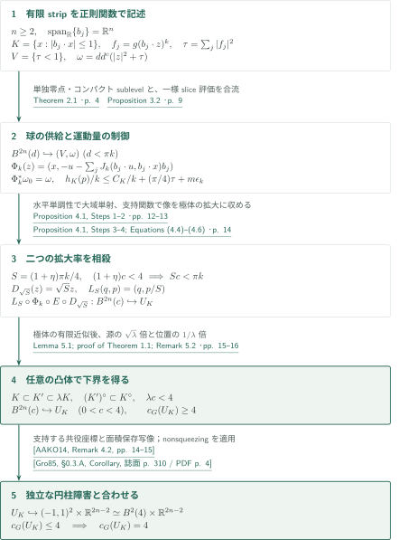
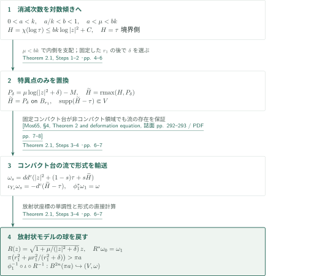
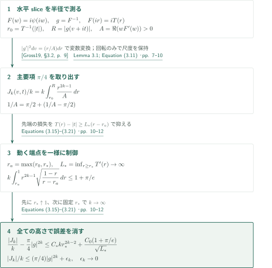
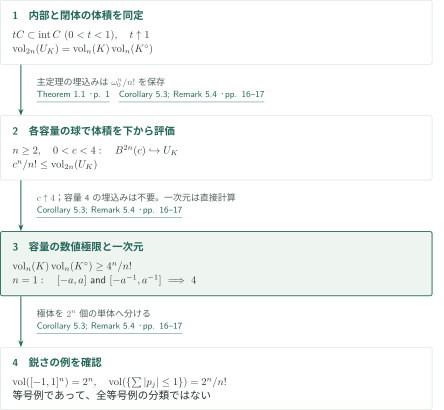
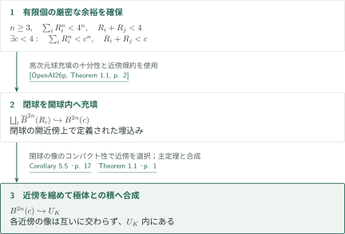

# Symplectic Balls in Symmetric Polar Products

**正則零点の消滅次数とレンズの一様積分評価を組み合わせ、極体との積へ球を入れる**

OpenAIの2026年9月22日原稿は、原点対称な凸体とその極体のLagrangian積に、容量が4未満の任意の標準球を滑らかにシンプレクティック埋込みする。下界を与える実際の埋込み、上界を与える円柱障害、体積保存からのMahler不等式を区別して説明する。

## 1. 主要結果

$K\subset\mathbb R^n$ はコンパクト、凸、内部非空で $K=-K$ とし、$K^\circ=\{p:\langle q,p\rangle\le1\ (q\in K)\}$ と置く。位置 $q$ と共役運動量 $p$ を使い、

$$
\omega_0=\sum_{j=1}^n dq_j\wedge dp_j,\qquad U_K=\operatorname{int}K\times\operatorname{int}K^\circ,\qquad
B^{2n}(c)=\{\pi(|q|^2+|p|^2)<c\}.
$$

$c$ は容量で、半径は $\sqrt{c/\pi}$、体積は $c^n/n!$ である。$c_G$ はこの球の滑らかなシンプレクティック埋込みが存在する容量の上限を表す。

### Theorem 1.1 — 対称凸体と極体の積のGromov幅

任意の整数 $n\ge2$ と原点対称凸体 $K\subset\mathbb R^n$ に対して $c_G(U_K)=4$。より正確には、各 $0<c<4$ について $B^{2n}(c)\hookrightarrow U_K$ が存在する。$K$ の滑らかさ、狭義凸性、座標ごとの符号対称性は仮定しない。上限4での埋込みは主張していない。

<!-- cite:main -->[Theorem 1.1 · p. 1](https://github.com/openai/math/blob/1581d4cbdd69a0faf34b2089614fe2a814316a6a/preprints/Symplectic-Balls-in-Symmetric-Polar-Products-September-22-2026/paper.pdf)<!-- /cite -->

### Corollary 5.3 — 対称Mahler不等式

任意の整数 $n\ge1$ と原点対称凸体 $K\subset\mathbb R^n$ に対して

$$\operatorname{vol}_n(K)\operatorname{vol}_n(K^\circ)\ge\frac{4^n}{n!}.$$

立方体と交差多面体の対でこの定数を達成するが、本稿は等号成立体の分類を与えない。

<!-- cite:volume -->[Corollary 5.3; Remark 5.4 · pp. 16–17](https://github.com/openai/math/blob/1581d4cbdd69a0faf34b2089614fe2a814316a6a/preprints/Symplectic-Balls-in-Symmetric-Polar-Products-September-22-2026/paper.pdf)<!-- /cite -->

### Corollary 5.5 — 有限球充填の十分条件

整数 $n\ge3$, $k\ge1$、原点対称凸体 $K\subset\mathbb R^n$、正の容量 $R_1,\ldots,R_k$ が

$$\sum_{i=1}^kR_i^n<4^n,\qquad R_i+R_j<4\quad(i<j)$$

を満たすとする。このとき閉球 $\overline B^{2n}(R_i)$ の開近傍から $U_K$ へのシンプレクティック埋込みを、像が互いに交わらないように取れる。$k=1$ では対ごとの条件は空である。この極体との積への条件は十分条件であり、必要十分条件と読み替えない。

<!-- cite:packing -->[Corollary 5.5 · p. 17](https://github.com/openai/math/blob/1581d4cbdd69a0faf34b2089614fe2a814316a6a/preprints/Symplectic-Balls-in-Symmetric-Polar-Products-September-22-2026/paper.pdf)<!-- /cite -->

## 図の矢印に付した引用

<!-- reference-guide -->
略号のない定理・補題・節・式番号は本原稿 [Symplectic Balls in Symmetric Polar Products](https://github.com/openai/math/blob/1581d4cbdd69a0faf34b2089614fe2a814316a6a/preprints/Symplectic-Balls-in-Symmetric-Polar-Products-September-22-2026/paper.pdf) を指します。外部入力には次の略号を使います。

- [AAKO14](https://arxiv.org/pdf/1303.4197v2) Shiri Artstein-Avidan, Roman Karasev, Yaron Ostrover — *From symplectic measurements to the Mahler conjecture*：支持する正方形円柱の構成。上界で使用。arXiv:1303.4197v2。
- [Gro85](https://www.ihes.fr/~gromov/wp-content/uploads/2018/08/945.pdf) Mikhael Gromov — *Pseudo holomorphic curves in symplectic manifolds*：nonsqueezingによる球容量の上界。Inventiones Mathematicae 82 (1985), 307–347; published PDF。
- [Gross19](https://arxiv.org/pdf/1905.00852v1) Renan Gross — *A conformal Skorokhod embedding*：一様分布の写像。回転して使い、必要な性質は本稿で証明。arXiv:1905.00852v1。
- [Mos65](https://people.math.harvard.edu/~dafr/M392C-2018-MorseTheory/Readings/Moser.pdf) Jürgen Moser — *On the Volume Elements on a Manifold*：形式の変形法。本稿でコンパクト台を確認。Transactions of the American Mathematical Society 120 (1965), 286–294; published PDF。
- [OpenAI26p](https://github.com/openai/math/blob/1581d4cbdd69a0faf34b2089614fe2a814316a6a/preprints/Symplectic-Ball-Packings-in-Higher-Dimensions-September-23-2026/paper.pdf) OpenAI — *Symplectic Ball Packings in Higher Dimensions*：帰結のみに使う高次元球充填。容量・閉球近傍規約を照合。September 23, 2026; commit 1581d4cbdd69a0faf34b2089614fe2a814316a6a。

各引用に結果番号とページを付します。誌面番号とPDF内の位置が異なる場合は両方を示します。GitHubの閲覧リンクではページ位置への自動移動を前提としません。
<!-- /reference-guide -->

## 2. Theorem 1.1 — 二つの尺度の比較と円柱障害

<!-- proof-target:1 -->証明対象：[Theorem 1.1 · p. 1](https://github.com/openai/math/blob/1581d4cbdd69a0faf34b2089614fe2a814316a6a/preprints/Symplectic-Balls-in-Symmetric-Polar-Products-September-22-2026/paper.pdf)<!-- /proof-target -->

**証明の道筋。** 有限個の対称stripで定まる $K$ について、Theorem 2.1が容量 $\pi k$ 未満の球を供給し、Proposition 3.2が運動量方向の拡大率を $(1+o(1))\pi k/4$ に抑える。両者をProposition 4.1で接続し、極体側の有限近似で任意の $K$ に移す。上界は独立な支持円柱とnonsqueezingによる。二つの解析的入力は後続の証明節で説明する。

### 1. 有限stripから位相空間へ

$K=\{x:|b_j\cdot x|\le1,\ 1\le j\le m\}$ とし、$b_j$ が $\mathbb R^n$ を張るとする。後述のレンズ $D$ と $g:D\to\mathbb D$ を用い、$\ell_j(z)=b_j\cdot z$、$\Omega=\bigcap_j\ell_j^{-1}(D)$、$f_j=g(\ell_j)^k$、$\tau=\sum_j|f_j|^2$ と置く。$\Omega$ は有界で、$f$ の共通零点は0だけである。$\{\tau\le s\}$ では各 $\ell_j(z)$ が $F(\{|w|\le s^{1/(2k)}\})\Subset D$ に入る。線形写像 $(\ell_j)_j$ の単射性が閉sublevelのコンパクト性を保証するので、Theorem 2.1を適用できる。

$z=u+ix$ と書くと、$dd^c|z|^2=\sum du_j\wedge dx_j$ であり、目標の位置は $q=x$、元の運動量は $-u$ となる。補正を

$$\Phi_k(z)=(q,p),\qquad q=x,\quad p=-u-\sum_jJ_k(b_j\cdot u,b_j\cdot x)b_j$$

で定める。$\partial_vJ_k=|(g^k)'|^2$ により $\Phi_k^*\omega_0=dd^c(|z|^2+\tau)$。局所的な形式の一致だけでは埋込みにならない。固定した $x$ の二点について、水平slice上の単調性から

$$(p_2-p_1)\cdot(u_2-u_1)\le-|u_2-u_1|^2$$

を得るため大域単射になる。fiberが非連結でも同じ水平区間上で比較できる点が重要である。

<!-- cite:realization -->[Proposition 4.1, Steps 1–2 · pp. 12–13](https://github.com/openai/math/blob/1581d4cbdd69a0faf34b2089614fe2a814316a6a/preprints/Symplectic-Balls-in-Symmetric-Polar-Products-September-22-2026/paper.pdf)<!-- /cite -->

### 2. 極体を保つ運動量評価と相殺する拡大

$h_K$ を支持関数とすると $h_K(\pm b_j)\le1$ であり、Proposition 3.2は

$$\frac{h_K(p)}k\le\frac{C_K}k+\frac\pi4\tau+m\epsilon_k,\qquad \epsilon_k\to0$$

を与える。$K,m,C_K$ を固定してから $k$ を大きく取る。任意の $\eta>0$ に対して像は $\operatorname{int}K\times S\operatorname{int}K^\circ$ に入り、$S=(1+\eta)\pi k/4$ とできる。$(1+\eta)c<4$ なら $Sc<\pi k$ なので、Theorem 2.1の球 $B^{2n}(Sc)$ を使える。源の $D_{\sqrt S}(z)=\sqrt S z$ と目標の $L_S(q,p)=(q,p/S)$ を合成すると、形式の倍率 $S$ と $S^{-1}$ が相殺し、$B^{2n}(c)\hookrightarrow U_K$ となる。

<!-- cite:scale -->[Proposition 4.1, Steps 3–4; Equations (4.4)–(4.6) · p. 14](https://github.com/openai/math/blob/1581d4cbdd69a0faf34b2089614fe2a814316a6a/preprints/Symplectic-Balls-in-Symmetric-Polar-Products-September-22-2026/paper.pdf)<!-- /cite -->

### 3. 任意の凸体への有限近似

各 $c<4$ に対して $\lambda=1+\alpha>1$ を $\lambda c<4$ となるよう取る。Lemma 5.1は $K^\circ$ の有限netの対称凸包を極化して、有限strip体 $K'$ を

$$K\subset K'\subset\lambda K,\qquad (K')^\circ\subset K^\circ$$

となるよう作る。$B^{2n}(\lambda c)\hookrightarrow\operatorname{int}K'\times\operatorname{int}(K')^\circ$ を $\lambda\operatorname{int}K\times\operatorname{int}K^\circ$ への埋込みとみなし、源の $\sqrt\lambda$ 倍と位置の $1/\lambda$ 倍を組み合わせる。ここでも形式の倍率が相殺する。選択順は $c$, $\alpha$, $K'$ と有限制約列、$\eta$, $k$ である。一つの $c$ に一つの有限構成を作るので、埋込みの極限や境界の平滑化は不要である。

<!-- cite:approximation -->[Lemma 5.1; proof of Theorem 1.1; Remark 5.2 · pp. 15–16](https://github.com/openai/math/blob/1581d4cbdd69a0faf34b2089614fe2a814316a6a/preprints/Symplectic-Balls-in-Symmetric-Polar-Products-September-22-2026/paper.pdf)<!-- /cite -->

### 4. 支持円柱による上界

$\langle q_0,p_0\rangle=1$ を満たす $q_0\in K$, $p_0\in K^\circ$ を選ぶ。$q_0$ と $\ker p_0$ の基底から作る $A$ により $Q=A^{-1}q$, $P=A^Tp$ はシンプレクティックで、$|Q_1|,|P_1|<1$ となる。従って $U_K$ は第一共役座標の面積4の正方形に基づく円柱へ入る。正方形を面積保存で面積4の円板へ移し、Gromovのnonsqueezingから球の容量は4以下となる。これはHofer–Zehnder容量の値から下界を推論する議論ではない。

<!-- cite:upper -->[Proof of Theorem 1.1, upper bound · p. 16](https://github.com/openai/math/blob/1581d4cbdd69a0faf34b2089614fe2a814316a6a/preprints/Symplectic-Balls-in-Symmetric-Polar-Products-September-22-2026/paper.pdf)<!-- /cite -->
<!-- cite:aako -->[&#91;AAKO14, Remark 4.2, pp. 14–15&#93;](https://arxiv.org/pdf/1303.4197v2#page=14)<!-- /cite -->
<!-- cite:gromov -->[&#91;Gro85, §0.3.A, Corollary, 誌面 p. 310 / PDF p. 4&#93;](https://www.ihes.fr/~gromov/wp-content/uploads/2018/08/945.pdf#page=4)<!-- /cite -->

## 3. Theorem 2.1 — 正則零点を球へ変える

<!-- proof-target:2 -->証明対象：[Theorem 2.1 · p. 4](https://github.com/openai/math/blob/1581d4cbdd69a0faf34b2089614fe2a814316a6a/preprints/Symplectic-Balls-in-Symmetric-Polar-Products-September-22-2026/paper.pdf)<!-- /proof-target -->

<!-- statement:theorem-2-1 -->
### Theorem 2.1 — 正則零点からの球

$n,m\ge1$、$0\in\Omega\subset\mathbb C^n$ は開集合、$f:\Omega\to\mathbb C^m$ は正則とする。ある整数 $k\ge1$ に対して $f^{-1}(0)=\{0\}$、$|f(z)|=O(|z|^k)$、さらに全ての $0<s<1$ について $\{|f|^2\le s\}\Subset\Omega$ を仮定する。$\tau=|f|^2$, $V=\{\tau<1\}$、$d^c\phi(X)=-\frac14d\phi(iX)$、$\omega=dd^c(|z|^2+\tau)$ と置く。このとき各 $0<c<\pi k$ に対し $(B^{2n}(c),\omega_0)\hookrightarrow(V,\omega)$ が存在する。

<!-- cite:holomorphic -->[Theorem 2.1 · p. 4](https://github.com/openai/math/blob/1581d4cbdd69a0faf34b2089614fe2a814316a6a/preprints/Symplectic-Balls-in-Symmetric-Polar-Products-September-22-2026/paper.pdf)<!-- /cite -->
<!-- /statement -->

**証明の道筋。** 消滅次数を対数ポテンシャルの傾きに変え、0の近くのみ滑らかな放射状ポテンシャルで置換する。差のコンパクト台がMoser流を完備にし、放射状モデルで見える球を元の形式へ戻す。

### 1. 対数傾きと正則化最大値

容量を $c=\pi a$ と書き、$0<a<k$、$a/k<b<1$、$a<\mu<bk$ を取る。$H=\chi(\log\tau)$ が境界側では $\tau$ と一致し、0の近くでは $H\le bk\log|z|^2+C$ となるよう、増加凸関数 $\chi$ を選ぶ。$P_\delta=\mu\log(|z|^2+\delta)-M$ について、まず外側球面で $P_\delta<H-2$、次に $\delta$ に依存しない内側球で $P_\delta>H+2$ を確保する。$\mu<bk$ の厳密性が後者を与える。その後で $\delta>0$ を小さくする順序が必要である。

正則化最大値で $\widetilde H$ を作ると、内側では $P_\delta$、外側では $H$ になり、多重劣調和性を保つ。$\widetilde H-\tau$ の台は、仮定によりコンパクトなある $\{\tau\le\sigma\}$、$\sigma<1$ に入る。

<!-- cite:smoothing -->[Theorem 2.1, Steps 1–2 · pp. 4–6](https://github.com/openai/math/blob/1581d4cbdd69a0faf34b2089614fe2a814316a6a/preprints/Symplectic-Balls-in-Symmetric-Polar-Products-September-22-2026/paper.pdf)<!-- /cite -->

### 2. Moser輸送と放射状の容量

$\omega_s=dd^c(|z|^2+(1-s)\tau+s\widetilde H)$ は常に非退化である。$\iota_{Y_s}\omega_s=-d^c(\widetilde H-\tau)$ の解は固定コンパクト集合に台を持つため、非コンパクトな $V$ 上でも $0\le s\le1$ の流 $\phi_s$ が存在し、$\phi_1^*\omega_1=\omega$。これはMoserの変形法の局所適用を本稿で証明したもので、コンパクト多様体についての原定理を非コンパクト領域へ無条件に引用していない。

内側では $\Psi(t)=t+\mu\log(t+\delta)$ に対し $R(z)=\sqrt{\Psi'(|z|^2)}z$ が標準形式へ移す。半径 $r_1$ の球の像の容量は $\pi(r_1^2+\mu r_1^2/(r_1^2+\delta))>\pi a$。この像の球を $R^{-1}$、包含、$\phi_1^{-1}$ で戻せばよい。sublevel境界の正則値条件や $V$ の連結性は使わない。

<!-- cite:transport -->[Theorem 2.1, Steps 3–4 · pp. 6–7](https://github.com/openai/math/blob/1581d4cbdd69a0faf34b2089614fe2a814316a6a/preprints/Symplectic-Balls-in-Symmetric-Polar-Products-September-22-2026/paper.pdf)<!-- /cite -->
<!-- cite:moser -->[&#91;Mos65, §4, Theorem 2 and deformation equation, 誌面 pp. 292–293 / PDF pp. 7–8&#93;](https://people.math.harvard.edu/~dafr/M392C-2018-MorseTheory/Readings/Moser.pdf#page=7)<!-- /cite -->

## 4. Proposition 3.2 — 先端まで一様な水平積分評価

<!-- proof-target:3 -->証明対象：[Proposition 3.2 · p. 9](https://github.com/openai/math/blob/1581d4cbdd69a0faf34b2089614fe2a814316a6a/preprints/Symplectic-Balls-in-Symmetric-Polar-Products-September-22-2026/paper.pdf)<!-- /proof-target -->

<!-- statement:proposition-3-2 -->
### Proposition 3.2 — 一様slice評価

Lemma 3.1の写像

$$F(w)=\frac8{\pi^2}\sum_{\ell\ge0}\frac{(-1)^\ell w^{2\ell+1}}{(2\ell+1)^2}:\mathbb D\longrightarrow D,\qquad g=F^{-1}$$

を用いる。$D$ は有界で、高さ $-1<t<1$ の水平sliceは $(-V(t),V(t))+it$ である。整数 $k\ge2$ に対し

$$J_k(v,t)=k^2\int_0^v|g(h+it)|^{2k-2}|g'(h+it)|^2\,dh.$$

$J_k$ は $D$ 上滑らか、$v$ について奇関数で、$\partial_vJ_k=k^2|g|^{2k-2}|g'|^2\ge0$。$F$ だけに依存する $\epsilon_k\ge0$, $\epsilon_k\to0$ が存在して、全ての $v+it\in D$ に同時に

$$\frac{|J_k(v,t)|}{k}\le\frac\pi4|g(v+it)|^{2k}+\epsilon_k$$

が成り立つ。

<!-- cite:slice -->[Proposition 3.2 · p. 9](https://github.com/openai/math/blob/1581d4cbdd69a0faf34b2089614fe2a814316a6a/preprints/Symplectic-Balls-in-Symmetric-Polar-Products-September-22-2026/paper.pdf)<!-- /cite -->
<!-- /statement -->

**証明の道筋。** Grossの一様分布の写像を源・目標で回転した $F(w)=i\psi(iw)$ を使う。拡大係数は加えない。水平線の積分を円板内の半径へ移し、主要項 $\pi/4$ と先端での誤差を分離する。

<!-- cite:gross -->[&#91;Gross19, §3.2, p. 9&#93;](https://arxiv.org/pdf/1905.00852v1#page=9)<!-- /cite -->

### 1. 半径積分と主要係数

$F(ir)=iT(r)$、$T'(r)=8\operatorname{arctanh}r/(\pi^2r)\to\infty$ とする。正の水平sliceに沿い $w=re^{i\theta(r,t)}$ と書くと、$r_0=T^{-1}(|t|)$ から $R=|g(v+it)|$ まで $r$ が単調増加する。

$$A(r,\theta)=\Re(wF'(w))=\frac4{\pi^2}\arctan\frac{2r\cos\theta}{1-r^2},\qquad
\frac{J_k(v,t)}k=k\int_{r_0}^R\frac{r^{2k-1}}{A(r,\theta(r,t))}\,dr.$$

$1/A$ の定数部分 $\pi/2$ の積分が $\frac\pi4(R^{2k}-r_0^{2k})$ を与える。$t$ を固定した境界極限だけでは、$t=t_k\to\pm1$ における残差は制御できない。

<!-- cite:radial -->[Lemma 3.1; Equation (3.11) · pp. 7–10](https://github.com/openai/math/blob/1581d4cbdd69a0faf34b2089614fe2a814316a6a/preprints/Symplectic-Balls-in-Symmetric-Polar-Products-September-22-2026/paper.pdf)<!-- /cite -->

### 2. 動く端点と極限の順序

$r_*\in(1/2,1)$ で分ける。内部の寄与は $C_*kr_*^{2k-2}$。外側では $r_a=\max(r_0,r_*)$、$L_* =\inf_{r_*\le r<1}T'(r)$ として

$$\frac1A\le\frac\pi2+C_0\sqrt{\frac{1-r}{T(r)-|t|}},\qquad
T(r)-|t|\ge L_*(r-r_a).$$

残る $I=k\int_{r_a}^1r^{2k-1}\sqrt{(1-r)/(r-r_a)}\,dr$ は $H=k(1-r_a)$ と $y=k(1-r)$ を使うと、$H$ の大小によらず $I\le1+\pi/e$。従って超過分は

$$C_*kr_*^{2k-2}+\frac{C_0(1+\pi/e)}{\sqrt{L_*}}$$

以下になる。先に $r_*\uparrow1$ で第二項を小さくし、その $r_*$ を固定して $k\to\infty$ とする。これで高さと両端点が $k$ とともに動く場合まで一様になる。滑らかさはコンパクトな水平線分上の微分、奇性と単調性は積分密度の対称性と非負性から従い、これらも§4の大域埋込みに使われる。

<!-- cite:uniform -->[Equations (3.15)–(3.21) · pp. 10–12](https://github.com/openai/math/blob/1581d4cbdd69a0faf34b2089614fe2a814316a6a/preprints/Symplectic-Balls-in-Symmetric-Polar-Products-September-22-2026/paper.pdf)<!-- /cite -->

## 5. Corollary 5.3 — 体積保存による帰結

<!-- proof-target:4 -->証明対象：[Corollary 5.3; Remark 5.4 · pp. 16–17](https://github.com/openai/math/blob/1581d4cbdd69a0faf34b2089614fe2a814316a6a/preprints/Symplectic-Balls-in-Symmetric-Polar-Products-September-22-2026/paper.pdf)<!-- /proof-target -->

**証明の道筋。** $n\ge2$ では球の体積を下から近づけ、$n=1$ は区間を直接計算する。等号例の確認と等号分類は別である。

### 1. 内部への移行と容量の極限

0を内部に含む凸体 $C$ では $tC\subset\operatorname{int}C$ ($0<t<1$) なので $t\uparrow1$ により内部と閉体の体積は一致する。従って $\operatorname{vol}_{2n}(U_K)=\operatorname{vol}_n(K)\operatorname{vol}_n(K^\circ)$。シンプレクティック埋込みは $\omega_0^n/n!$ を保つので、各 $c<4$ について $c^n/n!\le\operatorname{vol}_{2n}(U_K)$。数値として $c\uparrow4$ とするだけでよく、容量4の球の埋込みや埋込み列の収束を要求しない。

### 2. 一次元と鋭さ

$n=1$ では $K=[-a,a]$, $K^\circ=[-a^{-1},a^{-1}]$ の長さの積は4。一般次元の立方体は体積 $2^n$、極体の交差多面体は各象限の単体を数えて $2^n/n!$ であり、積は $4^n/n!$ となる。この例から他の全等号例を分類することはできない。

<!-- cite:volume -->[Corollary 5.3; Remark 5.4 · pp. 16–17](https://github.com/openai/math/blob/1581d4cbdd69a0faf34b2089614fe2a814316a6a/preprints/Symplectic-Balls-in-Symmetric-Polar-Products-September-22-2026/paper.pdf)<!-- /cite -->

## 6. Corollary 5.5 — 球充填を極体との積へ移す

<!-- proof-target:5 -->証明対象：[Corollary 5.5 · p. 17](https://github.com/openai/math/blob/1581d4cbdd69a0faf34b2089614fe2a814316a6a/preprints/Symplectic-Balls-in-Symmetric-Polar-Products-September-22-2026/paper.pdf)<!-- /proof-target -->

**証明の道筋。** 厳密な二種類の不等式に残る余裕を使って $c<4$ を一度選び、外部の球充填定理とTheorem 1.1を合成する。

### 1. 厳密な余裕と近傍の縮小

有限個の条件が厳密なので、$\sum_iR_i^n<c^n$ と $R_i+R_j<c$ が全て成り立つ $c<4$ を選べる。外部のTheorem 1.1は $n\ge3$ の閉球を $B^{2n}(c)$ 内へ、閉球の開近傍上で定義された埋込みとして充填する。コンパクトな閉球の像が互いに交わらず開球内にあるので、有限個の近傍を縮めて像の非交差と目標内への包含を同時に保つ。最後にTheorem 1.1の $B^{2n}(c)\hookrightarrow U_K$ と合成する。外部定理の必要十分性は球を目標とする場合のもので、この合成から $U_K$ での必要性は出ない。

<!-- cite:packing -->[Corollary 5.5 · p. 17](https://github.com/openai/math/blob/1581d4cbdd69a0faf34b2089614fe2a814316a6a/preprints/Symplectic-Balls-in-Symmetric-Polar-Products-September-22-2026/paper.pdf)<!-- /cite -->
<!-- cite:packings-input -->[&#91;OpenAI26p, Theorem 1.1, p. 2&#93;](https://github.com/openai/math/blob/1581d4cbdd69a0faf34b2089614fe2a814316a6a/preprints/Symplectic-Ball-Packings-in-Higher-Dimensions-September-23-2026/paper.pdf)<!-- /cite -->

## 7. どの論文が、どの段階を担うか

| 供給元 | 利用箇所 | 使う内容・接続 | 確認範囲 |
|---|---|---|---|
| Gross | Lemma 3.1, §3 | 一様分布の等角写像を回転。必要なレンズ・slice性質は本稿で証明 | §3.2の級数と回転を照合。確率論の全証明は対象外 |
| Moser | Theorem 2.1, Step 3 | 形式の道をベクトル場で輸送。本稿は固定コンパクト台を証明 | §4の変形方程式と本稿pp.5–6の台を照合 |
| Artstein-Avidan–Karasev–Ostrover、Gromov | Theorem 1.1の上界 | 支持正方形円柱とnonsqueezing | 入力の記述とp.16での適用を照合。nonsqueezingの証明全体は未検証 |
| OpenAI, Symplectic Ball Packings in Higher Dimensions | Corollary 5.5 | $n\ge3$、厳密不等式、閉球の近傍上の埋込み | Theorem 1.1と容量・近傍規約を照合。充填定理の証明は未検証 |

同じ087の *The symmetric Mahler conjecture and its equality cases* はレンズの共通する背景であり、本稿はその体積不等式や等号分類を証明入力としない。逆に本稿のCorollary 5.3は対称体について同じ体積下界を与えるが、等号分類を含まない。一般凸体の原稿との直接依存は、この原稿で読んだ証明には記録されていない。関連する全ての接続を調査済みという意味ではない。

<!-- cite:background -->[Background and prior constructions · p. 2](https://github.com/openai/math/blob/1581d4cbdd69a0faf34b2089614fe2a814316a6a/preprints/Symplectic-Balls-in-Symmetric-Polar-Products-September-22-2026/paper.pdf)<!-- /cite -->

## 8. 原典を読む入口と確認範囲

<!-- reading-list -->
- [Theorem 1.1 · p. 1](https://github.com/openai/math/blob/1581d4cbdd69a0faf34b2089614fe2a814316a6a/preprints/Symplectic-Balls-in-Symmetric-Polar-Products-September-22-2026/paper.pdf) — 容量の規約と主張の範囲
- [Theorem 2.1 · p. 4](https://github.com/openai/math/blob/1581d4cbdd69a0faf34b2089614fe2a814316a6a/preprints/Symplectic-Balls-in-Symmetric-Polar-Products-September-22-2026/paper.pdf) — 消滅次数を球容量に変える仮定
- [Equations (3.15)–(3.21) · pp. 10–12](https://github.com/openai/math/blob/1581d4cbdd69a0faf34b2089614fe2a814316a6a/preprints/Symplectic-Balls-in-Symmetric-Polar-Products-September-22-2026/paper.pdf) — 移動する端点でも一様な誤差
- [Proposition 4.1, Steps 1–2 · pp. 12–13](https://github.com/openai/math/blob/1581d4cbdd69a0faf34b2089614fe2a814316a6a/preprints/Symplectic-Balls-in-Symmetric-Polar-Products-September-22-2026/paper.pdf) — 局所形式と大域単射性
- [Lemma 5.1; proof of Theorem 1.1; Remark 5.2 · pp. 15–16](https://github.com/openai/math/blob/1581d4cbdd69a0faf34b2089614fe2a814316a6a/preprints/Symplectic-Balls-in-Symmetric-Polar-Products-September-22-2026/paper.pdf) — 近似とパラメータの選択順
- [Corollary 5.3; Remark 5.4 · pp. 16–17](https://github.com/openai/math/blob/1581d4cbdd69a0faf34b2089614fe2a814316a6a/preprints/Symplectic-Balls-in-Symmetric-Polar-Products-September-22-2026/paper.pdf) — 体積の帰結と鋭さ
- [Corollary 5.5 · p. 17](https://github.com/openai/math/blob/1581d4cbdd69a0faf34b2089614fe2a814316a6a/preprints/Symplectic-Balls-in-Symmetric-Polar-Products-September-22-2026/paper.pdf) — 外部充填定理を使う帰結
<!-- /reading-list -->

固定版の本文§§2–5（pp.3–17）を読み、消滅次数から球への変形、先端を含む一様評価、有限stripの大域単射性、二段階の拡大相殺、支持円柱、体積と充填の帰結を照合した。外部入力は上表の記述・使用箇所まで確認した。これらは原稿の論証を案内する編集上の確認であり、著者による全次元の主張を独立に認定するものではない。外部定理の全証明、全参考文献の再帰的検証、等号分類は確認範囲外である。
