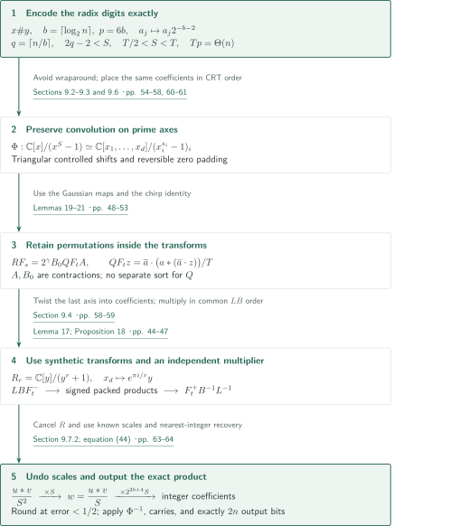
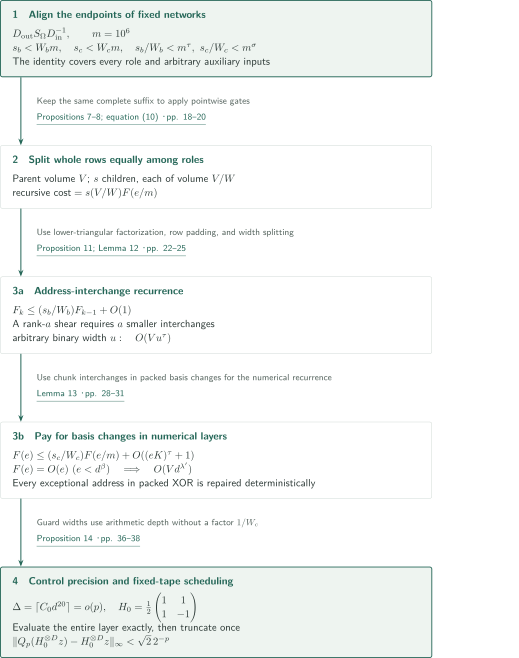
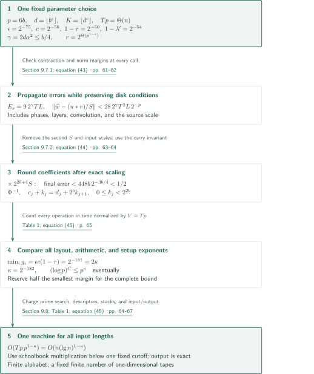

# Integer multiplication below n log n

**Fixed linear networks save on both data movement and simultaneous butterflies; controlled errors are then removed by exact recovery.**

The manuscript reduces integer multiplication to multidimensional normalized convolutions and accelerates both their tape layout changes and their arithmetic layers. Its central mechanism turns a rank deficit in a fixed linear network into an improved exponent in a recurrence normalized by the stored bit volume. This article explains the author's proof construction; it does not constitute an independent verification of the complete proof.

## 1. Main results

### Theorem 1 — Exact multiplication on a fixed number of one-dimensional tapes

For a binary string $x$ of length $n$, let $\operatorname{val}(x)$ be its nonnegative value, with the most significant bit on the left. Write $\operatorname{bin}_k(z)$ for its binary representation padded on the left to length $k$, and put $\lg n=\max\{\lceil\log_2n\rceil,1\}$.

There exists **one deterministic Turing machine** $\mathcal A$, with a fixed finite alphabet and a fixed finite number of one-dimensional tapes, that, for every $n\ge1$ and every $x,y\in\{0,1\}^n$, takes $x\#y$ to exactly

$$
\operatorname{bin}_{2n}\!\bigl(\operatorname{val}(x)\operatorname{val}(y)\bigr).
$$

Its worst-case time satisfies

$$
T_{\mathcal A}(n)=O\!\left(n(\lg n)^{1-\kappa}\right),\qquad\kappa=2^{-182}.
$$

Leading zeroes are allowed. Including the separator, the input has length $2n+1$, and the output has exactly $2n$ bits. One step reads and writes at most one cell on each tape and moves each head by at most one cell. The statement does not supply a different circuit or advice for each $n$.

<!-- cite:main-result -->[Theorem 1 · p. 3](https://github.com/openai/math/blob/1581d4cbdd69a0faf34b2089614fe2a814316a6a/preprints/Integer-multiplication-below-n-log-n-September-23-2026/paper.pdf)<!-- /cite -->

The bound is asymptotic through all input lengths. Against an eventual $\Omega(n\lg n)$ lower bound for every fixed multiplication machine, this machine satisfies $T_{\mathcal A}(n)/(n\lg n)\to0$. The manuscript explicitly describes the constants and thresholds as extremely large and makes no claim of practical speed. Its intermediate XOR computations also distinguish it from transposition models restricted to moving data.

<!-- cite:model-scope -->[Sections 1.7 and 2 · pp. 7–8](https://github.com/openai/math/blob/1581d4cbdd69a0faf34b2089614fe2a814316a6a/preprints/Integer-multiplication-below-n-log-n-September-23-2026/paper.pdf)<!-- /cite -->

## References on the arrows

<!-- reference-guide -->
Unprefixed theorem, lemma, section and equation numbers refer to [Integer multiplication below n log n](https://github.com/openai/math/blob/1581d4cbdd69a0faf34b2089614fe2a814316a6a/preprints/Integer-multiplication-below-n-log-n-September-23-2026/paper.pdf). External inputs use the following keys.

- [HvH21](https://hal.science/hal-02070778v2/file/nlogn.pdf) David Harvey and Joris van der Hoeven — *Integer multiplication in time O(n log n)*: Independent established multiplier, Gaussian resampling analysis and numerical routines, phase approximations, and prime intervals. Statements and applications are checked, not complete external proofs.. HAL hal-02070778v2 (submitted 28 November 2020; 45-page manuscript plus cover). Byte identity with the author-site file specified by the manuscript is unconfirmed..

Each citation gives the result and pages. When printed pagination differs from the PDF position, both are shown. GitHub previews do not automatically jump to the cited page.
<!-- /reference-guide -->

## 2. Proof of Theorem 1 — From the input to the exact product

<!-- proof-target:1 -->Proof target：[Theorem 1 · p. 3](https://github.com/openai/math/blob/1581d4cbdd69a0faf34b2089614fe2a814316a6a/preprints/Integer-multiplication-below-n-log-n-September-23-2026/paper.pdf)<!-- /proof-target -->

**Proof route.** A convolution-preserving CRT map places radix digits on a product of prime cyclic axes; Gaussian resampling moves the source transforms to power-of-two tensor transforms. Retained frequency permutations are handled inside the chirp and convolution identities. The final axis becomes the coefficient list of $R_r=\mathbb C[y]/(y^r+1)$. Synthetic-root transforms, polynomial products using an independent existing multiplier, and an opposite transform evaluate the convolution. Known scales are then removed to recover integer coefficients and the product. The next section explains the recurrences responsible for the saving; Section 4 treats errors and total cost.

### 1. Radix digits and a convolution-preserving address map

For sufficiently large $n$, set $b=\lceil\log_2n\rceil$, precision $p=6b$, and digit count $q=\lceil n/b\rceil$. Choose a power of two $T\in[4n/b,8n/b)$ and distinct odd primes $s_i$ just below power-of-two lengths $t_i\in\{r/2,r\}$. Then $S=\prod_i s_i$ and $T=\prod_i t_i$ satisfy $T/2<S<T$. Writing each operand as $\sum_{j<q}a_j2^{bj}$, the product has degree $2q-2<S$, so cyclic convolution modulo $x^S-1$ introduces no nonzero wraparound. Its coefficients satisfy $0\le c_j<2^{3b}$.

Put $P_i=\prod_{j<i}s_j$ and $\mu_i=P_i^{-1}\bmod s_i$. The map

$$
\Phi:\mathbb C[x]/(x^S-1)\longrightarrow
\mathbb C[x_1,\ldots,x_d]/(x_1^{s_1}-1,\ldots,x_d^{s_d}-1),
\qquad x\longmapsto\prod_i x_i^{\mu_i}
$$

is an algebra isomorphism permuting the monomial bases. A mixed-radix index $k=\sum_i a_iP_i$ moves to $b_i=a_i+\mu_i\sum_{j<i}a_jP_j\pmod{s_i}$. The triangular updates are ordered so that their lower-index controls have not yet changed. An extension fixing invalid padding intervals preserves zero padding, and the inverse map restores ordinary coefficient order. Each real input digit is stored exactly as $a_j2^{-b-2}$, so the arrays $u,v$ have norm less than $1/4$.

<!-- cite:input-crt -->[Sections 9.2–9.3 and 9.6 · pp. 54–58, 60–61](https://github.com/openai/math/blob/1581d4cbdd69a0faf34b2089614fe2a814316a6a/preprints/Integer-multiplication-below-n-log-n-September-23-2026/paper.pdf)<!-- /cite -->

### 2. Resampling and chirps with frequency permutations retained

Write $F_s=\bigotimes_iF_{s_i}$ for the normalized Fourier transform. Lemma 19 implements the one-dimensional Gaussian maps with ordered input and output; Lemma 20 tensors them. The resulting identity is

$$
RF_s=2^\gamma B_0QF_tA,\qquad\gamma=2d\alpha^2.
$$

Here $A,B_0$ are contractions, and $R,Q$ are explicit coordinate permutations. Instead of separately executing the two label-and-sort operations in the usual resampling algorithm, the manuscript converts $QF_t$ into a normalized cyclic convolution by a chirp identity. For its chirp array $a$, one has $QF_tz=\overline a\cdot(a*(\overline a\cdot z))/T$. The remaining $R$ cancels across the two forward transforms, their pointwise product, and the opposite-sign transform:

$$
(RF_s^+)\bigl[(RF_su)\cdot(RF_sv)\bigr]=\frac{u*v}{S^2}.
$$

The transform $F_s^+$ is itself normalized by $1/S$; it is not the inverse matrix of $F_s$. These normalizations explain the two later multiplications by $S$.

<!-- cite:resampling -->[Lemmas 19–20 · pp. 48–52](https://github.com/openai/math/blob/1581d4cbdd69a0faf34b2089614fe2a814316a6a/preprints/Integer-multiplication-below-n-log-n-September-23-2026/paper.pdf)<!-- /cite -->

<!-- cite:permutation-cancel -->[Lemma 21; equations (36)–(37) · p. 53](https://github.com/openai/math/blob/1581d4cbdd69a0faf34b2089614fe2a814316a6a/preprints/Integer-multiplication-below-n-log-n-September-23-2026/paper.pdf)<!-- /cite -->

### 3. Synthetic transforms, retained order, and polynomial products

The substitution $x_d\mapsto\zeta y$, with $\zeta=e^{\pi i/r}$, moves the last cyclic axis into $R_r$. Since $(\zeta y)^r=1$, this twist carries cyclic multiplication exactly into negacyclic polynomial multiplication. The sign from $y^r=-1$ cancels on untwisting. Powers of $y$ are signed cyclic shifts of coefficient lists, so multiplication by the synthetic roots for the other axes uses linear scans.

The forward and opposite procedures of Lemma 16 implement $LBF_t^-$ and $F_t^+B^{-1}L^{-1}$, respectively. Here $B$ is frequency bit reversal and $L$ is the layout suited to simultaneous layers. Both forward outputs remain in their common $LB$ order for the pointwise product, and the opposite procedure consumes that order directly. No intervening full-array sort is required.

Lemma 17 handles each polynomial product. After removing the denominator $2^p$, signed integer coefficients of the real and imaginary parts are packed in radix $B_0=2^{4p}$ (a local packing notation, distinct from the compression map). Four integer products yield the complex product. Every ordinary product coefficient has absolute value at most $r2^{2p}<B_0/2$, so centered residues and a carry uniquely recover the signed coefficients. Subtracting coefficient $j+r$ from coefficient $j$ gives the negacyclic product; truncation occurs only after normalization by $r$. The $O(N\log N)$ multiplier used here is the established theorem of [HvH21], not a recursive invocation of the improved multiplier under construction.

<!-- cite:synthetic-transform -->[Lemma 16 · pp. 40–44](https://github.com/openai/math/blob/1581d4cbdd69a0faf34b2089614fe2a814316a6a/preprints/Integer-multiplication-below-n-log-n-September-23-2026/paper.pdf)<!-- /cite -->

<!-- cite:packing -->[Lemma 17; Proposition 18 · pp. 44–47](https://github.com/openai/math/blob/1581d4cbdd69a0faf34b2089614fe2a814316a6a/preprints/Integer-multiplication-below-n-log-n-September-23-2026/paper.pdf)<!-- /cite -->

<!-- cite:twist -->[Section 9.4 · pp. 58–59](https://github.com/openai/math/blob/1581d4cbdd69a0faf34b2089614fe2a814316a6a/preprints/Integer-multiplication-below-n-log-n-September-23-2026/paper.pdf)<!-- /cite -->

## 3. Proof of Theorem 1 — Turning rank deficits into tape-time savings

<!-- proof-target:2 -->Proof target：[Theorem 1 · p. 3](https://github.com/openai/math/blob/1581d4cbdd69a0faf34b2089614fe2a814316a6a/preprints/Integer-multiplication-below-n-log-n-September-23-2026/paper.pdf)<!-- /proof-target -->

**Proof route.** The same representation principle accelerates two expensive operations in the overall construction. Arrays are split equally among $W$ roles in a fixed network, so $s$ child calls contribute the factor $s/W$, rather than $s$, to the normalized time. A strict deficit $s<Wm$ is used for both address interchange and numerical layers.

### 1. Changing frames while restoring arbitrary auxiliary values

Section 3 directly constructs two fixed networks from triples of three-element subsets of $[100]$. Side wires cancel unwanted intersection-size coefficients created by gather/scatter operations; three stages exchange two data banks. Auxiliary wires may start with arbitrary values: their old contribution is first subtracted, and their contents are restored after the computation. Lemma 5 proves this restoration, while Lemma 6 supplies nested subspace labels and counts their dimension losses.

At a vertex $v$, store a logical array $g$ as $D_vg$. On an edge $u\to v$, apply $D_vD_u^{-1}$, and use the same $D_v$ on every incidence of one gate. The pointwise linear gate then commutes with the frame. The full operation is $D_{\rm out}S_\Omega D_{\rm in}^{-1}$. The inverse input frame specifies a logical interpretation and needs no separate preprocessing of the supplied input.

For the bit network with rational subspace labels, the endpoint matrix difference is the identity on every role, and the edge-rank sum $s_b<W_bm$ supplies an address shear. For the complex network with binary subspace labels, the sum $s_c<W_cm$ of orthogonal residual dimensions supplies phase kernels. Both have $m=10^6$, with $s_b/W_b<m^\tau$, $s_c/W_c<m^\sigma$, and $\tau=\sigma=1-2^{-50}$. The networks are enormous but independent of the input length.

<!-- cite:network -->[Lemmas 5–6; equation (5) · pp. 11–17](https://github.com/openai/math/blob/1581d4cbdd69a0faf34b2089614fe2a814316a6a/preprints/Integer-multiplication-below-n-log-n-September-23-2026/paper.pdf)<!-- /cite -->

<!-- cite:rank-deficit -->[Propositions 7–8; equation (10) · pp. 18–20](https://github.com/openai/math/blob/1581d4cbdd69a0faf34b2089614fe2a814316a6a/preprints/Integer-multiplication-below-n-log-n-September-23-2026/paper.pdf)<!-- /cite -->

### 2. Exact address interchanges and deterministic exception repair

For the bit network, whole rows retaining their complete suffixes are distributed cyclically among $W_b$ roles. Each child has the same address set and $1/W_b$ of its parent's bit volume. For a width $e=m^k$, time divided by volume satisfies

$$
F_k\le(s_b/W_b)F_{k-1}+O(1),\qquad F_0=O(1).
$$

A lower-triangular factorization reduces a rational shear of rank $a$ to exactly $a$ smaller interchanges; this is why the number of children is the rank sum. Lemma 12 obtains rows from high digits, pads them, partitions widths in base $m$, and pads binary ranges to a fixed odd-prime radix. It thereby interchanges arbitrary nonadjacent width-$u$ chunks in $O(Vu^\tau)$ time. Intermediate XOR strings are not interpreted as numerical coefficients; arithmetic resumes only after the encodings have been exactly permuted.

The numerical network also needs simultaneous XORs on selected bits of many chunks. Lemma 13 uses eight controlled cyclic shifts with a third chunk as auxiliary space. Addresses near a guard boundary constitute at most $80(f-1)2^{-K}$ of the array. These exceptions are extracted, assigned their correct destinations, stably sorted by binary keys, and reinserted. Every exception is repaired deterministically, independently of payload values; there is no allowed failure probability. The conditions $K/\log p\to\infty$ and a long polynomial payload absorb the extra repair and address-computation costs.

<!-- cite:swap -->[Proposition 11; Lemma 12 · pp. 22–25](https://github.com/openai/math/blob/1581d4cbdd69a0faf34b2089614fe2a814316a6a/preprints/Integer-multiplication-below-n-log-n-September-23-2026/paper.pdf)<!-- /cite -->

<!-- cite:packed-basis -->[Lemma 13 · pp. 28–31](https://github.com/openai/math/blob/1581d4cbdd69a0faf34b2089614fe2a814316a6a/preprints/Integer-multiplication-below-n-log-n-September-23-2026/paper.pdf)<!-- /cite -->

### 3. Simultaneous butterflies and recursion on fixed tapes

The complex network produces tensor kernels of $C=H\operatorname{diag}(1,i)H$, where $H=2^{-1/2}\begin{pmatrix}1&1\\1&-1\end{pmatrix}$. Diagonal phases and a dyadic scale convert them into a simultaneous layer of $H_0=\frac12\begin{pmatrix}1&1\\1&-1\end{pmatrix}$. For $e$ active axes the normalized time satisfies

$$
F(e)\le(s_c/W_c)F(e/m)+O((eK)^\tau+1),\qquad
F(e)=O(e)\quad(e<d^\beta),\quad\beta=\tfrac12.
$$

Separating internal costs from leaf costs and choosing $\tau(1+c/\beta)<\lambda$ and $\max\{\lambda,\sigma+\beta(1-\sigma)\}<\lambda'<1$ yields $O(Vd^{\lambda'})$ for the complete layer, including the base-$m$ grouping.

Intermediate frames need not be contractions. The arithmetic dependency depth used for precision satisfies $A(e)\le s_cA(e/m)+E$; the volume factor $1/W_c$ does not enter this bound. Section 5.4 bounds denominator and magnitude growth by $\Delta=\lceil C_0d^{20}\rceil$. The entire layer is evaluated exactly using $p+\Delta$ fractional bits and $\Delta+3$ integer/sign bits. Since $20\epsilon<1$, this is still an $O(p)$-bit format. Only after the completed contraction layer are components truncated toward zero to $2^{-p}\mathbb Z$, producing error less than $\sqrt2\,2^{-p}$.

A fixed family of $W$ role tapes is reused at every recursion depth. Inactive streams are parked at the top of a stack, then popped back in their original order after the child returns. Ancestors' parked data are not rescanned; copies, rewinds, and cleanup are charged to the current node's volume. Growing axis counts and recursion depths appear as descriptors stored on tapes, not as additional tapes or alphabet symbols.

<!-- cite:layer -->[Section 5.3; Proposition 14 · pp. 32–38](https://github.com/openai/math/blob/1581d4cbdd69a0faf34b2089614fe2a814316a6a/preprints/Integer-multiplication-below-n-log-n-September-23-2026/paper.pdf)<!-- /cite -->

<!-- cite:fixed-tapes -->[Proposition 11 proof; Section 5.3 · pp. 23, 33–34](https://github.com/openai/math/blob/1581d4cbdd69a0faf34b2089614fe2a814316a6a/preprints/Integer-multiplication-below-n-log-n-September-23-2026/paper.pdf)<!-- /cite -->

## 4. Proof of Theorem 1 — Errors, complete cost, and all input lengths

<!-- proof-target:3 -->Proof target：[Theorem 1 · p. 3](https://github.com/openai/math/blob/1581d4cbdd69a0faf34b2089614fe2a814316a6a/preprints/Integer-multiplication-below-n-log-n-September-23-2026/paper.pdf)<!-- /proof-target -->

**Proof route.** At precision $p=6b$, preserve the disk conditions of every numerical call and undo both normalization factors and the input scales exactly. Error below $1/2$ uniquely recovers integer coefficients; a carry invariant then gives the product. Finally compare every cost exponent, including layout and setup, to obtain $\kappa$.

### 1. Computable parameters and the hypotheses of each call

Use the fixed rational choices of Section 9.1:

$$
\tau=\sigma=1-2^{-50},\quad\beta=\tfrac12,\quad\delta=\tfrac1{16},\quad
\lambda=1-2^{-52},\quad c=2^{-56},\quad\lambda'=1-2^{-54},\quad
\epsilon=2^{-75}.
$$

Set $d=\lfloor b^\epsilon\rfloor$, $K=\lfloor d^c\rfloor$, $r=2^{\lceil(\log_2T)/d\rceil}$, and $\ell=\log_2r$. Choose the $d$ axes from $r/2,r$ so that their product is $T$ and the last axis has length $r$. Then

$$
Tp=\Theta(n),\quad d=\Theta(p^\epsilon),\quad
K=\Theta(p^{\epsilon c}),\quad\ell=\Theta(p^{1-\epsilon}),\quad
r=2^{\Theta(p^{1-\epsilon})}.
$$

Take $\alpha=\lceil(12d^2b)^{1/4}\rceil$ and $\eta=1/(4d)$, and choose distinct odd primes $(1-2\eta)t_i<s_i\le(1-\eta)t_i$. For sufficiently large inputs, [HvH21, Lemma 5.1] supplies enough primes in each interval. These choices ensure $\gcd(s_i,t_i)=1$, $2\le\alpha<\sqrt p$, and $\alpha^4(t_i/s_i-1)>p$, as required by resampling. Even testing every candidate by trial division costs only $O(dr^{3/2}\operatorname{poly}(p))=n^{o(1)}=o(n)$. Fixed rational-power comparisons, inverses, and descriptors are also computed by the machine. Preprocessing is not excluded as free advice or a free table.

<!-- cite:parameters -->[Sections 9.1–9.2 · pp. 54–56](https://github.com/openai/math/blob/1581d4cbdd69a0faf34b2089614fe2a814316a6a/preprints/Integer-multiplication-below-n-log-n-September-23-2026/paper.pdf)<!-- /cite -->

### 2. Undoing both normalizations and recovering coefficients and carries

Put $h_p=2^{-p}$ and $L=\log_2T$. Contraction of each synthetic-transform round lets its errors add; Lemma 16 gives error less than $\sqrt2\ell h_p$. The ring convolution's error includes its final factor $M=T/r$. After twists and chirps, the source-transform error is bounded by

$$
E_sh_p,\qquad E_s=9\,2^\gamma TL,\qquad\gamma=2d\alpha^2\le b/4.
$$

Section 9.7.1 checks norms as well as errors: source inputs of norm at most $.5$, chirp inputs at most $.6$, and convolution inputs with one operand at most $.7$ give successive margins. Thus every call stays within its specified disk grid, without clipping its output.

After truncating the product of the two forward outputs, $\|z\|<.5$. The exact counterpart of the opposite transform is $(u*v)/S^2$. The first multiplication by $S$ produces an approximation $\widetilde w$ to $w=(u*v)/S$, with error less than $28\,2^\gamma T^2Lh_p$. Multiplication by $2^{2b+4}S$ then removes the remaining $S$ and both input scales. These integer products and shifts act exactly on numerators. The final error is

$$
2^{2b+4}S\cdot28\,2^\gamma T^2L\cdot2^{-6b}
<448b\,2^{-b+\gamma}\le448b\,2^{-3b/4}<\tfrac12.
$$

The nearest integer to the real component is therefore the correct $c_j$. Serialize it in a known $O(p)$-bit format and restore ordinary coefficient order with $\Phi^{-1}$. For $Q_0=2^b$, scan the recurrence

$$
k_0=0,\qquad d_j=(c_j+k_j)\bmod Q_0,\qquad
k_{j+1}=\left\lfloor\frac{c_j+k_j}{Q_0}\right\rfloor.
$$

The bounds $0\le k_j<Q_0^2$ and the invariant $\sum_{h<j}c_hQ_0^h=\sum_{h<j}d_hQ_0^h+k_jQ_0^j$ ensure bounded carry width and exactness. One final reverse copy, removing only redundant zero padding, produces exactly $2n$ bits in most-significant-first order. Zero inputs and leading zeroes obey the same rules.

<!-- cite:precision -->[Section 9.7.1; equation (43) · pp. 61–62](https://github.com/openai/math/blob/1581d4cbdd69a0faf34b2089614fe2a814316a6a/preprints/Integer-multiplication-below-n-log-n-September-23-2026/paper.pdf)<!-- /cite -->

<!-- cite:recovery -->[Section 9.7.2; equation (44) · pp. 63–64](https://github.com/openai/math/blob/1581d4cbdd69a0faf34b2089614fe2a814316a6a/preprints/Integer-multiplication-below-n-log-n-September-23-2026/paper.pdf)<!-- /cite -->

### 3. Dominant costs and the exponent $\kappa=2^{-182}$

Dividing by $V=Tp=\Theta(n)$, the principal costs are $dK$ for prefix layout and individual rounds, $pK^{\tau-1}$ for chunk exchanges, $\ell d^{\lambda'}$ for simultaneous layers, $d^2(1+\ell^\tau)$ for CRT and axis layouts, $dp^{1/2+\delta}\alpha$ for Gaussian maps, $dp^\delta$ for chirps and related scalar operations, and $\log(rp)$ for polynomial products. The margins of their powers of $p$ below one are

$$
\begin{aligned}
g_1&=1-\epsilon(1+c),&g_2&=\epsilon c(1-\tau),&g_3&=\epsilon(1-\lambda'),\\
g_4&=1-\tau-\epsilon(2-\tau),&g_5&=\tfrac14-\delta-\tfrac32\epsilon,
&g_6&=1-\delta-\epsilon,&g_7&=\epsilon.
\end{aligned}
$$

Their minimum is $g_2=2^{-75}2^{-56}2^{-50}=2^{-181}=2\kappa$. Absorbing any remaining fixed power of $\log p$ into $p^\kappa$ gives $O(Vp^{1-\kappa})$. The smallest margin thus comes from the product of the very small chunk-grouping exponent and the saving in chunk interchange itself.

The accounting includes linear input, padding, recovery, carry and output scans; phase generation; signed-format conversions; opposite layout restoration; exception sorting; and parking/restoration on fixed tapes. There are $T/r$ polynomial products on $O(rp)$-bit integers, costing $O(Tp\log(rp))$ altogether. Per-node setup is $\operatorname{poly}(p)=o(V)$, while per-record and per-Gaussian-line setup is absorbed because $r$ exceeds every fixed polynomial. Choose one fixed cutoff satisfying all large-input conditions and use schoolbook multiplication below it. Enlarging the constant for the finitely many remaining lengths gives one machine with the stated worst-case bound for every $n\ge1$.

<!-- cite:cost -->[Section 9.8; Table 1; equation (45) · pp. 64–67](https://github.com/openai/math/blob/1581d4cbdd69a0faf34b2089614fe2a814316a6a/preprints/Integer-multiplication-below-n-log-n-September-23-2026/paper.pdf)<!-- /cite -->

## 5. External inputs and where they are used

The principal external input followed here is [HvH21]. The manuscript directly proves its finite networks, frame connections, shear decomposition, chirp identities, and signed packing. References cited as antecedents of those constructions are therefore not automatically treated as proof-dependency arrows.

| Supplied result | Use in this manuscript | Content and hypotheses | Checking scope |
|---|---|---|---|
| [HvH21] Theorem 1.1 | Lemma 17, Sections 9.5 and 9.8 | Established fixed-tape $O(N\log N)$ multiplication on $O(rp)$-bit or $O(p)$-bit integers | Statement and application checked; complete external proof not independently verified |
| [HvH21] Theorem 4.2, Lemma 4.6, Proposition 4.7, Lemmas 4.8–4.12 | Lemmas 19 and 20 | Gaussian identity, convergence of the inverse, disk-grid approximations and line costs; Section 9.2 ensures $\theta>p/\alpha^4$ and $2\le\alpha<\sqrt p$ | Statements, algorithm boundaries and the manuscript's connection checked; complete Gaussian analysis not independently verified |
| [HvH21] Lemma 2.12, Lemma 5.1 | Sections 9.2 and 9.4–9.5 | Exponential approximations for prepared phases and existence of prime lengths; arguments have $O(p)$ bits and prime-interval hypotheses are checked in Section 9.2 | Statements and hypotheses checked; proofs in further external references not pursued |

<!-- cite:hvh-multiply -->[&#91;HvH21, Theorem 1.1, print p. 1 / PDF p. 2&#93;](https://hal.science/hal-02070778v2/file/nlogn.pdf#page=2)<!-- /cite -->

<!-- cite:hvh-gaussian -->[&#91;HvH21, Theorem 4.2; Lemma 4.6; Proposition 4.7; Lemmas 4.8–4.12, print pp. 24, 28–33 / PDF pp. 25, 29–34&#93;](https://hal.science/hal-02070778v2/file/nlogn.pdf#page=25)<!-- /cite -->

<!-- cite:hvh-arithmetic -->[&#91;HvH21, Lemmas 2.12 and 5.1, print pp. 17, 37–38 / PDF pp. 18, 38–39&#93;](https://hal.science/hal-02070778v2/file/nlogn.pdf#page=18)<!-- /cite -->

## 6. Return to the sources

<!-- reading-list -->
- [Theorem 1 · p. 3](https://github.com/openai/math/blob/1581d4cbdd69a0faf34b2089614fe2a814316a6a/preprints/Integer-multiplication-below-n-log-n-September-23-2026/paper.pdf) — Read the input/output contract, quantifiers and worst-case bound.
- [Lemmas 5–6; equation (5) · pp. 11–17](https://github.com/openai/math/blob/1581d4cbdd69a0faf34b2089614fe2a814316a6a/preprints/Integer-multiplication-below-n-log-n-September-23-2026/paper.pdf) — Read restoration of arbitrary auxiliaries and the frame invariant.
- [Proposition 11; Lemma 12 · pp. 22–25](https://github.com/openai/math/blob/1581d4cbdd69a0faf34b2089614fe2a814316a6a/preprints/Integer-multiplication-below-n-log-n-September-23-2026/paper.pdf) — Follow the volume-normalized recurrence and fixed-tape schedule.
- [Section 5.3; Proposition 14 · pp. 32–38](https://github.com/openai/math/blob/1581d4cbdd69a0faf34b2089614fe2a814316a6a/preprints/Integer-multiplication-below-n-log-n-September-23-2026/paper.pdf) — Track basis-change costs, stopping rules and precision guards.
- [Lemma 17; Proposition 18 · pp. 44–47](https://github.com/openai/math/blob/1581d4cbdd69a0faf34b2089614fe2a814316a6a/preprints/Integer-multiplication-below-n-log-n-September-23-2026/paper.pdf) — Check unique signed coefficient extraction and normalization.
- [Lemmas 19–20 · pp. 48–52](https://github.com/openai/math/blob/1581d4cbdd69a0faf34b2089614fe2a814316a6a/preprints/Integer-multiplication-below-n-log-n-September-23-2026/paper.pdf) — Read the connection from external inputs to transforms retaining permutations.
- [Section 9.7.2; equation (44) · pp. 63–64](https://github.com/openai/math/blob/1581d4cbdd69a0faf34b2089614fe2a814316a6a/preprints/Integer-multiplication-below-n-log-n-September-23-2026/paper.pdf) — Check the two S factors, error below 1/2, and the carry invariant.
- [Section 9.8; Table 1; equation (45) · pp. 64–67](https://github.com/openai/math/blob/1581d4cbdd69a0faf34b2089614fe2a814316a6a/preprints/Integer-multiplication-below-n-log-n-September-23-2026/paper.pdf) — Inspect the complete costs, slack yielding kappa, and one small-input cutoff.
<!-- /reading-list -->

[HvH21] was checked in the author-deposited HAL version submitted on 28 November 2020. Its manuscript has 45 pages; the HAL cover shifts PDF positions one page beyond printed page numbers. The author-site file specified in reference [15] was inaccessible, so byte identity with that file remains unconfirmed; the cited result numbers and statements were checked. The original Proposition 4.7 costs $O(tp^{3/2+\delta}\alpha+tp\log t)$; removing the latter term is the modification achieved by this manuscript's Lemma 19 through retained permutations.

The reading covers the main theorem and machine model; the frames and rank deficits of Section 3; the recurrences, row splitting, exception repair and guard estimates of Sections 4–5; retained layouts and signed coefficient recovery in Sections 6–7; the resampling connections in Section 8; and the parameters, precision and total cost in Section 9. This explains the connections to every conclusion of the main theorem, but does not independently recompute every finite-network edge, exhaust all guard-boundary cases of Lemma 13, verify every low-level descriptor implementation, or test an executable multiplication program. The complete proofs of [HvH21] and its references have not been independently verified.

Corollary 2 on division and square roots, Section 11 on matrix transposition, and the separate manuscript's exact DFT application are outside this article's proof scope. Results in a different computational model are not transferred to the present bit-complexity claim.
