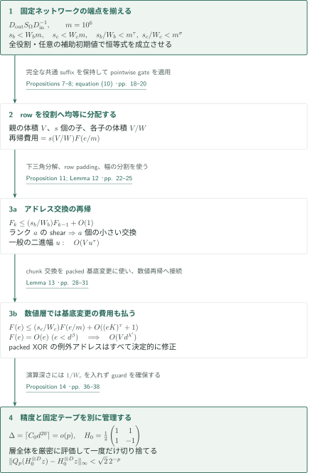
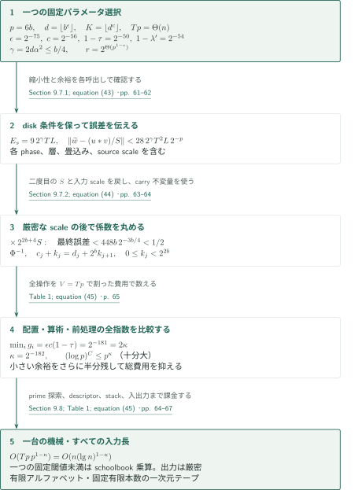

# Integer multiplication below n log n

**有限線形ネットワークでデータ移動と同時バタフライを節約し、誤差を管理して厳密な積へ戻す。**

本原稿は、整数乗算を多次元の正規化畳込みへ移し、そのテープ上の配置変更と算術層の両方を高速化する。核心は、固定された線形ネットワークのランクの不足を、配列のビット体積で正規化した再帰式の指数改善へ変える点にある。以下は著者が提示する証明構成の概説であり、全証明の独立検証を意味しない。

## 1. 主要結果

### Theorem 1 — 固定有限本数の一次元テープ上の厳密な整数乗算

長さ $n$ の二進列 $x$ の最上位ビットを左端とし、その非負整数値を $\operatorname{val}(x)$ とする。$\operatorname{bin}_k(z)$ は左を零で埋めた長さ $k$ の二進表示である。$\lg n=\max\{\lceil\log_2 n\rceil,1\}$ とおく。

**一台の決定性Turing機械** $\mathcal A$ が存在し、そのアルファベットは固定有限、一次元テープの本数も固定有限で、任意の $n\ge1$ と任意の $x,y\in\{0,1\}^n$ に対し、入力 $x\#y$ から厳密に

$$
\operatorname{bin}_{2n}\!\bigl(\operatorname{val}(x)\operatorname{val}(y)\bigr)
$$

を出力する。その最悪実行時間は

$$
T_{\mathcal A}(n)=O\!\left(n(\lg n)^{1-\kappa}\right),\qquad \kappa=2^{-182}.
$$

先行零を許し、入力長は区切りを含め $2n+1$、出力長は正確に $2n$ である。1ステップでは各テープの高々1セルを読み書きし、各ヘッドを高々1セル動かす。$n$ ごとに異なる回路や助言を与える主張ではない。

<!-- cite:main-result -->[Theorem 1 · p. 3](https://github.com/openai/math/blob/1581d4cbdd69a0faf34b2089614fe2a814316a6a/preprints/Integer-multiplication-below-n-log-n-September-23-2026/paper.pdf)<!-- /cite -->

この評価は全入力長を通じた漸近評価である。各固定乗算機械に最終的な $\Omega(n\lg n)$ 下界を課す予想に対し、本定理の機械では $T_{\mathcal A}(n)/(n\lg n)\to0$ となる。原稿は定数と閾値が極めて大きいことを明記しており、実用的な高速化を主張していない。中間でXOR計算を許すため、データの移動だけを許す転置モデルの下界とも区別が必要である。

<!-- cite:model-scope -->[Sections 1.7 and 2 · pp. 7–8](https://github.com/openai/math/blob/1581d4cbdd69a0faf34b2089614fe2a814316a6a/preprints/Integer-multiplication-below-n-log-n-September-23-2026/paper.pdf)<!-- /cite -->

## 図の矢印に付した引用

<!-- reference-guide -->
略号のない定理・補題・節・式番号は本原稿 [Integer multiplication below n log n](https://github.com/openai/math/blob/1581d4cbdd69a0faf34b2089614fe2a814316a6a/preprints/Integer-multiplication-below-n-log-n-September-23-2026/paper.pdf) を指します。外部入力には次の略号を使います。

- [HvH21](https://hal.science/hal-02070778v2/file/nlogn.pdf) David Harvey and Joris van der Hoeven — *Integer multiplication in time O(n log n)*：独立した既存整数乗算器、Gaussian resamplingの解析と数値ルーチン、phase近似、素数区間。直接使う記述と本稿の適用を照合し、外部の全証明は検証しない。HAL hal-02070778v2（2020年11月28日登録、本文45ページ＋表紙）。本稿指定の著者サイト版とのバイト同一性は未確認。

各引用に結果番号とページを付します。誌面番号とPDF内の位置が異なる場合は両方を示します。GitHubの閲覧リンクではページ位置への自動移動を前提としません。
<!-- /reference-guide -->

## 2. Theorem 1 の証明 — 入力から積への全体構成

<!-- proof-target:1 -->証明対象：[Theorem 1 · p. 3](https://github.com/openai/math/blob/1581d4cbdd69a0faf34b2089614fe2a814316a6a/preprints/Integer-multiplication-below-n-log-n-September-23-2026/paper.pdf)<!-- /proof-target -->

**証明の道筋。** 基数桁を畳込み保存のCRT写像で素数長の積群へ置き、Gaussian resamplingで2冪長のテンソル変換へ移す。残した周波数置換をchirpと畳込みの式の中で処理し、最後の軸を $R_r=\mathbb C[y]/(y^r+1)$ の係数列とみなす。合成根による変換、独立した既存乗算器を使う多項式積、逆向き変換を実行した後、既知の倍率を戻して整数係数と積を回収する。高速化を生む再帰は次節、誤差と総費用は第4節で説明する。

### 1. 基数桁と畳込みを保存するアドレス写像

十分大きな $n$ について $b=\lceil\log_2n\rceil$、精度 $p=6b$、桁数 $q=\lceil n/b\rceil$ とする。$T\in[4n/b,8n/b)$ を2冪に取り、相異なる奇素数 $s_i$ を2冪 $t_i\in\{r/2,r\}$ の直下に選ぶ。$S=\prod_i s_i$、$T=\prod_i t_i$ は $T/2<S<T$ を満たす。各入力を $\sum_{j<q}a_j2^{bj}$ と書けば積の次数は $2q-2<S$ なので、$x^S-1$ による巡回畳込みに巻き戻りは生じない。係数は $0\le c_j<2^{3b}$ である。

$P_i=\prod_{j<i}s_j$、$\mu_i=P_i^{-1}\bmod s_i$ とすると、

$$
\Phi:\mathbb C[x]/(x^S-1)\longrightarrow
\mathbb C[x_1,\ldots,x_d]/(x_1^{s_1}-1,\ldots,x_d^{s_d}-1),
\qquad x\longmapsto\prod_i x_i^{\mu_i}
$$

は基底単項式を置換する代数同型である。混合基数の添字 $k=\sum_i a_iP_i$ は $b_i=a_i+\mu_i\sum_{j<i}a_jP_j\pmod{s_i}$ へ移る。この三角形の更新を下位の制御座標がまだ変わらない順に行う。無効なpadding領域を固定する拡張により零paddingを保持し、逆写像で元の係数順を復元できる。各実数桁は正確に $a_j2^{-b-2}$ として格納するため、入力配列 $u,v$ のノルムは $1/4$ 未満となる。

<!-- cite:input-crt -->[Sections 9.2–9.3 and 9.6 · pp. 54–58, 60–61](https://github.com/openai/math/blob/1581d4cbdd69a0faf34b2089614fe2a814316a6a/preprints/Integer-multiplication-below-n-log-n-September-23-2026/paper.pdf)<!-- /cite -->

### 2. 周波数置換を残したresamplingとchirp

正規化Fourier変換を $F_s=\bigotimes_iF_{s_i}$ と書く。Lemma 19は一軸のGaussian写像を順序付き入出力のまま実装し、Lemma 20はそれらをテンソル化する。得られる恒等式は

$$
RF_s=2^\gamma B_0QF_tA,\qquad \gamma=2d\alpha^2.
$$

$A,B_0$ は縮小写像で、$R,Q$ は明示された座標置換である。通常のresamplingに含まれる二つのラベル付きソートを個別に実行せず、$QF_t$ をchirpによる正規化巡回畳込みへ変換する。原稿のchirp配列 $a$ に対し $QF_tz=\overline a\cdot(a*(\overline a\cdot z))/T$ となる。残る $R$ は二つの順変換、成分積、符号反対の変換を組み合わせると

$$
(RF_s^+)\bigl[(RF_su)\cdot(RF_sv)\bigr]=\frac{u*v}{S^2}
$$

として消える。ここで $F_s^+$ も $1/S$ で正規化されており、単独で $F_s$ の逆行列ではない。この正規化が後の二度の $S$ 倍を必要にする。

<!-- cite:resampling -->[Lemmas 19–20 · pp. 48–52](https://github.com/openai/math/blob/1581d4cbdd69a0faf34b2089614fe2a814316a6a/preprints/Integer-multiplication-below-n-log-n-September-23-2026/paper.pdf)<!-- /cite -->

<!-- cite:permutation-cancel -->[Lemma 21; equations (36)–(37) · p. 53](https://github.com/openai/math/blob/1581d4cbdd69a0faf34b2089614fe2a814316a6a/preprints/Integer-multiplication-below-n-log-n-September-23-2026/paper.pdf)<!-- /cite -->

### 3. 合成変換、保持した順序、多項式積

最後の巡回軸を $x_d\mapsto\zeta y$、$\zeta=e^{\pi i/r}$ により $R_r$ へ移す。$(\zeta y)^r=1$ なので、このtwistは巡回積をnegacyclic多項式積へ正確に移す。$y^r=-1$ による符号はuntwistで相殺される。$y$ の冪は係数列の符号付き巡回シフトであり、残る軸の根の乗算を線形走査で実行できる。

Lemma 16の順変換は $LBF_t^-$、反対向き変換は $F_t^+B^{-1}L^{-1}$ を実装する。$B$ は周波数のbit reversal、$L$ は同時層に適した配置である。二つの順変換を同じ $LB$ 順のまま成分積へ渡すと、反対向き変換がその順序を直接受け取る。追加の全配列ソートを挟む必要がない。

成分となる多項式積はLemma 17で処理する。分母 $2^p$ を除いた実部・虚部の整数係数をpacking基数 $B_0=2^{4p}$（この段落ではcompression写像とは別の記号）に詰め、4個の整数積から複素積を得る。通常の積係数は絶対値 $r2^{2p}<B_0/2$ なので中心剰余とcarryで符号付き係数を一意に抽出できる。$j+r$ 番目を $j$ 番目から引いてnegacyclic積を得て、$r$ で正規化した後だけ切り捨てる。使用する $O(N\log N)$ 乗算器は[HvH21]の既存定理であり、構成中の高速乗算器を呼ぶ循環論法ではない。

<!-- cite:synthetic-transform -->[Lemma 16 · pp. 40–44](https://github.com/openai/math/blob/1581d4cbdd69a0faf34b2089614fe2a814316a6a/preprints/Integer-multiplication-below-n-log-n-September-23-2026/paper.pdf)<!-- /cite -->

<!-- cite:packing -->[Lemma 17; Proposition 18 · pp. 44–47](https://github.com/openai/math/blob/1581d4cbdd69a0faf34b2089614fe2a814316a6a/preprints/Integer-multiplication-below-n-log-n-September-23-2026/paper.pdf)<!-- /cite -->

<!-- cite:twist -->[Section 9.4 · pp. 58–59](https://github.com/openai/math/blob/1581d4cbdd69a0faf34b2089614fe2a814316a6a/preprints/Integer-multiplication-below-n-log-n-September-23-2026/paper.pdf)<!-- /cite -->

## 3. Theorem 1 の証明 — ランクの不足をテープ時間の節約へ変える

<!-- proof-target:2 -->証明対象：[Theorem 1 · p. 3](https://github.com/openai/math/blob/1581d4cbdd69a0faf34b2089614fe2a814316a6a/preprints/Integer-multiplication-below-n-log-n-September-23-2026/paper.pdf)<!-- /proof-target -->

**証明の道筋。** 全体構成の二つの高価な操作を、固定ネットワークの同じ表現原理で加速する。配列を $W$ 個の役割へ均等に分けるため、$s$ 個の子呼出しの費用係数は $s$ ではなく $s/W$ になる。$s<Wm$ という厳密な不足を、アドレス交換と数値層の両方で利用する。

### 1. 任意の補助値を復元しながら表現を変える

§3は $[100]$ の3元部分集合の三つ組から、二つの固定ネットワークを直接構成する。gather/scatterにより生じる交差数の係数をside wireで消し、三段階でデータの二つのbankを交換する。補助wireの初期値は任意であり、最初にその寄与を引き、計算後に元へ戻す。Lemma 5はこの値の復元、Lemma 6は隣接頂点の部分空間ラベルの包含と次元損失を与える。

頂点 $v$ における論理配列 $g$ を $D_vg$ として格納する。辺 $u\to v$ で $D_vD_u^{-1}$ を適用し、一つのgateの全入出力では同じ $D_v$ を使うと、点ごとの線形gateとframeが可換になる。全演算は $D_{\rm out}S_\Omega D_{\rm in}^{-1}$ であり、入力frameの逆は論理的な解釈として使うので入力を別途変換する費用は生じない。

有理部分空間のbit networkでは、全役割の端点差が恒等行列となり、辺のランク和 $s_b<W_bm$ がアドレスshearを供給する。二進部分空間のcomplex networkでは、辺の直交残差の次元和 $s_c<W_cm$ が位相kernelを供給する。双方で $m=10^6$、$s_b/W_b<m^\tau$、$s_c/W_c<m^\sigma$、$\tau=\sigma=1-2^{-50}$ が成立する。固定ネットワークは巨大だが、入力長に依存しない。

<!-- cite:network -->[Lemmas 5–6; equation (5) · pp. 11–17](https://github.com/openai/math/blob/1581d4cbdd69a0faf34b2089614fe2a814316a6a/preprints/Integer-multiplication-below-n-log-n-September-23-2026/paper.pdf)<!-- /cite -->

<!-- cite:rank-deficit -->[Propositions 7–8; equation (10) · pp. 18–20](https://github.com/openai/math/blob/1581d4cbdd69a0faf34b2089614fe2a814316a6a/preprints/Integer-multiplication-below-n-log-n-September-23-2026/paper.pdf)<!-- /cite -->

### 2. 正確なアドレス交換と、決定的な例外修正

bit networkを配列に移す際、全suffixを保つrowを $W_b$ 役割へ巡回分配する。各子は同じアドレス集合をもち、親の $1/W_b$ のビット体積を使う。幅 $e=m^k$ の交換では、体積で割った時間 $F_k$ が

$$
F_k\le(s_b/W_b)F_{k-1}+O(1),\qquad F_0=O(1)
$$

を満たす。ランク $a$ の有理shearを下三角分解によりちょうど $a$ 個の小さい交換へ帰着することが、子の数をランク和に一致させる。高位桁からrowを確保し、零padding、$m$ 進分割、固定奇素数基数から二進範囲へのpaddingを行うLemma 12により、一般の幅 $u$ の二つの非隣接chunkも $O(Vu^\tau)$ で交換できる。途中のXOR列を数値係数として解釈せず、正確な配置へ戻ってから数値演算を再開する。

数値networkの基底変更では、多数のchunkの選択bitへXORを同時に施す必要がある。Lemma 13は第三のchunkを補助にした8回の制御巡回シフトを用いる。guard境界に近い例外アドレスは全体の高々 $80(f-1)2^{-K}$ で、そこだけを抽出し、正しい行先を付けて安定二進ソートし、戻す。これはデータ内容に関係なく全例外を修正する決定的処理であり、失敗確率を許す手順ではない。$K/\log p\to\infty$ と長い多項式payloadによって、例外処理・アドレス計算の追加費用を吸収する。

<!-- cite:swap -->[Proposition 11; Lemma 12 · pp. 22–25](https://github.com/openai/math/blob/1581d4cbdd69a0faf34b2089614fe2a814316a6a/preprints/Integer-multiplication-below-n-log-n-September-23-2026/paper.pdf)<!-- /cite -->

<!-- cite:packed-basis -->[Lemma 13 · pp. 28–31](https://github.com/openai/math/blob/1581d4cbdd69a0faf34b2089614fe2a814316a6a/preprints/Integer-multiplication-below-n-log-n-September-23-2026/paper.pdf)<!-- /cite -->

### 3. 同時バタフライと固定本数テープでの再帰

complex networkでは $C=H\operatorname{diag}(1,i)H$、$H=2^{-1/2}\begin{pmatrix}1&1\\1&-1\end{pmatrix}$ のtensor kernelを作り、対角位相とdyadic scaleで $H_0=\frac12\begin{pmatrix}1&1\\1&-1\end{pmatrix}$ の同時層へ変える。$e$ 個の軸を扱う体積正規化時間は

$$
F(e)\le(s_c/W_c)F(e/m)+O((eK)^\tau+1),\qquad
F(e)=O(e)\quad(e<d^\beta),\quad\beta=\tfrac12.
$$

内部費用とleaf費用を分け、$\tau(1+c/\beta)<\lambda$、$\max\{\lambda,\sigma+\beta(1-\sigma)\}<\lambda'<1$ を取ると、$m$ 進の群分けを含めて層全体が $O(Vd^{\lambda'})$ になる。

中間のframeは縮小写像とは限らない。精度のための演算依存深さは $A(e)\le s_cA(e/m)+E$ で評価し、体積による $1/W_c$ はここには入らない。§5.4は分母と絶対値の増大を $\Delta=\lceil C_0d^{20}\rceil$ で抑え、$p+\Delta$ fractional bitsと $\Delta+3$ integer/sign bitsで層全体を正確に計算する。$20\epsilon<1$ なので語長は $O(p)$ のままである。完成した縮小層の後にだけ成分を $2^{-p}\mathbb Z$ へ零方向に切り捨て、誤差は $\sqrt2\,2^{-p}$ 未満となる。

固定 $W$ 本の役割テープを再帰ごとに再利用する。非active streamはstack先頭へparkし、子が終了すると元の順へpopする。祖先のpark領域を繰り返し走査せず、copy・rewind・cleanupを各nodeの体積に課金する。軸数や再帰深さの増加はテープ上のdescriptorの長さに現れ、テープ数やアルファベットは増えない。

<!-- cite:layer -->[Section 5.3; Proposition 14 · pp. 32–38](https://github.com/openai/math/blob/1581d4cbdd69a0faf34b2089614fe2a814316a6a/preprints/Integer-multiplication-below-n-log-n-September-23-2026/paper.pdf)<!-- /cite -->

<!-- cite:fixed-tapes -->[Proposition 11 proof; Section 5.3 · pp. 23, 33–34](https://github.com/openai/math/blob/1581d4cbdd69a0faf34b2089614fe2a814316a6a/preprints/Integer-multiplication-below-n-log-n-September-23-2026/paper.pdf)<!-- /cite -->

## 4. Theorem 1 の証明 — 誤差、全費用、すべての入力長

<!-- proof-target:3 -->証明対象：[Theorem 1 · p. 3](https://github.com/openai/math/blob/1581d4cbdd69a0faf34b2089614fe2a814316a6a/preprints/Integer-multiplication-below-n-log-n-September-23-2026/paper.pdf)<!-- /proof-target -->

**証明の道筋。** 精度 $p=6b$ の下で全数値呼出しのdisk条件を保ち、二つの正規化因子と入力scaleを厳密に戻す。誤差 $<1/2$ により整数係数を一意に回収し、carry不変量で積へつなぐ。最後に配置・前処理を含む全費用の指数を比較して $\kappa$ を得る。

### 1. 計算可能なパラメータと各呼出しの適用条件

§9.1の固定有理数をそのまま用いる：

$$
\tau=\sigma=1-2^{-50},\quad\beta=\tfrac12,\quad\delta=\tfrac1{16},\quad
\lambda=1-2^{-52},\quad c=2^{-56},\quad\lambda'=1-2^{-54},\quad
\epsilon=2^{-75}.
$$

$d=\lfloor b^\epsilon\rfloor$、$K=\lfloor d^c\rfloor$、$r=2^{\lceil(\log_2T)/d\rceil}$、$\ell=\log_2r$ とし、$d$ 軸を $r/2$ と $r$ から選んで積を $T$、最後の軸を $r$ にする。すると

$$
Tp=\Theta(n),\quad d=\Theta(p^\epsilon),\quad
K=\Theta(p^{\epsilon c}),\quad \ell=\Theta(p^{1-\epsilon}),\quad
r=2^{\Theta(p^{1-\epsilon})}.
$$

$\alpha=\lceil(12d^2b)^{1/4}\rceil$、$\eta=1/(4d)$ とし、$(1-2\eta)t_i<s_i\le(1-\eta)t_i$ の相異なる奇素数を選ぶ。[HvH21, Lemma 5.1]により十分大きい入力では各区間に必要な数の素数がある。これが $\gcd(s_i,t_i)=1$、$2\le\alpha<\sqrt p$、$\alpha^4(t_i/s_i-1)>p$ を保証し、resamplingの仮定を満たす。全候補への試し割りでも素数探索は $O(dr^{3/2}\operatorname{poly}(p))=n^{o(1)}=o(n)$。固定有理冪の比較、逆元、descriptorも機械自身が計算する。前処理を助言や無料の表として除外していない。

<!-- cite:parameters -->[Sections 9.1–9.2 · pp. 54–56](https://github.com/openai/math/blob/1581d4cbdd69a0faf34b2089614fe2a814316a6a/preprints/Integer-multiplication-below-n-log-n-September-23-2026/paper.pdf)<!-- /cite -->

### 2. 二つの正規化を戻し、整数係数と積を回収する

$h_p=2^{-p}$、$L=\log_2T$ とする。合成変換は各roundの縮小性により誤差を加算でき、Lemma 16の誤差は $\sqrt2\ell h_p$ 未満である。ring畳込みでは最後の $M=T/r$ 倍を含めて誤差を数え、twistとchirpを経たsource変換の誤差は

$$
E_sh_p,\qquad E_s=9\,2^\gamma TL,\qquad \gamma=2d\alpha^2\le b/4
$$

で抑える。§9.7.1は単に誤差を足すだけでなく、入力ノルム $\le.5$ のsource呼出し、$\le.6$ のchirp入力、一方が $\le.7$ の畳込み入力という余裕を順に確認する。従って全呼出しが定義されたdisk gridに留まり、結果を強制的にclipする操作は不要である。

二つのforward出力の積を切り捨てて $z$ とすると $\|z\|<.5$。反対向き変換の厳密な対応物は $(u*v)/S^2$ である。最初に $S$ を掛けると $w=(u*v)/S$ の近似 $\widetilde w$ を得て、誤差は $28\,2^\gamma T^2Lh_p$ 未満となる。次に $2^{2b+4}S$ を掛け、残る $S$ と二つの入力scaleを戻す。分子に対するこれらの整数乗算とシフトは厳密であり、最終誤差は

$$
2^{2b+4}S\cdot28\,2^\gamma T^2L\cdot2^{-6b}
<448b\,2^{-b+\gamma}\le448b\,2^{-3b/4}<\tfrac12.
$$

従って実部の最近接整数が正しい $c_j$ である。既知の $O(p)$-bit語長で係数を直列化し、$\Phi^{-1}$ により通常の係数順へ戻す。その後 $Q_0=2^b$ として

$$
k_0=0,\qquad d_j=(c_j+k_j)\bmod Q_0,\qquad
k_{j+1}=\left\lfloor\frac{c_j+k_j}{Q_0}\right\rfloor
$$

を走査する。$0\le k_j< Q_0^2$ と $\sum_{h<j}c_hQ_0^h=\sum_{h<j}d_hQ_0^h+k_jQ_0^j$ がcarryの幅と正確性を保証する。最後に一度逆向きにコピーし、不要な零paddingだけを取り除いて最上位bitから正確に $2n$ bitsを出力する。零入力と先行零も同じ処理に含まれる。

<!-- cite:precision -->[Section 9.7.1; equation (43) · pp. 61–62](https://github.com/openai/math/blob/1581d4cbdd69a0faf34b2089614fe2a814316a6a/preprints/Integer-multiplication-below-n-log-n-September-23-2026/paper.pdf)<!-- /cite -->

<!-- cite:recovery -->[Section 9.7.2; equation (44) · pp. 63–64](https://github.com/openai/math/blob/1581d4cbdd69a0faf34b2089614fe2a814316a6a/preprints/Integer-multiplication-below-n-log-n-September-23-2026/paper.pdf)<!-- /cite -->

### 3. 支配費用と $\kappa=2^{-182}$ の導出

$V=Tp=\Theta(n)$ で割った主要費用は、配置prefixと個別roundの $dK$、chunk交換の $pK^{\tau-1}$、同時層の $\ell d^{\lambda'}$、CRTと軸配置の $d^2(1+\ell^\tau)$、Gaussian写像の $dp^{1/2+\delta}\alpha$、chirp等の $dp^\delta$、多項式積の $\log(rp)$ である。これらの $p$ の指数と1との差は

$$
\begin{aligned}
g_1&=1-\epsilon(1+c),&g_2&=\epsilon c(1-\tau),&g_3&=\epsilon(1-\lambda'),\\
g_4&=1-\tau-\epsilon(2-\tau),&g_5&=\tfrac14-\delta-\tfrac32\epsilon,
&g_6&=1-\delta-\epsilon,&g_7&=\epsilon.
\end{aligned}
$$

最小値は $g_2=2^{-75}2^{-56}2^{-50}=2^{-181}=2\kappa$ である。従って残る固定冪の $\log p$ を $p^\kappa$ へ吸収して $O(Vp^{1-\kappa})$ を得る。特に支配的な余裕は、chunk交換をまとめるための小さい $K$ と、交換自体の小さい指数改善の積から来る。

この費用には入力・padding・復元・carry・出力の線形走査、phase生成、符号形式変換、反対向き配置、例外のソート、固定本数テープ上のpark/restoreが含まれる。多項式積は $T/r$ 個の $O(rp)$-bit整数積なので総費用 $O(Tp\log(rp))$。nodeごとのsetupは $\operatorname{poly}(p)=o(V)$、recordごとやGaussian lineごとのsetupは $r$ が任意の固定多項式を上回ることで吸収する。大入力に必要な全条件を超える一つの固定閾値を取り、それ未満ではschoolbook乗算を用いる。有限個の小入力を定数へ含めることで、一台の機械によるすべての $n\ge1$ の最悪時評価となる。

<!-- cite:cost -->[Section 9.8; Table 1; equation (45) · pp. 64–67](https://github.com/openai/math/blob/1581d4cbdd69a0faf34b2089614fe2a814316a6a/preprints/Integer-multiplication-below-n-log-n-September-23-2026/paper.pdf)<!-- /cite -->

## 5. 直接入力と使用箇所

本概説で追う主要な外部入力は[HvH21]である。原稿自身が有限ネットワーク、frameの接続、shearの分解、chirpの式、符号付きpackingを証明しているため、それらの背景として挙げた文献をそのまま証明依存の矢印にしない。

| 供給結果 | 本稿の使用箇所 | 使用内容と適用条件 | 確認範囲 |
|---|---|---|---|
| [HvH21] Theorem 1.1 | Lemma 17、§9.5、§9.8 | 既存の固定テープ $O(N\log N)$ 乗算。長さ $O(rp)$ または $O(p)$ の整数へ適用 | 定理の記述と使用箇所を照合。外部証明全体は未検証 |
| [HvH21] Theorem 4.2、Lemma 4.6、Proposition 4.7、Lemmas 4.8–4.12 | Lemma 19、Lemma 20 | Gaussian恒等式、逆作用素の収束、disk-grid近似と一軸費用。$\theta>p/\alpha^4$、$2\le\alpha<\sqrt p$ を本稿§9.2で確保 | 引用する記述・アルゴリズム境界と本稿の接続を照合。Gaussian解析の全証明は未検証 |
| [HvH21] Lemma 2.12、Lemma 5.1 | §§9.2、9.4–9.5 | phaseを準備する指数関数近似、素数長の存在。引数は $O(p)$ bits、素数区間の条件は§9.2で検査 | 記述と適用条件を照合。原典のさらに先の外部証明は追わない |

<!-- cite:hvh-multiply -->[&#91;HvH21, Theorem 1.1, 誌面 p. 1 / PDF p. 2&#93;](https://hal.science/hal-02070778v2/file/nlogn.pdf#page=2)<!-- /cite -->

<!-- cite:hvh-gaussian -->[&#91;HvH21, Theorem 4.2; Lemma 4.6; Proposition 4.7; Lemmas 4.8–4.12, 誌面 pp. 24, 28–33 / PDF pp. 25, 29–34&#93;](https://hal.science/hal-02070778v2/file/nlogn.pdf#page=25)<!-- /cite -->

<!-- cite:hvh-arithmetic -->[&#91;HvH21, Lemmas 2.12 and 5.1, 誌面 pp. 17, 37–38 / PDF pp. 18, 38–39&#93;](https://hal.science/hal-02070778v2/file/nlogn.pdf#page=18)<!-- /cite -->

## 6. 原典を読む入口と確認範囲

<!-- reading-list -->
- [Theorem 1 · p. 3](https://github.com/openai/math/blob/1581d4cbdd69a0faf34b2089614fe2a814316a6a/preprints/Integer-multiplication-below-n-log-n-September-23-2026/paper.pdf) — 入力・出力、量化、最悪時評価を確認する
- [Lemmas 5–6; equation (5) · pp. 11–17](https://github.com/openai/math/blob/1581d4cbdd69a0faf34b2089614fe2a814316a6a/preprints/Integer-multiplication-below-n-log-n-September-23-2026/paper.pdf) — 任意の補助値の復元とframe恒等式を読む
- [Proposition 11; Lemma 12 · pp. 22–25](https://github.com/openai/math/blob/1581d4cbdd69a0faf34b2089614fe2a814316a6a/preprints/Integer-multiplication-below-n-log-n-September-23-2026/paper.pdf) — 体積で正規化した再帰と固定テープの実装を見る
- [Section 5.3; Proposition 14 · pp. 32–38](https://github.com/openai/math/blob/1581d4cbdd69a0faf34b2089614fe2a814316a6a/preprints/Integer-multiplication-below-n-log-n-September-23-2026/paper.pdf) — 基底変更の費用、停止条件、精度guardを追う
- [Lemma 17; Proposition 18 · pp. 44–47](https://github.com/openai/math/blob/1581d4cbdd69a0faf34b2089614fe2a814316a6a/preprints/Integer-multiplication-below-n-log-n-September-23-2026/paper.pdf) — 符号付き係数の一意な回収と正規化を確認する
- [Lemmas 19–20 · pp. 48–52](https://github.com/openai/math/blob/1581d4cbdd69a0faf34b2089614fe2a814316a6a/preprints/Integer-multiplication-below-n-log-n-September-23-2026/paper.pdf) — 外部入力から置換を保持した変換への接続を読む
- [Section 9.7.2; equation (44) · pp. 63–64](https://github.com/openai/math/blob/1581d4cbdd69a0faf34b2089614fe2a814316a6a/preprints/Integer-multiplication-below-n-log-n-September-23-2026/paper.pdf) — 二度のS、誤差1/2未満、carry不変量を確認する
- [Section 9.8; Table 1; equation (45) · pp. 64–67](https://github.com/openai/math/blob/1581d4cbdd69a0faf34b2089614fe2a814316a6a/preprints/Integer-multiplication-below-n-log-n-September-23-2026/paper.pdf) — 全費用、κの余裕、単一の小入力閾値を見る
<!-- /reading-list -->

[HvH21]は著者がHALへ登録した2020年11月28日版で照合した。本文は45ページ、HAL表紙によりPDF位置は誌面より1ページ後ろにある。本稿[15]が指定する著者サイトのファイルは取得できず、そのファイルとのバイト同一性は未確認だが、引用結果の番号・記述は照合した。Proposition 4.7の元の費用は $O(tp^{3/2+\delta}\alpha+tp\log t)$ であり、後者を除くのは本稿Lemma 19が置換を保持して得る改変である。

今回の読解は、主定理と機械モデル、§3のframeとランク不足、§§4–5の再帰・row分割・例外修正・guard評価、§§6–7の保持配置と符号付き係数回収、§8のresamplingの接続、§9のパラメータ・精度・総費用を対象とした。主定理の各結論へ至る接続を概説したが、有限networkの全辺を独立に再計算したわけではなく、Lemma 13の全guard境界の網羅、全descriptorの低水準実装、実行可能な乗算プログラムによる検証は未実施である。[HvH21]とその引用先の全証明の独立検証も行っていない。

Corollary 2の除算・平方根、§11の行列転置、別原稿のexact DFTへの応用はこの概説の証明対象に含めない。別の計算モデルの結果を本定理のbit complexityへ読み替えない。
