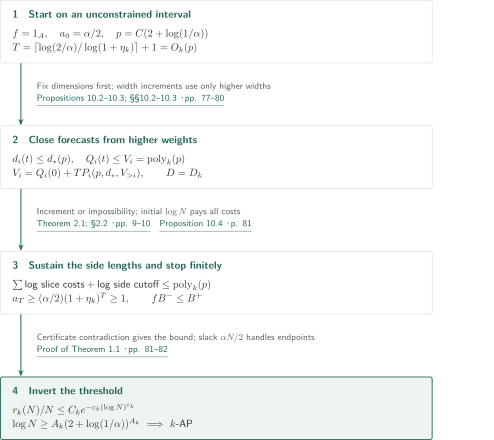
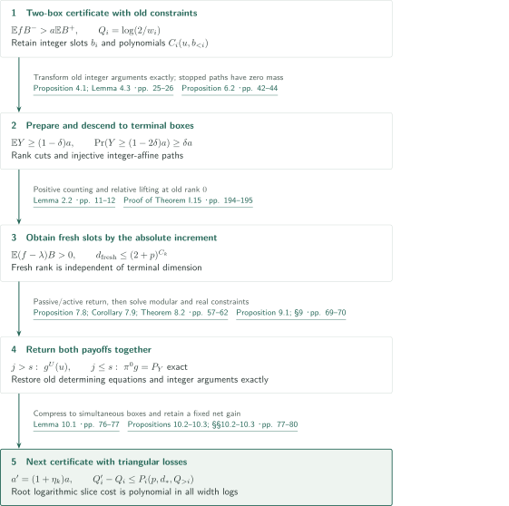
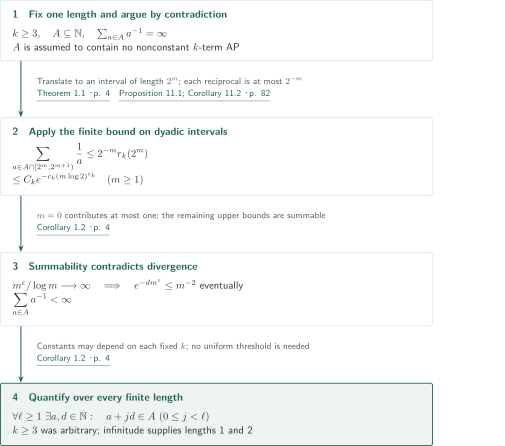

# Quasipolynomial Bounds for Arithmetic Progressions

**Controlling triangular polynomial-cell width losses closes the density increment at a quasipolynomial scale.**

OpenAI's September 23, 2026 manuscript establishes a density bound for each fixed progression length and deduces Erdős's reciprocal-sum conjecture for sets of positive integers. This article presents the authors' claims and proof route. It is not an independent verification of all 198 pages; the passages compared with the source and the remaining unchecked arguments are distinguished below.

## 1. Main results

### Theorem 1.1 — Density bound and sufficient interval length

Fix an integer $k\ge3$. Let $r_k(N)$ be the maximum cardinality of a subset of $[N]=\{1,\ldots,N\}$ containing no nonconstant $k$-term arithmetic progression. Such a progression has the form $a,a+d,\ldots,a+(k-1)d$ with $d>0$. There are $C_k,c_k,\varepsilon_k>0$, depending only on $k$, such that for every $N\ge2$,

$$r_k(N)\le C_kN\exp\{-c_k(\log N)^{\varepsilon_k}\}.$$

Equivalently, there is $A_k\ge1$ such that, for every $0<\alpha\le1$, a subset of $[N]$ of density at least $\alpha$ contains a nonconstant $k$-term progression whenever

$$\log N\ge A_k(2+\log(1/\alpha))^{A_k}.$$

All logarithms are natural. “Quasipolynomial” describes the sufficient length $N=\exp(O_k((2+\log(1/\alpha))^{A_k}))$ as a function of $1/\alpha$. The cardinality bound $r_k(N)$, the density $r_k(N)/N$, and a sufficient $N$ are distinct quantities. Constants and exponents depend on the fixed $k$; neither a uniform estimate in $k$ nor an optimal exponent is asserted.

<!-- cite:main -->[Theorem 1.1 · p. 4](https://github.com/openai/math/blob/1581d4cbdd69a0faf34b2089614fe2a814316a6a/preprints/Quasipolynomial-Bounds-for-Arithmetic-Progressions-September-23-2026/paper.pdf)<!-- /cite -->

### Corollary 1.2 — Divergent reciprocal sums

Let $\mathbb N=\{1,2,\ldots\}$. For every set $A\subseteq\mathbb N$, if $\sum_{a\in A}1/a=\infty$, then for every finite length $\ell\ge1$ there are $a,d\in\mathbb N$ such that $a,a+d,\ldots,a+(\ell-1)d\in A$. For lengths at least two, $d>0$ makes the progression nonconstant.

<!-- cite:reciprocal -->[Corollary 1.2 · p. 4](https://github.com/openai/math/blob/1581d4cbdd69a0faf34b2089614fe2a814316a6a/preprints/Quasipolynomial-Bounds-for-Arithmetic-Progressions-September-23-2026/paper.pdf)<!-- /cite -->

## References on the arrows

<!-- reference-guide -->
Unprefixed theorem, lemma, section and equation numbers refer to [Quasipolynomial Bounds for Arithmetic Progressions](https://github.com/openai/math/blob/1581d4cbdd69a0faf34b2089614fe2a814316a6a/preprints/Quasipolynomial-Bounds-for-Arithmetic-Progressions-September-23-2026/paper.pdf). External inputs use the following keys.

- [LSS24](https://arxiv.org/pdf/2402.17994v3) James Leng, Ashwin Sah, Mehtaab Sawhney — *Quasipolynomial bounds on the inverse theorem for the Gowers $U^{s+1}[N]$-norm*: Interval Gowers inverse theorem and converse correlation bound; distinct from this manuscript’s box and product-cyclic extensions. v3, 10 August 2024.
- [SS14](https://arxiv.org/pdf/1408.2568v1) Tomasz Schoen, Olof Sisask — *Roth’s theorem for four variables and additive structures in sums of sparse sets*: Almost-periodicity retaining the input Bohr radius multiplicatively, used through Lemma C.2 in degree-one shift comparison. v1, 11 August 2014.

Each citation gives the result and pages. When printed pagination differs from the PDF position, both are shown. GitHub previews do not automatically jump to the cited page.
<!-- /reference-guide -->

## 2. Theorem 1.1 — Proof overview of the main theorem

<!-- proof-target:1 -->Proof target：[Theorem 1.1 · p. 4](https://github.com/openai/math/blob/1581d4cbdd69a0faf34b2089614fe2a814316a6a/preprints/Quasipolynomial-Bounds-for-Arithmetic-Progressions-September-23-2026/paper.pdf)<!-- /proof-target -->

**Proof route.** Start with a progression-free set and iterate Theorem 2.1 finitely many times. The state is a two-box certificate on a cell retaining earlier polynomial constraints, rather than just a density on a subinterval. The next section explains one increment; first we identify the output dependencies that make iteration possible.

### 1. Fix the iteration horizon first

For a progression-free set of density $\alpha>0$, start with $f=1_A$, no cell constraints, and $a_0=\alpha/2$. Fix one resource parameter $p=C(2+\log(1/\alpha))$ and reserve

$$T=\left\lceil\frac{\log(2/\alpha)}{\log(1+\eta_k)}\right\rceil+1=O_k(p).$$

Each increment multiplies the target by at least $1+\eta_k$ and adds at most $d_0=(2+p)^{C_k}$ fresh absolute coordinates. Discounted intermediate targets remain above a fixed positive multiple of $a_0$, so the same $p$ ensures $a\ge e^{-p}$ throughout. Temporary higher-dimensional path boxes do not replace the root spatial dimension in the next round: the root remains an integer-affine slice of the original interval.

<!-- cite:closure -->[Proposition 10.4 · p. 81](https://github.com/openai/math/blob/1581d4cbdd69a0faf34b2089614fe2a814316a6a/preprints/Quasipolynomial-Bounds-for-Arithmetic-Progressions-September-23-2026/paper.pdf)<!-- /cite -->

### 2. Triangular recurrences control the loss of length

The weight depth $D=D_k$ is fixed. The increase in the dimension at weight $i$ is bounded by $d_0$ and a polynomial in strictly higher-weight dimensions. Within a preparation round, set $H_D=d_D$ and $H_i=d_i+H_{i+1}^2$; then $d_i^{\rm out}\le d_i+d_0+H_{i+1}^2$, with $H_{D+1}=0$. Descending induction bounds dimensions and cut counts across all $T$ rounds by one polynomial forecast $d_*(p)$, fixed before numerical precisions.

For widths $w_i$, write $Q_i=\log(2/w_i)$. The decisive estimate is

$$Q_i(t+1)-Q_i(t)\le P_i(p,d_*,Q_{i+1}(t),\ldots,Q_D(t)).$$

Neither the current $Q_i$ nor lower-weight widths enter the right-hand side. Define downward envelopes

$$V_D=Q_D(0)+TP_D(p,d_*),\qquad V_i=Q_i(0)+TP_i(p,d_*,V_{i+1},\ldots,V_D).$$

Then $Q_i(t)\le V_i=\operatorname{poly}_k(p)$. Fixed $D$ means fixed polynomial-composition depth. The sum of logarithmic root-slice losses, remaining logarithmic side requirements, and endpoint-rounding costs is also $\operatorname{poly}_k(p)$. Actual length losses occur at the exponential of this scale; a polynomial loss in the side lengths themselves is not asserted. An initial $\log N$ exceeding the total sustains every round.

<!-- cite:budgets -->[Propositions 10.2–10.3; §§10.2–10.3 · pp. 77–80](https://github.com/openai/math/blob/1581d4cbdd69a0faf34b2089614fe2a814316a6a/preprints/Quasipolynomial-Bounds-for-Arithmetic-Progressions-September-23-2026/paper.pdf)<!-- /cite -->

### 3. The stopping contradiction and equivalence of the two forms

An earlier impossibility alternative already contradicts the initial assumptions. Otherwise $a_T\ge(\alpha/2)(1+\eta_k)^T\ge1$. The certificate $\mathbb E fB^->a_T\mathbb EB^+$ contradicts the pointwise inequality $fB^-\le B^+$. Thus a progression-free set cannot satisfy $\log N\ge C_k(2+\log(1/\alpha))^{A_k}$.

Substituting $\alpha=r_k(N)/N>0$ and inverting gives

$$\alpha<e^2\exp\{-C_k^{-1/A_k}(\log N)^{1/A_k}\},$$

which yields the density bound after renaming constants. Conversely, put $\overline C_k=\max(1,C_k)$. The bound implies $r_k(N)\le\alpha N/2<\alpha N$ whenever

$$\log N\ge\left(\frac{\log(2\overline C_k/\alpha)}{c_k}\right)^{1/\varepsilon_k}.$$

This slack covers equality in “density at least $\alpha$.” Enlarging $A_k$ gives the stated threshold throughout $0<\alpha\le1$. The density bound is immediate when $\alpha=0$.

<!-- cite:inversion -->[Proof of Theorem 1.1 · pp. 81–82](https://github.com/openai/math/blob/1581d4cbdd69a0faf34b2089614fe2a814316a6a/preprints/Quasipolynomial-Bounds-for-Arithmetic-Progressions-September-23-2026/paper.pdf)<!-- /cite -->

## 3. Theorem 2.1 — One increment retaining the constraints

<!-- proof-target:2 -->Proof target：[Theorem 2.1; §2.2 · pp. 9–10](https://github.com/openai/math/blob/1581d4cbdd69a0faf34b2089614fe2a814316a6a/preprints/Quasipolynomial-Bounds-for-Arithmetic-Progressions-September-23-2026/paper.pdf)<!-- /proof-target -->

<!-- statement:theorem-2-1 -->
### Theorem 2.1 — Triangular increment

Fix $k\ge3$ and $s=k-2$. Give spatial variables $u$ weight one and integer blocks $b_h\in\mathbb Z^{d_h}$ weight $h$, with $C_h(u,b_{<h})$ of weighted degree at most $h$. Centers $l_h$ are bounded and $0<w_h\le1/32$. For sufficiently small $\gamma>0$, let $B^-$ and $B^+$ indicate the existence of an integer tuple satisfying, respectively, for all $h$,

$$\|b_h-C_h(u,b_{<h})-l_h\|_\infty\le w_h,\qquad
\|b_h-C_h(u,b_{<h})-l_h\|_\infty\le(1+\gamma)w_h.$$

Narrow widths and triangularity make the tuple unique.

There are fixed $D=D_k$, $\eta_k>0$, and polynomials depending only on $k$ with the following property. Suppose $p\ge2$, $a\ge e^{-p}$, and $0\le f\le1$ on a positive-dimensional integer box has support containing no nonconstant integer-vector $k$-term progression and satisfies $\mathbb E fB^->a\mathbb EB^+$. If each logarithmic root side exceeds the specified polynomial cutoff in $p$, the dimension data, and all $Q_h=\log(2/w_h)$, then either the hypotheses are impossible or a root slice carries a new certificate at target $(1+\eta_k)a$.

Old determining data are retained through exact integer reparametrizations. At most $d_0=(2+p)^{C_k}$ fresh absolute slots are added, together with downward preparation copies. Dimensions and widths satisfy

$$d_i'-d_i\le d_0+P_i(p,d_{i+1},\ldots,d_D),\qquad
Q_i'-Q_i\le P_i'(p,\text{all dimension forecasts},Q_{i+1},\ldots,Q_D).$$

The logarithmic root-slice cost is polynomial in the same data including all $Q_i$. Exponents and gain are independent of the number of rounds; gaps and discounts can be chosen in advance from dimension and cut-count forecasts.

<!-- cite:increment -->[Theorem 2.1; §2.2 · pp. 9–10](https://github.com/openai/math/blob/1581d4cbdd69a0faf34b2089614fe2a814316a6a/preprints/Quasipolynomial-Bounds-for-Arithmetic-Progressions-September-23-2026/paper.pdf)<!-- /cite -->
<!-- /statement -->

In the diagram, $\lambda$ denotes the target after the terminal absolute increment.

### 1. Do not charge the inverse of a small certificate surplus

A preparation rank cut uses a relation at a failing degree, lowers the rational value-space dimension, and, when needed, copies a higher block down one weight. Every higher determining polynomial is transformed exactly on its integer arguments. Since coefficients are unrestricted, continuity in an approximate integer slot cannot replace this operation.

Constrained paths along integer-affine maps carry the prepared cell to terminal boxes. Stopped paths retain zero mass; survivors are not renormalized. Proposition 6.2 gives a terminal mean $Y$ with $\mathbb EY\ge(1-\delta)a$, and at least a $\delta a$ fraction of paths have $Y\ge(1-2\delta)a$. This avoids paying the inverse of the original strict surplus $\mathbb EfB^--a\mathbb EB^+$. Injective integer-affine pullback and removal of points preserve progression-freeness.

<!-- cite:prepare -->[Proposition 4.1; Lemma 4.3 · pp. 25–26](https://github.com/openai/math/blob/1581d4cbdd69a0faf34b2089614fe2a814316a6a/preprints/Quasipolynomial-Bounds-for-Arithmetic-Progressions-September-23-2026/paper.pdf)<!-- /cite -->
<!-- cite:forward -->[Proposition 6.2 · pp. 42–44](https://github.com/openai/math/blob/1581d4cbdd69a0faf34b2089614fe2a814316a6a/preprints/Quasipolynomial-Bounds-for-Arithmetic-Progressions-September-23-2026/paper.pdf)<!-- /cite -->

### 2. Obtain a fresh-coordinate count independent of dimension

Lemma 2.2 supplies a fixed multiplicative gain and a degree-$s$ polynomial patch with at most $(2+p)^{C_k}$ fresh coordinates on a terminal box of density $a\ge e^{-p}$. The fresh count is independent of its dimension $n$, although logarithmic side requirements, slice costs, Lipschitz bounds, and inverse surplus may depend on $p+n$.

Positive counting in fixed dimension alone does not give this distinction. The manuscript obtains Proposition D.3's absolute increment from Theorem C.1's shift comparison, then converts the niltest into a patch by Lemma D.5. The relative lifting theorem, Theorem I.15, bounds the output rank by $d+d_0$ for an old patch of rank $d$. Applying it to the constant old patch $1$, with $d=0$, gives the dimension-independent $d_0$. We follow the statements and their combination in Lemma 2.2; the complete proofs in Appendices C–I have not been independently verified.

<!-- cite:absolute -->[Lemma 2.2 · pp. 11–12](https://github.com/openai/math/blob/1581d4cbdd69a0faf34b2089614fe2a814316a6a/preprints/Quasipolynomial-Bounds-for-Arithmetic-Progressions-September-23-2026/paper.pdf)<!-- /cite -->
<!-- cite:fixed-box -->[Proposition D.3 · pp. 118–119](https://github.com/openai/math/blob/1581d4cbdd69a0faf34b2089614fe2a814316a6a/preprints/Quasipolynomial-Bounds-for-Arithmetic-Progressions-September-23-2026/paper.pdf)<!-- /cite -->
<!-- cite:relative -->[Proof of Theorem I.15 · pp. 194–195](https://github.com/openai/math/blob/1581d4cbdd69a0faf34b2089614fe2a814316a6a/preprints/Quasipolynomial-Bounds-for-Arithmetic-Progressions-September-23-2026/paper.pdf)<!-- /cite -->

### 3. Keep integer boxes and finite groups distinct

For the interval-to-box inverse-theorem extension, embed $Q=\prod_i\{0,\ldots,T_i-1\}$ in an interval by a mixed-radix affine map with bases $4T_i$, and extend by zero. Two-face additive identities are reflected without carries, giving equality of unnormalized cube sums. Group embeddings retain the cube-count normalization ratio. To pass from a product of cyclic groups back to boxes, divide each coordinate into at most four intervals of diameter less than one-third of the period, eliminating wraparound. Factors of $\exp(O_s(n))$ enter the logarithmic resource budget.

Positive counting for the absolute increment uses a separate passage. A box with distinct prime side lengths $P_j$ is identified by the Chinese remainder theorem with $\mathbb Z/(\prod_jP_j)\mathbb Z$; $P_j>k-1$ ensures invertibility of the small slope differences. Proposition D.3 inserts a smooth nonnegative weight supported on $x_j/P_j\in(1/4,1/3)$ and $d_j/P_j\in(1/(20k),1/(10k))$. On this support every progression lifts to the integer box without wraparound and has $d\ne0$. Positive group counting contradicts the zero count forced by integer progression-freeness. Arbitrary cyclic progressions are not read unconditionally as integer progressions.

<!-- cite:inverse-local -->[Theorem A.7; Lemma A.9 · pp. 90–93](https://github.com/openai/math/blob/1581d4cbdd69a0faf34b2089614fe2a814316a6a/preprints/Quasipolynomial-Bounds-for-Arithmetic-Progressions-September-23-2026/paper.pdf)<!-- /cite -->
<!-- cite:fixed-box -->[Proposition D.3 · pp. 118–119](https://github.com/openai/math/blob/1581d4cbdd69a0faf34b2089614fe2a814316a6a/preprints/Quasipolynomial-Bounds-for-Arithmetic-Progressions-September-23-2026/paper.pdf)<!-- /cite -->

### 4. Return the positive score and close the width dependencies

The return transports the positive and negative payoffs together, retaining positivity of their difference. At passive layers $j>s$, Proposition 7.8 and Corollary 7.9 give an ordinary ambient orbit and a retained modulus with small logarithmic cost. At active layers $j\le s$, Theorem 8.2 retains the determining projection as an exact identity. Auxiliary subdivisions in short variables or moduli could feed a current-width cost back into the scoring slice; instead these variables remain in labeled polynomial families.

Proposition 9.1 solves the inactive integer equations, real constraints, and congruence conditions in turn, restoring the old determining equations exactly. Selected affine planes solve the active layer's large full-modulus congruences identically, avoiding subdivision at that modulus. Rather than control the returned polynomial's coefficients, extraction localizes its normalized domain, bounding $\log(w_j/r_j')$ by higher-layer data independent of the current width. Finally Lemma 10.1 uses coverage averaging to compress to simultaneous residual boxes, with no new slots. Section 10.3 orders dimension forecasts, gaps, descending numerical forecasts, and the final accuracy, rank, and side choices; total discounts remain below the absolute gain, leaving $\eta_k>0$.

<!-- cite:return -->[Proposition 7.8; Corollary 7.9; Theorem 8.2 · pp. 57–62](https://github.com/openai/math/blob/1581d4cbdd69a0faf34b2089614fe2a814316a6a/preprints/Quasipolynomial-Bounds-for-Arithmetic-Progressions-September-23-2026/paper.pdf)<!-- /cite -->
<!-- cite:extract -->[Proposition 9.1; §9 · pp. 69–70](https://github.com/openai/math/blob/1581d4cbdd69a0faf34b2089614fe2a814316a6a/preprints/Quasipolynomial-Bounds-for-Arithmetic-Progressions-September-23-2026/paper.pdf)<!-- /cite -->
<!-- cite:compress -->[Lemma 10.1 · pp. 76–77](https://github.com/openai/math/blob/1581d4cbdd69a0faf34b2089614fe2a814316a6a/preprints/Quasipolynomial-Bounds-for-Arithmetic-Progressions-September-23-2026/paper.pdf)<!-- /cite -->
<!-- cite:budgets -->[Propositions 10.2–10.3; §§10.2–10.3 · pp. 77–80](https://github.com/openai/math/blob/1581d4cbdd69a0faf34b2089614fe2a814316a6a/preprints/Quasipolynomial-Bounds-for-Arithmetic-Progressions-September-23-2026/paper.pdf)<!-- /cite -->

## 4. Corollary 1.2 — From finite bounds to reciprocal sums

<!-- proof-target:3 -->Proof target：[Corollary 1.2 · p. 4](https://github.com/openai/math/blob/1581d4cbdd69a0faf34b2089614fe2a814316a6a/preprints/Quasipolynomial-Bounds-for-Arithmetic-Progressions-September-23-2026/paper.pdf)<!-- /proof-target -->

### 1. Fix one length and sum

Fix $k\ge3$ and suppose $A\subseteq\mathbb N$ contains no nonconstant $k$-term progression. Each half-open dyadic interval $[2^m,2^{m+1})\cap\mathbb Z$ translates to an integer interval of length $2^m$, so

$$\sum_{a\in A\cap[2^m,2^{m+1})}\frac1a
\le2^{-m}r_k(2^m)
\le C_k\exp\{-c_k(m\log2)^{\varepsilon_k}\}\quad(m\ge1).$$

For every $d,\varepsilon>0$, $m^{\varepsilon}/\log m\to\infty$, hence $e^{-dm^{\varepsilon}}\le m^{-2}$ for all sufficiently large $m$. Thus the right-hand side is summable. The interval $m=0$ contributes at most one, and $\sum_{a\in A}1/a<\infty$, contradicting divergence. The qualitative bound $r_k(N)=o(N)$ alone would not give this summability.

<!-- cite:reciprocal -->[Corollary 1.2 · p. 4](https://github.com/openai/math/blob/1581d4cbdd69a0faf34b2089614fe2a814316a6a/preprints/Quasipolynomial-Bounds-for-Arithmetic-Progressions-September-23-2026/paper.pdf)<!-- /cite -->
<!-- cite:dyadic -->[Proposition 11.1; Corollary 11.2 · p. 82](https://github.com/openai/math/blob/1581d4cbdd69a0faf34b2089614fe2a814316a6a/preprints/Quasipolynomial-Bounds-for-Arithmetic-Progressions-September-23-2026/paper.pdf)<!-- /cite -->

### 2. Recover every finite length

The contradiction applies to every fixed $k\ge3$, so a divergent-sum set contains a nonconstant progression of each such length. Constants and progressions may differ with $k$; no single uniform threshold is required. Divergence also makes the set infinite, supplying lengths one and two. This covers all quantifiers in Corollary 1.2. Section 11.1 extends the same dyadic partition to nonnegative weights $w$, but the subsequent weighted consequences are not all presented as main results here.

<!-- cite:reciprocal -->[Corollary 1.2 · p. 4](https://github.com/openai/math/blob/1581d4cbdd69a0faf34b2089614fe2a814316a6a/preprints/Quasipolynomial-Bounds-for-Arithmetic-Progressions-September-23-2026/paper.pdf)<!-- /cite -->

## 5. External inputs and their uses

The principal direct external inputs are the interval inverse theorem of Leng–Sah–Sawhney and the radius-sensitive almost-periodicity theorem of Schoen–Sisask. The first supplies the interval case of Theorem A.7; the second enters degree-one shift comparison through Lemma C.2. Nilsequence correlation alone does not finish the main theorem: positive counting, a dimension-independent fresh-coordinate count, and exact restoration of old constraints provide the intervening connections.

<!-- cite:inverse-local -->[Theorem A.7; Lemma A.9 · pp. 90–93](https://github.com/openai/math/blob/1581d4cbdd69a0faf34b2089614fe2a814316a6a/preprints/Quasipolynomial-Bounds-for-Arithmetic-Progressions-September-23-2026/paper.pdf)<!-- /cite -->
<!-- cite:almost-local -->[Lemma C.2 · p. 101](https://github.com/openai/math/blob/1581d4cbdd69a0faf34b2089614fe2a814316a6a/preprints/Quasipolynomial-Bounds-for-Arithmetic-Progressions-September-23-2026/paper.pdf)<!-- /cite -->

LSS Theorem 1.2 supplies a nilsequence for a unit-bounded interval function with $U^{s+1}$ norm at least $\delta$, with dimension $\operatorname{poly}_s(\log(1/\delta))$ and complexity and inverse correlation bounded by $\exp(\operatorname{poly}_s(\log(1/\delta)))$. This manuscript sets $\delta=e^{-p}$, normalizes the correlator to have cap one, and compares coordinate metrics. The converse input, Lemma B.5, corresponds to Lemma A.9 here. The external interval results must be separated from this manuscript's own box and product-cyclic extensions.

<!-- cite:lss-inverse -->[&#91;LSS24, Theorem 1.2, p. 1&#93;](https://arxiv.org/pdf/2402.17994v3#page=1)<!-- /cite -->
<!-- cite:lss-converse -->[&#91;LSS24, Lemma B.5, p. 83&#93;](https://arxiv.org/pdf/2402.17994v3#page=83)<!-- /cite -->

SS Theorem 5.4 supplies almost-periods under regular-Bohr-set and small-sumset hypotheses, retaining the incoming radius $\rho$ as a multiplicative factor in the output radius. Lemma C.2 applies it to two sets of relative density $\ge e^{-q}$ and obtains, for fixed error $\eta$, $\operatorname{rank}D_*\le D+C_\eta(1+q)^4$ and $w(D_*)\ge w(S')\exp\{-C_\eta(1+q+\log(2+D))\}$. Dividing counting convolution by the product of the set cardinalities converts the error into a probability error. This relative width loss is the input for tracking radii through the degree-one iteration.

<!-- cite:ss-almost -->[&#91;SS14, Theorem 5.4, p. 14&#93;](https://arxiv.org/pdf/1408.2568v1#page=14)<!-- /cite -->

A reviewer other than the author compared the statements of these two sources and the applications above with the originals. The input theorems' proofs were not independently verified.

The source record distinguishes external editions, statement checks, and application checks. The principal internal connections appear in the stages above. The companion manuscript's coloring lower bound in §1.4 is a comparison, not an input to the density upper bound. Catalog 159 contains one paper; no within-catalog dependency on another paper is introduced.

## 6. Return to the sources

<!-- reading-list -->
- [Theorem 1.1 · p. 4](https://github.com/openai/math/blob/1581d4cbdd69a0faf34b2089614fe2a814316a6a/preprints/Quasipolynomial-Bounds-for-Arithmetic-Progressions-September-23-2026/paper.pdf) — Quantifiers and the density-bound/threshold formulations
- [Theorem 2.1; §2.2 · pp. 9–10](https://github.com/openai/math/blob/1581d4cbdd69a0faf34b2089614fe2a814316a6a/preprints/Quasipolynomial-Bounds-for-Arithmetic-Progressions-September-23-2026/paper.pdf) — Two-box certificates and triangular loss bounds
- [Lemma 2.2 · pp. 11–12](https://github.com/openai/math/blob/1581d4cbdd69a0faf34b2089614fe2a814316a6a/preprints/Quasipolynomial-Bounds-for-Arithmetic-Progressions-September-23-2026/paper.pdf) — The connection supplying a dimension-independent fresh-slot count
- [Propositions 10.2–10.3; §§10.2–10.3 · pp. 77–80](https://github.com/openai/math/blob/1581d4cbdd69a0faf34b2089614fe2a814316a6a/preprints/Quasipolynomial-Bounds-for-Arithmetic-Progressions-September-23-2026/paper.pdf) — Structural choices first and descending width forecasts
- [Proposition 10.4 · p. 81](https://github.com/openai/math/blob/1581d4cbdd69a0faf34b2089614fe2a814316a6a/preprints/Quasipolynomial-Bounds-for-Arithmetic-Progressions-September-23-2026/paper.pdf) — Iteration horizon, side-length budget, and contradiction at target one
- [Proposition D.3 · pp. 118–119](https://github.com/openai/math/blob/1581d4cbdd69a0faf34b2089614fe2a814316a6a/preprints/Quasipolynomial-Bounds-for-Arithmetic-Progressions-September-23-2026/paper.pdf) — Chinese remaindering and the weight excluding wraparound
- [Corollary 1.2 · p. 4](https://github.com/openai/math/blob/1581d4cbdd69a0faf34b2089614fe2a814316a6a/preprints/Quasipolynomial-Bounds-for-Arithmetic-Progressions-September-23-2026/paper.pdf) — Dyadic summation and quantification over every finite length
<!-- /reading-list -->

The editorial reading covered the main statements on p.4; cell and increment setup on pp.8–14; preparation statements and the start of rank cutting on pp.24–26; forward mass comparison on pp.40–44; passive return on pp.57–60; active-return setup on pp.60–62; extraction setup and statement on pp.69–70; the iteration on pp.76–82; interval/box/group transitions on pp.90–93; almost-periodicity's application on p.101; positive counting to the absolute increment on pp.114–119; and the end of relative lifting on pp.194–195. We compared the inversion, dyadic summation, iteration forecasts, and roles of the cited internal results with the source.

The full constrained-sampling error estimates, active globalization proof, extraction estimates, and complete proofs in Appendices B–I remain unchecked. Accordingly, the analytic construction of Theorem 2.1 is presented as the authors' proof route, not as an independently verified chain in its entirety. Expert peer review and formal verification have not been performed. Editions and reading records are in [sources.json](sources.json); timing and checks are in [status.md](status.md).
