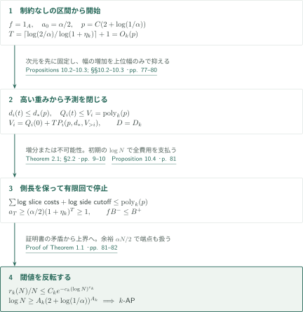
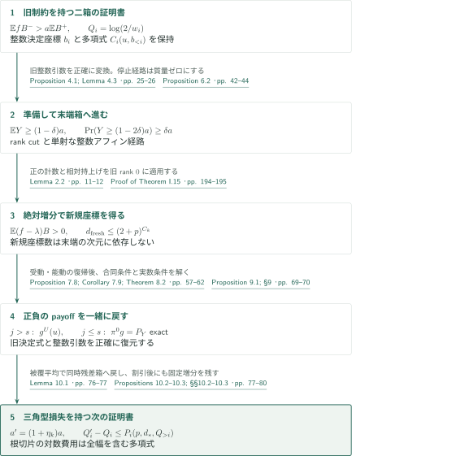
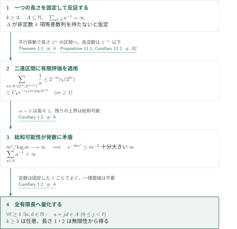

# Quasipolynomial Bounds for Arithmetic Progressions

**三角型多項式セルの幅損失を制御し、密度増分を準多項式の規模で閉じる。**

OpenAI の2026年9月23日原稿は、固定した等差数列長に対する密度上界を示し、正整数集合についての Erdős の逆数和予想を帰結する。本記事は著者の主張とその証明経路を紹介する。198頁の全証明を独立に検証したものではなく、以下で主要な帰着と数値反復を原典に照合した範囲、残る未照合を区別する。

## 1. 主要結果

### Theorem 1.1 — 密度上界と十分な区間長

整数 $k\ge3$ を固定し、$r_k(N)$ を $[N]=\{1,\ldots,N\}$ の部分集合で非定数の $k$ 項等差数列を含まないものの最大要素数とする。ここで非定数等差数列は $a,a+d,\ldots,a+(k-1)d$、$d>0$ である。$k$ のみに依存する $C_k,c_k,\varepsilon_k>0$ が存在し、すべての $N\ge2$ に対し

$$r_k(N)\le C_kN\exp\{-c_k(\log N)^{\varepsilon_k}\}.$$

同値な閾値表示として、ある $A_k\ge1$ が存在し、すべての $0<\alpha\le1$ に対し、密度が少なくとも $\alpha$ の $[N]$ の部分集合は

$$\log N\ge A_k(2+\log(1/\alpha))^{A_k}$$

ならば非定数の $k$ 項等差数列を含む。対数は自然対数である。「準多項式」は十分な長さ $N=\exp(O_k((2+\log(1/\alpha))^{A_k}))$ の $1/\alpha$ に対する増大を指す。$r_k(N)$ の上界そのもの、密度 $r_k(N)/N$、十分な $N$ は異なる量であり、指数・定数は固定した $k$ に依存する。$k$ に関する一様評価や最適な指数は主張していない。

<!-- cite:main -->[Theorem 1.1 · p. 4](https://github.com/openai/math/blob/1581d4cbdd69a0faf34b2089614fe2a814316a6a/preprints/Quasipolynomial-Bounds-for-Arithmetic-Progressions-September-23-2026/paper.pdf)<!-- /cite -->

### Corollary 1.2 — 発散する逆数和

$\mathbb N=\{1,2,\ldots\}$ とする。任意の集合 $A\subseteq\mathbb N$ について、$\sum_{a\in A}1/a=\infty$ ならば、すべての有限長 $\ell\ge1$ に対し、$a,d\in\mathbb N$ が存在して $a,a+d,\ldots,a+(\ell-1)d\in A$ となる。長さ2以上では $d>0$ により非定数である。

<!-- cite:reciprocal -->[Corollary 1.2 · p. 4](https://github.com/openai/math/blob/1581d4cbdd69a0faf34b2089614fe2a814316a6a/preprints/Quasipolynomial-Bounds-for-Arithmetic-Progressions-September-23-2026/paper.pdf)<!-- /cite -->

## 図の矢印に付した引用

<!-- reference-guide -->
略号のない定理・補題・節・式番号は本原稿 [Quasipolynomial Bounds for Arithmetic Progressions](https://github.com/openai/math/blob/1581d4cbdd69a0faf34b2089614fe2a814316a6a/preprints/Quasipolynomial-Bounds-for-Arithmetic-Progressions-September-23-2026/paper.pdf) を指します。外部入力には次の略号を使います。

- [LSS24](https://arxiv.org/pdf/2402.17994v3) James Leng, Ashwin Sah, Mehtaab Sawhney — *Quasipolynomial bounds on the inverse theorem for the Gowers $U^{s+1}[N]$-norm*：区間のGowers逆定理と逆向きの相関判定。本稿の箱・積巡回群への拡張とは区別する。v3, 10 August 2024。
- [SS14](https://arxiv.org/pdf/1408.2568v1) Tomasz Schoen, Olof Sisask — *Roth’s theorem for four variables and additive structures in sums of sparse sets*：入力Bohr半径を乗法的に保持するalmost-periodicity。Lemma C.2から次数1のshift comparisonへ使う。v1, 11 August 2014。

各引用に結果番号とページを付します。誌面番号とPDF内の位置が異なる場合は両方を示します。GitHubの閲覧リンクではページ位置への自動移動を前提としません。
<!-- /reference-guide -->

## 2. Theorem 1.1 — 主定理の証明概略

<!-- proof-target:1 -->証明対象：[Theorem 1.1 · p. 4](https://github.com/openai/math/blob/1581d4cbdd69a0faf34b2089614fe2a814316a6a/preprints/Quasipolynomial-Bounds-for-Arithmetic-Progressions-September-23-2026/paper.pdf)<!-- /proof-target -->

**証明の道筋。** 等差数列を持たない集合から出発し、Theorem 2.1 の増分を有限回反復する。状態は単なる部分区間上の密度ではなく、過去の多項式制約を保持したセル上の二つの箱による証明書である。次節で一回の増分の構成を説明する。ここではその出力のどの依存関係が反復を可能にするかを先に示す。

### 1. 反復回数を先に固定する

密度 $\alpha>0$ の等差数列を持たない集合に対し、$f=1_A$、制約なしのセル、$a_0=\alpha/2$ から始める。一つの共通資源量 $p=C(2+\log(1/\alpha))$ と

$$T=\left\lceil\frac{\log(2/\alpha)}{\log(1+\eta_k)}\right\rceil+1=O_k(p)$$

を初めに確保する。各増分は閾値を少なくとも $1+\eta_k$ 倍し、新規の絶対座標を高々 $d_0=(2+p)^{C_k}$ 個加える。途中で使う割引後の閾値も固定倍の $a_0$ 以上なので、同じ $p$ で $a\ge e^{-p}$ を保てる。経路上の一時的な高次元箱を次の反復の空間次元に置き換えず、根は元の区間の整数アフィン切片であり続ける。

<!-- cite:closure -->[Proposition 10.4 · p. 81](https://github.com/openai/math/blob/1581d4cbdd69a0faf34b2089614fe2a814316a6a/preprints/Quasipolynomial-Bounds-for-Arithmetic-Progressions-September-23-2026/paper.pdf)<!-- /cite -->

### 2. 三角型の漸化式が長さの損失を制御する

重みの深さ $D=D_k$ は固定である。重み $i$ の次元増加は $d_0$ と高い重みの次元のみの多項式で抑える。具体的に一回の準備では $H_D=d_D$, $H_i=d_i+H_{i+1}^2$ として $d_i^{\rm out}\le d_i+d_0+H_{i+1}^2$（$H_{D+1}=0$）。上から下への帰納で全 $T$ 回の次元・切断回数を一つの多項式 $d_*(p)$ に収め、数値精度を選ぶ前に固定する。

幅 $w_i$ について $Q_i=\log(2/w_i)$ とすると、原典の本質的評価は

$$Q_i(t+1)-Q_i(t)\le P_i(p,d_*,Q_{i+1}(t),\ldots,Q_D(t)).$$

右辺に現在の $Q_i$ と低い重みの幅が入らない。したがって

$$V_D=Q_D(0)+TP_D(p,d_*),\qquad V_i=Q_i(0)+TP_i(p,d_*,V_{i+1},\ldots,V_D)$$

を下向きに定義すれば、$Q_i(t)\le V_i=\operatorname{poly}_k(p)$。$D$ が固定なので多項式の合成深さも固定である。各根切片の対数損失、残る側長の対数下限、端点の丸め費用の総和も $\operatorname{poly}_k(p)$ になる。区間の損失はこれらの指数を取った規模であり、側長自体の多項式損失とは述べていない。$\log N$ がその総和を超えれば全反復を維持できる。

<!-- cite:budgets -->[Propositions 10.2–10.3; §§10.2–10.3 · pp. 77–80](https://github.com/openai/math/blob/1581d4cbdd69a0faf34b2089614fe2a814316a6a/preprints/Quasipolynomial-Bounds-for-Arithmetic-Progressions-September-23-2026/paper.pdf)<!-- /cite -->

### 3. 停止による矛盾と二つの表示の同値性

早い段階で増分定理の「仮定が不可能」の場合に入れば矛盾する。それ以外では $a_T\ge(\alpha/2)(1+\eta_k)^T\ge1$。ところが証明書 $\mathbb E fB^->a_T\mathbb EB^+$ は点ごとの $fB^-\le B^+$ に反する。よって等差数列を持たない集合は $\log N\ge C_k(2+\log(1/\alpha))^{A_k}$ を満たせない。

$\alpha=r_k(N)/N>0$ を代入し反転すると

$$\alpha<e^2\exp\{-C_k^{-1/A_k}(\log N)^{1/A_k}\},$$

となり、定数を改名して密度上界を得る。逆に上界から、$\overline C_k=\max(1,C_k)$ として

$$\log N\ge\left(\frac{\log(2\overline C_k/\alpha)}{c_k}\right)^{1/\varepsilon_k}$$

なら $r_k(N)\le\alpha N/2<\alpha N$。この余裕が「密度が少なくとも $\alpha$」の等号端点も処理する。原典は $A_k$ を拡大して全 $0<\alpha\le1$ の表示を揃える。$\alpha=0$ の密度上界は自明である。

<!-- cite:inversion -->[Proof of Theorem 1.1 · pp. 81–82](https://github.com/openai/math/blob/1581d4cbdd69a0faf34b2089614fe2a814316a6a/preprints/Quasipolynomial-Bounds-for-Arithmetic-Progressions-September-23-2026/paper.pdf)<!-- /cite -->

## 3. Theorem 2.1 — 制約を保持する一回の増分

<!-- proof-target:2 -->証明対象：[Theorem 2.1; §2.2 · pp. 9–10](https://github.com/openai/math/blob/1581d4cbdd69a0faf34b2089614fe2a814316a6a/preprints/Quasipolynomial-Bounds-for-Arithmetic-Progressions-September-23-2026/paper.pdf)<!-- /proof-target -->

<!-- statement:theorem-2-1 -->
### Theorem 2.1 — 三角型増分

$k\ge3$ と $s=k-2$ を固定する。空間変数 $u$ の重みを1、整数座標ブロック $b_h\in\mathbb Z^{d_h}$ の重みを $h$ とし、$C_h(u,b_{<h})$ の重み付き次数は高々 $h$ とする。中心 $l_h$ は有界、$0<w_h\le1/32$。十分小さい $\gamma>0$ に対し、$B^-$ と $B^+$ は、それぞれ全 $h$ で

$$\|b_h-C_h(u,b_{<h})-l_h\|_\infty\le w_h,\qquad
\|b_h-C_h(u,b_{<h})-l_h\|_\infty\le(1+\gamma)w_h$$

を満たす整数組が存在することの指示関数である。狭い幅と三角性により整数組は一意である。

$k$ のみに依存する固定した $D=D_k$, $\eta_k>0$ と多項式が存在する。$p\ge2$, $a\ge e^{-p}$ とし、正次元の整数箱上で $0\le f\le1$ の台が非定数整数ベクトル $k$ 項等差数列を持たず、$\mathbb E fB^->a\mathbb EB^+$ を満たすとする。各根側長の対数が $p$、次元データ、全 $Q_h=\log(2/w_h)$ の所定の多項式以上なら、仮定が不可能であるか、根切片上に閾値 $(1+\eta_k)a$ の新たな証明書がある。

旧決定データは正確な整数再パラメータ化で保持され、新規絶対座標は高々 $d_0=(2+p)^{C_k}$ 個、ほかに下位重みへの準備コピーが加わる。次元・幅は

$$d_i'-d_i\le d_0+P_i(p,d_{i+1},\ldots,d_D),\qquad
Q_i'-Q_i\le P_i'(p,\text{全次元予測},Q_{i+1},\ldots,Q_D).$$

根切片の対数費用は全 $Q_i$ も含む同じデータの多項式で抑えられる。指数と増分率は反復回数に依存せず、隙間・割引は次元と切断回数の予測から先に選べる。

<!-- cite:increment -->[Theorem 2.1; §2.2 · pp. 9–10](https://github.com/openai/math/blob/1581d4cbdd69a0faf34b2089614fe2a814316a6a/preprints/Quasipolynomial-Bounds-for-Arithmetic-Progressions-September-23-2026/paper.pdf)<!-- /cite -->
<!-- /statement -->

図中の $\lambda$ は末端の絶対増分後に用いる目標閾値を表す。

### 1. 小さい証明書の余剰を費用にしない

準備の rank cut は失敗する次数成分の関係を使い、値空間を一つ下げ、必要なら高い重みのブロックを一段下へコピーする。すべての高い決定多項式の整数引数を正確に置換する。係数に上限がないため、整数座標の近似値への連続性では代用できない。

準備したセルから、整数アフィン写像に沿う制約付き経路で末端箱へ進む。停止した経路は質量ゼロとして残し、生き残りで再正規化しない。Proposition 6.2 は末端平均を $Y$ として $\mathbb EY\ge(1-\delta)a$、少なくとも $\delta a$ の経路で $Y\ge(1-2\delta)a$ を与える。元の厳密余剰 $\mathbb EfB^--a\mathbb EB^+$ の逆数を費用にしないことが重要である。単射な整数アフィン引戻しと点の削除は等差数列を持たない性質を保つ。

<!-- cite:prepare -->[Proposition 4.1; Lemma 4.3 · pp. 25–26](https://github.com/openai/math/blob/1581d4cbdd69a0faf34b2089614fe2a814316a6a/preprints/Quasipolynomial-Bounds-for-Arithmetic-Progressions-September-23-2026/paper.pdf)<!-- /cite -->
<!-- cite:forward -->[Proposition 6.2 · pp. 42–44](https://github.com/openai/math/blob/1581d4cbdd69a0faf34b2089614fe2a814316a6a/preprints/Quasipolynomial-Bounds-for-Arithmetic-Progressions-September-23-2026/paper.pdf)<!-- /cite -->

### 2. 次元から独立した新規座標数を得る

Lemma 2.2 は密度 $a\ge e^{-p}$ の末端箱上で、固定比率の増分と高々 $(2+p)^{C_k}$ 個の新規座標を持つ次数 $s$ の多項式パッチを供給する。新規座標数は末端箱の次元 $n$ に依存しないが、側長条件・切片費用・Lipschitz 定数・余剰の逆数の対数は $p+n$ に依存してよい。

この区別は固定次元の正の計数だけからは得られない。原典は Theorem C.1 の shift comparison から Proposition D.3 の絶対増分を作り、Lemma D.5 で niltest をパッチへ変換する。Theorem I.15 の相対持上げは旧パッチの座標数 $d$ に対し出力を $d+d_0$ 個に抑える。これを旧パッチ $1$（$d=0$）に適用して、次元に依存しない $d_0$ を得る。ここではこれらの記述と Lemma 2.2 での組合せを追い、Appendices C–I の全証明は独立検証していない。

<!-- cite:absolute -->[Lemma 2.2 · pp. 11–12](https://github.com/openai/math/blob/1581d4cbdd69a0faf34b2089614fe2a814316a6a/preprints/Quasipolynomial-Bounds-for-Arithmetic-Progressions-September-23-2026/paper.pdf)<!-- /cite -->
<!-- cite:fixed-box -->[Proposition D.3 · pp. 118–119](https://github.com/openai/math/blob/1581d4cbdd69a0faf34b2089614fe2a814316a6a/preprints/Quasipolynomial-Bounds-for-Arithmetic-Progressions-September-23-2026/paper.pdf)<!-- /cite -->
<!-- cite:relative -->[Proof of Theorem I.15 · pp. 194–195](https://github.com/openai/math/blob/1581d4cbdd69a0faf34b2089614fe2a814316a6a/preprints/Quasipolynomial-Bounds-for-Arithmetic-Progressions-September-23-2026/paper.pdf)<!-- /cite -->

### 3. 整数箱と有限群を混同しない

逆定理の区間から箱への拡張では、$Q=\prod_i\{0,\ldots,T_i-1\}$ を基数 $4T_i$ の混合基数アフィン写像で一つの区間へ埋め込み、ゼロ延長する。二面の加法恒等式が桁上がりなく反映されるので cube 和が一致する。群への埋込みでは cube の個数による正規化比を保持し、積巡回群から箱へ戻す際には各座標を高々4区間に分け、径が周期の3分の1未満となる箱で wraparound を排除する。次元に伴う $\exp(O_s(n))$ の因子は対数資源量へ計上する。

絶対増分の正の計数では別の移行を使う。互いに異なる素数側長 $P_j$ の箱を中国剰余定理で $\mathbb Z/(\prod_jP_j)\mathbb Z$ に同定し、$P_j>k-1$ から小さな傾き差の可逆性を確保する。Proposition D.3 は $x_j/P_j\in(1/4,1/3)$、$d_j/P_j\in(1/(20k),1/(10k))$ に台を持つ非負の滑らかな重みを置く。その台では全数列が wraparound なく整数箱に戻り、$d\ne0$。群の計数が正になることと、整数箱内の数列不在による計数ゼロが矛盾する。任意の巡回群内の数列を無条件に整数数列へ読み替える議論ではない。

<!-- cite:inverse-local -->[Theorem A.7; Lemma A.9 · pp. 90–93](https://github.com/openai/math/blob/1581d4cbdd69a0faf34b2089614fe2a814316a6a/preprints/Quasipolynomial-Bounds-for-Arithmetic-Progressions-September-23-2026/paper.pdf)<!-- /cite -->
<!-- cite:fixed-box -->[Proposition D.3 · pp. 118–119](https://github.com/openai/math/blob/1581d4cbdd69a0faf34b2089614fe2a814316a6a/preprints/Quasipolynomial-Bounds-for-Arithmetic-Progressions-September-23-2026/paper.pdf)<!-- /cite -->

### 4. 正の余剰を戻し、幅の依存関係を閉じる

末端からの復路では正負二つの payoff を一緒に運び、その差の正値性を保つ。$j>s$ の受動層では Proposition 7.8 と Corollary 7.9 が通常の周囲軌道と対数費用の小さい残余法を与える。$j\le s$ の能動層では Theorem 8.2 が決定データへの射影を恒等式として保持する。短い変数や法を用いた補助的な細分を目的の切片に課すと、現在幅を含む費用が逆流するので、それらをラベル付き多項式族の中に残す。

Proposition 9.1 は非活性整数方程式、実数の制約、合同条件を順に解き、旧決定式を正確に復元する。能動層の巨大な全法を直接細分費用にせず、選択したアフィン平面で合同条件を恒等的に解く。戻った多項式の係数を制御する代わりに正規化した定義域を局所化し、$\log(w_j/r_j')$ を現在幅に依存しない上位データで抑える。最後に Lemma 10.1 の被覆平均で同時残差箱へ圧縮し、追加座標なしで二箱の証明書に戻す。§10.3 は次元予測、隙間、上位からの数値予測、最後の精度・rank・側長という順序を確認し、全割引を絶対増分より小さくして正の $\eta_k$ を残す。

<!-- cite:return -->[Proposition 7.8; Corollary 7.9; Theorem 8.2 · pp. 57–62](https://github.com/openai/math/blob/1581d4cbdd69a0faf34b2089614fe2a814316a6a/preprints/Quasipolynomial-Bounds-for-Arithmetic-Progressions-September-23-2026/paper.pdf)<!-- /cite -->
<!-- cite:extract -->[Proposition 9.1; §9 · pp. 69–70](https://github.com/openai/math/blob/1581d4cbdd69a0faf34b2089614fe2a814316a6a/preprints/Quasipolynomial-Bounds-for-Arithmetic-Progressions-September-23-2026/paper.pdf)<!-- /cite -->
<!-- cite:compress -->[Lemma 10.1 · pp. 76–77](https://github.com/openai/math/blob/1581d4cbdd69a0faf34b2089614fe2a814316a6a/preprints/Quasipolynomial-Bounds-for-Arithmetic-Progressions-September-23-2026/paper.pdf)<!-- /cite -->
<!-- cite:budgets -->[Propositions 10.2–10.3; §§10.2–10.3 · pp. 77–80](https://github.com/openai/math/blob/1581d4cbdd69a0faf34b2089614fe2a814316a6a/preprints/Quasipolynomial-Bounds-for-Arithmetic-Progressions-September-23-2026/paper.pdf)<!-- /cite -->

## 4. Corollary 1.2 — 有限評価から逆数和へ

<!-- proof-target:3 -->証明対象：[Corollary 1.2 · p. 4](https://github.com/openai/math/blob/1581d4cbdd69a0faf34b2089614fe2a814316a6a/preprints/Quasipolynomial-Bounds-for-Arithmetic-Progressions-September-23-2026/paper.pdf)<!-- /proof-target -->

### 1. 一つの長さを固定して総和する

$k\ge3$ を固定し、$A\subseteq\mathbb N$ が非定数の $k$ 項等差数列を持たないと仮定する。各半開二進区間 $[2^m,2^{m+1})\cap\mathbb Z$ は平行移動で長さ $2^m$ の整数区間になるため

$$\sum_{a\in A\cap[2^m,2^{m+1})}\frac1a
\le2^{-m}r_k(2^m)
\le C_k\exp\{-c_k(m\log2)^{\varepsilon_k}\}\quad(m\ge1).$$

任意の $d,\varepsilon>0$ に対し $m^{\varepsilon}/\log m\to\infty$ なので、$e^{-dm^{\varepsilon}}\le m^{-2}$ が十分大きい $m$ で成り立つ。よって右辺は総和可能である。$m=0$ の区間は高々1を寄与するだけであり、$\sum_{a\in A}1/a<\infty$。これは発散と矛盾する。単なる $r_k(N)=o(N)$ ではこの総和可能性は得られない。

<!-- cite:reciprocal -->[Corollary 1.2 · p. 4](https://github.com/openai/math/blob/1581d4cbdd69a0faf34b2089614fe2a814316a6a/preprints/Quasipolynomial-Bounds-for-Arithmetic-Progressions-September-23-2026/paper.pdf)<!-- /cite -->
<!-- cite:dyadic -->[Proposition 11.1; Corollary 11.2 · p. 82](https://github.com/openai/math/blob/1581d4cbdd69a0faf34b2089614fe2a814316a6a/preprints/Quasipolynomial-Bounds-for-Arithmetic-Progressions-September-23-2026/paper.pdf)<!-- /cite -->

### 2. すべての有限長へ戻す

この反証は任意に固定した $k\ge3$ に適用できるから、発散集合は各 $k$ の非定数等差数列を含む。$k$ ごとに異なる定数と数列でよく、一つの一様な閾値を必要としない。発散は集合が無限であることも含意し、長さ1と2を供給する。以上が Corollary 1.2 の全量化である。§11.1 は同じ二進分割を非負重み $w$ に拡張するが、本記事は後続の重み付き帰結全体を主要結果として掲げない。

<!-- cite:reciprocal -->[Corollary 1.2 · p. 4](https://github.com/openai/math/blob/1581d4cbdd69a0faf34b2089614fe2a814316a6a/preprints/Quasipolynomial-Bounds-for-Arithmetic-Progressions-September-23-2026/paper.pdf)<!-- /cite -->

## 5. 直接入力と使用箇所

原典の直接外部入力の中心は、Leng–Sah–Sawhney の区間逆定理と Schoen–Sisask の半径を保持する almost-periodicity である。前者は本稿 Theorem A.7 の区間入力、後者は Lemma C.2 を通じた次数1の shift comparison の入力となる。nilsequence の相関だけで主定理が完結するのではなく、正の計数、次元に独立な新規座標数、旧制約の正確な復元が間をつなぐ。

<!-- cite:inverse-local -->[Theorem A.7; Lemma A.9 · pp. 90–93](https://github.com/openai/math/blob/1581d4cbdd69a0faf34b2089614fe2a814316a6a/preprints/Quasipolynomial-Bounds-for-Arithmetic-Progressions-September-23-2026/paper.pdf)<!-- /cite -->
<!-- cite:almost-local -->[Lemma C.2 · p. 101](https://github.com/openai/math/blob/1581d4cbdd69a0faf34b2089614fe2a814316a6a/preprints/Quasipolynomial-Bounds-for-Arithmetic-Progressions-September-23-2026/paper.pdf)<!-- /cite -->

LSS の Theorem 1.2 は $U^{s+1}$ ノルムが $\delta$ 以上の絶対値1以下の区間関数に対し、次元が $\operatorname{poly}_s(\log(1/\delta))$、複雑度と相関の逆数が $\exp(\operatorname{poly}_s(\log(1/\delta)))$ の nilsequence を供給する。本稿は $\delta=e^{-p}$ とし、上限1への正規化と座標計量の比較を行う。Lemma B.5 の逆向き入力は本稿 Lemma A.9 に対応する。外部の区間結果と、本稿自身による箱・積巡回群への拡張を分けて読む。

<!-- cite:lss-inverse -->[&#91;LSS24, Theorem 1.2, p. 1&#93;](https://arxiv.org/pdf/2402.17994v3#page=1)<!-- /cite -->
<!-- cite:lss-converse -->[&#91;LSS24, Lemma B.5, p. 83&#93;](https://arxiv.org/pdf/2402.17994v3#page=83)<!-- /cite -->

SS の Theorem 5.4 は正則Bohr集合と小さい和集合の仮定の下で almost-period を供給し、出力半径に入力半径 $\rho$ が乗法因子として残る。本稿 Lemma C.2 は密度 $\ge e^{-q}$ の二集合に適用し、固定誤差 $\eta$ に対して $\operatorname{rank}D_*\le D+C_\eta(1+q)^4$ と $w(D_*)\ge w(S')\exp\{-C_\eta(1+q+\log(2+D))\}$ を得る。数え上げ畳込みを集合の要素数の積で割り、確率の誤差へ変換する。この相対幅損失が次数1の反復で半径を追跡する入力となる。

<!-- cite:ss-almost -->[&#91;SS14, Theorem 5.4, p. 14&#93;](https://arxiv.org/pdf/1408.2568v1#page=14)<!-- /cite -->

執筆者とは別の担当がこの二文献の記述と上記使用箇所を原典と照合した。入力定理自体の証明は独立検証していない。

外部文献の版・記述・適用の点検結果は出典記録に区別して記録する。主定理への主要な内部接続は上の各段階に示した。§1.4 の別原稿による彩色下界は比較であり、本稿の密度上界への入力ではない。カタログ159は単論文で、内部に別論文を仮定した依存辺は作らない。

## 6. 原典を読む入口と確認範囲

<!-- reading-list -->
- [Theorem 1.1 · p. 4](https://github.com/openai/math/blob/1581d4cbdd69a0faf34b2089614fe2a814316a6a/preprints/Quasipolynomial-Bounds-for-Arithmetic-Progressions-September-23-2026/paper.pdf) — 量化と密度上界・閾値の二つの表示
- [Theorem 2.1; §2.2 · pp. 9–10](https://github.com/openai/math/blob/1581d4cbdd69a0faf34b2089614fe2a814316a6a/preprints/Quasipolynomial-Bounds-for-Arithmetic-Progressions-September-23-2026/paper.pdf) — 二箱の証明書と三角型損失の主張
- [Lemma 2.2 · pp. 11–12](https://github.com/openai/math/blob/1581d4cbdd69a0faf34b2089614fe2a814316a6a/preprints/Quasipolynomial-Bounds-for-Arithmetic-Progressions-September-23-2026/paper.pdf) — 次元に依存しない新規座標数を供給する接続
- [Propositions 10.2–10.3; §§10.2–10.3 · pp. 77–80](https://github.com/openai/math/blob/1581d4cbdd69a0faf34b2089614fe2a814316a6a/preprints/Quasipolynomial-Bounds-for-Arithmetic-Progressions-September-23-2026/paper.pdf) — 構造を先に固定する順序と下降する幅予測
- [Proposition 10.4 · p. 81](https://github.com/openai/math/blob/1581d4cbdd69a0faf34b2089614fe2a814316a6a/preprints/Quasipolynomial-Bounds-for-Arithmetic-Progressions-September-23-2026/paper.pdf) — 反復回数、側長の維持、閾値1での矛盾
- [Proposition D.3 · pp. 118–119](https://github.com/openai/math/blob/1581d4cbdd69a0faf34b2089614fe2a814316a6a/preprints/Quasipolynomial-Bounds-for-Arithmetic-Progressions-September-23-2026/paper.pdf) — 中国剰余定理とwraparoundを除く重み
- [Corollary 1.2 · p. 4](https://github.com/openai/math/blob/1581d4cbdd69a0faf34b2089614fe2a814316a6a/preprints/Quasipolynomial-Bounds-for-Arithmetic-Progressions-September-23-2026/paper.pdf) — 二進区間の総和と全有限長への量化
<!-- /reading-list -->

今回の編集では主結果p.4、セルと増分の設定pp.8–14、準備の主張と切断の入口pp.24–26、前進質量比較pp.40–44、受動復帰pp.57–60、能動復帰の設定pp.60–62、抽出の設定と主張pp.69–70、反復の全体pp.76–82、区間・箱・群の移行pp.90–93、almost-periodicity の適用p.101、正の計数から絶対増分pp.114–119、相対持上げの終結pp.194–195を読んだ。式の反転、二進総和、反復予測の論理と、引用した内部結果の役割を照合した。

制約付き標本化の全誤差評価、能動 globalization の全証明、抽出の全数値評価、Appendices B–I の全証明は未照合である。そのため Theorem 2.1 の解析的構成は著者の証明経路の紹介であり、その全接続の独立検証済みという表示ではない。専門家査読・形式検証も行っていない。出典版と読解記録は [sources.json](sources.json)、制作時間・検査は [status.md](status.md) に残す。
