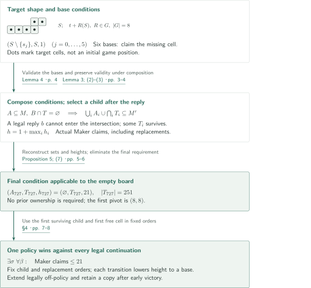
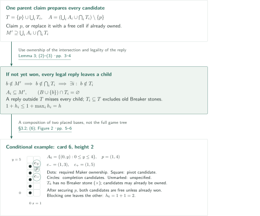
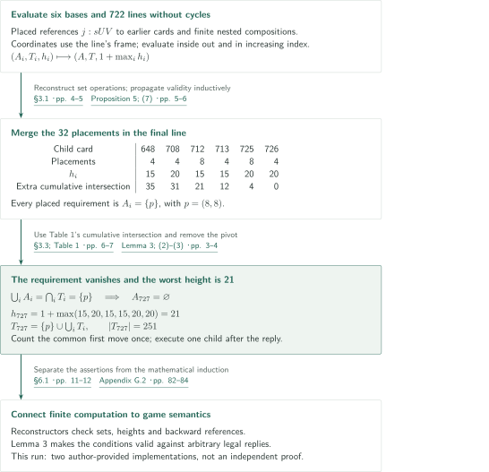
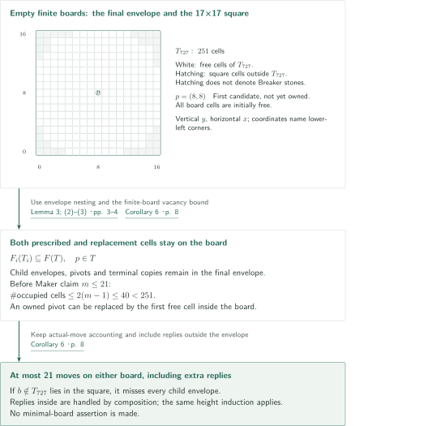

# Snaky in 21 Maker moves

**Compose continuations that survive a reply, instead of excluding replies**

The 21-claim strategy is not a fixed sequence of local attacks. The manuscript recursively combines sufficient conditions consisting of required Maker holdings and a region still free of Breaker. If Maker owns the intersection of the child regions, every legal next reply misses at least one child. A finite certificate iterates this principle to obtain a condition applicable to the empty board; the choices in its proof are then made into one policy determined by the history.

## 1. Main results

Index each cell by the integer coordinates of its lower left corner. The board is initially empty $\mathbb Z^2$. Maker moves first, and the players thereafter alternate claiming one previously unclaimed cell. Ownership is permanent. This is the weak achievement game: only Maker seeks the target, and Breaker completing a separate shape is not a winning condition. Snaky consists of the six cells

$$
\begin{aligned}
S=\{&(0,0),(1,0),(2,0),(3,0),\\
    &(3,1),(4,1)\}
\end{aligned}
$$

Let $G$ be the eight $2\times2$ signed permutation matrices. An allowed copy is $t+R(S)$ for $t\in\mathbb Z^2$ and $R\in G$. Integral translations, quarter turns and reflections are permitted, but scaling is not. Maker wins immediately upon owning every cell of one copy, regardless of additional holdings. There are no initial holdings or handicaps allowing multiple opening claims.

<!-- cite:rules -->[§1; (1) · pp. 1–2](https://github.com/openai/math/blob/1581d4cbdd69a0faf34b2089614fe2a814316a6a/preprints/Snaky-in-21-Maker-moves-September-25-2026/article.pdf)<!-- /cite -->

### Theorem 1 — At most 21 actual Maker claims from the empty board

There is one Maker policy assigning a legal claim on every finite legal history such that, when followed from the empty board, it completes an allowed copy of $S$ within at most 21 actual Maker claims against every legal continuation of Breaker. Equivalently, extend the policy by fresh claims after an earlier win. Whenever the first 20 Breaker replies are legal along this policy, Maker's holdings immediately after claim 21 contain a target.

<!-- cite:theorem -->[Theorem 1 · p. 1](https://github.com/openai/math/blob/1581d4cbdd69a0faf34b2089614fe2a814316a6a/preprints/Snaky-in-21-Maker-moves-September-25-2026/article.pdf)<!-- /cite -->

The number 21 is an **upper bound on Maker's own claims**. It includes a replacement claim when the prescribed cell is already Maker's, as described below. Counting both players, victory occurs no later than individual turn 41. The statement asserts neither necessity nor optimality of 21, nor the nonexistence of faster strategies. It does not concern the strong game in which both players seek to complete the target.

### Corollary 6 — A 251-cell board and a 17×17 board

Let $T_{727}$ be the final envelope of the certificate. It has 251 cells and satisfies $T_{727}\subseteq\{0,\ldots,16\}^2$. Maker wins within 21 actual claims both when the board is initially empty $T_{727}$ and when it is the initially empty 17×17 square $\{0,\ldots,16\}^2$. Maker moves first, the players alternate claiming one cell as above, and targets are the allowed copies of $S$ contained in the respective board.

<!-- cite:finite -->[Corollary 6 · p. 8](https://github.com/openai/math/blob/1581d4cbdd69a0faf34b2089614fe2a814316a6a/preprints/Snaky-in-21-Maker-moves-September-25-2026/article.pdf)<!-- /cite -->

## References on the arrows

<!-- reference-guide -->
Unprefixed theorem, lemma, section and equation numbers refer to [Snaky in 21 Maker moves](https://github.com/openai/math/blob/1581d4cbdd69a0faf34b2089614fe2a814316a6a/preprints/Snaky-in-21-Maker-moves-September-25-2026/article.pdf). External inputs use the following keys.

No external proof inputs are recorded.

Each citation gives the result and pages. When printed pagination differs from the PDF position, both are shown. GitHub previews do not automatically jump to the cited page.
<!-- /reference-guide -->

The manuscript is by OpenAI, formally titled *Snaky in 21 Maker moves*, dated September 25, 2026 (84 pages). Source links refer to official repository snapshot 1581d4cbdd69a0faf34b2089614fe2a814316a6a.

We explain the 21-claim construction in §§2–4. Its direct mathematical inputs are Lemma 3, Lemma 4 and Proposition 5 in this same manuscript; it does not assume a winning theorem from an earlier paper. The historical and methodological references in §1, the independent four-in-a-row result in §5, and the 25- and 35-claim constructions in Appendices A–B are separate from this proof route.

## 2. Theorem 1 — Proof overview of the main theorem

<!-- proof-target:1 -->Proof target：[Theorem 1 · p. 1](https://github.com/openai/math/blob/1581d4cbdd69a0faf34b2089614fe2a814316a6a/preprints/Snaky-in-21-Maker-moves-September-25-2026/article.pdf)<!-- /proof-target -->

The hypotheses and full conclusions are stated in [Theorem 1](#theorem-1). First specify the information preserved by the proof. For finite sets $A\subseteq T\subset\mathbb Z^2$ and an integer $h\geq1$, the triple $(A,T,h)$ is valid if, for every pair of finite disjoint ownership sets $M,B$, at a Maker turn with $A\subseteq M$ and $B\cap T=\varnothing$, Maker has already completed a target or can complete one within $h$ further actual claims. The set $A$ is the requirement, $T$ the Breaker-free envelope, and $h$ the height.

This condition does not specify the whole position. Cells of $T\setminus A$ may already belong to Maker, and arbitrary finite holdings of either player are allowed outside $T$. Neither the difference between $|M|$ and $|B|$ nor the previous move order is restricted. This flexibility lets the same condition be used in many different histories.

<!-- cite:condition -->[Definition 2; §2 · p. 3](https://github.com/openai/math/blob/1581d4cbdd69a0faf34b2089614fe2a814316a6a/preprints/Snaky-in-21-Maker-moves-September-25-2026/article.pdf)<!-- /cite -->

**Proof route.** Combine the six one-cell completions by a rule that selects a continuation after the reply. Calculate that the last certificate condition has $A=\varnothing$ and $h=21$, then execute the recursive choices in fixed orders. The board panel depicts the target, not a play sequence from the empty board.

### 1. Apply finite conditions to arbitrary histories

The six bases of Lemma 4 are $(S\setminus\{s_j\},S,1)$, obtained by omitting each cell $s_j$ of $S$ in turn. If Maker owns the required five cells and Breaker owns none of $S$, the last cell is either free or already Maker's. In the former case one claim completes the target; in the latter Maker has already won. Starting from these bases, repeatedly use the [composition rule](#lemma-3). Conditions transported by allowed placements remain valid at the same height.

The last condition $(\varnothing,T_{727},21)$ in [Proposition 5](#proposition-5) requires no pre-existing Maker holdings. Its Breaker-free hypothesis is also automatic on the empty board. This is the passage from conditional victories to an ordinary victory without a handicap. Stones required by intermediate conditions are not granted at the start of the game.

<!-- cite:bases -->[Lemma 4 · p. 4](https://github.com/openai/math/blob/1581d4cbdd69a0faf34b2089614fe2a814316a6a/preprints/Snaky-in-21-Maker-moves-September-25-2026/article.pdf)<!-- /cite --> <!-- cite:certificate -->[Proposition 5; (7) · pp. 5–6](https://github.com/openai/math/blob/1581d4cbdd69a0faf34b2089614fe2a814316a6a/preprints/Snaky-in-21-Maker-moves-September-25-2026/article.pdf)<!-- /cite -->

### 2. Fix child and replacement choices to obtain one policy

Merely selecting an available continuation after the fact would leave the policy description implicit. Section 4 fixes the choices before play: order cells by increasing $\max(|x|,|y|)$, lexicographically within each level, and order children as printed in the certificate.

For an active condition in placement $F$, claim its prescribed cell $F(p)$ if free. If it already belongs to Maker, claim the first free cell in the fixed order. The invariant $B\cap F(T)=\varnothing$ excludes Breaker ownership of the pivot. Unless the claim wins, take the first child whose envelope avoids the next reply. That envelope also avoids all earlier Breaker holdings, by inheritance from its parent. A reference with placement $G$ changes the active placement to $F\circ G$; an inline combination retains $F$.

At a base, claim the last missing cell and stop. A transition from a combination to a child costs one actual Maker claim and, if victory has not occurred, one actual Breaker reply; height drops by at least one. Starting at height 21 therefore gives at most 21 claims. An already-owned pivot is not treated as permission to skip a turn: counting its replacement preserves the correspondence between actual claims and alternating play.

<!-- cite:policy -->[§4 · pp. 7–8](https://github.com/openai/math/blob/1581d4cbdd69a0faf34b2089614fe2a814316a6a/preprints/Snaky-in-21-Maker-moves-September-25-2026/article.pdf)<!-- /cite -->

### 3. Legality on all histories and the endpoint after claim 21

Along histories consistent with the policy, the active expression and placement can be reconstructed from the history. On a history containing an earlier Maker choice inconsistent with the policy, prescribe the first free cell instead. Finite ownership guarantees a free cell on the infinite board. The resulting policy is legal even on histories it never reaches, while the height induction applies to every history obtained by following it from the empty board. The quantifier order is $\exists\sigma\,\forall\beta$: future Breaker replies do not determine the choice of $\sigma$.

If the first win occurs on Maker claim $m\leq21$, there have been $m-1$ Breaker claims. No reply after victory is needed. If play is formally extended by fresh claims, permanent ownership preserves the completed copy. Thus a legal extension through the first 20 replies still contains a copy immediately after Maker claim 21. This proves the theorem's equivalent endpoint formulation.

<!-- cite:policy -->[§4 · pp. 7–8](https://github.com/openai/math/blob/1581d4cbdd69a0faf34b2089614fe2a814316a6a/preprints/Snaky-in-21-Maker-moves-September-25-2026/article.pdf)<!-- /cite -->

## 3. Lemma 3 — Own the intersection to retain a continuation

<!-- proof-target:2 -->Proof target：[Lemma 3; (2)–(3) · pp. 3–4](https://github.com/openai/math/blob/1581d4cbdd69a0faf34b2089614fe2a814316a6a/preprints/Snaky-in-21-Maker-moves-September-25-2026/article.pdf)<!-- /proof-target -->

<!-- statement:lemma-3 -->
### Lemma 3 — Composition of conditional wins

Take $1\leq r<\infty$ valid conditions $(A_i,T_i,h_i)$ and any $p\in\mathbb Z^2$. Validity is in the sense of Definition 2 above: each $A_i\subseteq T_i$ is finite and $h_i\geq1$ is an integer. The following triple $(A,T,h)$ is valid:

$$
\begin{gathered}
T=\{p\}\cup\bigcup_{i=1}^r T_i,\\
A=\left(\bigcup_{i=1}^r A_i\cup\bigcap_{i=1}^r T_i\right)\setminus\{p\},\\
h=1+\max_{1\leq i\leq r}h_i.
\end{gathered}
$$

Moreover, at a Breaker turn with $A\cup\{p\}\subseteq M$ and $B\cap T=\varnothing$, Maker has already won or can win within $h-1$ further Maker claims.

<!-- cite:combine -->[Lemma 3; (2)–(3) · pp. 3–4](https://github.com/openai/math/blob/1581d4cbdd69a0faf34b2089614fe2a814316a6a/preprints/Snaky-in-21-Maker-moves-September-25-2026/article.pdf)<!-- /cite -->
<!-- /statement -->

### 1. Handle the new reply and the old holdings together

The pivot $p\in T$ is not Breaker's, so claim it if free and use another free cell if already owned. After either actual claim, $M'$ contains $\bigcup_iA_i\cup\bigcap_iT_i$. The union of requirements and the intersection of envelopes have different functions. The former ensures **the Maker holdings required by any child are present**; the latter ensures **a reply hitting every child is illegal**.

If Maker has not won, the next legal Breaker reply $b$ lies outside $M'$. Hence $b\notin\bigcap_iT_i$, so at least one child has $b\notin T_i$. For this child, $A_i\subseteq M'$. Old Breaker holdings avoid $T_i$ because $T_i\subseteq T$ and $B\cap T=\varnothing$. Consequently $(B\cup\{b\})\cap T_i=\varnothing$, restoring the child hypotheses. The count is one parent claim plus the selected child's $h_i$ claims: $1+h_i\leq h$.

A reply $b\notin T$ misses every child envelope and is covered by the same argument. No exterior move needs to be replaced by a fictitious pass. A replacement claim has its actual ensuing Breaker reply, but adding Maker ownership does not invalidate the inclusions. In the additional Breaker-turn conclusion those inclusions already hold, so the parent claim is unnecessary and the bound becomes $\max_i h_i=h-1$.

<!-- cite:combine -->[Lemma 3; (2)–(3) · pp. 3–4](https://github.com/openai/math/blob/1581d4cbdd69a0faf34b2089614fe2a814316a6a/preprints/Snaky-in-21-Maker-moves-September-25-2026/article.pdf)<!-- /cite -->

### 2. Card 6's two threats and transport by placements

In the first composition of §3.2, the requirement is the five-cell column $A_6=\{(0,y):0\leq y\leq4\}$ and the envelope is $T_6=A_6\cup\{(1,3),(1,4),(1,5)\}$. Securing the pivot $(1,4)$ prepares two copies: the one using the lower four-cell subcolumn completes at $(1,3)$, and the one using the upper subcolumn completes at $(1,5)$. Unless Maker has won, both completion cells are free. If Breaker claims one, the other remains; a reply claiming neither also permits completion. Adding one parent claim to base height 1 gives $h_6=2$.

A candidate or the pivot may already belong to Maker when the condition is invoked. Stop if a copy is complete; if only the pivot is already owned, count one replacement and use the same branching argument. Unmarked cells in the panel are not assumed to be free.

Card 7 uses two placements of card 6. Their common required column is $x=0$, $1\leq y\leq5$. Their extra envelope cells have heights $4,5,6$ on one side of the calculation and $0,1,2$ on the other, so these extras are disjoint. The envelope intersection is exactly the common column. Removing pivot $(0,5)$ leaves a requirement of four consecutive cells, with $h_7=1+h_6=3$. The extra required stone is thereby incorporated into the preceding turn's attack rather than granted in advance.

A placement $F(x)=Rx+t$ is a bijection of the whole lattice preserving allowed targets, legality and disjoint ownership. It transports complete histories of a strategy, and hence transports a valid condition without changing height. This does not discard visually symmetric replies without justification.

<!-- cite:elementary -->[§3.2; (6); Figure 2 · pp. 5–6](https://github.com/openai/math/blob/1581d4cbdd69a0faf34b2089614fe2a814316a6a/preprints/Snaky-in-21-Maker-moves-September-25-2026/article.pdf)<!-- /cite --> <!-- cite:condition -->[Definition 2; §2 · p. 3](https://github.com/openai/math/blob/1581d4cbdd69a0faf34b2089614fe2a814316a6a/preprints/Snaky-in-21-Maker-moves-September-25-2026/article.pdf)<!-- /cite -->

## 4. Proposition 5 — A finite certificate produces the empty-board condition

<!-- proof-target:3 -->Proof target：[Proposition 5; (7) · pp. 5–6](https://github.com/openai/math/blob/1581d4cbdd69a0faf34b2089614fe2a814316a6a/preprints/Snaky-in-21-Maker-moves-September-25-2026/article.pdf)<!-- /proof-target -->

<!-- statement:proposition-5 -->
### Proposition 5 — 728 conditions and the last empty requirement

The data in Appendix D contain 722 lines, numbered 6 through 727. Every child list is nonempty, every reference is an allowed placement of an earlier card, and every parenthesized expression is a finite nonempty composition. Including the six bases gives 728 valid conditions, each of height at most 21. The final condition satisfies

$$
\begin{gathered}
p_{727}=(8,8),\qquad A_{727}=\varnothing,\\
|T_{727}|=251,\qquad h_{727}=21,\\
T_{727}\subseteq\{0,\ldots,16\}^2
\end{gathered}
$$

<!-- cite:certificate -->[Proposition 5; (7) · pp. 5–6](https://github.com/openai/math/blob/1581d4cbdd69a0faf34b2089614fe2a814316a6a/preprints/Snaky-in-21-Maker-moves-September-25-2026/article.pdf)<!-- /cite -->
<!-- /statement -->

### 1. Read shared proof branches as an acyclic calculation

A card number identifies a condition, not a move in a play sequence. References reuse already proved conditions, allowing the data to avoid expanding the full game tree. Coordinate characters `0123456789ABCDEFG` represent 0 through 16; for example `88` is $(8,8)$. A reference `j:sUV` applies the signed coordinate permutation $R_s$ to card $j$ and then translates by $(U,V)$. The bits of weights 2 and 4 negate $x$ and $y$, respectively, and the bit of weight 1 finally interchanges the coordinates.

An inline expression `(XY child …)` is another application of Lemma 3. Its pivot `XY` uses the coordinate frame of the line, not a displacement from the enclosing pivot. References always point to smaller indices and nested expressions are evaluated from the inside out. All set operations and maxima are therefore finite and well-defined. Induction on the card number, combined with structural induction on expressions, propagates validity. The finite calculation of the sets is distinct from Lemma 3's semantic statement that those sets describe a sufficient condition in the game.

<!-- cite:encoding -->[§3.1 · pp. 4–5](https://github.com/openai/math/blob/1581d4cbdd69a0faf34b2089614fe2a814316a6a/preprints/Snaky-in-21-Maker-moves-September-25-2026/article.pdf)<!-- /cite --> <!-- cite:certificate -->[Proposition 5; (7) · pp. 5–6](https://github.com/openai/math/blob/1581d4cbdd69a0faf34b2089614fe2a814316a6a/preprints/Snaky-in-21-Maker-moves-September-25-2026/article.pdf)<!-- /cite -->

### 2. What the final 32 placements remove

The final line has 32 children from six card types. Every placed requirement is the single pivot $p=(8,8)$. The envelopes also contain other cells. If any extra cell remained common to all envelopes, it would become another required pre-existing Maker holding for the parent. Table 1 shows how adding placements eliminates those extra common cells.

| Child card | Requirement before placement | Envelope size before placement | Height | Placements | Cells other than $p$ in the cumulative intersection |
|---|---|---|---|---|---|
| 648 | $\{(4,5)\}$ | 87 | 15 | 4 | 35 |
| 708 | $\{(8,8)\}$ | 225 | 20 | 4 | 31 |
| 712 | $\{(5,5)\}$ | 96 | 15 | 8 | 21 |
| 713 | $\{(5,5)\}$ | 98 | 15 | 4 | 12 |
| 725 | $\{(7,7)\}$ | 167 | 20 | 8 | 4 |
| 726 | $\{(7,7)\}$ | 169 | 20 | 4 | 0 |

The last column is the intersection **accumulated over all placements through that row**, not a separate intersection for each group. Finally $\bigcup_iA_i=\bigcap_iT_i=\{p\}$, so the parent requirement is $(\{p\}\cup\{p\})\setminus\{p\}=\varnothing$. Its height is $1+\max(15,20,15,15,20,20)=21$. Count the first claim once, then execute only the child actually selected; do not add the move counts of 32 placements.

<!-- cite:intersection -->[§3.3; Table 1 · pp. 6–7](https://github.com/openai/math/blob/1581d4cbdd69a0faf34b2089614fe2a814316a6a/preprints/Snaky-in-21-Maker-moves-September-25-2026/article.pdf)<!-- /cite -->

The intersection condition guarantees a child after every legal reply to the opening $p$. For example, the manuscript takes Maker $(8,8)$, Breaker $(7,8)$, then child `708:100` with pivot $(8,7)$. After Breaker $(8,6)$, child `684:011`, still under the outer transposition, has pivot $(11,8)$. This illustrates an available nonlocal continuation, not a reply sequence forced upon Breaker. Coverage comes from the intersection condition, not from the number of examples.

### 3. What the finite reconstruction in this edition checked

The editors freshly retrieved the pinned author-supplied certificate and ran its short `verify_certificate.py` and separately implemented `independent_evaluator.py`. Both returned PASS, checking 728 conditions, the empty final requirement, 251 cells, height 21 and the final intersection table. The short verifier also checks containment in the 17×17 square, maximum card height 21, and cards 6 and 7. The second implementation uses a different parser and explicit matrices and counted 1,620 combination nodes, including 898 inline nodes, and 4,089 references.

These are editorial reruns of two author-supplied implementations. They are not an independent proof using an editor-written checker, a comparison of every intermediate set between implementations, or execution of every possible play. Passing the executed assertions and exception checks is distinct from the mathematical induction giving the data meaning on arbitrary histories.

<!-- cite:verification -->[§6.1 · pp. 11–12](https://github.com/openai/math/blob/1581d4cbdd69a0faf34b2089614fe2a814316a6a/preprints/Snaky-in-21-Maker-moves-September-25-2026/article.pdf)<!-- /cite --> <!-- cite:program -->[Appendix G.2 · pp. 82–84](https://github.com/openai/math/blob/1581d4cbdd69a0faf34b2089614fe2a814316a6a/preprints/Snaky-in-21-Maker-moves-September-25-2026/article.pdf)<!-- /cite -->

## 5. Corollary 6 — Guarantee a replacement within the board

<!-- proof-target:4 -->Proof target：[Corollary 6 · p. 8](https://github.com/openai/math/blob/1581d4cbdd69a0faf34b2089614fe2a814316a6a/preprints/Snaky-in-21-Maker-moves-September-25-2026/article.pdf)<!-- /proof-target -->

The targets are the [two finite-board conclusions of Corollary 6](#corollary-6). Passing from the infinite-board strategy to a finite board requires keeping both prescribed pivots and replacements for already-owned pivots inside the board. The 251 cells in the diagram are the final envelope drawn from this edition's reconstruction; all are initially free.

### 1. Nesting keeps prescribed claims within the board

The composition formula puts every placed child envelope inside its parent and every pivot inside its own envelope. A base target is its base envelope. Consequently all prescribed cells along a descent from the final condition, including the last completion cell, lie in $T_{727}$.

Order $T_{727}$ and replace an already-owned pivot with its first free cell. Before Maker claim $m\leq21$, the players together own at most $2(m-1)\leq40$ cells. They cannot have filled all 251 cells, so a legal replacement always exists. It loses none of Maker's required holdings, and the surviving-child argument covers the ensuing Breaker reply unchanged. The same height induction can therefore be executed on the 251-cell board.

<!-- cite:finite -->[Corollary 6 · p. 8](https://github.com/openai/math/blob/1581d4cbdd69a0faf34b2089614fe2a814316a6a/preprints/Snaky-in-21-Maker-moves-September-25-2026/article.pdf)<!-- /cite -->

### 2. Replies in the square's additional cells also leave a continuation

On the 17×17 board, Maker may still confine all claims to $T_{727}$. A Breaker claim in the square but outside $T_{727}$ misses every child envelope. Replies inside the envelope are covered by Lemma 3, so allowing the additional cells does not increase the bound. On both boards the count is at most 21 actual Maker claims, without assuming a reply after victory. This argument does not establish minimality of 251 cells or of the 17×17 square.

<!-- cite:finite -->[Corollary 6 · p. 8](https://github.com/openai/math/blob/1581d4cbdd69a0faf34b2089614fe2a814316a6a/preprints/Snaky-in-21-Maker-moves-September-25-2026/article.pdf)<!-- /cite -->

## 6. Dependencies and the roles of computational materials

This proof route closes within the manuscript's six bases, composition lemma, finite certificate calculation and conversion to a history-dependent policy. No application of an external theorem was identified in this route; an empty dependency table would add nothing. Cross-catalogue citations, applications, generalizations and alternative proofs remain uninvestigated.

The certificate records compositions of conditions, not one winning transcript. Reconstructors evaluate finite sets and heights from those data. Neither a strategy-search program nor an undistributed game tree is an input to that reconstruction. Section 6 and Appendix G.1 also report checks of 37,042 local reply classes, full-card agreement and malformed-input rejection. This edition ran only the two programs described above, not those additional suites.

<!-- cite:verification -->[§6.1 · pp. 11–12](https://github.com/openai/math/blob/1581d4cbdd69a0faf34b2089614fe2a814316a6a/preprints/Snaky-in-21-Maker-moves-September-25-2026/article.pdf)<!-- /cite --> <!-- cite:supplement -->[Appendix G.1 · pp. 81–82](https://github.com/openai/math/blob/1581d4cbdd69a0faf34b2089614fe2a814316a6a/preprints/Snaky-in-21-Maker-moves-September-25-2026/article.pdf)<!-- /cite -->

The official repository's Lean guide identifies the infinite-board 21-claim policy as its formalization scope and says it does not include the finite-board restriction. This is a different object from the finite reconstruction supplement for the 35-claim certificate discussed in §6.2 and Appendix C. We did not inspect Lean source and dependencies or perform kernel compilation. Python PASS is not treated as a Lean verification of the main theorem.

Pinned materials: [21-claim certificate](https://github.com/openai/math/blob/1581d4cbdd69a0faf34b2089614fe2a814316a6a/preprints/Snaky-in-21-Maker-moves-September-25-2026/verification/certificate.txt), [short verifier](https://github.com/openai/math/blob/1581d4cbdd69a0faf34b2089614fe2a814316a6a/preprints/Snaky-in-21-Maker-moves-September-25-2026/verification/verify_certificate.py), [second implementation](https://github.com/openai/math/blob/1581d4cbdd69a0faf34b2089614fe2a814316a6a/preprints/Snaky-in-21-Maker-moves-September-25-2026/verification/supporting/independent_evaluator.py), [Lean scope guide](https://github.com/openai/math/blob/1581d4cbdd69a0faf34b2089614fe2a814316a6a/lean/docs/187.md).

## 7. Return to the sources

<!-- reading-list -->
- [§1; (1) · pp. 1–2](https://github.com/openai/math/blob/1581d4cbdd69a0faf34b2089614fe2a814316a6a/preprints/Snaky-in-21-Maker-moves-September-25-2026/article.pdf) — The empty board, first player, eight target symmetries and actual-move convention.
- [Lemma 3; (2)–(3) · pp. 3–4](https://github.com/openai/math/blob/1581d4cbdd69a0faf34b2089614fe2a814316a6a/preprints/Snaky-in-21-Maker-moves-September-25-2026/article.pdf) — Required ownership, protected envelopes and both turn conventions.
- [§3.2; (6); Figure 2 · pp. 5–6](https://github.com/openai/math/blob/1581d4cbdd69a0faf34b2089614fe2a814316a6a/preprints/Snaky-in-21-Maker-moves-September-25-2026/article.pdf) — Follow cards 6 and 7, distinguishing conditional positions from game histories.
- [§3.3; Table 1 · pp. 6–7](https://github.com/openai/math/blob/1581d4cbdd69a0faf34b2089614fe2a814316a6a/preprints/Snaky-in-21-Maker-moves-September-25-2026/article.pdf) — Check the cumulative intersection of 32 placements and the empty requirement.
- [§4 · pp. 7–8](https://github.com/openai/math/blob/1581d4cbdd69a0faf34b2089614fe2a814316a6a/preprints/Snaky-in-21-Maker-moves-September-25-2026/article.pdf) — Fixed choices, composed placements, extension to all histories and finite-board replacement.
- [Appendix G.2 · pp. 82–84](https://github.com/openai/math/blob/1581d4cbdd69a0faf34b2089614fe2a814316a6a/preprints/Snaky-in-21-Maker-moves-September-25-2026/article.pdf) — Read the set operations and assertions of the short reconstructor.
<!-- /reading-list -->

The editors checked the game setup, Definition 2, both turn-specific conclusions of Lemma 3, the six bases, certificate rules and final intersections, the policy and actual move count in §4, and Corollary 6 against the source. The finite checks use fresh retrieval of the pinned edition and reruns of two author-supplied programs. Card 6 in the diagrams follows §3.2; the finite-board panel uses the reconstructed $T_{727}$.

We did not audit every line of Appendix D by hand, run the dedicated local-reply suite, compare all intermediate sets across implementations, execute a playing policy, search for strategies, or compile Lean. Proposition 7 in §5 and the proofs of the separate 25- and 35-claim constructions are outside this article's checking scope. This is a single-author self-check, not expert peer review or independent verification of the entire proof.
