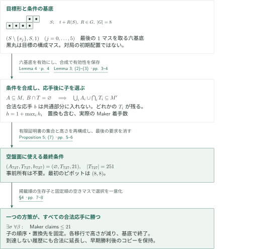
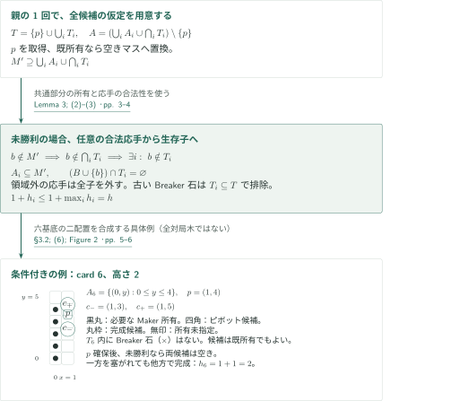
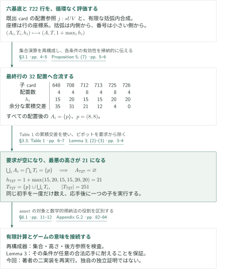
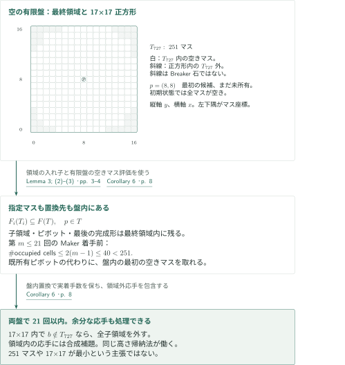

# Snaky in 21 Maker moves

**応手を排除するのではなく、応手後に残る継続を合成する**

本稿の21手戦略は、局所的な攻めを一つずつ実行する固定手順ではない。Makerの必要所有集合と、Breakerがまだ入っていない領域を組にした十分条件を再帰的に合成する。子領域の共通部分をMakerが所有すれば、次の合法応手は少なくとも一つの子領域を外す。この原理を有限証明書に沿って反復し、空盤面に適用できる条件を得た後、証明の選択を履歴から決まる一つの方策にする。

## 1. 主要結果

盤面の各マスを、その左下隅の整数座標で表す。初期盤面は空の$\mathbb Z^2$であり、Makerが先手、以後MakerとBreakerは交互に未所有の1マスを取る。所有は永久に残る。Makerだけが目標形の完成を目指すweak achievement gameで、Breakerが別の形を完成することは勝利条件ではない。Snakyは

$$
\begin{aligned}
S=\{&(0,0),(1,0),(2,0),(3,0),\\
    &(3,1),(4,1)\}
\end{aligned}
$$

という6マスである。$G$を8個の$2\times2$符号付き置換行列の集合とすると、許されるコピーは$t+R(S)$、$t\in\mathbb Z^2$、$R\in G$。整数平行移動、90度単位の回転、反転を許すが、拡大縮小は許さない。Makerが一つのコピーの全マスを所有した時点で直ちに勝つ。他の所有マスがあってもよい。初期所有や、初手に複数マスを取るハンディキャップはない。

<!-- cite:rules -->[§1; (1) · pp. 1–2](https://github.com/openai/math/blob/1581d4cbdd69a0faf34b2089614fe2a814316a6a/preprints/Snaky-in-21-Maker-moves-September-25-2026/article.pdf)<!-- /cite -->

### Theorem 1 — 空盤面から21回以内のMaker実着手

このゲームには、すべての有限な合法履歴上で合法な着手を指定する一つのMaker方策があり、空盤面からそれに従えば、Breakerのどの合法な継続に対しても高々21回の実際のMaker着手で$S$の許されたコピーが完成する。同値に、早期勝利後も新しいマスを取るよう方策を延長したとき、その方策に沿う最初の20回のBreaker応手が合法なら、Makerの21回目の着手直後の所有集合は目標を含む。

<!-- cite:theorem -->[Theorem 1 · p. 1](https://github.com/openai/math/blob/1581d4cbdd69a0faf34b2089614fe2a814316a6a/preprints/Snaky-in-21-Maker-moves-September-25-2026/article.pdf)<!-- /cite -->

21は**Maker自身の着手数の上界**である。後述の「指定マスを既に所有している場合の置換」も1回に数える。両者を合わせれば遅くとも第41手番で勝つという意味であり、21回が必要、21回が最適、またはより速い戦略が存在しないとは主張していない。両者が目標完成を競うstrong gameについての主張でもない。

### Corollary 6 — 251マスの盤と17×17盤

証明書の最終領域を$T_{727}$とする。これは251マスからなり、$T_{727}\subseteq\{0,\ldots,16\}^2$である。初期状態で空の$T_{727}$を盤とするゲーム、および空の17×17盤$\{0,\ldots,16\}^2$を盤とするゲームのいずれでも、Makerは21回以内の実着手で勝つ。先手・交互の1マス取得は上と同じで、目標はそれぞれの盤内に含まれる$S$の許されたコピーである。

<!-- cite:finite -->[Corollary 6 · p. 8](https://github.com/openai/math/blob/1581d4cbdd69a0faf34b2089614fe2a814316a6a/preprints/Snaky-in-21-Maker-moves-September-25-2026/article.pdf)<!-- /cite -->

## 図の矢印に付した引用

<!-- reference-guide -->
略号のない定理・補題・節・式番号は本原稿 [Snaky in 21 Maker moves](https://github.com/openai/math/blob/1581d4cbdd69a0faf34b2089614fe2a814316a6a/preprints/Snaky-in-21-Maker-moves-September-25-2026/article.pdf) を指します。外部入力には次の略号を使います。

外部の証明入力は記録していません。

各引用に結果番号とページを付します。誌面番号とPDF内の位置が異なる場合は両方を示します。GitHubの閲覧リンクではページ位置への自動移動を前提としません。
<!-- /reference-guide -->

参照する本稿の著者はOpenAI、正式タイトルは *Snaky in 21 Maker moves*、版は2026年9月25日（84ページ）。下記の原典リンクは公式リポジトリの固定コミット1581d4cbdd69a0faf34b2089614fe2a814316a6aを参照する。

以下では原典§§2–4の21手構成を解説する。直接の数学的入力は同じ原稿内のLemma 3、Lemma 4、Proposition 5であり、先行論文の勝利定理を仮定として借りない。§1の歴史・方法上の参照、§5の独立した四連石の結果、Appendices A–Bの25手・35手構成は、この証明経路と区別する。

## 2. Theorem 1 — 主定理の証明概略

<!-- proof-target:1 -->証明対象：[Theorem 1 · p. 1](https://github.com/openai/math/blob/1581d4cbdd69a0faf34b2089614fe2a814316a6a/preprints/Snaky-in-21-Maker-moves-September-25-2026/article.pdf)<!-- /proof-target -->

証明対象の仮定と全結論は[Theorem 1](#theorem-1)。まず証明で保存する情報を定める。有限集合$A\subseteq T\subset\mathbb Z^2$と整数$h\geq1$について、$(A,T,h)$が有効とは、任意の有限で互いに素な所有集合$M,B$に対し、Maker手番で$A\subseteq M$かつ$B\cap T=\varnothing$なら、既に目標を完成しているか、あと$h$回の実着手以内に完成できることをいう。$A$は必要所有集合、$T$はBreakerを排除する領域、$h$は高さである。

この条件は局面全体を指定していない。$T\setminus A$には既存のMaker石があってもよく、$T$外には両者の任意の有限な所有を許す。$|M|$と$|B|$の差や過去の着手順も制限しない。この余裕が、同じ条件を多数の異なる履歴で使い直すために必要になる。

<!-- cite:condition -->[Definition 2; §2 · p. 3](https://github.com/openai/math/blob/1581d4cbdd69a0faf34b2089614fe2a814316a6a/preprints/Snaky-in-21-Maker-moves-September-25-2026/article.pdf)<!-- /cite -->

**証明の道筋。** 最後の1マスを取る六つの基底を、応手後に継続を選べる規則で合成する。証明書の最終条件が$A=\varnothing$、$h=21$となることを計算し、そこで得た再帰的選択を固定順で実行する。図の盤面は目標形であり、空盤面からの対局例ではない。

### 1. 有限の条件を、任意の履歴に適用する

Lemma 4の六基底は、$S$の各マス$s_j$を一つずつ除いた$(S\setminus\{s_j\},S,1)$である。必要な5マスをMakerが所有し、$S$にBreakerがいなければ、残りの1マスは空いているか既にMaker所有である。前者では1回で完成し、後者では既に勝っている。これを出発点に[合成規則](#lemma-3)を繰り返す。対称配置で移した条件も有効であり、その高さは変わらない。

[Proposition 5](#proposition-5)の最終条件$(\varnothing,T_{727},21)$には事前のMaker所有が不要である。空盤面ではBreaker排除条件も自動的に満たす。ここで初めて、条件付きの勝利からハンディキャップなしの勝利へ移れる。個々の途中条件に必要な石を、空盤面で最初から与えているわけではない。

<!-- cite:bases -->[Lemma 4 · p. 4](https://github.com/openai/math/blob/1581d4cbdd69a0faf34b2089614fe2a814316a6a/preprints/Snaky-in-21-Maker-moves-September-25-2026/article.pdf)<!-- /cite --> <!-- cite:certificate -->[Proposition 5; (7) · pp. 5–6](https://github.com/openai/math/blob/1581d4cbdd69a0faf34b2089614fe2a814316a6a/preprints/Snaky-in-21-Maker-moves-September-25-2026/article.pdf)<!-- /cite -->

### 2. 子の選択と置換を固定し、一つの方策にする

存在する継続を対局ごとに後から選ぶだけでは、Theorem 1の方策の記述が明瞭にならない。原典§4は、マスを$\max(|x|,|y|)$の小さい順、同値なら辞書式順に並べ、子を証明書の掲載順に並べて、選択規則を対局前に固定する。

活動中の条件を配置$F$で使っているとき、指定マス$F(p)$が空なら取る。既にMaker所有なら、固定順で最初の空きマスを取る。$B\cap F(T)=\varnothing$なので指定マスをBreakerが所有する事態は起こらない。勝っていなければ、次の応手を含まない領域をもつ最初の子へ移る。既存のBreaker石もその領域にないことは親から継承される。参照先に配置$G$が付いていれば次の配置は$F\circ G$であり、括弧内合成なら現在の$F$を保つ。

基底では最後の空きマスを取って終了する。合成から子への移行は1回のMaker実着手と、未勝利の場合の1回のBreaker応手を伴い、高さを少なくとも1減らす。従って高さ21からの経路は高々21回で終了する。指定マスの既所有を「着手を省略できる」と扱わないことが、実着手数と交互手番の対応を保つ。

<!-- cite:policy -->[§4 · pp. 7–8](https://github.com/openai/math/blob/1581d4cbdd69a0faf34b2089614fe2a814316a6a/preprints/Snaky-in-21-Maker-moves-September-25-2026/article.pdf)<!-- /cite -->

### 3. 全履歴への合法性と21回目の終点

方策に従ってきた履歴では、活動中の式と配置を履歴から再構成できる。過去に方策と異なるMaker着手が含まれる履歴には、固定順で最初の空きマスを指定すればよい。所有集合は有限なので無限盤には必ず空きマスがある。この拡張により方策は到達しない履歴を含めて合法であり、空盤面から従うすべての履歴には上の高さ帰納法が適用される。量化の順序は$\exists\sigma\,\forall\beta$で、$\sigma$は将来のBreaker応手を見て選ばれない。

勝利がMakerの$m\leq21$回目なら、その直前までにBreakerが着手した回数は$m-1$。勝利後の応手を要求しない。形式的に勝利後も空きマス取得を続ければ、完成済みコピーは永久所有によって残る。したがって最初の20応手が合法な延長履歴では、21回目のMaker着手直後にもコピーがある。これが主定理の同値な終点記述である。

<!-- cite:policy -->[§4 · pp. 7–8](https://github.com/openai/math/blob/1581d4cbdd69a0faf34b2089614fe2a814316a6a/preprints/Snaky-in-21-Maker-moves-September-25-2026/article.pdf)<!-- /cite -->

## 3. Lemma 3 — 共通部分を所有して継続を残す

<!-- proof-target:2 -->証明対象：[Lemma 3; (2)–(3) · pp. 3–4](https://github.com/openai/math/blob/1581d4cbdd69a0faf34b2089614fe2a814316a6a/preprints/Snaky-in-21-Maker-moves-September-25-2026/article.pdf)<!-- /proof-target -->

<!-- statement:lemma-3 -->
### Lemma 3 — 条件付き勝利の合成

$1\leq r<\infty$個の有効な条件$(A_i,T_i,h_i)$と任意の$p\in\mathbb Z^2$を取る。有効性は前節のDefinition 2の意味であり、各$A_i\subseteq T_i$は有限、$h_i\geq1$は整数とする。次で定める$(A,T,h)$は有効である。

$$
\begin{gathered}
T=\{p\}\cup\bigcup_{i=1}^r T_i,\\
A=\left(\bigcup_{i=1}^r A_i\cup\bigcap_{i=1}^r T_i\right)\setminus\{p\},\\
h=1+\max_{1\leq i\leq r}h_i.
\end{gathered}
$$

さらに、Breaker手番で$A\cup\{p\}\subseteq M$かつ$B\cap T=\varnothing$なら、Makerは既に勝っているか、あと$h-1$回のMaker着手以内で勝てる。

<!-- cite:combine -->[Lemma 3; (2)–(3) · pp. 3–4](https://github.com/openai/math/blob/1581d4cbdd69a0faf34b2089614fe2a814316a6a/preprints/Snaky-in-21-Maker-moves-September-25-2026/article.pdf)<!-- /cite -->
<!-- /statement -->

### 1. 新しい応手と古い所有を同時に処理する

$p\in T$はBreaker所有ではないので、空なら取れる。既所有なら別の空きマスに置換する。いずれも1回の実着手後の集合$M'$は$\bigcup_iA_i\cup\bigcap_iT_i$を含む。ここで必要所有の和集合と領域の共通部分は役割が異なる。前者は**どの子を選んでも必要なMaker石を持つこと**、後者は**すべての子を塞ぐ応手が合法でないこと**を保証する。

未勝利の場合、合法なBreaker応手$b$は$M'$の外にある。従って$b\notin\bigcap_iT_i$、すなわち$b\notin T_i$となる子が少なくとも一つある。その子について$A_i\subseteq M'$であり、古いBreaker所有は$T_i\subseteq T$と$B\cap T=\varnothing$から排除される。よって$(B\cup\{b\})\cap T_i=\varnothing$となり、子の仮定が回復する。手数は親の1回に選ばれた子の$h_i$回を加えた$1+h_i\leq h$である。

領域外の応手$b\notin T$は、すべての子領域を外すので同じ議論に含まれる。盤の外を仮想的なpassと置き換える必要はない。置換着手にも実際のBreaker応手が続くが、Maker所有の増加は上の包含を壊さない。Breaker手番から始める追加結論では、その包含が既に成立しているため親の1回を使わず、上界が$\max_i h_i=h-1$になる。

<!-- cite:combine -->[Lemma 3; (2)–(3) · pp. 3–4](https://github.com/openai/math/blob/1581d4cbdd69a0faf34b2089614fe2a814316a6a/preprints/Snaky-in-21-Maker-moves-September-25-2026/article.pdf)<!-- /cite -->

### 2. card 6に現れる二つの攻めと、配置の輸送

原典§3.2の最初の合成では、Makerの必要所有は縦5マス$A_6=\{(0,y):0\leq y\leq4\}$、領域は$T_6=A_6\cup\{(1,3),(1,4),(1,5)\}$である。ピボット$(1,4)$を確保すると、下側の縦4マスを用いるコピーは$(1,3)$、上側の縦4マスを用いるコピーは$(1,5)$で完成する。未勝利なら両完成候補は空きであり、Breakerが一方を取っても他方が残る。どちらも取らない応手にも同じ終了手が使える。基底の高さ1に親の1を加え、$h_6=2$となる。

候補やピボットは条件の記述時点で既にMaker所有でもよい。完成済みなら停止し、ピボットだけ既所有なら置換を1回数えて同じ分岐へ進む。図の無印マスを空きと仮定しない。

次のcard 7はcard 6を二配置で使う。共通の必要所有列は$x=0$、$1\leq y\leq5$。列外の追加領域は片方が高さ$4,5,6$、他方が$0,1,2$で交わらない。領域の交差は共通列だけなので、ピボット$(0,5)$を除くと要求は縦4マスになり、$h_7=1+h_6=3$となる。こうして追加の石を最初から要求せず、前の手番の攻めへ組み込む。

配置$F(x)=Rx+t$は格子全体の全単射で、許された目標、合法性、所有の非交差を保つ。戦略の全履歴を輸送できるので高さを保って条件を移せる。これは対称に見えるBreaker応手を無根拠に捨てる操作ではない。

<!-- cite:elementary -->[§3.2; (6); Figure 2 · pp. 5–6](https://github.com/openai/math/blob/1581d4cbdd69a0faf34b2089614fe2a814316a6a/preprints/Snaky-in-21-Maker-moves-September-25-2026/article.pdf)<!-- /cite --> <!-- cite:condition -->[Definition 2; §2 · p. 3](https://github.com/openai/math/blob/1581d4cbdd69a0faf34b2089614fe2a814316a6a/preprints/Snaky-in-21-Maker-moves-September-25-2026/article.pdf)<!-- /cite -->

## 4. Proposition 5 — 有限証明書が空盤面の条件を作る

<!-- proof-target:3 -->証明対象：[Proposition 5; (7) · pp. 5–6](https://github.com/openai/math/blob/1581d4cbdd69a0faf34b2089614fe2a814316a6a/preprints/Snaky-in-21-Maker-moves-September-25-2026/article.pdf)<!-- /proof-target -->

<!-- statement:proposition-5 -->
### Proposition 5 — 728条件と最後の空要求

Appendix Dのデータは番号6から727までの722行である。各行の子リストは非空で、参照は既出cardの許された配置だけを使い、括弧内式は有限で非空の合成である。六つの基底を含め728個の有効な条件が得られ、各高さは21以下。最後の条件は

$$
\begin{gathered}
p_{727}=(8,8),\qquad A_{727}=\varnothing,\\
|T_{727}|=251,\qquad h_{727}=21,\\
T_{727}\subseteq\{0,\ldots,16\}^2
\end{gathered}
$$

を満たす。

<!-- cite:certificate -->[Proposition 5; (7) · pp. 5–6](https://github.com/openai/math/blob/1581d4cbdd69a0faf34b2089614fe2a814316a6a/preprints/Snaky-in-21-Maker-moves-September-25-2026/article.pdf)<!-- /cite -->
<!-- /statement -->

### 1. 証明木の共有を、循環のない計算として読む

cardは番号付きの条件であり、対局の着手番号ではない。既に証明した条件を参照して使い直すため、データは全対局木をそのまま展開せずに記述できる。座標文字は`0123456789ABCDEFG`で0から16を表し、例えば`88`は$(8,8)$。`j:sUV`はcard $j$に符号付き座標置換$R_s$を施してから$(U,V)$だけ平行移動する。$s$の重み2、4のビットで順に$x,y$の符号を変え、重み1のビットで最後に座標を交換する。

括弧内の`(XY child …)`もLemma 3の合成である。`XY`はその行の座標系のピボットであり、外側ピボットへの相対変位ではない。参照はすべて小さい番号へ向かい、括弧内は内側から計算する。これにより各集合演算と最大値が有限で定義され、番号についての帰納法と式についての構造帰納法を組み合わせて有効性を伝えられる。実際の集合を計算する部分と、計算した集合がゲームの十分条件であるというLemma 3の意味論を分けている。

<!-- cite:encoding -->[§3.1 · pp. 4–5](https://github.com/openai/math/blob/1581d4cbdd69a0faf34b2089614fe2a814316a6a/preprints/Snaky-in-21-Maker-moves-September-25-2026/article.pdf)<!-- /cite --> <!-- cite:certificate -->[Proposition 5; (7) · pp. 5–6](https://github.com/openai/math/blob/1581d4cbdd69a0faf34b2089614fe2a814316a6a/preprints/Snaky-in-21-Maker-moves-September-25-2026/article.pdf)<!-- /cite -->

### 2. 最終32配置で何を消すのか

最終行は六種類のcardの32配置を子とする。配置後の各要求集合はすべて$p=(8,8)$だけになる。一方、領域には$p$以外のマスもあり、すべての領域に共通する余分なマスがあると、そのマスも親の事前所有に要求されてしまう。Table 1は配置を追加してこの余分な交差を消す計算を示す。

| 子card | 配置前の要求集合 | 配置前の領域の大きさ | 高さ | 配置数 | 累積交差から$p$を除いたマス数 |
|---|---|---|---|---|---|
| 648 | $\{(4,5)\}$ | 87 | 15 | 4 | 35 |
| 708 | $\{(8,8)\}$ | 225 | 20 | 4 | 31 |
| 712 | $\{(5,5)\}$ | 96 | 15 | 8 | 21 |
| 713 | $\{(5,5)\}$ | 98 | 15 | 4 | 12 |
| 725 | $\{(7,7)\}$ | 167 | 20 | 8 | 4 |
| 726 | $\{(7,7)\}$ | 169 | 20 | 4 | 0 |

最右列はその行までの**全配置を累積した交差**であり、六群それぞれの独立な交差の大きさではない。最後に$\bigcup_iA_i=\bigcap_iT_i=\{p\}$となるため、親の要求集合は$(\{p\}\cup\{p\})\setminus\{p\}=\varnothing$。高さは$1+\max(15,20,15,15,20,20)=21$である。初手を一度だけ数え、その後は実際に選んだ一つの子を実行するので、32配置の手数を合計しない。

<!-- cite:intersection -->[§3.3; Table 1 · pp. 6–7](https://github.com/openai/math/blob/1581d4cbdd69a0faf34b2089614fe2a814316a6a/preprints/Snaky-in-21-Maker-moves-September-25-2026/article.pdf)<!-- /cite -->

この交差条件は、初手$p$の後の全合法応手について少なくとも一つの子を保証する。例えば原典は、Maker $(8,8)$、Breaker $(7,8)$から`708:100`を選び$(8,7)$へ進み、次のBreaker $(8,6)$に対して外側の座標交換を保った`684:011`のピボット$(11,8)$へ進む例を挙げる。これは非局所的な継続が使える例であり、その応手列をBreakerに強制する主張ではない。全応手の保証は例の数ではなく交差条件による。

### 3. 今回の有限再構成が確認したこと

編集側は固定版の著者配布証明書を新たに取得し、付属の短い`verify_certificate.py`と別実装の`independent_evaluator.py`を実行した。両方がPASSとなり、728条件、最終要求集合の空性、251マス、高さ21、最終交差表を確認した。短い検査器は17×17内への包含、全cardの最大高さ21、card 6／7も検査する。別実装は異なる構文解析と明示行列で再構成し、1,620合成節点、うち898括弧内節点、4,089参照を数えた。

これは著者の二実装を編集側が再実行した結果である。独自検査器による独立証明、全中間集合の二実装間比較、全対局の実行とは異なる。各assertや例外検査が通ったことと、任意の履歴に対する意味を保証する数学的帰納法を混同しない。

<!-- cite:verification -->[§6.1 · pp. 11–12](https://github.com/openai/math/blob/1581d4cbdd69a0faf34b2089614fe2a814316a6a/preprints/Snaky-in-21-Maker-moves-September-25-2026/article.pdf)<!-- /cite --> <!-- cite:program -->[Appendix G.2 · pp. 82–84](https://github.com/openai/math/blob/1581d4cbdd69a0faf34b2089614fe2a814316a6a/preprints/Snaky-in-21-Maker-moves-September-25-2026/article.pdf)<!-- /cite -->

## 5. Corollary 6 — 盤内で置換できることを保証する

<!-- proof-target:4 -->証明対象：[Corollary 6 · p. 8](https://github.com/openai/math/blob/1581d4cbdd69a0faf34b2089614fe2a814316a6a/preprints/Snaky-in-21-Maker-moves-September-25-2026/article.pdf)<!-- /proof-target -->

証明対象は[Corollary 6の二つの有限盤](#corollary-6)。無限盤の戦略から有限盤の戦略への移行では、指定されたピボットだけでなく、既所有の場合の置換先も盤内に取れることが必要である。図の251マスは今回の再構成結果から描いた最終領域で、各マスは初期状態では空いている。

### 1. 子領域の入れ子が通常の着手を盤内に保つ

合成式から、配置後の各子領域は親領域に含まれ、各ピボットも自身の領域にある。基底の完成形は基底領域そのものである。従って最終条件から下る途中の指定マスと最後の完成マスは、すべて$T_{727}$内にある。

置換先は$T_{727}$に固定順を入れ、その最初の空きマスにする。Makerの$m\leq21$回目の直前には、両者の所有マスは合わせて高々$2(m-1)\leq40$。251マス全部が埋まることはないので、毎回合法な置換が存在する。置換を行ってもMakerの必要所有は失われず、その後のBreaker応手に対する生存子の議論も変わらない。これで251マス盤上に同じ高さ帰納法を実現できる。

<!-- cite:finite -->[Corollary 6 · p. 8](https://github.com/openai/math/blob/1581d4cbdd69a0faf34b2089614fe2a814316a6a/preprints/Snaky-in-21-Maker-moves-September-25-2026/article.pdf)<!-- /cite -->

### 2. 正方形の追加マスにBreakerが置いても継続がある

17×17盤でもMakerの着手を$T_{727}$内に限ればよい。Breakerが正方形内で$T_{727}$の外に置く場合、その応手はすべての子領域を外す。領域内の応手はLemma 3が扱うため、新たに許された盤面のマスが上界を増やすことはない。両盤で勝利後に応手を仮定せず、実着手を高々21回数える。この論証は251マスや17×17が最小の盤であることを示していない。

<!-- cite:finite -->[Corollary 6 · p. 8](https://github.com/openai/math/blob/1581d4cbdd69a0faf34b2089614fe2a814316a6a/preprints/Snaky-in-21-Maker-moves-September-25-2026/article.pdf)<!-- /cite -->

## 6. 直接入力と計算資料の区別

本記事の証明経路は、原典内の六基底、合成補題、証明書の有限計算、履歴方策化で閉じている。外部文献の結果を適用する箇所はこの経路では確認されず、空の依存表は設けない。他カタログでの引用・利用・一般化・別証明については未調査である。

証明書は条件の合成データであり、一つの勝利棋譜ではない。再構成器はそのデータから有限集合と高さを評価する。戦略探索プログラムや非公開の対局木は、この再構成の入力ではない。原典§6とAppendix G.1はさらに局所応手クラス37,042件の検査、全cardの相互比較、誤入力拒否などの検査群を報告するが、今回実行したのは前節の二プログラムだけであり、それらの検査群を実行済みとはしない。

<!-- cite:verification -->[§6.1 · pp. 11–12](https://github.com/openai/math/blob/1581d4cbdd69a0faf34b2089614fe2a814316a6a/preprints/Snaky-in-21-Maker-moves-September-25-2026/article.pdf)<!-- /cite --> <!-- cite:supplement -->[Appendix G.1 · pp. 81–82](https://github.com/openai/math/blob/1581d4cbdd69a0faf34b2089614fe2a814316a6a/preprints/Snaky-in-21-Maker-moves-September-25-2026/article.pdf)<!-- /cite -->

公式リポジトリのLean案内は、無限盤の21手方策を形式化の対象に挙げ、有限盤への制限を含めないと述べる。原稿§6.2およびAppendix Cの35手証明書の有限再構成補遺とは別の対象である。今回Leanコード・依存関係・カーネルでのコンパイルは確認していない。PythonのPASSをLeanによる主定理確認とは扱わない。

固定版の資料：[21手証明書](https://github.com/openai/math/blob/1581d4cbdd69a0faf34b2089614fe2a814316a6a/preprints/Snaky-in-21-Maker-moves-September-25-2026/verification/certificate.txt)、[短い検査器](https://github.com/openai/math/blob/1581d4cbdd69a0faf34b2089614fe2a814316a6a/preprints/Snaky-in-21-Maker-moves-September-25-2026/verification/verify_certificate.py)、[別実装](https://github.com/openai/math/blob/1581d4cbdd69a0faf34b2089614fe2a814316a6a/preprints/Snaky-in-21-Maker-moves-September-25-2026/verification/supporting/independent_evaluator.py)、[Leanの対象説明](https://github.com/openai/math/blob/1581d4cbdd69a0faf34b2089614fe2a814316a6a/lean/docs/187.md)。

## 7. 原典を読む入口と確認範囲

<!-- reading-list -->
- [§1; (1) · pp. 1–2](https://github.com/openai/math/blob/1581d4cbdd69a0faf34b2089614fe2a814316a6a/preprints/Snaky-in-21-Maker-moves-September-25-2026/article.pdf) — 空盤面・先手・目標の8対称配置と実着手数の定式化。
- [Lemma 3; (2)–(3) · pp. 3–4](https://github.com/openai/math/blob/1581d4cbdd69a0faf34b2089614fe2a814316a6a/preprints/Snaky-in-21-Maker-moves-September-25-2026/article.pdf) — 必要所有と排除領域の意味、Maker手番とBreaker手番の二つの結論。
- [§3.2; (6); Figure 2 · pp. 5–6](https://github.com/openai/math/blob/1581d4cbdd69a0faf34b2089614fe2a814316a6a/preprints/Snaky-in-21-Maker-moves-September-25-2026/article.pdf) — card 6／7で合成を追い、条件付き局面と対局履歴を区別する。
- [§3.3; Table 1 · pp. 6–7](https://github.com/openai/math/blob/1581d4cbdd69a0faf34b2089614fe2a814316a6a/preprints/Snaky-in-21-Maker-moves-September-25-2026/article.pdf) — 最終32配置の累積交差と空要求を確かめる。
- [§4 · pp. 7–8](https://github.com/openai/math/blob/1581d4cbdd69a0faf34b2089614fe2a814316a6a/preprints/Snaky-in-21-Maker-moves-September-25-2026/article.pdf) — 選択順の固定、配置の合成、全履歴への拡張と有限盤の置換。
- [Appendix G.2 · pp. 82–84](https://github.com/openai/math/blob/1581d4cbdd69a0faf34b2089614fe2a814316a6a/preprints/Snaky-in-21-Maker-moves-September-25-2026/article.pdf) — 短い再構成器の集合演算とassertの範囲を読む。
<!-- /reading-list -->

編集側はゲーム設定、Definition 2、Lemma 3とその両手番の結論、六基底、証明書の規則と最終交差、§4の方策・実着手数、Corollary 6を原典と照合した。有限計算は今回の固定版取得と二つの著者提供プログラムの再実行による。図のcard 6は原典§3.2の座標、有限盤は再構成された$T_{727}$に基づく。

Appendix Dの全行を手計算で検証したわけではなく、専用局所応手検査、全中間集合の相互比較、方策の対局実行、探索、Leanコンパイルは未実施。§5のProposition 7および25手・35手の別構成の証明は本記事の確認対象から外す。単独制作の自己点検であり、専門家査読や全証明の独立検証ではない。
