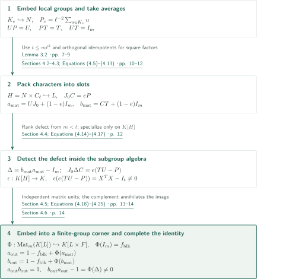
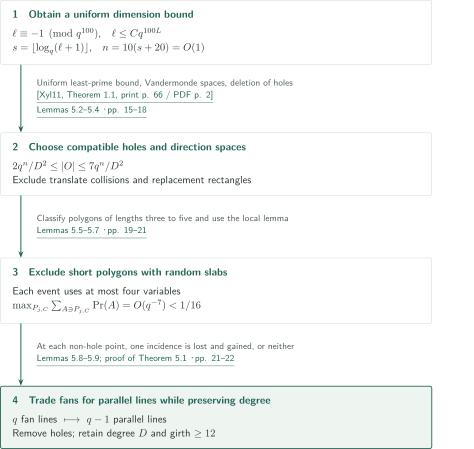
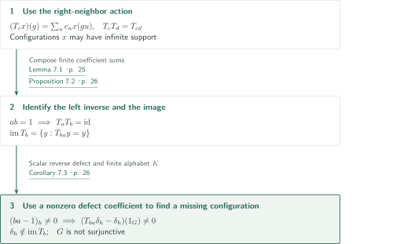

# A Counterexample to Kaplansky’s Direct-Finiteness Conjecture in Characteristic Two

**Pairings on a punctured finite affine space become a scalar counterexample through character packing and finite-group matrix units.**

The construction separates a one-sided inverse from the certificate of a nonzero reverse defect. Vanishing sums on lines force the forward matrix product; specialization inside an embedded subgroup algebra detects the reverse defect. Only after adding a finite group factor does the construction yield two scalar group-algebra elements.

## 1. Main results

### Theorem 1.1 — A scalar counterexample over a finite field of characteristic two

There exist a finite field $K$ of characteristic two, a finitely presented group $G$ containing an element of odd prime order, and $a_{\mathrm{out}},b_{\mathrm{out}}\in K[G]$ with
$$a_{\mathrm{out}}b_{\mathrm{out}}=1,\qquad b_{\mathrm{out}}a_{\mathrm{out}}\ne1.$$
The field, group and finite sums are specified by a terminating prescription using finite sets and finite-field arithmetic. The theorem does not assert $K=\mathbb F_2$; the group actually contains odd-prime torsion and is not torsion-free.

<!-- cite:main -->[Theorem 1.1 · p. 1](https://github.com/openai/math/blob/1581d4cbdd69a0faf34b2089614fe2a814316a6a/preprints/A-Counterexample-to-Kaplanskys-Direct-Finiteness-Conjecture-in-Characteristic-Two-September-23-2026/paper.pdf)<!-- /cite -->

Termination is proved, but the manuscript has not executed the search. The identities and nonvanishing defect have algebraic certificates that do not require a solution of the group word problem. By the contrapositive of Elek–Szabó's theorem, this group is also nonsofic. No reverse implication from non-soficity alone to a group-ring counterexample is used.

<!-- cite:recipe -->[Section 6; Equation (6.2) · pp. 22–24](https://github.com/openai/math/blob/1581d4cbdd69a0faf34b2089614fe2a814316a6a/preprints/A-Counterexample-to-Kaplanskys-Direct-Finiteness-Conjecture-in-Characteristic-Two-September-23-2026/paper.pdf)<!-- /cite -->
<!-- cite:sofic -->[&#91;ES04, Corollary 4.7, p. 8&#93;](https://arxiv.org/pdf/math/0305440v2#page=8)<!-- /cite -->

### Corollary 7.3 — An injective nonsurjective cellular automaton

For the same $K,G,a_{\mathrm{out}},b_{\mathrm{out}}$ as in Theorem 1.1, define for a finitely supported $c=\sum_uc_uu$
$$(T_cx)(g)=\sum_uc_ux(gu)\qquad(x\in K^G).$$
The map $T_{b_{\mathrm{out}}}:K^G\to K^G$ is injective but not surjective, and its image is the fixed set of $T_{b_{\mathrm{out}}a_{\mathrm{out}}}$. Thus $G$ is not surjunctive. Configurations are not restricted to finite support.

<!-- cite:ca -->[Corollary 7.3 · p. 26](https://github.com/openai/math/blob/1581d4cbdd69a0faf34b2089614fe2a814316a6a/preprints/A-Counterexample-to-Kaplanskys-Direct-Finiteness-Conjecture-in-Characteristic-Two-September-23-2026/paper.pdf)<!-- /cite -->

## References on the arrows

<!-- reference-guide -->
Unprefixed theorem, lemma, section and equation numbers refer to [A Counterexample to Kaplansky’s Direct-Finiteness Conjecture in Characteristic Two](https://github.com/openai/math/blob/1581d4cbdd69a0faf34b2089614fe2a814316a6a/preprints/A-Counterexample-to-Kaplanskys-Direct-Finiteness-Conjecture-in-Characteristic-Two-September-23-2026/paper.pdf). External inputs use the following keys.

- [Xyl11](https://www.impan.pl/shop/en/publication/transaction/download/product/83078) Triantafyllos Xylouris — *On the least prime in an arithmetic progression and estimates for the zeros of Dirichlet L-functions*: Uniform least-prime bound in Section 5 and termination of the prime search in Section 6. Acta Arithmetica 150(1), 65–91 (2011), publisher PDF.
- [ES04](https://arxiv.org/pdf/math/0305440v2) Gábor Elek and Endre Szabó — *Sofic groups and direct finiteness*: Non-soficity as a consequence of the main theorem. arXiv:math/0305440v2; PDF header 19 April 2004.

Each citation gives the result and pages. When printed pagination differs from the PDF position, both are shown. GitHub previews do not automatically jump to the cited page.
<!-- /reference-guide -->

## 2. Theorem 1.1 — Proof overview of the main theorem

<!-- proof-target:1 -->Proof target：[Theorem 1.1 · p. 1](https://github.com/openai/math/blob/1581d4cbdd69a0faf34b2089614fe2a814316a6a/preprints/A-Counterexample-to-Kaplanskys-Direct-Finiteness-Conjecture-in-Characteristic-Two-September-23-2026/paper.pdf)<!-- /proof-target -->

**Proof route.** Construct full affine lines on the complement $V$ of holes $O$, with exact degree $D=\ell+1$ and incidence girth at least $12$. Interpolate the hole indicators by low-degree polynomials to obtain matrix pairings. Theorem 3.1 converts these finite data into scalar witnesses, and Section 6 turns existence into a terminating finite search.

### 1. Supply geometry, algebra and size separately

Enumerate a field $Q=\{a_0,\ldots,a_{q-1}\}$ of order $q=2^h$ and define the index simplex $S_d=\{(a_{k_1},\ldots,a_{k_n}):k_i\ge0,\ \sum_i k_i\le d\}$. Set $A=Q^n$, take $O\subset S_{(q-2)/2}$, and write $m=|O|$. Interpolate the indicator values of each hole $o$ by $f_o$, and set $x_v=(f_o(v))_{o\in O}$. Every entry of $x_vx_v^T$ has polynomial degree at most $q-2$, so its sum vanishes both on full lines and on $A$. At holes the values are coordinate vectors; restricting to $V=A\setminus O$ yields
$$\sum_{v\in f}x_vx_v^T=0,\qquad\sum_{v\in V}x_vx_v^T=-I_m.$$
The two bounds on the number of holes imply $0<m<t=|V|\le m\ell^2$. Incidence girth protects local subgroup embeddings, the upper bound enables character packing, and $m<t$ detects the reverse defect.

<!-- cite:pairing -->[Proposition 2.3 · pp. 5–6](https://github.com/openai/math/blob/1581d4cbdd69a0faf34b2089614fe2a814316a6a/preprints/A-Counterexample-to-Kaplanskys-Direct-Finiteness-Conjecture-in-Characteristic-Two-September-23-2026/paper.pdf)<!-- /cite -->
<!-- cite:criterion -->[Theorem 3.1 · p. 6](https://github.com/openai/math/blob/1581d4cbdd69a0faf34b2089614fe2a814316a6a/preprints/A-Counterexample-to-Kaplanskys-Direct-Finiteness-Conjecture-in-Characteristic-Two-September-23-2026/paper.pdf)<!-- /cite -->

### 2. Turn existence into a terminating prescription

For $h=2,3,\ldots$, choose the least prime $\ell\equiv-1\pmod{q^{100}}$, the field $K=\mathbb F_{2^{h(\ell-1)}}$ defined by the first irreducible polynomial in the specified order, its subfield $Q$, and the first primitive $\ell$th root. For each $h$, enumerate the finitely many pairs $(O,\mathcal F)$ and test size, full-line containment, regularity and girth. Theorem 5.1 guarantees success for all sufficiently large $h$ and every field enumeration, so the outer search terminates too.

Finite-field linear algebra, finite local multiplication tables, prescribed conjugation relations and finite-group matrix units then determine the group and two finite expressions. There is no need to normalize those expressions by deciding equality of group words. This is a theoretical terminating prescription, not a claim of practical complexity or already computed output.

<!-- cite:recipe -->[Section 6; Equation (6.2) · pp. 22–24](https://github.com/openai/math/blob/1581d4cbdd69a0faf34b2089614fe2a814316a6a/preprints/A-Counterexample-to-Kaplanskys-Direct-Finiteness-Conjecture-in-Characteristic-Two-September-23-2026/paper.pdf)<!-- /cite -->
<!-- cite:linnik -->[&#91;Xyl11, Theorem 1.1, print p. 66 / PDF p. 2&#93;](https://www.impan.pl/shop/en/publication/transaction/download/product/83078)<!-- /cite -->

## 3. Proof of Theorem 3.1 — Rectangular identity, reverse defect, scalar transfer

<!-- proof-target:2 -->Proof target：[Theorem 3.1 · p. 6](https://github.com/openai/math/blob/1581d4cbdd69a0faf34b2089614fe2a814316a6a/preprints/A-Counterexample-to-Kaplanskys-Direct-Finiteness-Conjecture-in-Characteristic-Two-September-23-2026/paper.pdf)<!-- /proof-target -->

<!-- statement:theorem-3-1 -->
### Theorem 3.1 — Incidence criterion

Let $\ell$ be an odd prime, let $K$ be a finite field of characteristic two containing a primitive $\ell$th root $\zeta$, and set $\kappa=\ell^2$. Let $|V|=t$ and let $\mathcal F$ be a finite family of nonempty subsets such that every $v\in V$ belongs to exactly $\ell+1$ members and the bipartite incidence graph has girth at least $12$. Suppose an integer $m$ and columns $x_v\in K^m$ satisfy
$$0<m<t\le m\kappa,\qquad\sum_{v\in V}x_vx_v^T=-I_m,\qquad\sum_{v\in f}x_vx_v^T=0\quad(f\in\mathcal F).$$
Then the constructions below give a finitely presented group $G$ containing an element of order $\ell$ and finite sums $a_{\mathrm{out}},b_{\mathrm{out}}\in K[G]$ with $a_{\mathrm{out}}b_{\mathrm{out}}=1$ and $b_{\mathrm{out}}a_{\mathrm{out}}\ne1$.

<!-- cite:criterion -->[Theorem 3.1 · p. 6](https://github.com/openai/math/blob/1581d4cbdd69a0faf34b2089614fe2a814316a6a/preprints/A-Counterexample-to-Kaplanskys-Direct-Finiteness-Conjecture-in-Characteristic-Two-September-23-2026/paper.pdf)<!-- /cite -->
<!-- /statement -->

### 1. Local embeddings justify averages and the rectangular identity

Put $K_v^0=(\mathbb F_\ell^2,+)$ at each point and $L_f^0=(\mathbb F_\ell,+)$ at each member. Glue incident $L_f^0$ into distinct one-dimensional subspaces of $K_v^0$ to form $N$. Lemma 3.2 protects these local groups by reducing a hypothetical collapse to a weighted planar graph with one exceptional vertex. After minimization, black degrees are at least three, ordinary white degrees at least two, and all but possibly one face have length at least twelve, contradicting Euler's formula. Merely writing a presentation would not supply this embedding guarantee.

Use averages $P_v=\kappa^{-1}\sum_{u\in K_v}u$ in the embedded local groups and put $P=\operatorname{diag}(P_v)$, $U_{-,v}=-\kappa x_vP_v$, $T_{v,-}=P_vx_v^T$. The denominator is invertible because $\ell$ is odd. Partitioning $K_v\setminus\{1\}$ by incident one-dimensional subgroups and using the two pairings gives
$$UP=U,\qquad PT=T,\qquad UT=I_m.$$
The factors are still rectangular and do not yet constitute a direct-finiteness counterexample.

<!-- cite:embedding -->[Lemma 3.2 · pp. 7–9](https://github.com/openai/math/blob/1581d4cbdd69a0faf34b2089614fe2a814316a6a/preprints/A-Counterexample-to-Kaplanskys-Direct-Finiteness-Conjecture-in-Characteristic-Two-September-23-2026/paper.pdf)<!-- /cite -->
<!-- cite:rectangular -->[Section 4.1; Equation (4.4) · p. 10](https://github.com/openai/math/blob/1581d4cbdd69a0faf34b2089614fe2a814316a6a/preprints/A-Counterexample-to-Kaplanskys-Direct-Finiteness-Conjecture-in-Characteristic-Two-September-23-2026/paper.pdf)<!-- /cite -->

### 2. After character packing, return to the subgroup algebra

Set $H=N\times\langle z\rangle$, $|z|=\ell$, and adjoin stable letters implementing coordinate isomorphisms and character twists to form $L$. The manuscript directly proves $H\hookrightarrow L$ by extending the regular permutation action of $H$. With the central idempotent $e=\ell^{-1}\sum_r\zeta^{-r}z^r$, orthogonal character idempotents pack the $t\le m\kappa$ coordinates into $m$ slots, yielding $J_0C=eP$. Then
$$a_{\mathrm{mat}}=UJ_0+(1-e)I_m,\qquad b_{\mathrm{mat}}=CT+(1-e)I_m$$
satisfy $a_{\mathrm{mat}}b_{\mathrm{mat}}=I_m$.

The reverse defect $\Delta=b_{\mathrm{mat}}a_{\mathrm{mat}}-I_m$ is detected through
$$J_0\Delta C=e(TU-P)\in\operatorname{Mat}_t(K[H]).$$
Apply $\epsilon:K[H]\to K$, $nz^r\mapsto\zeta^r$. The result is $X^TX-I_t$, where $X=(x_v)$. Since $m<t$, the kernel of $X$ is nonzero, so this matrix is nonzero. The embedding $K[H]\hookrightarrow K[L]$ preserves that fact. No extension of $\epsilon$ to all of $K[L]$ is asserted.

<!-- cite:packing -->[Sections 4.2–4.3; Equations (4.5)–(4.13) · pp. 10–12](https://github.com/openai/math/blob/1581d4cbdd69a0faf34b2089614fe2a814316a6a/preprints/A-Counterexample-to-Kaplanskys-Direct-Finiteness-Conjecture-in-Characteristic-Two-September-23-2026/paper.pdf)<!-- /cite -->
<!-- cite:defect -->[Section 4.4; Equations (4.14)–(4.17) · p. 12](https://github.com/openai/math/blob/1581d4cbdd69a0faf34b2089614fe2a814316a6a/preprints/A-Counterexample-to-Kaplanskys-Direct-Finiteness-Conjecture-in-Characteristic-Two-September-23-2026/paper.pdf)<!-- /cite -->

### 3. Complete the identity in a finite-group matrix corner

Character idempotents of $F=(\mathbb Z/\ell)^m\rtimes S_m$ give linearly independent elements $p_{ij}$ with $p_{ij}p_{kr}=\delta_{jk}p_{ir}$. For $G=L\times F$, the map
$$\Phi:\operatorname{Mat}_m(K[L])\hookrightarrow K[G],\qquad \Phi(Z)=\sum_{i,j}Z_{ij}p_{ij}$$
is injective and multiplicative, but $\Phi(I_m)=f_{\mathrm{blk}}$ is the corner identity. Set
$$a_{\mathrm{out}}=1-f_{\mathrm{blk}}+\Phi(a_{\mathrm{mat}}),\qquad b_{\mathrm{out}}=1-f_{\mathrm{blk}}+\Phi(b_{\mathrm{mat}}).$$
The complement annihilates the image on both sides, so the forward product is $1$ and the reverse defect is $\Phi(\Delta)\ne0$. The construction inverts only the odd number $|(\mathbb Z/\ell)^m|$, never $|S_m|$.

Local zero-sum relators of length at most three give a finite presentation for $N$. Finitely many stable letters and relations, followed by the finite factor $F$, give a finite presentation for $G$. The embeddings $K_v\le N\le H\le L\le G$ retain elements of order $\ell$. Finite presentation is not inferred merely from finite generation of the support subgroup.

<!-- cite:scalar -->[Section 4.5; Equations (4.18)–(4.25) · pp. 13–14](https://github.com/openai/math/blob/1581d4cbdd69a0faf34b2089614fe2a814316a6a/preprints/A-Counterexample-to-Kaplanskys-Direct-Finiteness-Conjecture-in-Characteristic-Two-September-23-2026/paper.pdf)<!-- /cite -->
<!-- cite:finite -->[Section 4.6 · p. 14](https://github.com/openai/math/blob/1581d4cbdd69a0faf34b2089614fe2a814316a6a/preprints/A-Counterexample-to-Kaplanskys-Direct-Finiteness-Conjecture-in-Characteristic-Two-September-23-2026/paper.pdf)<!-- /cite -->

## 4. Proof of Theorem 5.1 — Trades preserve regularity around the holes

<!-- proof-target:3 -->Proof target：[Theorem 5.1 · p. 15](https://github.com/openai/math/blob/1581d4cbdd69a0faf34b2089614fe2a814316a6a/preprints/A-Counterexample-to-Kaplanskys-Direct-Finiteness-Conjecture-in-Characteristic-Two-September-23-2026/paper.pdf)<!-- /proof-target -->

<!-- statement:theorem-5-1 -->
### Theorem 5.1 — Full lines with exact degree and large incidence girth

Let $q=2^h$ and let $\ell$ be the least prime congruent to $-1\pmod{q^{100}}$. Set $D=\ell+1$, $s=\lfloor\log_qD\rfloor$, $b=s+20$, $n=10b$ and $N_{\mathrm{pt}}=q^n$. For any enumerated field $Q$ of order $q$, put $A=Q^n$ and $S=S_{(q-2)/2}$.

For every sufficiently large $h$ and every such $Q$ and enumeration, there are $O\subset S$ and a set $\mathcal F$ of full affine $Q$-lines contained in $V=A\setminus O$ such that
$$\frac{2N_{\mathrm{pt}}}{D^2}\le|O|\le\frac{7N_{\mathrm{pt}}}{D^2},$$
every point of $V$ lies on exactly $D$ lines, and the incidence graph has girth at least $12$.

<!-- cite:geometry -->[Theorem 5.1 · p. 15](https://github.com/openai/math/blob/1581d4cbdd69a0faf34b2089614fe2a814316a6a/preprints/A-Counterexample-to-Kaplanskys-Direct-Finiteness-Conjecture-in-Characteristic-Two-September-23-2026/paper.pdf)<!-- /cite -->
<!-- /statement -->

### 1. Choose uniform parameters and compatible holes

Apply Xylouris to the coprime residue $q^{100}-1$ and modulus $q^{100}$ to obtain $\ell\le Cq^{100L}$ for absolute constants $C>0,L$; Xylouris gives $L=5.18$. Thus $s$, and consequently $n$, have bounds independent of $h$, making the asymptotic estimates uniform. Partition the $D$ directions into bundles of size $q$ and use a Vandermonde construction of spaces $W_r,E_j$ such that any at most ten have direct sum.

Choose holes with small independent probability and delete collisions. The retained holes meet each translate of $W_r$ at most once, have bounded occupancy in relevant cosets, and avoid four simultaneous witnesses for an exceptional rectangle of replacement lines. These three conditions control compatibility of the later trades and the event counts.

<!-- cite:linnik -->[&#91;Xyl11, Theorem 1.1, print p. 66 / PDF p. 2&#93;](https://www.impan.pl/shop/en/publication/transaction/download/product/83078)<!-- /cite -->
<!-- cite:holes -->[Lemmas 5.2–5.4 · pp. 15–18](https://github.com/openai/math/blob/1581d4cbdd69a0faf34b2089614fe2a814316a6a/preprints/A-Counterexample-to-Kaplanskys-Direct-Finiteness-Conjecture-in-Characteristic-Two-September-23-2026/paper.pdf)<!-- /cite -->

### 2. Exclude short slab polygons, then exchange full lines

For each coset of $U_j=d_j\oplus E_j$, independently choose a two-dimensional space $P_{j,C}\subset E_j$ and partition into three-dimensional slabs. Directness of the direction spaces restricts candidate triangles, quadrilaterals and pentagons to a few types. Each bad event depends on at most four variables, and the sum of event probabilities at any variable is $O(q^{-7})$. The weighted local lemma proved in the manuscript simultaneously eliminates collisions of holes within slabs and the short polygons.

Partition each slab into full lines. At every hole $o$ and bundle $r$, remove the fan of $q$ lines through $o$ and insert $q-1$ parallel lines in $o+W_r$. Every non-hole point either loses and gains exactly one incidence or changes neither; the hole loses all its incidences. Thus the degree on $V$ stays exactly $D$. A short incidence cycle would yield either an excluded generic polygon or a replacement rectangle already forbidden by the hole choice.

<!-- cite:slabs -->[Lemmas 5.5–5.7 · pp. 19–21](https://github.com/openai/math/blob/1581d4cbdd69a0faf34b2089614fe2a814316a6a/preprints/A-Counterexample-to-Kaplanskys-Direct-Finiteness-Conjecture-in-Characteristic-Two-September-23-2026/paper.pdf)<!-- /cite -->
<!-- cite:trade -->[Lemmas 5.8–5.9; proof of Theorem 5.1 · pp. 21–22](https://github.com/openai/math/blob/1581d4cbdd69a0faf34b2089614fe2a814316a6a/preprints/A-Counterexample-to-Kaplanskys-Direct-Finiteness-Conjecture-in-Characteristic-Two-September-23-2026/paper.pdf)<!-- /cite -->

## 5. Proof of Corollary 7.3 — Right-neighbor action and local equations for the image

<!-- proof-target:4 -->Proof target：[Corollary 7.3 · p. 26](https://github.com/openai/math/blob/1581d4cbdd69a0faf34b2089614fe2a814316a6a/preprints/A-Counterexample-to-Kaplanskys-Direct-Finiteness-Conjecture-in-Characteristic-Two-September-23-2026/paper.pdf)<!-- /proof-target -->

**Proof route.** In the right-neighbor convention of the main results, $T_cT_d=T_{cd}$. The left inverse gives injectivity, and the reverse product acts as a projection identifying the image.

### 1. The left inverse acts on every configuration

The coefficient supports are finite, so the double sum remains finite even for infinitely supported $x\in K^G$:
$T_c(T_dx)(g)=\sum_{u,v}c_ud_vx(guv)=T_{cd}x(g)$. The order is $cd$, not $dc$. With $a=a_{\mathrm{out}}$ and $b=b_{\mathrm{out}}$, we have $T_aT_b=T_{ab}=\mathrm{id}$, hence $T_b$ is injective. The finite field supplies a finite alphabet, and the finite support of $b$ supplies finite memory.

<!-- cite:action -->[Lemma 7.1 · p. 25](https://github.com/openai/math/blob/1581d4cbdd69a0faf34b2089614fe2a814316a6a/preprints/A-Counterexample-to-Kaplanskys-Direct-Finiteness-Conjecture-in-Characteristic-Two-September-23-2026/paper.pdf)<!-- /cite -->

### 2. A defect coefficient selects a missing point indicator

If $y=T_bx$, then $T_{ba}y=y$; conversely, this equality gives $y=T_b(T_ay)$. Hence
$$\operatorname{im}T_b=\{y:T_{ba}y=y\}.$$
Choose a coefficient $(ba-1)_h\ne0$. The point indicator $\delta_h$ satisfies
$$(T_{ba}\delta_h-\delta_h)(1_G)=(ba-1)_h\ne0,$$
so it is outside the image. The same image is described by the finite local equations $\sum_u(ba-1)_uy(gu)=0$. This proves nonsurjectivity and non-surjunctivity. It does not claim that a particular nonzero coefficient has actually been computed by executing the search.

<!-- cite:image -->[Proposition 7.2 · p. 26](https://github.com/openai/math/blob/1581d4cbdd69a0faf34b2089614fe2a814316a6a/preprints/A-Counterexample-to-Kaplanskys-Direct-Finiteness-Conjecture-in-Characteristic-Two-September-23-2026/paper.pdf)<!-- /cite -->
<!-- cite:ca -->[Corollary 7.3 · p. 26](https://github.com/openai/math/blob/1581d4cbdd69a0faf34b2089614fe2a814316a6a/preprints/A-Counterexample-to-Kaplanskys-Direct-Finiteness-Conjecture-in-Characteristic-Two-September-23-2026/paper.pdf)<!-- /cite -->

## 6. External inputs and the catalogue connection

| Input or connection | Use | Checking scope |
|---|---|---|
| Xyl11, Theorem 1.1 | Uniform bound on $s$ in Section 5; prime search in Section 6 | Coprime modulus and residue, statement with effective constant, and application checked. External proof not verified. |
| ES04, Corollary 4.7 | Non-soficity in the Introduction | Stable finiteness for sofic groups over any division ring and the contrapositive checked. A consequence, not an input to the construction. |
| Theorem 1.1 here → determinant counterexample | Characteristic-two input for the group-ring determinant construction | Scalar conclusion checked here; the consuming step belongs to the determinant article and catalogue connection record. |

The HNN-type embedding, finite-factor matrix-to-scalar transfer, interpolation and local lemma are proved within this manuscript. References to earlier constructions and coding papers are not promoted to unchecked direct-dependency arrows.

## 7. Return to the sources

<!-- reading-list -->
- [Proposition 2.3 · pp. 5–6](https://github.com/openai/math/blob/1581d4cbdd69a0faf34b2089614fe2a814316a6a/preprints/A-Counterexample-to-Kaplanskys-Direct-Finiteness-Conjecture-in-Characteristic-Two-September-23-2026/paper.pdf) — Obtain both pairings by interpolation at the holes.
- [Theorem 3.1 · p. 6](https://github.com/openai/math/blob/1581d4cbdd69a0faf34b2089614fe2a814316a6a/preprints/A-Counterexample-to-Kaplanskys-Direct-Finiteness-Conjecture-in-Characteristic-Two-September-23-2026/paper.pdf) — Separate incidence conditions and the size inequalities.
- [Section 4.4; Equations (4.14)–(4.17) · p. 12](https://github.com/openai/math/blob/1581d4cbdd69a0faf34b2089614fe2a814316a6a/preprints/A-Counterexample-to-Kaplanskys-Direct-Finiteness-Conjecture-in-Characteristic-Two-September-23-2026/paper.pdf) — Return to the subgroup algebra to detect the reverse defect.
- [Section 4.5; Equations (4.18)–(4.25) · pp. 13–14](https://github.com/openai/math/blob/1581d4cbdd69a0faf34b2089614fe2a814316a6a/preprints/A-Counterexample-to-Kaplanskys-Direct-Finiteness-Conjecture-in-Characteristic-Two-September-23-2026/paper.pdf) — Use matrix units and the complementary identity to obtain scalars.
- [Theorem 5.1 · p. 15](https://github.com/openai/math/blob/1581d4cbdd69a0faf34b2089614fe2a814316a6a/preprints/A-Counterexample-to-Kaplanskys-Direct-Finiteness-Conjecture-in-Characteristic-Two-September-23-2026/paper.pdf) — Trades preserving degree and exclusion of short cycles.
- [Section 6; Equation (6.2) · pp. 22–24](https://github.com/openai/math/blob/1581d4cbdd69a0faf34b2089614fe2a814316a6a/preprints/A-Counterexample-to-Kaplanskys-Direct-Finiteness-Conjecture-in-Characteristic-Two-September-23-2026/paper.pdf) — Termination of finite search and specification of finite expressions.
- [Proposition 7.2 · p. 26](https://github.com/openai/math/blob/1581d4cbdd69a0faf34b2089614fe2a814316a6a/preprints/A-Counterexample-to-Kaplanskys-Direct-Finiteness-Conjecture-in-Characteristic-Two-September-23-2026/paper.pdf) — The image on all configurations and a missing point indicator.
<!-- /reading-list -->

The reading covered the pairings, local embeddings, packing, reverse defect and scalar transfer in Sections 2–4; the parameters and geometric construction in Section 5; the terminating prescription in Section 6; and the automaton and image proof in Sections 7.1–7.2. All hole/slab probability constants have not been independently recomputed, external theorems' full proofs have not been verified, and the search has not been executed. Corollary 7.4 in Section 7.3 and the separate type-$F_\infty$ embedding manuscript are outside this article's checking scope. This guide describes the author's existence and termination claims rather than certifying the entire proof.
